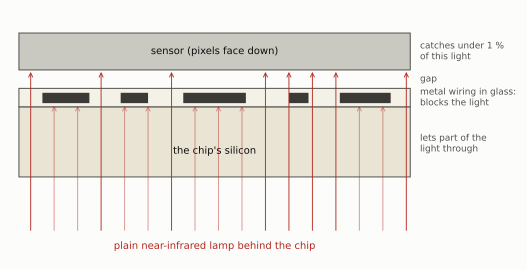
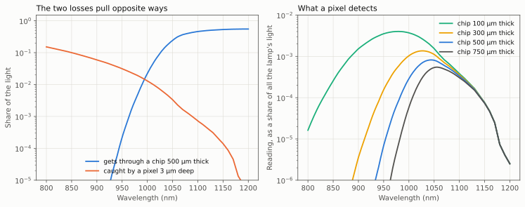
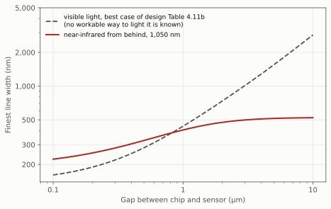

# Lighting the chip from behind with near-infrared light

The [light entry](light-entry.md) estimate found that ordinary light from
the side does not get under the sensor in any useful way. This page looks
at the most promising alternative it listed: a plain lamp behind the chip,
giving off near-infrared light, which is light just beyond red that the
eye cannot see and that silicon partly lets through. The light comes up
through the chip, is blocked by the chip's metal wiring, and falls straight
onto the sensor, which sees the wiring as a shadow. This is item D2e of
the [plan](plan.md#d-simulation-chain).

The answers:

- **Enough light arrives.** Through an unthinned chip 500 µm thick, a
  pixel detects about 8 parts in 10,000 of the lamp's light at the best
  wavelength, about 1,045 nm. That is ten times more than side light gave
  at a gap of 10 µm, and it does not depend on the gap.
- **The gap can be small again, and need not be.** Light from behind does
  not have to squeeze along the slot. With a gap of 0.3 µm the estimate
  gives lines of about 280 nm. With a gap of 10 µm it still gives lines of
  about 520 nm, because directed light carries detail down to about its own
  wavelength across any gap.
- **The picture is of the metal, and the limit is about half a micrometre
  unless the sensor almost touches.** The wavelength is twice that of
  green light, and the light is absorbed all the way down through the
  pixel, which smears fine detail.
- **Three things could spoil it and are not checked:** heavily doped
  silicon absorbs much more than the pure silicon assumed here, chips with
  many metal layers may leave almost no openings, and the sensor's response
  at this wavelength is assumed and not looked up.

Whether a plain near-infrared lamp counts as special lighting is an open
question ([design, section 11](design.md#11-build-stages-and-open-questions),
item 12). Everything on this page is an Estimate from a simple model,
written for this page in
[`ccdsr/backlight.py`](https://github.com/mithro/ccd-superres/blob/main/ccdsr/backlight.py)
and tested in
[`tests/test_backlight.py`](https://github.com/mithro/ccd-superres/blob/main/tests/test_backlight.py).
Nothing here has been measured.

## 1. The arrangement



*Figure 1. Light from behind the chip, not to scale. Drawn by
[`make_backlight_diagrams.py`](https://github.com/mithro/ccd-superres/blob/main/docs/diagrams/make_backlight_diagrams.py).*

This is the arrangement of lensless on-chip microscopes, which light a
thin sample from the far side with a plain light-emitting diode and
compute the picture from its shadow [O1, O2, O5 in the
[optical elements](optical-elements.md) reference list]. The difference
here is that the sample is a silicon chip, so the light has to be one that
silicon lets through.

## 2. How much light is detected

Two losses pull in opposite directions. Light of a shorter wavelength is
absorbed in the chip before it gets through. Light of a longer wavelength
gets through the chip and then passes through the sensor's thin
light-sensitive layer as well, without being caught.

| Step | Formula | Source |
|--:|---|---|
| 1. Enters the back of the chip | 1 − reflection at air to silicon | Fresnel formula for light arriving straight on [BornWolf] |
| 2. Crosses the chip's silicon | exp(−rate × thickness), with rate = 4π k ÷ wavelength | k from [Green2008] |
| 3. Leaves through the glass on the chip's face | (1 − reflection at silicon to glass) × (1 − reflection at glass to air) | As step 1; glass index 1.45, Unverified round value |
| 4. Enters the pixel | 1 − reflection at air to silicon | As step 1 |
| 5. Is absorbed in the pixel's sensitive layer | 1 − exp(−rate × depth) | As step 2 |

*Table 1. The steps the light goes through where no metal is in the way.
Derived here. The reading is the product of the five, and is a share of
all the lamp's light, the same yardstick as on the
[light entry](light-entry.md) page.*

| Setting | Value | Status |
|---|--:|---|
| Optical constants of silicon | Table of 121 wavelengths, 250 nm to 1,450 nm | [Green2008], copied from the refractiveindex.info database into [`ccdsr/data/silicon_green2008.csv`](https://github.com/mithro/ccd-superres/blob/main/ccdsr/data/silicon_green2008.csv). For pure silicon at 27 °C |
| Thickness of the chip | 100 µm to 750 µm | Assumption: 750 µm is about a full wafer, 100 µm a thinned chip |
| Depth of the pixel's light-sensitive silicon | 3 µm | Assumption for a small pixel lit from its back face. Not looked up for the baseline sensor ([plan](plan.md#data-collection), item R2) |
| Chip and pixel surfaces | Flat, no coatings | Assumption |

*Table 2. Settings.*

| Wavelength (nm) | Lost per micrometre of silicon (%) | Gets through a chip 500 µm thick (%) | Caught by a pixel 3 µm deep (%) |
|--:|--:|--:|--:|
| 550 (green) | 47 | 0 | 54 |
| 950 | 1.5 | 0.02 | 3.1 |
| 1,000 | 0.64 | 2.2 | 1.3 |
| 1,050 | 0.16 | 24 | 0.33 |
| 1,100 | 0.035 | 46 | 0.07 |

*Table 3. The two losses. Estimate from the steps of Table 1.*



*Figure 2. Left: the two losses. Right: their product, the reading, for
four chip thicknesses. Estimate.*

| Chip thickness (µm) | Best wavelength (nm) | Reading at the best wavelength | Reading at 950 nm | Reading at 1,050 nm |
|--:|--:|--:|--:|--:|
| 100 | 979 | 0.004 0 | 0.003 5 | 0.001 5 |
| 300 | 1,027 | 0.001 4 | 0.000 16 | 0.001 1 |
| 500 | 1,044 | 0.000 82 | 0.000 006 9 | 0.000 81 |
| 750 | 1,055 | 0.000 55 | 0.000 000 14 | 0.000 54 |

*Table 4. The reading through an open part of the chip, as a share of all
the lamp's light. Estimate. For comparison, side light gave 0.000 078 at a
gap of 10 µm and nothing useful under 5 µm
([light entry](light-entry.md), Tables 3 and 3c).*

So the exposure has to be one to two thousand times longer than for a
pixel that caught all the lamp's light, or the lamp that much brighter.
Light-emitting diodes are sold at 940 nm to 1,050 nm (Unverified; their
power and price are for [plan](plan.md#data-collection) item R10). A
thinned chip gets more light and can use the common 940 nm to 950 nm type.

## 3. How sharp the picture can be

Light from behind is directed: it all travels nearly the same way. That
changes how detail crosses the gap, compared with the matt model behind
the [design, Table 4.11b](design.md#411-no-special-lighting-what-ordinary-light-can-reach-and-where-the-work-goes).

| Effect | What it does | Model |
|---|---|---|
| Crossing the gap | Detail coarser than the wavelength crosses any gap, though scrambled, and has to be unscrambled by computation as in lensless on-chip microscopes. Detail finer than the wavelength fades within a fraction of a wavelength | The "collimated" gap model of [`ccdsr/resolution.py`](https://github.com/mithro/ccd-superres/blob/main/ccdsr/resolution.py) [Goodman] |
| The pixel's size and soft edges | As for visible light | The same factors as design Table 4.11b |
| Absorption all the way down the pixel | A fine pattern of light changes as it travels down through the pixel's silicon: its bright lines drift and swap with its dark ones. The pixel adds up what it absorbs at every depth, so fine patterns are smeared | Derived here: the pattern's phase grows with depth by 2π × depth × (n ÷ wavelength − square root of (n² ÷ wavelength² − 1 ÷ period²)), and the average of its cosine over the depth is taken |

*Table 5. What limits the sharpness with light from behind.*

| Period of the pattern (nm) | Contrast kept after the pixel's depth |
|--:|--:|
| 400 | 0.10 |
| 500 | 0.16 |
| 700 | 0.34 |
| 1,000 | 0.70 |
| 1,500 | 0.94 |
| 2,000 | 0.98 |

*Table 6. Smearing by absorption through a pixel 3 µm deep at 1,050 nm.
Estimate. In green light, which is absorbed near the surface, the same
effect is much smaller and the design has not modelled it.*

| Gap (µm) | Finest lines, near-infrared from behind (nm) | The same for a pixel 2 µm deep (nm) | The same for a pixel 4 µm deep (nm) | Finest lines, visible best case of design Table 4.11b (nm) |
|--:|--:|--:|--:|--:|
| 0.3 | 280 | 270 | 288 | 219 |
| 1 | 406 | 397 | 413 | 439 |
| 3 | 499 | 497 | 501 | 1,014 |
| 10 | 522 | 522 | 523 | 2,864 |
| 30 | 525 | 525 | 525 | 7,801 |

*Table 7. Finest line width (half the finest period) at 1,050 nm.
Estimate from the analytic model with the settings of design Table 4.11b:
baseline pixel with edges soft over 0.3 µm, signal-to-noise of 50 per
reading, 13,000 readings per pixel area. The last column has no known way
of being lit. "Gap" here is the distance from the metal being looked at to
the pixel's silicon, so it includes any glass and upper metal layers above
that metal.*



*Figure 3. Table 7 as a chart. Estimate.*

Two things follow. The instrument no longer needs a gap of a fraction of
a micrometre: a gap of 10 µm, which is ordinary mechanics, gives lines of
about half a micrometre. And getting much below that needs both a very
small gap and a shallower pixel, so about 300 nm lines is the practical
floor for this route (Judgement from Table 7).

## 4. What the estimate leaves out

| Left out | Likely effect | How to find out |
|---|---|---|
| **Doping of the chip's silicon.** The table is for pure silicon. Free electrons and holes in doped silicon absorb near-infrared light as well | Small for lightly doped wafers. Heavily doped wafers, used under some chips, could absorb most of the light (Unverified; from general knowledge) | A sourced formula for free-carrier absorption; [plan](plan.md#data-collection), new item R19 |
| **How much of the chip is open.** Light passes only where no metal layer is in the way. Chips with many metal layers, and with filler metal added to even out the layers, may have few openings | The picture is of the openings. Where metal covers everything there is no picture. Older and simpler chips, with one to three metal layers, are the natural first targets (Judgement) | Published layouts; a simulated layout in level 1 |
| **The sensor's real response.** The 3 µm depth is assumed. Real pixels also have wiring and a mounting wafer behind the sensitive layer that reflect light back through it | Could be a few times better or worse | Data item R2; the sensor's published response curve |
| Several metal layers at different heights | Each layer's shadow crosses a different distance. The computation has to treat the chip as a stack, as in the multi-layer methods of the [ptychography study](research/ptychography.md) | Level 3 or 4 |
| Light bent by the transistors and the silicon's own structures | A weak extra pattern on top of the metal's shadow, which carries information about them | Level 4 |
| Reflections back and forth inside the chip, the gap and the pixel | Ripples in brightness of some tens of per cent that vary with thickness and gap. With a light-emitting diode, whose colour is not pure, those from the thick chip average out and those from the thin gap do not (Estimate, from a coherence length of about 20 µm for a diode 50 nm wide in colour) | Level 3 |
| The lamp not being a point | A wide lamp close to the chip blurs the shadow by about the gap times the angle the lamp spans. A small or distant lamp avoids it | Simple geometry, to add |
| Warming of the chip and sensor by the lamp | Silicon absorbs more as it warms | Not needed yet |

*Table 8. What the estimate leaves out, most important first.*

## 5. What changes in the plan

| Change | Where |
|---|---|
| Near-infrared light from behind the chip is the leading way to light the chip under ordinary light, subject to the open question of whether it counts as special lighting | [Design, section 4.11](design.md#411-no-special-lighting-what-ordinary-light-can-reach-and-where-the-work-goes) |
| The target under ordinary light becomes the chip's metal wiring at lines of about 300 nm to 500 nm | Design, section 4.11 |
| Simulation level 1 needs a light model for directed light from behind: a shadow carried across the gap as a wave | [Plan](plan.md#d-simulation-chain), item D2f |
| New data to collect: free-carrier absorption in doped silicon, and how open the metal of real chips is | [Plan](plan.md#data-collection), items R19 and R20 |

*Table 9. What this estimate changes.*

## 6. How to repeat it

```
python docs/diagrams/make_backlight_diagrams.py
python -m pytest -q tests/test_backlight.py
```

The first command redraws the three figures and prints the numbers of
Tables 3, 4, 6 and 7. From Python:

```python
from ccdsr.backlight import backlight_reading, backlight_period
print(backlight_reading(wavelength_nm=1050, thickness_um=500))
print(backlight_period(1.3e4, gap_nm=10000, edge_sigma_nm=127.4) / 2)
```

## Sources

| Key | Source | Used for |
|---|---|---|
| Green2008 | M. A. Green, "Self-consistent optical parameters of intrinsic silicon at 300 K including temperature coefficients", *Solar Energy Materials and Solar Cells* 92, 1305 (2008). [doi:10.1016/j.solmat.2008.06.009](https://doi.org/10.1016/j.solmat.2008.06.009). Existence checked against a bibliographic database. The table was taken from the [refractiveindex.info database](https://github.com/polyanskiy/refractiveindex.info-database) (public domain), not from the paper itself | Refractive index and absorption of silicon |
| BornWolf, Goodman | In the [shared reference list](references.md) | Reflection at a flat surface; how detail crosses a gap |
| O1, O2, O5 | In the reference list of the [optical elements](optical-elements.md) page | Lensless on-chip microscopes lit from the far side by a light-emitting diode |

*Table 10. Sources.*
