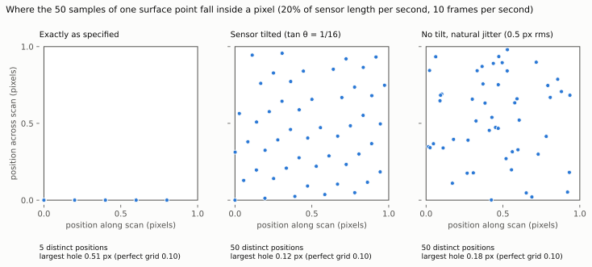

# Scan calculator

The calculator answers questions about a scan setting without running a
simulation. It is level 0 of [the simulation chain](simulation-chain.md).

## From the command line

```
pip install -e .
python -m ccdsr.sampling --fraction-per-s 0.2 --fps 10
```

This is the example "move 20% of the sensor length every second and sample at
10 frames per second" on a Raspberry Pi Camera Module 2 sensor:

```
Sensor            3280 x 2464 pixels, 1.12 um pitch (3.67 x 2.76 mm)
Speed             734.7 um/s
Frame rate        10 frames/s
Shift per frame   65.6 px (65.6 along, 0 across)
Samples per point 50 (a point stays under the sensor for 5 s)
Exposure          100 ms, motion blur 65.6 px
                  exposure for a quarter-pixel blur: 0.381 ms
Sub-pixel cover   5 distinct positions from 50 samples
                  widest gap 0.2 px along, 1 px across
                  largest hole 0.51 px radius (perfect grid: 0.1, efficiency 20%)
Data rate         80.82 million samples/s
Area rate         2.028 mm^2/s
```

Options: `--speed-um-per-s` in place of `--fraction-per-s`, `--exposure-ms`,
`--tilt-tan`, `--jitter-px`, `--readout-ms`, and `--n-along`, `--n-across`,
`--pitch-um` for other sensors.

## What the figures mean

| Figure | Formula | Meaning |
|---|---|---|
| Shift per frame | speed / frame rate / pixel pitch | How far the sensor moves between readouts, in pixels |
| Samples per point | frame rate / fraction of sensor per second | Each frame samples a given surface point once, with whichever pixel is over it |
| Motion blur | speed × exposure / pixel pitch | Smear during one exposure. Continuous capture means the exposure is the whole frame period |
| Distinct sub-pixel positions | counted | Samples that land on different places inside a pixel. Fewer than the sample count means the shift per frame repeats |
| Largest hole | radius of the largest empty circle inside a pixel | How evenly the samples cover the pixel. A perfect grid of N samples gives √(0.5 / N) |

Sensor tilt and natural position error both spread the samples across the
pixel. [The design](design.md) explains why in sections 5.4 and 5.5.



## From Python

```python
from ccdsr.sampling import Sensor, Scan, scan_budget
from ccdsr.resolution import explore

sensor = Sensor()                       # Camera Module 2 by default
scan = Scan(fps=10, fraction_per_s=0.2, exposure_s=0.0003, tilt_tan=1 / 16)

budget = scan_budget(sensor, scan)
print(budget.samples_per_point, budget.coverage.largest_hole_px)

result = explore(sensor, scan, gap_nm=3000)
print(result.recoverable_nm, result.limited_by)
```

`explore` adds the analytic resolution estimate: the smallest feature period
whose signal, after attenuation by the gap, the pixel area and motion blur,
still exceeds the noise left after averaging, and never smaller than the
sample positions can represent. It also names which effect sets the limit.

By default the surface is treated as matt. For a smooth, mirror-like surface
such as a silicon chip, pass `gap_model="collimated"` and a `wavelength_nm`:
detail coarser than the wavelength then crosses the gap without loss and finer
detail fades exponentially. `aperture_nm` sets a mask opening smaller than the
pixel. For the 100 nm target:

```python
result = explore(sensor, scan, gap_nm=100, gap_model="collimated", wavelength_nm=405)
```

These are estimates from closed-form formulas. They assume straight-on light
and exactly known sample positions. The higher levels of the
simulation chain exist to confirm or correct them.
