# Calibration and test methods

The project is about sliding a bare camera chip over a silicon chip and
letting a computer turn millions of blurry readings into one sharp picture.
The target is detail about 100 nanometres wide. For scale, a human hair is
about a thousand times wider, violet light has a wavelength of about 400
nanometres, and one pixel of the camera chip is 1,120 nanometres across.

A computer can only untangle the readings if it knows the instrument very
exactly: where the camera was for each reading, how sensitive each pixel is,
what the light was doing. Finding those numbers is called **calibration**.
And once a picture comes out, someone has to be able to say how sharp it
really is, and whether the fine detail in it is real or was made up by the
computer's assumptions. That is **testing**. This page plans both.

The main conclusions:

- **Most of the instrument's numbers can be worked out from the scan
  itself.** Every spot on the chip is read by thousands of different pixels,
  so there is far more data than there are unknowns. The camera's position,
  each pixel's sensitivity and the pattern of the light can all be solved by
  computation, with no extra equipment.
- **Three things can never be worked out from the scan, so each needs one
  outside fact.** The data cannot tell a big pattern scanned quickly from a
  small one scanned slowly, or a bright light on a dull surface from a dim
  light on a shiny one, and it reads height only in units of the light's
  wavelength. One known length, one known brightness and one known height
  settle these. All three are cheap.
- **One calibration is hard: how a pixel responds to stripes of light much
  finer than itself.** Nobody has published it for this camera chip. It can
  only be measured on real hardware, and hardware comes last. So in the
  simulator it is treated as an unknown with a range, and a method only
  counts as working if it works across the whole range.
- **A new finding: the colour of the laser has to be very pure.** The
  leading approach lights the chip with two laser beams that form fine
  stripes. With an ordinary laser diode the stripes are only visible in a
  strip between about 0.04 and 0.16 mm wide, depending on the diode. A
  purer laser, or some extra
  computation and a slower scan, gets around it.
- **Sharpness is measured by comparing the result with the truth.** In the
  simulator the truth is known. On hardware it is replaced by test patterns
  of known size, by chips whose design files are public, and by pictures
  from an electron microscope.
- **A sharp-looking picture is not proof.** If the computer is told that
  chips are made of straight lines of two materials, it will draw straight
  lines of two materials whether or not the data shows them. This page
  demonstrates the trap on a small example and lists the tests that catch
  it.
- **All approaches are scored on the same test scenes with the same
  measures**, so they can be compared fairly, and the checks a method must
  pass in simulation before any hardware is built are spelled out.

Terms are explained where they first appear and collected in the
[glossary](glossary.md). Every formula is followed by what it means in
words. Claims are tied to the sources in section 14, or carry one of the
labels defined on the [references](references.md) page: **Derived here**,
**Estimate**, **Assumption** or **Unverified**.

Status: plan for review. Nothing on this page has been run on hardware, and
the simulator levels it relies on are not built yet. Every figure is
generated by [`docs/diagrams/make_calibration_diagrams.py`](https://github.com/mithro/ccd-superres/blob/main/docs/diagrams/make_calibration_diagrams.py), from formulas or
from small toy simulations written for this page. The thresholds proposed
here are starting points to be agreed, and are labelled as assumptions.

## 1. How this page fits the project

Three rules from Tim shape the page.

| Rule | What it means here |
|---|---|
| Simulation first. Hardware work comes at the very end, once the simulation shows a method works. | Every procedure is defined first as something the simulator rehearses with simulated instrument errors. Section 9 says what this page contributes to the gate before hardware. The hardware procedures are the last phase (section 11). |
| Many approaches, not one. | The calibration list is organised by quantity, with a map of which approach needs which (section 2). Section 8 defines common test scenes and measures. |
| Computation before hardware. | A quantity is solved from the scan data wherever the data can determine it. A dedicated measurement is kept only where it cannot. |

The page builds on four others and does not repeat them: the measurement
model, the staged plan and the gate in the [design](design.md) (sections 3,
4.7 and 4.9), the levels and cross-checks of the
[simulation chain](simulation-chain.md), the lighting options in
[optical elements](optical-elements.md), and the survey of how other fields
solve for the instrument from the data in
[reconstruction methods, section 5](reconstruction-methods.md#5-estimating-position-gap-and-instrument-from-the-data).
In the [project plan](plan.md) this page is phase E.

## 2. Which approach needs which calibration

An **approach** is one complete way of building and running the instrument.
The approaches the simulator is meant to explore differ in what they need to
know. The map below takes each unknown of the instrument and shows, for each
family of approach, where its value comes from.

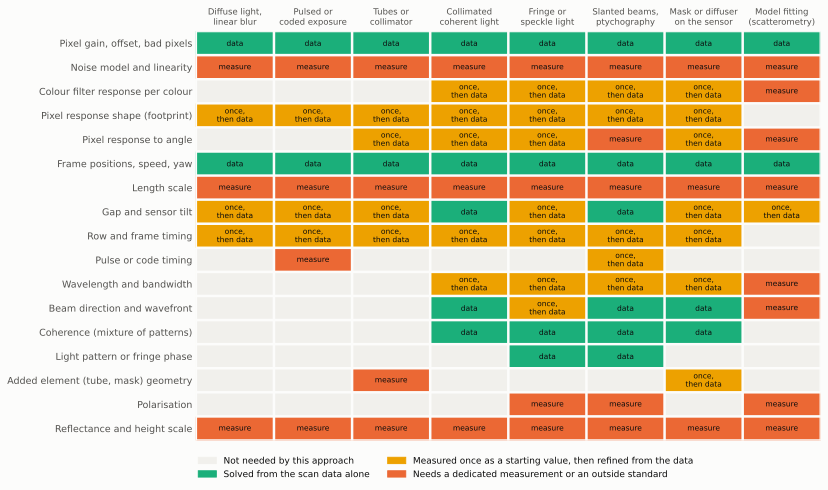

*Figure: where each instrument number comes from, for eight families of
approach. Rows are quantities, columns are approaches. Grey means the
approach does not need the quantity. Green means it is solved from the scan
data alone. Yellow means a rough starting value is measured once and the
data refines it. Orange means a dedicated measurement or an outside standard
is needed. The green and the top and bottom orange rows are the same for
every approach, so that part of the work is shared. Status: **Assumption**,
a judgement from the sources in sections 3 to 5, to be replaced by the
identifiability study of section 5.2.*

Reading the map:

- **Positions and pixel gains come from the data in every approach**,
  because every approach scans the same sensor over the same surface. This
  part of the calibration code is written once.
- **Every approach needs a noise model and the three outside facts** of
  section 3.2.
- **The middle rows are where approaches differ.** Approaches using
  [coherent light](glossary.md) add the properties of the light. Approaches
  with an added part (tubes, a mask) add that part's geometry. Fitting a
  model to the data ([scatterometry](glossary.md)) needs the most outside
  knowledge, because it fits only a few numbers per region and has no data
  to spare for the instrument.
- **In the simulation phase "measure" means "draw from a stated range".**
  Until hardware exists, a quantity marked for measurement gets a nominal
  value and an uncertainty range, and the simulated instrument draws its
  hidden true value from that range.

## 3. What must be known, and how well

### 3.1 Tolerances

Every calibration quantity is a number in the
[forward model](glossary.md), the calculation that predicts what the sensor
records. The reconstruction is never given the true values. It is given a
nominal value and a **tolerance** (how wrong the nominal value may be) and
improves on them.

One rule is used to state tolerances: the error that costs 10% of the
[contrast](glossary.md) of detail with [period](glossary.md) $\Lambda$ (one
line plus one space). For a random position error with root-mean-square size
$\sigma$ the contrast kept is

$$
C(\sigma) = \exp\!\left(-\frac{2\pi^2\sigma^2}{\Lambda^2}\right)
$$

In words: an error in position smears the picture, and the smear matters
only in proportion to the size of the detail. An error of 7% of the period
costs 10% of the contrast, and an error of a quarter of the period destroys
most of it. **Derived here**: this is the transfer function of a Gaussian
blur, the same form as the edge-softness term in
[design, section 3.1](design.md#31-the-three-blur-terms).

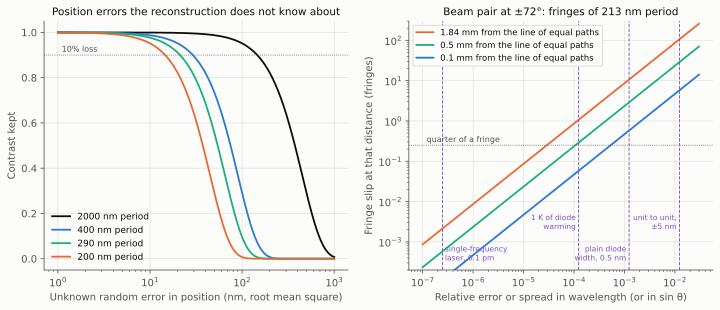

*Figure: two tolerance charts. Left: the share of contrast that survives
when frame positions are wrong by a random amount the reconstruction does
not know about, for four sizes of detail. The dotted line marks a 10% loss.
For the 200 nm period of the final target the error has to stay under about
15 nm. Right: for two laser beams crossing at ±72°, how far the bright and
dark stripes slip out of place at three distances from the centre line, as
the wavelength (or the beam angle) departs from its assumed value. Dashed
vertical lines mark typical laser figures. Staying under the dotted quarter
of a stripe at the edge of the sensor needs the wavelength to 3 parts in
100,000. Status: **Derived here** from the formula above and the geometry
of section 3.3.*

The tables below give the tolerance for each quantity. All tolerance values
are **Derived here** from the first-order formula in the "Rule" column and
are to be replaced by the simulator's sensitivity sweeps (section 9). The
simulator parameter names are proposals.

**Table 3.1a: position, angle and timing tolerances for a 10% loss of
contrast.** The speed is the worked example of the design, 735 µm/s
([design, section 5.7](design.md#57-sensor-control-and-readout-as-a-replaceable-model)).
The half-width of the sensor is 1.84 mm [R1].

| Quantity | Rule | 2000 nm period | 400 nm period | 290 nm period | 200 nm period | Unit |
|---|---|---:|---:|---:|---:|---|
| Frame position, random error | $0.073\,\Lambda$ | 146 | 29 | 21 | 15 | nm |
| Rotation of the sensor in its plane | $0.073\,\Lambda$ / 1.84 mm | 79 | 16 | 12 | 8 | µrad |
| Time of a reading | $0.073\,\Lambda$ / speed | 199 | 40 | 29 | 20 | µs |
| Length of a light pulse | same | 199 | 40 | 29 | 20 | µs |
| Row time, relative error over 2464 rows | time tolerance / 46.6 ms | 4300 | 850 | 620 | 430 | parts per million |

What the rows mean: a wrong position blurs the picture directly. A small
rotation moves the far end of the pixel array. A timing error is a position
error, because the sensor keeps moving. The row time is how long the sensor
takes to read one row of pixels (18.9 µs for the IMX219, see the
[glossary](glossary.md)), and an error in it builds up over the 2464 rows of
a frame.

**Table 3.1b: gap tolerances for a 10% loss of contrast.** The
[gap](glossary.md) is the distance from the sensor to the surface.

| Kind of approach | Rule | 2000 nm period | 400 nm period | 290 nm period | Unit | Status |
|---|---|---:|---:|---:|---|---|
| Diffuse light, linear blur | $\Lambda / 63$ | 32 | 6 | 5 | nm | Derived here from the gap term $e^{-2\pi z/\Lambda}$ of the design |
| Coherent light | $0.16\,\Lambda^2/\lambda$ at 405 nm | 1600 | 63 | 33 | nm | Derived here. Small-angle estimate, order of magnitude only at the two finer periods |

In words: with diffuse light the blur grows very fast with the gap, so the
gap must be known to a small fraction of the detail size. With coherent
light a wrong gap is a focus error, which is more forgiving for coarse
detail and just as strict for fine detail. One thousandth of a radian of
tilt between sensor and surface changes the gap by 3.7 µm across the sensor,
so in both cases the gap has to be solved separately for each small tile of
the picture.

**Table 3.1c: tolerances for a pair of laser beams at ±72°** making stripes
of 213 nm period across the full sensor (section 3.3).

| Quantity | Rule | Tolerance | Unit |
|---|---|---:|---|
| Stripe period, relative | quarter of a stripe in 8,640 stripes | 29 | parts per million |
| Wavelength, if the angle is exact | the same, times 405 nm | 12 | pm |
| Beam angle, if the wavelength is exact | the same, times tan 72° | 89 | µrad |

In words: there are so many stripes across the sensor that their spacing
must be known extremely well, far better than a laser's label or a
mechanical mount can give. Section 3.3 explains why that is acceptable: the
spacing is solved from the data.

**Table 3.1d: detector quantities.** Starting values are those of the
[design, section 5.1](design.md#51-sensor).

| Quantity | Starting value | Unit | Accuracy needed | Unit | Status of the accuracy figure |
|---|---:|---|---:|---|---|
| Full well | 4500 | electrons | 5 | % | Assumption |
| Read noise | 3 | electrons | 5 | % | Assumption |
| Gain of each pixel, spread | 1 | % | 0.3 | % | Assumption |
| Linearity | not known | | 1 | % of signal | Assumption |
| Bit depth | 10 | bits | exact | | [R1] |

In words: these set how much each reading can be trusted. The fit weighs
every reading by its expected noise, so the noise model has to be roughly
right, and it does not have to be exact.

**Table 3.1e: where each quantity comes from.** This is a text table. "Data"
means solved from the scan.

| Group | Quantity | Comes from | Published basis | Simulator parameter |
|---|---|---|---|---|
| Detector | Electrons per count, read noise, dark current, linearity | Measured (4.1) | [T1], [T2], [T3] | `full_well_e`, `read_noise_e`, `dark_current_e_s`, `response_curve` |
| Detector | Gain and offset of each pixel | Data | [T11] | `gain_sigma`, `offset_sigma` |
| Detector | Row and column noise, bad pixels | Data, dark frames | Assumption | `row_noise_e`, `read_noise_map` |
| Detector | Response of each colour of pixel to each wavelength | Measured once, then data | Assumption | `pixel_spectral_response` |
| Pixel | Sensitive area and edge softness | Level 4, then measured (4.2), then data | [T4], [T5] | `pixel_fringe_response`, `edge_softness_nm` |
| Pixel | Response to angle | Level 4, then measured (4.2) | [T10] | `pixel_angular_response` |
| Pixel | Differences between pixels | Data, if it supports them (5.2) | Assumption | `pixel_shape_variation` |
| Geometry | Frame positions, speed, rotation | Data | [T12], [T13], [T14], [T23] | Motion terms of design section 3.2 |
| Geometry | Length scale | Outside fact (3.2) | [T12], [T15] | `scale_error` |
| Geometry | Gap and tilt, per tile | Rough value, then data | [T17], [T18] | `gap_nm`, `gap_tilt_mrad` |
| Geometry | Vibration within an exposure | Short pulses, then a mixture model | [T16] | `vibration_nm`, `coherence_modes` |
| Timing | Row and frame time | Register values, checked once (4.3) | [T21] | `rolling_shutter_line_time` |
| Timing | Pulse time, pulse length, exposure code | Driven from the sensor clock, checked once | Assumption | `pulse_length_s`, `pulse_time_jitter`, `code_seed` |
| Light | Wavelength | Rough value, then data as the stripe period | Derived here (3.3) | `wavelengths_nm` |
| Light | Spectral width | Measured (4.4), then a mixture model | [T16] | `bandwidth_nm` |
| Light | Beam directions, beam profile | Data | [T15], [T18], [T19] | `directions`, `probe` |
| Light | Stripe position in each frame | Data | [T20] | `fringe_phase_drift` |
| Light | Energy of each pulse | Data | Assumption | `pulse_energy_sigma` |
| Light | Polarisation | Set by a polariser, checked once | Assumption | `polarisation` |
| Sample | Brightness and height scales | Outside facts (3.2) | Section 3.2 | `reflectance_scale` |

### 3.2 What the data can never tell: three outside facts

Solving for the instrument and the picture together always leaves a few
combinations of numbers that the data cannot pin down, whatever the method.
[Ptychography](glossary.md) documents them [T12, T15], and the
reconstruction survey lists them. Each needs one fact from outside the data.
This page calls such a fact an **anchor**.

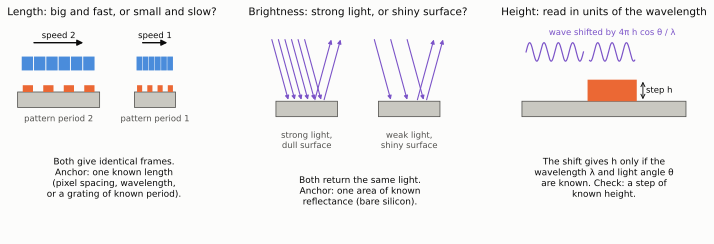

*Figure: the three anchors. Left: a pattern twice as large scanned twice as
fast produces exactly the same frames, so one length has to be known from
outside. Middle: a strong light on a dull surface returns the same light as
a weak light on a shiny one, so one reflectance has to be known. Right: a
step on the surface shifts the reflected light wave by an amount that
depends on the step's height, the wavelength and the angle of the light, so
height is only as well known as those two. Status: illustrative.*

**Table 3.2: anchors and candidates for each.** A text table.

| What is undetermined | Candidate anchors, cheapest first | Status |
|---|---|---|
| Length scale | The sensor's own pixel spacing, 1.12 µm [R1]. The laser wavelength, through the stripe period. A grating of known period on the stage (6.4). A known repeat distance on the chip. | Assumption that the pixel spacing is accurate enough. To be checked against a grating. |
| Brightness | An area of bare polished silicon in the scan | Unverified: see the note below |
| Height | The wavelength and beam angle, once length is anchored. Checked on a step of known height (6.4). | Derived here |
| Absolute position, uniform tilt of the picture | By convention: the coarse chip map of stage 1 becomes the coordinate system | Assumption |
| Errors that repeat with the scan step | Irregular frame timing or position dither, which the design already plans | [T15] |

Notes on the table:

- **Two anchors of the same kind are a test.** Lengths anchored by the pixel
  spacing should reproduce the period of a reference grating. If they do
  not, something in the model is wrong.
- **Bare silicon as the brightness anchor.** The share of light a polished
  surface reflects straight back follows from its refractive index by the
  Fresnel formula [BornWolf]. With a refractive index of about 5.4 and an
  absorption index of about 0.3 for silicon at 405 nm, the formula gives
  about 47%. **Unverified**: the two constants are from memory of published
  tables, and the thin natural oxide on silicon is ignored. Both need
  checking before this anchor is relied on.
- **The pixel spacing changes with temperature.** Silicon expands by about
  2.6 millionths per kelvin (**Unverified**, general knowledge). Across the
  3.68 mm sensor that is 10 nm per kelvin (**Derived here**), which is
  negligible for a 2 µm period and not for a 200 nm one. At the last stage
  the sensor temperature becomes one more slowly varying unknown.

The same point can be made by calculation. The figure below is a toy model
of a one-dimensional scan with six unknowns. Asking how much information the
data holds about each combination of unknowns shows two combinations with
none: exactly the brightness and length anchors.

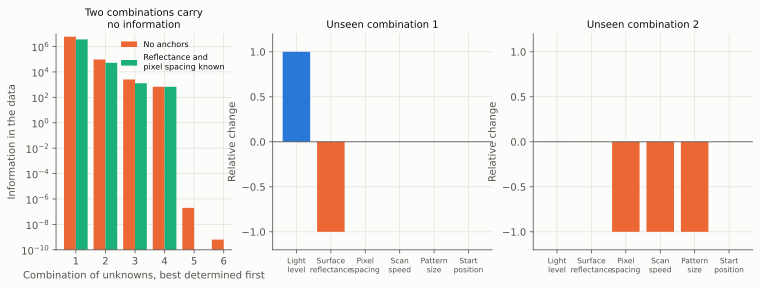

*Figure: a toy calculation of what a scan can and cannot determine. A
pattern is scanned by 40 pixels over 30 frames, with six unknowns: light
level, surface reflectance, pixel spacing, scan speed, pattern size and
start position. Left: the information the data carries about each
independent combination of the unknowns, on a logarithmic scale. Without
anchors (orange) two combinations carry essentially none. With the
reflectance and the pixel spacing known (green) every remaining combination
is determined. Middle and right: the two undetermined combinations. The
first raises the light and lowers the reflectance by the same factor. The
second changes pixel spacing, speed and pattern size together. Status:
**Derived here**, a toy model made for this figure, not the instrument.*

### 3.3 A finding: stripes across the whole sensor need a pure colour

This applies to any approach that lights the chip, or the bare sensor, with
two beams from one laser. That includes the present leading candidate
([design, section 4.6](design.md#46-the-target-100-nm-features-on-silicon-chips)).
Where two such beams overlap they form [fringes](glossary.md): regular
bright and dark stripes.

Two beams arriving from opposite sides at angle $\theta$ have travelled
equally far only along one line. At a distance $x$ from that line their
paths differ by

$$
\Delta = 2x\sin\theta
$$

In words: the further from the centre line, the more one beam has had to
travel than the other. **Derived here** from the geometry in the figure
below. A laser's light stays in step with itself only over a limited
distance, its **coherence length**, roughly the wavelength squared divided
by the spread of wavelengths it emits. Where the path difference exceeds
that length, the stripes fade.

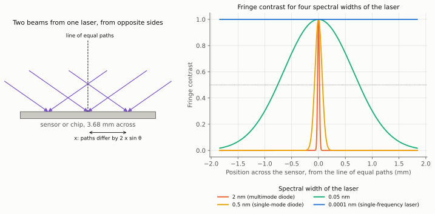

*Figure: why the laser's colour purity limits the useful field. Left: two
beams from one laser meet on the sensor or chip from opposite sides. Along
the dashed line they have travelled the same distance. To either side one
has travelled further. Right: the contrast of the stripes across the 3.68 mm
sensor, for four lasers with different spreads of wavelength. An ordinary
laser diode (orange and yellow) gives stripes only in a narrow strip around
the centre line. A single-frequency laser (blue) gives them everywhere.
Status: **Derived here**, assuming the laser's spectrum has a Gaussian
shape. The diode widths are from vendor datasheets [T50].*

**Table 3.3a: the numbers behind the figure,** for beams at ±72° and a
wavelength of 405 nm. All values **Derived here**.

| Quantity | Value | Unit |
|---|---:|---|
| Stripe period | 213 | nm |
| Stripes across the 3.68 mm sensor | 17,300 | |
| Path difference from one edge of the sensor to the other | 7.0 | mm |

| Spectral width of the laser (nm) | Coherence length (mm) | Half-width of the strip where stripe contrast exceeds one half (mm) |
|---:|---:|---:|
| 2 | 0.08 | 0.02 |
| 0.5 | 0.33 | 0.08 |
| 0.05 | 3.3 | 0.76 |
| 0.0001 | 1600 | 380 |

**Table 3.3b: laser diode figures from vendor datasheets** [T50]. Status:
**Unverified**, read in summary from search results for parts that have not
been chosen.

| Property | Low | High | Unit |
|---|---:|---:|---|
| Wavelength, unit to unit | 400 | 410 | nm |
| Drift of wavelength with temperature | 0.05 | 0.3 | nm per kelvin |
| Spectral width, ordinary diode | 0.5 | 2 | nm |
| Spectral width, single-frequency module | 0.0001 | 0.0001 | nm |

Two consequences:

- **The stripe spacing must be solved from the data.** Table 3.1c asks for
  the wavelength to 12 pm. A diode's label is good to 5 nm and it drifts by
  at least 50 pm for each kelvin of warming. So the stripe spacing cannot be
  taken from a datasheet or measured once. It is one number per frame, and
  17,000 stripes determine it very well.
- **A spread of colours cannot be solved away.** Each colour makes its own
  stripes and they wash each other out. That is a loss of signal, not a
  wrong number.

**Table 3.3c: options.** A text table. All are simulator settings to be
compared, not decisions.

| Option | Hardware added | What it costs |
|---|---|---|
| Single-frequency laser | A stabilised laser module in place of a bare diode | A dearer light source. The simplest model. |
| Accept a narrow strip | None | The useful field is a strip a fraction of a millimetre wide. The scan carries every point of the chip through it, so nothing is missed, and there are fewer useful readings of each point. |
| Split the beam with a grating | One optical part, which makes stripes whose spacing does not depend on the wavelength | The part's own calibration |
| Model the spread | None | The fit treats each frame as a mixture of a few stripe patterns [T16]. Recovers part of the contrast. |

The simulator parameters are `bandwidth_nm`, already proposed in the optical
elements study, and a new `path_difference_map` worked out from the beam
geometry.

## 4. The dedicated measurements, each with a simulated twin

Four measurements cannot be replaced by computation on scan data. Each is
defined so the simulator runs it first. The simulated instrument has hidden
true values, the simulated measurement produces frames, the same analysis
code that will later run on hardware produces an estimate, and the error
against the hidden truth is the result of the rehearsal.

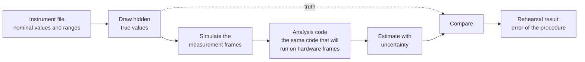

*Figure: how every calibration procedure is rehearsed in simulation. The
analysis code never sees the hidden true values. Only the comparison step
does.*

### 4.1 Noise model: dark frames and photon transfer

This is the standard way to characterise any image sensor [T1, T2], and it
has been done for the Raspberry Pi camera that uses this sensor [T3].

Record pairs of frames under even, steady light, at a ladder of light
levels. Subtracting the two frames of a pair removes the fixed differences
between pixels and leaves only random noise. Light arrives as separate
photons, and the resulting **photon noise** obeys a fixed law: counted in
electrons, its variance (the square of its typical size) equals the mean
signal. So

$$
\sigma_\text{counts}^2 = \frac{\mu_\text{counts}}{K} + \sigma_\text{read}^2
$$

In words: plot the noise variance against the mean signal, both in the
sensor's output counts. The points fall on a straight line. Its slope gives
$K$, the number of electrons per count. Where the line meets zero light
gives the **read noise**, the noise the electronics add to every reading.
Where the points fall away from the line near the top gives the full well
and the linearity [T1]. Frames with the lamp off at several exposure times
give the dark current and flag bad pixels.

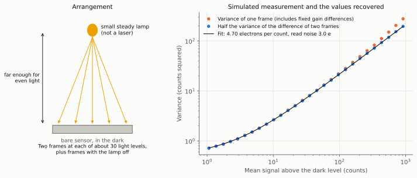

*Figure: the noise measurement and its rehearsal. Left: the arrangement. A
small steady lamp, far enough from the bare sensor that its light is even,
with two frames taken at each light level. Right: a simulated run. Blue
points are half the variance of the difference of each pair of frames,
against the mean signal. They follow the fitted straight line (it looks
curved because both axes are logarithmic). Orange points are the variance of
a single frame, which is inflated at high signal by the fixed differences
between pixels and shows why pairs are used. Status: **Derived here**, a
toy simulation.*

**Table 4.1: result of the rehearsal.** 28 pairs of frames of 200 by 200
pixels, simulated with the design's starting values.

| Quantity | Hidden true value | Recovered | Error (%) | Unit |
|---|---:|---:|---:|---|
| Electrons per count | 4.692 | 4.698 | 0.1 | electrons per count |
| Read noise | 3.00 | 3.03 | 1.0 | electrons |

Without a lens the even light is the awkward part. The method only needs the
light to be the same in both frames of a pair, not flat across the sensor,
so a small lamp at a distance is enough. Laser light is unsuitable because
of [speckle](glossary.md).

### 4.2 Pixel response to fine stripes and to angle

This is stage 0 of the plan and the largest open risk of every approach that
relies on light arriving from steep angles. The
[pixel response](glossary.md) of the IMX219 to stripes finer than a pixel is
not published (**Unverified**: none was found in the searches behind the
design and this page).

**What exactly has to be measured.** When two plane waves from directions
$\mathbf{k}_1$ and $\mathbf{k}_2$, with strengths $a_1$ and $a_2$, fall on a
pixel together, its signal is

$$
s = R(\mathbf{k}_1,\mathbf{k}_1)\,|a_1|^2 + R(\mathbf{k}_2,\mathbf{k}_2)\,|a_2|^2
  + 2\,\mathrm{Re}\!\left[R(\mathbf{k}_1,\mathbf{k}_2)\,a_1 a_2^*\right]
$$

In words: the pixel's reading has three parts. The first two are its
response to each beam alone, which is its response to angle. The third is
its response to the stripes the two beams make together. For an ideal thin
pixel the third part depends only on the stripe spacing, and is the
"contrast against stripe period" curve of the design. For a real pixel under
a micrometre of microlens, colour filter and metal grid it need not be.
**Derived here**: this is the general form for a detector that responds to
light intensity, and it assumes neighbouring pixels do not exchange light.
The role of the layers above a pixel in shaping its response to angle is
described in [T10].

**Table 4.2a: the three parts of the measurement.** A text table.

| Part | Light | Gives |
|---|---|---|
| A. One beam, angle swept in two directions | A widened beam, sensor on a rotation mount | Response against angle for each colour of pixel, and how it changes from the centre of the array to the edge |
| B. Two beams at equal and opposite angles | The mirror arrangement below | Stripe contrast against stripe period, along rows, along columns and diagonally |
| C. Two beams at unequal angles | The same, with the assembly rotated | Whether part B can be predicted from part A and a pixel shape. If so the simple pixel model is enough. If not, level 4 has to supply the full table. |

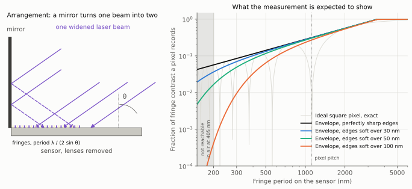

*Figure: the stripe measurement. Left: one widened laser beam falls on the
bare sensor at angle θ from straight down. A mirror standing on the sensor
reflects part of the beam, so two beams cross on the pixels and form stripes
with a period of the wavelength divided by twice the sine of θ. Tilting the
assembly changes the period. Right: the share of the stripes' contrast that
a 1.12 µm pixel records, against stripe period, for four degrees of softness
of the pixel's edges. The pale grey curve is an ideal square pixel, which
records nothing whenever a whole number of stripes fits across it. The
coloured curves trace the tops of that pattern. The shaded band on the left
cannot be reached in air with 405 nm light. Status: **Estimate** from the
design's pixel model
([design, section 3.1](design.md#31-the-three-blur-terms)).*

**Table 4.2b: stripe contrast the model predicts a pixel records** (peak
values, **Estimate**).

| Stripe period (nm) | Beam angle θ (degrees) | Sharp edges (%) | Edges soft over 30 nm (%) | Soft over 50 nm (%) | Soft over 100 nm (%) |
|---:|---:|---:|---:|---:|---:|
| 400 | 30 | 11.4 | 10.2 | 8.4 | 3.3 |
| 290 | 44 | 8.2 | 6.7 | 4.6 | 0.8 |
| 213 | 72 | 6.0 | 4.1 | 2.0 | 0.1 |
| 203 | 86 | 5.8 | 3.8 | 1.7 | 0.1 |

"Soft over" in this table is the standard deviation $\sigma$ of the
Gaussian blur of the pixel's edges, as in the formula of section 2.3. The
[design, table 4.6b](design.md#46-the-target-100-nm-features-on-silicon-chips)
quotes the same blur by its full width at half height, which is 2.355 times
larger, so its "100 nm" row is a sharper pixel than the last column here.

In words: between "sharp" and "soft over 100 nm" the signal at the target
period changes about sixtyfold. That is why this one measurement decides so
much.

**How pixels read stripes far finer than themselves.** This is an
established way to measure the fine response of image sensors [T4, T5].
Stripes of 213 nm period sampled by pixels 1.12 µm apart show up across the
array as a coarse beat pattern, in the way a fine fabric seen through a
window screen shows broad bands. The strength of the beat pattern is the
pixel's response at the stripe period. Related work maps the sensitivity
inside single pixels by scanning a small spot [T6, T7], and uses laser
stripes to calibrate pixel positions to millionths of a pixel [T8, T9].

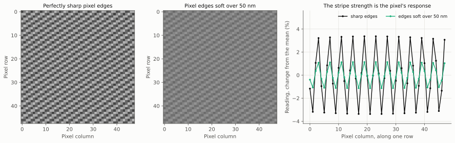

*Figure: what the sensor records in the stripe measurement, simulated.
Stripes of 213 nm period, turned 4° from the pixel columns, fall on a patch
of 48 by 48 pixels. Left: with perfectly sharp pixel edges the pixels show a
clear coarse pattern repeating about every 4 pixels. Middle: with edges soft
over 50 nm the same pattern is there and three times weaker. Right: readings
along one row for both cases, as a percentage change from the mean. The
height of this ripple is the number being measured. No single reading shows
it, the pattern across many pixels does. Status: **Estimate**, same pixel
model.*

Two limits of the measurement itself, both **Derived here**:

- In air at 405 nm two beams cannot make stripes finer than half the
  wavelength, 203 nm. Finer periods need a shorter wavelength or a liquid on
  the sensor.
- The stripes must have full contrast to begin with. That needs light
  polarised along the stripes, and the colour purity of section 3.3: with
  the mirror arrangement the line of equal paths is at the foot of the
  mirror, so an ordinary diode gives stripes only in the strip next to it.
  Contrast measured at coarse periods, where the pixel's own response is
  close to one, checks both.

**In simulation, where the real value is not available.** The
[design, section 4.9](design.md#49-simulation-first-the-unknown-pixel-response-and-the-gate-before-hardware)
treats the pixel response as an uncertain range that every approach is run
across, narrowed by level 4. This page adds two things. Level 4 should
produce $R$ for pairs of directions, not only a single curve, so part C can
be answered in simulation. And the measurement itself is rehearsed as a
level 3 or 4 simulation of the two-beam arrangement over a patch of pixels,
analysed by the code that will later read the hardware frames.

### 4.3 Timing

The row time and frame time come from register settings and the sensor's
clock. One check confirms the settings mean what they are believed to mean.
A light flashing at an accurately known rate, recorded by a sensor that
reads its rows one after another (a [rolling shutter](glossary.md)), appears
as bands. The number of rows from one band to the next, times the flash
rate, gives the row time. Calibrating rolling-shutter timing is a standard
step in camera calibration [T21]. After that check, timing errors look
exactly like position errors and are absorbed by the position estimate.

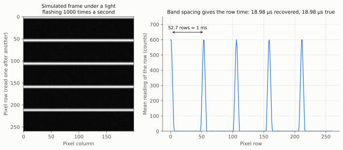

*Figure: the timing check, simulated. Left: part of a frame taken under a
light flashing 1000 times a second. Each bright band is one flash, caught by
the rows being exposed at that instant. Right: the mean reading of each row.
The bands are 52.7 rows apart, and one flash period (1 ms) divided by 52.7
rows gives the row time. Status: **Derived here**, a toy simulation.*

**Table 4.3: result of the rehearsal.** The simulated sensor's row time was
set 0.4% longer than its nominal value, and the analysis was not told.

| Quantity | Nominal | Hidden true value | Recovered | Error (parts per million) | Unit |
|---|---:|---:|---:|---:|---|
| Row time | 18.900 | 18.976 | 18.978 | 110 | µs |

The error is below the 430 parts per million that table 3.1a asks for at
the finest period.

### 4.4 Wavelength, colour purity, gap and the anchors

**Table 4.4: the remaining one-off measurements.** A text table.

| Measurement | Method | Gives | Status |
|---|---|---|---|
| Wavelength, roughly | A grating of known period turns wavelength into an angle | A starting value. The fit refines it (3.3). | Derived here from the grating equation [BornWolf] |
| Colour purity | Stripe contrast against distance from the line of equal paths: part B of 4.2 read along the other axis | Spectral width, for the model of 3.3 | Derived here |
| Length anchor | A grating of known period on the stage, scanned like a sample | The scale of the picture | Section 6.4 |
| Brightness anchor | A bare silicon area in the scan | The brightness scale | Unverified constants, see 3.2 |
| Gap, roughly | A mechanical or optical starting value | A value inside the range from which the automatic focus can recover | Assumption. The simulator has to establish that range. |

## 5. Solving for the instrument from the scan

### 5.1 What is solved, and how each solution is tested

The methods are surveyed, with their flow chart, in
[reconstruction methods, section 5](reconstruction-methods.md#5-estimating-position-gap-and-instrument-from-the-data).
This text table adds what each needs in order to be tested.

| Unknown | Method | Published basis | Test in simulation | Test on hardware |
|---|---|---|---|---|
| Frame positions | Match overlapping frames, then refine each position in the fit | [T23], [T12], [T13], [T14] | Error against the hidden path | A grating of known period. Forward and return passes agree. |
| Pixel gain and offset | Every point is read by many pixels | [T11] | Error against the hidden gain map | Agreement with the even-light frames of 4.1 |
| Light pattern | Second unknown in the ptychographic fit | [T15], [T19] | Error against the hidden pattern, up to the anchors | Stable between scans |
| Imperfect coherence, vibration | Each frame as a mixture of a few patterns | [T16] | Number of patterns against the hidden spectral width | Agreement with 4.4 |
| Gap, per tile | Automatic focus inside the fit | [T17] | Error against the hidden gap map | Smooth, plane-like map |
| Tilt and beam angle | Angle correction inside the fit | [T18] | Error against the hidden angles | Stable between scans |
| Stripe position per frame | Estimated from the frames | [T20] | Error against the hidden drift | Not testable directly |
| Pixel response | Refined from its starting value as a few shared numbers | Section 4.2 | Error against the level 4 response used to make the data | Agreement with 4.2 |

Open software that already implements most of these for ptychography exists
and is useful as a cross-check on the project's own solver [T22].

### 5.2 The identifiability study

"Can the data determine it" has an answer that can be computed, and
computing it is the cheapest way to compare approaches before reconstructing
anything. **Identifiability** means whether a quantity can be recovered from
the data at all. For a given approach and scan, the forward model is
differentiated with respect to every unknown: the picture and each
instrument number. The toy figure in section 3.2 is a miniature of this. The
full calculation gives, for the stated noise:

- how precisely each instrument number can be recovered at best. This limit
  is called the Cramér-Rao bound, and it is the fair standard for judging a
  calibration procedure [T40];
- which combinations cannot be recovered at all: the anchors of section 3.2,
  and any more that a particular approach has;
- how much of the instrument's uncertainty leaks into the picture, at each
  size of detail.

This turns the map of section 2 from a judgement into numbers, one column
per approach. It needs only the forward model and automatic differentiation,
both of which the design already calls for, and it runs on small patches.
Status: **Assumption** that it is cheap. It is not built.

## 6. Test: putting a number on resolution

### 6.1 What "resolution" means on this project

Published resolution claims in computational microscopy are hard to compare
because they use different definitions, and a review proposed standard
practice to fix this [T29]. This project adopts the following rules
(**Assumption**: they are a proposal for Tim to agree).

| Rule | Reason |
|---|---|
| [Resolution](glossary.md) is quoted as a period: one line plus one space. "100 nm features" means a 200 nm period. | A single isolated line can be found far below the resolution. Only a repeating pattern shows whether neighbours are told apart. |
| It is quoted for dense patterns. Finding and locating isolated features is reported separately. | Same reason |
| It is quoted along the scan and across it, and the worse of the two is the headline. | Motion blur and the row-by-row readout act along the scan only |
| It is quoted with the rule used, the light dose, and whether any prior was used. | So that numbers can be compared |

### 6.2 The measures

**Table 6.2: the measures.** A text table.

| Measure | What it says | Needs the truth? | Basis |
|---|---|---|---|
| Ring correlation against the truth | The finest period at which the result still agrees with the truth. The headline number in simulation. | Yes | [T24], [T25] |
| Ring correlation between two independent halves of the data | The finest period at which the result repeats. The only form available on an unknown sample. | No | [T26], [T27], [T30] |
| Contrast of bar groups and of a star | Contrast kept at each period and direction | A known pattern | [T29] |
| Edge response | Sharpness and overshoot at an isolated edge | A known edge | [T42] |
| Error against truth after alignment | Overall error, after removing the shifts and scale factors the data cannot fix | Yes | [T43] |
| Location error of isolated features | Precision against the theoretical best | Yes | [T39], [T40] |
| Line width and height error | Bias and repeatability of fitted values | A reference measurement | [T41] |
| Mismatch on held-out readings | Whether the model explains data it was not fitted to (7.3) | No | [T34] |
| Calibration error | Each recovered instrument number against its hidden true value | Yes | Section 5.1 |

**[Fourier ring correlation](glossary.md).** Take two pictures of the same
thing. Split each into its ingredients by size of detail, from coarse to
fine. For each size, check how well the two pictures agree. The result is a
curve that starts near one for coarse detail, where the pictures agree, and
falls towards zero where they stop agreeing. The size at which it crosses a
set threshold is the resolution.

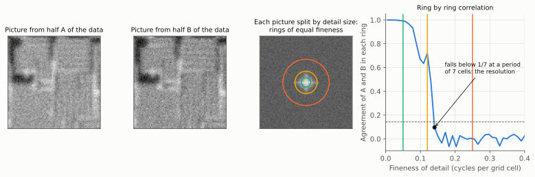

*Figure: Fourier ring correlation step by step, on a toy example. First and
second panels: two pictures of the same scene reconstructed from two
independent halves of the data. Third panel: one picture split by size of
detail. Coarse detail is at the centre and fine detail towards the edge, so
each coloured ring holds detail of one fineness. Fourth panel: the agreement
between the two pictures within each ring, from coarse on the left to fine
on the right. The coloured lines mark the three rings. The resolution is
read where the curve first falls below the threshold of 1/7, here at a
period of 7 grid cells. Status: **Derived here**, a toy example.*

The measure was introduced in electron microscopy [T24]. Its thresholds are
discussed in [T25]. It is now standard in optical super-resolution
[T26, T27], in X-ray ptychography of chips [T44] and in image restoration
[T28]. The rule proposed here (**Assumption**) is the first crossing of 1/7
for the split-data form, with the half-bit curve of [T25] beside it, and of
1/2 for the form against the truth. The two thresholds are the usual
pairing, because a picture compared with a noise-free truth agrees more
strongly than two noisy halves do [T30].

It has one serious weakness, the subject of section 7: anything the two
halves share that is not the sample also agrees.

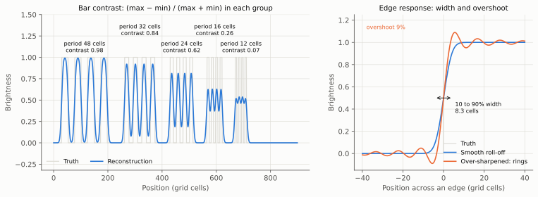

*Figure: two simpler measures that are hard to fool. Left: a row of bar
groups of decreasing period (grey) and a blurred reconstruction of it
(blue). For each group the contrast is the difference between the brightest
and darkest reading divided by their sum. It falls from 0.98 at a 48-cell
period to 0.07 at 12 cells. Right: the response to a single sharp edge. A
well-behaved reconstruction (blue) rises smoothly, and its width from 10% to
90% is a measure of sharpness. An over-sharpened one (orange) rises faster
and then overshoots and ripples, which shows up as false lines beside every
real edge. Status: **Derived here**, toy examples.*

### 6.3 Comparison against a trusted picture

On hardware the truth is not known. Three substitutes, in order of
preference:

1. **A design file.** For a chip whose design is public, the layout file is
   the truth to within the factory's tolerances. It is converted to the
   simulator's scene description, so the same comparison code runs on
   simulated and real results.
2. **An electron microscope picture of the same area.** The usual reference
   at this scale, and how X-ray pictures of chips are judged [T44].
3. **A probe microscope scan** (atomic force microscope), for height.

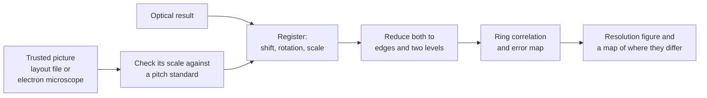

*Figure: how a result is compared with a trusted picture. The trusted
picture's own scale is checked first, the two are aligned, both are reduced
to the same kind of image, and only then compared.*

Three cautions, which the steps of the flow chart answer:

- An electron microscope's magnification is not accurate unless it has been
  calibrated [T45], so its scale is checked against a pitch standard first.
- It shows shape and material, where the optical result shows reflectance.
  So the comparison is made on edges and on a two-level version of both, not
  on grey levels (**Assumption**: this is the proposed way, to be tried in
  simulation with a simulated electron picture).
- It sees only the top surface, where light also sees through transparent
  layers.

The comparison is reported as a ring correlation and as an error map [T35],
so that it says where the result is wrong and not only how good it is on
average.

### 6.4 Reference samples

A **reference sample** is something with a known pattern, used to check the
instrument.

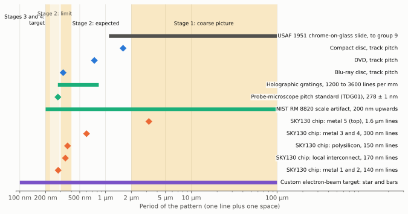

*Figure: which reference samples can test which stage. The horizontal axis
is the period of the pattern on a logarithmic scale, from 100 nm to 100 µm.
Shaded bands are the periods each stage of the plan has to resolve. Bars and
diamonds are samples: a bar covers a range of periods, a diamond is a single
period. Catalogue parts (grey, green) and optical discs (blue) cover stages
1 and 2. Chips made in the open SKY130 process (orange) reach a 280 nm
period, which tests stage 2. Only a custom-made target (purple) reaches the
200 nm period of the final target. Sources are in table 6.4a.*

**Table 6.4a: periods and line widths of the reference samples.**

| Sample | Smallest period (nm) | Largest period (nm) | Line width at smallest period (nm) | Source | Status |
|---|---:|---:|---:|---|---|
| USAF 1951 bar target, chrome on glass, to group 9 | 1,096 | 100,000 | 548 | [T52] | Derived here from the chart's formula |
| Compact disc, track spacing | 1,600 | 1,600 | | [T49] | Unverified |
| DVD, track spacing | 740 | 740 | | [T49] | Unverified |
| Blu-ray disc, track spacing | 320 | 320 | 150 | [T49] | Unverified. Line width is the shortest pit. |
| Holographic grating, 1200 to 3600 lines per mm | 278 | 833 | | [T51] | Derived here from lines per mm |
| Probe-microscope pitch standard TDG01 | 278 | 278 | | [T48] | Stated to ±1 nm by the distributor |
| NIST RM 8820 scale artifact | 200 | 1,500,000 | 100 | [T47] | Certificate calls its characterisation preliminary |
| SKY130 chip, metal 1 and 2 | 280 | | 140 | [T46] | Minimum design rule |
| SKY130 chip, local interconnect | 340 | | 170 | [T46] | Minimum design rule |
| SKY130 chip, polysilicon | 360 | | 150 | [T46] | Minimum design rule: 150 nm line, 210 nm space |
| SKY130 chip, metal 3 and 4 | 600 | | 300 | [T46] | Minimum design rule |
| SKY130 chip, metal 5 (top) | 3,200 | | 1,600 | [T46] | Minimum design rule |
| Custom electron-beam target | 100 | 100,000 | 50 | | Assumption: what such a service can write |

**Table 6.4b: what each sample is for.** A text table.

| Sample | Tests | Cautions |
|---|---|---|
| USAF 1951 bar target | Stage 1 resolution in both directions, contrast against period | Chrome on glass is mirror-like, as silicon is |
| Star target | All directions at once. Recommended for coherent methods [T29]. | Catalogue ones are coarse. A fine one is a custom part. |
| Holographic grating | Length anchor. Contrast at one period in the stage 2 range. | Smooth wavy profile, one direction only |
| Pitch standard | Length anchor with a stated accuracy | Small area |
| Step-height standards | Height anchor and height accuracy | Exact parts still to be chosen (Unverified) |
| NIST RM 8820 | Length scale across the whole range on one chip | Made for electron microscopes |
| Optical discs | A nearly free pattern at three useful periods. Pits are a pattern in height, which suits coherent methods. | The pattern is under a cover layer that has to be removed. Whether a clean surface survives is untested (Unverified). |
| SKY130 chip | The real task, with the truth known from the public design file | See below |
| Any chip plus an electron microscope picture | The real task on an unknown layout | Needs access to an electron microscope |
| Custom electron-beam target | Bar groups, star, planted defects and rule-breaking shapes at the final period | A paid service |
| Bare polished silicon | Brightness anchor, and the empty-scene test of section 7 | None |

Two points about real chips. First, on a finished chip the finest layers are
at the bottom of a stack several micrometres thick, under wider metal,
transparent oxide and a protective coating (**Unverified**: general
knowledge of chip construction, the SKY130 documentation read for this page
does not give the layer thicknesses). An approach that works on a bare
patterned surface may see them poorly or not at all. Which layer is the
target, and whether upper layers are removed first, is an open question for
Tim. Second, the smallest dense period on SKY130 is 280 nm, which tests
stage 2 and not the 200 nm of the final target. A chip from a finer process,
or the custom target, is needed for that.

Every sample in the table also exists as a scene in the simulator
(section 8), so the hardware test of each is rehearsed first.

## 7. Tests that catch invented detail

### 7.1 The problem, shown on a toy case

A reconstruction that uses a [prior](glossary.md), something assumed about
the chip in advance such as "two materials" or "straight edges", can produce
sharp detail that the data does not support. Comparing two halves of the
data does not catch this, because both halves pass through the same
assumption.

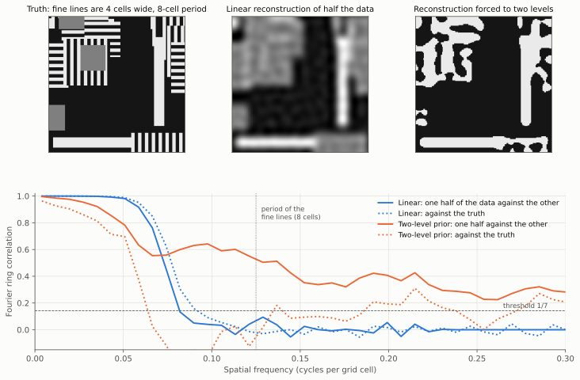

*Figure: how an assumption can fake sharpness. Top left: the true scene,
with fine lines 4 cells wide on an 8-cell period and a few grey patches of a
third material. It is blurred so that periods below about 10 cells are lost,
and noise is added, twice, giving two independent sets of data. Top middle:
a plain linear reconstruction of one set. The fine lines are honestly
blurred away. Top right: a reconstruction that is told the scene has only
two levels. It looks crisp, and its fine lines have become blobs. Bottom:
ring correlation curves. For the linear reconstruction (blue) the solid
curve, half against half, and the dotted curve, against the truth, fall
together. For the two-level reconstruction (orange) the solid curve stays
high, claiming very fine resolution, while the dotted curve against the
truth collapses early. Status: **Derived here**, a toy model, not the
instrument.*

**Table 7.1: resolution read from the figure,** as the period where each
curve first falls below 1/7.

| Reconstruction | Half against half (cells) | Against the truth (cells) |
|---|---:|---:|
| Linear | 12 | 10 |
| Forced to two levels | 3 | 15 |

In words: the linear result is honest. Its two halves stop agreeing at about
the size where it stops agreeing with the truth. The two-level result claims
3 cells and delivers 15, worse than the linear one. Its sharp edges are
repeatable and wrong.

Electron microscopy met the same failure and named it "Einstein from noise",
after a demonstration that a picture of Einstein can be recovered from pure
noise by aligning the noise to it [T33]. Its remedies are the model for the
tests below [T30, T31, T32]. The same failure is documented for
reconstruction by neural networks in medical imaging [T36, T37].

### 7.2 The tests

Each is run in simulation for every approach that uses a prior. Those that
need no truth are run again on hardware. A text table.

| Test | How | Passes when | Needs truth? | Basis |
|---|---|---|---|---|
| Split-data against truth | Compare the two numbers of table 7.1 | They agree within the margin of table 10.1 | Yes | [T30], [T31] |
| Scene that breaks the prior | A scene with features the prior forbids | The forbidden features appear, at the resolution the linear result gives them | Yes | Assumption |
| Empty scene | Bare silicon, or pure noise, through the whole pipeline | Nothing is reconstructed above the noise level | No | [T33] |
| Wrong start | Start the fit from a deliberately wrong layout | Detail counts only if it appears from both starts | No | [design, section 4.7](design.md#47-a-staged-path-to-the-picture-the-current-leading-candidate) |
| Prior weight sweep | Repeat with the prior's weight lowered in steps to zero | Each feature is labelled with the lowest weight at which it survives | No | Assumption |
| Noise substitution | Replace the data's content finer than a chosen period with noise of the same strength, and reconstruct again | Detail finer than that period disappears | No | [T32] |
| Held-out data | Section 7.3 | The model predicts readings it was not fitted to | No | [T34] |
| Independent repeat | Scan again after remounting and turning the sample by 90° | The two results agree | No | [T30] |
| Blind sample | A sample chosen by someone else, truth withheld until the result is handed in | Reported resolution matches the later comparison | Withheld | Assumption |

### 7.3 Held-out data

Crystallography solved its version of this problem by setting aside a few
percent of the measurements, never using them in the fit, and judging the
model by how well it predicts them [T34]. The same works here, and this
instrument makes it easy because it has so much redundant data. What is held
out decides what the test proves.

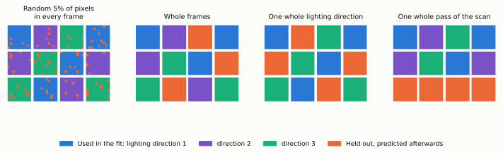

*Figure: four ways to hold data back. Each panel shows twelve frames of a
scan as small squares of pixels, coloured by which lighting direction was
on. Orange marks readings kept out of the fit and predicted afterwards.
From left to right: a random 5% of pixels in every frame, which tests
whether the picture has been fitted to noise. Whole frames, which tests the
position and per-frame estimates. Every frame taken under one lighting
direction, which tests whether the picture, the light model and the pixel
response carry over to light the fit never saw, the strongest of the four.
And one whole pass of the scan, which is an independent repeat. Status:
illustrative.*

The mismatch on the held-out readings is compared with the noise model of
section 4.1 (**Assumption**: the thresholds are in table 10.1).

| Held-out mismatch, relative to the expected noise | Meaning |
|---|---|
| About 1 | The model explains the data |
| Well above 1 | Something is missing from the forward model |
| Fitted data well below 1 while held-out data is above 1 | The fit is following the noise |

## 8. A common benchmark for comparing approaches

Tim wants to explore many approaches, so they need common ground: the same
scenes, the same measures and the same budgets. A **benchmark** is that
agreed set. It lives in the repository as scene files and one scoring
program, and every approach is scored by that program and no other. This
extends the test surfaces of
[design, section 8](design.md#8-validation-plan).

### 8.1 Scenes

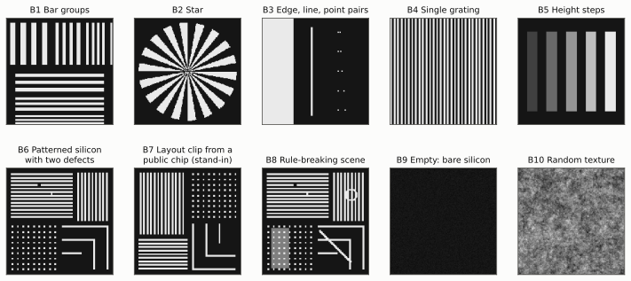

*Figure: the ten benchmark scenes, drawn schematically. B1: groups of bars
of decreasing period, in both directions. B2: a star, which holds every
direction and a continuous range of periods. B3: an edge, a single line and
pairs of points at decreasing separation. B4: a single grating. B5: steps of
increasing height, shown as brightness. B6: the default scene of patterned
silicon, with a broken line and a bridge between two lines as deliberate
defects. B7: a clip of a real chip layout (a stand-in is drawn). B8: scene
B6 with features that break the usual assumptions: a third material, a
diagonal line, a ring and a line off the grid. B9: an empty scene. B10:
random texture. Each exists at the target size (100 nm lines) and as a
scaled copy (2 µm lines). Status: illustrative, the real scene files are not
written yet.*

**Table 8.1: the scenes.** A text table.

| Scene | Probes | Real sample that matches it |
|---|---|---|
| B1 Bar groups | Contrast against period and direction | USAF target, custom target |
| B2 Star | All directions [T29] | Custom target |
| B3 Edge, line, point pairs | Edge response, location precision, two-point resolution | Custom target |
| B4 Single grating | Length scale, contrast at one period | Gratings, pitch standard, optical discs |
| B5 Height steps | Height scale and accuracy | Step-height standard |
| B6 Patterned silicon with defects | The stated goal | SKY130 chip, in part |
| B7 Layout clip from a public chip design, with its layer stack | A real layout, including what lies above the fine layers | SKY130 chip |
| B8 Rule-breaking scene | Invented detail (section 7) | Custom target |
| B9 Empty | Invented detail, and noise in the result | Bare silicon |
| B10 Random texture | Position and gain estimates when nothing is regular | None needed |

### 8.2 Instrument conditions

Each scene is run under four named conditions, so that no approach is judged
only on a perfect instrument (**Assumption**: the factors are proposals).

| Condition | Noise | Instrument numbers | Light dose (relative) | Motion and timing errors (relative) | Pixel response |
|---|---|---|---:|---:|---|
| Ideal | Off | Known exactly | 1 | 0 | Nominal |
| Nominal | On | Hidden, drawn from the tolerances of section 3 | 1 | 1 | Drawn from the range |
| Stressed | On | Hidden | 0.5 | 2 | Unfavourable end of the range |
| Blind | On | Hidden | 1 | 1 | Drawn from the range, and the scene is one the developer has not seen |

### 8.3 Rules for a fair comparison

| Rule | Reason |
|---|---|
| Equal budgets: the same light dose on the sample, scan time and sensor, in a few fixed classes. An approach that needs ten passes is charged for ten. | Otherwise the approach that takes most data wins |
| The data is made one simulation level above the solver's own model, on a finer grid, with a different interpolation | Scoring a solver on data made by its own model overstates what it can do. The trap is known as the inverse crime [T38]. |
| The solver receives raw frames and nominal instrument values only. The scoring program holds the truth. | Same as the gate's "blind" condition |
| Each result declares what it assumed about the scene, and is scored on B8 and B9 as well as B6 | Section 7 |
| Several numbers, no single score | Approaches trade resolution against hardware, light and computation, and the trade should stay visible |

### 8.4 The scorecard

One row per approach and budget class, produced by the scoring program and
published in the documentation. Each column is one number with a unit.

| Column | Unit | From scene |
|---|---|---|
| Resolution against truth, along the scan, nominal | nm | B1, B2, B6 |
| Resolution against truth, across the scan, nominal | nm | B1, B2, B6 |
| Resolution against truth, worst direction, stressed | nm | B1, B2, B6 |
| Contrast at 2000, 400, 290 and 200 nm periods | % | B1 |
| Split-data resolution divided by resolution against truth | ratio | B6 |
| Location error of isolated features | nm | B3 |
| Height error | nm | B5 |
| Length scale error | % | B4 |
| Rule-breaking features recovered, of those planted | count | B8 |
| Signal in the empty scene, relative to noise | ratio | B9 |
| Held-out mismatch, relative to noise | ratio | B6 |
| Worst calibration error, relative to its tolerance | ratio | All |
| Light dose, scan time, data volume | photons per nm², s, GB | Budget class |
| Computation | graphics card hours | Measured |
| Hardware beyond the bare sensor and scan stage | list | Declared |
| Highest simulation level at which the result was confirmed | level | Section 9 |

## 9. What this page gives the gate before hardware

The [gate](glossary.md) is defined in
[design, section 4.9](design.md#49-simulation-first-the-unknown-pixel-response-and-the-gate-before-hardware)
as eight conditions. This page does not redefine it. It supplies the
procedures, scenes, measures and thresholds the conditions call for.

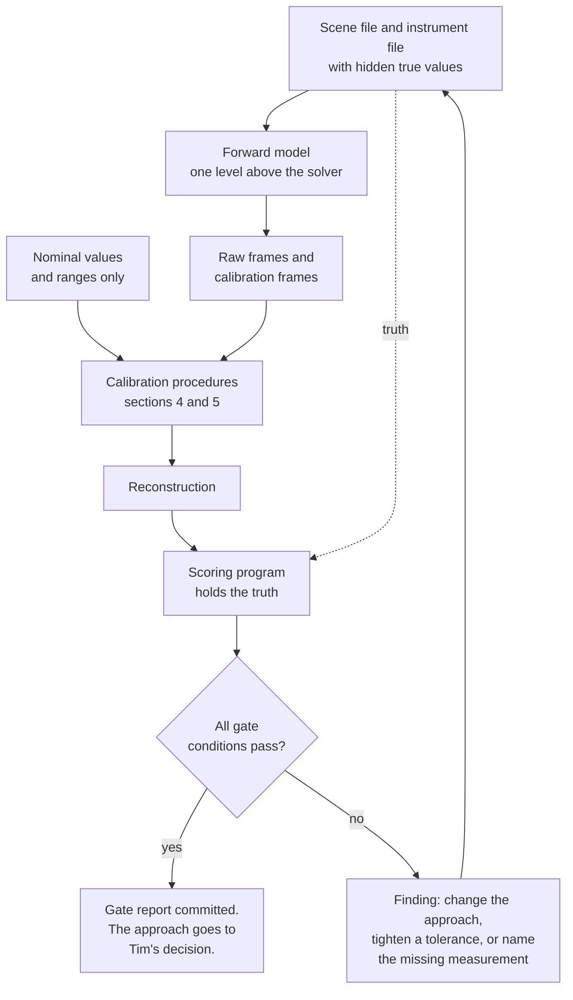

*Figure: one pass through the gate for one approach. The truth reaches only
the scoring program. A failure is recorded as a finding and feeds the next
attempt.*

**Table 9: what this page supplies to each gate condition.** A text table.

| Gate condition (design 4.9) | Supplied here |
|---|---|
| Agreed scenes | Scenes B1 to B10 (8.1), including the rule-breaking scene B8 and the blind condition (8.2) |
| Agreed measures | The measures of 6.2, the scorecard of 8.4, and the thresholds of table 10.1, fixed before the run |
| Robust to the unknowns | The stressed condition (8.2). The tolerance tables of 3.1, which the runs replace with measured ones. For each quantity only hardware can settle, the value at which the approach fails, which becomes the pass mark for the first hardware measurement (section 11). |
| Blind | The instrument file with hidden true values, and the calibration procedures of sections 4 and 5, each scored against the hidden truth and against the best possible (5.2) |
| Levels agree | The rule that data is made one level above the solver (8.3), and the cross-check of each calibration procedure one level up (table 9.1b) |
| Honest about priors | All of section 7.2, not only the wrong-start test |
| Repeatable | Seeds, configuration and the scoring program in the repository |
| Buildable on paper | The list of dedicated measurements (section 4) and reference samples (6.4) the approach needs |

What the gate produces is as useful as passing it. The blind condition
yields the real tolerance table that replaces the estimates of section 3.
The robustness condition yields the list of what to measure first on
hardware, with pass marks. The scorecard yields the comparison of
approaches.

### 9.1 How this is represented in the simulator

**Table 9.1a: proposed pieces.** None exist yet. Names are suggestions. A
text table.

| Piece | Role |
|---|---|
| Instrument file | Every quantity of section 3 with a nominal value and a range. The simulator draws hidden true values from it with a seed. The reconstruction gets the nominal file only. |
| `ccdsr.calibration` | One function per procedure of sections 4 and 5. Each takes frames and returns an estimate with an uncertainty. The same functions run on simulated and real frames. |
| Calibration scenes | The light and target for each dedicated measurement of section 4: even light at a ladder of levels, two beams on the bare sensor, a flashing light, a grating on the stage |
| `ccdsr.benchmark` | The scenes and conditions of section 8 and the scoring program |
| `ccdsr.metrics` | Already planned in the design. Gains both forms of ring correlation, bar contrast, edge response, the alignment that removes undetermined shifts and scales [T43], and held-out mismatch. |
| Identifiability tool | Section 5.2 |
| Gate report | One generated page per approach, with the conditions, the scorecard row and the figures |

**Table 9.1b: where each calibration procedure is rehearsed and
cross-checked** along the simulation chain. Levels are those of the
[simulation chain](simulation-chain.md): 1 linear blur, 2 ray tracing,
3 wave propagation, 4 full electromagnetic solver.

| Procedure | Rehearsed at level | Cross-checked at level | What the cross-check shows |
|---|---:|---:|---|
| Photon transfer (4.1) | 1 | none | The noise model is the same at every level |
| Timing check (4.3) | 1 | none | |
| Gain and offset from the scan | 1 | 3 | Whether interference stripes in the frames disturb the gain estimate |
| Frame positions from the scan | 1 | 2 and 3 | Whether height, shadows and diffraction bias the position estimate |
| Gap and tilt, diffuse light | 1 | 2 | Whether surface height biases it |
| Gap and tilt, coherent light | 3 | 4 | Whether real chip structure biases the focus |
| Pixel response measurement (4.2) | 3 | 4 | Whether the simple pixel model is enough (part C) |
| Light pattern, stripe position, coherence | 3 | 4 on a patch | The same |
| Length, brightness and height anchors | 1 and 3 | 4 | Whether a grating's known period survives the full physics, and the true reflectance of silicon with its oxide |

## 10. Stage by stage

The five stages are those of
[design, section 4.7](design.md#47-a-staged-path-to-the-picture-the-current-leading-candidate).
They belong to the current leading candidate and are one path through the
approaches, not the only one. Each stage is passed twice: first in
simulation, and at the very end on hardware.

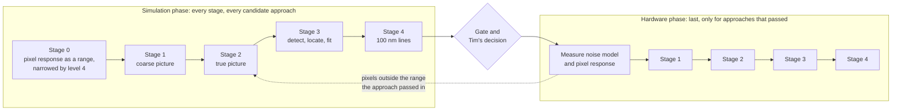

*Figure: the two passes through the stages. All five stages are first run in
simulation for every candidate approach. Hardware starts only after the gate
and Tim's decision, with the pixel measurement, which can send the work back
to simulation if the real pixels fall outside the range in which the
approach passed.*

**Table 10.1: proposed acceptance thresholds in simulation.** Every
threshold is an **Assumption**, chosen to be plausible and to be agreed
before the runs, as the gate requires. Periods are for the target-size
scenes unless marked "scaled", which means the 2 µm copy.

| Stage | Check | Scene | Condition | Threshold | Unit |
|---|---|---|---|---:|---|
| 0 | Electrons per count recovered | Even light | Nominal | ±2 | % |
| 0 | Read noise recovered | Even light | Nominal | ±5 | % |
| 0 | Pixel edge softness recovered by the simulated stripe measurement | Two beams on the sensor | Nominal | ±10 | nm |
| 0 | Row time recovered | Flashing light | Nominal | ±400 | parts per million |
| 1 | Resolution against truth, relative to the level 0 prediction for the gap | B1, B2, scaled | Nominal | ≤ 1.2 | ratio |
| 1 | Frame positions recovered | B10, scaled | Nominal | ≤ 146 | nm |
| 1 | Pixel gains recovered | B10, scaled | Nominal | ≤ 0.3 | % |
| 1 | Length scale recovered | B4, scaled | Nominal | ≤ 0.5 | % |
| 1 | Signal in the empty scene | B9 | Nominal | ≤ 1 | ratio to noise |
| 2 | Resolution against truth, worst direction | B1, B2, B6, B7 | Nominal | ≤ 400 | nm period |
| 2 | Frame positions recovered | B6 | Nominal | ≤ 29 | nm |
| 2 | Height recovered | B5 | Nominal | ≤ 10 | nm |
| 2 | Split-data resolution against true resolution | B6 | Nominal | 0.85 to 1.15 | ratio |
| 2 | Held-out lighting direction, mismatch | B6 | Nominal | ≤ 1.2 | ratio to noise |
| 2 | Rule-breaking features recovered | B8 | Nominal | all | of those planted |
| 3 | Location error of isolated features, relative to the theoretical best [T40] | B3 | Nominal | ≤ 2 | ratio |
| 3 | Fitted line width | B6 | Nominal | ≤ 10 | nm |
| 3 | Rule-breaking features reported as "does not fit" | B8 | Nominal | all | of those planted |
| 4 | Resolution against truth, worst direction | B1, B2, B6 | Nominal | ≤ 200 | nm period |
| 4 | The same, with the prior's weight at zero | B6 | Nominal | ≤ 200 | nm period |
| 4 | The same, started from a wrong layout | B8 | Nominal | ≤ 200 | nm period |
| All | Every check above | The same | Stressed | stated | reported, with the point of failure |

**Table 10.2: what is calibrated at each stage, and how.** A text table.
"Data" means solved from the scan.

| Stage | Result | Dedicated measurements (hardware phase) | Solved from the data | Anchors |
|---|---|---|---|---|
| 0. The pixels | Pixel response, noise model | Photon transfer (4.1). Pixel response to angle and stripes (4.2). Timing (4.3). Rough wavelength and colour purity (4.4). Response to near-ultraviolet light, which decides the stage 4 hardware. | None | None |
| 1. Coarse picture | Picture at micrometre scale, positions, gains, chip map | Rough gap | Positions, speed, rotation, gains, offsets, row noise, gap and tilt per tile | Length (pixel spacing, checked on a grating). Brightness (bare silicon). |
| 2. True picture to 150 to 200 nm lines | Picture and a calibrated instrument model | Polarisation set, pulse timing checked | Positions to about 20 nm, gap per tile, beam angles, stripe period and position per frame, light pattern, coherence mixture, pulse energy, pixel response refined | As stage 1, plus height (wavelength and angle, checked on a step) |
| 3. Detect, locate and fit | Layout estimate, labelled measured or inferred | Optical constants of the materials, on unpatterned areas of the same chip | The stage 2 instrument model, held fixed | Brightness matters most: fitted line widths are read from brightness, colour and polarisation [T41] |
| 4. True picture at 100 nm lines | The result | Pixel response repeated at the new wavelength or through the liquid. Refractive index of the liquid. | As stage 2, plus sensor temperature (3.2) | As stage 2 |

**Table 10.3: proposed acceptance tests on hardware,** each compared with
its own rehearsal. A text table. Thresholds are those of table 10.1 where a
truth exists.

| Stage | Sample | Test |
|---|---|---|
| 0 | Bare sensor | Stripe contrast at coarse periods above 90%, which shows the stripes themselves are good. Contrast against period repeatable between runs and between areas of the sensor. The measured response falls inside the simulated range. |
| 1 | USAF target | The finest group resolved matches the simulation for the measured gap, in both directions |
| 1 | Grating | Period recovered within the length tolerance, with the pixel spacing as the ruler |
| 1 | Any | Forward and return passes agree. Solved gains agree with the even-light frames. |
| 2 | Grating, 278 nm period | Period recovered. Contrast compared with simulation. |
| 2 | Blu-ray disc | Tracks 320 nm apart separated |
| 2 | SKY130 chip | Ring correlation against the design file to a stated period |
| 2 | Any | Held-out lighting direction predicted. Wrong-start and noise-substitution tests passed. Repeat after turning the sample agrees. |
| 3 | SKY130 chip | Fitted layout against the design file |
| 3 | Any chip | Fitted line widths against electron microscope measurements of the same lines. A blind sample. |
| 4 | Custom target | Bars of 200 nm period separated in both directions. Planted defects and rule-breaking shapes found. |
| 4 | A chip finer than SKY130 | Ring correlation against an electron microscope picture to a 200 nm period |

## 11. The hardware phase

When an approach has passed the gate and Tim has decided it goes ahead, the
hardware work is ordered so the cheapest and most decisive measurement comes
first.

| Order | Step | Equipment | Decides |
|---:|---|---|---|
| 1 | Noise model (4.1) | Sensor, a small lamp | Replaces the assumed noise figures |
| 2 | Pixel response (4.2) | Sensor, laser, mirror | Go or no-go: whether the real pixels fall in the range in which the approach passed |
| 3 | Timing, wavelength, colour purity (4.3, 4.4) | A flashing light, a grating | Starting values for the fit |
| 4 | Stage acceptance tests, in order (table 10.3) | Scan stage, lighting, reference samples | Whether the instrument does what the simulation said |

If step 2 fails, the hardware work stops there, having cost one sensor and
one laser, and the simulation is revisited with the measured response.

Every hardware measurement is compared with its simulated twin. A difference
between the two is treated as a failed cross-check between two simulation
levels would be: either a fault or a limit of the model, and recorded either
way. This is item H3 of the [plan](plan.md): measured behaviour goes back
into the simulator.

## 12. Open questions for Tim

1. **Which layer of a finished chip is the target**, and may upper layers be
   removed? This decides which reference chips are useful and whether scene
   B7 needs the full layer stack.
2. **Is an electron microscope, or a probe microscope, available** for the
   final comparison? Without one, public-layout chips and custom targets
   carry the whole hardware test.
3. **Is a custom electron-beam test target acceptable** as a purchase in the
   hardware phase? It is the only source of designed patterns at a 200 nm
   period.
4. **Are the proposed thresholds of table 10.1 and the stressed condition of
   table 8.2 right?** They have to be fixed before the runs.
5. **Should the colour purity of the laser (3.3) be solved by a purer laser,
   or by computation and a narrower useful strip?** The simulator can
   compare them. The first is more hardware, the second more scan time.

## 13. Limits of this page

- The tolerances in section 3 are first-order formulas. The gap tolerance
  for coherent light uses a small-angle estimate that is not valid at steep
  angles, and is for order of magnitude only.
- The map in section 2 is a judgement. The identifiability study would
  confirm it.
- The laser figures are from vendor datasheets found by search and read in
  summary, for parts that have not been chosen. The width of the strip in
  which an ordinary diode gives stripes depends on its spectral width and on
  the shape of its spectrum, both of which vary between parts and with drive
  current. A Gaussian shape was assumed.
- The reflectance of silicon is computed from optical constants quoted from
  memory and ignores the natural oxide.
- Treating the pixel response as a function of two directions assumes the
  pixel responds to light intensity and that neighbouring pixels do not
  exchange light. Light leaking between pixels at steep angles would add
  further terms. Level 4 on a group of pixels would show it.
- The toy examples (sections 3.2, 4.1, 4.3, 6.2 and 7.1) show that an effect
  exists or that a procedure works in principle. Their numbers say nothing
  about the size of the effect for this instrument.
- Reference samples are listed from catalogues and specifications. None has
  been bought or tried. Prices are not given because none were checked.
- The thresholds in section 10 are proposals.
- The papers in section 14 were checked to exist, with the identifiers
  given, against the OpenAlex index. They were not re-read in full for this
  page. Each is cited for its main, well-known result, and no specific
  number on this page is taken from them unless stated.

## 14. References

Keys beginning with T are this page's own list, which is part of the shared
[references](references.md) page. Keys R1 and BornWolf are defined there.
"Checked" means the work was matched in the OpenAlex index when it was
added. It does not mean the specific claim was checked against the text.

Sensor characterisation:

- [T1] Janesick, "Photon Transfer", SPIE Press, 2007.
  [doi:10.1117/3.725073](https://doi.org/10.1117/3.725073). Checked. Also in
  the shared list as Janesick.
- [T2] European Machine Vision Association, "EMVA Standard 1288: Standard
  for characterization of image sensors and cameras".
  <https://www.emva.org/standards-technology/emva-1288/>. Unverified: cited
  from general knowledge of the standard, page not opened.
- [T3] Pagnutti et al., "Laying the foundation to use Raspberry Pi 3 V2
  camera module imagery for scientific and engineering purposes", Journal of
  Electronic Imaging, 2017.
  [doi:10.1117/1.jei.26.1.013014](https://doi.org/10.1117/1.jei.26.1.013014).
  Checked.
- [T4] Marchywka and Socker, "Modulation transfer function measurement
  technique for small-pixel detectors", Applied Optics, 1992.
  [doi:10.1364/ao.31.007198](https://doi.org/10.1364/ao.31.007198). Checked.
- [T5] Greivenkamp and Lowman, "Modulation transfer function measurement of
  sparse-array sensors using a self-calibrating fringe pattern", Applied
  Optics, 1994.
  [doi:10.1364/ao.33.005029](https://doi.org/10.1364/ao.33.005029). Checked.
- [T6] Kavaldjiev and Ninkov, "Subpixel sensitivity map for a charge-coupled
  device", Optical Engineering, 1998.
  [doi:10.1117/1.601788](https://doi.org/10.1117/1.601788). Checked.
- [T7] Mahato et al., "Measuring intra-pixel sensitivity variations of a
  CMOS image sensor", IEEE Sensors Journal, 2018.
  [doi:10.1109/jsen.2018.2798698](https://doi.org/10.1109/jsen.2018.2798698).
  Checked.
- [T8] Zhai, Shao, Goullioud and Nemati, "Micro-pixel accuracy centroid
  displacement estimation and detector calibration", Proceedings of the
  Royal Society A, 2011.
  [doi:10.1098/rspa.2011.0255](https://doi.org/10.1098/rspa.2011.0255).
  Checked.
- [T9] Crouzier et al., "Metrology calibration and very high accuracy
  centroiding with the NEAT testbed", Proceedings of SPIE, 2014.
  [doi:10.1117/12.2056956](https://doi.org/10.1117/12.2056956). Checked.
- [T10] Catrysse and Wandell, "Optical efficiency of image sensor pixels",
  Journal of the Optical Society of America A, 2002.
  [doi:10.1364/josaa.19.001610](https://doi.org/10.1364/josaa.19.001610).
  Checked.
- [T21] Oth, Furgale, Kneip and Siegwart, "Rolling shutter camera
  calibration", IEEE Conference on Computer Vision and Pattern Recognition,
  2013. [doi:10.1109/cvpr.2013.179](https://doi.org/10.1109/cvpr.2013.179).
  Checked.

Solving for the instrument from the data:

- [T11] Kuhn, Lin and Loranz, "Gain calibrating nonuniform image-array data
  using only the image data", Publications of the Astronomical Society of
  the Pacific, 1991. [doi:10.1086/132932](https://doi.org/10.1086/132932).
  Checked.
- [T12] Guizar-Sicairos and Fienup, "Phase retrieval with transverse
  translation diversity: a nonlinear optimization approach", Optics Express,
  2008. [doi:10.1364/oe.16.007264](https://doi.org/10.1364/oe.16.007264).
  Checked.
- [T13] Maiden, Humphry, Sarahan, Kraus and Rodenburg, "An annealing
  algorithm to correct positioning errors in ptychography", Ultramicroscopy,
  2012.
  [doi:10.1016/j.ultramic.2012.06.001](https://doi.org/10.1016/j.ultramic.2012.06.001).
  Checked.
- [T14] Zhang et al., "Translation position determination in ptychographic
  coherent diffraction imaging", Optics Express, 2013.
  [doi:10.1364/oe.21.013592](https://doi.org/10.1364/oe.21.013592). Checked.
- [T15] Thibault, Dierolf, Bunk, Menzel and Pfeiffer, "Probe retrieval in
  ptychographic coherent diffractive imaging", Ultramicroscopy, 2009.
  [doi:10.1016/j.ultramic.2008.12.011](https://doi.org/10.1016/j.ultramic.2008.12.011).
  Checked.
- [T16] Thibault and Menzel, "Reconstructing state mixtures from diffraction
  measurements", Nature, 2013.
  [doi:10.1038/nature11806](https://doi.org/10.1038/nature11806). Checked.
- [T17] Loetgering, Du, Eikema and Witte, "zPIE: an autofocusing algorithm
  for ptychography", Optics Letters, 2020.
  [doi:10.1364/ol.389492](https://doi.org/10.1364/ol.389492). Checked.
- [T18] de Beurs et al., "aPIE: an angle calibration algorithm for
  reflection ptychography", Optics Letters, 2022.
  [doi:10.1364/ol.453655](https://doi.org/10.1364/ol.453655). Checked.
- [T19] Odstrčil, Menzel and Guizar-Sicairos, "Iterative least-squares
  solver for generalized maximum-likelihood ptychography", Optics Express,
  2018. [doi:10.1364/oe.26.003108](https://doi.org/10.1364/oe.26.003108).
  Checked.
- [T20] Wicker, Mandula, Best, Fiolka and Heintzmann, "Phase optimisation
  for structured illumination microscopy", Optics Express, 2013.
  [doi:10.1364/oe.21.002032](https://doi.org/10.1364/oe.21.002032). Checked.
- [T22] Loetgering et al., "PtyLab.m/py/jl: a cross-platform, open-source
  inverse modeling toolbox for conventional and Fourier ptychography",
  Optics Express, 2023.
  [doi:10.1364/oe.485370](https://doi.org/10.1364/oe.485370). Checked.
- [T23] Guizar-Sicairos, Thurman and Fienup, "Efficient subpixel image
  registration algorithms", Optics Letters, 2008.
  [doi:10.1364/ol.33.000156](https://doi.org/10.1364/ol.33.000156). Checked.
  Also in the shared list as GuizarSicairos2008.

Resolution measures:

- [T24] Saxton and Baumeister, "The correlation averaging of a regularly
  arranged bacterial cell envelope protein", Journal of Microscopy, 1982.
  [doi:10.1111/j.1365-2818.1982.tb00405.x](https://doi.org/10.1111/j.1365-2818.1982.tb00405.x).
  Checked.
- [T25] van Heel and Schatz, "Fourier shell correlation threshold criteria",
  Journal of Structural Biology, 2005.
  [doi:10.1016/j.jsb.2005.05.009](https://doi.org/10.1016/j.jsb.2005.05.009).
  Checked. Also in the shared list as vanHeel2005.
- [T26] Nieuwenhuizen et al., "Measuring image resolution in optical
  nanoscopy", Nature Methods, 2013.
  [doi:10.1038/nmeth.2448](https://doi.org/10.1038/nmeth.2448). Checked.
- [T27] Banterle, Bui, Lemke and Beck, "Fourier ring correlation as a
  resolution criterion for super-resolution microscopy", Journal of
  Structural Biology, 2013.
  [doi:10.1016/j.jsb.2013.05.004](https://doi.org/10.1016/j.jsb.2013.05.004).
  Checked.
- [T28] Koho et al., "Fourier ring correlation simplifies image restoration
  in fluorescence microscopy", Nature Communications, 2019.
  [doi:10.1038/s41467-019-11024-z](https://doi.org/10.1038/s41467-019-11024-z).
  Checked.
- [T29] Horstmeyer, Heintzmann, Popescu, Waller and Yang, "Standardizing the
  resolution claims for coherent microscopy", Nature Photonics, 2016.
  [doi:10.1038/nphoton.2015.279](https://doi.org/10.1038/nphoton.2015.279).
  Checked.
- [T39] Thompson, Larson and Webb, "Precise nanometer localization analysis
  for individual fluorescent probes", Biophysical Journal, 2002.
  [doi:10.1016/s0006-3495(02)75618-x](https://doi.org/10.1016/s0006-3495(02)75618-x).
  Checked.
- [T40] Ober, Ram and Ward, "Localization accuracy in single-molecule
  microscopy", Biophysical Journal, 2004.
  [doi:10.1016/s0006-3495(04)74193-4](https://doi.org/10.1016/s0006-3495(04)74193-4).
  Checked.
- [T41] Niu, Jakatdar, Bao and Spanos, "Specular spectroscopic
  scatterometry", IEEE Transactions on Semiconductor Manufacturing, 2001.
  [doi:10.1109/66.920722](https://doi.org/10.1109/66.920722). Checked.
- [T42] Burns, "Slanted-edge MTF for digital camera and scanner analysis",
  Proceedings of the IS&T PICS Conference, 2000. Checked (no identifier).
  The method standardised in ISO 12233.
- [T43] Fienup, "Invariant error metrics for image reconstruction", Applied
  Optics, 1997.
  [doi:10.1364/ao.36.008352](https://doi.org/10.1364/ao.36.008352). Checked.

Over-fitting, invented detail and fair tests:

- [T30] Rosenthal and Henderson, "Optimal determination of particle
  orientation, absolute hand, and contrast loss in single-particle electron
  cryomicroscopy", Journal of Molecular Biology, 2003.
  [doi:10.1016/j.jmb.2003.07.013](https://doi.org/10.1016/j.jmb.2003.07.013).
  Checked.
- [T31] Scheres and Chen, "Prevention of overfitting in cryo-EM structure
  determination", Nature Methods, 2012.
  [doi:10.1038/nmeth.2115](https://doi.org/10.1038/nmeth.2115). Checked.
- [T32] Chen et al., "High-resolution noise substitution to measure
  overfitting and validate resolution in 3D structure determination by
  single particle electron cryomicroscopy", Ultramicroscopy, 2013.
  [doi:10.1016/j.ultramic.2013.06.004](https://doi.org/10.1016/j.ultramic.2013.06.004).
  Checked.
- [T33] Henderson, "Avoiding the pitfalls of single particle cryo-electron
  microscopy: Einstein from noise", Proceedings of the National Academy of
  Sciences, 2013.
  [doi:10.1073/pnas.1314449110](https://doi.org/10.1073/pnas.1314449110).
  Checked.
- [T34] Brünger, "Free R value: a novel statistical quantity for assessing
  the accuracy of crystal structures", Nature, 1992.
  [doi:10.1038/355472a0](https://doi.org/10.1038/355472a0). Checked.
- [T35] Culley et al., "Quantitative mapping and minimization of
  super-resolution optical imaging artifacts", Nature Methods, 2018.
  [doi:10.1038/nmeth.4605](https://doi.org/10.1038/nmeth.4605). Checked.
- [T36] Antun, Renna, Poon, Adcock and Hansen, "On instabilities of deep
  learning in image reconstruction and the potential costs of AI",
  Proceedings of the National Academy of Sciences, 2020.
  [doi:10.1073/pnas.1907377117](https://doi.org/10.1073/pnas.1907377117).
  Checked.
- [T37] Bhadra, Kelkar, Brooks and Anastasio, "On hallucinations in
  tomographic image reconstruction", IEEE Transactions on Medical Imaging,
  2021.
  [doi:10.1109/tmi.2021.3077857](https://doi.org/10.1109/tmi.2021.3077857).
  Checked.
- [T38] Kaipio and Somersalo, "Statistical inverse problems: discretization,
  model reduction and inverse crimes", Journal of Computational and Applied
  Mathematics, 2007.
  [doi:10.1016/j.cam.2005.09.027](https://doi.org/10.1016/j.cam.2005.09.027).
  Checked.

Reference samples and trusted pictures:

- [T44] Holler et al., "High-resolution non-destructive three-dimensional
  imaging of integrated circuits", Nature, 2017.
  [doi:10.1038/nature21698](https://doi.org/10.1038/nature21698). Checked.
- [T45] Postek and Vladár, "Does your SEM really tell the truth? How would
  you know? Part 1", Scanning, 2013.
  [doi:10.1002/sca.21075](https://doi.org/10.1002/sca.21075). Checked.
- [T46] SkyWater SKY130 process design kit documentation, "Periphery rules".
  <https://skywater-pdk.readthedocs.io/en/main/rules/periphery.html>. The
  page was read for this work, and the values used are rules poly.1a and
  poly.2 (0.150 and 0.210 µm), li.1 and li.3 (0.170), m1.1 to m2.2 (0.140),
  m3.1 to m4.2 (0.300), m5.1 and m5.2 (1.600).
- [T47] National Institute of Standards and Technology, "Reference Material
  8820: Scanning electron microscope scale calibration artifact", report of
  investigation. <https://tsapps.nist.gov/srmext/certificates/8820.pdf>.
  Read in summary from a search result.
- [T48] TDG01 diffraction grating for probe microscope calibration, 278 nm
  period, distributor listing.
  <https://nanotechnologysolutions.com.au/product/tdg01/>. Read in summary
  from a search result.
- [T49] CyberLink, "Blu-ray Disc specifications",
  <https://www.cyberlink.com/stat/bd-support/enu/bd-specs.jsp>, and
  Wikipedia, "Optical disc". Read in summary from a search result.
  Secondary sources, to be replaced by the disc standards.
- [T50] Vendor datasheets for 405 nm laser diode modules, read in summary
  from search results:
  <https://www.rpmclasers.com/wp-content/uploads/2022/05/R3Z0-Datasheet-RWLD-405-001-1.pdf>
  and
  <https://shop.laserdiodesource.com/shop/405nm-300mw-mmf-pc-fiber-coupled-wvsl>.
  To be replaced by the datasheet of the part chosen.
- [T51] Edmund Optics, 3600 grooves per mm holographic grating, catalogue
  page.
  <https://www.edmundoptics.com/p/3600-groovesmm-25mm-square-uv-holographic-grating/4929/>.
  Read in summary from a search result.
- [T52] Wikipedia, "1951 USAF resolution test chart".
  <https://en.wikipedia.org/wiki/1951_USAF_resolution_test_chart>. The
  chart's formula, lines per millimetre = 2 to the power (group + (element −
  1) / 6), read in summary from a search result.
