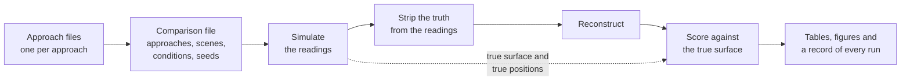
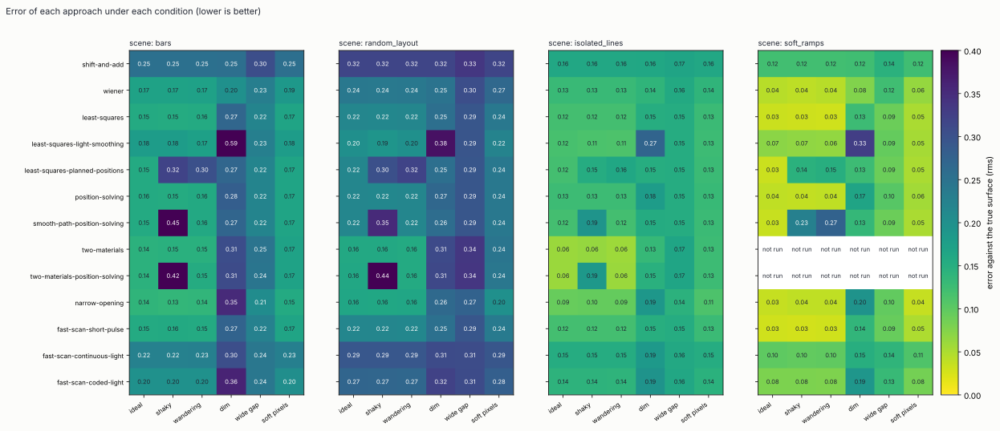
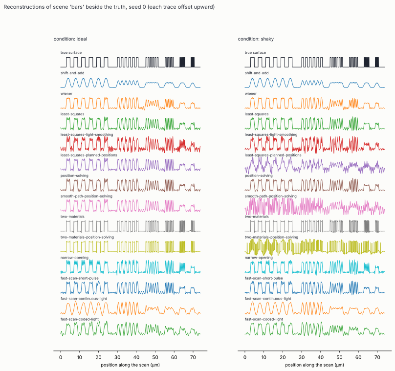

# Comparing approaches

Tim asked for a simulator that can explore many different approaches and not
one. This page describes the part that does it, and the first comparison it
has run. An approach is one short text file. A comparison runs every approach
in a list on the same test surfaces, under the same conditions, with the same
random numbers, and scores every result with the same measures.

The first comparison ran 13 approaches on 4 surfaces under 6 conditions, 10
times each with different random noise: 3,120 runs. It uses simulation
[level 1](level1.md) in one dimension, with bars down to 0.32 µm, so it says
nothing yet about 100 nm features or about laser light. What it found:

1. Trusting the planned constant speed fails in every run once the motion
   has errors. Finding the positions from the readings usually repairs it
   with no position readout, but not always: on the bar scene with a
   wandering path it lost the positions in 3 runs of 10.
2. The rule that the sensor's path is smooth gives better positions when the
   path is smooth, and fails in every run when the path shakes from frame to
   frame.
3. Knowing the two materials lowers the error against a fit with the same
   smoothing in good conditions and in dim light, and not across a wide gap.
   How strongly the fit is smoothed matters as much as knowing the materials.
4. A narrow opening on each pixel shows the finest bars. What it costs in dim
   light depends on the scene.
5. Scanning the same strip six times faster, with six times fewer readings
   and a short flash of light, still shows the same bars at a somewhat higher
   error. With the light left on, fine detail is lost, and switching the
   light in a coded pattern did not win it back in this test.
6. A gap of 1 µm limits the finest detail for every approach. Dim light
   raises the error more for several of them.

Terms in *italics* are explained in the [glossary](glossary.md). Every number
on this page is Simulated and comes from the committed results in
[`results/level1-first/`](https://github.com/mithro/ccd-superres/tree/main/results/level1-first).

## How a comparison works



*Diagram: the path of one run. The true surface and the true positions go
round the reconstruction, straight to the scoring. A reconstruction receives
only the readings and what its approach file says the instrument knows.*

| Part of an approach | What it sets | Choices that exist today |
|---|---|---|
| Optics | Gap, pixel opening, softness of the pixel edges, matt or mirror-like surface | Any value |
| Scan | Movement per frame, number of frames, share of the frame the light is on, on-off code of the light | Any value |
| Noise | Light level, read noise, spread of pixel gains | Any value |
| Position knowledge | Whether the reconstruction is told where each frame really was, or only the plan | `known`, `unknown` |
| Other knowledge | Whether it is told the two reflectances on the surface | Yes or no |
| Reconstruction | The method and its settings | `shift_and_add`, `wiener`, `least_squares`, `least_squares_positions`, `two_materials`, `two_materials_positions` |

*Table 1. The parts of an approach file at level 1. This is a subset of the
parts listed in [design, section 7.1](design.md#71-approaches-as-named-configurations);
lighting direction, optical elements and wave propagation arrive with the
later simulation levels.*

An approach file is written in TOML, a plain text format of names and values.
It looks like this
([`approaches/two-materials-position-solving.toml`](https://github.com/mithro/ccd-superres/blob/main/approaches/two-materials-position-solving.toml)):

```toml
name = "two-materials-position-solving"
description = "Reconstruction by elimination, step-by-step form: smooth-path position solving, then the two-material fit. No position readout."
hardware = ["sensor with its lens removed", "diffuse light", "scan stage"]
positions = "unknown"

[knowledge]
materials = true

[reconstruction]
method = "two_materials_positions"
path_stiffness = 10.0
```

Three rules keep a comparison fair.

- **A reconstruction never sees the truth.** The readings are copied, the
  true surface is removed from the copy, and the positions in it are
  replaced by the planned ones unless the approach has a position readout.
  What it does receive is idealised in this first version: the blur of the
  instrument (gap, pixel shape, exposure), the light level and the noise
  sizes are given exactly, and a position readout is exact.
- **A condition applies to every approach alike.** A condition is something
  outside the approach's control, such as dim light. If a condition and an
  approach set the same thing, the run is refused.
- **What cannot be run is refused with the reason**, and shown as "not run"
  in the tables. A fit that needs two materials is not run on a surface of
  many reflectances.

## The first comparison

| Approach | What it is | Position readout | Told the materials |
|---|---|---|---|
| `shift-and-add` | Average the readings where they were taken; no sharpening | Yes | No |
| `wiener` | The same, then undo the known blur | Yes | No |
| `least-squares` | Fit a surface to the readings, usual smoothing | Yes | No |
| `least-squares-light-smoothing` | The same with ten times less smoothing, for a like-for-like comparison with the two-material fits | Yes | No |
| `least-squares-planned-positions` | The same fit, trusting the planned constant speed | No | No |
| `position-solving` | Fit the surface and the position of every frame, each frame free | No | No |
| `smooth-path-position-solving` | The same with the rule that the path is smooth | No | No |
| `two-materials` | A fit that pulls every point to one of two known reflectances | Yes | Yes |
| `two-materials-position-solving` | Smooth-path position solving, then the two-material fit | No | Yes |
| `narrow-opening` | Pixels masked to a quarter of their width; least squares | Yes | No |
| `fast-scan-short-pulse` | 2.37 pixels per frame, light flashed briefly | Yes | No |
| `fast-scan-continuous-light` | 2.37 pixels per frame, light always on | Yes | No |
| `fast-scan-coded-light` | 2.37 pixels per frame, light switched in a fixed irregular pattern | Yes | No |

*Table 2. The approaches compared. Each is a file in
[`approaches/`](https://github.com/mithro/ccd-superres/tree/main/approaches). The list is in
[`comparisons/level1-first.toml`](https://github.com/mithro/ccd-superres/blob/main/comparisons/level1-first.toml).*

| Condition | Movement error | Light at full brightness (electrons) | Gap (nm) | Softness of pixel edges (nm) |
|---|---|---:|---:|---:|
| `ideal` | None | 2,500 | 300 | 0 |
| `shaky` | 0.3 pixel rms, new for every frame | 2,500 | 300 | 0 |
| `wandering` | 1 pixel rms, each wander lasting about 20 frames | 2,500 | 300 | 0 |
| `dim` | None | 100 | 300 | 0 |
| `wide gap` | None | 2,500 | 1,000 | 0 |
| `soft pixels` | None | 2,500 | 300 | 150 |

*Table 3. The conditions. Assumptions chosen to stress one thing at a time.
Unless an approach says otherwise the scan is 200 frames of 64 pixels,
1.12 µm wide, moving 0.37 pixel per frame. The three fast-scan approaches
move 2.37 pixels per frame and take 31 frames, so they cover the same strip
with about a sixth of the readings. Each cell of the comparison is run 10
times; the runs differ in their random noise and motion errors (their
"seed").*

| Scene | What is on the surface | Reflectances |
|---|---|---|
| `bars` | Six groups of bars repeating every 4, 2, 1.2, 0.8, 0.48 and 0.32 µm | 0.2 and 1.0 |
| `random_layout` | 80 cells, each 240 nm wide, filled at random with one of two materials | 0.2 and 1.0 |
| `isolated_lines` | Seven bright lines 200 nm wide at uneven spacings | 0.2 and 1.0 |
| `soft_ramps` | Smooth waves of three sizes added together | Any value from 0.1 to 0.9 |

*Table 4. The scenes. They are level 1 stand-ins, not yet the ten benchmark
scenes of [calibration and test, section 8](calibration-and-test.md).*

| Measure | Meaning | Unit |
|---|---|---|
| Error against the true surface | Typical difference between reconstruction and truth (*rms*). Given as the median of the 10 runs and as the worst run | Reflectance, 0 to 1 |
| Finest bar period shown | The finest group of bars reconstructed in the right place with between half and one and a half times its true strength, all coarser groups also passing. "None" if the coarsest group fails. The median is the coarser of the two middle runs | nm |
| Surface assigned to the wrong material | Share of each material that lands on the wrong side of the midpoint between the two reflectances, averaged over the two materials. An all-dark or all-bright answer scores 50 | % |
| Error of the frame positions used | Error of the positions the reconstruction ended with, for approaches with no position readout | nm, rms |
| Runs with positions lost | How many of the 10 runs ended with positions wrong by more than 100 nm rms | Count |

*Table 5. The measures. Before scoring, every reconstruction is slid along
the surface by up to 3 pixels to where it matches the truth best, because a
method with no position readout cannot know where the whole picture sits.
The same freedom is given to every approach. It changes the error of
approaches with a position readout by little, and by up to about a seventh
for the two-material fit on isolated lines (reviewer's check, not in the
committed results).*



*Figure 1. Error against the true surface for every approach (rows) under
every condition (columns), one panel per scene. Lighter is better. Simulated;
each cell is the median of 10 runs.*



*Figure 2. What the reconstructions look like: the bars scene with ideal
motion (left) and shaky motion (right), one run. Simulated.*

## What it found

| Finding | Scene, condition | Measure | First approach | Value | Second approach | Value |
|---|---|---|---|---:|---|---:|
| Planned positions fail with motion errors | `bars`, shaky | Error (reflectance) | `least-squares-planned-positions` | 0.320 | `least-squares` | 0.154 |
| Position solving usually repairs it | `bars`, shaky | Error (reflectance) | `position-solving` | 0.154 | `least-squares` | 0.154 |
| but it can lose the positions | `bars`, wandering | Runs lost, of 10 | `position-solving` | 3 | `smooth-path-position-solving` | 2 |
| and badly in dim light on a sparse scene | `isolated_lines`, dim | Runs lost, of 10 | `position-solving` | 9 | `smooth-path-position-solving` | 0 |
| The smooth-path rule gives better positions on a smooth path | `bars`, wandering | Position error (nm) | `smooth-path-position-solving` | 2.7 | `position-solving` | 6.2 |
| The smooth-path rule fails on a shaky path | `bars`, shaky | Runs lost, of 10 | `smooth-path-position-solving` | 10 | `position-solving` | 0 |
| Two materials help in good conditions | `random_layout`, ideal | Error (reflectance) | `two-materials` | 0.159 | `least-squares-light-smoothing` | 0.199 |
| The same on isolated lines | `isolated_lines`, ideal | Error (reflectance) | `two-materials` | 0.064 | `least-squares-light-smoothing` | 0.115 |
| and in dim light, at the same smoothing | `random_layout`, dim | Error (reflectance) | `two-materials` | 0.305 | `least-squares-light-smoothing` | 0.392 |
| but heavier smoothing does better still in dim light | `random_layout`, dim | Error (reflectance) | `two-materials` | 0.305 | `least-squares` | 0.256 |
| Two materials do not help across a wide gap | `random_layout`, wide gap | Error (reflectance) | `two-materials` | 0.334 | `least-squares-light-smoothing` | 0.293 |
| A narrow opening shows the finest bars | `bars`, ideal | Finest period (nm) | `narrow-opening` | 480 | `least-squares` | 800 |
| It is worse in dim light on bars | `bars`, dim | Error (reflectance) | `narrow-opening` | 0.354 | `least-squares` | 0.267 |
| but not on the random layout | `random_layout`, dim | Error (reflectance) | `narrow-opening` | 0.254 | `least-squares` | 0.256 |
| Six times faster with a short flash costs a little | `bars`, ideal | Error (reflectance) | `fast-scan-short-pulse` | 0.185 | `least-squares` | 0.155 |
| and shows the same bars | `bars`, ideal | Finest period (nm) | `fast-scan-short-pulse` | 800 | `least-squares` | 800 |
| It costs much more in dim light | `bars`, dim | Error (reflectance) | `fast-scan-short-pulse` | 0.583 | `least-squares` | 0.267 |
| Light left on during a fast scan loses fine detail | `bars`, ideal | Finest period (nm) | `fast-scan-continuous-light` | 2,000 | `fast-scan-short-pulse` | 800 |
| A coded light did not win it back | `bars`, ideal | Finest period (nm) | `fast-scan-coded-light` | 2,000 | `fast-scan-continuous-light` | 2,000 |
| and is the worst of all in dim light | `bars`, dim | Error (reflectance) | `fast-scan-coded-light` | 0.790 | `fast-scan-continuous-light` | 0.637 |
| A wide gap limits the finest detail | `bars`, wide gap against ideal | Finest period (nm), best approach | `narrow-opening`, wide gap | 1,200 | `narrow-opening`, ideal | 480 |
| Dim light raises the error more than the wide gap for the plain fit | `bars` | Error (reflectance) | `least-squares`, dim | 0.267 | `least-squares`, wide gap | 0.220 |

*Table 6. The findings with their evidence. Simulated; medians of 10 runs
unless the measure is a count. Every value is in the full tables below.*

Cautions on reading these.

- **Medians hide failures, so the worst run and the count of lost runs are
  tabled beside them.** A method that is right in 7 runs of 10 and badly
  wrong in 3 has a good median.
- **Each approach was run at one setting.** The two-material fits use ten
  times lighter smoothing than the plain fit, which is why a plain fit at
  the same light smoothing is included. Other settings were not tuned, and
  a different smoothing could change an order.
- **The exposure comparison gives every reading the same light.** That suits
  a light that can be flashed brighter. With a light of fixed brightness a
  short flash collects less, and the order of the three fast-scan approaches
  can change ([design, section 4.8](design.md#48-motion-blur-cause-model-and-reversal)).
  That case is not in this comparison yet. The coded pattern was one fixed
  pattern of 16 slots and was not optimised.
- **The surface repeats.** The simulator joins the two ends of each scene,
  and the sensor is longer than three of the four scenes, so every frame
  sees the whole surface. A real scan sees each place only while the sensor
  passes over it. Comparisons of scan speed in particular need scenes
  longer than the sensor, which this version does not have.
- **One result is an effect of the scene.** On `soft_ramps` with a
  wandering path, both position-solving approaches lose the positions in
  nearly every run (table R20). The scene repeats exactly every 5.6 µm, so
  a slip of one repeat fits the readings equally well. The free solver
  still returns a good picture (error 0.037) and the smooth-path solver does
  not (0.260). Regularly repeating surfaces are a known weak point, and
  chips are full of them
  ([ptychography study, section 5.7](research/ptychography.md#57-regular-patterns-a-known-weakness-that-chips-will-trigger)).
- **Ten runs per cell is still few.** Differences in the third decimal
  place are not meaningful, and a bar group that passes in one cell and
  fails in the next may be sitting on the pass mark.

## Full results

```{include} ../results/level1-first/tables.md
```

## What this does not cover yet

| Limit | Why it matters | Where it is dealt with |
|---|---|---|
| Level 1, one dimension, matt surface | No laser light, slanted beams, phase recovery or two-dimensional layouts, so the laser route of the design (a recorded alternative since 15 November 2026) is not in the comparison | Later levels of the [simulation chain](simulation-chain.md) |
| Stand-in scenes | The ten benchmark scenes and the tests against invented detail are not used yet | [Calibration and test, sections 7 and 8](calibration-and-test.md) |
| Conditions vary one thing at a time | Real conditions combine, and the uncertain pixel response should be sampled over its whole range | [Design, section 4.9](design.md#49-simulation-first-the-unknown-pixel-response-and-the-gate-before-hardware) |
| Cost is not scored | Hardware is listed in each approach file, and computing time is in a side table, but neither is part of the scorecard, and scan time and data volume are not worked out | [Plan](plan.md#d-simulation-chain) item D1a, next step |
| Settings of each approach were not tuned | A different smoothing could change an order; one like-for-like pair is included | Sweeps over settings, same item |
| The reconstruction is given the exact blur, light level and noise sizes | A real instrument has to measure or solve for them | Uncertain settings sampled for every approach, same item |
| Scenes repeat and are mostly shorter than the sensor | Every frame sees everything, which flatters all approaches and hides the cost of a faster scan | Longer scenes, same item |
| Listing and eliminating layouts is not an approach here | It examines one small region and does not return a whole picture | [Reconstruction by elimination](constrained-reconstruction.md) |

*Table 7. Limits of the first comparison.*

## Running it and adding to it

```
python -m ccdsr.compare comparisons/level1-first.toml --out results/level1-first --workers 4
```

This takes about a minute on four cores and rewrites the tables, the figures
and [`results.json`](https://github.com/mithro/ccd-superres/blob/main/results/level1-first/results.json), which
holds every run, the text of every approach file and the version of the code
it was run from. A rerun with the same number of workers writes the same
tables, figures and records. With a different number of workers the smooth-path
solver can differ in the last digits, and in a run where it fails outright
the error itself can differ. Computing times change from run to run and are
kept apart, in
[`timings.md`](https://github.com/mithro/ccd-superres/blob/main/results/level1-first/timings.md):
the slowest approach, position solving with two materials, takes a few
tenths of a second per run here. Reading approach files needs Python 3.11
or newer.

To add an approach, write a new file in
[`approaches/`](https://github.com/mithro/ccd-superres/tree/main/approaches) and add it to a comparison file.
To add a reconstruction method or a scene, register a function in
[`ccdsr/approaches.py`](https://github.com/mithro/ccd-superres/blob/main/ccdsr/approaches.py):

```python
from ccdsr import approaches

@approaches.reconstruction("my_method", needs=("materials",))
def my_method(frames, levels, strength=1.0):
    ...                       # frames holds no truth; levels are the two reflectances
    return surface, None      # or (surface, positions) if it estimates positions
```

The runner is [`ccdsr/compare.py`](https://github.com/mithro/ccd-superres/blob/main/ccdsr/compare.py) and its
tests are [`tests/test_approaches.py`](https://github.com/mithro/ccd-superres/blob/main/tests/test_approaches.py).
