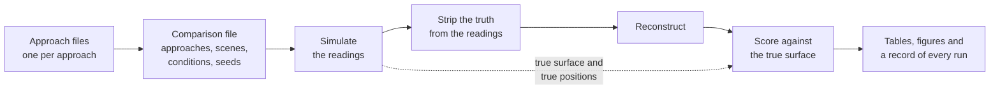

# Comparing approaches

Tim asked for a simulator that can explore many different approaches and not
one. This page describes the part that does it, and the first comparison it
has run. An approach is one short text file. A comparison runs every approach
in a list on the same test surfaces, under the same conditions, with the same
random numbers, and scores every result with the same measures.

The first comparison ran 13 approaches on 4 surfaces under 6 conditions, with
5 sets of random numbers each: 1,560 runs. It uses simulation
[level 1](level1.md) in one dimension, with bars down to 0.32 µm, so it says
nothing yet about 100 nm features or about laser light. What it found:

1. Trusting the planned constant speed fails as soon as the motion has
   errors. Finding the positions from the readings repairs it fully, with no
   position readout.
2. The rule that the sensor's path is smooth gives the best positions when
   the path is smooth and the worst result of all when it shakes from frame
   to frame.
3. Knowing the two materials gives the lowest error in good conditions and
   stops helping in dim light or across a wide gap.
4. A narrow opening on each pixel is the sharpest in good light and among
   the worst in dim light.
5. A fast scan with a short flash of light loses nothing against a slow one.
   With the light left on it loses most fine detail, and switching the light
   in a coded pattern wins part of it back.
6. A gap of 1 µm costs every approach more than any other condition tried.

Terms in *italics* are explained in the [glossary](glossary.md). Every number
on this page is Simulated and comes from the committed results in
[`results/level1-first/`](https://github.com/mithro/ccd-superres/tree/main/results/level1-first).

## How a comparison works



*Diagram: the path of one run. The true surface and the true positions go
round the reconstruction, straight to the scoring. A reconstruction receives
only the readings and what its approach file says the instrument knows.*

| Part of an approach | What it sets | Choices that exist today |
|---|---|---|
| Optics | Gap, pixel opening, softness of the pixel edges, matt or mirror-like surface | Any value |
| Scan | Movement per frame, number of frames, share of the frame the light is on, on-off code of the light | Any value |
| Noise | Light level, read noise, spread of pixel gains | Any value |
| Position knowledge | Whether the reconstruction is told where each frame really was, or only the plan | `known`, `unknown` |
| Other knowledge | Whether it is told the two reflectances on the surface | Yes or no |
| Reconstruction | The method and its settings | `shift_and_add`, `wiener`, `least_squares`, `least_squares_positions`, `two_materials`, `two_materials_positions` |

*Table 1. The parts of an approach file at level 1. This is a subset of the
parts listed in [design, section 7.1](design.md#71-approaches-as-named-configurations);
lighting direction, optical elements and wave propagation arrive with the
later simulation levels.*

An approach file looks like this
([`approaches/two-materials-position-solving.toml`](https://github.com/mithro/ccd-superres/blob/main/approaches/two-materials-position-solving.toml)):

```toml
name = "two-materials-position-solving"
description = "Reconstruction by elimination, step-by-step form: smooth-path position solving, then the two-material fit. No position readout."
hardware = ["sensor with its lens removed", "diffuse light", "scan stage"]
positions = "unknown"

[knowledge]
materials = true

[reconstruction]
method = "two_materials_positions"
path_stiffness = 10.0
```

Three rules keep a comparison fair.

- **A reconstruction never sees the truth.** The readings are copied, the
  true surface is removed from the copy, and the positions in it are
  replaced by the planned ones unless the approach has a position readout.
- **A condition applies to every approach alike.** A condition is something
  outside the approach's control, such as dim light. If a condition and an
  approach set the same thing, the run is refused.
- **What cannot be run is refused with the reason**, and shown as "not run"
  in the tables. A fit that needs two materials is not run on a surface of
  many reflectances.

## The first comparison

| Approach | What it is | Position readout | Told the materials |
|---|---|---|---|
| `shift-and-add` | Average the readings where they were taken; no sharpening | Yes | No |
| `wiener` | The same, then undo the known blur | Yes | No |
| `least-squares` | Fit a surface to the readings, usual smoothing | Yes | No |
| `least-squares-light-smoothing` | The same with ten times less smoothing, for a like-for-like comparison with the two-material fits | Yes | No |
| `least-squares-planned-positions` | The same fit, trusting the planned constant speed | No | No |
| `position-solving` | Fit the surface and the position of every frame, each frame free | No | No |
| `smooth-path-position-solving` | The same with the rule that the path is smooth | No | No |
| `two-materials` | A fit that pulls every point to one of two known reflectances | Yes | Yes |
| `two-materials-position-solving` | Smooth-path position solving, then the two-material fit | No | Yes |
| `narrow-opening` | Pixels masked to a quarter of their width; least squares | Yes | No |
| `fast-scan-short-pulse` | 2.37 pixels per frame, light flashed briefly | Yes | No |
| `fast-scan-continuous-light` | 2.37 pixels per frame, light always on | Yes | No |
| `fast-scan-coded-light` | 2.37 pixels per frame, light switched in a fixed irregular pattern | Yes | No |

*Table 2. The approaches compared. Each is a file in
[`approaches/`](https://github.com/mithro/ccd-superres/tree/main/approaches). The list is in
[`comparisons/level1-first.toml`](https://github.com/mithro/ccd-superres/blob/main/comparisons/level1-first.toml).*

| Condition | Movement error | Light at full brightness (electrons) | Gap (nm) | Softness of pixel edges (nm) |
|---|---|---:|---:|---:|
| `ideal` | None | 2,500 | 300 | 0 |
| `shaky` | 0.3 pixel rms, new for every frame | 2,500 | 300 | 0 |
| `wandering` | 1 pixel rms, each wander lasting about 20 frames | 2,500 | 300 | 0 |
| `dim` | None | 100 | 300 | 0 |
| `wide gap` | None | 2,500 | 1,000 | 0 |
| `soft pixels` | None | 2,500 | 300 | 150 |

*Table 3. The conditions. Assumptions chosen to stress one thing at a time.
Unless an approach says otherwise the scan is 200 frames of 64 pixels,
1.12 µm wide, moving 0.37 pixel per frame.*

| Scene | What is on the surface | Reflectances |
|---|---|---|
| `bars` | Six groups of bars repeating every 4, 2, 1.2, 0.8, 0.48 and 0.32 µm | 0.2 and 1.0 |
| `random_layout` | 80 cells, each 240 nm wide, filled at random with one of two materials | 0.2 and 1.0 |
| `isolated_lines` | Seven bright lines 200 nm wide at uneven spacings | 0.2 and 1.0 |
| `soft_ramps` | Smooth waves of three sizes added together | Any value from 0.1 to 0.9 |

*Table 4. The scenes. They are level 1 stand-ins, not yet the ten benchmark
scenes of [calibration and test, section 8](calibration-and-test.md).*

| Measure | Meaning | Unit |
|---|---|---|
| Error against the true surface | Typical difference between reconstruction and truth (*rms*) | Reflectance, 0 to 1 |
| Finest bar period shown | The finest group of bars reconstructed with at least half its true *contrast*, all coarser groups also passing | nm |
| Surface assigned to the wrong material | Share of the surface on the wrong side of the midpoint between the two reflectances | % |
| Error of the frame positions used | Error of the positions the reconstruction ended with. Zero when it is told them | nm, rms |

*Table 5. The measures. Before scoring, every reconstruction is slid along
the surface by up to 3 pixels to where it matches the truth best, because a
method with no position readout cannot know where the whole picture sits.*


*Figure 1. Error against the true surface for every approach (rows) under
every condition (columns), one panel per scene. Lighter is better. Simulated;
each cell is the median of 5 runs.*


*Figure 2. What the reconstructions look like: the bars scene with ideal
motion (left) and shaky motion (right), one run. Simulated.*

## What it found

| Finding | Evidence (scene `bars` unless stated) | Value | Compared with |
|---|---|---:|---:|
| Planned positions fail with motion errors | Error of `least-squares-planned-positions`, shaky, against ideal | 0.319 | 0.155 |
| Position solving repairs it | Error of `position-solving`, shaky, against `least-squares` with a position readout | 0.154 | 0.154 |
| The smooth-path rule gives better positions on a smooth path | Position error (nm), wandering: `smooth-path-position-solving` against `position-solving` | 2.7 | 6.2 |
| The smooth-path rule fails on a shaky path | Error, shaky: `smooth-path-position-solving` against planned positions | 0.453 | 0.319 |
| Two materials help in good conditions | Error on `random_layout`, ideal: `two-materials` against `least-squares-light-smoothing` | 0.159 | 0.200 |
| The same on isolated lines | Error on `isolated_lines`, ideal, same pair | 0.060 | 0.116 |
| Two materials do not help across a wide gap | Error on `random_layout`, wide gap, same pair | 0.336 | 0.294 |
| In dim light the usual smoothing beats both | Error on `random_layout`, dim: `least-squares`, then `two-materials`, then light smoothing | 0.254 | 0.310, 0.381 |
| A narrow opening is sharpest in good light | Finest period shown (nm), ideal: `narrow-opening` against `least-squares` | 480 | 800 |
| A narrow opening is poor in dim light | Error, dim: `narrow-opening` against `least-squares` | 0.353 | 0.268 |
| A fast scan with a short flash loses nothing | Error, ideal: `fast-scan-short-pulse` against `least-squares` | 0.155 | 0.155 |
| Light left on during a fast scan loses fine detail | Finest period shown (nm), ideal: `fast-scan-continuous-light` against short pulse | 2,000 | 800 |
| A coded light wins part back | Finest period shown (nm), ideal: `fast-scan-coded-light` | 1,200 | 2,000 |
| A wide gap costs every approach | Finest period shown (nm), wide gap: best of all approaches, against ideal | 1,200 | 480 |

*Table 6. The findings with their evidence. Simulated, median of 5 runs;
all values are in the full tables below.*

Three cautions on reading these.

- **The exposure comparison gives every reading the same light.** That suits
  a light that can be flashed brighter. With a light of fixed brightness a
  short flash collects less, and the order of the three fast-scan approaches
  can change ([design, section 4.8](design.md#48-motion-blur-cause-model-and-reversal)).
  That case is not in this comparison yet.
- **One result is an effect of the scene.** On `soft_ramps` with a
  wandering path, both position-solving approaches end thousands of
  nanometres from the true positions (table R12). The scene repeats exactly
  every 5.6 µm, so a slip of one repeat fits the readings equally well. The
  free solver still returns a good picture (error 0.038) and the smooth-path
  solver does not (0.274). Regularly repeating surfaces are a known weak
  point, and chips are full of them
  ([ptychography study, section 5.7](research/ptychography.md#57-regular-patterns-a-known-weakness-that-chips-will-trigger)).
- **Five runs per cell is few.** Differences in the third decimal place are
  not meaningful.

## Full results

```{include} ../results/level1-first/tables.md
```

## What this does not cover yet

| Limit | Why it matters | Where it is dealt with |
|---|---|---|
| Level 1, one dimension, matt surface | No laser light, slanted beams, phase recovery or two-dimensional layouts, so the leading candidate of the design is not in the comparison | Later levels of the [simulation chain](simulation-chain.md) |
| Stand-in scenes | The ten benchmark scenes and the tests against invented detail are not used yet | [Calibration and test, sections 7 and 8](calibration-and-test.md) |
| Conditions vary one thing at a time | Real conditions combine, and the uncertain pixel response should be sampled over its whole range | [Design, section 4.9](design.md#49-simulation-first-the-unknown-pixel-response-and-the-gate-before-hardware) |
| Cost is only computing time | Hardware, scan time and data volume are listed in each approach file but not scored | [Plan](plan.md#d-simulation-chain) item D1a, next step |
| Settings of each approach were not tuned | A different smoothing could change an order; one like-for-like pair is included | Sweeps over settings, same item |
| Listing and eliminating layouts is not an approach here | It examines one small region and does not return a whole picture | [Reconstruction by elimination](constrained-reconstruction.md) |

*Table 7. Limits of the first comparison.*

## Running it and adding to it

```
python -m ccdsr.compare comparisons/level1-first.toml --out results/level1-first --workers 4
```

This takes under a minute on four cores and rewrites the tables, the figures
and [`results.json`](https://github.com/mithro/ccd-superres/blob/main/results/level1-first/results.json), which
holds every run, the text of every approach file and the version of the code.
A rerun gives the same numbers to six figures, except where position solving
fails outright, where the last digits depend on the machine.

To add an approach, write a new file in
[`approaches/`](https://github.com/mithro/ccd-superres/tree/main/approaches) and add it to a comparison file.
To add a reconstruction method or a scene, register a function in
[`ccdsr/approaches.py`](https://github.com/mithro/ccd-superres/blob/main/ccdsr/approaches.py):

```python
from ccdsr import approaches

@approaches.reconstruction("my_method", needs=("materials",))
def my_method(frames, levels, strength=1.0):
    ...                       # frames holds no truth; levels are the two reflectances
    return surface, None      # or (surface, positions) if it estimates positions
```

The runner is [`ccdsr/compare.py`](https://github.com/mithro/ccd-superres/blob/main/ccdsr/compare.py) and its
tests are [`tests/test_approaches.py`](https://github.com/mithro/ccd-superres/blob/main/tests/test_approaches.py).
