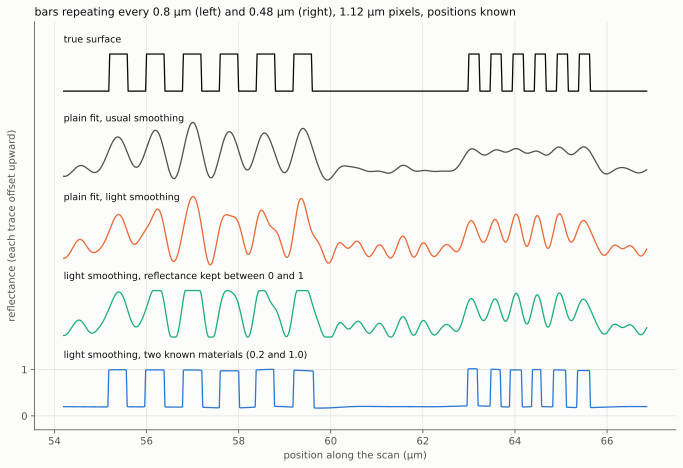

# Reconstruction by elimination

A blurred, noisy measurement can usually be explained by many different
surfaces. Most of them could never exist: surfaces that reflect more light
than falls on them, materials that are not on the chip, wires narrower than
the factory can make, a sensor that jumps sideways between two frames. This
approach uses the simulator to predict what each possible surface would have
produced, and throws away every one that either contradicts the measurement
or could not physically exist. If one is left, it is the answer. If several
are left, the answer is one of them. If none is left, something assumed
about the instrument or the chip is wrong, and the method says so.

The idea is Tim's: "Combinding the results with simulation should allow
recovery based on working out potential possible solutions and eliminating
ones which are physically impossible even without exact positioning
information", and "Temporal properties of the real world can also be used to
help eliminate incorrect or impossible solution spaces."

It is one named approach among those the project compares
([design, section 7.1](design.md#71-approaches-as-named-configurations)), not
a replacement for the others. This page reports a first version in the
one-dimensional [level 1 simulator](level1.md). The test surface has bars
that repeat every 4 µm down to every 0.48 µm (so the finest bars are 0.24 µm
wide) under pixels 1.12 µm wide. The results show that the method works and
how it fails. They do not yet show it at the 100 nm target. For scale, a
pixel is about one seventieth of the width of a human hair, and 0.48 µm is
about the wavelength of blue-green light.

The results, each explained below:

1. Knowing which two materials are on the surface brings back fine bars that
   a plain reconstruction with the same settings shows only weakly
   (*contrast* 0.67 against 0.39, true 0.85). Knowing only that reflectance
   lies between 0 and 1 does not sharpen the picture.
2. Listing all 4,096 possible layouts of a small region and testing each
   against the readings leaves exactly one, the true one, in good light. In
   poor light more are left. The true one was among them in every test,
   when the surroundings and the positions were the true ones.
3. When an assumption is wrong (the materials, or where the frames were) the
   method reports that nothing fits. In these tests it never returned a
   wrong layout.
4. Requiring the sensor's path to be smooth places each frame to 2.4 nm (the
   median of the 37 scans of 40 in which the path was found), when a frame
   taken alone could be placed to 5.6 nm at best. The rule only
   holds when the path really is smooth from one frame to the next: with
   even a little frame-to-frame shake it does harm.
5. With all of this together, positions wrong by a pixel and the whole scan
   misplaced by an unknown amount, 22 scans of 24 ended with the true layout
   and its position, and the other 2 with "nothing fits". A second set of
   24 scans, not used to choose any setting, gave the same counts.

Terms in *italics* are explained in the [glossary](glossary.md). Every number
on this page is printed by
[`docs/diagrams/make_constrained_diagrams.py`](https://github.com/mithro/ccd-superres/blob/main/docs/diagrams/make_constrained_diagrams.py)
and is Simulated with the level 1 simulator unless marked otherwise. An independent review
of the first version of this page found that two of its headline results did
not hold as stated; the [review record](review.md) lists what changed.

## The constraints

```{mermaid}
flowchart TD
    M["Measured readings"] --> T
    P["What is known beforehand"] --> C1["Materials:<br/>reflectance limits,<br/>known reflectances"]
    P --> C2["Layout rules:<br/>drawing grid,<br/>minimum width"]
    P --> C3["Time:<br/>surface does not change,<br/>sensor path is smooth"]
    C1 --> G["Candidates that<br/>could exist"]
    C2 --> G
    C3 --> G
    G --> S["Simulator predicts the<br/>readings of each candidate"]
    S --> T{"Do the predicted<br/>readings match the<br/>measured ones?"}
    T -->|"no"| X["Eliminated"]
    T -->|"yes"| K["Kept"]
```

*Figure 1. How the approach works. Knowledge about the real world limits
which candidates are considered at all. The simulator then predicts what each
remaining candidate would have measured, and the measurement eliminates the
ones that do not fit.*

| Constraint | What it rules out | Used here | Basis |
|---|---|---|---|
| Reflectance limits | Surfaces that send back less than no light, or more than falls on them | Yes | Assumption: the brightness scale is calibrated, so that "all the light" is a known reading |
| Known materials | Reflectances that belong to no material on the chip | Yes, with two materials | Assumption: the materials and their reflectances are known exactly. [Plan](plan.md#data-collection) item R6 collects real values. |
| Layout rules | Features off the drawing grid, or narrower than the process allows | Yes: cell size and minimum width. The position of the grid is searched for. | Assumption: the cell size is known. [Plan](plan.md#data-collection) item R7 collects real layouts and rules. |
| The surface does not change | Explanations in which the same point looks different in different frames | Yes, built into every reconstruction here | Assumption: nothing on the chip moves or heats enough to matter during a scan |
| The path is smooth | Frame positions that jump in ways a moving mass cannot | Yes | Assumption: the motion is smooth from frame to frame. The [radar study](research/synthetic-aperture-radar.md#55-time-as-a-source-of-rules) notes that this rule is strong between rows within one frame and weak from frame to frame. |
| Each disturbance has its own behaviour in time | Mistaking drift, vibration or lamp flicker for surface detail | Not yet | [Radar study, section 5.5](research/synthetic-aperture-radar.md#55-time-as-a-source-of-rules) |

*Table 1. The constraints, and which of them this first version uses.*

The same idea exists in other fields under other names, and each of the four
research studies has a section on it: radar autofocus
([radar study, sections 5.4 and 5.5](research/synthetic-aperture-radar.md#54-proposing-candidates-and-eliminating-the-impossible)),
and the studies of [beamforming](research/beamforming.md),
[multi-frame reconstruction](research/multi-frame-reconstruction.md) and
[ptychography](research/ptychography.md). Their findings have not yet been
folded into this page; that is [plan](plan.md#c-fold-the-research-into-the-design)
item C1.

## The test

| Setting | Value | Unit |
|---|---:|---|
| Pixel pitch | 1.12 | µm |
| Gap, matt surface | 0.30 | µm |
| Pixels in the row | 64 | |
| Frames | 160 | |
| Shift between frames | 0.37 | pixels |
| Bar groups, repeat distance | 4, 2, 1.2, 0.8, 0.48 | µm |
| Bar width in the finest group | 0.24 | µm |
| Reflectance of the two materials | 0.2 and 1.0 | |
| Electrons at full brightness | 2,500 | e⁻ |
| Read noise | 2.0 | e⁻ |
| Share of contrast the blur lets through at 0.48 µm | 0.63 | % |

*Table 2. Settings, the same as the [level 1 worked example](level1.md)
except that the finest group is 0.48 µm, so that its bars are whole numbers
of grid steps. Assumption. As on the level 1 page, every frame sees the whole
strip and the scan passes over it twice.*

## Materials

Reconstructions of the same readings, with positions known. A reconstruction
has a setting for how strongly it prefers a smooth answer. A weaker
preference lets fine detail through, and noise with it, whatever else is
done. So the rows below are compared at the same setting.



*Figure 2. Top: the true surface. Second: a plain fit with the usual
smoothing shows the 0.48 µm bars as a grey block. Third: the same fit with
light smoothing shows them weakly, with more ripple elsewhere. Fourth:
keeping reflectance between 0 and 1 removes some ripple but does not
strengthen the bars. Bottom: knowing that there are two materials, with
reflectance 0.2 and 1.0, gives sharp bars, most of them in the right places.
One scan, seed 1.*

| Reconstruction | Smoothing | 4 µm | 2 µm | 1.2 µm | 0.8 µm | 0.48 µm | 0.48 µm, lowest to highest | Overall error (rms) |
|---|---:|---:|---:|---:|---:|---:|---|---:|
| True surface | | 0.85 | 0.85 | 0.85 | 0.85 | 0.85 | | 0.000 |
| Plain fit | 0.01 | 0.85 | 0.85 | 0.67 | 0.79 | 0.05 | 0.02 to 0.08 | 0.147 |
| Plain fit | 0.001 | 0.85 | 0.85 | 0.80 | 0.85 | 0.39 | 0.21 to 0.56 | 0.175 |
| Reflectance between 0 and 1 | 0.001 | 0.85 | 0.85 | 0.75 | 0.82 | 0.38 | 0.20 to 0.54 | 0.141 |
| Two known materials | 0.001 | 0.85 | 0.85 | 0.83 | 0.84 | 0.67 | 0.42 to 0.82 | 0.114 |
| Three materials offered, one of them not present | 0.001 | 0.85 | 0.84 | 0.75 | 0.77 | 0.06 | 0.00 to 0.24 | 0.150 |

*Table 3. Contrast of each bar group and the *rms* difference from the true
surface in units of reflectance: averages over 15 random scans (seeds 0 to
14), with the range over those scans for the finest group. Smoothing is the
`smoothness` setting of the fit.*

| Bar group, repeat distance (µm) | 4 | 2 | 1.2 | 0.8 | 0.48 |
|---|---:|---:|---:|---:|---:|
| Share of the group given the wrong material (%) | 0.9 | 1.5 | 4.3 | 3.6 | 18.0 |

*Table 4. How much of each bar group the two-material reconstruction gets
wrong, by length, averaged over seeds 0 to 14.*

What this shows:

- **Knowing the materials helps.** At the same smoothing the finest bars go
  from a contrast of 0.39 to 0.67, and the overall error falls by a third.
- **The limits of 0 and 1 alone do not sharpen anything here.** They lower
  the overall error (0.175 to 0.141) by removing swings below zero, but the
  contrast of the fine bars is unchanged. This surface never comes near
  zero, its darkest material reflecting 0.2, so the lower limit has little
  to hold on to. A surface with truly black areas may behave differently;
  that is not tested. Judgement.
- **The materials must be the right ones.** Offering a third material that
  is not on the surface (reflectance 0.6) wipes out the gain, because a
  blurred edge between dark and bright looks like the middle material.
- **The search can settle on a wrong arrangement.** It moves step by step
  towards an allowed surface and is not a proof. Table 4 shows that 18% of
  the finest group ends up as the wrong material, mostly edges placed a
  little off, and the contrast varies widely from scan to scan.

## Listing layouts and eliminating them

For a small region the candidates can all be listed. The finest bar group is
twelve cells of 240 nm, each one material or the other, which makes 4,096
possible layouts. For each one the simulator predicts all 10,240 readings.
Two tests follow.

**Which candidates are worse than the best?** Each candidate gets a
*misfit*: the squared differences between predicted and measured readings,
each divided by the noise expected for that reading, added up, plus a term
that stops a brighter candidate (which expects more noise) from being let
off lightly. A candidate is eliminated when its misfit exceeds the best
one's by more than a margin set from the number of candidates, here 25.8,
chosen so that the true layout is eliminated by chance at most once in a
hundred times. That guarantee holds when the true layout is among the
candidates and the surroundings, the positions and the noise model are
exact; otherwise the tables below are the evidence. Derived here: the margin is `2 × ln(candidates ÷ 0.01)`, a
standard bound for comparing likelihoods, stated in the docstring of
`eliminate_candidates` in
[`ccdsr/constrained.py`](https://github.com/mithro/ccd-superres/blob/main/ccdsr/constrained.py).

**Does the best candidate fit at all?** The best candidate's predicted
readings near the region must agree with the measured ones as well as the
noise allows. If they do not, no candidate explains the data, nothing is
kept, and the method reports "nothing fits".


*Figure 3. Left: all 4,096 layouts in order of misfit, in full light, with
the surroundings taken from the two-material reconstruction. The true layout
fits best. The next best is 1,768 worse, far above the elimination line at
25.8, so every wrong layout is eliminated. Right: with less light the
readings are noisier and more layouts cannot be told from the truth.*

| Electrons at full brightness (e⁻) | Layouts left, median | Layouts left, fewest | Layouts left, most | True layout kept (% of trials) | True layout is the best fit (% of trials) |
|---:|---:|---:|---:|---:|---:|
| 2,500 | 1 | 1 | 1 | 100 | 100 |
| 250 | 1 | 1 | 1 | 100 | 100 |
| 50 | 4 | 1 | 6 | 100 | 95 |
| 25 | 28.5 | 18 | 40 | 100 | 77.5 |
| 10 | 270 | 170 | 407 | 100 | 12.5 |
| 5 | 1,327.5 | 727 | 1,648 | 100 | 0 |

*Table 5. Elimination against the amount of light: 40 random scans per row
(seeds 100 to 139), 4,096 candidates, positions and surroundings known. The
best candidate passed the "does it fit" test in every trial.*

| What is wrong | Only the true layout left | True layout among several | "Nothing fits" | A wrong layout left |
|---|---:|---:|---:|---:|
| Nothing | 12 | 0 | 0 | 0 |
| Materials assumed to reflect 0.25 and 0.95 (really 0.2 and 1.0) | 0 | 0 | 12 | 0 |
| Gap assumed 330 nm (really 300 nm) | 10 | 0 | 2 | 0 |
| Whole scan 120 nm from where it is assumed to be, position not searched | 0 | 0 | 12 | 0 |
| Whole scan 120 nm from where it is assumed to be, positions within ±160 nm searched | 12 | 0 | 0 | 0 |

*Table 6. What elimination returns when an assumption is wrong: counts over
12 scans (seeds 0 to 11) in full light, with the surroundings taken from the
two-material reconstruction made under the same wrong assumption.*

What this shows:

- **In good light the answer is unique**, although only 0.63% of the
  contrast of these bars survives the blur. The bars are found because a
  wrong layout differs from the true one in more than its finest detail: it
  moves an edge or changes how much bright material there is, and those
  changes do reach the sensor. Judgement.
- **In poor light the method reports a set, not a guess.** At 10 electrons
  the best-fitting layout is the true one in only one trial in eight, but
  the true one is among those kept in every trial.
- **Wrong assumptions give "nothing fits", not a wrong layout**, in every
  case tried. Materials wrong by 0.05 in reflectance are enough to trigger
  it. That is the safe way to fail, but it also means the materials, the
  blur and the positions must be known, or searched for, quite closely
  before the method returns anything.
- **An unknown position can be searched for.** A scan that is misplaced as a
  whole is equivalent to the drawing grid being somewhere else. Trying every
  position in 20 nm steps finds both the layout and the position.
- **Rules shrink the list before any data are used.** If features and spaces
  must be at least two cells wide the twelve cells have 466 possible
  layouts, not 4,096; at three cells, 176. (The alternating test pattern
  itself needs the one-cell rule. The counts allow a narrow feature at
  either end of the region, since it could continue outside.)

Limits: the list doubles with every added cell, so listing everything works
only for small regions. Larger regions need the step-by-step search of the
previous section, or a search that builds layouts cell by cell and abandons
branches early. The surroundings of the region have to be about right
already: the "does it fit" test looks only at readings near the region so
that small errors far away do not condemn every candidate.

## Time: the path must be smooth

The [level 1 page](level1.md#scan-position-errors-and-finding-them-from-the-data)
found each frame's position separately, and that failed once errors passed
about half a pixel. A stage with mass cannot be far ahead in one frame and
far behind in the next. Here the simulated sensor wanders smoothly by one
pixel rms, each wander lasting about 20 frames (Assumption), and the
estimate is required to follow a smooth path: every round, the per-frame
estimates are replaced by a smooth curve fitted through them, trusting each
frame according to how much detail it saw. A second change is separate from
the rule: the search starts from a much blurrier picture ("coarse start"),
which helps with large errors whether or not the rule is used.


*Figure 4. Left: one scan (seed 0). The black line is how far each frame
really was from where it was assumed to be. The estimate that requires a
smooth path lies on top of it. The estimate that treats each frame alone
loses the first ten frames, where the error is largest. Right: the position
error left in forty scans. Points near the top are scans that were not
solved. The dotted line is the best that could be done for a single frame
taken alone with the surface known.*

| Method | Scans solved, of 40 | Error left in solved scans (nm, rms, median) |
|---|---:|---:|
| Each frame free | 25 | 6.1 |
| Each frame free, coarse start | 35 | 6.0 |
| Smooth path required, coarse start | 37 | 2.4 |

*Table 7. Position estimation with a wander of one pixel rms (1,120 nm
before estimation), seeds 0 to 39. A scan counts as solved when the error
left is under 20 nm. The reference limit for one frame alone is 5.6 nm.*

| Condition | Smooth path: solved, of 24 | Smooth path: error (nm) | Each frame free: solved, of 24 | Each frame free: error (nm) |
|---|---:|---:|---:|---:|
| Stiffness 0.1 | 20 | 4.4 | | |
| Stiffness 1 | 21 | 3.1 | | |
| Stiffness 10 (used above) | 22 | 2.4 | 20 | 6.0 |
| Stiffness 100 | 22 | 5.3 | | |
| Stiffness 1,000 | 3 | 15.6 | | |
| Wander lasting 3 frames | 0 | | 16 | 6.0 |
| Wander lasting 5 frames | 0 | | 20 | 6.0 |
| Wander lasting 10 frames | 24 | 5.6 | 24 | 6.0 |
| Wander lasting 40 frames | 24 | 2.3 | 22 | 5.9 |
| Added shake of 0.01 pixel (11 nm) on each frame | 24 | 9.7 | 24 | 6.1 |
| Added shake of 0.03 pixel (34 nm) on each frame | 0 | | 24 | 5.9 |

*Table 8. How the smooth-path rule depends on its setting and on the motion
being smooth: seeds 0 to 23, coarse start, wander of one pixel rms lasting 20
frames unless the row says otherwise. Error is the median rms error of the
solved scans. Stiffness is the weight of the rule; it has no physical unit
yet.*

What this shows:

- **The rule improves accuracy when the motion is smooth**: 2.4 nm against
  6.0 nm. Neighbouring frames help to place each other, so the result can
  be better than the limit for a frame taken alone. Judgement on the cause.
- **It widens the range of errors that can be found only a little**: 37
  scans of 40 against 35. Most of the widening, from 25 to 35, comes from
  the coarse start.
- **It does harm when the motion is not smooth.** With a shake of only 0.03
  pixel on each frame, or a wander that changes within 5 frames, the rule
  solves no scan at all, where treating each frame alone solves most. The
  [radar study](research/synthetic-aperture-radar.md#55-time-as-a-source-of-rules)
  makes the same point: a rule from inertia is strong between rows within a
  frame and weak from frame to frame. So the rule cannot be applied on the
  word "inertia" alone. The real motion has to be measured or modelled
  first ([plan](plan.md#data-collection) item R11), and a better version
  would allow a smooth path plus a small free error per frame.
- **The setting matters.** Too stiff a path (1,000) cannot follow the real
  motion.
- **Large errors are still not solved.** With a wander of two pixels rms, 23
  scans of 40 are solved. The
  [radar study](research/synthetic-aperture-radar.md#54-proposing-candidates-and-eliminating-the-impossible)
  reaches the same conclusion for radar: the search must run from coarse to
  fine from a rough starting path.

## Everything together, without position information

The last test uses everything at once. Each frame's position is wrong by a
smooth wander of one pixel rms, and on top of that the whole scan is
misplaced by an unknown amount of up to 150 nm either way. The steps are:
find the path with the smooth-path rule, rebuild the surface with the two
known materials, then list the 4,096 layouts of the finest group at every
position within ±160 nm in 20 nm steps (69,632 candidates) and eliminate.

| Outcome | Scans used to choose the settings (of 24) | Fresh scans (of 24) |
|---|---:|---:|
| Only the true layout left | 22 | 22 |
| Of those, layout placed within 20 nm of where it is | 22 | 22 |
| True layout left together with others | 0 | 0 |
| "Nothing fits" reported | 2 | 2 |
| A wrong layout left | 0 | 0 |

*Table 9. All constraints together. Simulated. The first column is seeds 0
to 23, which were also used when the path stiffness was chosen; the second
is seeds 100 to 123, which were not. In the four scans that ended with
"nothing fits" the path had not been found (position errors of 270 to
1,230 nm).*

| Quantity | Plain fit, usual smoothing, assumed positions | Plain fit, light smoothing, found positions | Two materials, light smoothing, found positions |
|---|---:|---:|---:|
| Position error of the frames (nm, rms, median) | 1,120 | 2.4 | 2.4 |
| Contrast of the 0.8 µm bars, median (true 0.85) | 0.13 | 0.84 | 0.84 |
| Contrast of the 0.48 µm bars, median (true 0.85) | 0.05 | 0.32 | 0.57 |
| Contrast of the 0.48 µm bars, lowest to highest | 0.01 to 0.13 | 0.13 to 0.53 | 0.12 to 0.81 |
| The same medians on the fresh scans (0.8 µm, 0.48 µm) | 0.13, 0.05 | 0.84, 0.36 | 0.84, 0.63 |

*Table 10. The 22 solved scans of the first column of table 9, with the
fresh scans in the last row. Simulated. The middle column separates the two
gains: finding the positions brings back the 0.8 µm bars and part of the
0.48 µm bars, and knowing the materials adds the rest. Reconstructions are
moved onto the true surface before their contrast is measured; the method
itself is not given that information.*

The two ways of using the materials differ on the finest group. The
step-by-step search gives anything from 0.12 to 0.81 of contrast, because it
often settles on a wrong arrangement. Listing every layout and eliminating
ended with the true one in all 44 scans whose path was found, and declined
to answer in the other 4. Where the candidates can be listed, listing is
the more reliable.

What the method was told in this test, and a real instrument would have to
supply: the two reflectances exactly, the cell size of the layout, which
region to examine, the blur of the instrument, a starting path good to
about a pixel, the brightness of the light, and the size of the sensor's
noise. The region examined also had plain dark material on both sides.

## What this does not show yet

| Limit | Why it matters | Where it is dealt with |
|---|---|---|
| Coarse test bars, matt surface | The target is 100 nm lines under coherent light | Levels 3 and 4 of the [simulation chain](simulation-chain.md) |
| One dimension | Real layouts are two-dimensional, with far more candidates per region | [Plan](plan.md#d-simulation-chain) item D2b |
| The simulator that tests candidates is the one that made the data | Real pixels will differ from the model. Table 6 shows a 10% error in the gap is mostly tolerated; larger or different errors are untested. | Uncertain pixel response as a swept setting ([design 4.9](design.md#49-simulation-first-the-unknown-pixel-response-and-the-gate-before-hardware)) |
| Brightness of the light known exactly | Simulated, 6 scans: a brightness assumed 1 % too high still gave the true layout in all 6, and 2 % too high gave "nothing fits" in all 6. A read noise assumed to be 15 electrons when it was 2 still gave the true layout in all 6 | Make the brightness an unknown that is solved for; a light monitor is an open question in the [design](design.md#11-build-stages-and-open-questions) |
| The region stands alone | It has 3 µm of plain dark material on each side, and the code assumes that. Structure right next to the region is untested | Later steps of item D2b |
| Materials known exactly | An error of 0.05 in reflectance makes the method return nothing | Add the reflectances to the candidates; [plan](plan.md#data-collection) item R6 |
| Only two materials, sharp boundaries | Real surfaces have more materials, slopes and films, and an extra material that is offered wrongly destroys the gain | Later steps of item D2b |
| Smooth wander only, and the rule fails with shake | Real motion has both | A path model with a smooth part and a free part; [plan](plan.md#data-collection) item R11 |
| The path stiffness was set by trial and has no physical unit | It should follow from the mechanics | Later steps of item D2b |
| Every frame sees the whole strip, and the scan passes over it twice | Favourable for finding positions | [Level 1 page](level1.md), same limit |
| One test surface | Other patterns, lower contrast between materials and sparse scenes are untried | Later steps of item D2b |

*Table 11. Known limits of this first version.*

## Running it

```python
import numpy as np
from ccdsr import constrained, level1 as l1

dx = 20.0
surface, groups = l1.bar_groups([4000, 2000, 1200, 800, 480], dx)
scan = l1.Scan1D(n_pixels=64, n_frames=160, shift_px=0.37, wander_px=1.0)
frames = l1.simulate(surface, dx, l1.Optics1D(gap_nm=300), scan, l1.Noise1D(), seed=1)

believed = l1.nominal_positions(frames) + 80.0        # whole scan misplaced by 80 nm
estimate, snapped, positions = constrained.solve_surface_and_positions(
    frames, levels=(0.2, 1.0), start_positions_nm=believed)

_, start, stop = groups[4]
layouts = constrained.allowed_layouts(12, min_run=1)
result = constrained.eliminate_candidates(frames, snapped, start, 12, layouts, (0.2, 1.0),
                                          positions_nm=positions, shifts=tuple(range(-8, 9)))
print("fits:", result.fits)
print("arrangements left:", len(result.surviving_shapes(layouts, 12)))
print("first raised cell, nm from the start of the region (lowest, highest):",
      result.surviving_edges_nm(layouts, 12, dx))
```

The code is [`ccdsr/constrained.py`](https://github.com/mithro/ccd-superres/blob/main/ccdsr/constrained.py), with the
smooth-path rule in `estimate_positions` in
[`ccdsr/level1.py`](https://github.com/mithro/ccd-superres/blob/main/ccdsr/level1.py). The automated checks are in
[`tests/test_constrained.py`](https://github.com/mithro/ccd-superres/blob/main/tests/test_constrained.py). The functions
are listed in the [Python reference](api.md#reconstruction-by-elimination).
