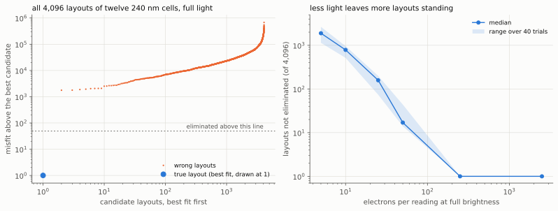
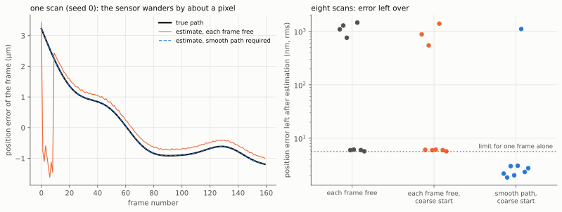

# Reconstruction by elimination

A blurred, noisy measurement can usually be explained by many different
surfaces. Most of them could never exist: surfaces that reflect more light
than falls on them, materials that are not on the chip, wires narrower than
the factory can make, a sensor that jumps sideways between two frames. This
approach uses the simulator to predict what each possible surface would have
produced, and throws away every one that either contradicts the measurement
or could not physically exist. What is left is the answer, and it can be much
sharper than the blur alone would allow.

The idea is Tim's: "Combinding the results with simulation should allow
recovery based on working out potential possible solutions and eliminating
ones which are physically impossible even without exact positioning
information", and "Temporal properties of the real world can also be used to
help eliminate incorrect or impossible solution spaces."

It is one named approach among those the project compares
([design, section 7.1](design.md#71-approaches-as-named-configurations)), not
a replacement for the others. This page reports a first version in the
one-dimensional [level 1 simulator](level1.md). The tests use bars between
4 µm and 0.48 µm wide under 1.12 µm pixels, so the results show that the
method works and how it fails. They do not yet show it at the 100 nm target.
For scale, 0.48 µm is about the wavelength of blue-green light, and a pixel is
about one sixtieth of the width of a human hair.

Four results, each explained below:

1. Knowing only that reflectance lies between 0 and 1 brings back bars that
   the plain reconstruction loses (contrast 0.44 against 0.06, true 0.85).
   Knowing the two materials on the surface brings back nearly all of it
   (0.77).
2. Listing all 4,096 possible layouts of a small region and testing each
   against the readings leaves exactly one standing, the true one, in good
   light. In poor light more survive, and the method says so.
3. Requiring the sensor's path to be smooth finds position errors of a whole
   pixel that the unconstrained search misses, and locates each frame to
   2.3 nm, better than a single frame could be located alone (5.6 nm).
4. With all of these together and no position information beyond a rough
   starting path, the surface and the positions are both recovered.

Terms in *italics* are explained in the [glossary](glossary.md).

## The constraints

```{mermaid}
flowchart TD
    M["Measured readings"] --> T
    P["What is known beforehand"] --> C1["Materials:<br/>reflectance limits,<br/>known reflectances"]
    P --> C2["Layout rules:<br/>drawing grid,<br/>minimum width"]
    P --> C3["Time:<br/>surface does not change,<br/>sensor path is smooth"]
    C1 --> G["Candidates that<br/>could exist"]
    C2 --> G
    C3 --> G
    G --> S["Simulator predicts the<br/>readings of each candidate"]
    S --> T{"Do the predicted<br/>readings match the<br/>measured ones?"}
    T -->|"no"| X["Eliminated"]
    T -->|"yes"| K["Kept"]
```

*Figure 1. How the approach works. Knowledge about the real world limits
which candidates are considered at all. The simulator then predicts what each
remaining candidate would have measured, and the measurement eliminates the
ones that do not fit.*

| Constraint | What it rules out | Used here | Source |
|---|---|---|---|
| Reflectance limits | Surfaces that send back less than no light, or more than falls on them | Yes | Physics: conservation of energy |
| Known materials | Reflectances that belong to no material on the chip | Yes, with two materials | Assumption: the materials and their reflectances are known. Plan item R6 collects real values. |
| Layout rules | Features off the drawing grid, or narrower than the process allows | Yes, grid and minimum width | Assumption: the grid and its position are known. Plan item R7 collects real layouts and design rules. |
| The surface does not change | Explanations in which the same point looks different in different frames | Yes, built into every reconstruction here | Physics |
| The path is smooth | Frame positions that jump in ways a moving mass cannot | Yes | Physics: inertia. Assumption: the size of the smoothing weight. |
| Each disturbance has its own behaviour in time | Mistaking drift, vibration or lamp flicker for surface detail | Not yet | [Radar study, section 5.5](research/synthetic-aperture-radar.md#55-time-as-a-source-of-rules) |

*Table 1. The constraints, and which of them this first version uses.*

The same idea exists in other fields under other names, which the research
items are collecting. Radar calls the position part autofocus; see the
[radar study, section 5.4](research/synthetic-aperture-radar.md#54-proposing-candidates-and-eliminating-the-impossible).
Statement about other fields: Unverified here, to be sourced by plan items
B1 to B4.

## The test

| Setting | Value | Unit |
|---|---:|---|
| Pixel pitch | 1.12 | µm |
| Gap, matt surface | 0.30 | µm |
| Pixels in the row | 64 | |
| Frames | 160 | |
| Shift between frames | 0.37 | pixels |
| Bar groups, repeat distance | 4, 2, 1.2, 0.8, 0.48 | µm |
| Reflectance of the two materials | 0.2 and 1.0 | |
| Electrons at full brightness | 2,500 | e⁻ |
| Read noise | 2.0 | e⁻ |
| Share of contrast the blur lets through at 0.48 µm | 0.63 | % |

*Table 2. Settings, the same as the [level 1 worked example](level1.md)
except that the finest group is 0.48 µm, so that its bars are whole numbers
of grid steps. Assumption. As on the level 1 page, every frame sees the whole
strip and the scan passes over it twice.*

## Materials

Three reconstructions of the same readings, with positions known.


*Figure 2. Top: the true surface. Second: the plain fit shows the 0.48 µm
bars as a grey block. Third: keeping reflectance between 0 and 1 is enough
for the bars to appear. Bottom: knowing that there are two materials, with
reflectance 0.2 and 1.0, gives sharp bars in nearly the right places.*

| Constraint | 4 µm | 2 µm | 1.2 µm | 0.8 µm | 0.48 µm | Overall error (rms) |
|---|---:|---:|---:|---:|---:|---:|
| True surface | 0.85 | 0.85 | 0.85 | 0.85 | 0.85 | 0.000 |
| None | 0.85 | 0.85 | 0.66 | 0.80 | 0.06 | 0.147 |
| Reflectance between 0 and 1 | 0.85 | 0.85 | 0.75 | 0.83 | 0.44 | 0.143 |
| Two known materials | 0.85 | 0.85 | 0.84 | 0.84 | 0.77 | 0.113 |

*Table 3. Contrast of each bar group, and the rms difference from the true
surface in units of reflectance, averaged over five random scans (seeds 0 to
4). Derived here: printed by
[`docs/diagrams/make_constrained_diagrams.py`](https://github.com/mithro/ccd-superres/blob/main/docs/diagrams/make_constrained_diagrams.py).*

| Bar group (µm) | 4 | 2 | 1.2 | 0.8 | 0.48 |
|---|---:|---:|---:|---:|---:|
| Share of the group given the wrong material (%) | 0.8 | 1.6 | 4.5 | 3.4 | 16.7 |

*Table 4. How much of each bar group the two-material reconstruction gets
wrong, by length, averaged over seeds 0 to 4. Derived here.*

How this works: a reflectance cannot go below zero, so a fit is not free to
add the negative swings that an unconstrained fit uses to cancel fine detail
it cannot see. That alone carries information about detail finer than the
blur. Knowing the materials carries more.

How it can fail: the search is a search, not a proof. It moves step by step
towards an allowed surface and can settle on a wrong one. Table 4 shows it:
one sixth of the finest group is given the wrong material, mostly as edges
placed a little off. The contrast figure alone would hide that.

## Listing layouts and eliminating them

For a small region the candidates can simply all be listed. The 0.48 µm bar
group is twelve cells of 240 nm, each one material or the other, which makes
4,096 possible layouts. For each one the simulator predicts all 10,240
readings, and the *misfit* is worked out: the sum of the squared differences
between predicted and measured readings, each divided by the noise expected
for that reading. For the true layout the misfit comes out close to the
number of readings. A layout is eliminated when its misfit is more than 49
above the best one.



*Figure 3. Left: all 4,096 layouts in order of misfit, in full light. The
true layout fits best. The next best is 1,767 worse, far above the
elimination line at 49, so every wrong layout is eliminated. Right: with less
light the readings are noisier and more layouts cannot be told from the
truth.*

| Electrons at full brightness (e⁻) | Layouts left, median | Layouts left, fewest | Layouts left, most | True layout kept (% of trials) | True layout is the best fit (% of trials) |
|---:|---:|---:|---:|---:|---:|
| 2,500 | 1 | 1 | 1 | 100 | 100 |
| 250 | 1 | 1 | 1 | 100 | 100 |
| 50 | 17 | 14 | 44 | 100 | 95 |
| 25 | 159 | 74 | 200 | 100 | 60 |
| 10 | 785 | 515 | 959 | 100 | 0 |
| 5 | 1,890 | 1,138 | 2,648 | 97.5 | 0 |

*Table 5. Elimination against the amount of light, 40 random scans per row
(seeds 100 to 139), 4,096 candidates, positions known and the rest of the
surface known. Derived here.*

What this shows:

- **In good light the answer is unique**, although only 0.63% of the
  contrast of these bars survives the blur. The bars are found because a
  wrong layout differs from the true one in more than its finest detail: it
  moves an edge or changes how much bright material there is, and those
  changes do reach the sensor.
- **In poor light the method reports a set, not a guess.** At 25 electrons
  the best-fitting layout is the true one in only 60% of trials, but the true
  one is always among those kept. Picking the best fit would be wrong four
  times in ten; the surviving set is right.
- **The elimination line was set by trial**, at 49. A line at 25 eliminated
  the true layout in a third of trials at 10 electrons, because among
  thousands of wrong layouts a few fit the noise better than the truth does
  by chance. The right line depends on the number of candidates. Estimate.
- **Rules shrink the list before any data are used.** If features and spaces
  must be at least two cells wide the twelve cells have 466 possible layouts,
  not 4,096; at three cells, 176. (The alternating test pattern itself needs
  the one-cell rule.)

Limits: the list doubles with every added cell, so listing everything works
only for small regions. Larger regions need the step-by-step search of the
previous section, or a search that builds layouts cell by cell and abandons
branches early. The drawing grid and where it sits are taken as known here.

## Time: the path must be smooth

The [level 1 page](level1.md#scan-position-errors-and-finding-them-from-the-data)
found each frame's position separately, and that failed once errors passed
about half a pixel. A real stage has mass. It cannot be half a pixel ahead in
one frame and half a pixel behind in the next. Here the simulated sensor
wanders smoothly by one pixel rms, with each wander lasting about 20 frames
(Assumption), and the estimate is required to follow a smooth path: each
round fits a smooth curve through the per-frame estimates, trusting each
frame according to how much detail it saw.



*Figure 4. Left: one scan. The black line is how far each frame really was
from where it was assumed to be. The estimate that requires a smooth path
lies on top of it. The estimate that treats each frame alone loses the first
ten frames, where the error is largest. Right: the position error left over
in eight scans. The dotted line is the best that could be done for a single
frame taken alone with the surface known.*

| Method | Scans solved, of 8 | Error left in solved scans (nm, rms, median) |
|---|---:|---:|
| Before any estimation | 0 | 1,120 |
| Each frame free | 4 | 6.0 |
| Each frame free, starting from a blurrier picture | 5 | 6.0 |
| Smooth path required, starting from a blurrier picture | 7 | 2.3 |

*Table 6. Position estimation with a wander of one pixel rms, seeds 0 to 7.
A scan counts as solved when the error left is under 20 nm. The reference
limit for one frame alone is 5.6 nm. Derived here.*

- **The smooth-path rule widens the range of errors that can be found**: 7
  scans of 8 against 5.
- **It also improves the accuracy**, to 2.3 nm against 6.0 nm, because
  neighbouring frames now help to place each other. That is below the limit
  for a single frame, which is no contradiction: the limit assumes each frame
  stands alone.
- **One scan in eight is still not solved.** With a wander of two pixels rms
  most are not (one of four in a trial not tabulated here). Larger errors
  need a rough first alignment. The
  [radar study](research/synthetic-aperture-radar.md#54-proposing-candidates-and-eliminating-the-impossible)
  reaches the same conclusion for radar: the search must run from coarse to
  fine from a rough starting path.
- **Fast vibration is the opposite case.** A smooth-path rule cannot recover
  errors that really do change from frame to frame, and would smooth them
  away wrongly. Not simulated here.

## Everything together, without position information

The last test uses all the constraints at once on scans whose positions are
wrong by one pixel rms: smooth path and reflectance limits to find the
positions, two materials to rebuild the surface, then listing and
eliminating the layouts of the finest group.

| Scan (seed) | Position error left (nm, rms) | Contrast of 0.8 µm bars, assumed positions and no constraints | Contrast of 0.8 µm bars, all constraints | Contrast of 0.48 µm bars, all constraints | Layouts left of 4,096 | The one left is the true layout |
|---:|---:|---:|---:|---:|---:|---|
| 0 | 2.3 | 0.27 | 0.85 | 0.12 | 1 | Yes |
| 1 | 1.9 | 0.11 | 0.83 | 0.60 | 1 | Yes |
| 2 | 3.0 | 0.11 | 0.84 | 0.59 | 1 | Yes |
| 3 | 2.0 | 0.20 | 0.84 | 0.46 | 1 | Yes |
| 4 | 3.1 | 0.09 | 0.84 | 0.51 | 1 | Yes |

*Table 7. All constraints together, positions unknown, true contrast 0.85.
Each reconstruction is aligned to the true surface before scoring. Derived
here.*

The positions are found to about 2 to 3 nm and the bars down to 0.8 µm come
back at full contrast. The 0.48 µm group shows the difference between the two
ways of using the constraints. The step-by-step search does poorly on it
(contrast 0.12 to 0.60), because it settles on a wrong arrangement. Listing
every layout and eliminating finds the true one every time. Where the
candidates can be listed, listing is the more reliable.

## What this does not show yet

| Limit | Why it matters | Where it is dealt with |
|---|---|---|
| Coarse test bars, matt surface | The target is 100 nm lines under coherent light | Levels 3 and 4 of the [simulation chain](simulation-chain.md) |
| One dimension | Real layouts are two-dimensional, with far more candidates per region | [Plan](plan.md#d-simulation-chain), item D2b |
| The simulator that tests candidates is the one that made the data | Real pixels will differ from the model, and a wrong model can eliminate the truth | Uncertain pixel response as a swept setting ([design 4.9](design.md#49-simulation-first-the-unknown-pixel-response-and-the-gate-before-hardware)) |
| Materials, drawing grid and its position taken as known | On a real chip they are known only roughly, or have to be found | Plan items R6 and R7; candidates for the unknowns can be added to the list |
| Only two materials, sharp boundaries | Real surfaces have more materials, slopes and films | Later steps of item D2b |
| Smooth wander only | Fast vibration, drift of the lamp and of the gap behave differently in time | Later steps of item D2b |
| The elimination line and the path stiffness were set by trial | They should follow from the noise and from the mechanics | Later steps of item D2b |
| Every frame sees the whole strip | Favourable for finding positions | Level 1 page, same limit |

*Table 8. Known limits of this first version.*

## Running it

```python
from ccdsr import constrained, level1 as l1

dx = 20.0
surface, groups = l1.bar_groups([4000, 2000, 1200, 800, 480], dx)
scan = l1.Scan1D(n_pixels=64, n_frames=160, shift_px=0.37, wander_px=1.0)
frames = l1.simulate(surface, dx, l1.Optics1D(gap_nm=300), scan, l1.Noise1D(), seed=1)

estimate, snapped, positions = constrained.solve_surface_and_positions(frames, levels=(0.2, 1.0))

_, start, stop = groups[4]
layouts = constrained.allowed_layouts(12, min_run=1)
misfits, kept = constrained.eliminate_candidates(frames, snapped, start, 12, layouts, (0.2, 1.0),
                                                 positions_nm=positions)
print(kept.sum(), "layouts left")
```

The code is [`ccdsr/constrained.py`](https://github.com/mithro/ccd-superres/blob/main/ccdsr/constrained.py), with the
smooth-path rule in `estimate_positions` in
[`ccdsr/level1.py`](https://github.com/mithro/ccd-superres/blob/main/ccdsr/level1.py). The automated checks are in
[`tests/test_constrained.py`](https://github.com/mithro/ccd-superres/blob/main/tests/test_constrained.py). The functions
are listed in the [Python reference](api.md#reconstruction-by-elimination).
