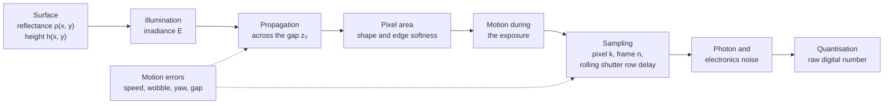
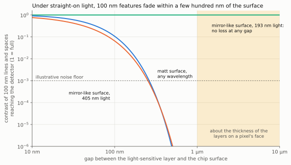
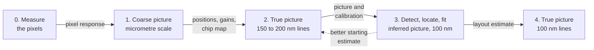
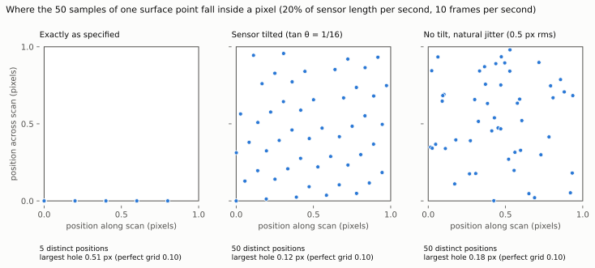
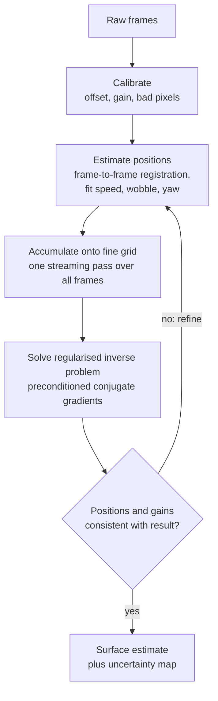
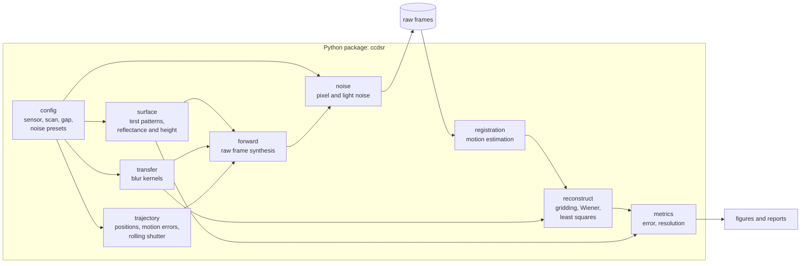

# Scanning lensless sensor super-resolution simulator: design

Status: draft for review. The scan sampling calculator (section 5.4) and the
trade-off explorer (section 5.6) are implemented. The simulator is not.
The stated goal is features of about 100 nm on silicon chips; section 4.6
works out what that demands and section 4.7 sets out the stages towards a
picture at that scale.
Numbers marked "illustrative" come from the analytic model in section 4, not
from simulation runs.

## 1. Purpose

Build a Python simulation of an image sensor that is moved at a constant rate,
parallel to a surface, with no lens in between. Every pixel captures
continuously and is read out at the same fixed rate. The simulation produces
the raw pixel data such an instrument would record, then reconstructs the
surface from that data at a scale finer than the pixel pitch, and compares the
result with the known ground truth.

The simulator has two jobs:

1. Answer "what could this instrument resolve, and what limits it?" before
   hardware is built.
2. Become the reference model for a real instrument, so the reconstruction code
   written here can later run on real frames.

### Inputs from Tim that this design is built on

| Decision | Value |
|---|---|
| Optics | Lensless. The lenses on top of the sensor are removed. |
| What is reconstructed | Surface reflectance first. Height is wanted too. Lighting is undecided. |
| Target | A reconstructed picture of features of about 100 nm on silicon chips, reached in stages (section 4.7). Nanometre scale both laterally and in height. |
| Effort | Significantly more computation is preferred over more hardware. |
| Randomness | Deliberately adding random noise, and modelling the randomness already present, to improve the reconstruction is in scope (section 5.8). |
| Sensor control | The sensor's control functions are expected to be pulled apart and driven differently from the stock camera, so the readout scheme is a replaceable model (section 5.7). |
| Two dimensions | The two-dimensional nature of the sensor is to be used to get more detail (section 5.9). |
| Exploration | The simulator is for exploring many different approaches, not one specific approach. Comparing approaches is a deliverable (section 7.1). |
| Computing | All processing happens offline, on powerful computers with graphics cards. Hundreds of cores in parallel are fine. |
| Motion | Constant rate, parallel to the surface. |
| Noise | Present in the motion rate, the pixel data and similar quantities. |
| First hardware | Something like a Raspberry Pi camera sensor. |
| Trajectory | Start as a model, end as a real instrument. |
| Deliverables | Everything in this git repository, documented, with real diagrams. |

### Design principle: computation before hardware

Tim's preference is to spend significantly more computation rather than add
hardware, with all processing done offline on powerful machines with graphics
cards and hundreds of cores. The design follows that in four ways:

- **Estimate instead of control.** Quantities a more expensive instrument
  would fix mechanically are estimated from the data: the position of every
  frame, the scan speed and its drift, tilt, the gain of each pixel and the
  blur kernel itself (sections 6.4 and 6.5).
- **Use what is known about the sample.** A chip is not an arbitrary picture.
  It is a few materials in layers, with straight edges on a design grid, and
  the layout may be known. That knowledge enters the reconstruction as a
  prior, or the layout itself becomes the thing being fitted (section 6.5).
- **Collect far more data than strictly needed.** Extra passes, tilts,
  wavelengths and lighting directions cost scan time and computation, not
  hardware.
- **Randomness is a tool.** Random variation that is modelled or measured
  becomes sampling diversity instead of error, and randomness added on
  purpose removes regular gaps in what the instrument records (section 5.8).
- **No speed limit on the methods.** Nothing has to run in real time, so
  slow iterative, joint and model-fitting methods are acceptable, and so is a
  full electromagnetic solver inside a fitting loop.

The principle has one hard limit, set out in section 4.6: computation can
only use information that reaches the detector. Detail that has decayed far
below the noise before the light arrives cannot be bought back, because each
thousandfold increase in samples buys only a modest step in resolution.

### Assumptions made here that need confirming

- "Lenses removed" has two possible meanings, and section 5.3 works through
  both from the sensor's layer structure. Removing only the module lens leaves
  the on-chip microlenses and the colour filter in place. Removing the
  microlenses as well takes the colour filter with them. The simulator
  supports both, and the baseline is the first, because it needs no
  destructive processing of the die.
- No cover glass sits between the sensor face and the surface. Whether the
  Camera Module 2 has one under its lens holder is not confirmed by the
  sources found so far (section 5.3). If it does, it must come off: with glass
  in place the gap cannot go below a fraction of a millimetre, which section 4
  shows is far too large.
- The surface behaves as a diffuse reflector: each point re-emits light in
  proportion to its reflectance, with no fixed phase relation to its
  neighbours. Section 4.4 covers what changes if the lighting is coherent.

## 2. Concept


The sensor slides over the surface at velocity `v` and is read out `f` times
per second. Between readouts it moves a step `d = v / f`, which is chosen to be
a fraction of the pixel pitch `p`. Each pixel therefore records a time series
that is a line scan of the surface with sample spacing `d`.

The array is rotated by a small angle `θ` relative to the scan direction.
Successive pixels in a sensor row then follow tracks that are offset across the
scan by `p·sin θ`, so one sensor row of `N` pixels fills the space between
tracks in steps much smaller than a pixel. This is where the "thousands of
pixels" matter:

- Pixels along a sensor row provide fine sampling across the scan direction.
- Sampling in time provides fine sampling along the scan direction.
- Every surface point is seen by every pixel whose track passes over it, which
  gives the averaging that pays for deblurring.


Each sample is not a point measurement. A pixel collects light from a patch of
surface whose size is set by the pixel's own area, by the distance travelled
during the exposure, and above all by the gap `z₀` between sensor and surface.

## 3. Measurement model

The signal chain from surface to stored number:



For pixel `k` in frame `n` the noise-free signal is

$$
m_{k,n} = g_k \, E_n \iint B\big(\mathbf{r} - \mathbf{r}_k(t_{k,n})\big)\, \rho(\mathbf{r})\, d^2\mathbf{r} + o_k
$$

where

- $\mathbf{r}_k(t) = \mathbf{r}_k^0 + \mathbf{v}\,t + \boldsymbol{\epsilon}(t)$ is the
  pixel's position over the surface: its place in the rotated array, plus
  constant-velocity motion, plus motion error.
- $t_{k,n} = n/f + j_k\, t_\text{line}$ is the sample time. The second term is the
  rolling shutter: row $j_k$ of the sensor is exposed slightly later than the
  row before it. With known constant motion this is just a known extra shift
  per row.
- $B$ is the combined blur kernel, the convolution of three parts:
  $B = B_\text{gap} * B_\text{pixel} * B_\text{motion}$.
- $g_k$ and $o_k$ are per-pixel gain and offset, and $E_n$ is the illumination
  level in frame $n$.

Because all pixels share the same blur kernel, the model factors into
"blur the surface once, then read it off at the sample positions". In operator
form, with the surface on a fine grid as a vector $\rho$:

$$
m = D\, S\, K\, \rho + \text{noise}
$$

where $K$ is the blur (a convolution), $S$ picks out the sample positions
(interpolation, a few non-zeros per row) and $D$ holds gains. This factoring is
what makes both the simulation and the inversion tractable (section 6).

### 3.1 The three blur terms

In spatial frequency $\mathbf{f} = (f_x, f_y)$, with $|\mathbf{f}| = 1/\Lambda$ for a
feature of period $\Lambda$:

| Term | Transfer function | Meaning |
|---|---|---|
| Gap | $H_\text{gap} = u\,K_1(u)$, $u = 2\pi z_0 \lvert\mathbf{f}\rvert$ | Diffuse light spreading across the gap. $K_1$ is a modified Bessel function. Falls as $e^{-2\pi z_0/\Lambda}$. |
| Pixel | $\text{sinc}(a f_{x'})\,\text{sinc}(a f_{y'})\, e^{-2\pi^2\sigma_e^2 \lvert\mathbf{f}\rvert^2}$ | Square sensitive area of width $a$ in the rotated sensor frame, with edges softened over $\sigma_e$. |
| Motion | $\text{sinc}(v\, t_\text{exp}\, f_x)$ | Smear over the exposure time $t_\text{exp}$. Continuous capture means $t_\text{exp} = 1/f$, so the smear equals the step $d$. |

The gap term comes from a diffuse point on the surface illuminating a plane at
distance $z_0$: the irradiance falls off as $z_0^2 / (r^2 + z_0^2)^2$, a spot
whose full width at half maximum is about $1.3\,z_0$. This geometric model is
the baseline. Closer than about one wavelength the true near-field behaviour
is more complicated, but the exponential fall-off with $z_0/\Lambda$ is the same
law that governs evanescent waves, so the scaling conclusion in section 4 does
not depend on the simplification.

### 3.2 Noise and error sources

Tim asked that noise in the motion rate and the pixel data be assumed. The
model carries each of the following as an explicit, switchable parameter. The
last column says whether the reconstruction is told the true value.

| Group | Source | Model | Known to reconstruction? |
|---|---|---|---|
| Pixel | Photon shot noise | Poisson on collected electrons | Statistics only |
| Pixel | Read noise | Gaussian, per sample | Statistics only |
| Pixel | Dark current | Poisson, scales with exposure | Statistics only |
| Pixel | Gain variation between pixels | Fixed random $g_k$ | Optional: calibrated or estimated |
| Pixel | Offset variation between pixels | Fixed random $o_k$ | Optional: calibrated or estimated |
| Pixel | Row noise | Random offset per row per frame | No |
| Pixel | Dead and hot pixels | Fixed mask | Optional |
| Pixel | Quantisation and clipping | 10 or 12 bit, full well | Yes |
| Light | Illumination flicker | Random $E_n$ per frame | No, estimated |
| Motion | Speed error | Constant scale error on $v$ | No, estimated |
| Motion | Speed fluctuation | Random walk plus periodic term along the scan | No, estimated |
| Motion | Cross-scan wobble | Slow random drift across the scan | No, estimated |
| Motion | Yaw error | Offset and drift of the tilt $\theta$ | No, estimated |
| Motion | Gap error | Offset, tilt (non-parallelism) and vibration of $z_0$ | No, studied as sensitivity |
| Timing | Frame time jitter | Random error on $t_{k,n}$ | No |

Motion errors matter more than pixel noise here. Pixel noise averages down
across thousands of pixels. A position error that the reconstruction does not
know about is a blur that no amount of averaging removes. Section 6.4 covers
how positions are estimated from the data itself.

## 4. What limits the resolution

This section is the most important one to agree on, because it determines
whether the instrument can reach its goal.


Reading the chart: a stage that passes a contrast of 1 leaves detail of that
size untouched. Detail whose contrast falls below the noise floor is lost. The
floor drawn at 1/1000 is illustrative; where it really sits depends on light
level and on how many samples are averaged.

### 4.1 The gap dominates

The pixel area attenuates fine detail gently, in proportion to feature size.
The gap attenuates it exponentially. Reconstruction can undo a known
attenuation only down to the noise floor, and against an exponential, better
signal-to-noise buys almost nothing:


Illustrative results from the analytic model:

- The smallest recoverable period is roughly 0.75 times the gap for a contrast
  floor of 1/1000. A hundred times better signal-to-noise improves that by
  less than a factor of two.
- Cover glass left on (gap about 0.5 mm): features of a few hundred
  micrometres. Worse than an ordinary camera.
- Bare die held about 3 µm from the surface: features of about 2 µm, which is
  larger than the 1.12 µm pixel. In this regime the pixels already sample
  finely enough and super-resolution adds nothing beyond averaging.
- Sub-pixel resolution only becomes possible once the gap is smaller than the
  pixel pitch, so below about 1 µm for these sensors.
- Nanometre lateral features need a gap of nanometres. That is the regime of
  hard-disk heads and near-field scanning microscopes, over a die that is
  millimetres across with bond wires standing above its surface.

**Consequence for the project.** A Raspberry Pi class sensor with lenses
removed can validate the whole pipeline (sampling, motion estimation, noise
handling, reconstruction) at micrometre scale. It cannot resolve nanometre
lateral features, because the gap cannot be made small enough. The simulator
is designed so the gap is a free parameter, which lets it show exactly what
gap, flatness and motion accuracy a later instrument would need.

### 4.2 What a huge number of samples buys, and what it does not

The instrument collects an enormous number of samples, and that does recover
resolution finer than the pixel size. It is the point of the design. The
sample count does two separate things:

1. **It removes the pixel pitch as a limit.** Samples land on the surface far
   more densely than the pixels are spaced (section 2), so detail smaller than
   a pixel is sampled properly instead of being aliased.
2. **It lowers the noise floor.** Averaging `N` samples improves
   signal-to-noise by `√N`. The pixel area attenuates fine detail only in
   proportion to its size, so this averaging is enough to undo the pixel blur
   well below one pixel.

What it cannot do is restore detail that was attenuated exponentially before
it reached the sensor. Each extra factor of `e` in gap attenuation needs
`e² ≈ 7` times more samples to overcome, so the gain from more samples is
logarithmic:


The plot is deliberately optimistic: full-contrast features, ideal sharp pixel
edges, exactly known positions, and a single-sample signal-to-noise of 50. One
pass of the baseline sensor gives about 13 000 samples per pixel-sized area
(3280 pixels in a row each cross it, sampling four times on the way).

| Gap | One pass | A million times more samples | Compared with the 1.12 µm pixel |
|---|---|---|---|
| 0.3 µm | 0.34 µm | 0.17 µm | 3 to 7 times finer than a pixel |
| 3 µm | 2.0 µm | 1.2 µm | Coarser than a pixel, reaching about one pixel |
| 30 µm | 16 µm | 10 µm | Much coarser than a pixel |

So the answer to "can the sample count beat the sensor's pixel size" is yes,
by a large factor, provided the gap is smaller than the pixel. With a gap
larger than the pixel, the same sample count is spent fighting the gap
instead, and a million-fold increase in samples buys less than a factor of
two. This agrees with the estimate in section 4.1; it is not a more
pessimistic or more optimistic result, only the same law plotted against
sample count.

Two things could genuinely move these curves, and both are parameters of the
simulator rather than assumptions baked into it:

- **A narrower acceptance angle.** The gap model assumes each pixel accepts
  light from all directions. A pixel that only accepts light from near
  straight ahead sees a smaller patch of surface for the same gap. Intact
  microlenses do some of this, which is another reason to keep them at first.
- **Directional lighting.** If the surface is lit by a collimated beam and
  mostly reflects or transmits it without scattering, light crosses the gap in
  nearly straight lines and the spreading is set by diffraction rather than
  geometry. That is a different, wave-optics model (section 4.5).

### 4.3 The pixel area

A bare pixel with perfectly sharp edges would pass fine detail at a contrast
of about (feature period) / (π × pixel width), which thousands of averaged
samples could recover. Real pixel edges are not sharp: charge spreads inside
the silicon and light spreads in the layers above it. Any softness removes
detail much finer than the softness scale, as the orange curve shows. The edge
softness of a real sensor is not known in advance and would have to be
measured. The simulator takes it as a parameter.

A later option is an opaque mask with one small opening per pixel. Resolution
is then set by the opening rather than the pixel, at the cost of light. Related
lensless instruments have used exactly this (section 9).

### 4.4 Sampling, motion and noise

- Sampling: the step `d` and the track spacing `p·sin θ` must both be at most
  half the smallest period to be recovered. Both are cheap to make small.
- Motion: unknown position error must stay well below the target resolution,
  or be estimated from the data to that accuracy.
- Noise: sets the contrast floor. Averaging over `N` pixels lowers it by `√N`.

### 4.5 Height

Tim wants height as well as reflectance, with lighting undecided. There are
three candidate ways height reaches the pixel, in increasing order of modelling
effort:

1. **Blur width.** A raised feature is closer to the sensor, so its blur spot
   is narrower. Total collected light is unchanged, so the effect is weak, and
   separating it from reflectance needs two passes at different gaps.
2. **Shading.** With light arriving at an angle, slopes facing the light are
   brighter. This gives slope rather than height, and needs a lighting
   geometry that fits in the gap.
3. **Interference in the gap.** With narrow-band light, reflections from the
   sensor face and from the surface interfere, and brightness cycles once for
   every half wavelength of gap change. This is sensitive to nanometres of
   height even at micrometre lateral resolution, and may be the most realistic
   route to "nanometre features" with this hardware. It needs a wave-optics
   model rather than the diffuse model above.

The plan is to build reflectance first, then add option 1 because it reuses
the same model, and treat option 3 as a separate study once Tim has decided on
lighting.

### 4.6 The target: 100 nm features on silicon chips

Lines and spaces 100 nm wide repeat every 200 nm, so the instrument has to
recover a period of 200 nm. Two things about the sample change the picture
drawn in section 4.1.

First, a silicon chip is smooth and mirror-like, not matt. Under a directed
beam it does not scatter light in all directions. Each pattern on it sends
light into a few definite directions, and the rule is sharp: detail with a
period longer than the wavelength leaves the surface as an ordinary beam and
crosses any gap without loss, while detail finer than the wavelength never
leaves. It exists only as a field that clings to the surface and fades with
distance as

$$
\exp\!\left(-2\pi z \sqrt{1/\Lambda^2 - 1/\lambda^2}\right)
$$

for period $\Lambda$, wavelength $\lambda$ and gap $z$. For a 200 nm period
in violet light (405 nm) that field falls by a factor of $e$ every 37 nm. The
calculator and explorer now carry this "mirror-like surface, directed beam"
model next to the matt one.

Second, 200 nm is less than half the wavelength of any visible light, so with
visible light the detail is always on the fading side of that rule.



What the analytic model gives for a 200 nm period, with 13,000 samples per
pixel area (the slow baseline scan of section 5.2 over a full sensor), a single-sample signal-to-noise of 50 and full feature contrast:

| Case | Largest gap that still recovers a 200 nm period |
|---|---|
| Matt surface, ideal sharp-edged pixel | 140 nm |
| Same, with only 50 samples per pixel area | 35 nm |
| Same, with 13 million samples (a thousand times more data) | 260 nm |
| Mirror-like, 405 nm light | 123 nm |
| Mirror-like, 650 nm light | 113 nm |
| Mirror-like, 266 nm light | 162 nm |
| Mirror-like, 193 nm light | Any gap |
| Matt surface, pixel edges soft over 30 nm | 125 nm |
| Matt surface, pixel edges soft over 50 nm | 96 nm |
| Matt surface, pixel edges soft over 100 nm | Not recoverable at any gap |

These are estimates from level 0 of the simulation chain. Where they sit
below a wavelength, only level 4 can confirm them.

The table covers two different regimes, and the target can be approached
through either. They are set side by side here with the same numbers as
section 9 of the optical elements study (`docs/optical-elements.md`, in pull
request 2), which analyses the second regime in detail.

| | Near field | Far field, slanted coherent light |
|---|---|---|
| Applies to | Any surface and any light, including matt surfaces and straight-on light longer than the period | Mirror-like surfaces such as silicon, under laser light arriving at a steep slant from several directions |
| How the detail reaches the detector | As the fading field next to the surface | As ordinary beams, because slanted light turns fine detail into angles that still travel |
| Gap | 100 to 140 nm from the light-sensitive silicon (rows 1 and 4 to 6 of the table above) | Not the limit. About a millimetre is fine, and is needed to let the light in. |
| What sets the limit | Gap, then pixel edge sharpness | Period = wavelength / (sine of the light's slant + sine of the widest angle the sensor collects) |
| 405 nm light | 123 nm gap | 290 nm period (145 nm lines) at a 65 degree slant collecting ±30 degrees; 225 nm period (113 nm lines) at 72 degrees collecting ±58 degrees |
| 365 nm light | 128 nm gap | 260 nm period (130 nm lines) and 203 nm period (101 nm lines) for the same two cases |
| 405 nm light, water in the gap | Not modelled | About 169 nm period (84 nm lines) |
| Best conceivable | No limit in principle | Wavelength / 2: a sensor collecting right out to grazing angles under grazing light. 203 nm period at 405 nm. |
| Hardware | Layers stripped from the sensor, gap and tilt held to tens of nanometres. Very heavy. | A few laser diodes at fixed angles. Light. |
| Computation | The linear solve of section 6 | Very large: iterative recovery of the light's phase over every frame (ptychography), with positions as unknowns |

The two analyses agree. The calculator's "mirror-like" rows are the special
case of the right-hand column with straight-on light and a sensor that
collects every angle, which is why they give "period no finer than the
wavelength" and "any gap at 193 nm". Earlier wording in this section, that
only a 100 nm gap or light near 200 nm would do, held for straight-on light
only.

What this means for the target:

- **The far-field regime is the one that fits the preference for computation
  over hardware**, and it is the recommended route. With a 405 nm laser diode
  it reaches lines of about 110 to 145 nm, close to the target but not at
  it. Lines and spaces of 100 nm need about 365 nm or shorter, or liquid in
  the gap, together with steep light and a wide collection angle. Lensless
  imaging of this kind in reflection is undemonstrated below about 2 µm, as
  the optical elements study notes.
- **The near-field regime is not realistic for this project.** The
  microlenses, colour filter and coatings on an IMX219 pixel are together of
  the order of a micrometre thick (section 5.3), several times the whole gap
  budget. The bare face would have to stay within about 100 nm of the chip,
  a tilt below about 30 millionths of a radian across a 3.7 mm sensor, and
  finished chips carry protective layers thicker than that. It stays in the
  model as the reference case and because it is what a matt surface would
  need.
- **Computation cannot rescue the wrong regime.** At a gap of 1 µm under
  straight-on visible light, the contrast of a 200 nm period reaching the
  detector is about $10^{-13}$. A thousand times more data moves the
  near-field gap limit only from 140 nm to 260 nm.
- **The pixel's own response is the shared unknown.** In the far field the
  pattern arrives at the detector as interference stripes as fine as the
  detail itself, 200 nm for the target, and a 1.12 µm pixel spans more than
  five of them. It sees them only through the sharpness of its edges: about
  6% of the contrast for ideally sharp edges, and nothing useful once the
  edges are soft over 100 nm. This is the same quantity the optical elements
  study calls the collection angle, seen from the other side: a pixel that
  responds to light out to ±58 degrees is a pixel that responds to stripes
  down to about 240 nm at 405 nm. Neither figure is known for this sensor.
  It can be measured with a laser at a few angles, and estimated at level 4.
  In this model a mask with a 100 nm opening does not improve on an ideally
  sharp pixel, because the light it blocks costs as much signal as the
  sharper response gains, but it would help a pixel whose edges are soft.
- **Two ways round the pixel's edges.** The optical elements study (section
  9.3 there) lists two ways for fine detail to reach coarse pixels without
  relying on edge sharpness. Lighting the chip with two slanted beams from
  one laser at once lays light stripes of about 213 nm period on it (405 nm
  at 72 degrees). A 200 nm pattern beats against those stripes into a
  pattern of about 3 µm period, which the pixels read at nearly full
  contrast. The other is to read the map of brightness of the scattered
  light, which at a gap of about a millimetre lands hundreds of micrometres
  from the mirror reflection. That one is unproven in this geometry and is a
  question for levels 3 and 4. The proposed first measurement on real
  hardware is pixel contrast against stripe period, using two laser beams
  crossing on the sensor.
- **A wave model for everything.** The matt-surface blur used by levels 0 and
  1 is the wrong physics for polished silicon. The answer for this target
  comes from levels 3 and 4. The calculator does not yet model slanted light
  or a limited collection angle. Getting light into the arrangement is
  covered in the optical elements study and is not repeated here.

There is also a route that does not form an image at all, and it is the one
that best matches the preference for computation. Chip factories measure line
widths far below the wavelength by shining light on a pattern, recording how
the reflected light varies with wavelength, angle and polarisation, and
fitting a full electromagnetic model of the structure to those readings
(optical scatterometry). Features finer than the wavelength change how
strongly and with what phase each area reflects, even though their shape
cannot be seen. If the layout is known or constrained, the question becomes
"which layout parameters best explain the data", and it can be answered at
ordinary gaps. The same applies to finding an isolated 100 nm feature, which
can be detected and located much more finely than it can be imaged. What
this route cannot do is show an unknown, arbitrary pattern at 100 nm.

Tim has settled which of these is the goal: the picture is to be
reconstructed, and it may be reached in several stages. The measuring routes
above therefore become stages on the way to the picture, not alternatives to
it.

### 4.7 A staged path to the picture: the current leading candidate

The simulator is built to explore many approaches, not this one
(section 7.1). The path below is the candidate that looks strongest from the
analysis so far, and it is itself one named configuration per stage. It is
kept as the reference that other approaches are compared against, and it is
replaced if the comparisons favour another.

The end goal is a reconstructed picture of an unknown layout with features of
about 100 nm. Each stage below is useful on its own, and each hands its result
to the next as a starting estimate or a prior. Hardware is added only when a
stage cannot proceed without it.



This is the single staged plan for the leading candidate. The optical elements study
(`docs/optical-elements.md`, pull request 2) uses the same stage numbers.

| Stage | What it produces | Hardware | Computation | Simulation levels | Passes on |
|---|---|---|---|---|---|
| 0. Measure the pixels | How strongly a pixel responds to fine light stripes and to light from each angle. This is the shared unknown of section 4.6 and decides how far every later stage gets. | The sensor, one laser diode and a mirror, to cross two beams on the sensor | Small | 4, to compare with the measurement | The pixel response, used as a kernel by every level |
| 1. Coarse picture | A picture of the chip at micrometre scale: blocks, wide wiring, pads | A scan and simple lighting | The linear solve of section 6, with frame positions estimated from the data | 0 and 1 | Position of every frame, speed, tilt, pixel gains, and a map of the chip to register everything else against |
| 2. True picture to 150 to 200 nm lines | A picture of the layout, with height, not restricted to any assumed kind of structure. Lines of 150 to 200 nm are expected, and 110 to 145 nm is the limit of the formula in section 4.6. | Pulsed 405 nm laser beams at a steep slant from several directions, switched on in pairs, and several colours | Very large: iterative recovery of the light's phase over every frame (ptychography), with positions and the pixel response as unknowns, tiled across graphics cards | 3 for the solver's forward model, 4 to check it on patches | The picture, and a calibrated model of the instrument |
| 3. Detect, locate and fit | From the same data, with no new hardware: edges, isolated lines and defects located to tens of nanometres, the repeat distance and direction of each regular region, and line widths and heights fitted with an electromagnetic model. Together these give a picture at about 100 nm that is partly inferred, and is labelled as such. | None | Very large: the electromagnetic solver inside a fitting loop, thousands of runs, one independent job per region | 4 | A layout estimate: the best description of the chip that straight edges and a few materials allow |
| 4. True picture at 100 nm | The stated goal | Near-ultraviolet light (365 nm) or water in the gap, and possibly a sensor with its top layers removed | As stage 2, started from the stage 3 layout | 3 and 4 | The result |

How each stage uses the ones before:

- **As a starting estimate.** The phase-recovery solve has many false
  solutions and takes a long time from a blank start. Stage 2 starts from
  the coarse picture. Stage 4 starts from the stage 3 layout, and stage 2
  can be rerun from it as well, so stages 2 and 3 are repeated in turn until
  they stop changing.
- **As a prior.** The layout estimate enters the picture solve as a
  preference, with a weight that is lowered step by step, so the final
  picture is held up by the data and not by the assumption.
- **As calibration.** The pixel response, frame positions and pixel gains
  are estimated once in the early stages and refined, not rediscovered,
  later.
- **As a guide to where to look.** Stage 3's detection pass says which
  regions hold fine structure, so the expensive fits run only there.

Two checks keep the stages honest. Each picture from stage 2 or 4 is also
reconstructed from a deliberately wrong starting layout, and only the detail
that appears in both counts as seen. And each stage reports its result at the
scale it can support, so a stage 3 result is never presented as a true picture.

In the simulator the stages are run in the same order on the default scene,
which gives the first evidence of how far each one gets before any hardware
is bought. Stage 4 is at the edge of what is possible (section 4.6), and the
simulator's job is to say how close to 100 nm it comes and what limits it.

### 4.8 Motion blur: cause, model and reversal

**Cause.** A pixel does not take an instant reading. It adds up light for
the whole exposure, and during that time it keeps moving. Each reading is
therefore the average of the surface along the short track the pixel swept,
of length speed × exposure. In the worked example of section 5.4 (20% of the
sensor per second, 10 frames per second, exposed for the whole frame) that
track is 73.5 µm, or 65.6 pixels.

**Model.** This blur is the best known part of the whole instrument. It is
a one-dimensional smear along the scan direction with the shape of the
exposure in time: a flat box when the light and shutter are on throughout.
The simulator carries it as an explicit term $B_\text{motion}$ of the forward
operator (section 3.1), built from the exposure pattern and the trajectory,
not as a fixed number:

- With constant speed, it is a box of length $v\,t_\text{exp}$.
- With speed that varies, it is the record of where the pixel was during
  that exposure. Once the trajectory has been estimated (section 6.4) this
  is known per frame.
- With a rolling shutter, each row starts its exposure one line time after
  the row before. The smear has the same shape for every row, and each row
  is shifted along the scan by a known amount, 14 nm per row in the worked
  example (speed × 18.9 µs line time). That shift is extra sub-pixel
  sampling, obtained for nothing.
- With the light switched in a pattern during the exposure, it is that
  pattern laid along the track.

**Reversal.** Because the smear is part of the forward operator, the
reconstruction of section 6 reverses it together with everything else, with
no separate step. What decides how well this works is how much of each
detail size the smear lets through:

| Exposure pattern | What passes at feature period $\Lambda$, smear length $L$ | Consequence |
|---|---|---|
| On throughout | At most $\Lambda / (\pi L)$, and exactly zero wherever $L$ is a whole number of periods | Reversible, but fine detail arrives very weak. At $L$ = 73.5 µm a 200 nm period keeps 1/1154 of its contrast. Detail across the scan is untouched. |
| Short pulse, light on for a share $1/N$ of the frame | Everything, down to the pulse's own smear $L/N$ | Nothing to reverse. Collects $1/N$ of the light unless the source is bright enough to make up for it. |
| Coded: $N$ slots, on in a random half of them | About $1/\sqrt{N/2}$ at every period down to one slot $L/N$, with no zeros | Reversible with a known, even loss. Collects half the light. |

Smallest recoverable period for the worked example with a 6.25% tilt, a
100 nm gap and a matt surface, where the smear is the only thing that
differs:

| Exposure | Source bright enough to fill the pixel in any exposure | Light proportional to on-time, read noise 2 electrons |
|---|---|---|
| On throughout (73.5 µm smear) | 1.8 µm | 1.8 µm |
| Pulse of 0.38 ms (quarter-pixel smear) | 0.39 µm | 0.85 µm |
| Pulse of 24 µs (18 nm smear) | 0.39 µm | 2.1 µm |
| Coded, 1024 slots | 1.1 µm | 1.1 µm |
| Coded, 4096 slots | 1.5 µm | 1.5 µm |

What this says:

- **Yes, the blur can be modelled exactly and reversed**, and the simulator
  does so. Reversal does not make continuous exposure as good as a frozen
  image, because what the smear removed has to be amplified back along with
  the noise.
- **With a bright pulsed source, a short pulse is simply best.** A laser
  diode delivers enough light in microseconds to fill a pixel this small, so
  for the staged plan of section 4.7 pulsing is the baseline.
- **When light is limited, there is a best pulse length**, neither the
  shortest nor the longest, and the explorer finds it by sweeping exposure.
- **Coded exposure does not beat the best pulse when the noise comes from
  the light itself.** It collects more light but spreads each detail thinly,
  and the two effects cancel. It wins when the sensor's read noise dominates,
  which is the case for very short pulses from a weak source, and when the
  source cannot be pulsed hard. It is included as an option for those cases,
  and because its random pattern needs no synchronisation with the motion.
- **The zeros of the plain smear can be filled** by using two exposure
  lengths, or by natural speed variation between frames, since frames with
  different smears have their zeros in different places.

The sensor can also shorten the exposure itself, down to one line time, with
no change to the light (section 5.7).

The explorer has an "Exposure pattern" setting for comparing the three, a
choice of whether light is proportional to on-time, and the read noise.

## 5. Baseline parameters

### 5.1 Sensor

The baseline is the Sony IMX219 used in the Raspberry Pi Camera Module 2.
Figures are from the Raspberry Pi camera hardware documentation [R1].

| Sensor | Module | Pixels | Pitch | Image area | Shutter | Fastest listed modes |
|---|---|---|---|---|---|---|
| IMX219 (baseline) | Camera Module 2 | 3280 × 2464 | 1.12 µm | 3.68 × 2.76 mm | Rolling | 1640 × 1232 at 41, 640 × 480 at 206 frames per second |
| IMX708 | Camera Module 3 | 4608 × 2592 | 1.4 µm | 6.45 × 3.63 mm | Rolling | 2304 × 1296 at 56, 1536 × 864 at 120 |
| IMX477 | HQ Camera | 4056 × 3040 | 1.55 µm | 6.287 × 4.712 mm | Rolling | 2028 × 1520 at 40, 1332 × 990 at 120 |
| IMX296 | Global Shutter Camera | 1456 × 1088 | 3.45 µm | 6.3 mm diagonal | Global | 1456 × 1088 at 60 |

Notes:

- The documentation states the shutter type only for the Global Shutter
  Camera. "Rolling" for the other three is general knowledge of these sensors,
  not a quoted figure.
- The documentation reportedly lists the Camera Module 2 sensor as "Sony
  IMX219 (or IMX355 from November 2026)". This was read second-hand and should
  be checked before buying hardware, since a different sensor means a
  different stack.
- The faster modes combine neighbouring pixels, which changes the effective
  pixel size. The simulator treats binning as a larger pixel.

Starting values for quantities that are not in public specifications, to be
replaced by measurement: full well 4500 electrons, read noise 3 electrons,
gain variation 1 percent, edge softness 0.3 µm.

### 5.2 Scan

| Parameter | Starting value | Reason |
|---|---|---|
| Frame rate `f` | 30 frames per second | Conservative full-resolution rate; faster binned modes are listed in 5.1 |
| Step `d` | 0.28 µm (a quarter pixel) | Fine along-scan sampling with modest motion smear |
| Velocity `v = d·f` | 8.4 µm/s | Follows from the two above |
| Tilt `θ` | tan θ = 1/16 | Track spacing of 70 nm from a 1.12 µm pitch |
| Gap `z₀` | Swept from 20 nm to 0.5 mm | The main unknown of the instrument |

### 5.3 The sensor stack, and what removing the lenses leaves


A published electron-microscope cross-section of the IMX219 [R2] gives the
layer order on the light-facing side, from the outside in:

1. Main microlens, one per pixel.
2. Passivation layer.
3. Bayer colour filter.
4. A smaller sub-lens sitting between the bars of a metal wire grid that
   separates neighbouring pixels.
5. The photodiode. The sensor is back-illuminated, so the wiring is behind the
   photodiodes and out of the light path.

The source gives no thickness for the microlens, passivation or filter
layers. The diagram is therefore a schematic of the order only. For scale, the
photodiode region is reported as about 0.9 µm deep under a 1.12 µm pixel, so a
stack of the order of a micrometre or two is a reasonable expectation, to be
measured.

What each kind of removal leaves:

| Removed | What remains on the sensor face | Evidence |
|---|---|---|
| Module lens only (the lens barrel and its holder) | Microlenses, passivation, colour filter, sub-lens and wire grid, all intact | The microlenses are bonded to the chip and are separate from the module lens [R3]. The holder is glued down with a thin layer of epoxy [R4]. |
| Module lens and microlenses | Colour filter is gone too. Sub-lens, wire grid and some residue remain. | The microlenses sit directly on top of the colour filter [R2], and every reported method removes both together: laser ablation "removes those as well" [R5]; photoresist remover or scraping strips the filter layer [R4]. |

So the answer to "does the colour filter survive" is: yes if only the module
lens comes off, no if the microlenses come off.

Reported practical hazards of stripping the die: the bond wires around the
edge of the sensor are extremely fine and one builder lost four cameras before
succeeding [R4]; solvents alone did not work in two independent attempts
[R4, R5]; the surface afterwards carries residue and exposed wire grid
[R2, R4].

Cover glass: on the first-generation module (OV5647) a glass cover over the
die is reported, and was removed with a scalpel [R5]. No source found so far
says whether the IMX219 module has one. This needs checking on a real module.

#### Consequences for the model

| Property | Module lens removed only (baseline) | Microlenses and filter removed |
|---|---|---|
| Colour response | Red, green and blue pixels in the Bayer pattern. With single-colour light this is a known gain pattern and pixels of the other colours contribute little. | Monochrome, all pixels alike. |
| Acceptance angle | Narrowed by the microlens. | Wide. |
| Pointing | Microlenses near the edge of the array are shifted towards the centre to suit the original lens [R3]. With a surface close above, edge pixels look slightly sideways, which displaces their footprint by an amount proportional to the gap. Modelled as a known position-dependent offset. | Straight down. |
| Minimum effective gap | Air gap plus the full stack. | Air gap plus the sub-lens layer, less by the stack thickness. |
| Pixel response shape | Set by the microlens, smooth. | Set by the wire grid opening and sub-lens, with unknown residue. |
| Risk | Low. | High, and the result varies from die to die. |

Other properties of this sensor class that the model includes:

- **Rolling shutter.** Rows are exposed in sequence. Under constant motion this
  is a known per-row shift and is included in the sample positions. It adds
  variety to the sampling phases, which is harmless or mildly helpful.
- **Bond wires.** They stand above the sensor face around its edge, so a flat
  sample larger than the active area cannot approach closely. The sample must
  be smaller than the die or raised on a pedestal.
- **Raw data.** Reconstruction needs unprocessed sensor data. The camera's
  normal pipeline applies lens shading correction and other processing tuned
  for the original lens [R3], all of which must be bypassed.
- **Illumination.** With the sensor covering the surface, light has to enter
  from the side through the gap, through the sample from behind, or through
  the sensor. This is unresolved and is listed in section 11.

Sources for this section:

- [R1] Raspberry Pi, "Camera" hardware documentation.
  <https://www.raspberrypi.com/documentation/accessories/camera.html>
- [R2] Matthews et al., "Laser de-Bayering of low cost image sensors"
  (electron-microscope cross-section of the IMX219PQ), arXiv:1901.03807.
  <https://arxiv.org/abs/1901.03807>
- [R3] Bowman et al., "Flat-field and colour correction for the Raspberry Pi
  camera module", arXiv:1911.13295. <https://arxiv.org/abs/1911.13295>
- [R4] E. Orbach, "Debayering Raspberry Pi camera", 2016 (first-generation
  module).
  <https://eladorbach.blogspot.com/2016/05/debayering-raspberry-pi-camera.html>
- [R5] Hackaday, "Using a laser to blast away a Bayer array", 2021, with the
  builder's replies in the comments (first-generation module, OV5647).
  <https://hackaday.com/2021/08/09/using-a-laser-to-blast-away-a-bayer-array>

### 5.4 Scan sampling calculator

Questions such as "if we move 20% of the sensor size every second and sample
at 10 frames per second, how many samples does each surface point get?" are
answered by a calculator in the package, `ccdsr/sampling.py`. It is the first
piece of code in the repository because every later choice of speed, frame
rate and exposure goes through it.

```
python -m ccdsr.sampling --fraction-per-s 0.2 --fps 10
```

Inputs: sensor size and pixel pitch, speed (as a fraction of sensor length per
second, or in micrometres per second), frame rate, exposure time, tilt,
rolling-shutter readout time, and random position jitter per frame.

| Output | Formula | Tim's example (IMX219, 20% per second, 10 frames per second) |
|---|---|---|
| Speed | fraction × sensor length | 735 µm/s |
| Shift per frame | speed / frame rate / pitch | 65.6 pixels |
| Time a point spends under the sensor | sensor length / speed | 5 s |
| Samples per surface point | frame rate / fraction per second | 50 |
| Motion blur | speed × exposure / pitch | 65.6 pixels with continuous exposure |
| Exposure for a quarter-pixel blur | 0.25 × pitch / speed | 0.38 ms |
| Distinct sub-pixel positions | counted from the sample positions | 5 |
| Largest unsampled hole in a pixel | radius of the largest empty circle | 0.51 pixels (a perfect grid of 50 samples would give 0.10) |
| Data rate | pixels × frame rate | 81 million samples per second |
| Area rate | speed × sensor width | 2.0 mm² per second |

Three things follow from the example.

**Samples per point is simply frame rate divided by the fraction moved per
second.** Each frame contributes one sample of a given point, taken by
whichever pixel is over it at the time.

**The 50 samples are not automatically 50 different sub-pixel positions.** A
shift of 65.6 pixels per frame leaves a remainder of 0.6 pixels, which repeats
every 5 frames, so the samples pile up on 5 positions along the scan and a
single position across it. The figure shows this, and two ways out.



**Continuous exposure smears the image at this speed.** The sensor moves 65.6
pixels during one frame period. Sub-pixel reconstruction needs each sample
frozen to a fraction of a pixel, which here means an exposure or a light pulse
of about 0.4 ms. The slow baseline in section 5.2 avoids this by moving a
quarter pixel per frame, at the cost of taking a hundred times longer to cover
the same area. The calculator exists to trade these off.

For comparison with section 4.2: the slow baseline collects about 13 000
samples per pixel-sized area in one pass, and this example collects 50.

### 5.5 Natural misalignment as a resource

Tim's point is that with noise in the motion and continuous movement, samples
are never perfectly aligned, and that this should be used. The design takes
that position:

- **Imperfect motion fills the pixel on its own.** The right-hand panel above
  has no tilt at all. A random position error of half a pixel per frame spreads
  the 50 samples over the whole pixel in both directions, giving a largest
  hole of 0.18 pixels against 0.51 for perfectly regular motion. Regular
  motion is the bad case, because it can repeat.
- **It only helps if the positions are known afterwards.** A sample at an
  unknown position is blur. A sample at a known irregular position is as
  useful as one on a grid. So positions are treated as unknowns to be
  estimated from the data (section 6.4), never as commanded values to be
  trusted. The reconstruction takes arbitrary sample positions, so irregular
  sampling costs nothing extra.
- **The estimate can be far better than the motion.** Each frame holds
  millions of pixels and overlaps its neighbour almost completely, so the
  shift between frames can be measured to a small fraction of a pixel even
  when the stage itself wanders by many pixels.
- **Tilt becomes optional rather than required.** Deliberate tilt gives the
  most even coverage (0.12 pixels in the middle panel). Natural wobble gives
  less even but adequate coverage without it. Using both is the safe choice,
  and the calculator reports the coverage for any combination.

Limits to keep in view:

- Jitter helps sampling only between frames. Movement during an exposure is
  still blur, so the short-exposure requirement above stands.
- With a rolling shutter, speed changes during one frame's readout distort
  that frame. The trajectory model in section 6.4 must therefore describe
  position against time, not one shift per frame.
- Noise in the pixel values does not add sampling diversity. It only sets the
  noise floor of section 4.
- Small jitter is not enough. With 0.1 pixels of random error the largest hole
  is still 0.38 pixels, because the regular 5-position pattern dominates.

### 5.6 Trade-off explorer

Speed, frame rate, exposure, samples per point, sub-pixel coverage, motion
blur, gap and recoverable resolution all depend on each other, and Tim wants
to explore those trade-offs easily and quickly. The tool for that is a single
web page, `explorer/index.html`, which opens straight from the repository in
any browser with nothing to install. It is also embedded in the
documentation, on [the explorer page](explorer.md).

Why a web page rather than a notebook: it needs no Python environment, it
responds on every slider movement, and it can be opened on any device or
shared as a link. A notebook would tie exploration to a running kernel.

What it does:

- **Controls:** sensor model, speed, frame rate, exposure or light pulse
  length, tilt, random position error, number of passes, gap, pixel edge
  softness, single-sample signal-to-noise and feature contrast, the exposure
  pattern (on throughout or coded), whether light is proportional to
  on-time, the read noise, plus the
  surface type (matt, or mirror-like under a directed beam), the wavelength
  and a mask opening on each pixel. Exposure is a
  free parameter from continuous down to a hundred-thousandth of the frame
  period, because the choice between a short exposure, a light pulse, a slow
  scan or modelling the smear has not been made.
- **Figures, updated instantly:** smallest recoverable feature period and
  which effect limits it, samples per point, shift per frame, motion blur,
  distinct sub-pixel positions, area rate and data rate.
- **Plots:** where the samples of one point fall inside a pixel; the contrast
  passed by the gap, the pixel area and motion blur against feature size, with
  the level needed to beat the noise; and the recoverable feature size swept
  against any one setting with the rest held fixed.
- **Presets** for the settings discussed so far, including the 20% per second
  at 10 frames per second example and the 100 nm silicon target. The 200 nm
  target period is marked on every plot.

It is built on the analytic model only (sections 3.1, 4.2 and 5.4), so it
answers in milliseconds and runs no simulation. The same formulas exist in
Python as `ccdsr/sampling.py` and `ccdsr/resolution.py`, and a test runs the
page's JavaScript model against the Python one so the two cannot drift apart.

The estimate it reports is the larger of two limits: the period at which the
attenuated signal equals the averaged noise, and the period that the sample
positions can represent (twice the effective sample spacing). It carries the
simplifications of the analytic model. The full simulator of section 11 is
what will confirm or correct it.

### 5.7 Sensor control and readout as a replaceable model

Tim expects to pull apart the control functions of the sensor and drive it
differently from a stock camera. The simulator therefore does not build in
"a full frame, read top to bottom by a rolling shutter". The readout scheme
is its own model, and the standard frame is one instance of it.

A readout scheme answers one question for every reading the sensor
produces: which pixels were combined, when did the exposure start, in what
pattern was it open, with what gain, and when was the light on. The forward
model takes that list and nothing else, so any scheme that can produce the
list can be simulated and reconstructed without changes elsewhere.

| What a scheme controls | Effect on sampling and blur |
|---|---|
| Which rows and columns are read, and in what order | Where the samples go. Reading a narrow window repeats it far more often. |
| Exposure start for each row | A known shift per row along the scan: sub-pixel sampling for nothing |
| Exposure length, overall or per row | The length of the motion smear, and the light collected |
| Reset and sampling instants within a row | The exact shape of the exposure in time |
| Binning | A larger, more sensitive pixel footprint, and fewer readings |
| Analogue gain | Read noise and quantisation relative to the signal |
| Raw output | Readings before any correction, colour processing or compression. Required: the reconstruction needs unprocessed values. |
| Light pulses tied to row timing | Freezes motion per row, or lays a code along the track (section 4.8) |

What the IMX219 offers, and what needs another sensor. The first column is
from the sensor's public Linux driver and Raspberry Pi camera modes, not yet
checked against the datasheet register by register.

| Control | IMX219 through its registers | Otherwise |
|---|---|---|
| Raw 10-bit unprocessed output | Yes | |
| Read window of any size and position | Yes | |
| Frame rate through window height and blanking | Yes: about 21 frames per second for the full array, hundreds for a strip of rows | |
| Exposure length, in whole lines of 18.9 µs, the same for every row | Yes, from one line upwards | |
| Binning 2 × 2 | Yes | |
| Analogue gain, about 1 to 10 times | Yes | |
| Flipped read direction | Yes | |
| Frame start from an external trigger, and a strobe output for the light | To be checked. The global-shutter IMX296 camera has both. | Derive pulse timing from the sensor's own clock and frame signal |
| All rows exposed at the same instant | No | A global-shutter sensor such as the IMX296 |
| Rows read in an arbitrary or random order | No | Driving the row-select lines directly, or a sensor with random access |
| Different exposure per row or per pixel | No | Direct control of the reset lines, or a research sensor |
| Exposure shorter than one line, or coded within a line | No | Do it with the light instead (section 4.8) |
| Reading a pixel several times without resetting it | No | Direct control of the pixel timing |

How the schemes available today change the figures, at the same speed as the
worked example (20% of the sensor length per second, 735 µm/s):

| Scheme | Frame rate | Shift per frame | Samples per point | Motion smear | Width covered |
|---|---|---|---|---|---|
| Full array, exposed for the whole frame | 10 | 65.6 pixels | 50 | 73.5 µm | 2.76 mm |
| Full array, exposure of one line | 21 | 31.2 pixels | 105 | 14 nm | 2.76 mm |
| Full array, exposure of four lines | 21 | 31.2 pixels | 105 | 56 nm | 2.76 mm |
| Strip of 100 rows, exposed for the whole frame | 401 | 1.64 pixels | 2,008 | 1.8 µm | 112 µm |
| Strip of 100 rows, exposure of one line | 401 | 1.64 pixels | 2,008 | 14 nm | 112 µm |
| Strip of 16 rows, exposure of one line | 1,102 | 0.60 pixels | 5,521 | 14 nm | 18 µm |

Two things stand out. The sensor's own shortest exposure already freezes
motion to 14 nm at this speed, so motion blur can be removed without a
pulsed light, at the cost of light. And windowing does not create more
readings, because the sensor reads a fixed number of pixels per second. It
chooses where they go: many samples of a narrow strip, or few samples of a
wide one.

The frame rates for strips assume 32 lines of overhead per frame and are to
be confirmed on hardware.

How far Tim's control goes decides which rows of the second table are in
play: the registers only, or direct drive of the row, reset and column
lines. That is open question 6.

### 5.8 Randomness as a tool

Tim has put two things in scope: adding random noise on purpose, and
modelling the randomness that is already there, where either improves the
reconstruction. Both rest on one fact. A regular instrument has regular
blind spots: sample positions that repeat exactly, smears with zeros at
exact sizes, steps in the digitiser, light that always arrives the same way.
Randomness spreads those concentrated losses into a thin, even loss that
averaging over many readings removes. It does not add information to any
single reading, and each use below costs something, which the simulator has
to show next to the gain.

Randomness added on purpose:

| Use | What it fixes | Cost | Simulator parameter |
|---|---|---|---|
| Coded exposure: light on in a random pattern within each exposure | The zeros and the steady fall-off of the motion smear (section 4.8) | Half the light, and an even loss of contrast | `code_chips`, `code_duty`, `code_seed` (in the calculator and explorer now) |
| Random frame timing | The exact repeat of the shift per frame, which leaves most sub-pixel positions unvisited (section 5.5) | None, if the times are recorded | `frame_time_jitter` |
| Position dither or vibration between frames | The same, across the scan as well as along it. It can replace the tilt. | Motion during an exposure is blur, so it must be slow or the exposure short | `jitter_px` (in the calculator and explorer now), `dither_pattern` |
| Random light: speckle, or a random phase or brightness pattern on the beam | Detail finer than the pixels reaches them as coarser beat patterns, and the phase-recovery solve of stage 2 gains the variety it needs | The pattern must be known or solved for | `illumination_pattern`, `illumination_seed` |
| Random read order or random choice of window | Regular gaps in time between visits to a point | Needs the control of section 5.7 | Part of the readout scheme |
| Noise added before the digitiser | Steps of the digitiser, when the signal changes by less than one step. Averaging then resolves below a step. | Slightly more noise per reading. The sensor's own noise is often enough already. | `dither_dn`, `bit_depth` |

Randomness that is already there, modelled and estimated:

| Random process | How it is used | Estimated from | Simulator parameter |
|---|---|---|---|
| Position error of each frame | Becomes the sub-pixel sampling pattern, once measured | The frames themselves (section 6.4) | `jitter_px`, speed and wobble terms of section 3.2 |
| Speed variation within and between frames | Gives each frame a slightly different smear, which fills the zeros of the others | The trajectory estimate | `speed_noise` |
| Gain of each pixel | Removed as an error. It also labels each pixel, which helps registration. | The scan: every pixel sees the same surface | `gain_sigma` |
| Sensitivity pattern inside each pixel | Pixels are not identical inside. Once measured (stage 0), the differences act as a fixed random mask over the sensor and carry detail finer than a pixel. | Stage 0 measurement, then refined in the solve | `pixel_response_sigma` |
| Read noise and its pixel-to-pixel differences | Each reading is weighted by its own reliability. Noisy and flickering pixels count for less. | Dark frames, and residuals of the solve | `read_noise_e`, `read_noise_map` |
| Light level per pulse | Removed as a per-frame factor | The frames | `pulse_energy_sigma` |

The optical side of this, including speckle lighting, a scattering layer on
the sensor and models for imperfect coherence, is worked through in section
9.7 of the optical elements study (`docs/optical-elements.md`, pull request
2), with its own proposed parameters. It advises against a light pattern
that changes at random every frame, and for one that stays fixed and is
solved together with the picture.

Every entry is a parameter with a seed, so a run can be repeated exactly,
and each can be switched off. The validation plan (section 8) includes, for
each one, the same scene reconstructed with and without it, so the gain is a
measured number and not a claim.

### 5.9 Using the two-dimensional array

A single line of pixels dragged over the surface would already give a
picture. The full array of 3280 × 2464 pixels gives much more than a wider
strip, and the design uses it in six ways. The figures are for the IMX219 and
the worked example unless stated.

| Use of the second dimension | What it gives | How much |
|---|---|---|
| **Scan direction tilted against the pixel grid.** Each pixel further along the scan crosses a surface point slightly to one side of the last. | Sub-pixel sampling across the scan, where straight motion gives none | Without tilt a point is sampled at 5 distinct positions inside a pixel and the largest unsampled hole is 0.51 pixels. With any tilt from 1 in 3280 to 1 in 10 it is sampled at 50 distinct positions and the hole is 0.11 to 0.13 pixels. |
| **Many looks at every point.** Every point passes under all 3280 pixels of a track, not one. | Noise averaged down, and fine sampling along the scan | 3280 divided by the shift per frame in pixels: 50 readings in the worked example, 13,000 in the slow baseline. Noise falls by 7 and 115 times. |
| **Rows read at different times.** The rolling shutter reads each row 18.9 µs after the one before, and with tilt a point crosses many rows. | A second, much finer set of sub-pixel positions along the scan, which stays varied even when the shift per frame repeats exactly | 14 nm of extra shift per row. At a tilt of 1 in 16 a point crosses 205 rows, so its samples spread over 2.8 µm in 14 nm steps. |
| **Each pixel sees a point from a different angle.** This matters in the far-field scheme of section 4.6, where the gap is about a millimetre. | Each pixel records light the surface sent in a different direction. The whole array is a synthetic aperture in both directions at once, where a single line would give fine detail in one direction only. | At a 1 mm gap the array spans about ±61° along the scan and ±54° across it, in steps of 1.1 thousandths of a radian. That is the wide collection angle the limit in section 4.6 assumes, in both directions. |
| **Scans in more than one direction.** A second pass at right angles, or at a different tilt. | The motion smear and the rolling shutter act along the scan only, so each direction of detail gets one pass in which it is untouched. Position estimates from the two passes check each other. Slanted light meets the pattern from another side. | Removes the smear loss of section 4.8 for one direction per pass. Doubles the scan time. |
| **Redundancy.** Successive frames show almost the same surface, and every point is read by thousands of different pixels. | Frame positions, pixel gains, row and column noise patterns and bad pixels are all estimated from the data, with no calibration target | Frames overlap by 98% in the worked example. A shift is estimated from about 8 million pixels at once, so its error is a small fraction of a pixel (to be measured at level 1). Each pixel's gain is fixed by comparing it with the thousands of other pixels that read the same points. With tilt a point crosses both rows and columns, so row noise and column noise can be told apart. |

Consequences for the design:

- **Tilt is a first-class scan parameter**, not a correction. Any small tilt
  gives nearly the same coverage, so its exact value need not be controlled.
  It only has to be estimated, which the redundancy allows.
- **The forward model keeps every pixel's own position, time and viewing
  angle.** Nothing is averaged along rows or columns before reconstruction,
  because the differences between pixels are the information.
- **The scan path is a list of passes**, each with its own direction, tilt
  and speed, reconstructed together as one problem. A single straight pass
  is the simplest case.
- **Different parts of the array can do different jobs** once the sensor is
  driven directly (section 5.7): a fast narrow strip for tracking position
  while the rest integrates, or strips with different exposures.
- **At the far-field stage the array's size sets the resolution**, through
  the angle it covers, as well as the swath. A larger sensor at the same gap
  collects wider angles. This is one more reason not to window the array
  down in stages 2 and 4.

The explorer's tilt control is the scan direction relative to the pixel
grid, and it reports how many pixel rows a point crosses and the timing
step between them.

## 6. Reconstruction

### 6.1 Pipeline



### 6.2 Approaches considered

| Method | What it does | Role |
|---|---|---|
| Shift and add | Place every sample on a fine grid and average | Baseline. Shows what dense sampling alone achieves, without deblurring. |
| Shift and add, then Wiener filter | Grid, then divide out the blur in frequency space with noise-aware damping | Fast first estimate and preconditioner. Exact when coverage is uniform. |
| Regularised least squares | Find the surface that best explains all samples under the full model | Main method. Handles uneven coverage, per-sample noise weights and missing pixels. |

The main method minimises

$$
\lVert W^{1/2}(D S K \rho - m)\rVert^2 + \lambda\, \lVert \nabla\rho \rVert^2
$$

with $W$ the per-sample noise weights and $\lambda$ controlling smoothness.

### 6.3 Solving the large inverse problem

Tim noted this needs a large amount of matrix inversion. Formally it does, but
no matrix is ever inverted or even stored. The sizes rule it out: one full
IMX219 frame is 8 million samples, a scan is thousands of frames, and a fine
grid over the sensor's footprint is tens of millions of unknowns. A dense
matrix for a mere one million unknowns would need 8 terabytes and a direct
inverse about 10¹⁸ operations.

The structure $A = D S K$ avoids this:

| Step | Cost | Memory |
|---|---|---|
| Apply blur $K$ | Fast Fourier transform, $N \log N$ | Size of the grid, $N$ |
| Apply sampling $S$ | Four multiplications per sample | Not stored, computed from positions |
| Accumulate $S^T W m$ and $S^T W S$ | One pass over the frames, streaming | $N$ and about $9N$ (a sparse matrix that only links neighbouring cells) |
| One solver iteration | $N \log N$, independent of the number of frames | A few grids |
| Whole solve | Tens of iterations with a Fourier preconditioner | A few grids |

Key points:

- **The raw data is read once.** Everything the solver needs is accumulated
  into two grid-sized quantities in a single streaming pass, so the number of
  frames affects only that pass and never the iterations.
- **Uniform coverage makes the problem nearly diagonal.** When every fine-grid
  cell is sampled about equally often, $S^T W S$ is close to a constant, and
  the Wiener filter is already the answer. That filter is used as the
  preconditioner, which is why few iterations are needed.
- **Large areas are tiled.** The blur is local, so the surface is cut into
  overlapping tiles solved independently, in parallel, on a processor or
  graphics card.

Expected scaling, to be confirmed by measurement in the build:

| Problem | Unknowns | Samples | Expected solve time on one processor |
|---|---|---|---|
| Unit test | 10⁴ | 10⁵ | Under a second |
| Demonstration patch | 10⁶ | 10⁷ | Seconds to a minute |
| Full sensor footprint, tiled | 10⁸ | 10¹⁰ | Dominated by the streaming pass over frames |

All of this is written against an array interface rather than against NumPy
directly, so the same code runs on a processor with NumPy or on a graphics
card with CuPy, JAX or PyTorch. Which of those to use is decided when level 1
is built, by measurement.

### 6.4 Estimating motion from the data

Each frame is a full two-dimensional picture of the surface, blurred but
containing millions of pixels. Consecutive frames overlap almost completely,
so cross-correlating them gives the shift between frames to a small fraction
of a pixel. The plan:

1. Register consecutive frames to get a raw trajectory.
2. Fit a smooth motion model (mean speed, slow variation, wobble, yaw) to it.
   Constant-rate motion makes this a strong constraint.
3. Reconstruct, then refine the trajectory by registering each frame against
   the model's prediction from the current surface estimate. Repeat.

The trajectory is modelled as position against time (a smooth curve with a
few parameters per frame), so that it covers both the frame-to-frame
misalignment that section 5.5 relies on and the within-frame distortion of a
rolling shutter.

Per-pixel gain and offset are refined the same way, since every pixel sees the
same surface statistics over a long scan.

### 6.5 Spending computation instead of hardware

Processing is offline, on machines with graphics cards and hundreds of cores,
and more computation is preferred over more hardware. Beyond the linear solve
above, that budget is spent on four things, in increasing order of cost.

| Method | What it replaces or adds | Cost |
|---|---|---|
| Joint estimation of the surface with frame positions, speed drift, tilt, pixel gains and the blur kernel, alternating between them | Position encoders, a precision stage, flat-field and kernel calibration | Several times the basic solve |
| Priors that match a chip: few materials, sharp straight edges, repeated cells | Signal-to-noise that would otherwise need more light or a smaller gap | Hundreds of iterations of a non-linear solver |
| Fitting a layout: the unknowns are edge positions and widths on a known or partly known design, and the forward model is the wave or electromagnetic level | Imaging resolution, for samples whose design is constrained (section 4.6) | Thousands of forward runs of levels 3 or 4 |
| Uncertainty from repeated solves on resampled data | Trust in a result that leans on priors | Tens of full solves |

Priors need care. A strong prior produces a sharp, plausible picture whether
or not the data supports it. Every result that uses one is therefore
reported next to the plain least-squares result, and with the test in which
the prior is given a deliberately wrong layout.

How the work is split across cores:

- **Tiles.** The surface is cut into patches that overlap by at least the
  width of the blur kernel. Each patch is an independent job, and the
  overlaps are blended afterwards. One patch fits on one graphics card, and
  patches are spread over as many cards or cores as are available.
- **Frames.** The streaming pass that accumulates the data is a sum over
  frames, so frames are processed in any order by any number of workers and
  the partial sums are added.
- **Parameter studies.** Every point in a sweep, and every forward run in a
  layout fit, is an independent job.
- **The heavier simulation levels.** Rays are independent of each other.
  Wave propagation is a set of Fourier transforms per tile and suits a
  graphics card. The electromagnetic solver runs many small patches side by
  side, and each patch can itself be split across cores.

The command-line tools take a worker count and a tile size, and run the same
way on a laptop with one worker as on a cluster.

## 7. Software design



Design rules:

- Physical units everywhere, with nanometres as the length unit.
- The simulator and the reconstruction share only the `config` and `transfer`
  modules. The reconstruction never sees ground truth or true positions.
- The ground truth is generated on a finer grid than the reconstruction uses,
  and with a different interpolation, so the test is not rigged in the
  reconstruction's favour.
- The reconstruction reads raw frames in the same form a real camera would
  provide, so real data can be substituted later.
- Fixed random seeds, so every figure is reproducible.

### 7.1 Approaches as named configurations

Tim wants the simulator to explore many different approaches, not one. So no
approach is built into the code. Every part of the instrument and of the
processing is a component with a fixed interface, each component has several
interchangeable implementations, and an approach is nothing more than a
named choice of one implementation and its settings for each part.

| Component | It answers | Implementations planned (more can be added without touching the rest) |
|---|---|---|
| Scene | What is on the surface | Patterned silicon at 100 nm (default), scaled copy at 2 µm, bar groups, star, point pairs, edge, random texture, a layout file |
| Illumination | What light arrives, from where, when | Diffuse glow, collimated straight-on, slanted coherent beam, coherent beam pairs, speckle through a fixed diffuser, several wavelengths in turn, pulsed or coded in time |
| Optical elements | What sits in the light path | None, per-pixel collimator tubes, pixel masks, coded mask or diffuser on the sensor, colour filter and microlenses, liquid in the gap |
| Gap | Distance and tilt between sensor and surface, and their errors | Fixed, tilted, vibrating, several gaps in turn |
| Propagation | How light gets from surface to sensor | Level 1 kernel, level 2 rays, level 3 scalar waves, level 4 electromagnetic patch (section 10) |
| Sensor | Pixel grid, pixel response in position and angle, noise | IMX219 as sold, IMX219 with layers removed, other sensors, a measured response from stage 0 |
| Readout | Which pixels are read when, and for how long (section 5.7) | Rolling full frame, strip, short line exposure, global shutter, per-row exposure, random row order |
| Scan | The path of the sensor and its errors | One straight pass, tilted pass, several directions, dithered, stepped |
| Exposure | The pattern of light or shutter within a reading (section 4.8) | Continuous, short pulse, coded |
| Randomness | Which random processes are present or added (section 5.8) | Each one on or off, with its size and seed |
| Reconstruction | How the picture is recovered | Shift and add, Wiener, regularised least squares, joint estimation, phase recovery (ptychography), layout fitting, methods from the research items of the plan |
| Metrics | How a result is judged | Error against truth, resolution by Fourier ring correlation, bar contrast, defect found or missed, position error, scan time, data volume, computation used |

How this is used:

- **An approach is a file.** One short text file under `approaches/` names
  the implementation and settings for every component. It has a name, a
  one-line description and a list of the hardware it assumes. The staged
  path of section 4.7 is five such files.
- **A comparison is a list of approaches and a list of scenes.** One command
  runs every approach on every scene, with the same seeds, and writes one
  table and one set of figures: the same metrics side by side, the
  reconstructions next to the truth, and what each approach cost in
  hardware, scan time, data and computation. Runs are independent jobs, so a
  comparison spreads over as many cores as are available.
- **Results are committed.** Each comparison writes to `results/` with the
  approach files and code version that produced it, and is published in the
  documentation, so a ranking can always be traced and repeated.
- **Not every combination is valid.** A component declares what it needs. A
  phase-recovery reconstruction needs coherent light and a wave level, and a
  level 1 kernel cannot represent slanted beams. An invalid combination is
  refused with the reason, not run to a wrong answer.
- **New ideas enter as new implementations.** A method found by the research
  items, or a new optical element, is added as one more implementation of
  one component, and can at once be compared with everything else.
- **The explorer follows the same structure.** Its analytic model is the
  cheapest implementation of each component, so an approach can be tried
  there in seconds before it is run through the simulator.

Approaches the first comparison will include, so that the leading candidate
is tested and not assumed:

| Approach | Illumination | Elements | Gap | Reconstruction |
|---|---|---|---|---|
| Plain contact scan | Diffuse | None | As small as practical | Regularised least squares |
| Collimator tubes | Diffuse | Per-pixel tubes | Micrometres | Regularised least squares |
| Masked pixels in the near field | Any | 100 nm openings | About 100 nm | Regularised least squares |
| Straight-on coherent | Collimated 405 nm | None | About 1 mm | Phase recovery |
| Slanted beam pairs (leading candidate) | Pulsed 405 nm pairs from several directions | None | About 1 mm | Phase recovery with position solving |
| Speckle lighting | 405 nm through a fixed diffuser | None | About 1 mm | Phase recovery with the pattern solved |
| Coded mask on the sensor | Slanted 405 nm | Random scattering layer | About 1 mm | Phase recovery |
| Shorter wavelength or liquid | 365 nm, or 405 nm with water | None | About 1 mm | Phase recovery |
| Layout fitting | Several colours and angles | Polariser | About 1 mm | Fit of a layout model |

### Repository layout

```
README.md
docs/
  design.md               this document
  diagrams/               diagram sources (Python) and rendered SVG and PNG
ccdsr/                    the package, one file per module above
  sampling.py             scan sampling calculator (implemented)
  resolution.py           analytic resolution model (implemented)
explorer/                 trade-off explorer web page (implemented)
approaches/               one file per named approach (section 7.1)
examples/                 runnable scripts that produce the result figures
studies/                  parameter sweeps for the limit study
results/                  committed figures, summary tables and approach comparisons
tests/                    unit and end-to-end tests
```

## 8. Validation plan

Test surfaces, each chosen to probe one thing:

| Surface | Probes |
|---|---|
| **Default scene: patterned silicon.** Smooth, mirror-like silicon carrying lines, spaces, corners, line ends and contact-like squares of metal or oxide, 100 nm wide and tens of nanometres high, on a 200 nm period, with one deliberate defect | The stated goal, with the real materials. Used at every level that can represent it. |
| Bar groups of decreasing period, both orientations | Resolution along and across the scan |
| Siemens star | Resolution in every direction at once |
| Pairs of points at decreasing separation | Two-point resolution |
| Sharp edge | Edge response and ringing |
| Random texture | Realistic broadband content, used for registration tests |

Measures: error against ground truth, resolution by Fourier ring correlation
(the finest scale at which the reconstruction still agrees with the truth) and
contrast of each bar group.

Checks, in build order:

1. Each blur kernel against its analytic transfer function.
2. Forward and adjoint operators are consistent.
3. With no noise and exact positions, the reconstruction recovers everything
   the blur lets through.
4. Achieved resolution matches the analytic predictions in section 4.
5. The limit study: achieved resolution against gap, pixel edge softness,
   light level, pixel count, step, tilt, and each motion error in section 3.2.

## 9. Related work

- Heng et al., "Optofluidic microscopy: a method for implementing a high
  resolution optical microscope on a chip", Lab on a Chip, 2006.
  [doi:10.1039/b604676b](https://doi.org/10.1039/b604676b). A lensless sensor
  with a tilted line of small openings; the sample moves past at constant
  speed. The closest prior instrument to this concept.
- Cui et al., "Lensless high-resolution on-chip optofluidic microscopes for
  Caenorhabditis elegans and cell imaging", PNAS, 2008.
  [doi:10.1073/pnas.0804612105](https://doi.org/10.1073/pnas.0804612105).
- Zheng et al., "Sub-pixel resolving optofluidic microscope for on-chip cell
  imaging", Lab on a Chip, 2010.
  [doi:10.1039/c0lc00213e](https://doi.org/10.1039/c0lc00213e). Sub-pixel
  reconstruction from samples moving over bare pixels.
- Zheng et al., "The ePetri dish, an on-chip cell imaging platform based on
  subpixel perspective sweeping microscopy", PNAS, 2011.
  [doi:10.1073/pnas.1110681108](https://doi.org/10.1073/pnas.1110681108).
- Fruchter and Hook, "Drizzle: a method for the linear reconstruction of
  undersampled images", PASP, 2002.
  [doi:10.1086/338393](https://doi.org/10.1086/338393). The standard
  shift-and-add method.
- Farsiu et al., "Fast and robust multiframe super resolution", IEEE
  Transactions on Image Processing, 2004.
  [doi:10.1109/tip.2004.834669](https://doi.org/10.1109/tip.2004.834669).
  Regularised multi-frame reconstruction.

## 10. The simulation chain

The simulator is built as a chain of progressively more accurate levels that
share one scene description and are cross-checked against each other:

0. Analytic calculator (implemented; sections 5.4 and 5.6).
1. Linear blur model (sections 3 and 6 of this document).
2. Ray tracing, for surface shape, lighting geometry, the sensor stack and
   pixel sampling schemes.
3. Scalar wave propagation, for diffraction and interference.
4. A full electromagnetic solver on small patches, for nanometre scale.

Ray tracing ignores the wave nature of light, so it is valid only where
every dimension is many wavelengths. The pixels here are about two
wavelengths across and the target features are far smaller, which is why the
chain continues to wave models. The levels, the range where each is valid,
the shared scene description and the specific cross-checks between
neighbours are set out in [the simulation chain](simulation-chain.md).

## 11. Build stages and open questions

The build order follows the chain and is listed in
[the simulation chain](simulation-chain.md#build-order).

Open questions for Tim:

1. Is ultraviolet light (365 nm) or liquid in the gap acceptable for the
   last stage (section 4.7)? Slanted
   405 nm laser light alone reaches lines of about 110 to 145 nm, and one of
   those two is needed to image 100 nm lines and spaces.
2. Is it acceptable that the first hardware validates the method at
   micrometre scale (section 4.1), with the simulator used to specify the
   100 nm instrument?
3. Section 5.3 concludes that removing only the module lens keeps the colour
   filter, and removing the microlenses loses it. The baseline assumes only
   the module lens is removed. Is that the intended first setup?
4. Is there any constraint on lighting (side, through the sample, single
   colour) that should be fixed now? It decides which height mechanism in
   section 4.5 is worth modelling.
5. What gap is realistically achievable in the first setup? This is the one
   number that most changes the results.
6. How deep does control of the sensor go: its registers only, or direct
   drive of the row, reset and column lines of a sensor taken apart, or a
   different sensor chosen for its control? Section 5.7 lists what each
   allows.
