# Scanning lensless sensor super-resolution simulator: design

Status: draft for review. The scan sampling calculator (section 5.4) and the
trade-off explorer (section 5.6) are implemented. The simulator is not.
Numbers marked "illustrative" come from the analytic model in section 4, not
from simulation runs.

## 1. Purpose

Build a Python simulation of an image sensor that is moved at a constant rate,
parallel to a surface, with no lens in between. Every pixel captures
continuously and is read out at the same fixed rate. The simulation produces
the raw pixel data such an instrument would record, then reconstructs the
surface from that data at a scale finer than the pixel pitch, and compares the
result with the known ground truth.

The simulator has two jobs:

1. Answer "what could this instrument resolve, and what limits it?" before
   hardware is built.
2. Become the reference model for a real instrument, so the reconstruction code
   written here can later run on real frames.

### Inputs from Tim that this design is built on

| Decision | Value |
|---|---|
| Optics | Lensless. The lenses on top of the sensor are removed. |
| What is reconstructed | Surface reflectance first. Height is wanted too. Lighting is undecided. |
| Feature scale | Nanometre scale, both laterally and in height. |
| Motion | Constant rate, parallel to the surface. |
| Noise | Present in the motion rate, the pixel data and similar quantities. |
| First hardware | Something like a Raspberry Pi camera sensor. |
| Trajectory | Start as a model, end as a real instrument. |
| Deliverables | Everything in this git repository, documented, with real diagrams. |

### Assumptions made here that need confirming

- "Lenses removed" has two possible meanings, and section 5.3 works through
  both from the sensor's layer structure. Removing only the module lens leaves
  the on-chip microlenses and the colour filter in place. Removing the
  microlenses as well takes the colour filter with them. The simulator
  supports both, and the baseline is the first, because it needs no
  destructive processing of the die.
- No cover glass sits between the sensor face and the surface. Whether the
  Camera Module 2 has one under its lens holder is not confirmed by the
  sources found so far (section 5.3). If it does, it must come off: with glass
  in place the gap cannot go below a fraction of a millimetre, which section 4
  shows is far too large.
- The surface behaves as a diffuse reflector: each point re-emits light in
  proportion to its reflectance, with no fixed phase relation to its
  neighbours. Section 4.4 covers what changes if the lighting is coherent.

## 2. Concept

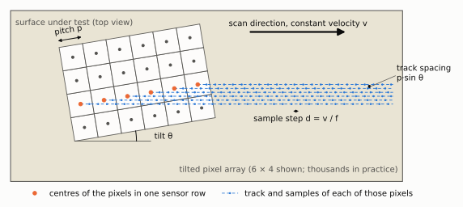

The sensor slides over the surface at velocity `v` and is read out `f` times
per second. Between readouts it moves a step `d = v / f`, which is chosen to be
a fraction of the pixel pitch `p`. Each pixel therefore records a time series
that is a line scan of the surface with sample spacing `d`.

The array is rotated by a small angle `θ` relative to the scan direction.
Successive pixels in a sensor row then follow tracks that are offset across the
scan by `p·sin θ`, so one sensor row of `N` pixels fills the space between
tracks in steps much smaller than a pixel. This is where the "thousands of
pixels" matter:

- Pixels along a sensor row provide fine sampling across the scan direction.
- Sampling in time provides fine sampling along the scan direction.
- Every surface point is seen by every pixel whose track passes over it, which
  gives the averaging that pays for deblurring.

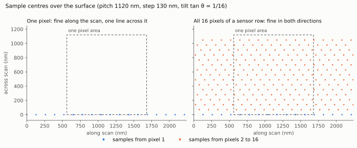

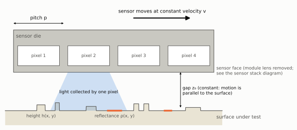

Each sample is not a point measurement. A pixel collects light from a patch of
surface whose size is set by the pixel's own area, by the distance travelled
during the exposure, and above all by the gap `z₀` between sensor and surface.

## 3. Measurement model

The signal chain from surface to stored number:

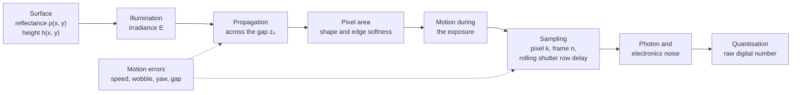

For pixel `k` in frame `n` the noise-free signal is

$$
m_{k,n} = g_k \, E_n \iint B\big(\mathbf{r} - \mathbf{r}_k(t_{k,n})\big)\, \rho(\mathbf{r})\, d^2\mathbf{r} + o_k
$$

where

- $\mathbf{r}_k(t) = \mathbf{r}_k^0 + \mathbf{v}\,t + \boldsymbol{\epsilon}(t)$ is the
  pixel's position over the surface: its place in the rotated array, plus
  constant-velocity motion, plus motion error.
- $t_{k,n} = n/f + j_k\, t_\text{line}$ is the sample time. The second term is the
  rolling shutter: row $j_k$ of the sensor is exposed slightly later than the
  row before it. With known constant motion this is just a known extra shift
  per row.
- $B$ is the combined blur kernel, the convolution of three parts:
  $B = B_\text{gap} * B_\text{pixel} * B_\text{motion}$.
- $g_k$ and $o_k$ are per-pixel gain and offset, and $E_n$ is the illumination
  level in frame $n$.

Because all pixels share the same blur kernel, the model factors into
"blur the surface once, then read it off at the sample positions". In operator
form, with the surface on a fine grid as a vector $\rho$:

$$
m = D\, S\, K\, \rho + \text{noise}
$$

where $K$ is the blur (a convolution), $S$ picks out the sample positions
(interpolation, a few non-zeros per row) and $D$ holds gains. This factoring is
what makes both the simulation and the inversion tractable (section 6).

### 3.1 The three blur terms

In spatial frequency $\mathbf{f} = (f_x, f_y)$, with $|\mathbf{f}| = 1/\Lambda$ for a
feature of period $\Lambda$:

| Term | Transfer function | Meaning |
|---|---|---|
| Gap | $H_\text{gap} = u\,K_1(u)$, $u = 2\pi z_0 \lvert\mathbf{f}\rvert$ | Diffuse light spreading across the gap. $K_1$ is a modified Bessel function. Falls as $e^{-2\pi z_0/\Lambda}$. |
| Pixel | $\text{sinc}(a f_{x'})\,\text{sinc}(a f_{y'})\, e^{-2\pi^2\sigma_e^2 \lvert\mathbf{f}\rvert^2}$ | Square sensitive area of width $a$ in the rotated sensor frame, with edges softened over $\sigma_e$. |
| Motion | $\text{sinc}(v\, t_\text{exp}\, f_x)$ | Smear over the exposure time $t_\text{exp}$. Continuous capture means $t_\text{exp} = 1/f$, so the smear equals the step $d$. |

The gap term comes from a diffuse point on the surface illuminating a plane at
distance $z_0$: the irradiance falls off as $z_0^2 / (r^2 + z_0^2)^2$, a spot
whose full width at half maximum is about $1.3\,z_0$. This geometric model is
the baseline. Closer than about one wavelength the true near-field behaviour
is more complicated, but the exponential fall-off with $z_0/\Lambda$ is the same
law that governs evanescent waves, so the scaling conclusion in section 4 does
not depend on the simplification.

### 3.2 Noise and error sources

Tim asked that noise in the motion rate and the pixel data be assumed. The
model carries each of the following as an explicit, switchable parameter. The
last column says whether the reconstruction is told the true value.

| Group | Source | Model | Known to reconstruction? |
|---|---|---|---|
| Pixel | Photon shot noise | Poisson on collected electrons | Statistics only |
| Pixel | Read noise | Gaussian, per sample | Statistics only |
| Pixel | Dark current | Poisson, scales with exposure | Statistics only |
| Pixel | Gain variation between pixels | Fixed random $g_k$ | Optional: calibrated or estimated |
| Pixel | Offset variation between pixels | Fixed random $o_k$ | Optional: calibrated or estimated |
| Pixel | Row noise | Random offset per row per frame | No |
| Pixel | Dead and hot pixels | Fixed mask | Optional |
| Pixel | Quantisation and clipping | 10 or 12 bit, full well | Yes |
| Light | Illumination flicker | Random $E_n$ per frame | No, estimated |
| Motion | Speed error | Constant scale error on $v$ | No, estimated |
| Motion | Speed fluctuation | Random walk plus periodic term along the scan | No, estimated |
| Motion | Cross-scan wobble | Slow random drift across the scan | No, estimated |
| Motion | Yaw error | Offset and drift of the tilt $\theta$ | No, estimated |
| Motion | Gap error | Offset, tilt (non-parallelism) and vibration of $z_0$ | No, studied as sensitivity |
| Timing | Frame time jitter | Random error on $t_{k,n}$ | No |

Motion errors matter more than pixel noise here. Pixel noise averages down
across thousands of pixels. A position error that the reconstruction does not
know about is a blur that no amount of averaging removes. Section 6.4 covers
how positions are estimated from the data itself.

## 4. What limits the resolution

This section is the most important one to agree on, because it determines
whether the instrument can reach its goal.

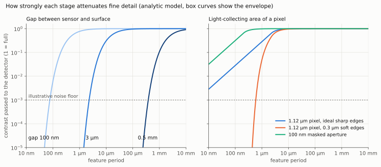

Reading the chart: a stage that passes a contrast of 1 leaves detail of that
size untouched. Detail whose contrast falls below the noise floor is lost. The
floor drawn at 1/1000 is illustrative; where it really sits depends on light
level and on how many samples are averaged.

### 4.1 The gap dominates

The pixel area attenuates fine detail gently, in proportion to feature size.
The gap attenuates it exponentially. Reconstruction can undo a known
attenuation only down to the noise floor, and against an exponential, better
signal-to-noise buys almost nothing:

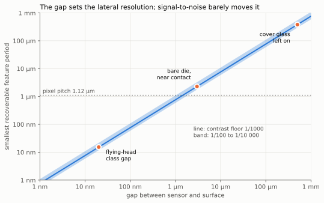

Illustrative results from the analytic model:

- The smallest recoverable period is roughly 0.75 times the gap for a contrast
  floor of 1/1000. A hundred times better signal-to-noise improves that by
  less than a factor of two.
- Cover glass left on (gap about 0.5 mm): features of a few hundred
  micrometres. Worse than an ordinary camera.
- Bare die held about 3 µm from the surface: features of about 2 µm, which is
  larger than the 1.12 µm pixel. In this regime the pixels already sample
  finely enough and super-resolution adds nothing beyond averaging.
- Sub-pixel resolution only becomes possible once the gap is smaller than the
  pixel pitch, so below about 1 µm for these sensors.
- Nanometre lateral features need a gap of nanometres. That is the regime of
  hard-disk heads and near-field scanning microscopes, over a die that is
  millimetres across with bond wires standing above its surface.

**Consequence for the project.** A Raspberry Pi class sensor with lenses
removed can validate the whole pipeline (sampling, motion estimation, noise
handling, reconstruction) at micrometre scale. It cannot resolve nanometre
lateral features, because the gap cannot be made small enough. The simulator
is designed so the gap is a free parameter, which lets it show exactly what
gap, flatness and motion accuracy a later instrument would need.

### 4.2 What a huge number of samples buys, and what it does not

The instrument collects an enormous number of samples, and that does recover
resolution finer than the pixel size. It is the point of the design. The
sample count does two separate things:

1. **It removes the pixel pitch as a limit.** Samples land on the surface far
   more densely than the pixels are spaced (section 2), so detail smaller than
   a pixel is sampled properly instead of being aliased.
2. **It lowers the noise floor.** Averaging `N` samples improves
   signal-to-noise by `√N`. The pixel area attenuates fine detail only in
   proportion to its size, so this averaging is enough to undo the pixel blur
   well below one pixel.

What it cannot do is restore detail that was attenuated exponentially before
it reached the sensor. Each extra factor of `e` in gap attenuation needs
`e² ≈ 7` times more samples to overcome, so the gain from more samples is
logarithmic:

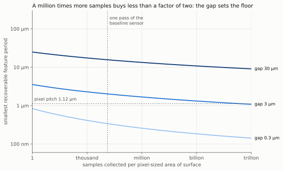

The plot is deliberately optimistic: full-contrast features, ideal sharp pixel
edges, exactly known positions, and a single-sample signal-to-noise of 50. One
pass of the baseline sensor gives about 13 000 samples per pixel-sized area
(3280 pixels in a row each cross it, sampling four times on the way).

| Gap | One pass | A million times more samples | Compared with the 1.12 µm pixel |
|---|---|---|---|
| 0.3 µm | 0.34 µm | 0.17 µm | 3 to 7 times finer than a pixel |
| 3 µm | 2.0 µm | 1.2 µm | Coarser than a pixel, reaching about one pixel |
| 30 µm | 16 µm | 10 µm | Much coarser than a pixel |

So the answer to "can the sample count beat the sensor's pixel size" is yes,
by a large factor, provided the gap is smaller than the pixel. With a gap
larger than the pixel, the same sample count is spent fighting the gap
instead, and a million-fold increase in samples buys less than a factor of
two. This agrees with the estimate in section 4.1; it is not a more
pessimistic or more optimistic result, only the same law plotted against
sample count.

Two things could genuinely move these curves, and both are parameters of the
simulator rather than assumptions baked into it:

- **A narrower acceptance angle.** The gap model assumes each pixel accepts
  light from all directions. A pixel that only accepts light from near
  straight ahead sees a smaller patch of surface for the same gap. Intact
  microlenses do some of this, which is another reason to keep them at first.
- **Directional lighting.** If the surface is lit by a collimated beam and
  mostly reflects or transmits it without scattering, light crosses the gap in
  nearly straight lines and the spreading is set by diffraction rather than
  geometry. That is a different, wave-optics model (section 4.5).

### 4.3 The pixel area

A bare pixel with perfectly sharp edges would pass fine detail at a contrast
of about (feature period) / (π × pixel width), which thousands of averaged
samples could recover. Real pixel edges are not sharp: charge spreads inside
the silicon and light spreads in the layers above it. Any softness removes
detail much finer than the softness scale, as the orange curve shows. The edge
softness of a real sensor is not known in advance and would have to be
measured. The simulator takes it as a parameter.

A later option is an opaque mask with one small opening per pixel. Resolution
is then set by the opening rather than the pixel, at the cost of light. Related
lensless instruments have used exactly this (section 9).

### 4.4 Sampling, motion and noise

- Sampling: the step `d` and the track spacing `p·sin θ` must both be at most
  half the smallest period to be recovered. Both are cheap to make small.
- Motion: unknown position error must stay well below the target resolution,
  or be estimated from the data to that accuracy.
- Noise: sets the contrast floor. Averaging over `N` pixels lowers it by `√N`.

### 4.5 Height

Tim wants height as well as reflectance, with lighting undecided. There are
three candidate ways height reaches the pixel, in increasing order of modelling
effort:

1. **Blur width.** A raised feature is closer to the sensor, so its blur spot
   is narrower. Total collected light is unchanged, so the effect is weak, and
   separating it from reflectance needs two passes at different gaps.
2. **Shading.** With light arriving at an angle, slopes facing the light are
   brighter. This gives slope rather than height, and needs a lighting
   geometry that fits in the gap.
3. **Interference in the gap.** With narrow-band light, reflections from the
   sensor face and from the surface interfere, and brightness cycles once for
   every half wavelength of gap change. This is sensitive to nanometres of
   height even at micrometre lateral resolution, and may be the most realistic
   route to "nanometre features" with this hardware. It needs a wave-optics
   model rather than the diffuse model above.

The plan is to build reflectance first, then add option 1 because it reuses
the same model, and treat option 3 as a separate study once Tim has decided on
lighting.

## 5. Baseline parameters

### 5.1 Sensor

The baseline is the Sony IMX219 used in the Raspberry Pi Camera Module 2.
Figures are from the Raspberry Pi camera hardware documentation [R1].

| Sensor | Module | Pixels | Pitch | Image area | Shutter | Fastest listed modes |
|---|---|---|---|---|---|---|
| IMX219 (baseline) | Camera Module 2 | 3280 × 2464 | 1.12 µm | 3.68 × 2.76 mm | Rolling | 1640 × 1232 at 41, 640 × 480 at 206 frames per second |
| IMX708 | Camera Module 3 | 4608 × 2592 | 1.4 µm | 6.45 × 3.63 mm | Rolling | 2304 × 1296 at 56, 1536 × 864 at 120 |
| IMX477 | HQ Camera | 4056 × 3040 | 1.55 µm | 6.287 × 4.712 mm | Rolling | 2028 × 1520 at 40, 1332 × 990 at 120 |
| IMX296 | Global Shutter Camera | 1456 × 1088 | 3.45 µm | 6.3 mm diagonal | Global | 1456 × 1088 at 60 |

Notes:

- The documentation states the shutter type only for the Global Shutter
  Camera. "Rolling" for the other three is general knowledge of these sensors,
  not a quoted figure.
- The documentation reportedly lists the Camera Module 2 sensor as "Sony
  IMX219 (or IMX355 from November 2026)". This was read second-hand and should
  be checked before buying hardware, since a different sensor means a
  different stack.
- The faster modes combine neighbouring pixels, which changes the effective
  pixel size. The simulator treats binning as a larger pixel.

Starting values for quantities that are not in public specifications, to be
replaced by measurement: full well 4500 electrons, read noise 3 electrons,
gain variation 1 percent, edge softness 0.3 µm.

### 5.2 Scan

| Parameter | Starting value | Reason |
|---|---|---|
| Frame rate `f` | 30 frames per second | Conservative full-resolution rate; faster binned modes are listed in 5.1 |
| Step `d` | 0.28 µm (a quarter pixel) | Fine along-scan sampling with modest motion smear |
| Velocity `v = d·f` | 8.4 µm/s | Follows from the two above |
| Tilt `θ` | tan θ = 1/16 | Track spacing of 70 nm from a 1.12 µm pitch |
| Gap `z₀` | Swept from 20 nm to 0.5 mm | The main unknown of the instrument |

### 5.3 The sensor stack, and what removing the lenses leaves

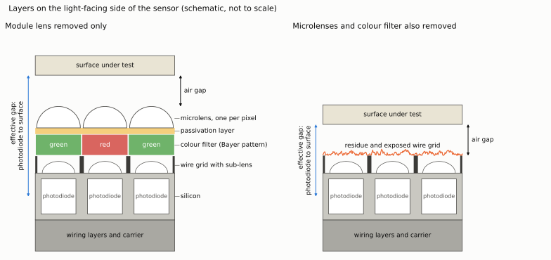

A published electron-microscope cross-section of the IMX219 [R2] gives the
layer order on the light-facing side, from the outside in:

1. Main microlens, one per pixel.
2. Passivation layer.
3. Bayer colour filter.
4. A smaller sub-lens sitting between the bars of a metal wire grid that
   separates neighbouring pixels.
5. The photodiode. The sensor is back-illuminated, so the wiring is behind the
   photodiodes and out of the light path.

The source gives no thickness for the microlens, passivation or filter
layers. The diagram is therefore a schematic of the order only. For scale, the
photodiode region is reported as about 0.9 µm deep under a 1.12 µm pixel, so a
stack of the order of a micrometre or two is a reasonable expectation, to be
measured.

What each kind of removal leaves:

| Removed | What remains on the sensor face | Evidence |
|---|---|---|
| Module lens only (the lens barrel and its holder) | Microlenses, passivation, colour filter, sub-lens and wire grid, all intact | The microlenses are bonded to the chip and are separate from the module lens [R3]. The holder is glued down with a thin layer of epoxy [R4]. |
| Module lens and microlenses | Colour filter is gone too. Sub-lens, wire grid and some residue remain. | The microlenses sit directly on top of the colour filter [R2], and every reported method removes both together: laser ablation "removes those as well" [R5]; photoresist remover or scraping strips the filter layer [R4]. |

So the answer to "does the colour filter survive" is: yes if only the module
lens comes off, no if the microlenses come off.

Reported practical hazards of stripping the die: the bond wires around the
edge of the sensor are extremely fine and one builder lost four cameras before
succeeding [R4]; solvents alone did not work in two independent attempts
[R4, R5]; the surface afterwards carries residue and exposed wire grid
[R2, R4].

Cover glass: on the first-generation module (OV5647) a glass cover over the
die is reported, and was removed with a scalpel [R5]. No source found so far
says whether the IMX219 module has one. This needs checking on a real module.

#### Consequences for the model

| Property | Module lens removed only (baseline) | Microlenses and filter removed |
|---|---|---|
| Colour response | Red, green and blue pixels in the Bayer pattern. With single-colour light this is a known gain pattern and pixels of the other colours contribute little. | Monochrome, all pixels alike. |
| Acceptance angle | Narrowed by the microlens. | Wide. |
| Pointing | Microlenses near the edge of the array are shifted towards the centre to suit the original lens [R3]. With a surface close above, edge pixels look slightly sideways, which displaces their footprint by an amount proportional to the gap. Modelled as a known position-dependent offset. | Straight down. |
| Minimum effective gap | Air gap plus the full stack. | Air gap plus the sub-lens layer, less by the stack thickness. |
| Pixel response shape | Set by the microlens, smooth. | Set by the wire grid opening and sub-lens, with unknown residue. |
| Risk | Low. | High, and the result varies from die to die. |

Other properties of this sensor class that the model includes:

- **Rolling shutter.** Rows are exposed in sequence. Under constant motion this
  is a known per-row shift and is included in the sample positions. It adds
  variety to the sampling phases, which is harmless or mildly helpful.
- **Bond wires.** They stand above the sensor face around its edge, so a flat
  sample larger than the active area cannot approach closely. The sample must
  be smaller than the die or raised on a pedestal.
- **Raw data.** Reconstruction needs unprocessed sensor data. The camera's
  normal pipeline applies lens shading correction and other processing tuned
  for the original lens [R3], all of which must be bypassed.
- **Illumination.** With the sensor covering the surface, light has to enter
  from the side through the gap, through the sample from behind, or through
  the sensor. This is unresolved and is listed in section 11.

Sources for this section:

- [R1] Raspberry Pi, "Camera" hardware documentation.
  <https://www.raspberrypi.com/documentation/accessories/camera.html>
- [R2] Matthews et al., "Laser de-Bayering of low cost image sensors"
  (electron-microscope cross-section of the IMX219PQ), arXiv:1901.03807.
  <https://arxiv.org/abs/1901.03807>
- [R3] Bowman et al., "Flat-field and colour correction for the Raspberry Pi
  camera module", arXiv:1911.13295. <https://arxiv.org/abs/1911.13295>
- [R4] E. Orbach, "Debayering Raspberry Pi camera", 2016 (first-generation
  module).
  <https://eladorbach.blogspot.com/2016/05/debayering-raspberry-pi-camera.html>
- [R5] Hackaday, "Using a laser to blast away a Bayer array", 2021, with the
  builder's replies in the comments (first-generation module, OV5647).
  <https://hackaday.com/2021/08/09/using-a-laser-to-blast-away-a-bayer-array>

### 5.4 Scan sampling calculator

Questions such as "if we move 20% of the sensor size every second and sample
at 10 frames per second, how many samples does each surface point get?" are
answered by a calculator in the package, `ccdsr/sampling.py`. It is the first
piece of code in the repository because every later choice of speed, frame
rate and exposure goes through it.

```
python -m ccdsr.sampling --fraction-per-s 0.2 --fps 10
```

Inputs: sensor size and pixel pitch, speed (as a fraction of sensor length per
second, or in micrometres per second), frame rate, exposure time, tilt,
rolling-shutter readout time, and random position jitter per frame.

| Output | Formula | Tim's example (IMX219, 20% per second, 10 frames per second) |
|---|---|---|
| Speed | fraction × sensor length | 735 µm/s |
| Shift per frame | speed / frame rate / pitch | 65.6 pixels |
| Time a point spends under the sensor | sensor length / speed | 5 s |
| Samples per surface point | frame rate / fraction per second | 50 |
| Motion blur | speed × exposure / pitch | 65.6 pixels with continuous exposure |
| Exposure for a quarter-pixel blur | 0.25 × pitch / speed | 0.38 ms |
| Distinct sub-pixel positions | counted from the sample positions | 5 |
| Largest unsampled hole in a pixel | radius of the largest empty circle | 0.51 pixels (a perfect grid of 50 samples would give 0.10) |
| Data rate | pixels × frame rate | 81 million samples per second |
| Area rate | speed × sensor width | 2.0 mm² per second |

Three things follow from the example.

**Samples per point is simply frame rate divided by the fraction moved per
second.** Each frame contributes one sample of a given point, taken by
whichever pixel is over it at the time.

**The 50 samples are not automatically 50 different sub-pixel positions.** A
shift of 65.6 pixels per frame leaves a remainder of 0.6 pixels, which repeats
every 5 frames, so the samples pile up on 5 positions along the scan and a
single position across it. The figure shows this, and two ways out.


**Continuous exposure smears the image at this speed.** The sensor moves 65.6
pixels during one frame period. Sub-pixel reconstruction needs each sample
frozen to a fraction of a pixel, which here means an exposure or a light pulse
of about 0.4 ms. The slow baseline in section 5.2 avoids this by moving a
quarter pixel per frame, at the cost of taking a hundred times longer to cover
the same area. The calculator exists to trade these off.

For comparison with section 4.2: the slow baseline collects about 13 000
samples per pixel-sized area in one pass, and this example collects 50.

### 5.5 Natural misalignment as a resource

Tim's point is that with noise in the motion and continuous movement, samples
are never perfectly aligned, and that this should be used. The design takes
that position:

- **Imperfect motion fills the pixel on its own.** The right-hand panel above
  has no tilt at all. A random position error of half a pixel per frame spreads
  the 50 samples over the whole pixel in both directions, giving a largest
  hole of 0.18 pixels against 0.51 for perfectly regular motion. Regular
  motion is the bad case, because it can repeat.
- **It only helps if the positions are known afterwards.** A sample at an
  unknown position is blur. A sample at a known irregular position is as
  useful as one on a grid. So positions are treated as unknowns to be
  estimated from the data (section 6.4), never as commanded values to be
  trusted. The reconstruction takes arbitrary sample positions, so irregular
  sampling costs nothing extra.
- **The estimate can be far better than the motion.** Each frame holds
  millions of pixels and overlaps its neighbour almost completely, so the
  shift between frames can be measured to a small fraction of a pixel even
  when the stage itself wanders by many pixels.
- **Tilt becomes optional rather than required.** Deliberate tilt gives the
  most even coverage (0.12 pixels in the middle panel). Natural wobble gives
  less even but adequate coverage without it. Using both is the safe choice,
  and the calculator reports the coverage for any combination.

Limits to keep in view:

- Jitter helps sampling only between frames. Movement during an exposure is
  still blur, so the short-exposure requirement above stands.
- With a rolling shutter, speed changes during one frame's readout distort
  that frame. The trajectory model in section 6.4 must therefore describe
  position against time, not one shift per frame.
- Noise in the pixel values does not add sampling diversity. It only sets the
  noise floor of section 4.
- Small jitter is not enough. With 0.1 pixels of random error the largest hole
  is still 0.38 pixels, because the regular 5-position pattern dominates.

### 5.6 Trade-off explorer

Speed, frame rate, exposure, samples per point, sub-pixel coverage, motion
blur, gap and recoverable resolution all depend on each other, and Tim wants
to explore those trade-offs easily and quickly. The tool for that is a single
web page, [`explorer/index.html`](../explorer/index.html), which opens straight
from the repository in any browser with nothing to install.

Why a web page rather than a notebook: it needs no Python environment, it
responds on every slider movement, and it can be opened on any device or
shared as a link. A notebook would tie exploration to a running kernel.

What it does:

- **Controls:** sensor model, speed, frame rate, exposure or light pulse
  length, tilt, random position error, number of passes, gap, pixel edge
  softness, single-sample signal-to-noise and feature contrast. Exposure is a
  free parameter from continuous down to a hundred-thousandth of the frame
  period, because the choice between a short exposure, a light pulse, a slow
  scan or modelling the smear has not been made.
- **Figures, updated instantly:** smallest recoverable feature period and
  which effect limits it, samples per point, shift per frame, motion blur,
  distinct sub-pixel positions, area rate and data rate.
- **Plots:** where the samples of one point fall inside a pixel; the contrast
  passed by the gap, the pixel area and motion blur against feature size, with
  the level needed to beat the noise; and the recoverable feature size swept
  against any one setting with the rest held fixed.
- **Presets** for the settings discussed so far, including the 20% per second
  at 10 frames per second example.

It is built on the analytic model only (sections 3.1, 4.2 and 5.4), so it
answers in milliseconds and runs no simulation. The same formulas exist in
Python as `ccdsr/sampling.py` and `ccdsr/resolution.py`, and a test runs the
page's JavaScript model against the Python one so the two cannot drift apart.

The estimate it reports is the larger of two limits: the period at which the
attenuated signal equals the averaged noise, and the period that the sample
positions can represent (twice the effective sample spacing). It carries the
simplifications of the analytic model. The full simulator of section 11 is
what will confirm or correct it.

## 6. Reconstruction

### 6.1 Pipeline

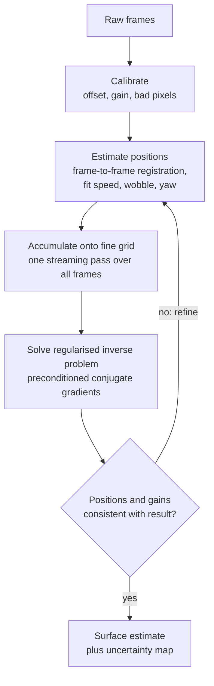

### 6.2 Approaches considered

| Method | What it does | Role |
|---|---|---|
| Shift and add | Place every sample on a fine grid and average | Baseline. Shows what dense sampling alone achieves, without deblurring. |
| Shift and add, then Wiener filter | Grid, then divide out the blur in frequency space with noise-aware damping | Fast first estimate and preconditioner. Exact when coverage is uniform. |
| Regularised least squares | Find the surface that best explains all samples under the full model | Main method. Handles uneven coverage, per-sample noise weights and missing pixels. |

The main method minimises

$$
\lVert W^{1/2}(D S K \rho - m)\rVert^2 + \lambda\, \lVert \nabla\rho \rVert^2
$$

with $W$ the per-sample noise weights and $\lambda$ controlling smoothness.

### 6.3 Solving the large inverse problem

Tim noted this needs a large amount of matrix inversion. Formally it does, but
no matrix is ever inverted or even stored. The sizes rule it out: one full
IMX219 frame is 8 million samples, a scan is thousands of frames, and a fine
grid over the sensor's footprint is tens of millions of unknowns. A dense
matrix for a mere one million unknowns would need 8 terabytes and a direct
inverse about 10¹⁸ operations.

The structure $A = D S K$ avoids this:

| Step | Cost | Memory |
|---|---|---|
| Apply blur $K$ | Fast Fourier transform, $N \log N$ | Size of the grid, $N$ |
| Apply sampling $S$ | Four multiplications per sample | Not stored, computed from positions |
| Accumulate $S^T W m$ and $S^T W S$ | One pass over the frames, streaming | $N$ and about $9N$ (a sparse matrix that only links neighbouring cells) |
| One solver iteration | $N \log N$, independent of the number of frames | A few grids |
| Whole solve | Tens of iterations with a Fourier preconditioner | A few grids |

Key points:

- **The raw data is read once.** Everything the solver needs is accumulated
  into two grid-sized quantities in a single streaming pass, so the number of
  frames affects only that pass and never the iterations.
- **Uniform coverage makes the problem nearly diagonal.** When every fine-grid
  cell is sampled about equally often, $S^T W S$ is close to a constant, and
  the Wiener filter is already the answer. That filter is used as the
  preconditioner, which is why few iterations are needed.
- **Large areas are tiled.** The blur is local, so the surface is cut into
  overlapping tiles solved independently, in parallel, on a processor or
  graphics card.

Expected scaling, to be confirmed by measurement in the build:

| Problem | Unknowns | Samples | Expected solve time on one processor |
|---|---|---|---|
| Unit test | 10⁴ | 10⁵ | Under a second |
| Demonstration patch | 10⁶ | 10⁷ | Seconds to a minute |
| Full sensor footprint, tiled | 10⁸ | 10¹⁰ | Dominated by the streaming pass over frames |

### 6.4 Estimating motion from the data

Each frame is a full two-dimensional picture of the surface, blurred but
containing millions of pixels. Consecutive frames overlap almost completely,
so cross-correlating them gives the shift between frames to a small fraction
of a pixel. The plan:

1. Register consecutive frames to get a raw trajectory.
2. Fit a smooth motion model (mean speed, slow variation, wobble, yaw) to it.
   Constant-rate motion makes this a strong constraint.
3. Reconstruct, then refine the trajectory by registering each frame against
   the model's prediction from the current surface estimate. Repeat.

The trajectory is modelled as position against time (a smooth curve with a
few parameters per frame), so that it covers both the frame-to-frame
misalignment that section 5.5 relies on and the within-frame distortion of a
rolling shutter.

Per-pixel gain and offset are refined the same way, since every pixel sees the
same surface statistics over a long scan.

## 7. Software design

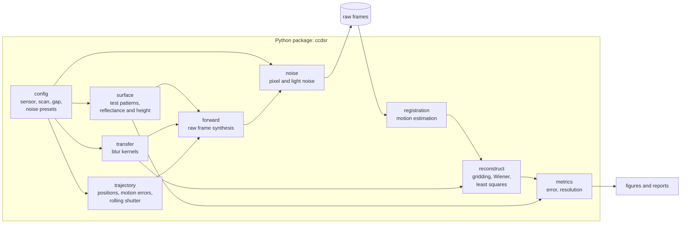

Design rules:

- Physical units everywhere, with nanometres as the length unit.
- The simulator and the reconstruction share only the `config` and `transfer`
  modules. The reconstruction never sees ground truth or true positions.
- The ground truth is generated on a finer grid than the reconstruction uses,
  and with a different interpolation, so the test is not rigged in the
  reconstruction's favour.
- The reconstruction reads raw frames in the same form a real camera would
  provide, so real data can be substituted later.
- Fixed random seeds, so every figure is reproducible.

### Repository layout

```
README.md
docs/
  design.md               this document
  diagrams/               diagram sources (Python) and rendered SVG and PNG
ccdsr/                    the package, one file per module above
  sampling.py             scan sampling calculator (implemented)
  resolution.py           analytic resolution model (implemented)
explorer/                 trade-off explorer web page (implemented)
examples/                 runnable scripts that produce the result figures
studies/                  parameter sweeps for the limit study
results/                  committed figures and summary tables
tests/                    unit and end-to-end tests
```

## 8. Validation plan

Test surfaces, each chosen to probe one thing:

| Surface | Probes |
|---|---|
| Bar groups of decreasing period, both orientations | Resolution along and across the scan |
| Siemens star | Resolution in every direction at once |
| Pairs of points at decreasing separation | Two-point resolution |
| Sharp edge | Edge response and ringing |
| Random texture | Realistic broadband content, used for registration tests |

Measures: error against ground truth, resolution by Fourier ring correlation
(the finest scale at which the reconstruction still agrees with the truth) and
contrast of each bar group.

Checks, in build order:

1. Each blur kernel against its analytic transfer function.
2. Forward and adjoint operators are consistent.
3. With no noise and exact positions, the reconstruction recovers everything
   the blur lets through.
4. Achieved resolution matches the analytic predictions in section 4.
5. The limit study: achieved resolution against gap, pixel edge softness,
   light level, pixel count, step, tilt, and each motion error in section 3.2.

## 9. Related work

- Heng et al., "Optofluidic microscopy: a method for implementing a high
  resolution optical microscope on a chip", Lab on a Chip, 2006.
  [doi:10.1039/b604676b](https://doi.org/10.1039/b604676b). A lensless sensor
  with a tilted line of small openings; the sample moves past at constant
  speed. The closest prior instrument to this concept.
- Cui et al., "Lensless high-resolution on-chip optofluidic microscopes for
  Caenorhabditis elegans and cell imaging", PNAS, 2008.
  [doi:10.1073/pnas.0804612105](https://doi.org/10.1073/pnas.0804612105).
- Zheng et al., "Sub-pixel resolving optofluidic microscope for on-chip cell
  imaging", Lab on a Chip, 2010.
  [doi:10.1039/c0lc00213e](https://doi.org/10.1039/c0lc00213e). Sub-pixel
  reconstruction from samples moving over bare pixels.
- Zheng et al., "The ePetri dish, an on-chip cell imaging platform based on
  subpixel perspective sweeping microscopy", PNAS, 2011.
  [doi:10.1073/pnas.1110681108](https://doi.org/10.1073/pnas.1110681108).
- Fruchter and Hook, "Drizzle: a method for the linear reconstruction of
  undersampled images", PASP, 2002.
  [doi:10.1086/338393](https://doi.org/10.1086/338393). The standard
  shift-and-add method.
- Farsiu et al., "Fast and robust multiframe super resolution", IEEE
  Transactions on Image Processing, 2004.
  [doi:10.1109/tip.2004.834669](https://doi.org/10.1109/tip.2004.834669).
  Regularised multi-frame reconstruction.

## 10. Ray tracing simulation (later stage)

Tim wants an eventual ray-tracing simulation that can demonstrate feature
sizes and pixel sampling schemes. It is planned as a second forward model
beside the linear one, not a replacement.

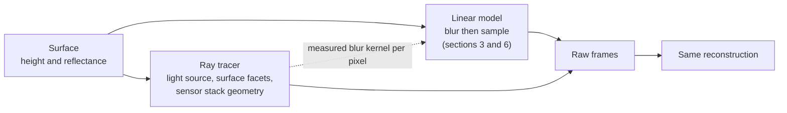

What the ray tracer adds that the linear model cannot do:

- **Real three-dimensional surface shape.** Shadowing, occlusion by raised
  features, slope-dependent brightness and light bouncing between surface and
  sensor. The linear model treats the surface as a flat brightness map.
- **The actual lighting geometry.** Light entering from the side of the gap,
  from behind, or through the sensor, instead of an assumed uniform glow.
- **The sensor stack.** Microlenses, colour filters, the wire grid and the
  acceptance angle of each pixel traced as geometry, including edge pixels
  that look sideways (section 5.3).
- **Pixel sampling schemes.** Any layout of sensitive areas, masks, tilts or
  scan paths can be drawn and traced, and the picture of which rays reach
  which pixel is itself the demonstration.
- **Blur kernels for the linear model.** Tracing a point source gives the
  true footprint of each pixel, which replaces the analytic gap formula in
  the fast model and in the explorer.

How it fits: it produces raw frames in the same format as the linear model,
so the reconstruction and the metrics are shared. The linear model stays the
workhorse for large parameter sweeps because it is thousands of times faster.

### Where ray tracing is valid

Ray tracing treats light as straight lines and ignores its wave nature. That
is accurate only while every relevant dimension is much larger than the
wavelength, which for visible light is about 0.4 to 0.7 µm.

| Situation | Ray tracing | Reason |
|---|---|---|
| Features and gap of tens of micrometres or more | Valid | Everything is many wavelengths across |
| Features or gap of a few micrometres | Approximate | Diffraction starts to soften shadows and spread light; treat results as indicative |
| Features, gap or pixel structures near or below a micrometre | Not valid | Diffraction dominates; rays predict sharp shadows that do not exist |
| Nanometre height read through interference (section 4.5) | Not valid | Interference is a wave effect that rays do not have |
| Nanometre gaps | Not valid | Light couples through near-field effects, not along rays |

This matters here because the pixels are 1.12 µm, about two wavelengths, and
the project's target is nanometre features. The ray tracer will therefore be
honest for the first hardware at micrometre scale and for demonstrating
sampling schemes, and it will be wrong in exactly the regime the project
ultimately cares about. For that regime the plan is a wave-optics model
(scalar diffraction for the gap, and a full electromagnetic solver for the
pixel structures if needed). The design keeps the forward model behind one
interface so that rays, waves and the linear approximation are
interchangeable and can be checked against each other where their ranges of
validity overlap.

## 11. Build stages and open questions

| Stage | Content | Outcome |
|---|---|---|
| 1 | One-dimensional model along the scan, with reconstruction | Maths verified against analytic curves |
| 2 | Two-dimensional reflectance model with tilt, rolling shutter and pixel noise; least-squares reconstruction | First surface reconstructions and figures |
| 3 | Motion errors and motion estimation from the data | Tolerances for the stage and mechanics |
| 4 | Limit study across gap, noise, sampling and motion | Resolution map of the instrument |
| 5 | Height: blur-width model, two-gap reconstruction | Whether height is recoverable without interference |
| 6 | Interference model for height, if lighting allows | Nanometre height sensitivity study |
| 7 | Ray-tracing forward model (section 10): surface shape, lighting geometry, sensor stack, sampling schemes | Demonstrations of feature sizes and sampling schemes at micrometre scale; measured blur kernels for the fast model |
| 8 | Wave-optics forward model for sub-micrometre features and gaps | Results valid in the nanometre regime |

Open questions for Tim:

1. Is the conclusion in section 4.1 acceptable: the first hardware validates
   the method at micrometre scale, and the simulator is used to specify what a
   nanometre instrument would need?
2. Section 5.3 concludes that removing only the module lens keeps the colour
   filter, and removing the microlenses loses it. The baseline assumes only
   the module lens is removed. Is that the intended first setup?
3. Is there any constraint on lighting (side, through the sample, single
   colour) that should be fixed now? It decides which height mechanism in
   section 4.5 is worth modelling.
4. What gap is realistically achievable in the first setup? This is the one
   number that most changes the results.
