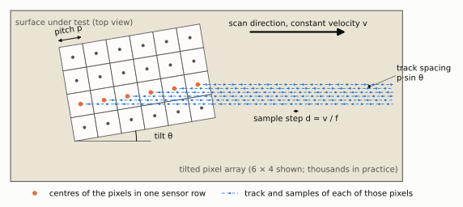
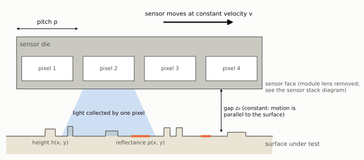
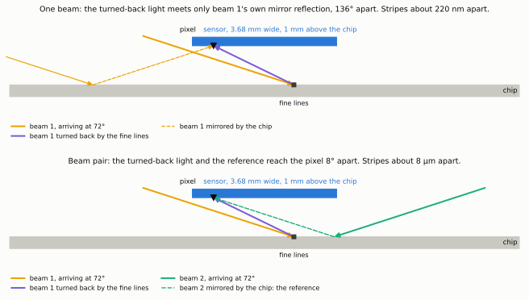
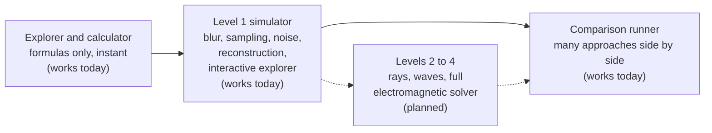
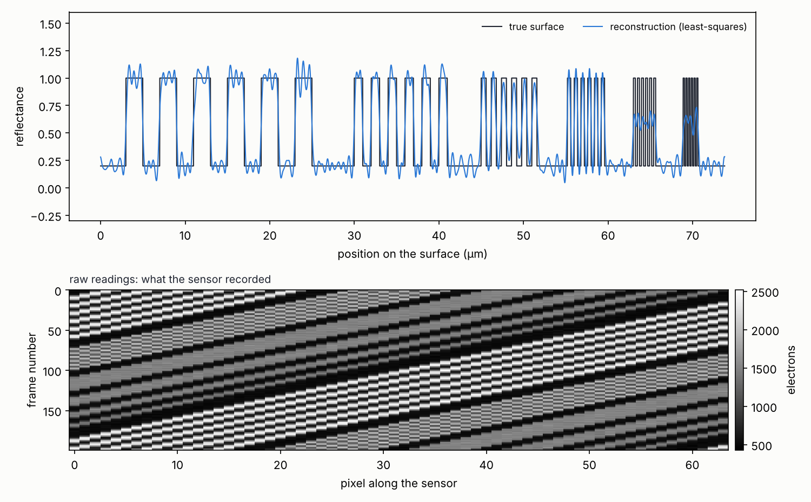
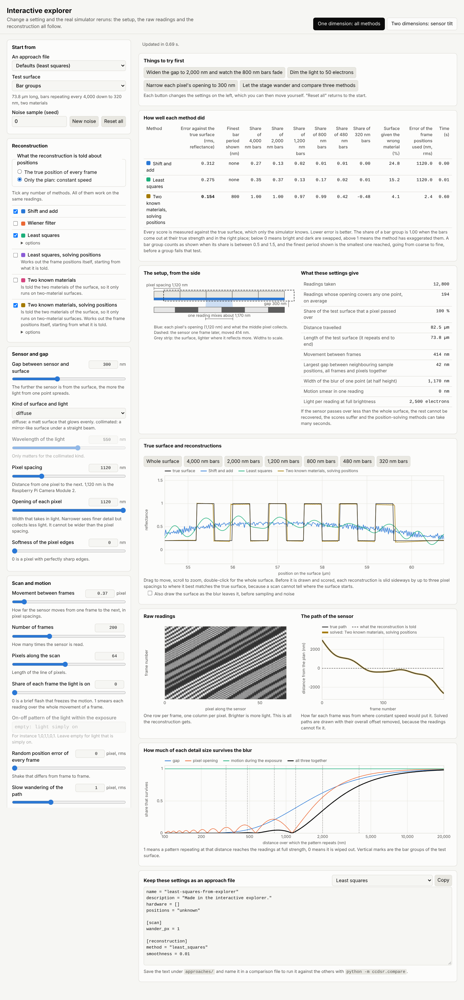

# Getting started

This page shows the instrument as it is currently configured and how to try
the simulator yourself, starting with what needs no installation. Each step
links to the page that explains it in full.

## The current configuration

An image sensor with its lenses removed slides over the chip at a steady
speed, a small distance above it, and is read out many times a second. The
sensor is turned by a small angle so that its rows of pixels fill in the
detail across the direction of travel.



*Figure 1. The scan seen from above. From
[design, section 2](design.md#2-concept). Illustrative, not to scale.*



*Figure 2. The sensor and the surface from the side. The gap decides how
wide an area of the surface each pixel collects light from (the cone drawn), which is the same as how far light from one point spreads. The letters in figures 1 and 2 are explained in the design section they come from. From
[design, section 2](design.md#2-concept). Illustrative, not to scale.*



*Figure 3. The laser route, to scale. It was the leading candidate until 15
November 2026 and is now a recorded alternative, because special lighting is not assumed
([REQ-6](design.md#requirements); [design 4.11](design.md#411-no-special-lighting-what-ordinary-light-can-reach-and-where-the-work-goes)): steep laser
beams enter under the edge of the sensor, and the pixels record the
reflected light. From the
[ptychography study, section 7](research/ptychography.md#7-has-beam-pair-mixing-been-done-before).
Derived there from straight rays.*

There are three configurations to keep apart: the one the simulator runs
today, the one the design is now heading for under ordinary light, and the
laser route that was set aside on 15 November 2026. The first two use the
same model, so what runs today is a small version of where the design is
heading. Table 1 compares what runs today with the laser route; the figures
for ordinary light at each distance are in
[design, Table 4.11b](design.md#411-no-special-lighting-what-ordinary-light-can-reach-and-where-the-work-goes).

| Setting | What runs today (level 1), ordinary light | Laser route (recorded alternative) | Source of the laser-route value |
|---|---|---|---|
| Sensor pixel width | 1,120 nm | 1,120 nm | Raspberry Pi Camera Module 2, [design 5.1](design.md#51-sensor) |
| Pixels | 64 in a line (16 by 16 in two dimensions) | 3,280 by 2,464 | [Design 5.1](design.md#51-sensor) |
| Gap between sensor and surface | 300 nm | About 1 mm (1,000,000 nm), at least 0.6 mm | [Design, Table 4.10a](design.md#410-what-the-four-research-studies-changed) |
| Light | Even, undirected glow from a matt surface | 405 nm laser beams at about 72° from several directions. Whether each has partner beams is one of two options to be compared | [Design 4.7](design.md#47-a-staged-path-with-laser-light-a-recorded-alternative) |
| Movement per frame | 0.37 pixel | 0.25 pixel, made slightly irregular | [Design 5.2](design.md#52-scan) |
| Sensor tilt | None in one dimension. In two dimensions 0° unless set; the [level 1 example](level1.md) uses 3.6° | About 3.6° (1 in 16) | [Design 5.2](design.md#52-scan) |
| Stage | One direction | Two directions (acceptable, [REQ-9](design.md#requirements)) | [Design, section 11](design.md#11-build-stages-and-open-questions) |
| Finest detail | The test bars go down to a 320 nm period. The default run shows 800 nm, and the best approach so far shows 480 nm ([comparison](comparison.md)) | Aim: lines of 100 nm | [Design 4.6](design.md#46-the-target-100-nm-features-on-silicon-chips) |
| Reconstruction | Shift and add, Wiener filter, least squares, position solving and known materials, all through the commands below. Elimination only from Python ([its page](constrained-reconstruction.md#running-it)) | Recovery of the light's phase with positions solved (ptychography) | [Design 6](design.md#6-reconstruction) |

*Table 1. What runs today against the laser route. The middle column is what the code does
now. The right-hand columns are design values, each an Estimate or
Assumption on the page linked, and none has been simulated yet: the wave
levels of the [simulation chain](simulation-chain.md) that can represent
laser light are not built.*



*Diagram: what can be run today (solid arrows) and what is planned (dashed).*

## Step 1: sliders in the browser

Open the [trade-off explorer](explorer.md). Nothing to install. Move the
sliders for speed, frame rate, exposure, tilt, gap and noise, and the
smallest recoverable feature, the samples per point and the motion blur
update at once. It uses formulas only, so it answers "what limits this
setting" and not "what would the picture look like". The "100 nm on
silicon" preset loads the target case.

## Step 2: install the code

```
git clone https://github.com/mithro/ccd-superres
cd ccd-superres
pip install -e .
```

This needs Python 3.11 or newer.

## Step 3: ask about a scan setting

```
python -m ccdsr.sampling --fraction-per-s 0.2 --fps 10
```

This is the question "move 20 % of the sensor length every second at 10
frames a second: how many samples does each point get?". The answer and the
other options are on the [scan calculator](calculator.md) page.

## Step 4: run the simulator on one approach

```
python -m ccdsr.run approaches/least-squares.toml
```

This simulates a scan of a test surface, reconstructs it, prints how well
it did and saves a picture as `run.png` in the folder you are in.



*Figure 4. The picture that step 4 saves. Top: the true surface (black) and
the reconstruction (blue). Bottom: the raw readings, one row per frame.
Simulated, level 1, seed 0.*

Change any setting for one run with `--set`:

```
python -m ccdsr.run approaches/least-squares.toml --set optics.gap_nm=1000
python -m ccdsr.run approaches/least-squares.toml --set noise.full_e=100 --set scan.shift_px=0.9
python -m ccdsr.run approaches/two-materials-position-solving.toml --scene random_layout --set scan.wander_px=1
python -m ccdsr.run --list
```

The last line lists every scene, method and setting with its default.

| Setting | What it is | Default | Unit |
|---|---|---:|---|
| `optics.gap_nm` | Gap between sensor and surface | 300 | nm |
| `optics.aperture_nm` | Width of the opening on each pixel (the whole pixel if not set) | 1,120 | nm |
| `optics.edge_sigma_nm` | Softness of the pixel edges | 0 | nm |
| `scan.shift_px` | Movement between frames | 0.37 | pixel |
| `scan.n_frames` | Number of frames | 200 | |
| `scan.exposure_fraction` | Share of each frame the light is on (0 is a brief flash) | 0 | |
| `scan.jitter_px` | Random position error of every frame | 0 | pixel, rms |
| `scan.wander_px` | Slow wandering of the path | 0 | pixel, rms |
| `noise.full_e` | Light collected at full brightness | 2,500 | electrons |
| `noise.read_e` | Read noise of the sensor | 2 | electrons, rms |
| `positions` | `known`: the reconstruction is told where each frame was. `unknown`: it is told only the planned speed | Set by the approach file (`known` if it does not say) | |
| `reconstruction.method` | How the picture is recovered | Set by the approach file | |

*Table 2. The settings most worth changing. Defaults are those of
[`ccdsr/level1.py`](https://github.com/mithro/ccd-superres/blob/main/ccdsr/level1.py); they are Assumptions
chosen for a small, fast test and are not the design values of table 1.*

## Step 5: explore with the mouse

```
python -m ccdsr.gui
```

This opens the [interactive explorer](interactive-explorer.md) in your
browser: a control for every setting above, with the setup, the raw
readings and the reconstructions of several methods redrawn on every
change. It runs the same simulator as step 4.



*Figure 5. The interactive explorer. Explained on
[its own page](interactive-explorer.md).*

## Step 6: compare approaches

```
python -m ccdsr.compare comparisons/level1-first.toml --out results/mine --workers 4
```

This runs 13 approaches on 4 surfaces under 6 conditions in about a minute
and writes tables and figures to `results/mine`. To add your own approach,
copy a file in [`approaches/`](https://github.com/mithro/ccd-superres/tree/main/approaches), change it, and add
its name to
[`comparisons/level1-first.toml`](https://github.com/mithro/ccd-superres/blob/main/comparisons/level1-first.toml).
The [comparison page](comparison.md) explains the files and shows the first
results.

## Step 7: use it from Python

The pages on [level 1](level1.md#running-it) and
[reconstruction by elimination](constrained-reconstruction.md#running-it)
end with short examples that call the simulator directly, including the two
dimensional version with sensor tilt.

## What you cannot try yet

| Not yet runnable | Why | Where it is planned |
|---|---|---|
| Laser light, slanted beams and beam pairs | Level 1 only blurs brightness. It has no interference between beams | Levels 3 and 4 of the [simulation chain](simulation-chain.md) |
| 100 nm features | Under ordinary light they need the silicon within about 140 nm of the chip ([design 4.11](design.md#411-no-special-lighting-what-ordinary-light-can-reach-and-where-the-work-goes)). Also, level 1 with its built-in blur is trusted only for dimensions of several micrometres or more ([simulation chain, where each level is valid](simulation-chain.md#where-each-level-is-valid)); 100 nm needs the wave levels | The same |
| The full sensor of 8 million pixels | The solver is not yet split into tiles | [Plan](plan.md#d-simulation-chain), phase D |
| Surfaces longer than the sensor | The level 1 surface joins up end to end | [Comparison page, limits](comparison.md#what-this-does-not-cover-yet) |
