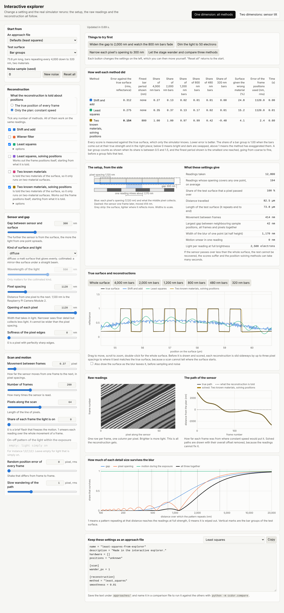
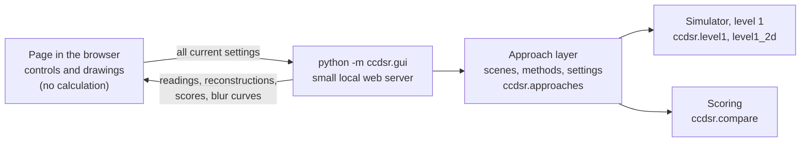
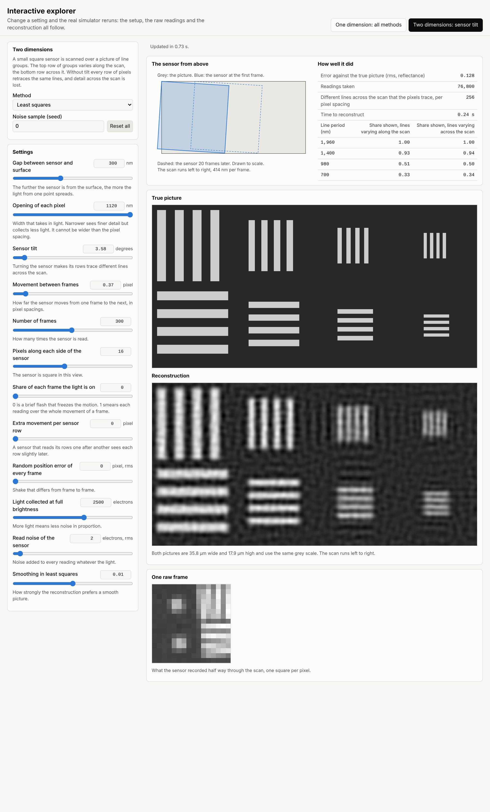

# Interactive explorer

The interactive explorer is a page in your browser with a control for every
setting of the simulator. Move a control and the real simulator reruns, and
the drawing of the setup, the raw readings, the reconstructions and their
scores all redraw, usually in well under a second (a few seconds with every method ticked).

Tim asked for this on 14 November 2026: "Make an interactive GUI based
explorer a high priority." It is item D1b of the [plan](plan.md#d-simulation-chain).

## Starting it

```
pip install -e .
python -m ccdsr.gui
```

The page opens at `http://127.0.0.1:8765/`. Everything runs on your own
computer and nothing is sent anywhere. Stop it with Ctrl+C. Use
`--port 9000` for another port and `--no-browser` to stop the page opening
by itself.



*Figure 1. The explorer in one dimension. Here the stage wanders by one
pixel (rms), the reconstruction is told only the planned speed, and three
methods work on the same readings. The surface plot is zoomed in on the
800 nm bars. The two that trust the plan lose every
bar group. The one that solves the positions and knows the two materials
recovers the path and the bars down to 800 nm. Simulated, level 1, seed 0.
Taken by the [browser test](https://github.com/mithro/ccd-superres/blob/main/tests/gui_browser.js).*

## How it works



*Diagram: one change of a setting. The page only draws. Every number it
shows is computed by the same code as the
[command line](getting-started.md) and the
[comparison runner](comparison.md), and
[tests](https://github.com/mithro/ccd-superres/blob/main/tests/test_gui.py)
check that the three give the same scores and that the page draws the
numbers Python sent.*

Nothing about any one approach is built into the explorer. The list of test
surfaces, the list of methods and each method's options are read from the
same registries the [approach files](comparison.md) use, so a method or a
surface added there appears on the page without changing it. The approach
files in
[`approaches/`](https://github.com/mithro/ccd-superres/tree/main/approaches)
are offered as starting points.

## What the page shows

| Panel | What it shows | What to look for |
|---|---|---|
| How well each method did | One row per ticked method: error against the true surface, the finest bar group shown, the share of each bar group's strength, the share of surface given the wrong material, the error of the frame positions used, and the computing time | Which method wins under the current settings, and where each one gives up |
| The setup, from the side | Five pixels with their openings, the gap, the surface, the sensor's position one frame later, and how much surface one reading mixes. Widths are to scale; a gap too large to draw is marked as not to scale | Whether the blur of one reading is wider than the detail you want |
| What these settings give | Readings taken, readings per surface point, the share of the surface a pixel passed over, distance travelled, movement between frames, the largest gap left between sample positions once all frames and pixels are put together, width of the blur, motion smear, light per reading | The answer to "how many samples does each point get at this speed", and whether any part of the surface was missed |
| True surface and reconstructions | The true surface in black and each method's result in its colour. Each result is first slid sideways, by up to three pixel spacings, to where it best matches the truth, because a scan cannot tell where the surface starts. Drag, scroll to zoom, or use the buttons to jump to a bar group | Where a method invents detail or loses it |
| Raw readings | One row per frame, one column per pixel | What the reconstruction actually receives |
| The path of the sensor | How far each frame was from the planned position: the truth, what the reconstruction is told, and what each position-solving method worked out | Whether a method found the real path |
| How much of each detail size survives the blur | One curve each for the gap, the pixel opening and motion during the exposure, and their product | Which of the three is the limit for a given detail size |
| Keep these settings as an approach file | The current settings as the text of an approach file | Saving a setting you like, to run it in a [comparison](comparison.md) |

*Table 1. The panels of the one-dimensional view.*

## What can be changed

| Group | Settings | Range on the sliders |
|---|---|---|
| Start from | An approach file to load, the test surface, the noise sample | |
| Reconstruction | Whether the reconstruction is told the true frame positions or only the planned speed; any number of the methods, each with its own options (numbers only) | |
| Sensor and gap | Gap | 20 nm to 20,000 nm |
| | Kind of surface and light (matt and glowing, or mirror-like under a straight beam) and the wavelength | 200 nm to 800 nm |
| | Pixel spacing | 500 nm to 3,000 nm |
| | Opening of each pixel (the slider stops at the current pixel spacing), and the softness of its edges | 50 nm to the pixel spacing; 0 nm to 500 nm |
| Scan and motion | Movement between frames | 0.02 to 4 pixels |
| | Number of frames; pixels along the scan | 10 to 600; 8 to 128 |
| | Share of each frame the light is on, and an on-off pattern within it | 0 to 1 |
| | Random position error per frame; slow wander of the path and how long a wander lasts | 0 to 1 pixel; 0 to 3 pixels; 2 to 200 frames |
| Light and noise | Light collected at full brightness | 10 to 100,000 electrons |
| | Read noise; spread of pixel sensitivities; photon noise on or off | 0 to 50 electrons; 0 to 0.2 |

*Table 2. The settings of the one-dimensional view. A value outside a
slider's range can be typed into the number box beside it. Values the
simulator cannot use, such as a negative gap, are refused with the reason
shown at the top of the page. Ranges are choices made for this page
(Assumption), not limits of the instrument.*

The address in the browser holds every setting, so a bookmark or a copied
link reopens the same view on the same computer.

## Two dimensions and sensor tilt

The second tab scans a small square sensor over a picture of line groups,
using [level 1 in two dimensions](level1.md). Its settings are the gap, the
pixel opening, the tilt, the movement per frame, the number of frames, the
sensor size, the exposure, the extra movement per sensor row (a sensor that
reads its rows one after another), the position error, the light, the read
noise, the method (least squares or shift and add), its smoothing and the
noise sample. The reconstruction on this tab is told the exact position of
every frame, so it shows what the sampling can deliver and does not test
position finding. Parts of the picture that no pixel passed over are drawn
in blue and left out of the scores.



*Figure 2. The two-dimensional view with the sensor turned by 3.58°. Set
the tilt to 0 and the lower row of line groups, which vary across the scan,
disappears from the reconstruction. Simulated, level 1, seed 0.*

## How it differs from the trade-off explorer

| | [Trade-off explorer](explorer.md) | Interactive explorer (this page) |
|---|---|---|
| What it computes | Formulas only (level 0) | The simulator: readings with noise, then real reconstructions (level 1) |
| Answers | "What limits this setting?" | "What would the readings and the picture look like, and which method copes?" |
| Needs | Nothing; it runs on Read the Docs | Python on your computer |
| Covers ordinary light, the main line of work since 15 November 2026 | Yes, as formulas | Yes: level 1 is the ordinary-light model |
| Covers the laser route (a recorded alternative) | Yes, as formulas | No: level 1 has no interference between beams |

*Table 3. The two explorers.*

## Limits

| Limit | Why | What would lift it |
|---|---|---|
| Level 1 only: ordinary light, which is the main line of work ([design 4.11](design.md#411-no-special-lighting-what-ordinary-light-can-reach-and-where-the-work-goes)), but no laser beams or beam pairs, and unconfirmed for detail finer than a wavelength | The wave levels of the [simulation chain](simulation-chain.md) are not built | Each new level and method appears here as it is added to the approach layer |
| The two-dimensional tab has two methods and no position solving | Position solving in two dimensions is not built ([plan](plan.md#d-simulation-chain), item D2) | That item |
| At most 1,000 frames and 256 pixels in one dimension, 600 frames and a sensor 32 pixels square in two; 100 solver steps on the two-dimensional tab | To keep a change from taking minutes. At the largest sizes with every method ticked a change takes about 8 s (measured on the build machine) | The command line has no such limit |
| Slow and poor when the scan covers only part of the surface | The uncovered part cannot be recovered, and the position-solving methods then take 5 s to 10 s (measured) | Keep "share of the test surface that a pixel passed over" at 100 % |
| The test surface repeats end to end | A property of level 1 ([comparison page, limits](comparison.md#what-this-does-not-cover-yet)). With the default settings the sensor and its travel are longer than the surface, so the scan laps it and collects sample positions a single real pass would not have. The counts of readings per point and the gaps between samples are therefore flattering | Surfaces longer than the sensor, planned next |
| One noise sample at a time | A single run can be lucky; the page shows one seed | Press "New noise" a few times, or run a [comparison](comparison.md), which reports the worst of ten |
| Approach files are offered only when run from a copy of the repository | They are not part of the installed package | Install with `pip install -e .` from the repository, as above |
| Method options must be numbers | The approach layer accepts only numbers | A change there when a method needs something else |
| Runs only on your own computer | The simulator is Python | A version that runs inside the browser from Read the Docs is planned. It could not be tested from the build environment, which cannot reach the service that provides Python in the browser |

*Table 4. What the explorer does not do yet.*

The functions behind the page are listed in the
[Python reference](api.md#interactive-explorer).
