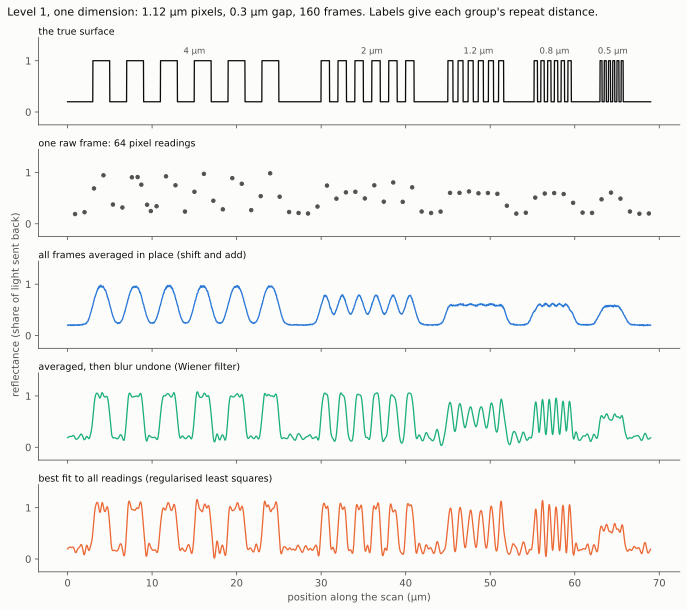
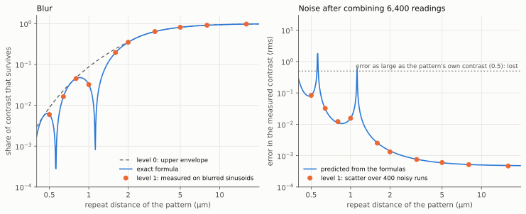
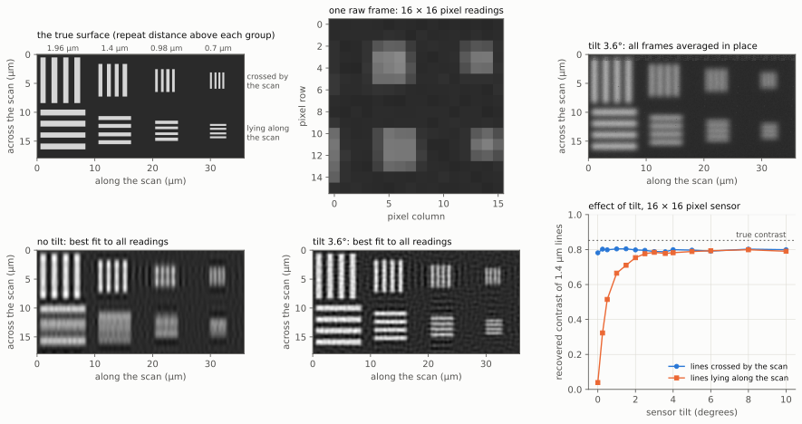
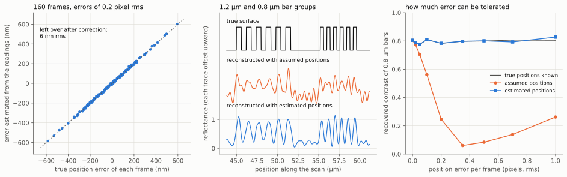

# Simulation level 1: blur and sample

## In plain words

Level 1 is the first simulator that produces sensor readings and turns them
back into a picture of the surface. It treats the surface as a flat strip of
bright and dark, blurs it the way the gap and the pixels would, reads it off
at the places the moving pixels visit, adds sensor noise, and then
reconstructs the strip from those readings.

This page covers level 1 in one dimension and in two, and the estimation of
scan position errors from the data. The one-dimensional part shows three things, and
the [two-dimensional part](#two-dimensions-and-sensor-tilt) adds a fourth.

1. Dense sampling by itself is not enough. Averaging the readings in place
   loses lines narrower than a pixel. Undoing the known blur brings them back.
2. The simulator agrees with the [level 0](calculator.md) formulas. The blur
   it applies matches the formula to better than half a percent, and the noise
   in a measured contrast matches the predicted noise within the scatter of
   the test.
3. What is lost is lost for a stated reason. Detail comes back wherever the
   blur leaves more of it than the noise, and nowhere else.

4. In two dimensions the sensor must be turned slightly. With the pixel rows
   exactly in line with the scan, lines lying along the scan cannot be
   recovered at all. A tilt of a few degrees on a small sensor, and far less
   on a full-size one, recovers them as well as lines crossed by the scan.

5. Errors in the scan position blur the picture badly, and they can be found
   from the readings themselves. In the one-dimensional example, errors of
   up to half a pixel per frame are worked out to about 6 nm and the picture
   is restored. See
   [scan position errors](#scan-position-errors-and-finding-them-from-the-data).

Level 1 is **not** a model of the 100 nm target. That target needs coherent
slanted light, which is level 3 in the [simulation chain](simulation-chain.md).
The example here uses coarse lines so that the method can be checked where
the answer is known.

Terms in *italics* are explained in the [glossary](glossary.md).

## What the simulator does

```{mermaid}
flowchart LR
    A["Surface<br/>strip of reflectance<br/>on a 20 nm grid"] --> B["Blur<br/>gap, pixel width,<br/>motion during exposure"]
    B --> C["Sample<br/>read the blurred strip<br/>at each pixel position<br/>in each frame"]
    C --> D["Noise<br/>photon noise,<br/>read noise,<br/>pixel gain"]
    D --> E["Raw frames"]
    E --> F["Reconstruction<br/>three methods"]
    F --> G["Score<br/>against the<br/>true surface"]
    A -.-> G
```

*Figure 1. The steps of level 1. Solid arrows are the simulated instrument
and the reconstruction. The dotted arrow is the true surface, which the
reconstruction never sees and which is used only for scoring.*

Each step is a separate, replaceable piece of code, in line with the
[approach-neutral design](design.md#71-approaches-as-named-configurations).

| Step | What it models | Settings | Source |
|---|---|---|---|
| Surface | *Reflectance* along one line of the surface | Groups of bars, or a single sinusoid | Assumption: test patterns chosen for this page |
| Gap blur | Light spreading as it crosses the gap | Gap; matt surface, or mirror-like surface with a wavelength | [Design 4.1](design.md#41-the-gap-dominates); [Goodman] |
| Pixel blur | Each pixel adds up the light over its width | *Pixel pitch*, light-sensitive width, softness of the pixel edge | [Design 4.3](design.md#43-the-pixel-area) |
| Motion blur | The sensor moves while a reading collects light | Share of the frame time the shutter is open; optional open and shut code | [Design 4.8](design.md#48-motion-blur-cause-model-and-reversal); [Raskar2006] |
| Sampling | Where each pixel is in each frame | Pixels, frames, shift per frame, random position error | Derived here: [`ccdsr/level1.py`](https://github.com/mithro/ccd-superres/blob/main/ccdsr/level1.py) |
| Noise | *Photon noise*, *read noise*, fixed gain differences between pixels | Electrons at full brightness, read noise, gain spread | [Janesick] |

## The measurement in one line

Level 1 uses the *forward model* from the
[design](design.md#3-measurement-model):

```
readings = sample( blur( surface ) ) + noise
```

- `surface` is the reflectance on a fine grid, 20 nm per step in the examples
  here.
- `blur` multiplies each size of detail by the share of its contrast that
  survives, called the *transfer*. Coarse detail has a transfer near 1. Fine
  detail has a transfer near 0.
- `sample` reads the blurred strip at the centre of every pixel in every
  frame. Between grid points it takes a straight-line average of the two
  neighbours.
- `noise` is drawn at random for every reading.

The grid wraps round: detail leaving one end of the strip re-enters at the
other. This makes the blur exact and fast to compute. It is a convenience of
the simulator, not a property of the instrument, and the bar patterns have
empty margins so that it does not affect the scores.

## Worked example: bars from 4 µm down to 0.5 µm

The example scans five groups of bars. Each group has six bright bars with a
repeat distance (*period*) of 4, 2, 1.2, 0.8 and 0.5 µm. The pixels are
1.12 µm wide, so the last three groups are finer than one pixel.

| Setting | Value | Unit |
|---|---:|---|
| Pixel pitch | 1.12 | µm |
| Gap, matt surface | 0.30 | µm |
| Pixels in the row | 64 | |
| Frames | 160 | |
| Shift between frames | 0.37 | pixels |
| Readings in total | 10,240 | |
| Electrons at full brightness | 2,500 | e⁻ |
| Read noise | 2.0 | e⁻ |
| Exposure | short pulse, no motion blur | |
| Grid step | 20 | nm |

*Table 1. Settings of the worked example. The gap is far smaller than a real
first instrument would manage; it is chosen so that the gap and the pixel
matter about equally.*



*Figure 2. Top: the true surface. Second: one raw frame of 64 readings, in
which only the coarsest bars can be made out. Third: all 160 frames averaged
in place, which loses every group finer than 2 µm. Fourth and fifth: the two
methods that undo the blur bring back the 1.2 µm and 0.8 µm groups. The
0.5 µm group stays lost, because the blur leaves less than 1% of its
contrast.*

### The three reconstruction methods

| Method | What it does | Cost | Source |
|---|---|---|---|
| *Shift and add* | Puts every reading on the fine grid at its known position and averages | One pass over the readings | Standard method; see [reconstruction methods](reconstruction-methods.md) |
| *Wiener filter* | Shift and add, then divides out the known blur, holding back where the noise would be amplified | One extra Fourier transform | Standard method; see [reconstruction methods](reconstruction-methods.md) |
| Regularised *least squares* | Searches for the surface whose predicted readings best match the recorded ones, with a mild preference for smoothness (*regularisation*) | Iterative; 7 steps here | Solver: conjugate gradients [HestenesStiefel] |

### How much contrast each method recovers

Contrast here is the strength of a bar group's basic repeat divided by its
average brightness. A perfect reconstruction would match the first row.

| | 4 µm | 2 µm | 1.2 µm | 0.8 µm | 0.5 µm | Overall error (rms) |
|---|---:|---:|---:|---:|---:|---:|
| True surface | 0.85 | 0.85 | 0.85 | 0.85 | 0.87 | 0.000 |
| Shift and add | 0.63 | 0.30 | 0.02 | 0.04 | 0.01 | 0.251 |
| Wiener filter | 0.85 | 0.84 | 0.37 | 0.55 | 0.02 | 0.163 |
| Regularised least squares | 0.85 | 0.85 | 0.65 | 0.78 | 0.04 | 0.148 |
| Share of contrast the blur lets through | 0.74 | 0.35 | 0.028 | 0.045 | 0.006 | |

*Table 2. Contrast of each bar group in each reconstruction, and the rms
difference from the true surface over the whole strip, in units of
reflectance. Last row: the transfer at each period. Derived here: computed by
[`docs/diagrams/make_diagrams.py`](https://github.com/mithro/ccd-superres/blob/main/docs/diagrams/make_diagrams.py) with the settings of table 1 and random
seed 1.*

Three points about reading this table.

- **The 1.2 µm group is harder than the 0.8 µm group.** A pattern that
  repeats once per pixel width averages out to nothing inside the pixel.
  1.2 µm is close to the 1.12 µm pixel, so it passes only 2.8% of its
  contrast, while 0.8 µm passes 4.5%. The same effect makes a second blind
  spot at half the pixel width, 0.56 µm, which is why the 0.5 µm group is
  lost.
- **The gap between the Wiener filter and least squares is mostly tuning.**
  Each method has one knob that sets how hard it pushes against the noise.
  The table uses each method's default. With the Wiener knob turned down by
  ten, its figures for the 1.2 and 0.8 µm groups rise to 0.63 and 0.81 and
  its overall error falls to 0.156. With evenly spread, exactly known
  positions the two methods solve nearly the same problem. Least squares is
  kept because it extends to uneven sampling, unknown positions and extra
  unknowns, which the Wiener filter does not. Judgement.
- **The overall error is dominated by the sharp bar edges.** No method here
  recovers detail finer than about 0.6 µm, and a sharp edge is made of such
  detail. The ripples beside each bar in figure 2 are the missing detail,
  not noise.

## Cross-check against level 0

The [simulation chain](simulation-chain.md#cross-checks-between-neighbouring-levels) requires each level
to agree with the one below it where both are valid. Two checks are done
here, on a single sinusoid at ten periods from 0.5 to 16 µm with the optics
of table 1.



*Figure 3. Left: the share of contrast that survives the blur. The dots are
measured on level 1 output, the solid line is the exact formula, and the
dashed line is the smooth upper limit that the level 0 calculator uses. The
dips are the blind spots at one and at one half of the pixel width. Right:
the error in a contrast measured from 6,400 noisy readings. The dots are the
scatter over 60 simulated runs and the line is the prediction. Above the
dotted line the error is as large as the pattern itself.*

| Period (µm) | Transfer, formula | Transfer, level 1 | Contrast error, predicted | Contrast error, measured | Measured ÷ predicted |
|---:|---:|---:|---:|---:|---:|
| 0.50 | 0.0060 | 0.0059 | 0.08398 | 0.08767 | 1.04 |
| 0.64 | 0.0162 | 0.0162 | 0.03083 | 0.03304 | 1.07 |
| 0.80 | 0.0451 | 0.0451 | 0.01111 | 0.01083 | 0.98 |
| 1.00 | 0.0321 | 0.0321 | 0.01559 | 0.01421 | 0.91 |
| 1.60 | 0.1950 | 0.1950 | 0.00257 | 0.00230 | 0.89 |
| 2.00 | 0.3498 | 0.3498 | 0.00143 | 0.00143 | 1.00 |
| 3.20 | 0.6376 | 0.6376 | 0.00079 | 0.00073 | 0.93 |
| 5.00 | 0.8128 | 0.8128 | 0.00062 | 0.00062 | 1.01 |
| 8.00 | 0.9121 | 0.9121 | 0.00055 | 0.00043 | 0.78 |
| 16.00 | 0.9730 | 0.9730 | 0.00051 | 0.00054 | 1.04 |

*Table 3. Level 1 against the formulas. Contrast errors are rms, for a
pattern of contrast 0.5, from 64 pixels and 100 frames. Derived here:
computed by [`docs/diagrams/make_diagrams.py`](https://github.com/mithro/ccd-superres/blob/main/docs/diagrams/make_diagrams.py).*

| Check | Result | Pass mark | Verdict |
|---|---|---|---|
| Blur against the exact transfer formula | Agrees to better than 0.001% at nine periods. At 0.5 µm the figure reads 0.4% low because the peak is read off a grid with 25 points per period. | 2% of the predicted contrast, down to a contrast of 1/1000 ([simulation chain](simulation-chain.md#cross-checks-between-neighbouring-levels)) | Pass |
| Level 0 upper limit against the exact transfer | The exact transfer never exceeds the level 0 limit | Never exceeds | Pass |
| Noise in a measured contrast against the prediction | Ratio between 0.78 and 1.07 over 60 runs per period. With 60 runs, a scatter of about ±9% (one standard deviation) is expected, so the 0.78 at 8 µm is an outlier; repeated with 400 runs that ratio is 0.94. The automated test uses 300 runs and requires agreement within 12%. | Agreement within the scatter of the test | Pass |

*Table 4. Verdicts of the cross-checks. The automated versions are in
[`tests/test_level1.py`](https://github.com/mithro/ccd-superres/blob/main/tests/test_level1.py) and run on every change.*

The noise prediction is the one-dimensional form of the rule the level 0
calculator uses. With `M` readings, each with noise `σ` as a share of full
brightness, a pattern with transfer `T` on an average brightness `m` has its
contrast measured with an error of

```
error = σ × √(2 ÷ M) ÷ (T × m)
```

More readings shrink the error by the square root of their number. A small
transfer multiplies it up. Derived here: `predicted_contrast_noise` in
[`ccdsr/level1.py`](https://github.com/mithro/ccd-superres/blob/main/ccdsr/level1.py); the noise model per reading follows [Janesick].

## Two dimensions and sensor tilt

The two-dimensional simulator has the same steps as figure 1. The surface is
a picture, the sensor is a small square array of pixels, and the array can be
turned by a tilt angle about the line of sight. The gap blurs equally in
every direction, the square pixel blurs along its own tilted sides, and
motion blur lies along the scan.

**Why tilt matters.** The scan moves the sensor along one direction only.
Along that direction a point of the surface is visited at many slightly
different positions, which is what makes detail finer than a pixel
recoverable. Across the scan nothing moves. With no tilt, every pixel in a
row looks at the same strip, the strips are one whole pixel apart, and what
lies between two strips is seen only through the blur of a whole pixel.
Turning the sensor makes each pixel along a row sit a little further across
the scan than the one before, so that together they cover the space between
the strips. This is the same geometry as the
[scan sampling figure in the design](design.md#2-concept), now simulated end
to end.

| Setting | Value | Unit |
|---|---:|---|
| Pixel pitch | 1.12 | µm |
| Gap, matt surface | 0.30 | µm |
| Sensor | 16 × 16 | pixels |
| Frames | 300 | |
| Shift between frames | 0.37 | pixels |
| Readings in total | 76,800 | |
| Unknowns (grid cells) | 131,072 | |
| Electrons at full brightness | 2,500 | e⁻ |
| Read noise | 2.0 | e⁻ |
| Grid step | 70 | nm |
| Picture size | 35.8 × 17.9 | µm |

*Table 6. Settings of the two-dimensional example. There are fewer readings
than grid cells; the blur removes the finest detail anyway, and the mild
preference for smoothness settles what the readings leave open.*



*Figure 4. Top left: the true surface, with four groups of lines crossed by
the scan and the same four groups lying along it. Top middle: one raw frame,
256 readings. Top right: all frames averaged in place with the sensor tilted.
Bottom left: the best-fit reconstruction with no tilt recovers the upper
groups and turns the lower groups into smears. Bottom middle: with a tilt of
3.6° both sets are recovered equally. Bottom right: recovered contrast of the
1.4 µm lines against tilt.*

| Lines | Repeat distance (µm) | True | No tilt, best fit | Tilt 3.6°, averaged | Tilt 3.6°, best fit | Share the blur lets through |
|---|---:|---:|---:|---:|---:|---:|
| Crossed by the scan | 1.96 | 0.85 | 0.85 | 0.32 | 0.85 | 0.336 |
| Crossed by the scan | 1.40 | 0.85 | 0.78 | 0.14 | 0.79 | 0.110 |
| Crossed by the scan | 0.98 | 0.86 | 0.37 | 0.02 | 0.43 | 0.035 |
| Crossed by the scan | 0.70 | 0.86 | 0.23 | 0.01 | 0.28 | 0.029 |
| Lying along the scan | 1.96 | 0.85 | 0.19 | 0.32 | 0.85 | 0.336 |
| Lying along the scan | 1.40 | 0.85 | 0.04 | 0.14 | 0.78 | 0.110 |
| Lying along the scan | 0.98 | 0.86 | 0.03 | 0.02 | 0.42 | 0.035 |
| Lying along the scan | 0.70 | 0.86 | 0.02 | 0.01 | 0.27 | 0.029 |
| Overall error (rms) | | 0.000 | 0.194 | 0.213 | 0.129 | |

*Table 7. Contrast of each line group in each reconstruction, and the rms
difference from the true surface in units of reflectance. Derived here:
computed by [`docs/diagrams/make_diagrams.py`](https://github.com/mithro/ccd-superres/blob/main/docs/diagrams/make_diagrams.py) with the settings of table 6 and
random seed 1.*

| Tilt (degrees) | Lines crossed by the scan | Lines lying along the scan |
|---:|---:|---:|
| 0.00 | 0.78 | 0.04 |
| 0.25 | 0.80 | 0.32 |
| 0.50 | 0.80 | 0.51 |
| 1.00 | 0.80 | 0.66 |
| 1.50 | 0.80 | 0.71 |
| 2.00 | 0.80 | 0.75 |
| 2.50 | 0.80 | 0.78 |
| 3.00 | 0.79 | 0.78 |
| 3.58 | 0.79 | 0.78 |
| 5.00 | 0.80 | 0.79 |
| 10.00 | 0.80 | 0.79 |

*Table 8. Recovered contrast of the 1.4 µm lines (true value 0.85) against
sensor tilt, best-fit reconstruction, 16 × 16 pixel sensor. Derived here.*

What the tilt results say:

- **No tilt loses one direction completely.** Even the coarsest lines lying
  along the scan, 1.96 µm, come back at a contrast of 0.19 against a true
  0.85, and the picture shows smears, not lines.
- **The tilt needed is small and depends on the sensor's length.** The lines
  across the scan are fully recovered once the far end of a pixel row has
  drifted sideways by about one pixel. For this 16-pixel row that is 3.6°
  (one in sixteen). For the 3,280-pixel row of the baseline sensor the same
  rule gives about 0.02°. Derived here from the geometry; the practical
  choice of tilt, which also has to avoid repeating the same offsets, is
  worked out by the [scan calculator](calculator.md).
- **Beyond that point more tilt changes little**, up to the 10° tested.
- **With the right tilt both directions come out the same**, to within 0.01
  in contrast, so a single scan pass is enough for a full picture at this
  level of modelling.

### Cross-checks in two dimensions

| Check | Result | Verdict |
|---|---|---|
| Against one dimension: a surface that is uniform across the scan, no tilt, no noise | Every pixel row gives the same readings as the one-dimensional simulator, to 9 significant figures | Pass |
| Blur against the two-dimensional transfer formula, for waves at 0°, 30° and 90° to the scan, with tilt and motion blur | Agrees to 6 significant figures | Pass |
| Reconstruction with no noise and tilt | Every line group recovered within 5% of its true contrast | Pass |
| Rolling readout: each row read slightly later | Positions shift along the scan by the set amount per row, and not across it | Pass |

*Table 9. Cross-checks of the two-dimensional simulator. Automated in
[`tests/test_level1_2d.py`](https://github.com/mithro/ccd-superres/blob/main/tests/test_level1_2d.py).*

## Scan position errors, and finding them from the data

A real scan does not move at a perfectly constant rate. Each frame is taken a
little ahead of or behind where the instrument believes it was. This section
uses the one-dimensional simulator to answer two questions: how much does
that hurt, and can the true positions be worked out from the readings?

**How the positions are estimated.** The method alternates two steps and
repeats them twelve times.

1. Reconstruct the surface using the positions as currently believed.
2. For each frame, slide it along that reconstruction to the place where its
   64 readings fit best, and take that as its new position.

The reconstruction is kept smooth at first and allowed to sharpen from round
to round, so that large errors are corrected on coarse detail before fine
detail is trusted. The spacing of the pixels inside one frame is fixed by
the sensor, so there is only one unknown per frame. Moving every frame by
the same amount only moves the whole picture, so that one number cannot be
found from the data and does not need to be. Derived here: `estimate_positions`
in [`ccdsr/level1.py`](https://github.com/mithro/ccd-superres/blob/main/ccdsr/level1.py). The idea of solving for scan positions together with
the picture is standard in ptychography [Maiden2009] and in image
registration [GuizarSicairos2008].



*Figure 5. Left: for 160 frames with position errors of 0.2 pixel rms
(about 220 nm), the error worked out from the readings against the true
error. The points lie on the dotted line of perfect agreement, and 6 nm rms
is left over. Middle: the 1.2 µm and 0.8 µm bar groups, reconstructed with
the positions the instrument assumed and with the estimated positions.
Right: recovered contrast of the 0.8 µm bars against the size of the
position error.*

| Position error per frame (pixels, rms) | Position error (nm, rms) | Left over after estimation (nm, rms) | Contrast, true positions known | Contrast, assumed positions | Contrast, estimated positions |
|---:|---:|---:|---:|---:|---:|
| 0.00 | 0 | 6.0 | 0.80 | 0.80 | 0.81 |
| 0.02 | 22 | 5.9 | 0.79 | 0.77 | 0.79 |
| 0.05 | 54 | 6.1 | 0.77 | 0.71 | 0.78 |
| 0.10 | 108 | 6.3 | 0.81 | 0.56 | 0.81 |
| 0.20 | 216 | 5.9 | 0.78 | 0.25 | 0.79 |
| 0.35 | 379 | 6.1 | 0.80 | 0.06 | 0.80 |
| 0.50 | 541 | 6.0 | 0.80 | 0.08 | 0.80 |
| 0.70 | 757 | 68 | 0.81 | 0.14 | 0.79 |
| 1.00 | 1,082 | 588 | 0.81 | 0.26 | 0.83 |

*Table 10. Effect of random position errors on the 0.8 µm bars (true
contrast 0.85), averaged over five random scans of 160 frames with the
settings of table 1. Derived here: computed by
[`docs/diagrams/make_diagrams.py`](https://github.com/mithro/ccd-superres/blob/main/docs/diagrams/make_diagrams.py).*

| Believed speed, relative to true | Position error before (nm, rms) | Left over after estimation (nm, rms) | Contrast, assumed positions | Contrast, estimated positions |
|---:|---:|---:|---:|---:|
| 1.001 | 19 | 5.8 | 0.76 | 0.78 |
| 1.010 | 191 | 5.8 | 0.13 | 0.78 |
| 1.030 | 574 | 5.8 | 0.06 | 0.74 |
| 1.050 | 957 | 5.8 | 0.11 | 0.67 |

*Table 11. Effect of a wrong belief about the scan speed, with no random
error. Contrast is of the 0.8 µm bars; with true positions it is 0.78.
Derived here.*

What these results say:

- **Unknown position errors do real damage.** An error of a tenth of a pixel
  per frame already costs a third of the contrast of sub-pixel bars, and
  0.35 pixel removes them. A speed that is wrong by 1% does the same.
- **The readings contain the positions.** Up to errors of half a pixel rms
  the estimate brings the picture back to what it would be with perfectly
  known positions, with no extra hardware.
- **The leftover error is at the theoretical limit.** The best any method
  could do with this surface and this noise (the *Cramér-Rao bound*) is
  5.7 nm rms per frame; the estimate reaches 6.0 nm. This limit is not a
  fixed property of the instrument. It gets better with more pixels per
  frame, more light and more fine detail on the surface, and worse with
  less.
- **There is a capture range.** At 0.7 pixel rms a few frames per scan are
  placed wrongly, and at 1 pixel many are (the leftover error in table 10
  jumps). The contrast figures in those two rows, and in the "assumed"
  column above 0.35 pixel, are no longer meaningful measures of picture
  quality. Larger errors will need a coarse first alignment, for example by
  correlating neighbouring frames [GuizarSicairos2008]. Judgement.

| Check | Result | Verdict |
|---|---|---|
| Leftover position error against the Cramér-Rao bound | Within 0.8 to 1.3 times the bound | Pass |
| Contrast with estimated positions against contrast with true positions, 0.2 pixel error | Within 5% | Pass |
| Speed wrong by 1% | Error falls from over 150 nm to under 10 nm rms | Pass |

*Table 12. Automated checks of the position estimate, in
[`tests/test_level1.py`](https://github.com/mithro/ccd-superres/blob/main/tests/test_level1.py).*

This is one dimension, with the blur model known exactly and a surface rich
in edges. Sideways errors, rotation, gap changes and two dimensions are not
covered yet.

## What this version leaves out

| Limit | Why it matters | Where it is dealt with |
|---|---|---|
| Small sensor and small picture | 16 × 16 pixels and 36 × 18 µm, against 3,280 × 2,464 pixels on the baseline sensor. Larger cases need the tiled, parallel solver. | [Design 6.5](design.md#65-spending-computation-instead-of-hardware); later step of [plan item D2](plan.md#d-simulation-chain) |
| Position estimation is one-dimensional | Sideways errors, rotation and changes of gap during the scan also occur, and the capture range is about half a pixel | Next step of [plan item D2](plan.md#d-simulation-chain) |
| The same blur model simulates and reconstructs | A reconstruction always looks best when it knows the blur perfectly. Real pixels will differ from the model. | Uncertain pixel response as a swept setting ([design 4.9](design.md#49-simulation-first-the-unknown-pixel-response-and-the-gate-before-hardware)); cross-checks against levels 2 to 4 |
| Pixel gain differences are simulated but not corrected | Uncorrected gain differences leave stripes | [Calibration and test methods](calibration-and-test.md) |
| Matt or mirror-like surface, no interference | The 100 nm target relies on interference of coherent light | Level 3 |
| Grid wraps round | Harmless with margins; would mix the two ends of a real strip | Removed with the tiled solver |

*Table 5. Known limits of this version.*

## Running it

```python
from ccdsr import level1 as l1

dx = 20.0                                             # grid step in nm
surface, groups = l1.bar_groups([4000, 2000, 1200, 800, 500], dx)
scan = l1.Scan1D(n_pixels=64, n_frames=160, shift_px=0.37)
frames = l1.simulate(surface, dx, l1.Optics1D(gap_nm=300), scan, l1.Noise1D(), seed=1)

estimate, steps = l1.least_squares(frames)
for group in groups:
    print(group[0], l1.bar_contrast(estimate, group, dx))
```

The two-dimensional version has the same shape:

```python
from ccdsr import level1_2d as l2

picture, groups = l2.line_groups([1960, 1400, 980, 700], 70.0, (256, 512))
scan = l2.Scan2D(n_rows=16, n_cols=16, n_frames=300, tilt_deg=3.58)
frames = l2.simulate(picture, 70.0, l2.Optics(gap_nm=300), scan, seed=1)
estimate, steps = l2.least_squares(frames)
```

The functions are listed in the [Python reference](api.md#simulation-level-1).

[Goodman]: references.md#textbooks-and-standard-methods
[Janesick]: references.md#textbooks-and-standard-methods
[Raskar2006]: references.md#textbooks-and-standard-methods
[HestenesStiefel]: references.md#textbooks-and-standard-methods
[Maiden2009]: references.md#textbooks-and-standard-methods
[GuizarSicairos2008]: references.md#textbooks-and-standard-methods
