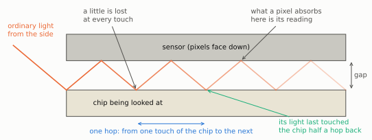
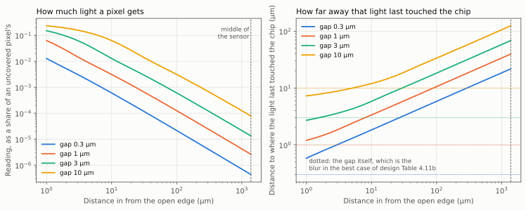

# How much ordinary light gets under the sensor

The sensor lies face down over the chip it is looking at, so it shades the
very area it is trying to see. Ordinary light can only come in from the
side, through the slot between the two. This page is a first, rough
estimate of how much light arrives that way, from which direction, and what
that does to the sharpness of the picture. It is item 1 in the order of
work of the
[design, section 4.11](design.md#411-no-special-lighting-what-ordinary-light-can-reach-and-where-the-work-goes),
and it applies requirement [REQ-6](design.md#requirements): special
lighting is not assumed.

The answers:

- **Very little light reaches the middle of the sensor.** With a gap of
  1 µm a pixel in the middle gets about 3 millionths of what it would get
  uncovered. With a gap of 0.3 µm it is under half a millionth.
- **The light that does arrive is skimming along the surfaces.** It meets
  the pixel at 88° to 89° from straight on.
- **That light did not come from the patch of chip under the pixel.** It
  last touched the chip 20 µm to 70 µm away. In this model the picture is
  therefore tens of micrometres coarse in the middle of the sensor, however
  small the gap. The best case of design Table 4.11b, a blur about as wide
  as the gap, is not reached with light from the side onto a flat chip.
- **The model leaves out the one effect that could rescue side light:**
  light knocked upwards by the edges of the chip's own features. That
  needs a wave calculation and is now the most important thing to check.

Everything on this page is an Estimate from a simple ray model, written
for this page in
[`ccdsr/light_entry.py`](https://github.com/mithro/ccd-superres/blob/main/ccdsr/light_entry.py)
and tested in
[`tests/test_light_entry.py`](https://github.com/mithro/ccd-superres/blob/main/tests/test_light_entry.py).
A slot this shallow is too small for rays to be trusted
([simulation chain, where each level is valid](simulation-chain.md#where-each-level-is-valid)),
so the numbers show the scale of the problem and are not predictions.
Nothing here has been measured.

## 1. The model



*Figure 1. The slot seen from the side, not to scale. A ray entering from
the side bounces between chip and sensor. Drawn by
[`make_light_entry_diagrams.py`](https://github.com/mithro/ccd-superres/blob/main/docs/diagrams/make_light_entry_diagrams.py).*

A ray that makes a shallow angle with the two surfaces (its grazing angle)
touches them alternately as it travels inwards. Three things follow from
the geometry.

| Quantity | Formula | Meaning |
|---|---|---|
| Touches on each surface | distance × tan(grazing angle) ÷ (2 × gap) | Steep rays touch often, skimming rays rarely |
| Share of the ray left | (reflectance of chip × reflectance of sensor) raised to that number | A little is absorbed at every touch |
| One hop | 2 × gap ÷ tan(grazing angle) | The distance along the chip from one touch to the next |

*Table 1. The geometry of one ray. Derived here from straight rays between
two flat, parallel surfaces.*

The share reflected at each touch comes from the Fresnel formulas for a
flat surface [BornWolf], which need the refractive index of the material.
The light at the open edge is taken to come evenly from all directions. A
pixel's reading is what the sensor absorbs at the ray's touches on it. It
is given as a share of what the same pixel would absorb lying uncovered in
the same light, and that share depends only on the ratio of distance to
gap (Derived in the code's notes).

| Setting | Value | Status |
|---|--:|---|
| Distance from the open edge to the middle of the sensor | 1.38 mm | Half the short side of the light-sensitive area, 2.76 mm ([design, section 5.1](design.md#51-sensor)) |
| Wavelength | 550 nm | Green light. Assumption |
| Refractive index of silicon | 4.08 + 0.03i | Unverified: a round value from general knowledge. The tabulated values are in [Green2008], not yet checked against the text |
| Refractive index of aluminium | 0.96 + 6.7i | Unverified, as above; tabulated in [Rakic1995] |
| Refractive index of glass (silicon dioxide) | 1.46 | Unverified, as above; tabulated in [Malitson1965] |
| Chip surface and sensor surface | Bare silicon, flat | Assumption. Real chips carry oxide, metal and steps; real pixels carry layers |

*Table 2. Settings of the estimate. Table 4 shows that the conclusions
hardly depend on the three refractive indices.*

## 2. What it gives

| Gap (µm) | Distance ÷ gap | Reading, share of an uncovered pixel's | Exposure needed, times longer | Angle of arrival from straight on (°) | Distance to where the light last touched the chip (µm) |
|--:|--:|--:|--:|--:|--:|
| 0.3 | 4,600 | 0.000 000 43 | 2,300,000 | 89.2 | 22 |
| 1 | 1,380 | 0.000 002 6 | 380,000 | 88.6 | 40 |
| 3 | 460 | 0.000 013 | 75,000 | 87.5 | 68 |
| 10 | 138 | 0.000 078 | 13,000 | 85.4 | 125 |
| 30 | 46 | 0.000 38 | 2,600 | 82.1 | 215 |
| 100 | 14 | 0.002 0 | 490 | 75.7 | 393 |
| 500 | 3 | 0.017 | 60 | 60.5 | 885 |

*Table 3. Light at the middle of the sensor, 1.38 mm in from the edge.
Estimate from the ray model with the settings of Table 2. The angle and the
last column are for the typical ray: half the absorbed light arrives more
steeply and half less. The last column is half a hop.*



*Figure 2. Left: the reading against distance in from the edge. Right: how
far away the light last touched the chip, with the gap itself dotted for
comparison. Estimate from the same model.*

Two simple rules summarise the curves once the distance is more than about
30 gaps (fitted to the model's output, so also an Estimate):

| Quantity | Rule | Example: gap 1 µm, 1.38 mm in |
|---|---|--:|
| Reading, as a share of an uncovered pixel's | 0.13 × (gap ÷ distance) to the power 1.5 | 0.000 002 6 |
| Distance to where the light last touched the chip | 1.1 × square root of (gap × distance) | 40 µm |

*Table 3a. Rules of thumb read off the model.*

| Chip surface | Sensor surface | Reading, share of an uncovered pixel's | Distance to the last touch (µm) |
|---|---|--:|--:|
| Silicon, 4.08 + 0.03i | Silicon | 0.000 002 6 | 40 |
| Silicon, 3.9 + 0.02i | The same | 0.000 002 6 | 41 |
| Silicon, 4.3 + 0.07i | The same | 0.000 002 7 | 38 |
| Aluminium | Silicon | 0.000 006 3 | 28 |
| Glass | Silicon | 0.000 001 4 | 91 |

*Table 4. The same estimate for a gap of 1 µm with other materials.
Estimate. The conclusions do not depend on the material.*

## 3. What this means

**Only skimming light survives.** A ray at a steep angle touches the
surfaces thousands of times on its way to the middle and is absorbed long
before it gets there. A skimming ray touches rarely, and at shallow angles
every material reflects almost completely, so it survives. The light in the
middle is therefore what is left of the rays within a degree or two of the
surface.

**The pixel is reading the wrong place.** In the best case of the
[design, Table 4.11b](design.md#411-no-special-lighting-what-ordinary-light-can-reach-and-where-the-work-goes),
light leaves each point of the chip in all directions and the pixel
straight above collects it, so the blur is about as wide as the gap. A
skimming ray instead carries the mark of a point on the chip sideways by
half a hop before a pixel absorbs it, and rays at slightly different angles
carry it different distances. The blur is of the order of that distance:
tens of micrometres in the middle of the sensor against a gap of a
micrometre or less (Judgement, from the last column of Table 3; the model
does not compute a picture).

**The reading is a running total.** Every touch on the chip removes a
little light from the ray for good, so a pixel's reading carries the mark
of every place its light has touched since the edge. A feature on the chip
shows up as a small step in brightness for all pixels further in, and it
has to be found by comparing neighbouring readings (Derived here from the
model).

**The contrast is diluted.** Two things weaken the mark a feature leaves.
The materials reflect more alike at skimming angles than straight on
(Table 3b). And a feature is touched only by the rays whose hop happens to
land on it: a feature 1 µm wide under rays with a hop of 80 µm is touched
by about one ray in 80 (Derived here from the geometry of Table 1).

| Material | Straight on (%) | At 1.5° from the surface, field along the surface (%) | At 1.5°, field across the surface (%) |
|---|--:|--:|--:|
| Silicon | 37 | 97 | 64 |
| Aluminium | 92 | 99.8 | 91 |
| Glass | 3.5 | 91 | 81 |

*Table 3b. Share of light reflected by a flat surface. Derived from the
Fresnel formulas with the values of Table 2, for the two polarisations of
the light.*

**Near the open edge it is better, but never good.** In Figure 2 the blur
falls towards the gap itself only in the first few micrometres from the
edge. The light-sensitive area of a real sensor does not start at the edge
of its silicon, and bond wires stand around it
([design, section 5.3](design.md#53-the-sensor-stack-and-what-removing-the-lenses-leaves)),
so no pixel is that close to the opening (Unverified for the baseline
sensor: the width of the border has not been looked up).

**A larger gap does not help.** It lets in more light, and Table 3 shows
the light then lands further from where it touched the chip. The best-case
blur also grows with the gap.

## 4. What the model leaves out

| Left out | Likely effect | How to find out |
|---|---|---|
| **Light scattered upwards by the chip's features.** A real chip is not flat: lines have edges and steps. An edge struck by skimming light throws some of it in all directions, and the pixel straight above collects that part | It could restore the best case of design Table 4.11b for edges and steps, because scattered light behaves like the matt surface that table assumes. The picture would be of edges, bright on a dark background, and not of how reflective each material is. How bright is not known | A wave calculation on a small patch (level 4 of the [simulation chain](simulation-chain.md)). Unverified until then |
| Waves. Below about half a wavelength of gap, light cannot zigzag at all and travels as a guided wave | Unknown. It may let more or less light through than rays suggest, and it changes what "angle of arrival" means | The same wave calculation |
| The third dimension. Light also enters from the other three sides and at angles across the slot | A few times more light. No change to the blur | Not needed yet |
| The layers on a real pixel: microlenses, colour filter, wiring | A pixel as sold accepts little light at 88° from straight on, so the reading would be lower still (Unverified; [plan](plan.md#data-collection), item R3) | Data item R3, then level 4 |
| Roughness of the two surfaces | Scatters skimming light, as the first row | Level 4 |
| The opening at the edge being evenly lit | A lamp aimed along the slot puts more of its light at shallow angles. Some tens of times more reading, with no change to the blur (Estimate: under 2 % of an even source lies within 1° of the surface, so a lamp aimed within 1° could give up to about 60 times more) | Not needed yet |

*Table 5. What the estimate leaves out, most important first.*

## 5. Other ways to get ordinary light in

Each of these is a candidate to look at, and none has been checked.
Whether the last three count as special lighting is a question for
[design, section 11](design.md#11-build-stages-and-open-questions), item 12.

| Way in | What it would give | Difficulty | Status |
|---|---|---|---|
| From the side, relying on the chip's edges to scatter light upwards | A picture of edges and steps at the best-case sharpness, if the scattered light is bright enough | Very little light; needs the wave calculation to say how little | The main candidate. Unverified |
| From the side, using only the pixels nearest the open edge and scanning the chip past them | Light that is less skimming and a shorter sideways carry | The sensor's border keeps every pixel away from the edge; most of the sensor is unused | Unverified |
| Through the chip from behind, with plain near-infrared light, which silicon lets through | Light arriving straight on, as the best case assumes | The chip's metal layers block it; an ordinary sensor barely responds to light that silicon lets through; the wavelength is about 1 µm, twice that of green light | Unverified |
| Through the sensor from behind | Light arriving straight on | The sensor's own wiring and mounting are in the way. A change to the sensor, so hardware work | Unverified |
| A light source in the gap or on the sensor's face | Light where it is needed | A purpose-built part. Probably special lighting | Recorded only |

*Table 6. Ways to light the chip under the sensor. Judgement.*

## 6. What changes in the plan

| Change | Where |
|---|---|
| The best case of design Table 4.11b is not reached by side light on a flat chip. The design now says so and points here | [Design, section 4.11](design.md#411-no-special-lighting-what-ordinary-light-can-reach-and-where-the-work-goes) |
| The wave calculation of light entry and of scattering by edges moves up the order of work, ahead of the two-dimensional solving, because the light model it gives is the one the reconstruction has to use | Design Table 4.11d; [plan](plan.md#d-simulation-chain), item D5 |
| Simulation level 1 needs a second light model beside "matt": a reading that is a running total along the direction of the light, with a sideways carry | [Plan](plan.md#d-simulation-chain), item D2 |
| The light budget enters the scan calculator: exposures tens of thousands to millions of times longer than for an uncovered sensor in the same light | [Plan](plan.md#c-fold-the-research-into-the-design), item C1a |

*Table 7. What this estimate changes.*

## 7. How to repeat it

```
python docs/diagrams/make_light_entry_diagrams.py
python -m pytest -q tests/test_light_entry.py
```

The first command redraws the two figures and prints the rows of Table 3.
From Python:

```python
from ccdsr.light_entry import light_under_sensor
print(light_under_sensor(gap_nm=1000))
```

## Sources

| Key | Source | Used for |
|---|---|---|
| BornWolf | M. Born and E. Wolf, *Principles of Optics*. In the [shared reference list](references.md) | The Fresnel formulas for reflection at a flat surface |
| Green2008 | M. A. Green, "Self-consistent optical parameters of intrinsic silicon at 300 K including temperature coefficients", *Solar Energy Materials and Solar Cells* 92, 1305 (2008). [doi:10.1016/j.solmat.2008.06.009](https://doi.org/10.1016/j.solmat.2008.06.009). Existence checked against a bibliographic database; the text was not read | Where the refractive index of silicon is tabulated |
| Rakic1995 | A. D. Rakić, "Algorithm for the determination of intrinsic optical constants of metal films: application to aluminum", *Applied Optics* 34, 4755 (1995). [doi:10.1364/AO.34.004755](https://doi.org/10.1364/AO.34.004755). Existence checked; the text was not read | Where the refractive index of aluminium is tabulated |
| Malitson1965 | I. H. Malitson, "Interspecimen comparison of the refractive index of fused silica", *Journal of the Optical Society of America* 55, 1205 (1965). [doi:10.1364/JOSA.55.001205](https://doi.org/10.1364/JOSA.55.001205). Existence checked; the text was not read | Where the refractive index of silicon dioxide is tabulated |

*Table 8. Sources.*
