# Filters, gratings and other optical elements

**What the project does.** A camera chip (an image sensor) has its lens taken
off and is slid slowly, very close, over a surface. The chip takes thousands
of pictures as it moves. Each picture is blurry, but every point on the
surface is seen many times from slightly different positions, and a computer
combines all of those readings into one picture that is much sharper than
any single one. The aim is to see features about 100 nanometres wide on
silicon chips. A nanometre (nm) is a millionth of a millimetre, so 100 nm is
roughly a thousandth of the width of a human hair.

**The question on this page.** What could be added to that arrangement to
make the final picture sharper? The additions considered are of three kinds:
special lighting, something placed in the space between the sensor and the
surface, and a layer placed on the sensor itself.

**Why sharpness is hard to get.** With no lens, light leaving one point of
the surface spreads out before it reaches the sensor, the way the glow of a
torch spreads on a wall when the torch is held further back. The space the
light has to cross is called the gap. The bigger the gap, the wider the
glow, and the blurrier the result. With ordinary lighting, the finest detail
that can be recovered is about three quarters of the gap, however clever the
computing.

**The three ways to fight the spreading.**

1. *Narrow each pixel's view.* A pixel is one light-sensing square on the
   sensor. Put each small group of pixels at the bottom of a tiny dark tube,
   like blinkers on a horse, and it sees only what is straight ahead. This
   helps about ten-fold, throws away almost all the light, and works for
   matt surfaces such as paper. It is not nearly fine enough for chips.
2. *Use the fact that light is a wave.* Laser light is a single pure colour
   whose waves all march in step. When such light bounces off a smooth
   surface, the detail is not lost as the light spreads. It is scrambled
   into a pattern of ripples, and a computer can unscramble it. The gap then
   hardly matters. What limits the sharpness is the wavelength, the length
   of one wave of the light, which is about half a thousandth of a
   millimetre for visible light.
3. *Get extremely close.* Closer than one wavelength, detail finer than the
   wavelength can be picked up. Holding a gap that small over a whole chip
   is not practical.

**What this means for 100 nm features on silicon chips.** Only the second
way is fine enough, and it has to be pushed hard. The light must be violet
laser light, of the kind used in Blu-ray players, arriving at a steep slant
from several sides. In theory that reaches lines about 110 to 145 nm wide.
Getting to 100 nm needs ultraviolet light, or a drop of water in the gap,
which shortens the light's waves.

**A second obstacle, and a way round it.** Each pixel of the sensor is about
eleven times wider than a 100 nm line, so it cannot see such lines directly.
The way round is the effect seen when two fine net curtains overlap and
broad bands appear (a moiré pattern). If the chip is lit with very fine
stripes of light, the fine detail of the chip and the fine stripes together
make broad patterns, and the pixels can read those. Whether this works well
enough with this sensor is the biggest unknown on the page.

**What is recommended.** A path in five stages, numbered 0 to 4, from a
coarse picture to a true picture at about 100 nm. All of it is tried in
computer simulation first, and nothing is built until the simulations show
it works. It is the leading candidate, not a final choice, and other
approaches are compared against it.

**Rough parts can beat precise parts.** Several useful additions are random
by nature: a piece of frosted glass in the laser beam, a rough layer on the
sensor, irregular timing of the light flashes. They are cheap because they
need no precision. The computer works out what they are from the data. This
suits the project's rule of spending computation instead of hardware.

**What is not known.** Nobody has published a lensless picture of an opaque
surface at anything close to this scale. The figures on this page are
estimates from formulas and small calculations, not measurements. Section 13
lists what they leave out.

*Sources: this opening restates the numbered sections below, where each
claim is sourced or labelled.*

Status: exploration for review. Nothing here is implemented in the simulator.
The numbers come from the analytic model of the design document, from a small
one-dimensional diffraction calculation in
[`diagrams/make_optics_diagrams.py`](diagrams/make_optics_diagrams.py), and
from the published literature. Each is labelled with which. Section 13 lists
what these estimates leave out.

Sections 2 to 8 survey the options in general. Tim has since stated the
target: features of about 100 nm on silicon chips, with a strong preference
for more computation over more hardware, and all processing done offline on
powerful computers with graphics cards. The goal is to reconstruct the picture, in
several stages if need be. Section 9 works out what that target takes, and the
summary and the staged path in section 10 are written for it.

This page answers one question: what could be added to the scanning lensless
sensor, in the light, in the gap or on the sensor face, to improve the result?
It is written to be read after the [design document](design.md), and section 11
gives the parameters that would carry the recommended options into the
simulator.

## Words used on this page

Each technical term is explained in the text where it first matters. All of
them are also in the shared [glossary](glossary.md), which is the place to
look a word up. Two points of usage on this page: a number in square
brackets, such as [[O7](#ref-o7)], is a source in the reference list of section 14, and
"stage" is used both for a step of the recommended path (stage 0 to stage 4)
and for the moving platform that carries a sample.

## How claims on this page are sourced

Every factual claim, number and formula on this page either cites a source
or carries one of the labels defined on the shared
[references](references.md#how-claims-are-labelled) page. Under each block
of claims there is a line in italics beginning "Sources:".

| Mark | Meaning on this page |
|---|---|
| [[O7](#ref-o7)] and similar | A published source in [section 14](#14-references). Each key links to its entry, and each entry links to the source. Figures quoted from a paper are from its abstract unless stated. |
| BornWolf, R1 and similar | A source in the shared [references](references.md) page. |
| design, section N | Taken from the [design document](design.md), which gives its own sources. |
| **Derived here** | Worked out on this page from the stated starting points. Where a calculation was needed it is in the script [`docs/diagrams/make_optics_diagrams.py`](https://github.com/mithro/ccd-superres/blob/main/docs/diagrams/make_optics_diagrams.py), and the function is named. |
| **Estimate** | A number from a simplified model, good for comparing options and not confirmed by a more exact simulation. |
| **Assumption** | A value chosen to make progress, with no source. |
| **Unverified** | Believed from general knowledge or catalogues and not checked against a primary source. |
| **Judgement** | A ranking or verdict reached on this page by weighing the sourced and derived figures. It is an opinion to be tested in the simulator, not a result. |

## 1. Summary

The design document found that with diffuse light (light going in all
directions) and open pixels (pixels with nothing in front of them), the gap
between sensor and surface sets the resolution. The smallest feature period
that can be recovered is about 0.75 times the gap, where the period is the
distance from one line to the next. More samples help very little: a
thousand times more readings improve the figure by only a modest fixed
amount (the gain is logarithmic). Every candidate below is judged on whether
it changes that law, and what it costs.

*Sources: the 0.75 × gap law is an **Estimate** from the model of the
[design, section 4.1](design.md#41-the-gap-dominates). The weak gain from more samples is from the [design, section 4.2](design.md#42-what-a-huge-number-of-samples-buys-and-what-it-does-not).*

The candidates fall into four families, and the family decides the result more
than the particular element does:

| Family | How it works | Examples | What the gap does |
|---|---|---|---|
| Nothing added | Every pixel sees light from all directions | Open pixels, diffuse light | Sets the resolution |
| Angle restriction | Each pixel sees only light from nearly straight ahead | One tube per pixel, collimator plates (plates full of fine tubes), pinholes, shadow masks | Still matters, but much less |
| Interference | Light waves are kept in step, so detail is scrambled and not lost | A parallel beam of one colour with computed unscrambling (phase recovery), lighting in fine stripes (fringes) or random grains (speckle), fine patterned or frosted layers on the sensor (coded masks, diffusers) | Almost nothing |
| Near field | The sensor almost touches the surface | Openings smaller than a pixel, sample in contact | Must be far smaller than a wavelength |

The same four families as numbers, for green light with a wavelength of
0.5 µm. The law gives the smallest feature period that can be recovered. To
read the square-root law: multiply the wavelength by the gap and take the
square root. A gap 100 times bigger then costs 10 times in sharpness, not
100.

| Family | Law for the smallest period | At a 3 µm gap (µm) | At a 30 µm gap (µm) | At a 100 µm gap (µm) | At a 500 µm gap (µm) | Status |
|---|---|---:|---:|---:|---:|---|
| Nothing added | 0.75 × gap | 2.3 | 23 | 75 | 375 | Estimate |
| Angle restriction, best case | 1 × √(wavelength × gap) | 1.2 | 3.9 | 7.1 | 16 | Derived here |
| Angle restriction, typical | 2 × √(wavelength × gap) | 2.4 | 7.7 | 14 | 32 | Derived here |
| Interference, best reported | about 1 × wavelength | 0.5 | 0.5 | 0.5 | 0.5 | Published |
| Interference, typical | about 2 × wavelength | 1.0 | 1.0 | 1.0 | 1.0 | Published |

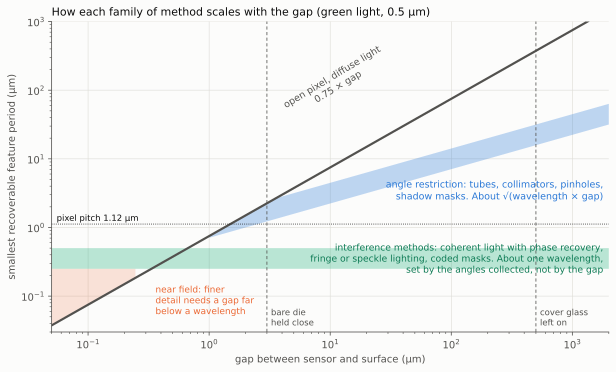

*Figure: the finest detail each family can recover, for green light. Across
the bottom is the gap between sensor and surface, and up the side is the
smallest feature period that can be recovered. Lower is sharper. Both scales
are in micrometres and each step is a factor of ten. The dark line is the
plain arrangement, which gets worse in direct proportion to the gap. The
blue band is angle restriction, which gets worse more slowly. The green band
is the interference family, which stays near one wavelength whatever the
gap. The pink corner is the near field, reachable only with a gap far below
a wavelength. The two dashed lines mark the gaps that are practical: about
3 µm with the bare chip held close, and about 500 µm with its cover glass
left on.*

*Sources for the table and figure: "Nothing added" is the design's law
above. The square-root law for angle restriction is **Derived here**
(section 2, checked by the function `tube_footprint` in the [diagram script](https://github.com/mithro/ccd-superres/blob/main/docs/diagrams/make_optics_diagrams.py)),
and is the same scaling as the classic best size of a pinhole [[O65](#ref-o65)]. The
interference row is the range reported for lensless microscopes
[[O1](#ref-o1), [O2](#ref-o2), [O3](#ref-o3), [O6](#ref-o6), [O7](#ref-o7)]. The near-field row follows from the textbook result
that detail finer than the wavelength does not travel [[O35](#ref-o35)].*

### For the stated target: 100 nm features on silicon chips

A silicon chip is smooth, mirror-like and patterned, so it belongs to the
interference family, and tubes drop out (they suit matt surfaces and reach
micrometres). Lines 100 nm wide repeat every 200 nm, which is finer than
"about one wavelength". Section 9 gives the details. The short version
follows. Two words in it need explaining. Ptychography is a method in which
the object is moved under laser-like light, many overlapping views are
recorded, and a computer finds the single sharp picture that explains them
all. A beam pair is two beams from the same laser arriving from different
sides at once, which makes fine stripes of light where they cross.

- **The gap stops being the hard part.** With interference methods a gap of
  about a millimetre is fine. Wavelength and the angles of the light take its
  place as the limit.
- **Resolving 100 nm lines and spaces needs slanted light and a short
  wavelength.** With a 405 nm laser diode and steeply slanted light the limit
  is about 110 to 145 nm lines. Reaching 100 nm needs ultraviolet light of
  about 365 nm or shorter, or water in the gap (light has a shorter
  wavelength in water). Neither has been demonstrated with a lensless sensor
  looking at an opaque surface.
- **The pixels are five times wider than the detail**, and may not be able to
  read it directly. Lighting with pairs of beams from one laser turns fine
  detail into coarse patterns the pixels can read, as overlapping net
  curtains show broad bands. How the pixels respond to fine fringes (stripes
  of light) is the main unknown. It is carried through the simulations as
  an uncertain range, and measured first when hardware is built (section 9.3).
- **Much can be measured at 100 nm before it can be imaged**: finding and
  locating isolated features, measuring the line width of regular arrays from
  how they reflect different colours and polarisations of light, and fitting
  structure that obeys chip layout rules. These need no extra hardware, only computation, and they prepare the
  ground for true imaging.
- **The hardware would stay simple until the last stage.** A laser diode or
  three, switched in pulses, and the sensor as sold. None of it is built
  until the simulations show a method works.
- **Randomness is used, not fought.** Irregular timing of the light flashes,
  speckle lighting (the grainy pattern a laser makes through frosted glass),
  a rough scattering layer on the sensor, and calculations that allow for
  the noise in the readings all swap
  precise hardware for computation. They help reach the limits above. They
  do not move them (section 9.7).

*Sources: each bullet summarises a part of section 9, where the claims are
sourced: the limits in 9.2, the pixels in 9.3, measuring without imaging in
9.5 and randomness in 9.7.*

Tim's goal is to reconstruct the picture, in stages if need be. The
recommendation is therefore a staged path that ends in true imaging at about
100 nm. It is the current leading candidate, not a settled choice: the
project explores many approaches in simulation, and this one is the
reference the others are compared against. All stages are carried out in the
simulator first, and all hardware comes at the very end, after the
simulations show a method works (see the [project plan](plan.md)). The
hardware column says what each stage would need then. Section 10 explains
the path.

| Stage | What | Hardware | Result |
|---|---|---|---|
| 0 | How the pixels respond to fine fringes and to angle. In simulation this is an uncertain range swept in every run. It is measured on the real sensor only when hardware starts. | One laser diode and a mirror | The two unknowns everything depends on |
| 1 | A coarse picture at micrometre scale from the one-pass (linear) reconstruction of the design document | A scan and simple lighting | Frame positions, pixel gains and a map of the chip |
| 2 | Flashes of slanted violet (405 nm) laser light in beam pairs, several colours, and a ptychographic reconstruction that also works out where the sensor was for each frame | A few laser diodes | A true picture down to about 150 to 200 nm lines, with height |
| 3 | Detect, locate and fit known structure in the same data: find features and measure them by assuming the kind of pattern chips have | None | A partly inferred picture at about 100 nm, labelled as such, and a starting estimate for stage 4 |
| 4 | Near ultraviolet light or water in the gap, same reconstruction | The heaviest hardware of the path | A true picture at about 100 nm lines |

The stage numbers match
[section 4.7 of the design document](design.md#47-a-staged-path-to-the-picture-the-current-leading-candidate),
which holds the single definition of the stages. Stage 3 does not replace stage 4. Assumed layout rules cannot show structure
that breaks them, so a true picture at 100 nm needs the shorter wavelength.

*Sources: the stages are defined in the design document, section 4.7. Their
order and content are a **Judgement** of this page and of the design
document, explained in section 10. The line widths are from section 9.2.*

Not recommended for this target: tubes and collimator arrays, one tube around
the sensor as a way to sharpen the image, sub-pixel openings, near-field gaps,
and Talbot self-imaging (section 4.6) as a way to carry the image across the
gap.

## 2. What an added element can and cannot do

There are only three places to put something, and four
facts of physics decide what it can do there. The short of it is that the
blur happens while the light crosses the gap, so anything that helps must
act before or during the crossing.

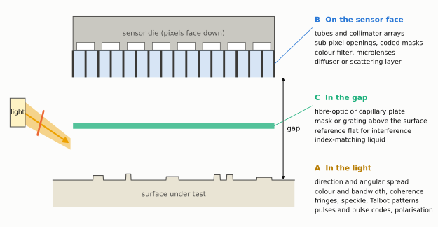

*Figure: a side view of the arrangement, with the surface below and the
sensor above it. The three places an added element can sit are marked: in
the light on its way to the surface, in the gap between surface and sensor,
and on the face of the sensor. Examples of each kind are labelled.*

An element can sit in three places: in the light before it reaches the
surface, in the gap, or on the sensor face. Four physical facts govern what
each can achieve.

**The loss happens in the gap, so the cure has to act before or during the
crossing.** In the design's model a diffuse point on the surface lights the
sensor with a smooth spot about 1.3 times the gap wide. The smoothness is the
problem: a smooth spot has almost no fine structure, so fine detail on the
surface produces almost no signal. An element on the sensor face that only
reshapes the pixel (a smaller opening, a colour filter) acts after the
information is gone. To help, an element must either stop each pixel from
seeing the whole spot, or put fine structure into what each pixel sees.

*Sources: the spot of about 1.3 times the gap is an **Estimate** from the
model of the [design, section 3.1](design.md#31-the-three-blur-terms) and [design, section 4.1](design.md#41-the-gap-dominates). The conclusion drawn from it is
**Derived here**.*

**Restricting angles replaces the gap with the square root of the gap.** If a
pixel accepts light only from near straight ahead, it sees a small patch
instead of the whole spot. A narrower angle gives a smaller patch, but light
passing through a narrow opening spreads out again (this is diffraction), by
an angle of about wavelength divided by opening width. An opening ten
wavelengths wide spreads the light by about a tenth of a radian, or 6°. The two effects balance when the patch is
about √(wavelength × gap) across. No arrangement of tubes, pinholes or shadows
that treats each opening separately does better than this, whatever its
details. At a 100 µm gap and green light that is about 7 µm instead of 75 µm.
Close to the surface the benefit vanishes: at a gap of 1 µm both laws give
about 0.7 µm.

*Sources: the spreading angle of about wavelength divided by opening width
is the textbook result for diffraction at an opening [[O35](#ref-o35)]. The balance at
√(wavelength × gap) is **Derived here** by setting the geometric patch equal
to the diffraction spread, and matches the classic analysis of the pinhole
camera [[O65](#ref-o65)]. The examples are arithmetic from the two laws.*

**Interference removes the gap from the resolution.** Light waves that stay
in step with each other (coherent light) cross the gap without losing fine
detail. The detail is scrambled into a pattern of ripples (a diffraction
pattern) and not weakened, and it can be unscrambled by computation. The limit becomes the wavelength and the range of
angles collected. This needs either lighting that is coherent, or an element
that makes the light from each surface point interfere with itself (a fine
mask or diffuser). Published lensless microscopes built this way resolve
225 nm lines [[O7](#ref-o7)] and about 250 nm [[O6](#ref-o6)] using ordinary image sensor chips.

*Sources: the principle is reviewed in [[O1](#ref-o1), [O2](#ref-o2), [O3](#ref-o3)]. The two results are
from [[O7](#ref-o7)] and [[O6](#ref-o6)].*

**Below a wavelength only closeness works.** Detail finer than about half a
wavelength does not travel at all. Its trace in the light dies away within a
fraction of a wavelength of the surface, a region called the near field. Reaching it means a gap of tens of nanometres, as the design
document already concluded.

The numbers for the three families at four gaps are in the second table of
section 1. The first row there is an **Estimate** from the design's model,
the two angle-restriction rows are **Derived here**, and the interference
rows are the range reported in the literature
[[O6](#ref-o6), [O7](#ref-o7), [O22](#ref-o22)].

The same comparison as transfer curves at one gap. A transfer curve shows,
for each feature size, what fraction of its contrast (the difference between
its bright and dark parts) survives the trip to the pixel. Reading the chart
as in the design document: a method passes a feature size if its curve is
above the noise floor there, the level below which a signal is lost in the
random error of the readings.

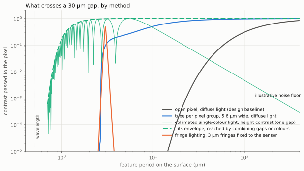

*Figure: how much contrast each method passes across a 30 µm gap. Across the
bottom is the feature period on the surface in micrometres, finer to the
left. Up the side is the fraction of contrast that reaches the pixel, where
1 is all of it, and each step is a factor of ten. The dotted horizontal line
is an illustrative noise floor of one part in a thousand, and a method can
recover a feature size only where its curve is above that line. The grey
curve is the plain arrangement, which fails below a period of about 23 µm.
The blue curve is a tube over each group of pixels, good down to about
2.7 µm. The thin green curve is a parallel beam of one colour. It swings up
and down, and the dashed green curve shows what is reached when several gaps
or colours are combined, good down to about 0.7 µm. The orange spike is
lighting in 3 µm stripes, which passes only features near 3 µm.*

Reading the chart at the noise floor gives the finest period each method
recovers at a 30 µm gap:

| Method | Finest period above the noise floor (µm) | Gain over the open pixel (times) | Status |
|---|---:|---:|---|
| Open pixel, diffuse light | 23 | 1.0 | Derived here |
| Tube 5.6 µm wide per pixel group | 2.7 | 8.5 | Derived here |
| Parallel single-colour light, gaps or colours combined | 0.7 | 33 | Derived here |

The last row assumes a plain LED with a bandwidth of 20 nm.

*Sources: all three figures are **Derived here**, by the function
`transfer_functions` in the [diagram script](https://github.com/mithro/ccd-superres/blob/main/docs/diagrams/make_optics_diagrams.py). The noise floor of one part in a
thousand is the illustrative value of the design document. The 20 nm
bandwidth of an LED is an **Assumption**, typical of catalogue values.*

## 3. Angle restriction: tubes and collimators

A dark tube in front of a pixel works like blinkers, so the
pixel sees only what is straight ahead. One big tube around the whole sensor
does not sharpen anything, because every pixel still looks out through the
same wide opening. A separate small tube over each group of pixels does
sharpen the picture, about ten-fold, at the price of nearly all the light.
The wave nature of light stops the tubes being made too narrow.

Tim's suggestion: put the sensor at the bottom of a deep absorbing tube so
that only light travelling nearly straight up reaches it. The idea is sound.
Whether it works depends entirely on whether there is one tube or many.

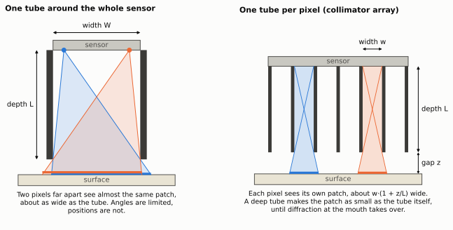

*Figure: two side views. On the left, one tube surrounds the whole sensor.
Every pixel looks out through the full width of the tube, so every pixel
sees a patch of surface as wide as the tube, and the picture is not
sharpened. On the right, each pixel has its own narrow tube, so each sees
only the small patch directly opposite it. W or w is the width of a tube,
L its depth, and z the distance from the mouth of the tube to the surface.*

### 3.1 One tube around the whole sensor

A tube of width `W` and depth `L` limits the light reaching every pixel to
within an angle of about `W / L` of straight ahead. But each pixel looks out
through the whole mouth of the tube, so each pixel sees a patch of surface
about as wide as the tube:

    patch width ≈ W · (1 + z / L)

In words: the patch is as wide as the tube, plus a little more that grows
with the distance `z` from the mouth of the tube to the surface. A tube held
its own depth away from the surface sees a patch twice its width. The patch
is never narrower than the tube.

For a tube that fits around the IMX219 sensor that is at least 3.7 mm, the
width of the sensor. The formula is **Derived here** from straight-line ray
geometry. The sensor width of 3.68 mm is from [R1](references.md#the-sensor-and-its-layers). Two pixels at
opposite ends of the sensor see almost the same patch. The angle of the light
has been restricted, but not where it comes from, and the sensor has also been
moved a distance `L` away from the surface. For resolving surface detail with
diffuse light this is worse than no tube.

A single tube is still worth having for two other jobs:

- **Stray light baffle.** It keeps room light and light scattered from outside
  the area of interest off the sensor. Every arrangement in this document
  benefits.
- **Pinhole camera.** If the mouth is closed down to one small hole, the tube
  becomes a pinhole camera, the simplest camera there is: a dark box with a
  small hole, which projects a magnified image of a small area onto the
  sensor. The best hole is about √(wavelength × gap) across, the
  resolution is the same square-root law as above, the field of view is tiny
  and almost all the light is lost. It is a possible bench experiment, not an
  instrument.

*Sources: the best pinhole size and its resolution are the classic result of
[[O65](#ref-o65)]. That a single tube does not sharpen the picture is **Derived here**
from the patch formula.*

### 3.2 One tube per pixel or per small group of pixels

With a separate tube of width `w` and depth `L` over each pixel, and the tube
mouth a distance `z` from the surface, ray geometry gives each pixel a patch
that is flat over the tube width and falls to zero over a further `w·z/L` on
each side:

| Quantity | Formula | Notes |
|---|---|---|
| Largest accepted angle | `atan(w / L)` | Measured from straight ahead |
| Patch width at half height | `w · (1 + z / L)` | Tends to the tube width for a deep tube |
| Transfer function | `sinc(w(1 + z/L) f) · sinc((w z / L) f)` | A box convolved with a box |
| Light kept, relative to an open pixel | About `(w / L)² / π` | Diffuse surface, square tube |

*Sources: the first three rows are **Derived here** from straight-line ray
geometry. The fourth is the standard geometric view factor between two
parallel squares, in its limit for a deep tube. The exact form is computed
by the function `tube_throughput` in the [diagram script](https://github.com/mithro/ccd-superres/blob/main/docs/diagrams/make_optics_diagrams.py), and the formula
used there is **Unverified** against a published catalogue of view
factors.*

In words, row by row. The largest accepted angle is set by the shape of the
tube alone: a tube ten times deeper than it is wide accepts light within
about 6° of straight ahead. The patch is the tube width plus a little more
that grows with the gap. The transfer function says how the contrast of
finer and finer detail falls away: gradually, reaching zero where the
feature period equals the patch width (`sinc` is the name of the curve that
describes this, and `f` is the fineness of the detail, the number of periods
per unit length). The light kept falls with the square of the tube's shape:
a tube ten times deeper than wide keeps about 0.3 percent, and one twice as
deep again keeps a quarter of that.

Two consequences matter more than the patch width itself:

- **The gap that counts is now from the tube mouth, not from the sensor.** The
  tube plate has a flat face that can be larger than the die (the bare
  silicon chip of the sensor) and can stand proud of the bond wires (the
  fine wires around the edge of the die that connect it). It turns the unreachable micrometre gap to the die
  into a reachable gap to a plate.
- **The loss of fine detail changes from exponential to gradual.** With open
  pixels, each halving of the feature size cuts the signal by a large factor
  again and again, so it is soon beyond recovery. A patch with definite edges
  has a transfer function that falls off slowly, like the pixel area in the
  design document. That is the kind of loss that averaging
  thousands of samples can undo, so the huge sample count becomes useful
  again.

Diffraction sets the limits. A tube narrower than about √(wavelength × L)
stops behaving as a tube: light spreads across it faster than the walls can
select it. So the narrowest angle a tube of width `w` can enforce is about
`wavelength / w`, and making it deeper than `w² / wavelength` only loses
light. For example, a tube 5 µm wide in green light (0.5 µm) cannot select
angles narrower than about a tenth of a radian (6°), and there is no point
making it deeper than 50 µm.

*Sources: **Derived here** from the diffraction angle of an opening [[O35](#ref-o35)].*

| Depth divided by width | Largest accepted angle (degrees) | Light kept (percent) | Signal-to-noise per sample (open pixel = 1) | Narrowest tube that can use this ratio (µm) |
|---:|---:|---:|---:|---:|
| 2 | 27 | 6.9 | 0.26 | 1.0 |
| 5 | 11 | 1.2 | 0.11 | 2.5 |
| 10 | 5.7 | 0.32 | 0.056 | 5.0 |
| 30 | 1.9 | 0.035 | 0.019 | 15 |
| 100 | 0.57 | 0.0032 | 0.0056 | 50 |

Light kept is the exact geometric fraction of the light entering one end of
a square tube that reaches the other end directly (the "view factor").
Signal-to-noise is the wanted signal divided by the random error. It assumes
photon noise dominates, the chance variation in the number of light
particles counted, so it falls as the square root of the light. The last column is `wavelength × (L / w)` for green light.

*Sources: every column is **Derived here**. Angles are from the tube shape,
light kept from `tube_throughput` in the [diagram script](https://github.com/mithro/ccd-superres/blob/main/docs/diagrams/make_optics_diagrams.py), signal-to-noise as
the square root of the light kept (the rule for photon noise, Janesick in
the shared [references](references.md#textbooks-and-standard-methods)), and
the last column from the diffraction limit above.*

The table shows why one tube per native pixel is not the answer for this
sensor. A 1.12 µm tube can be at most about 2.5 µm deep before diffraction
takes over, which gives an acceptance of about 24° (**Derived here**). That
is roughly what the existing microlenses (the tiny lens on each pixel)
already do (**Unverified**: the acceptance of the IMX219 microlenses has not
been found in a source). The useful design is a tube several
micrometres wide over a group of pixels.

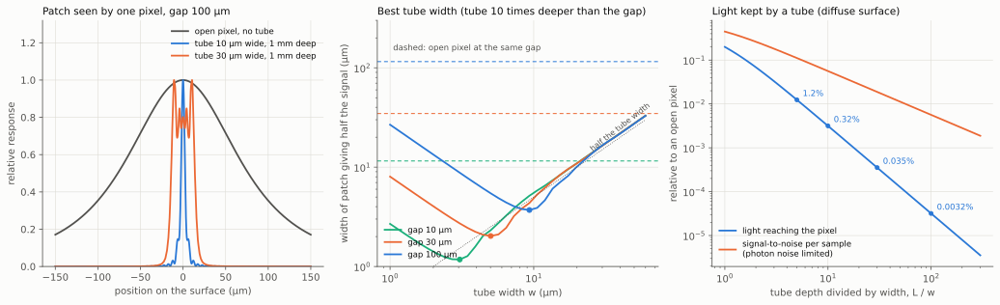

*Figure: three charts about tubes. Left: the patch of surface that one pixel
sees at a gap of 100 µm, as response (up) against position on the surface in
micrometres (across). Without a tube (grey) the patch is more than 100 µm
wide. With a tube 10 µm wide (blue) or 30 µm wide (orange), each 1 mm deep,
it is a narrow spike. Middle: the width of the patch that gives half the
signal (up, in micrometres, lower is sharper) against the width of the tube
(across), for gaps of 10, 30 and 100 µm. Each curve has a lowest point,
marked with a dot, which is the best tube width for that gap. Narrower tubes
do worse because the light spreads by diffraction. The dashed lines show the
same measure for a pixel with no tube. Right: the price. The fraction of
light kept (blue) and the signal-to-noise ratio of one reading (orange),
both compared with a pixel with no tube, against how many times deeper the
tube is than it is wide.*

The middle panel comes from the diffraction calculation. For each gap there is
a best tube width, about 1.3 × √(wavelength × gap):

| Gap from tube mouth (µm) | Best tube width (µm) | Patch giving half the signal (µm) | Same measure, open pixel (µm) | Pixels under one tube, per side |
|---:|---:|---:|---:|---:|
| 10 | 3.1 | 1.2 | 12 | 3 |
| 30 | 5.0 | 2.0 | 35 | 4 |
| 100 | 9.3 | 3.7 | 115 | 8 |

The last column counts IMX219 pixels of 1.12 µm along one side of the tube,
so 4 means a block of 4 × 4 pixels.

The patch is 10 to 30 times narrower than for an open pixel. In terms of the
smallest period above the noise floor the gain at 30 µm is about 9 times
(23 µm to 2.7 µm). The transfer curve of a tube also has a hard cut-off, at a
period of `wavelength × z / w`, below which nothing passes. For green light,
a 30 µm gap and a 5 µm tube, that is 3 µm. A wider tube moves
that cut-off to finer detail but lowers the contrast above it, so the best
width for reconstruction is somewhat wider than the best width for a narrow
patch. Finding it is a job for the simulator.

*Sources: the table, the best width of about 1.3 × √(wavelength × gap) and
the cut-off are **Derived here**, from the one-dimensional diffraction
calculation in the functions `tube_footprint` and `half_light_width` of the
[diagram script](https://github.com/mithro/ccd-superres/blob/main/docs/diagrams/make_optics_diagrams.py). Section 13 lists what that calculation leaves out.*

Since a tube several micrometres wide covers many pixels, the pixels beneath
it can be added together, which recovers some of the lost light: a 5 µm tube
ten times deeper than it is wide delivers, in total, about 6 percent of what
one open pixel would collect (**Derived here**: 0.32 percent per pixel times
about 20 pixels). The price is that the sensor then has one independent
channel per tube, not per pixel.

### 3.3 What it costs and how it could be built

- **Light.** 99 to 99.97 percent is lost for depth-to-width ratios of 5 to 30.
  An LED can usually be driven a hundred times harder than a bare sensor
  needs, so this is affordable, but it works against the short light pulses of
  section 4.1.
- **Wall reflections.** Every smooth surface is a good mirror for light that
  skims along it (grazing angles), and that is exactly the light a tube wall
  sees. Smooth walls
  turn the tube into a light pipe and the angular selection is lost. The walls
  have to be rough and black, or the tube has to be built as a stack of thin
  plates with holes, so that there are no continuous walls.
- **Fabrication.** Nothing of this kind can be built onto a Raspberry Pi
  sensor at home. A separately made plate laid on the sensor face is the
  realistic route. The plate does not need to be aligned to the pixels,
  because the bore of each tube defines the patch and the pixels under it only
  collect the light.

*Sources: the light lost is from the table of section 3.2. That an LED can
be driven a hundred times harder than a bare sensor needs is **Unverified**.
Strong reflection at grazing angles is the textbook behaviour of light at
any smooth surface [BornWolf](references.md#textbooks-and-standard-methods). The points on fabrication are a **Judgement**.*

Forms reported in the literature or available as parts:

| Form | Reported or typical figures | Suitability here |
|---|---|---|
| Gratings built into the chip's metal layers over each pixel | Acceptance ±18°, built to sharpen contact images of tissue [[O9](#ref-o9), [O10](#ref-o10)] | Shows the principle works. Needs a custom chip. |
| Etched silicon collimator arrays | Used to pick out unscattered light through tissue [[O11](#ref-o11)] | Right scale. Custom fabrication. |
| Stacked hole plates and lithographic collimators | "Stack of pinholes" in black plastic [[O12](#ref-o12)]; 300 µm thick collimator made by X-ray lithography [[O13](#ref-o13)] | Buildable at tens of micrometres. A good first experiment. |
| Glass capillary plates | Pores of a few micrometres, depth 40 or more times the width (catalogue values, to be checked) | Right dimensions. Walls reflect at grazing angles unless blackened. |
| Fibre-optic plates | See section 6.1 | Carry the image, but ordinary plates accept all angles. |
| Louvre (privacy) film | Slats tens of micrometres apart, restricts one direction only | Too coarse, and one-directional. Not recommended. |
| The sensor's own microlenses | Present if only the module lens is removed | Free, modest: comparable to a tube twice as deep as it is wide. |

*Sources: figures for published devices are from the papers cited in each
row. The figures for capillary plates and louvre film are **Unverified**
catalogue knowledge. The comparison of microlenses to a tube twice as deep
as wide is an **Estimate**. The suitability column is a **Judgement**.*

### 3.4 In the simulator

The design's blur kernel is its description of the patch of surface each
pixel sees. The tube replaces the parts of it that come from the gap and
from the pixel's size with the tube footprint. Everything else in the linear
(one-pass) model, including the fast solver, is unchanged, and the signal
level is scaled by the light kept. In the first stages the footprint is the
formula in the table of section 3.2: a flat-topped patch with sloping
sides. The
wave-optics stage replaces it with a computed footprint and decides the best
tube width.

## 4. Elements in the light

This section covers changes to the lighting only. Flashing
the light freezes the motion of the scan. Using a parallel beam of one pure
colour turns the blur into a pattern a computer can undo. Lighting in fine
stripes or random grains lets fine detail show up as broad patterns.
Lighting from several directions, or in several colours, fills in what one
alone misses.

### 4.1 Pulsed and coded light

The design document found that a fast scan smears the image. Its example:

| Quantity | Value | Unit |
|---|---:|---|
| Scan speed | 20 | percent of the sensor length per second |
| Frame rate | 10 | frames per second |
| Movement during one frame | 65.6 | pixels |
| Exposure short enough for a sharp image | 0.4 | milliseconds |

A light pulse of 0.4 ms does the same job as a short exposure, and an LED
can be switched far faster than that from a Raspberry Pi output pin.

*Figure: three ways of lighting one frame, using the scan example in the
table above. Each row is one way. The left chart shows when the light is on
during the 100 milliseconds of the frame. The right chart shows where one
point of the surface lands on the sensor during that time, in pixels, which
is the smear it leaves. Top: light on throughout smears the point over 65.6
pixels. Middle: one flash of 0.4 milliseconds leaves a smear of a quarter of
a pixel but uses 0.4 percent of the light. Bottom: a known irregular pattern
of flashes leaves a smear with a known shape, which computation can undo,
and uses nearly half the light. The pattern drawn is an example made by
the [diagram script](https://github.com/mithro/ccd-superres/blob/main/docs/diagrams/make_optics_diagrams.py), not an optimised code.*
*Sources: the shift per frame and the exposure needed are from the
[design, section 4.8](design.md#48-motion-blur-cause-model-and-reversal). That an LED can be switched faster than 0.4 ms from an output
pin is **Unverified** general knowledge.*

A short flash freezes motion, as a camera flash does.

A step further is a coded pulse train: switch the light on and off in a known
irregular pattern during each frame. A single long exposure erases some
feature sizes completely, while a well-chosen code keeps all of them, so the
smear can be undone by computation [[O30](#ref-o30)]. This collects half the light instead
of a fraction of a percent.

| | |
|---|---|
| Improves | Scan speed without motion blur. Does not change the gap limit. |
| Cost | A single short pulse collects little light. A code collects half but adds noise when undone; when photon noise dominates, the net gain over a single pulse is modest [[O31](#ref-o31)]. |
| Reconstruction | Unchanged for a single pulse. A code changes the motion term of the blur kernel, nothing else. |
| On a Raspberry Pi sensor | Practical. The sensor has a rolling shutter, meaning it reads its rows one after another, so each row sees the code with a different, known delay. |
| In the simulator | The motion term becomes an arbitrary exposure pattern instead of a box. |

### 4.2 Collimated single-colour light

Light a smooth surface with a tidy beam of one colour and
the sensor records a pattern of ripples in place of a blur. The ripples
contain the fine detail, and also the heights of the surface, and a
computer can work back from them to the surface.

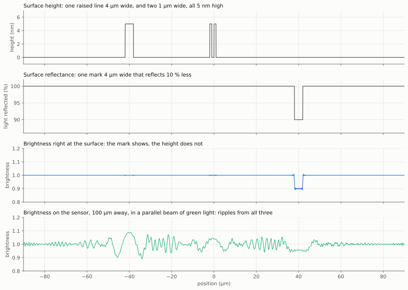

*Figure: a calculated example of what a parallel beam of one colour
records. Position along the surface runs across all four charts, in
micrometres. First chart: the height of a test surface in nanometres, with
one raised line 4 µm wide and two 1 µm wide, all 5 nm high. Second chart:
how much light the surface reflects, with one mark that reflects 10 percent
less. Third chart: the brightness right at the surface. The mark shows, and
the raised lines are invisible, because height changes only the timing of
the wave. Fourth chart: the brightness 100 µm away, where the sensor is.
Every feature, including the 5 nm lines, has spread into ripples of several
percent. These ripples are what the sensor records, and the reconstruction
works back from them to the first two charts. **Derived here**, by the
function `hologram_demo` of the [diagram script](https://github.com/mithro/ccd-superres/blob/main/docs/diagrams/make_optics_diagrams.py), for green light.*

Light a smooth surface with a parallel (collimated) beam of one colour and
the reflected light crosses the gap as a wave that keeps its fine detail.
What the sensor records is a diffraction pattern, also called an in-line
hologram, and reconstruction means undoing the diffraction. This is how nearly all published lensless
microscopes work [[O1](#ref-o1), [O2](#ref-o2), [O3](#ref-o3)], with the sample typically a fraction of a
millimetre from the sensor.

For a surface that changes the light only slightly, which is the case for
nanometre height steps and faint marks on a smooth surface, the recorded
intensity is linear in both reflectance and height:

$$
\frac{I(\mathbf{f})}{I_0} = \delta(\mathbf{f}) + 2\,\hat a(\mathbf{f}) \cos(\pi \lambda z_0 |\mathbf{f}|^2) + 2\,\hat\varphi(\mathbf{f}) \sin(\pi \lambda z_0 |\mathbf{f}|^2),
\qquad \varphi = \frac{4\pi h}{\lambda}
$$

where $a$ is the fractional change in reflected amplitude, $h$ is the height
and $\varphi$ is the phase it produces in reflection at normal incidence
(standard result of Fresnel propagation [[O35](#ref-o35)]; see also [[O33](#ref-o33)]).

In words: the brightness pattern on the sensor is plain even light (the
first term), plus a part caused by changes in how well the surface reflects
(the second), plus a part caused by changes in its height (the third). Each
part is the surface's own pattern with every feature size made stronger or
weaker by a known factor, the cosine or sine term, which depends only on the
feature size, the wavelength $\lambda$ and the gap $z_0$. The symbol
$\mathbf{f}$ stands for the fineness of a feature, the number of periods per
unit length. Because the factors are known, they can be divided out again.
The last formula says how height becomes a delay of the wave: a step of a
quarter of a wavelength, about 100 nm, turns the reflected wave completely
upside down (**Derived here** from the formula: a quarter wavelength of
height is half a wavelength of extra path, there and back). Two things
follow.

- **The model stays linear.** This is the design's `m = D S K ρ` (readings
  equal the surface, blurred, sampled and summed over the pixel) with two
  unknown maps, reflectance and height, each with its own blur. The fast
  solver still applies.
- **Height is measured directly.** One nanometre of height changes the signal
  by up to 5 percent (**Derived here**: twice the phase, 8π × 1 nm / 500 nm,
  for green light; see section 8).

The curves oscillate, and each has feature sizes at which it passes nothing
(the thin green curve in the chart of section 2). The zeros depend on
wavelength × gap, so data at two or three gaps [[O5](#ref-o5)] or two or three colours
[[O8](#ref-o8)] fill them in. Large, slowly varying height is passed weakly at any gap or
colour, which is a known weakness of these methods [[O22](#ref-o22)].

Requirements, from the formula. The light must be coherent in two senses.
It must come from a small enough source that all of it arrives from nearly
the same direction (spatial coherence), and it must be close enough to a
single colour (temporal coherence). Otherwise the ripples from different
directions or colours overlap and wash each other out.

| Requirement | Rule | Example: 1 µm features at a 100 µm gap |
|---|---|---|
| Small light source (spatial coherence) | Source angular size × gap well below the feature size | Under 5 milliradians: a 0.1 mm hole 20 mm or more away |
| Narrow colour band (temporal coherence) | Bandwidth below about 0.4 × period² / gap | About 4 nm: a filtered LED or a laser diode |
| Weak surface for the linear form | Height range well below a wavelength, smooth surface | Otherwise the non-linear methods of section 5.2 |

In words: the finer the detail and the larger the gap, the smaller the
light source must look from the surface and the purer its colour must be. A
milliradian is about a seventeenth of a degree. The bandwidth is the spread
of wavelengths in the light.

*Sources: the three rules are **Derived here** from the formula above and
from the textbook definitions of spatial and temporal coherence [BornWolf](references.md#textbooks-and-standard-methods). The
examples are arithmetic from the rules.*

| | |
|---|---|
| Improves | Lateral resolution to about a wavelength at any gap, and adds nanometre height. Published: 225 nm lines [[O7](#ref-o7)], about 250 nm with scanned light angle [[O6](#ref-o6)], both through a transparent sample. In reflection, 2 µm or better with a beam splitter [[O4](#ref-o4)]. |
| Cost | Little light is lost. Needs a smooth surface, a small bright source, and control of stray reflections between sensor and surface. A rough surface gives speckle and needs the non-linear methods. |
| Reconstruction | Linear for weak surfaces. Iterative phase recovery otherwise. |
| On a Raspberry Pi sensor | Practical: an LED or laser diode and a pinhole. The pixels accept a limited range of angles, which caps the finest detail [[O6](#ref-o6)]. |
| In the simulator | A coherent forward model: multiply the light by the surface's complex reflectance, propagate across the gap, take the intensity. This is the wave-optics stage already planned in the design. |

### 4.3 Fringe and speckle lighting

Light the surface with fine stripes, and detail too fine to
cross the gap shows up as broad bands that do cross it, in the way two
overlapping net curtains show broad moiré bands.

Fine detail survives the gap if it is first multiplied by a known fine pattern
of light. The product contains coarse beat patterns (the broad bands) that do
cross the gap. This is the principle of structured-illumination microscopy
[[O14](#ref-o14)].

Two beams of the same colour from the same laser, crossing at an angle,
interfere and make straight bright and dark stripes (fringes) with a period
down to half a wavelength (textbook two-beam interference, [BornWolf](references.md#textbooks-and-standard-methods)). The fringes stand as vertical sheets of light, so
they stay sharp at any gap. The scanning design then offers something useful.
If the fringes are fixed to the sensor, the surface slides through them, and
every pixel records the fine detail directly as a time series. No stepping of
the pattern is needed, because the scan does it.

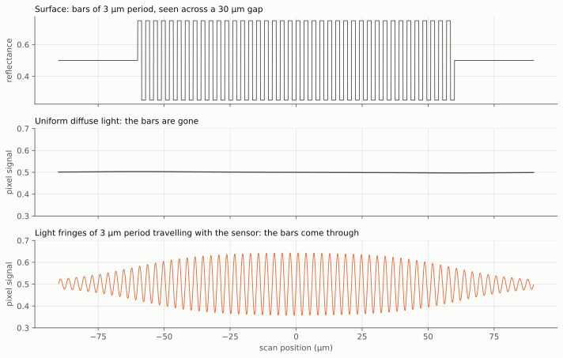

*Figure: a calculated example of what stripe lighting does. Top: the test
surface, a set of bars repeating every 3 µm, shown as how much light it
reflects (up) against position in micrometres (across). Middle: what one
pixel records as it scans past, 30 µm above the surface, in ordinary even
light. The line is flat. The bars are far too fine for that gap and are
lost. Bottom: the same scan when the surface is lit by 3 µm stripes of light
that travel with the sensor. The pixel's signal now rises and falls once per
bar, so the bars are recorded.*

The calculation is one-dimensional, for bars of 3 µm period seen across a
30 µm gap:

| Case | Ripple in the pixel signal (percent) |
|---|---:|
| The bars themselves, with no blur | 50 |
| Even light | 0.1 |
| Stripes of 3 µm period travelling with the sensor | 29 |

The 0.1 percent in even light comes from the edge of the patch of bars, not
from the bars. The idea of
fixing the fringes to the sensor is derived here from the model, not taken
from a publication, and needs confirming in the simulator.

*Sources: the three figures are **Derived here**, by the function
`fringe_demo` in the [diagram script](https://github.com/mithro/ccd-superres/blob/main/docs/diagrams/make_optics_diagrams.py).*

The limit is that one fringe period opens only one narrow window of feature
sizes (the orange curve in the chart of section 2). Covering all sizes needs
many fringe periods and directions, or a pattern that contains all of them at
once: laser speckle, the random grainy pattern that laser light makes after
passing through or bouncing off something rough. Speckle lighting with unknown patterns has been shown to
work [[O15](#ref-o15), [O24](#ref-o24)], at the price that each feature size then gets only a small
share of the contrast, roughly the speckle grain size divided by the gap
(**Estimate**).
Section 9.7 takes up speckle again for the coherent, slanted lighting of the
100 nm target, where it is a strong candidate.

| | |
|---|---|
| Improves | Lateral resolution down to the pattern period, half a wavelength at best, independent of the gap. Slanted fringes also encode height (section 8). |
| Cost | Half the light at most. Needs two stable coherent beams reaching the surface, and the pattern must be known or estimated. Reflections between sensor and surface distort it. |
| Reconstruction | Still linear in reflectance (one-pass), but the blur is no longer the same for every pixel. For fringes it becomes a sum of a few plain blurs (convolutions). For speckle the pattern has to be measured beforehand or worked out from the data. |
| On a Raspberry Pi sensor | Possible on a bench with a laser diode and a beam splitter (a part-silvered mirror that divides one beam into two). Mechanically delicate. |
| In the simulator | Multiply the surface by a light pattern expressed in sensor coordinates before blurring. |

### 4.4 Several light angles

Lighting from different directions shows different things.
On a rough surface the shadows reveal slopes. On a smooth one, each
direction brings a different part of the fine detail within the sensor's
reach.

- **For slope and height, with diffuse light.** Lighting the surface from
  three or more directions in turn gives the local slope from the change in
  brightness (photometric stereo [[O27](#ref-o27)]). Cheap, and it suits a rough surface.
  It measures slope, so height comes by integration and slow errors build up.
- **For resolution, with coherent light.** Each light angle shifts which
  detail falls within the pixels' acceptance. Combining many angles gave the
  250 nm result quoted above [[O6](#ref-o6)], and the same idea with a lens is called
  Fourier ptychography [[O25](#ref-o25)]. Small angle changes only shift the pattern sideways,
  which the scan already provides for free [[O32](#ref-o32), [O34](#ref-o34)].

In the simulator: the direction of the light is a parameter of the coherent
model, and a list of directions for the shading model.

### 4.5 Several colours

Each colour gives a different pattern of ripples from the
same surface, so several colours give several independent looks for free.

Changing the colour changes the diffraction pattern without moving anything.
It has been used on its own to recover detail finer than the pixel [[O8](#ref-o8)], and
it fills the gaps in the transfer curves of section 4.2. For height it removes
the ambiguity of interference, which otherwise repeats every half wavelength:
two colours together behave like one much longer wavelength [[O28](#ref-o28)]. With red,
green and blue lights on together, the sensor's own colour filter separates
three colours in one frame (section 5.3).

### 4.6 Gratings and Talbot self-imaging

A grating is a plate of fine evenly spaced lines. Lit with a
tidy beam, a sharp copy of its lines appears in mid-air at set distances
behind it. That can throw a fine pattern of light onto the surface with no
lens. It cannot carry a picture of the surface back to the sensor.

A grating lit by a parallel single-colour beam reproduces its own pattern at
regular distances behind it, the Talbot distance `2 × period² / wavelength`
and its multiples [[O17](#ref-o17)]. In words: square the spacing of the lines, double
it, and divide by the wavelength. For lines 10 µm apart in green light the
distance is 0.4 mm. The verdicts in the table rest on the sources cited
in each row. That only a periodic pattern images itself is the content of
the Talbot effect [[O17](#ref-o17)]. Three possible uses, with different verdicts:

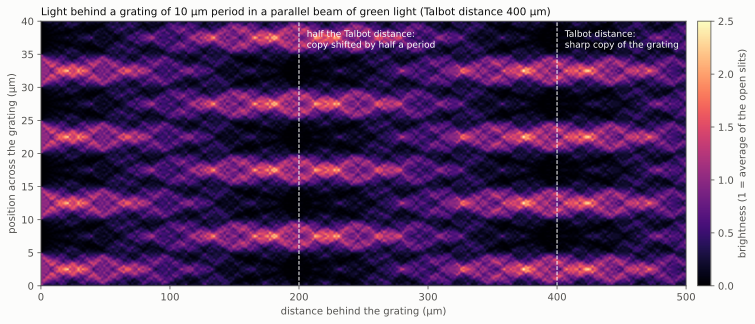

*Figure: the light behind a grating, calculated. Distance behind the
grating runs across, in micrometres, and position across the grating runs
up. Brighter colours are brighter light. The grating has lines 10 µm apart
and is lit from the left by a parallel beam of green light. Its pattern of
bright bands blurs, then re-forms shifted by half a period at 200 µm, and
re-forms as a sharp copy at 400 µm, the Talbot distance. **Derived here**,
by the function `talbot_carpet` of the [diagram script](https://github.com/mithro/ccd-superres/blob/main/docs/diagrams/make_optics_diagrams.py).*

| Use | Verdict |
|---|---|
| Carry the image of the surface across the gap | Does not work. Only a periodic pattern images itself. An arbitrary surface does not. |
| Project a fine pattern onto the surface from a distance | Works. A grating or hole array a Talbot distance away throws fringes or an array of light spots onto the surface with no lens. Scanning the sample through such a spot array has been used for wide-field microscopy, with resolution set by the spot size [[O18](#ref-o18)]. The same effect prints patterns of a few hundred nanometres in lithography [[O19](#ref-o19)]. It is a way to make the patterns of section 4.3. |
| Make a pixel sensitive to angle | Works, but needs a custom chip. Two gratings stacked over a pixel give it a response that depends on the direction of the light [[O16](#ref-o16)]. This is an angle restriction that does not throw light away. It is subject to the same square-root law. |

## 5. Elements on the sensor face

Three things can sit on the sensor itself. A cover with a
tiny hole over each pixel makes the pixels effectively smaller, which only
helps if the sensor nearly touches the surface. A rough or finely patterned
layer scrambles the light in a way that keeps fine detail, and is the basis
of the published work closest to this project. And the colour filter already
on the sensor can be put to use.

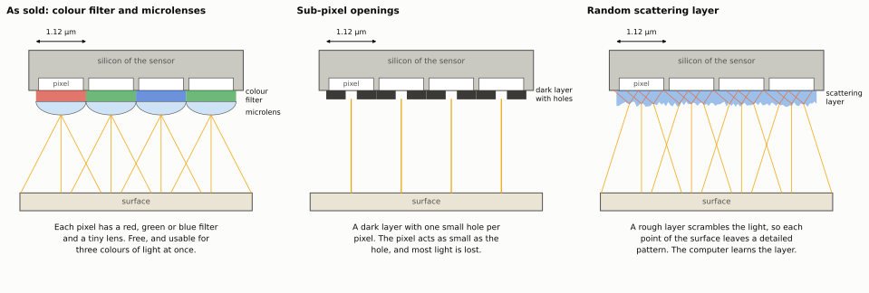

*Figure: side views of three things that can sit on the face of the
sensor, each drawn over four pixels of 1.12 µm. The surface is below and
light travels upward. The gap is not drawn to scale. Left: the sensor as
sold, with a colour filter and a tiny lens on each pixel. Middle: a dark
layer with one small hole per pixel, so that each pixel sees only the light
passing its hole. Right: a rough scattering layer, which sends light from
each point of the surface to many pixels in a detailed pattern.*

### 5.1 Sub-pixel openings

An opaque layer with one small opening per pixel makes the effective pixel as
small as the opening. This is the optofluidic microscope cited in the design
document (Heng2006 in the shared
[references](references.md#closest-earlier-instruments-and-reconstruction-methods)). It only helps when the pixel area is what limits resolution, which
requires a gap smaller than the pixel. At any gap the first hardware can reach,
the gap or the tube dominates and a smaller opening only loses light, in
proportion to its area and faster once it is smaller than a wavelength
(**Derived here** from the design's model for the first part; the faster
loss below a wavelength is **Unverified** general knowledge of small
openings). It
becomes relevant for a later instrument with a sub-micrometre gap. In the
simulator it is the pixel width `a` that already exists, set smaller than the
pitch.

A related published result is useful as a check on the design's central
finding: with cells growing directly on the sensor face, and the light swept in
angle to get sub-pixel shifts, 660 nm resolution was reached [[O36](#ref-o36)]. That is sub-pixel resolution with plain light, obtained exactly
where the design says it should be possible: at a gap below the pixel size.

### 5.2 Coded masks and thin diffusers

A mask is a layer with a fine pattern of clear and dark, or thick and thin,
areas. A diffuser is a layer that scatters light, like frosted glass. Either,
with fine random structure and fixed to the sensor, makes the light from
each surface point interfere with itself, so each point produces a detailed
pattern on the sensor instead of a smooth spot. That puts back the
fine structure the gap removes.

- **With diffuse light.** A fine mask a few hundred micrometres above the
  sensor, with a reconstruction algorithm, gave micrometre resolution for
  glowing samples [[O21](#ref-o21)], and the same principle makes lensless cameras
  [[O20](#ref-o20), [O37](#ref-o37), [O38](#ref-o38)]. The cost is that every pixel sees many surface points at
  once, so a densely detailed surface gives a low-contrast signal.
- **With coherent light.** This is where the closest match to this project
  is found. In coded ptychography the sample is translated across a sensor
  that carries a thin scattering layer, and the surface is recovered from the
  sequence of frames. Reported results: 0.78 µm with a low-cost stage whose
  positions were recovered from the data instead of being trusted [[O23](#ref-o23)]; and
  lines 308 nm wide resolved, with 240 mm² imaged in 15 seconds [[O22](#ref-o22)]. Both
  used transparent samples.

Three features of that work match Tim's concept directly: the sample moves
steadily past the sensor, positions are estimated from the data, and
continuous motion during the exposure can be modelled instead of avoided
[[O26](#ref-o26)]. Position refinement is standard practice in this field [[O34](#ref-o34)].

| | |
|---|---|
| Improves | Resolution to about a wavelength at any gap, plus height. Makes the reconstruction better conditioned, meaning less sensitive to small errors in the data, because every frame is a different encoding of the same surface. |
| Cost | A mask whose pattern has been measured (calibrated). Reconstruction is no longer one-pass. It is iterative: guess, compare with the data, improve, repeat. Every round revisits all the frames, unlike the design's solver that reads the data once. |
| On a Raspberry Pi sensor | The published layer combined etched scatterers with printed absorbers [[O22](#ref-o22)]. A thin diffusing film laid on the sensor is a plausible home-built version (**Assumption**, untested). |
| In the simulator | A complex mask applied to the wave at the sensor plane in the coherent model. |

### 5.3 The colour filter that is already there

If only the module lens is removed, the Bayer filter (the pattern of red,
green and blue filters over the pixels) and the microlenses (the tiny lens on
each pixel) stay. The
design document covers what this does to the pixel response. For this
exploration:

- **With one colour of light** the filter is a fixed pattern of sensitive and
  less sensitive pixels. A quarter or half of the pixels do most of the work.
  Because resolution depends only weakly on sample count, losing half or
  three quarters of the samples costs very little. Leakage between colours
  needs calibrating.
- **With red, green and blue light on together** the filter gives three
  colours in every frame at no extra cost. This has been done for lensless
  holography, including correcting the leakage between channels [[O29](#ref-o29)]. It
  serves sections 4.5 and 8.
- **The microlenses** restrict the acceptance angle modestly, which helps in
  diffuse light and limits the finest detail in coherent light [[O6](#ref-o6)].

In the simulator: a spectral response for each pixel, meaning how strongly
it responds to each colour. That is three numbers per pixel type.

*Sources: what stays on the sensor is from the [design, section 5.3](design.md#53-the-sensor-stack-and-what-removing-the-lenses-leaves). That losing
samples costs little is from the [design, section 4.2](design.md#42-what-a-huge-number-of-samples-buys-and-what-it-does-not). The other claims are cited
in place.*

## 6. Elements in the gap

Four things could go between the sensor and the surface. A
block of glass fibres carries the image and makes the mechanics easier but
does not sharpen it. A part-reflecting flat plate turns height into
brightness. A liquid shortens the light's waves, which sharpens everything a
little. Special layered "lenses" from research are not practical here.

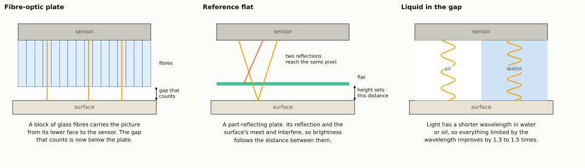

*Figure: side views of three things that can sit in the gap, with the
sensor above and the surface below. Not to scale. Left: a fibre-optic plate
carries light straight up its fibres to the sensor, so only the short
distance below the plate blurs the picture. Middle: a part-reflecting flat
plate. Light reflected by the plate and light reflected by the surface reach
the same pixel and interfere, so the brightness depends on the small
distance between plate and surface. Right: the same light wave in air and in
water, where its wavelength is 1.33 times shorter.*

### 6.1 Fibre-optic plates

A fibre-optic plate is a block of fused glass fibres that carries an image
from one face to the other. Bonded to a sensor, its outer face becomes the
effective sensor face. It has been used this way for lensless fluorescence
imaging [[O39](#ref-o39)]. Like the tube plate it solves the mechanical problem (a flat
face clear of the bond wires) but not the optical one: the gap from plate to
surface still sets the resolution, and ordinary plates accept all angles. The
fibres are several micrometres across, which is then the effective pixel. A
plate with absorbing material between fibres and a small acceptance angle
would be a ready-made collimator array. Whether such a plate exists with
suitable dimensions needs checking against manufacturers' data.

*Sources: the use for lensless imaging is from [[O39](#ref-o39)]. The fibre size of
several micrometres and the acceptance of ordinary plates are **Unverified**
catalogue knowledge. The conclusions are **Derived here** from the gap law.*

### 6.2 A reference flat

A partly reflecting flat plate just above the surface reflects some of the
light. That reflection and the one from the surface interfere, and the
brightness then depends on the distance between plate and surface, cycling
once per half wavelength. This turns height into brightness with nanometre
sensitivity. The sensor face itself can act as the plate if the gap is small,
which is option 3 of the design's section 4.5. It needs light of narrow enough
band that the two reflections can still interfere: twice the distance must be
well within wavelength² / bandwidth, which is about 12 µm for a plain LED.
That length is called the coherence length: the distance over which the
light's waves stay in step. The purer the colour, the longer it is.

*Sources: interference between two reflections and the coherence length are
textbook results [BornWolf](references.md#textbooks-and-standard-methods). The sensor face as the plate is from the
[design, section 4.5](design.md#45-height). The 12 µm figure is **Derived here** for green light with an
assumed LED bandwidth of 20 nm (**Assumption**).*

### 6.3 Liquid in the gap

Filling the gap with oil or water shortens the wavelength by the liquid's
refractive index (the factor by which the liquid slows light), 1.3 to 1.5, improves every wave-limited figure by the same
factor, and suppresses reflections. It is cheap and messy, and it rules out
samples that must stay dry.

*Sources: the shortening of the wavelength by the refractive index is a
textbook result [BornWolf](references.md#textbooks-and-standard-methods). The index values, 1.33 for water and about 1.5 for
immersion oil, are **Unverified** general knowledge.*

### 6.4 Near-field lenses

Layers of metal and insulator have been shown to carry detail finer than a
wavelength across a short distance [[O40](#ref-o40)]. These are research devices with high
losses that need the object in contact. They do not relax the gap requirement
and are not recommended. A scanning tip [[O41](#ref-o41)] is a different instrument
entirely.

## 7. Polarisers and spectral filters

A polariser passes only light vibrating in one direction,
as polarising sunglasses do, and a spectral filter passes only a narrow band
of colour. Neither makes the picture sharper. Both clean up the signal that
the other methods work with.

Neither changes the gap law. Both improve the quality of the signal that the
other methods work with.

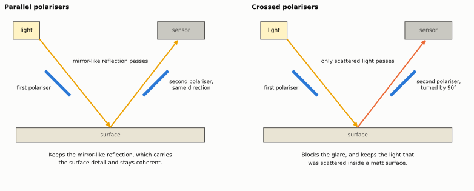

*Figure: how two polarisers separate two kinds of reflected light. In
both drawings light passes a first polariser, reflects from the surface, and
passes a second polariser before the sensor. Left: with the second polariser
set the same way as the first, the mirror-like reflection passes. Right:
with the second turned by 90°, the mirror-like reflection is blocked, and
only light that was scattered inside the surface, which loses its
polarisation, gets through. Not to scale.*

| Element | What it does | Verdict |
|---|---|---|
| Crossed polarisers (one on the light, one on the sensor) | Remove mirror-like glare and keep light scattered within the surface [[O42](#ref-o42)] | Useful with diffuse methods on glossy samples. The film is about 0.1 mm thick, so it only fits arrangements that tolerate that gap. |
| Parallel polarisers | Keep the mirror-like reflection, which carries the surface detail and stays coherent | Useful with coherent methods. |
| A thin birefringent plate between two polarisers (birefringent: a crystal that splits a beam into two slightly shifted copies) | Converts slopes in height into brightness, as in the microscope method called differential interference contrast. Demonstrated lensless [[O43](#ref-o43)] | An alternative route to height. Adds a plate to the gap. |
| Narrow-band filter on the light | Lengthens the distance over which reflections can interfere | Required by sections 4.2 and 6.2 unless a laser diode is used. Costs light in proportion to the band removed. |
| Angle-selective coatings | Layered coatings can pass light from a narrow range of angles only [[O44](#ref-o44)] | A laboratory result. A tube array is the practical equivalent. |

In the simulator: polarisers change the ratio of mirror-like to scattered
reflection, a property of the surface model; the filter sets the bandwidth of
the light.

*Sources: cited in each row. The film thickness of about 0.1 mm is
**Unverified** catalogue knowledge. The verdict column is a **Judgement**.*

## 8. Height

The project also wants the height of the surface, in
nanometres. Height does not show in an ordinary picture. The methods that
use interference turn a height change of one nanometre into a brightness
change of about one percent, which is easily measured. Judging height from
how blurred the picture is gives a signal thirty times weaker or worse.

The design document lists three ways height can reach a pixel. With the
elements above there are six. The chart compares how much signal one nanometre
of height produces. The values are order-of-magnitude estimates from simple
formulas, given in the [diagram script](https://github.com/mithro/ccd-superres/blob/main/docs/diagrams/make_optics_diagrams.py).

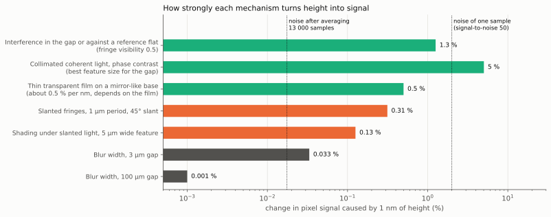

*Figure: how strongly each method responds to height. Each bar is one way of
sensing height, and its length is the change in a pixel's reading, as a
percentage, when the surface height changes by one nanometre. Longer is
better. The methods based on interference give about 0.3 to 5 percent.
Shading gives about 0.1 percent, and blur width about 0.03 percent. The
values are order-of-magnitude estimates.*

| Mechanism | Section | Signal for one nanometre of height (percent) | Status |
|---|---|---:|---|
| Parallel beam of coherent light (phase contrast) | 4.2 | 5 | Estimate, upper limit |
| Interference against a reference flat or the sensor face | 6.2 | 1 | Estimate |
| Thin transparent film on a reflecting base | 8 | 0.5 | Estimate |
| Slanted fringes | 4.3 | 0.3 | Estimate |
| Shading from several light angles, features a micrometre wide | 4.4 | 0.1 | Estimate |
| Blur width, at a 3 µm gap | design, option 1 | 0.03 | Estimate |

What each mechanism needs, and what limits it:

| Mechanism | Needs | Limits |
|---|---|---|
| Parallel beam of coherent light, where height shows as a delay of the wave (phase contrast) | Smooth surface, small single-colour source | Large slow height changes are passed weakly. Repeats every half wavelength unless two colours are used. |
| Interference against a reference flat or the sensor face | Narrow-band light, a flat close to the surface | Gap drift looks like height. |
| Thin transparent film on a reflecting base | LEDs of a few colours. No coherence needed, because the film is its own interferometer | Only for that kind of sample. Used to measure molecular layers building up on a surface [[O45](#ref-o45)]. Fits the plain reflectance model exactly. |
| Slanted fringes | Two-beam fringes arriving at an angle, so height shifts them sideways [[O46](#ref-o46)] | Fringe stability. |
| Shading from several light angles | Diffuse light from known directions | Gives slope. Needs room for slanted light. |
| Blur width | Two passes at different gaps | Far too weak at practical gaps. |

*Sources: every figure in the "Signal per nanometre" column is an
**Estimate** from the simple formulas in the function `height_signal` of the
[diagram script](https://github.com/mithro/ccd-superres/blob/main/docs/diagrams/make_optics_diagrams.py). The mechanisms are from the sources cited in each row and
from the [design, section 4.5](design.md#45-height).*

All the interference mechanisms put a nanometre of height above the noise of a
single sample or close to it, and far above the noise after averaging. Blur
width does not. This supports the design document's remark that interference
may be the realistic route to "nanometre features" with this hardware, and
suggests replacing build stage 5 (blur-width height) with one of the
interference mechanisms.

## 9. The target: 100 nm features on silicon chips

This section asks what it takes to see 100 nm features on
a silicon chip. The answer has two parts. First, light itself sets a limit
that depends on its wavelength and on how steeply it arrives and leaves:
violet laser light gets close to 100 nm, and ultraviolet light or water in
the gap gets there. Second, the sensor's pixels are much wider than the
detail, so the detail has to be turned into broad patterns before the pixels
can read it. A good deal can also be measured about 100 nm features without
making a picture of them.

Tim's target is features of about 100 nm on silicon chips. This section takes
"100 nm features" to mean lines about 100 nm wide. Dense lines and spaces of
that width repeat every 200 nm. An isolated 100 nm line or dot is a different
and easier problem (section 9.5).

### 9.1 What changes

- **The surface is smooth and mirror-like.** That selects the interference
  family of section 2. The reflected light keeps its phase, so the detail
  crosses the gap intact and is recovered by computation.
- **The gap is no longer the hard part.** A gap of about a millimetre is
  acceptable, and is in fact needed to let slanted light in (arrangement B of
  section 12). The limit that replaces it is the wavelength.
- **The limit is below what sections 2 to 8 assumed.** "About one wavelength"
  is 500 nm of period. The target is 200 nm.

### 9.2 The limit: wavelength and angles

For coherent light, the finest period that can be recovered is

    period = wavelength / (NA of the light + NA collected)

where each NA (numerical aperture) is the sine of an angle from straight
ahead: the slant of the light arriving, and the widest angle at which the
sensor still collects the light the surface sends back. The line width is
half the period.

In words: the steeper the light comes in, and the steeper the angle at which
the sensor can still catch what comes back, the finer the detail that can be
recovered. Each NA can be at most 1 in air, so the sum can be at most 2, and
the finest possible line is a quarter of the wavelength. With light straight
down (NA 0) and a sensor that collects up to 30° (NA 0.5), the finest line
is one whole wavelength. Water raises each NA by a factor of 1.33. Slanting the
light is what synthetic-aperture and ptychographic methods exploit [[O6](#ref-o6), [O25](#ref-o25)]:
light arriving at a steep angle shifts fine detail to angles the sensor can
collect. Synthetic aperture means combining many views from different
angles into the picture a much larger instrument would have taken.

*Sources: the formula is the standard resolution limit for coherent light
with slanted lighting, which goes back to Abbe [[O66](#ref-o66)] and is the basis of the
synthetic-aperture results of [[O6](#ref-o6), [O25](#ref-o25)].*

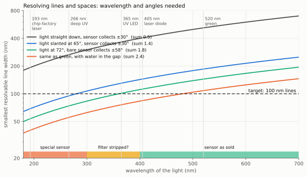

*Figure: the narrowest lines that can be told apart, for different light.
Across the bottom is the wavelength of the light in nanometres, with common
light sources marked by vertical lines. Up the side is the smallest line
width that can be resolved, in nanometres. Lower is better. The dashed
horizontal line is the target of 100 nm. Each coloured curve is one
arrangement, from light straight down (grey, worst) to steeply slanted light
with a bare sensor and water in the gap (orange, best). The "sum" in the key
is the two NA values of the formula added together. An arrangement reaches
the target where its curve is below the dashed line. The coloured strip
along the bottom shows which wavelengths an ordinary sensor can detect as
sold (green), which may need its colour filter removed (yellow), and which
need a special sensor (red).*

| Wavelength (nm) | Light source | A: line width (nm) | B: line width (nm) | C: line width (nm) | D: line width (nm) |
|---:|---|---:|---:|---:|---:|
| 520 | Green LED or laser | 520 | 186 | 144 | 108 |
| 405 | Violet laser diode | 405 | 145 | 113 | 84 |
| 365 | Ultraviolet LED | 365 | 130 | 101 | 76 |
| 266 | Deep ultraviolet laser | 266 | 95 | 74 | 55 |

The four arrangements, A to D:

| Arrangement | Slant of the light (degrees) | Sensor collects up to (degrees) | Medium in the gap | Sum of the two NA values |
|---|---:|---:|---|---:|
| A | 0 | 30 | Air | 0.50 |
| B | 65 | 30 | Air | 1.41 |
| C | 72 | 58 | Air | 1.80 |
| D | 72 | 58 | Water | 2.39 |

The entries are smallest line widths from the formula. The collection angles
are assumptions: ±30° is a guess for a pixel with its microlens in place, and
±58° for a bare die. The real angular response of the sensor has to be
measured, and published work found it a real limitation [[O6](#ref-o6), [O22](#ref-o22)].

*Sources: every entry in the table is **Derived here** from the formula, by
the function `hundred_nm` in the [diagram script](https://github.com/mithro/ccd-superres/blob/main/docs/diagrams/make_optics_diagrams.py). The slant angles of 65° and
72° and both collection angles are **Assumptions**.*

Reading the table for the target:

- **Visible light as the sensor is sold reaches about 110 to 150 nm lines**,
  with a 405 nm laser diode and steeply slanted light. That is close to the
  target but not at it.
- **100 nm lines and spaces need about 365 nm or shorter**, or water in the
  gap, together with steep light and a wide collection angle.

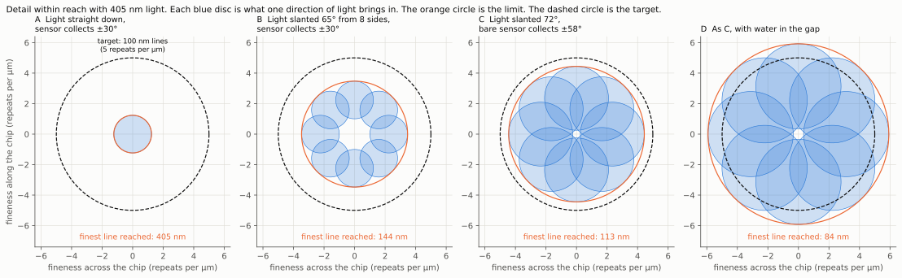

*Figure: why slanted light reaches finer detail, for 405 nm light and the
four arrangements A to D of the table above. Each chart is a map of
fineness of detail, in repeats per micrometre, across the chip
(horizontal) and along it (vertical). The centre is coarse detail, and
further out is finer. Each blue disc is the detail that one direction of
light brings within the sensor's reach. With light straight down there is
one small disc at the centre. Slanted light moves the disc outward, and
eight directions of light give eight discs. The orange circle is the limit
reached, and the dashed circle is the target, lines and spaces of 100 nm.
Only arrangement D, with water in the gap, covers the target. **Derived
here**, by the function `frequency_coverage` of the [diagram script](https://github.com/mithro/ccd-superres/blob/main/docs/diagrams/make_optics_diagrams.py), with
the assumed angles of the table.*

Published results quoted on this page, for comparison with those limits:

| Source | Finest detail reported (nm) | Stated as | Lens | Sample | Method |
|---|---:|---|---|---|---|
| [O47](#ref-o47) | 80 | Line width | Yes | Opaque, in reflection | Fourier ptychography with a 193 nm laser |
| [O7](#ref-o7) | 225 | Line width | No | Transparent | Lensless holography with pixel super-resolution |
| [O6](#ref-o6) | 250 | Resolution | No | Transparent | Lensless, light angle scanned |
| [O22](#ref-o22) | 308 | Line width | No | Transparent | Coded ptychography, scattering layer on the sensor |
| [O36](#ref-o36) | 660 | Resolution | No | Cells on the sensor face | Light angle swept, plain light |
| [O23](#ref-o23) | 780 | Resolution | No | Transparent | Coded ptychography with a low-cost stage |
| [O4](#ref-o4) | 2000 | Resolution | No | Opaque, in reflection | Lensless holography through a beam splitter |

Figures are from the abstracts of the papers.

The published benchmark for this kind of imaging on opaque
samples is a microscope with a lens: 80 nm lines resolved in reflection by
Fourier ptychography with a 193 nm laser [[O47](#ref-o47)]. The lensless results quoted
earlier (225 nm lines [[O7](#ref-o7)], 250 nm [[O6](#ref-o6)], 308 nm [[O22](#ref-o22)]) were all through
transparent samples. The only lensless result in reflection found is 2 µm
[[O4](#ref-o4)]. Reaching even 150 nm lines on an opaque chip without a lens would be new.

### 9.3 What the pixels can actually see

A pixel adds up all the light that falls on it. Stripes much
narrower than the pixel average out to an even grey, so the pixel cannot
tell they are there. Three ways round this are given below.

The formula above says which detail reaches the sensor as light. It does not
say the pixels can read it, and for this sensor that is a separate limit. The
design document raises the same point in its section 4.6.

When the light scattered by fine detail meets the plain mirror reflection at
the sensor, the two interfere and form fringes with the same period as the
detail itself: about 200 nm for the target. A 1.12 µm pixel covers more than
five such fringes and averages them. What survives depends on how sharp the
edges of the pixel's sensitive area are:

| Edges of the pixel's sensitive area | Contrast left in fringes of 200 nm period, at most (percent) |
|---|---:|
| Perfectly sharp | 5.7 |
| Soft over about 100 nm | 2.3 |
| Soft over about 300 nm | 0.002 |

The 5.7 percent is the fringe period divided by π times the pixel width:
200 nm / (3.14 × 1120 nm). Soft edges are modelled as a smooth (Gaussian)
blur of the stated full width at half height, which multiplies the contrast
by a further factor. These are upper limits: at some exact periods a
sharp-edged pixel records nothing at all.

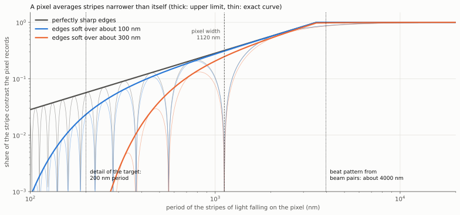

*Figure: how well a pixel 1120 nm wide records stripes of light, for
three assumptions about how sharp the edges of its sensitive area are.
Across is the period of the stripes in nanometres, finer to the left. Up is
the share of the stripes' contrast that the pixel records, where 1 is all of
it. Both scales step by factors of ten. The thick curves are upper limits
and the thin curves the exact result, which drops to zero wherever a whole
number of stripes fits the pixel. The dotted line on the left marks the
200 nm period of the target detail, where a pixel records between 6 percent
and almost nothing. The dotted line on the right marks the beat pattern of
about 4000 nm made by lighting with a beam pair (the example below), which
the pixel records largely whatever its edges are like. **Estimate**, by the function
`pixel_fringe_response` of the [diagram script](https://github.com/mithro/ccd-superres/blob/main/docs/diagrams/make_optics_diagrams.py).*

*Sources: **Derived here**. A pixel adds up the light across its width, and
the contrast left in a stripe pattern averaged over a box of that width is
the sinc function of width divided by period (textbook, [[O35](#ref-o35)]). The edge
softness values and the Gaussian model of soft edges are **Assumptions**.
Edge softness here is the full width at half height of the Gaussian blur of
the pixel's edges. The [reconstruction methods](reconstruction-methods.md)
and [calibration and test](calibration-and-test.md) pages quote the same
blur by its standard deviation (sigma), which is the full width divided by
2.355, so "100 nm" on those pages is a softer edge than "100 nm" here. The limit was raised by the
[design, section 4.6](design.md#46-the-target-100-nm-features-on-silicon-chips).*

The edge sharpness of the IMX219 is unknown. So the collection angles assumed
in section 9.2 describe which directions of light the pixel responds to at
all. They do not mean the pixel can read fringes that fine: ±58° corresponds
to fringes down to about 240 nm at 405 nm, which is exactly the regime where
the pixel may see nothing.

Fine detail can still reach coarse pixels, in three ways. The first two do not
depend on the pixel edges.

1. **Two beams from one laser at once (mutually coherent beams).** If the
   chip is lit by two slanted beams from the same laser, they form light fringes on the chip (section
   4.3). Fine detail then beats against those fringes and appears at the
   sensor as a coarse pattern. The table after this list gives an example:
   405 nm beams from opposite sides at
   72° make fringes of 213 nm period, and chip detail of 225 nm period beats
   against them with a period of about 4 µm (two patterns of nearly equal
   spacing overlap into a broad one, the moiré effect), which the pixels
   can read whatever their edges are like. These figures are **Derived
   here**: the fringe period is wavelength / (2 × sin 72°), and the beat
   period is 1 / (1/213 − 1/225) nm.

   In wave terms, the detail deflects part of one beam into a new direction
   (58° from straight ahead in this example), and that deflected light meets
   the mirror reflection of the other beam at the sensor, where the two make
   the coarse pattern. Two conditions follow. The deflected light has to be
   light that can travel across the gap, which is the limit of section 9.2:
   a 225 nm period is the finest that a 72° beam and a ±58° collection angle
   allow, and a 200 nm period (lines and spaces of exactly 100 nm) is just
   beyond what 405 nm light can carry in air at any angle (the limit is
   203 nm). And the pixels have to respond to both steep beams. An earlier
   version of this page used 200 nm detail in this example, which the simple
   multiply-the-brightnesses picture allows but the wave limit does not; it
   was corrected in the [review](review.md). This is the standard remedy when the detector is coarser
   than the detail [[O14](#ref-o14)]. It needs both beams on together. Lighting from one
   direction at a time does not do it.
2. **Where the scattered light lands.** Across a gap of about a millimetre,
   light scattered at different angles lands on different pixels, hundreds of
   micrometres apart. The brightness map of that scattered light carries the
   fine detail without any fine fringes. Conventional ptychography works this
   way: its detector pixels are far coarser than the detail recovered [[O57](#ref-o57)].
   Whether this is well enough conditioned at a millimetre gap with wide-area
   lighting is not known, and is a question for the simulator.
3. **Sharp pixel edges.** If the edges turn out sharp, the 6 % that survives
   is recoverable by averaging, as the design document describes for
   sub-pixel detail in general.

The example of mechanism 1, calculated and then in numbers:

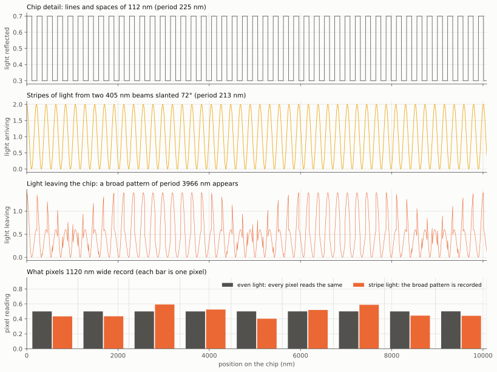

*Figure: how a beam pair lets coarse pixels record fine detail,
calculated. Position on the chip runs across all four charts, in
nanometres. First chart: the chip detail, lines and spaces of 112 nm (a
period of 225 nm).
Second chart: the stripes of light made by two 405 nm beams slanted at 72°
from opposite sides, with a period of 213 nm. Third chart: the light leaving
the chip, which is the first two multiplied together. Its fine wiggles are
overlaid by a broad rise and fall about every 4000 nm. Fourth chart: what pixels
1120 nm wide record. In even light (grey bars) every pixel reads nearly the
same and the lines are invisible. In stripe light (orange bars) the readings
rise and fall with the broad pattern, so the presence and position of the
fine lines is recorded. This is a simplified picture that multiplies
brightnesses. It gives the right beat period only for detail that the light
can carry across the gap (a period of about 225 nm or more here); the full
wave calculation belongs to the simulator. **Derived
here**, by the function `beam_pair_beat` of the [diagram script](https://github.com/mithro/ccd-superres/blob/main/docs/diagrams/make_optics_diagrams.py).*

| Quantity | Value | Unit | How it is found |
|---|---:|---|---|
| Wavelength of the two beams | 405 | nm | Chosen: a violet laser diode |
| Slant of each beam from straight ahead | 72 | degrees | Assumption |
| Period of the light fringes on the chip | 213 | nm | Wavelength / (2 × sin 72°) |
| Period of the chip detail | 225 | nm | Lines and spaces of 112 nm, the finest a 72° beam and ±58° collection allow |
| Period of the beat pattern at the sensor | 3970 | nm | 1 / (1/213 − 1/225) |
| Width of one pixel | 1120 | nm | IMX219 |
| Pixels per beat period | 3.5 | pixels | 3970 / 1120 |

Consequences for this page:

- The line widths in section 9.2 remain the limit set by wavelength and
  angle, but reaching them relies on mechanisms 1 or 2, not on the pixels
  reading 200 nm fringes directly.
- Lighting with pairs of beams from one laser becomes part of the first
  recommendation, not an alternative to it. The added hardware is small: a
  mirror beside the chip turns one beam into two.
- **The response of the pixels to fine fringes is the main unknown.** Since
  all hardware comes at the end, the simulations carry it as an uncertain
  range, from sharp pixel edges to soft ones, and every approach has to work
  across that range
  ([design document, section 4.9](design.md#49-simulation-first-the-unknown-pixel-response-and-the-gate-before-hardware)).
  When hardware is built it is the first measurement to make: two beams from
  a laser diode crossing directly on the sensor make fringes of any chosen
  period, and the contrast recorded against period gives the edge sharpness.
  The same two-beam arrangement is the lighting for mechanism 1, so nothing
  is wasted.

### 9.4 The routes to finer detail

| Route | What it gains | Hardware it adds | Computation it adds | With a Raspberry Pi class sensor |
|---|---|---|---|---|
| Slanted light from several directions, ptychographic reconstruction | Line width from about 400 nm down to 110 to 145 nm at 405 nm | A few laser diodes at fixed angles around the sensor | Very large: the computer repeatedly refines its estimate of the picture and of the missing phase over every frame (iterative phase recovery), and works out the scan positions as well | Realistic. The blue pixels respond well at 405 nm. Undemonstrated in reflection. |
| Near ultraviolet, 365 to 385 nm | A further 10 percent | An ultraviolet LED or laser diode | None extra | Uncertain. The colour filter and microlenses may absorb ultraviolet. A ten-minute test with an ultraviolet LED on an unmodified sensor would settle it. |
| Deep ultraviolet, 250 to 280 nm | A further 30 to 35 percent: 75 to 95 nm lines | Costly weak sources, eye and skin protection, and a sensor with the filter stripped or a special coating | None extra | Not realistic at first. Ordinary sensors respond poorly below 300 nm (general knowledge, not checked for this sensor). |
| Water or oil in the gap | A factor of 1.33 to 1.5: about 84 nm lines at 405 nm | A drop of liquid, and a sensor and chip that tolerate it | Small | Possible but messy. Light must enter through the liquid. |
| Near-field gap | In principle unlimited | A gap below about 100 nm held over millimetres, and openings of about 100 nm on every pixel | None | Not realistic. For 200 nm periods the detail fades to a third within about 35 nm of the surface. Finished chips also carry protective layers thicker than that. |

*Sources: the gains are **Derived here** from the formula of section 9.2.
The fading distance of about 35 nm is **Derived here** from the textbook
decay of detail finer than the wavelength [[O35](#ref-o35)], for 200 nm periods at
405 nm. The statements about how the sensor responds to ultraviolet, and
about protective layers on finished chips, are **Unverified** general
knowledge. The last column is a **Judgement**.*

The wavelengths that chip factories themselves use for this job show where
the comfortable limits are: 193 nm lasers [[O47](#ref-o47)], extreme ultraviolet light
with a wavelength of 13.5 nm [[O48](#ref-o48), [O49](#ref-o49)], and X-rays [[O50](#ref-o50)], all with
ptychographic reconstruction.
The method is the same as proposed here. Only the wavelength differs.

### 9.5 Measuring 100 nm features without resolving them

A star is far too small for a telescope to show its shape,
yet it is easy to see that it is there, exactly where it is, and how bright
it is. In the same way a 100 nm feature can be found, located and measured
without a picture that shows its shape.

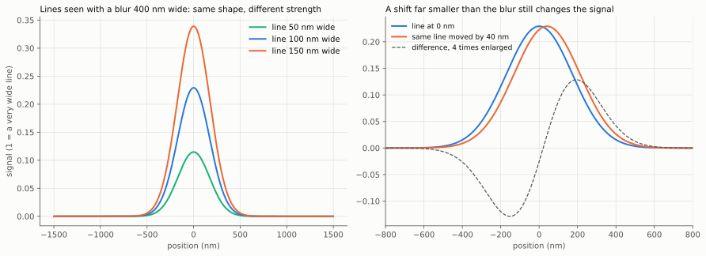

*Figure: why a feature can be measured without being resolved,
calculated for a blur 400 nm wide. Left: the signal from single lines 50,
100 and 150 nm wide. Position runs across in nanometres. All three look the
same shape, which is the shape of the blur, so the picture cannot show their
widths. But the strength of the signal is in proportion to the width, so the
width can be read from the strength. Right: the same 100 nm line at two
positions 40 nm apart. The two signals differ clearly (dashed curve,
enlarged 4 times), so the position can be found far more finely than the
blur. **Derived here**, by the function `locate_without_resolving` of the
[diagram script](https://github.com/mithro/ccd-superres/blob/main/docs/diagrams/make_optics_diagrams.py), with a Gaussian blur as an **Assumption**.*

A feature does not have to be resolved to be found, counted or measured. This
is where computation can stand in for hardware, and several published results
are directly relevant.

| What is wanted | How | Evidence | Hardware | Computation |
|---|---|---|---|---|
| Find and locate isolated features: a single line, a particle, a defect | The feature scatters light that interferes with the mirror reflection of the silicon around it. Its position is found to a small fraction of the resolution, and its size from the strength of the signal. | Particles of 70 to 200 nm detected and sized with a wide-field common-path interferometer [[O51](#ref-o51)]; nanoparticles detected with a lensless sensor, helped by liquid nanolenses [[O52](#ref-o52)]; defects 20 nm wide found in patterned wafers with visible laser light [[O53](#ref-o53)] | None beyond route 1 | Moderate |
| Measure the average line width or height of a regular array | An array finer than the resolution looks like a uniform film whose brightness depends on colour, polarisation and angle. A model of the array is fitted to those readings. This is how chip factories measure line widths, a method called scatterometry [[O54](#ref-o54), [O55](#ref-o55)]. | Standard factory practice [[O54](#ref-o54)] | Three colours and a polariser | Large: an electromagnetic solver (a program that calculates how light behaves from first principles) run again and again while the model is adjusted to fit. This is the most accurate level of the project's chain of simulations, which uses the program Meep. |
| Check a chip against a known or assumed layout | Chip patterns obey strict rules: straight edges in two directions, a few materials, fixed pitches. The unknowns are then edge positions and widths, far fewer than free pixels, and they can be estimated below the resolution limit. With a layout file, the expected data can be simulated and compared directly. | Measuring by fitting a model, well below the resolution limit, is established practice in optical measurement [[O55](#ref-o55), [O56](#ref-o56)] | None | Very large |

The limit on the third row must be stated plainly. Prior knowledge lets
computation measure the parameters of a structure of a known kind. It does not
reveal arbitrary unknown structure below the limit of section 9.2, and if the
assumed kind of structure is wrong the answer will be wrong but look
confident. The reconstruction should report how much of each result comes from
the data and how much from the assumption.

*Sources: the evidence is cited in each row of the table. The hardware and
computation columns and the limit stated above are a **Judgement** of this
page.*

### 9.6 What is realistic

| Goal | Verdict with a Raspberry Pi class sensor |
|---|---|
| Detect and locate isolated 100 nm features | Realistic. |
| Measure height and film thickness to nanometres at micrometre lateral scale | Realistic (section 8). |
| Measure the average line width of regular 100 nm arrays | Plausible. Needs the electromagnetic model. |
| Compare a chip against a known layout at 100 nm | Plausible. A research problem in computation, with little hardware. |
| Image unknown structure with 150 to 200 nm lines | Plausible with 405 nm slanted light. Would be a new result for lensless reflection. |
| Image unknown 100 nm lines and spaces | At the edge. Needs ultraviolet or liquid as well, and probably a stripped sensor. |
| Image unknown structure well below 100 nm | Not with light this sensor can detect. This is the territory of extreme ultraviolet, X-ray and electron instruments [[O48](#ref-o48), [O50](#ref-o50)]. |

*Sources: every verdict in this table is a **Judgement** of this page,
reached from the limits of section 9.2, the pixel limit of 9.3 and the
published results cited in 9.2 and 9.5. None is a measured or simulated
result.*

Three practical points apply to all of these:

- **Positions must be known to a few tens of nanometres.** No affordable
  moving platform (stage) provides that, and none is needed: ptychography recovers positions
  from the data [[O23](#ref-o23), [O34](#ref-o34)]. This is the same use of natural misalignment that
  the design document already plans, at a finer scale.
- **Vibration during one exposure cannot be fully computed away.** It washes
  out the interference pattern, though section 9.7 shows that a model of it
  recovers part of the loss. Short pulses solve it, and laser diodes pulse easily.
- **Both the chip and the sensor are mirrors.** Light bounces between them and
  adds its own interference. It has to be modelled, or avoided by tilting the
  sensor slightly.

### 9.7 Randomness as a tool

A rough, random part costs almost nothing to make, because
it needs no precision. The computer can work out what the part is from the
data, as long as the part stays the same from one frame to the next. So
randomness is a way to buy with computation what would otherwise need
precise hardware.

Tim has said that introducing random noise on purpose, and modelling the
randomness that is already there, are both in scope. Several elements on this
page are random by nature, and for them randomness is a strength. A random
element needs no precision to make, because the computation learns what it
is. That trades hardware for computation, which is the trade Tim prefers.

One limit comes first. Randomness does not move the limit of section 9.2,
which is set by wavelength and angles. What it does is help the
reconstruction get close to that limit, keep it from getting stuck or
producing repeating artefacts, and replace precise parts with rough ones.

One rule sorts the useful kinds from the costly ones:

- **Random but frozen is nearly free.** A pattern that is the same in every
  frame (a speckle pattern fixed to the sensor, a scattering layer, pixel to
  pixel differences) adds a fixed number of unknowns, and thousands of frames
  are available to solve for them.
- **Random and known is free.** Anything generated by the instrument itself,
  such as pulse times, costs nothing to model.
- **Random and fresh in every frame is affordable only when small.** A
  position, a brightness and a gap per frame are a few numbers against a
  million pixel readings. A whole new unknown light pattern per frame is not,
  so a moving diffuser is not recommended.

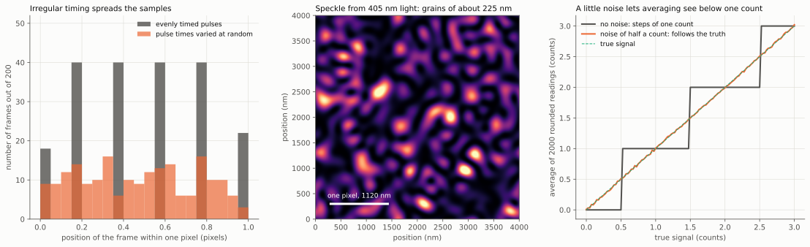

*Figure: three calculated examples of randomness helping. Left: where
200 successive frames fall within the width of one pixel, for the scan
example of section 4.1. With evenly timed flashes (grey) the frames land on
only five positions. With flash times varied at random by up to half a
pixel of travel (orange) they spread over all positions, which is what the
reconstruction needs. Middle: a speckle pattern, the random grainy light
that a 405 nm laser makes after frosted glass, drawn over a square 4000 nm
on a side. The white bar is the width of one pixel. The grains are about
225 nm across, fine enough to make broad beat patterns with detail near
the 110 nm line width that section 9.2 gives as the limit.
Right: dither. The true signal (dashed) rises smoothly from 0 to 3 counts.
A sensor that rounds to whole counts and has no noise (grey) reports steps,
however many readings are averaged. With noise of half a count (orange) the
average of 2000 readings follows the true signal. **Derived here**, by the
function `randomness_demo` of the [diagram script](https://github.com/mithro/ccd-superres/blob/main/docs/diagrams/make_optics_diagrams.py).*

Randomness added on purpose:

| What | What it buys | Hardware | Computation | Rank |
|---|---|---|---|---|
| Irregular pulse times and a scan that never repeats | A steady scan with evenly timed pulses puts the frames on a regular grid, which is known to leave false repeating patterns (artefacts) in ptychography [[O61](#ref-o61)]. Irregular spacing removes them [[O64](#ref-o64)]. Pulse times drawn from a known random sequence do this along the scan, and a scan direction slightly off the pixel rows, plus the natural wobble, does it across. It also spreads samples evenly over sub-pixel positions, as the design document plans. | None. A change to the pulse timing. | None extra | 1. Adopt from stage 1. |
| Speckle lighting: the laser sent through a fixed piece of ground glass (section 4.3) | A speckle pattern is every beam pair the lighting cone allows, all at once, in every direction. Its grain is about the wavelength divided by twice the sine of the widest light angle [[O67](#ref-o67)], so about 225 nm at 405 nm with steep light (**Derived here**, for light up to 64° from straight ahead, an **Assumption**). Fine chip detail beats against the grain into coarse patterns, the same work-around as beam pairs in section 9.3. Since the light travels with the sensor, the pattern is frozen in sensor coordinates and the chip slides through it. That is ptychography with a structured (patterned) beam, with which the calculation is known to settle on the right answer more reliably than with a smooth beam [[O59](#ref-o59), [O62](#ref-o62)], and the pattern is solved along with the picture [[O61](#ref-o61)]. | One diffuser in place of several aligned mirrors. Arguably less hardware than beam pairs. | Larger: the light pattern becomes a large unknown | 2. Compare with beam pairs in the simulator for stage 2. |
| Random scattering layer on the sensor (section 5.2) | A third work-around for coarse pixels, on the detection side. The layer scrambles light arriving at steep angles into patterns the pixels can record, and makes each frame a different encoding of the surface. It is the basis of the closest published results [[O22](#ref-o22), [O23](#ref-o23)]. | One passive layer on the sensor face. No precision needed, but it touches the sensor. | Larger: the layer is another unknown, solved once | 3. Simulate for stage 2. It belongs there if the approach only works with sharp pixel edges without it. Otherwise keep it for stage 4. |
| Noise as dither | A sensor that rounds to whole counts loses any change smaller than one count, unless noise of about half a count or more is present. Then averaging many samples recovers it [[O63](#ref-o63)]. The design gives every surface point thousands of samples, so this matters for the weakest signals. | None. Choose the sensor gain so that the noise is at least about one count. | None | Adopt. A setting, to be checked on the sensor. Past that level more noise only costs samples. |
| Coded pulses within one exposure (section 4.1) | Keeps all feature sizes when the exposure is long | None | Small | Low. A laser diode is bright enough for a single short pulse. |
| A fresh random pattern in every frame, such as a moving diffuser | Many different encodings | A moving part | Very large, and poorly determined | Not recommended. |

Randomness already present, to be modelled and not fought:

| Source | How it is modelled | Why it helps |
|---|---|---|
| Scan position and speed errors | A position for every frame, solved from the data [[O23](#ref-o23), [O34](#ref-o34)] | Already in every stage. Removes the need for a precise stage. |
| Vibration during a pulse, and laser light that is not perfectly coherent | The light is described as a mixture of a few patterns instead of one (called mixed states in the literature) [[O58](#ref-o58), [O26](#ref-o26)] | Recovers contrast that would otherwise be counted as lost, and relaxes the pulse length and laser quality needed. |
| Photon noise | The fit gives each reading the weight it deserves, using the known statistics of counting photons, instead of treating all readings alike (maximum likelihood instead of plain least squares) [[O60](#ref-o60)] | Matters most where the signal is dim: light scattered far from the mirror direction, which carries the finest detail. |
| Pulse to pulse laser brightness, and laser colour jumps | One brightness and one wavelength per frame, solved or read from the frame average | Lets an ordinary laser diode be used without stabilising it. |
| Pixel to pixel differences in gain, and in the shape of each pixel's sensitive area | A map per pixel, frozen, solved from the data | Gain is already in stage 1. Differences in shape would act as a weak built-in random mask. Whether they are large enough to help is not known. The simulations sweep it, and the stage 0 measurement on hardware would show it. |
| Gap and tilt drift | A few slowly changing numbers per frame | Removes the need for a precise mount. |

*Sources: published methods are cited in each row of the two tables. The
"Rank" column, the rule of three kinds of randomness, and the statements
about what each buys for this instrument are a **Judgement** of this page.
The remark on pixel shape differences is an **Assumption**.*

What changes in the path of section 10: stage 1 gains irregular pulse timing
and the dither setting. Stage 2 gains noise-aware fitting and the mixture
model as standard parts of the reconstruction, and two options to compare in
the simulator against beam pairs before any are built: speckle lighting and
the scattering layer. None of this changes the stage numbers or the limits
quoted for each stage.

## 10. Recommendation: a staged path, the current leading candidate

The first table compares every option on this page. After
it comes the recommended path for 100 nm features on silicon chips, in five
stages numbered 0 to 4. Each stage gives a useful result and prepares the
next. All of it is done in simulation first.

Comparison of all candidates. Gains are relative to open pixels in diffuse
light at a 30 µm gap, which is a plausible first-hardware gap once a plate or
spacer is involved.

| Candidate | Resolution gain, low (times) | Resolution gain, high (times) | Light kept, low (percent) | Light kept, high (percent) |
|---|---:|---:|---:|---:|
| Pulsed or coded light | 1 | 1 | 0.1 | 50 |
| Tube per pixel group | 9 | 10 | 0.03 | 1 |
| One tube around the sensor | 1 | 1 | 90 | 100 |
| Collimated single-colour light | 20 | 40 | 90 | 100 |
| Fringe or speckle lighting | 1 | 40 | 25 | 50 |
| Coded mask or diffuser | 20 | 40 | – | – |
| Several colours with the Bayer filter | 1 | 1 | – | – |
| Several light angles | 1 | 1 | 100 | 100 |
| Sub-pixel openings | 1 | 1 | 1 | 25 |
| Fibre-optic plate | 1 | 1 | – | – |
| Polarisers, filters, liquid | 1 | 1.5 | 10 | 50 |

A gain of 1 means no change in resolution. A dash means the light kept was
not worked out. It is expected to be most of the light. Pulsed light does not
sharpen the picture, but lets the scan run about 100 times faster. Several
colours and several angles support the other methods and add height
information. Sub-pixel openings give no gain until the gap is smaller than a
pixel.

What each candidate attacks and needs:

| Candidate | Attacks | Hardware | Reconstruction | On a Raspberry Pi sensor |
|---|---|---|---|---|
| Pulsed or coded light | Motion blur | Trivial | Unchanged | Yes |
| Tube per pixel group | Gap | Collimator plate | Unchanged | Yes, with a bought or made plate |
| One tube around the sensor | Stray light | Trivial | Unchanged | Yes |
| Collimated single-colour light | Gap, height | LED or laser, pinhole | Linear if surface is weak, else iterative | Yes |
| Fringe or speckle lighting | Gap, height | Two-beam optics | Linear, larger | Bench only |
| Coded mask or diffuser | Gap, conditioning, height | Calibrated layer on sensor | Iterative, heavy | Plausible |
| Several colours with the Bayer filter | Conditioning, height ambiguity | Three LEDs | Small addition | Yes |
| Several light angles | Height (slope) | Several LEDs | Small addition | Yes |
| Sub-pixel openings | Pixel area | Lithography on the die | Unchanged | No |
| Fibre-optic plate | Mechanics | Bonded plate | Unchanged | Yes |
| Polarisers, filters, liquid | Contrast, coherence | Trivial | Unchanged | Yes |

*Sources: the first table collects figures from the sections on each
candidate, where they are sourced or labelled. Most are **Derived here** or
**Estimates**. The second table is a **Judgement**.*

That table is the general comparison. For Tim's target and preferences the
staged path below replaces a single ranking. What Tim has stated:

- The goal is to reconstruct the picture: true imaging of features of about
  100 nm on silicon chips.
- It can be reached in several stages.
- Significantly more computation is preferred to more hardware, and all
  processing can run offline on powerful computers with graphics cards. So
  computation is treated as nearly free and hardware as expensive.
- Many approaches are to be explored, not one.
- All hardware work comes at the very end, after simulation shows that a
  method works.

So the path below is the current leading candidate and not a decision. It is
the approach that looks strongest from the analysis on this page, slanted
coherent 405 nm light in beam pairs with phase recovery, and it is the
reference that other approaches are compared against in the simulator. The
alternatives this page supplies for that comparison are speckle lighting and
a scattering layer on the sensor (section 9.7), collimated single-colour
light (section 4.2), and for matt surfaces the collimator array (section 3).
If the comparisons favour another approach, this section is rewritten.

Every stage is carried out in the simulator first. The hardware column says
what a stage would need when it is eventually built, and nothing is built
until the approach has passed the gate described in
[section 4.9 of the design document](design.md#49-simulation-first-the-unknown-pixel-response-and-the-gate-before-hardware).
The path orders the options so that each stage would add as little hardware
as possible. Each stage produces a usable result and hands something specific
to the next. The stage numbers are those of
[section 4.7 of the design document](design.md#47-a-staged-path-to-the-picture-the-current-leading-candidate),
which holds the single definition of the stages, and the
[project plan](plan.md) tracks their state. This section gives the optical
reasoning behind stages 0, 2, 3 and 4.

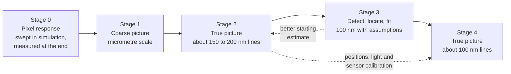

*Figure: the five stages of the recommended path, in order from left to
right. Solid arrows show the order of work. The dotted arrows show results
handed back or forward: stage 3 gives stage 2 a better starting estimate, so
those two are repeated in turn, and stage 2 passes its measured positions
and its calibration of the light and the sensor on to stage 4.*

| Stage | What is done | Hardware added | Computation added | Result | What it hands on |
|---|---|---|---|---|---|
| 0. Pixel response | In simulation: the response to fine fringes and to arrival angle is an uncertain range, swept in every run and narrowed by the electromagnetic level on a model of the pixel's layers. On hardware, at the end: two laser beams crossing on the sensor, recording contrast against fringe period and against arrival angle (section 9.3). | None until the end. Then one 405 nm laser diode and one mirror. | Small | Whether pixels can read fine fringes, and their collection angles | The two numbers every later estimate depends on. When built, the same parts are the stage 2 lighting. |
| 1. Coarse picture | A scan with simple lighting and the linear reconstruction of the design document, with frame positions estimated from the data. | A scan and simple lighting | Moderate | A picture of the chip at micrometre scale: blocks, wide wiring, pads | The position of every frame, the speed and tilt, pixel gains, and a map of the chip to register everything else against. No optical element from this page is needed. |
| 2. True picture to 150 to 200 nm | Pulsed 405 nm light, slanted, from several directions and in beam pairs. Ptychographic reconstruction that also solves for scan positions. Red, green and blue added through the colour filter (sections 4.1 to 4.5, 9.2). Pulse times irregular, fitting aware of photon noise and of imperfect coherence. Speckle lighting and a scattering layer on the sensor are compared with beam pairs in the simulator first (section 9.7). | A few laser diodes, a pulse driver. Sensor as sold, gap about 1 mm. Possibly a diffuser in the beam. | Very large | A true picture down to about 150 to 200 nm lines, with a height map. Theory allows 110 to 145 nm. | Scan positions, the measured light beams, and the sensor model, all recovered from data. A reconstruction pipeline proven on real frames. |
| 3. Detect, locate and fit | From the same data: find and locate isolated 100 nm features, measure line widths of regular arrays from colour and polarisation, and fit structure that obeys chip layout rules (section 9.5). | None, or one polariser | Very large, including the electromagnetic solver | A picture at about 100 nm that is partly inferred. Every part of it is labelled as measured or as assumed. | A starting estimate for stage 4, a list of regions where the assumptions fail and finer imaging is needed, and a calibrated model of how real chip structure scatters light. |
| 4. True picture at 100 nm | Shorten the wavelength the light has at the chip: near ultraviolet at 365 to 385 nm if the sensor responds to it, or water in the gap at 405 nm. A thin scattering layer on the sensor for a better-conditioned reconstruction, if it was not already added in stage 2 (sections 5.2, 9.4, 9.7). | The heaviest hardware of the path: an ultraviolet source or liquid handling, possibly a stripped sensor, one passive layer | Same pipeline as stage 2, started from the stage 3 estimate | A true picture at about 100 nm lines: 100 to 130 nm at 365 nm, about 85 nm with water at 405 nm (theoretical limits) | The end point. |

The line widths expected at each stage, as numbers:

| Stage | Wavelength (nm) | Medium in the gap | Narrowest line, limit of the formula (nm) | Narrowest line expected in practice (nm) | Kind of picture |
|---:|---:|---|---:|---:|---|
| 1 | 520 | Air | – | 1000 | True, coarse |
| 2 | 405 | Air | 110 to 145 | 150 to 200 | True |
| 3 | 405 | Air | – | 100 | Partly inferred |
| 4 | 365 | Air | 100 to 130 | – | True |
| 4 | 405 | Water | 85 | – | True |

A dash means no figure has been worked out. The limits are **Derived here**
from the formula of section 9.2. The figures expected in practice are a
**Judgement**, allowing for the fact that published systems reach somewhat
less than the formula. The 1000 nm for stage 1 is an order of magnitude.

Why the earlier stages are not a detour:

- **Stage 2 is the same instrument as stage 4 at a longer wavelength.** All
  of its software carries over unchanged. Only the light changes.
- **Stage 3 makes stage 4 easier and checkable.** An iterative reconstruction
  started from a good estimate converges faster and more reliably than one
  started from nothing. Where the stage 4 picture and the stage 3 estimate
  disagree, one of them is wrong, which is the only independent check
  available short of an electron microscope.
- **Stages 2 and 3 improve each other.** The layout estimate from stage 3 is
  also a better starting estimate for stage 2, so the two are repeated in
  turn until they stop changing.
- **Stage 3 is not a substitute for stage 4.** Fitting with assumed layout
  rules cannot show structure that breaks the rules, and that is exactly what
  a picture is for (section 9.5). Reaching a true picture at 100 nm requires
  the shorter wavelength of stage 4. Computation alone does not get there.

Choosing the stage 4 hardware. The two candidates cost different things. The
simulations compare what each reaches, and when hardware starts the stage 0
measurement and a simple test decide between them:

| Candidate | Wavelength, low (nm) | Wavelength, high (nm) | Narrowest line, low (nm) | Narrowest line, high (nm) |
|---|---:|---:|---:|---:|
| Near ultraviolet, sensor as sold | 365 | 385 | 100 | 135 |
| Near ultraviolet, stripped sensor | 365 | 385 | 100 | 135 |
| Water in the gap, sensor as sold | 405 | 405 | 85 | 85 |
| Deep ultraviolet | 250 | 280 | 75 | 95 |

What each depends on:

| Candidate | Depends on | How to find out on hardware |
|---|---|---|
| Near ultraviolet, sensor as sold | Whether the colour filter and microlenses pass ultraviolet | Shine an ultraviolet LED on an unmodified sensor |
| Near ultraviolet, stripped sensor | Surviving the stripping (design document, section 5.3) | Only if the test above fails |
| Water in the gap, sensor as sold | Chip and sensor tolerating water, and light entering through it | Bench trial |
| Deep ultraviolet | A sensor that responds, costly sources, safety measures | Not recommended unless the others fail |

*Sources: the line widths are **Derived here** from the formula of
section 9.2 with the assumed angles stated there. The second table is a
**Judgement**.*

Adopt at every stage: one tube around the whole assembly as a stray light
baffle.

Dropped for this target, with reasons:

- **Tubes and collimator arrays.** They sharpen diffuse light from matt
  surfaces and reach a few micrometres. A silicon chip is a mirror, and the
  target is 20 times finer.
- **Fringe lighting as a separate option.** It is part of stage 2. Section
  9.3 shows that beam pairs are what let coarse pixels read fine detail.
- **Sub-pixel openings and near-field gaps.** Hardware-heavy, and section 9.4
  shows the gap needed is not buildable over a chip.
- **A light pattern that changes randomly from frame to frame.** It adds a
  moving part and more unknowns than the frames can settle (section 9.7).

Order of work in the simulator. The wave-optics forward model moves to the
front of the build plan, since every stage depends on it. For 100 nm
features on silicon the surface cannot be treated as a flat sheet that merely
dims and delays the light: the features are smaller than the wavelength and
have depth, so the light's interaction with the surface needs the
electromagnetic solver level of the simulation chain. A sensible sequence
follows the stages: a scalar wave model with slanted beam pairs, coarse pixels
and ptychographic reconstruction on synthetic layouts, to answer the open
question of section 9.3; then the electromagnetic solver to generate the
surface response; then known-structure fitting; then the same reconstruction
at the stage 4 wavelengths, started from the fitted estimate. The simulator
runs every stage before any hardware is built, as the project plan requires. Pulsed light and the
tube kernel remain cheap additions to the linear model for anyone studying
matt surfaces.

## 11. Parameters for the simulator

This section is for whoever writes the simulation program.
It lists the settings the program would need so that every option on this
page can be switched on and tried.

Proposed additions to the design's configuration, so the recommended options
become settings and not separate programs. Names are suggestions.

*Sources: the parameters and levels are proposals of this page (a
**Judgement**), each tied to the section named in its "Used by" column,
where the underlying claims are sourced.*

| Group | Parameter | Meaning | Used by | Model level |
|---|---|---|---|---|
| Acceptance | `tube_width_nm`, `tube_depth_nm` | Bore and depth of the collimator; zero depth means open pixels | 3 | 1 |
| Acceptance | `tube_pitch_nm` | Spacing of tubes, which sets the open fraction and how many pixels share a tube | 3 | 1 |
| Acceptance | `wall_reflectance` | Light surviving a wall bounce; zero is a perfect absorber | 3 | Ray tracer |
| Acceptance | `mouth_gap_nm` | Distance from tube mouth to surface. Replaces the gap in the blur kernel when tubes are present | 3 | 1 |
| Light | `pulse_pattern` | On and off times within a frame; one entry is a simple pulse | 4.1 | 1 |
| Light | `wavelengths_nm`, `bandwidth_nm` | Colours present and their spectral width | 4.2, 4.5 | 3 |
| Light | `source_angle_mrad` | Angular size of the source | 4.2 | 3 |
| Light | `directions` | Arrival directions of the light, one or several | 4.2, 4.4 | 1 (shading), 3 |
| Light | `pattern` | Intensity pattern in sensor coordinates: uniform, fringes (period, direction, slant) or a speckle map | 4.3 | 2 |
| Sensor | `pixel_spectral_response` | Response of each Bayer pixel type to each colour, including leakage | 5.3 | 1 |
| Sensor | `mask` | Complex transmission of a layer at the sensor plane, and its height above the pixels | 5.2 | 4 |
| Gap | `reference_reflectance` | Reflectance of a reference flat or of the sensor face | 6.2 | 3 |
| Gap | `refractive_index` | Of the medium in the gap | 6.3 | 3 |
| Light | `pulse_length_s` | Length of each light pulse, for vibration and motion blur | 9.6 | 3 |
| Sensor | `pixel_angular_response` | Response of a pixel against arrival angle, measured or assumed | 9.2 | 3 |
| Sensor | `pixel_fringe_response` | Contrast a pixel records against fringe period. Follows from the pixel width and edge softness of the design document, and is to be measured | 9.3 | 1, 3 |
| Light | `beam_pairs` | Pairs of directions lit at once by mutually coherent beams | 9.3 | 3 |
| Surface | `layout_prior` | Rules or a layout file describing allowed structure: edge directions, materials, pitches | 9.5 | Reconstruction |
| Surface | `surface_model` | Thin sheet (reflectance and height maps) or full three-dimensional structure solved electromagnetically | 9, 10 | 3, 4, solver |
| Light | `pulse_time_jitter` | Random sequence of pulse times, known to the reconstruction | 9.7 | 1, 3 |
| Light | `coherence_modes` | Number of patterns in the mixture that describes imperfect coherence and vibration | 9.7 | 3, 4 |
| Light | `frame_power_variation`, `wavelength_jitter_nm` | Random brightness and colour of each pulse | 9.7 | 3 |
| Sensor | `adc_bits`, `noise_counts` | Rounding of the readout and the noise ahead of it, for the dither study | 9.7 | 1 |
| Sensor | `pixel_shape_variation` | Random pixel to pixel differences in the sensitive area | 9.7 | 1, 3 |
| Reconstruction | `noise_model` | Plain least squares or photon-counting statistics | 9.7 | Reconstruction |
| Surface | `specular_fraction` | Share of mirror-like reflection, which polarisers select or reject | 7 | 1 |

Model levels, in increasing cost. Each is a forward model behind the single
interface the design already plans:

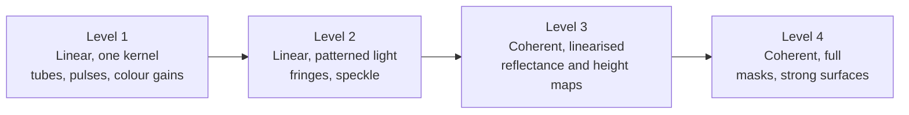

*Figure: the four levels of calculation the options on this page need, from
the simplest and fastest on the left to the most complete and slowest on the
right. Each box names the level, the kind of calculation, and the options it
covers. Each level can do everything the one before it can. These are levels
of this page's models and are separate from the numbered levels of the
project's simulation chain.*

| Level | Forward model | Reconstruction | Elements covered |
|---|---|---|---|
| 1 | The design's `m = D S K ρ` with a different kernel `K` | Unchanged | Tubes, pulses and codes, sub-pixel openings, colour gains, polariser contrast |
| 2 | Surface multiplied by a light pattern in sensor coordinates, then blurred | Linear least squares; the blur differs between pixels, so the single fast convolution becomes a sum of a few | Fringes, speckle, fine masks in diffuse light |
| 3 | Two unknown maps, reflectance and height, each with its own kernel per gap and colour | Linear least squares over both maps | Collimated light on weak surfaces, reference flat, several colours |
| 4 | Complex wave: surface, propagation, mask, intensity | Iterative phase recovery | Coded masks, rough or strongly stepped surfaces |

Level 1 additions also belong in the analytic model ([`ccdsr/resolution.py`](https://github.com/mithro/ccd-superres/blob/main/ccdsr/resolution.py))
and the trade-off explorer: tube width and depth as two more controls, with
the light lost feeding the signal-to-noise control.

## 12. Getting light in, and the questions that decide the choice

The sensor sits over the surface like a lid, so getting
light underneath it is a problem in itself. There are four ways to do it,
and each suits different methods. The section ends with the questions whose
answers would settle the remaining choices.

With an opaque surface and a sensor covering it, the light has few ways in.
The choice of method and the choice of lighting constrain each other.

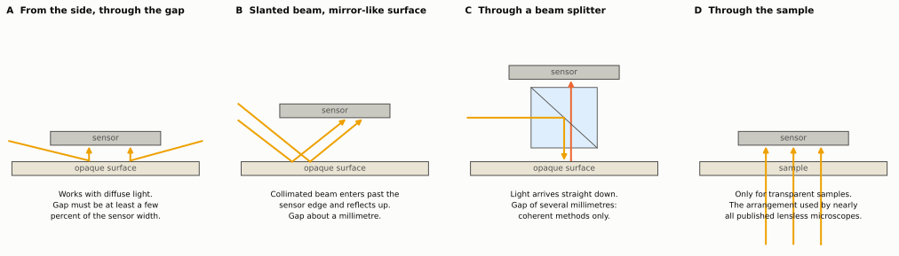

*Figure: four side views, each showing the sensor above the surface and the
path the light takes. A: light enters from the side through the gap. B: a
parallel beam comes in at a slant and reflects off a mirror-like surface up
to the sensor. C: light is fed in through a beam splitter, a part-silvered
mirror between sensor and surface. D: light comes up through a transparent
sample from below. The table after the figure says how big a gap each needs
and which methods it suits.*

| Arrangement | Gap it needs | Methods it suits |
|---|---|---|
| A. From the side, through the gap | At least a few percent of the sensor width, so 100 µm or more for this sensor | Diffuse light with tubes; fringes; shading |
| B. Slanted parallel beam on a mirror-like surface | About a millimetre | Collimated single-colour light |
| C. Through a beam splitter | Several millimetres | Collimated single-colour light [[O4](#ref-o4)] |
| D. Through the sample | Any | Everything, but only for transparent samples |

*Sources: the gaps needed are **Estimates** from the geometry of each
arrangement. Arrangement C is the published reflection instrument of [[O4](#ref-o4)].*

Arrangement A shows a tension in the original concept: a gap small enough for
sharp images with open pixels in diffuse light is too small to let the light
in. Tubes, and all the interference methods, resolve this by making larger
gaps usable.

Questions for Tim. Two are answered: the surfaces are smooth silicon chips,
and the goal is a true picture at about 100 nm, reached in stages. Still open:

1. **Are the 100 nm features dense lines and spaces, or isolated?** It sets
   how much stage 3 can deliver before stage 4.
2. **Is the layout known, or are its rules known?** A layout file or design
   rules make the known-structure fitting of section 9.5 much stronger.
3. **Which layer carries the features, and what lies above it?** Finished
   chips have protective and wiring layers over the finest features. Light
   has to reach them and return.
4. **For stage 4, which is more acceptable: ultraviolet light, possibly with a
   stripped sensor, or water on the chip?**

One open unknown, not a question for Tim: the response of the pixels to fine
fringes (section 9.3). It is swept in simulation and measured when hardware
starts.

## 13. Limits of these estimates

The numbers on this page come from simplified formulas and
small calculations, not from measurements. This section lists what was
simplified or assumed, so that no figure is trusted further than it should
be.

- The tube diffraction calculation is one-dimensional (a slit, not a square
  or round bore), assumes small angles, and treats the walls as perfect
  absorbers with no diffraction of their own. The square-root scaling is
  robust. The factors in front of it (1.3 for the best width, 0.5 for the
  patch) are not, and a real tube of depth 10 times the gap is itself beyond
  the simple model for the narrowest widths.
- "Smallest recoverable period" uses the illustrative contrast floor of
  1/1000 from the design document. As there, the true floor depends on light
  level and sample count. For tubes the light loss raises the floor, which the
  figures above do not include.
- The collimated-light formulas assume a weakly modulating, smooth surface
  and ignore the pixel's own angular response and reflections between sensor
  and surface. Published results show both matter [[O6](#ref-o6), [O22](#ref-o22)].
- Published resolutions were obtained with transparent samples unless stated.
  Only [[O4](#ref-o4)] is in reflection. Reaching the same figures on an opaque surface
  is not demonstrated.
- Typical dimensions quoted for capillary plates, fibre-optic plates and
  louvre films are general catalogue knowledge and were not checked against
  specific datasheets.
- The line widths in section 9.2 are the theoretical limit for the stated
  angles. The collection angles of the sensor are assumed, not measured, and
  noise, stray reflections and imperfect coherence all cost resolution in
  practice. Published systems typically reach somewhat less than the formula.
- Whether pixels of 1.12 µm can record the fine detail at all depends on
  their edge sharpness and on the two work-arounds of section 9.3. None of
  the three has been measured or simulated for this sensor. This is the
  largest open risk for the 100 nm target.
- Statements about the sensor's response to ultraviolet light are general
  knowledge about silicon sensors with polymer colour filters, not
  measurements of the IMX219.
- Section 9 treats the chip surface with simple formulas. Features smaller
  than the wavelength with real depth and several materials need a rigorous
  electromagnetic calculation, which may change the achievable figures in
  either direction.
- The claims for speckle lighting and for a scattering layer (section 9.7)
  rest on published results with transparent samples, mostly with X-rays or
  with gaps under a millimetre. Neither has been shown for an opaque chip
  with light entering from the side, and the speckle grain quoted assumes
  light can reach the chip from a wide range of steep angles. The idea that
  pixel shape differences act as a useful random mask is a conjecture.
- Fixing fringes to the sensor so that the scan provides the phase steps
  (section 4.3) is a consequence of the design's model worked out here. No
  publication was found for exactly this arrangement.

## 14. References

This list is part of the shared bibliography on the
[references](references.md) page, which also defines the labels used for
claims that have no published source. Every entry below was matched against
the OpenAlex bibliographic database when it was added, which confirms that
the work exists as cited. Figures quoted from a paper on this page are from
its abstract, not from a reading of the full text, unless stated.

Reviews:

(ref-o1)=
- **O1** Greenbaum et al., "Imaging without lenses: achievements and remaining
  challenges of wide-field on-chip microscopy", Nature Methods, 2012.
  [doi:10.1038/nmeth.2114](https://doi.org/10.1038/nmeth.2114)
(ref-o2)=
- **O2** Ozcan and McLeod, "Lensless imaging and sensing", Annual Review of
  Biomedical Engineering, 2016.
  [doi:10.1146/annurev-bioeng-092515-010849](https://doi.org/10.1146/annurev-bioeng-092515-010849)
(ref-o3)=
- **O3** Wu and Ozcan, "Lensless digital holographic microscopy and its
  applications in biomedicine and environmental monitoring", Methods, 2018.
  [doi:10.1016/j.ymeth.2017.08.013](https://doi.org/10.1016/j.ymeth.2017.08.013)
(ref-o38)=
- **O38** Boominathan, Robinson, Waller and Veeraraghavan, "Recent advances in
  lensless imaging", Optica, 2022.
  [doi:10.1364/optica.431361](https://doi.org/10.1364/optica.431361)

Coherent lensless microscopy:

(ref-o4)=
- **O4** Lee, Yaglidere and Ozcan, "Field-portable reflection and transmission
  microscopy based on lensless holography", Biomedical Optics Express, 2011.
  [doi:10.1364/boe.2.002721](https://doi.org/10.1364/boe.2.002721)
(ref-o5)=
- **O5** Greenbaum and Ozcan, "Maskless imaging of dense samples using pixel
  super-resolution based multi-height lensfree on-chip microscopy", Optics
  Express, 2012.
  [doi:10.1364/oe.20.003129](https://doi.org/10.1364/oe.20.003129)
(ref-o6)=
- **O6** Luo, Greenbaum, Zhang and Ozcan, "Synthetic aperture-based on-chip
  microscopy", Light: Science & Applications, 2015.
  [doi:10.1038/lsa.2015.34](https://doi.org/10.1038/lsa.2015.34)
(ref-o7)=
- **O7** Greenbaum et al., "Increased space-bandwidth product in pixel
  super-resolved lensfree on-chip microscopy", Scientific Reports, 2013.
  [doi:10.1038/srep01717](https://doi.org/10.1038/srep01717)
(ref-o8)=
- **O8** Luo, Zhang, Feizi, Göröcs and Ozcan, "Pixel super-resolution using
  wavelength scanning", Light: Science & Applications, 2016.
  [doi:10.1038/lsa.2016.60](https://doi.org/10.1038/lsa.2016.60)
(ref-o29)=
- **O29** Wu, Zhang, Luo and Ozcan, "Demosaiced pixel super-resolution for
  multiplexed holographic color imaging", Scientific Reports, 2016.
  [doi:10.1038/srep28601](https://doi.org/10.1038/srep28601)
(ref-o32)=
- **O32** Bishara, Su, Coskun and Ozcan, "Lensfree on-chip microscopy over a
  wide field-of-view using pixel super-resolution", Optics Express, 2010.
  [doi:10.1364/oe.18.011181](https://doi.org/10.1364/oe.18.011181)
(ref-o33)=
- **O33** Zuo et al., "Transport of intensity equation: a tutorial", Optics and
  Lasers in Engineering, 2020.
  [doi:10.1016/j.optlaseng.2020.106187](https://doi.org/10.1016/j.optlaseng.2020.106187)
(ref-o35)=
- **O35** Goodman, "Introduction to Fourier Optics", textbook, any edition
  (Fresnel propagation and transfer functions).
(ref-o43)=
- **O43** Oh, Isikman, Khademhosseinieh and Ozcan, "On-chip differential
  interference contrast microscopy using lensless digital holography", Optics
  Express, 2010.
  [doi:10.1364/oe.18.004717](https://doi.org/10.1364/oe.18.004717)

Angle restriction:

(ref-o9)=
- **O9** Papageorgiou, Boser and Anwar, "Chip-scale angle-selective imager for
  in vivo microscopic cancer detection", IEEE Transactions on Biomedical
  Circuits and Systems, 2019.
  [doi:10.1109/tbcas.2019.2959278](https://doi.org/10.1109/tbcas.2019.2959278)
(ref-o10)=
- **O10** Papageorgiou, Boser and Anwar, "An angle-selective CMOS imager with
  on-chip micro-collimators for blur reduction in near-field cell imaging",
  IEEE MEMS, 2016.
  [doi:10.1109/memsys.2016.7421629](https://doi.org/10.1109/memsys.2016.7421629)
(ref-o11)=
- **O11** Chapman et al., "Angular domain imaging of objects within highly
  scattering media using silicon micromachined collimating arrays", IEEE
  Journal of Selected Topics in Quantum Electronics, 2003.
  [doi:10.1109/jstqe.2003.811286](https://doi.org/10.1109/jstqe.2003.811286)
(ref-o12)=
- **O12** Balsam, Ossandon, Bruck and Rasooly, "Modeling and design of
  micromachined optical Söller collimators for lensless CCD-based
  fluorometry", Analyst, 2012.
  [doi:10.1039/c2an35729a](https://doi.org/10.1039/c2an35729a)
(ref-o13)=
- **O13** Koppelhuber and Bimber, "Thin-film camera using luminescent
  concentrators and an optical Söller collimator", Optics Express, 2017.
  [doi:10.1364/oe.25.018526](https://doi.org/10.1364/oe.25.018526)
(ref-o16)=
- **O16** Wang, Gill and Molnar, "Light field image sensors based on the Talbot
  effect", Applied Optics, 2009.
  [doi:10.1364/ao.48.005897](https://doi.org/10.1364/ao.48.005897)
(ref-o44)=
- **O44** Shen et al., "Optical broadband angular selectivity", Science, 2014.
  [doi:10.1126/science.1249799](https://doi.org/10.1126/science.1249799)

Patterned light, gratings and coded exposure:

(ref-o14)=
- **O14** Gustafsson, "Surpassing the lateral resolution limit by a factor of
  two using structured illumination microscopy", Journal of Microscopy, 2000.
  [doi:10.1046/j.1365-2818.2000.00710.x](https://doi.org/10.1046/j.1365-2818.2000.00710.x)
(ref-o15)=
- **O15** Mudry et al., "Structured illumination microscopy using unknown
  speckle patterns", Nature Photonics, 2012.
  [doi:10.1038/nphoton.2012.83](https://doi.org/10.1038/nphoton.2012.83)
(ref-o17)=
- **O17** Wen, Zhang and Xiao, "The Talbot effect: recent advances in classical
  optics, nonlinear optics, and quantum optics", Advances in Optics and
  Photonics, 2013.
  [doi:10.1364/aop.5.000083](https://doi.org/10.1364/aop.5.000083)
(ref-o18)=
- **O18** Pang, Han, Kato, Sternberg and Yang, "Wide and scalable field-of-view
  Talbot-grid-based fluorescence microscopy", Optics Letters, 2012.
  [doi:10.1364/ol.37.005018](https://doi.org/10.1364/ol.37.005018)
(ref-o19)=
- **O19** Solak, Dais and Clube, "Displacement Talbot lithography: a new method
  for high-resolution patterning of large areas", Optics Express, 2011.
  [doi:10.1364/oe.19.010686](https://doi.org/10.1364/oe.19.010686)
(ref-o24)=
- **O24** Zhang et al., "Near-field Fourier ptychography: super-resolution phase
  retrieval via speckle illumination", Optics Express, 2019.
  [doi:10.1364/oe.27.007498](https://doi.org/10.1364/oe.27.007498)
(ref-o30)=
- **O30** Raskar, Agrawal and Tumblin, "Coded exposure photography: motion
  deblurring using fluttered shutter", ACM Transactions on Graphics, 2006.
  [doi:10.1145/1141911.1141957](https://doi.org/10.1145/1141911.1141957)
(ref-o31)=
- **O31** Cossairt, Gupta and Nayar, "When does computational imaging improve
  performance?", IEEE Transactions on Image Processing, 2013.
  [doi:10.1109/tip.2012.2216538](https://doi.org/10.1109/tip.2012.2216538)

Coded masks and ptychography:

(ref-o20)=
- **O20** Asif et al., "FlatCam: thin, lensless cameras using coded aperture and
  computation", IEEE Transactions on Computational Imaging, 2017.
  [doi:10.1109/tci.2016.2593662](https://doi.org/10.1109/tci.2016.2593662)
(ref-o21)=
- **O21** Adams et al., "Single-frame 3D fluorescence microscopy with
  ultraminiature lensless FlatScope", Science Advances, 2017.
  [doi:10.1126/sciadv.1701548](https://doi.org/10.1126/sciadv.1701548)
(ref-o22)=
- **O22** Jiang et al., "Resolution-enhanced parallel coded ptychography for
  high-throughput optical imaging", ACS Photonics, 2021.
  [doi:10.1021/acsphotonics.1c01085](https://doi.org/10.1021/acsphotonics.1c01085)
(ref-o23)=
- **O23** Jiang et al., "Wide-field, high-resolution lensless on-chip microscopy
  via near-field blind ptychographic modulation", Lab on a Chip, 2020.
  [doi:10.1039/c9lc01027k](https://doi.org/10.1039/c9lc01027k)
(ref-o25)=
- **O25** Zheng, Horstmeyer and Yang, "Wide-field, high-resolution Fourier
  ptychographic microscopy", Nature Photonics, 2013.
  [doi:10.1038/nphoton.2013.187](https://doi.org/10.1038/nphoton.2013.187)
(ref-o26)=
- **O26** Deng et al., "Continuous motion scan ptychography: characterization
  for increased speed in coherent x-ray imaging", Optics Express, 2015.
  [doi:10.1364/oe.23.005438](https://doi.org/10.1364/oe.23.005438)
(ref-o34)=
- **O34** Zhang et al., "Translation position determination in ptychographic
  coherent diffraction imaging", Optics Express, 2013.
  [doi:10.1364/oe.21.013592](https://doi.org/10.1364/oe.21.013592)
(ref-o37)=
- **O37** Antipa et al., "DiffuserCam: lensless single-exposure 3D imaging",
  Optica, 2018.
  [doi:10.1364/optica.5.000001](https://doi.org/10.1364/optica.5.000001)

Height, contact imaging and other elements:

(ref-o27)=
- **O27** Woodham, "Photometric method for determining surface orientation from
  multiple images", Optical Engineering, 1980.
  [doi:10.1117/12.7972479](https://doi.org/10.1117/12.7972479)
(ref-o28)=
- **O28** Cheng and Wyant, "Two-wavelength phase shifting interferometry",
  Applied Optics, 1984.
  [doi:10.1364/ao.23.004539](https://doi.org/10.1364/ao.23.004539)
(ref-o36)=
- **O36** Zheng, Lee, Antebi, Elowitz and Yang, "The ePetri dish, an on-chip
  cell imaging platform based on subpixel perspective sweeping microscopy",
  PNAS, 2011.
  [doi:10.1073/pnas.1110681108](https://doi.org/10.1073/pnas.1110681108)
(ref-o39)=
- **O39** Coskun, Sencan, Su and Ozcan, "Wide-field lensless fluorescent
  microscopy using a tapered fiber-optic faceplate on a chip", Analyst, 2011.
  [doi:10.1039/c0an00926a](https://doi.org/10.1039/c0an00926a)
(ref-o40)=
- **O40** Liu, Lee, Xiong, Sun and Zhang, "Far-field optical hyperlens
  magnifying sub-diffraction-limited objects", Science, 2007.
  [doi:10.1126/science.1137368](https://doi.org/10.1126/science.1137368)
(ref-o41)=
- **O41** Betzig and Trautman, "Near-field optics: microscopy, spectroscopy, and
  surface modification beyond the diffraction limit", Science, 1992.
  [doi:10.1126/science.257.5067.189](https://doi.org/10.1126/science.257.5067.189)
(ref-o42)=
- **O42** Nayar, Fang and Boult, "Separation of reflection components using
  color and polarization", International Journal of Computer Vision, 1997.
  [doi:10.1023/a:1007937815113](https://doi.org/10.1023/a:1007937815113)
(ref-o45)=
- **O45** Daaboul et al., "LED-based interferometric reflectance imaging sensor
  for quantitative dynamic monitoring of biomolecular interactions",
  Biosensors and Bioelectronics, 2011.
  [doi:10.1016/j.bios.2010.09.038](https://doi.org/10.1016/j.bios.2010.09.038)
(ref-o46)=
- **O46** Takeda and Mutoh, "Fourier transform profilometry for the automatic
  measurement of 3-D object shapes", Applied Optics, 1983.
  [doi:10.1364/ao.22.003977](https://doi.org/10.1364/ao.22.003977)

The 100 nm target:

(ref-o47)=
- **O47** Park, Bae, Choi and Sohn, "High numerical aperture reflective deep
  ultraviolet Fourier ptychographic microscopy for nanofeature imaging", APL
  Photonics, 2022.
  [doi:10.1063/5.0102413](https://doi.org/10.1063/5.0102413)
(ref-o48)=
- **O48** Seaberg et al., "Tabletop nanometer extreme ultraviolet imaging in an
  extended reflection mode using coherent Fresnel ptychography", Optica, 2014.
  [doi:10.1364/optica.1.000039](https://doi.org/10.1364/optica.1.000039)
(ref-o49)=
- **O49** Gardner et al., "Subwavelength coherent imaging of periodic samples
  using a 13.5 nm tabletop high-harmonic light source", Nature Photonics, 2017.
  [doi:10.1038/nphoton.2017.33](https://doi.org/10.1038/nphoton.2017.33)
(ref-o50)=
- **O50** Holler et al., "High-resolution non-destructive three-dimensional
  imaging of integrated circuits", Nature, 2017.
  [doi:10.1038/nature21698](https://doi.org/10.1038/nature21698)
(ref-o51)=
- **O51** Daaboul et al., "High-throughput detection and sizing of individual
  low-index nanoparticles and viruses for pathogen identification", Nano
  Letters, 2010.
  [doi:10.1021/nl103210p](https://doi.org/10.1021/nl103210p)
(ref-o52)=
- **O52** Mudanyali et al., "Wide-field optical detection of nanoparticles using
  on-chip microscopy and self-assembled nanolenses", Nature Photonics, 2013.
  [doi:10.1038/nphoton.2012.337](https://doi.org/10.1038/nphoton.2012.337)
(ref-o53)=
- **O53** Zhou, Edwards, Arbabi, Popescu and Goddard, "Detecting 20 nm wide
  defects in large area nanopatterns using optical interferometric
  microscopy", Nano Letters, 2013.
  [doi:10.1021/nl401622b](https://doi.org/10.1021/nl401622b)
(ref-o54)=
- **O54** Diebold, Antonelli and Keller, "Perspective: Optical measurement of
  feature dimensions and shapes by scatterometry", APL Materials, 2018.
  [doi:10.1063/1.5018310](https://doi.org/10.1063/1.5018310)
(ref-o55)=
- **O55** Orji et al., "Metrology for the next generation of semiconductor
  devices", Nature Electronics, 2018.
  [doi:10.1038/s41928-018-0150-9](https://doi.org/10.1038/s41928-018-0150-9)
(ref-o56)=
- **O56** Attota, Germer and Silver, "Through-focus scanning-optical-microscope
  imaging method for nanoscale dimensional analysis", Optics Letters, 2008.
  [doi:10.1364/ol.33.001990](https://doi.org/10.1364/ol.33.001990)
(ref-o57)=
- **O57** Maiden and Rodenburg, "An improved ptychographical phase retrieval
  algorithm for diffractive imaging", Ultramicroscopy, 2009.
  [doi:10.1016/j.ultramic.2009.05.012](https://doi.org/10.1016/j.ultramic.2009.05.012)

Randomness and noise models:

(ref-o58)=
- **O58** Thibault and Menzel, "Reconstructing state mixtures from diffraction
  measurements", Nature, 2013.
  [doi:10.1038/nature11806](https://doi.org/10.1038/nature11806)
(ref-o59)=
- **O59** Stockmar et al., "Near-field ptychography: phase retrieval for inline
  holography using a structured illumination", Scientific Reports, 2013.
  [doi:10.1038/srep01927](https://doi.org/10.1038/srep01927)
(ref-o60)=
- **O60** Thibault and Guizar-Sicairos, "Maximum-likelihood refinement for
  coherent diffractive imaging", New Journal of Physics, 2012.
  [doi:10.1088/1367-2630/14/6/063004](https://doi.org/10.1088/1367-2630/14/6/063004)
(ref-o61)=
- **O61** Thibault, Dierolf, Bunk, Menzel and Pfeiffer, "Probe retrieval in
  ptychographic coherent diffractive imaging", Ultramicroscopy, 2009.
  [doi:10.1016/j.ultramic.2008.12.011](https://doi.org/10.1016/j.ultramic.2008.12.011)
(ref-o62)=
- **O62** Guizar-Sicairos et al., "Role of the illumination spatial-frequency
  spectrum for ptychography", Physical Review B, 2012.
  [doi:10.1103/physrevb.86.100103](https://doi.org/10.1103/physrevb.86.100103)
(ref-o63)=
- **O63** Widrow, Kollár and Liu, "Statistical theory of quantization", IEEE
  Transactions on Instrumentation and Measurement, 1996.
  [doi:10.1109/19.492748](https://doi.org/10.1109/19.492748)
(ref-o64)=
- **O64** Huang et al., "Optimization of overlap uniformness for ptychography",
  Optics Express, 2014.
  [doi:10.1364/oe.22.012634](https://doi.org/10.1364/oe.22.012634)

Classic results and textbooks:

(ref-o65)=
- **O65** Rayleigh, "On pin-hole photography", Philosophical Magazine, 1891
  (the best size of a pinhole and the sharpness it gives).
  [doi:10.1080/14786449108620080](https://doi.org/10.1080/14786449108620080)
(ref-o66)=
- **O66** Abbe, "Beiträge zur Theorie des Mikroskops und der mikroskopischen
  Wahrnehmung", Archiv für mikroskopische Anatomie, 1873 (the resolution
  limit set by wavelength and angles, including slanted light).
  [doi:10.1007/bf02956173](https://doi.org/10.1007/bf02956173)
(ref-o67)=
- **O67** Goodman, "Speckle Phenomena in Optics: Theory and Applications",
  textbook, 2006 (the grain size of speckle). Matched in the database as a
  book with no identifier.
