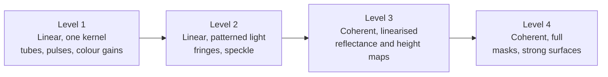

# Filters, gratings and other optical elements

Status: exploration for review. Nothing here is implemented in the simulator.
The numbers come from the analytic model of the design document, from a small
one-dimensional diffraction calculation in
[`diagrams/make_optics_diagrams.py`](diagrams/make_optics_diagrams.py), and
from the published literature. Each is labelled with which. Section 13 lists
what these estimates leave out.

Sections 2 to 8 survey the options in general. Tim has since stated the
target: features of about 100 nm on silicon chips, with a strong preference
for more computation over more hardware, and all processing done offline on
powerful computers with graphics cards. Section 9 works out what that target
takes, and the summary and the ranking in section 10 are written for it.

This page answers one question: what could be added to the scanning lensless
sensor, in the light, in the gap or on the sensor face, to improve the result?
It is written to be read after the [design document](design.md), and section 11
gives the parameters that would carry the recommended options into the
simulator.

## 1. Summary

The design document found that with diffuse light and open pixels, the gap
between sensor and surface sets the resolution: the smallest recoverable
feature period is about 0.75 times the gap, and more samples help only
logarithmically. Every candidate below is judged on whether it changes that
law, and what it costs.

The candidates fall into four families, and the family decides the result more
than the particular element does:

| Family | Examples | Smallest feature period | What the gap does |
|---|---|---|---|
| Nothing added | Open pixels, diffuse light | About 0.75 × gap | Sets the resolution |
| Angle restriction | One tube per pixel, collimator plates, pinholes, shadow masks | About √(wavelength × gap) | Still matters, but as a square root |
| Interference | Collimated single-colour light with phase recovery, fringe or speckle lighting, fine coded masks and diffusers | About one wavelength, 0.5 µm | Almost nothing |
| Near field | Sub-pixel openings, sample in contact | Below a wavelength | Must be far smaller than a wavelength |

### For the stated target: 100 nm features on silicon chips

A silicon chip is smooth, mirror-like and patterned, so it belongs to the
interference family, and tubes drop out (they suit matt surfaces and reach
micrometres). Lines 100 nm wide repeat every 200 nm, which is finer than
"about one wavelength". Section 9 gives the details. The short version:

- **The gap stops being the hard part.** With interference methods a gap of
  about a millimetre is fine. Wavelength and the angles of the light take its
  place as the limit.
- **Resolving 100 nm lines and spaces needs slanted light and a short
  wavelength.** With a 405 nm laser diode and steeply slanted light the limit
  is about 110 to 145 nm lines. Reaching 100 nm needs ultraviolet light of
  about 365 nm or shorter, or water in the gap. Neither has been demonstrated
  with a lensless sensor looking at an opaque surface.
- **The pixels are five times wider than the detail**, and may not be able to
  read it directly. Lighting with pairs of beams from one laser turns fine
  detail into coarse patterns the pixels can read. How the pixels respond to
  fine fringes is the first thing to measure (section 9.3).
- **Much can be measured at 100 nm without resolving it**, and this is where
  computation substitutes for hardware: finding and locating isolated
  features, measuring the line width of regular arrays from colour and
  polarisation, and fitting a known chip layout to the data.
- **The hardware stays simple.** A laser diode or three, switched in pulses,
  and the sensor as sold. Almost all the difficulty moves into
  reconstruction, which matches Tim's preference.

Ranked recommendation for this target, explained in section 10:

1. **Pulsed single-colour laser light, slanted, from several directions and in
   beam pairs, with ptychographic reconstruction** that also solves for the scan positions.
   Start at 405 nm.
2. **Several colours**, separated by the sensor's own colour filter.
3. **Known-structure fitting**: chip layout rules as prior knowledge, and
   measurement of features that are detected but not resolved.
4. **A thin scattering layer on the sensor** (coded ptychography).
5. **Shorter wavelength or water in the gap**, the only steps that truly
   resolve 100 nm lines, and the only ones that need real hardware work.

Not recommended for this target: tubes and collimator arrays, one tube around
the sensor as a way to sharpen the image, sub-pixel openings, near-field gaps,
and Talbot self-imaging as a way to carry the image across the gap.

## 2. What an added element can and cannot do

An element can sit in three places: in the light before it reaches the
surface, in the gap, or on the sensor face. Four physical facts govern what
each can achieve.

**The loss happens in the gap, so the cure has to act before or during the
crossing.** In the design's model a diffuse point on the surface lights the
sensor with a smooth spot about 1.3 times the gap wide. The smoothness is the
problem: a smooth spot has almost no fine structure, so fine detail on the
surface produces almost no signal. An element on the sensor face that only
reshapes the pixel (a smaller opening, a colour filter) acts after the
information is gone. To help, an element must either stop each pixel from
seeing the whole spot, or put fine structure into what each pixel sees.

**Restricting angles replaces the gap with the square root of the gap.** If a
pixel accepts light only from near straight ahead, it sees a small patch
instead of the whole spot. A narrower angle gives a smaller patch, but light
passing through a narrow opening spreads by diffraction, by an angle of about
wavelength divided by opening width. The two effects balance when the patch is
about √(wavelength × gap) across. No arrangement of tubes, pinholes or shadows
that treats each opening separately does better than this, whatever its
details. At a 100 µm gap and green light that is about 7 µm instead of 75 µm.
Close to the surface the benefit vanishes: at a gap of 1 µm both laws give
about 0.7 µm.

**Interference removes the gap from the resolution.** Light waves that keep a
fixed phase relation cross the gap without losing fine detail. The detail is
scrambled into a diffraction pattern rather than attenuated, and it can be
unscrambled by computation. The limit becomes the wavelength and the range of
angles collected. This needs either lighting that is coherent, or an element
that makes the light from each surface point interfere with itself (a fine
mask or diffuser). Published lensless microscopes built this way resolve
225 nm lines [O7] and about 250 nm [O6] using ordinary image sensor chips.

**Below a wavelength only closeness works.** Detail finer than about half a
wavelength does not travel at all. It stays within a fraction of a wavelength
of the surface. Reaching it means a gap of tens of nanometres, as the design
document already concluded.

Putting numbers on the three families, for green light (0.5 µm). The first two
rows are formulas, the third is the range reported in the literature:

| Gap | 3 µm | 10 µm | 30 µm | 100 µm | 500 µm |
|---|---|---|---|---|---|
| Open pixel, diffuse light (0.75 × gap) | 2.3 µm | 7.5 µm | 23 µm | 75 µm | 375 µm |
| Angle restriction (1 to 2 × √(wavelength × gap)) | 1.2 to 2.4 µm | 2.2 to 4.5 µm | 3.9 to 7.7 µm | 7 to 14 µm | 16 to 32 µm |
| Interference methods | 0.5 to 1 µm | 0.5 to 1 µm | 0.5 to 1 µm | 0.5 to 1 µm | 0.5 to 1 µm |

The same comparison as transfer curves at one gap. Reading the chart as in the
design document: a method passes a feature size if its curve is above the
noise floor there.

At a 30 µm gap the open pixel reaches the illustrative floor at a period of
23 µm, a 5.6 µm tube at 2.7 µm, and single-colour collimated light at 0.7 µm
(from the calculation in the diagram script; the last figure assumes a plain
LED with 20 nm bandwidth).

## 3. Angle restriction: tubes and collimators

Tim's suggestion: put the sensor at the bottom of a deep absorbing tube so
that only light travelling nearly straight up reaches it. The idea is sound.
Whether it works depends entirely on whether there is one tube or many.

### 3.1 One tube around the whole sensor

A tube of width `W` and depth `L` limits the light reaching every pixel to
within an angle of about `W / L` of straight ahead. But each pixel looks out
through the whole mouth of the tube, so each pixel sees a patch of surface
about as wide as the tube:

    patch width ≈ W · (1 + z / L)

For a tube that fits around the IMX219 that is at least 3.7 mm. Two pixels at
opposite ends of the sensor see almost the same patch. The angle of the light
has been restricted, but not where it comes from, and the sensor has also been
moved a distance `L` away from the surface. For resolving surface detail with
diffuse light this is worse than no tube.

A single tube is still worth having for two other jobs:

- **Stray light baffle.** It keeps room light and light scattered from outside
  the area of interest off the sensor. Every arrangement in this document
  benefits.
- **Pinhole camera.** If the mouth is closed down to one small hole, the tube
  becomes a pinhole camera that projects a magnified image of a small area
  onto the sensor. The best hole is about √(wavelength × gap) across, the
  resolution is the same square-root law as above, the field of view is tiny
  and almost all the light is lost. It is a possible bench experiment, not an
  instrument.

### 3.2 One tube per pixel or per small group of pixels

With a separate tube of width `w` and depth `L` over each pixel, and the tube
mouth a distance `z` from the surface, ray geometry gives each pixel a patch
that is flat over the tube width and falls to zero over a further `w·z/L` on
each side:

| Quantity | Formula | Notes |
|---|---|---|
| Largest accepted angle | `atan(w / L)` | Measured from straight ahead |
| Patch width at half height | `w · (1 + z / L)` | Tends to the tube width for a deep tube |
| Transfer function | `sinc(w(1 + z/L) f) · sinc((w z / L) f)` | A box convolved with a box |
| Light kept, relative to an open pixel | About `(w / L)² / π` | Diffuse surface, square tube |

Two consequences matter more than the patch width itself:

- **The gap that counts is now from the tube mouth, not from the sensor.** The
  tube plate has a flat face that can be larger than the die and can stand
  proud of the bond wires. It turns the unreachable micrometre gap to the die
  into a reachable gap to a plate.
- **The loss of fine detail changes from exponential to gradual.** A patch
  with definite edges has a transfer function that falls off slowly, like the
  pixel area in the design document. That is the kind of loss that averaging
  thousands of samples can undo, so the huge sample count becomes useful
  again.

Diffraction sets the limits. A tube narrower than about √(wavelength × L)
stops behaving as a tube: light spreads across it faster than the walls can
select it. So the narrowest angle a tube of width `w` can enforce is about
`wavelength / w`, and making it deeper than `w² / wavelength` only loses
light.

| Depth divided by width | Largest accepted angle | Light kept | Signal-to-noise per sample | Narrowest tube that can use this ratio |
|---|---|---|---|---|
| 2 | 27° | 6.9 % | 0.26 | 1 µm |
| 5 | 11° | 1.2 % | 0.11 | 2.5 µm |
| 10 | 5.7° | 0.32 % | 0.056 | 5 µm |
| 30 | 1.9° | 0.035 % | 0.019 | 15 µm |
| 100 | 0.57° | 0.0032 % | 0.0056 | 50 µm |

Light kept is the exact view factor between the two ends of a square tube.
Signal-to-noise assumes photon noise dominates, so it falls as the square root
of the light. The last column is `wavelength × (L / w)` for green light.

The table shows why one tube per native pixel is not the answer for this
sensor. A 1.12 µm tube can be at most about 2.5 µm deep before diffraction
takes over, which gives an acceptance of about 24°. That is roughly what the
existing microlenses already do. The useful design is a tube several
micrometres wide over a group of pixels.

The middle panel comes from the diffraction calculation. For each gap there is
a best tube width, about 1.3 × √(wavelength × gap):

| Gap from tube mouth | Best tube width | Patch giving half the signal | Same measure, open pixel | Tube covers (IMX219 pixels) |
|---|---|---|---|---|
| 10 µm | 3.1 µm | 1.2 µm | 12 µm | 3 × 3 |
| 30 µm | 5.0 µm | 2.0 µm | 35 µm | 4 × 4 |
| 100 µm | 9.3 µm | 3.7 µm | 115 µm | 8 × 8 |

The patch is 10 to 30 times narrower than for an open pixel. In terms of the
smallest period above the noise floor the gain at 30 µm is about 9 times
(23 µm to 2.7 µm). The transfer curve of a tube also has a hard cut-off, at a
period of `wavelength × z / w`, below which nothing passes. A wider tube moves
that cut-off to finer detail but lowers the contrast above it, so the best
width for reconstruction is somewhat wider than the best width for a narrow
patch. Finding it is a job for the simulator.

Since a tube several micrometres wide covers many pixels, the pixels beneath
it can be added together, which recovers some of the lost light: a 5 µm tube
ten times deeper than it is wide delivers, in total, about 6 percent of what
one open pixel would collect. The price is that the sensor then has one
independent channel per tube, not per pixel.

### 3.3 What it costs and how it could be built

- **Light.** 99 to 99.97 percent is lost for depth-to-width ratios of 5 to 30.
  An LED can usually be driven a hundred times harder than a bare sensor
  needs, so this is affordable, but it works against the short light pulses of
  section 4.1.
- **Wall reflections.** Every smooth surface is a good mirror at grazing
  angles, and grazing angles are exactly what a tube wall sees. Smooth walls
  turn the tube into a light pipe and the angular selection is lost. The walls
  have to be rough and black, or the tube has to be built as a stack of thin
  plates with holes, so that there are no continuous walls.
- **Fabrication.** Nothing of this kind can be built onto a Raspberry Pi
  sensor at home. A separately made plate laid on the sensor face is the
  realistic route. The plate does not need to be aligned to the pixels,
  because the bore of each tube defines the patch and the pixels under it only
  collect the light.

Forms reported in the literature or available as parts:

| Form | Reported or typical figures | Suitability here |
|---|---|---|
| Gratings built into the chip's metal layers over each pixel | Acceptance ±18°, built to sharpen contact images of tissue [O9, O10] | Shows the principle works. Needs a custom chip. |
| Etched silicon collimator arrays | Used to pick out unscattered light through tissue [O11] | Right scale. Custom fabrication. |
| Stacked hole plates and lithographic collimators | "Stack of pinholes" in black plastic [O12]; 300 µm thick collimator made by X-ray lithography [O13] | Buildable at tens of micrometres. A good first experiment. |
| Glass capillary plates | Pores of a few micrometres, depth 40 or more times the width (catalogue values, to be checked) | Right dimensions. Walls reflect at grazing angles unless blackened. |
| Fibre-optic plates | See section 6.1 | Carry the image, but ordinary plates accept all angles. |
| Louvre (privacy) film | Slats tens of micrometres apart, restricts one direction only | Too coarse, and one-directional. Not recommended. |
| The sensor's own microlenses | Present if only the module lens is removed | Free, modest: comparable to a tube twice as deep as it is wide. |

### 3.4 In the simulator

The tube replaces the gap and pixel terms of the design's blur kernel with the
tube footprint. Everything else in the linear model, including the fast
solver, is unchanged, and the signal level is scaled by the light kept. In the
first stages the footprint is the box-convolved-with-box formula above. The
wave-optics stage replaces it with a computed footprint and decides the best
tube width.

## 4. Elements in the light

### 4.1 Pulsed and coded light

The design document found that a fast scan smears the image: at 20 percent of
the sensor length per second and 10 frames per second the sensor moves 65.6
pixels per frame, and a sharp image needs an exposure of about 0.4 ms. A light
pulse of that length does the same job as a short exposure, and an LED can be
switched far faster than that from a Raspberry Pi output pin.

A step further is a coded pulse train: switch the light on and off in a known
irregular pattern during each frame. A single long exposure erases some
feature sizes completely, while a well-chosen code keeps all of them, so the
smear can be undone by computation [O30]. This collects half the light instead
of a fraction of a percent.

| | |
|---|---|
| Improves | Scan speed without motion blur. Does not change the gap limit. |
| Cost | A single short pulse collects little light. A code collects half but adds noise when undone; when photon noise dominates, the net gain over a single pulse is modest [O31]. |
| Reconstruction | Unchanged for a single pulse. A code changes the motion term of the blur kernel, nothing else. |
| On a Raspberry Pi sensor | Practical. With a rolling shutter each row sees the code with a different, known delay. |
| In the simulator | The motion term becomes an arbitrary exposure pattern instead of a box. |

### 4.2 Collimated single-colour light

Light a smooth surface with a parallel beam of one colour and the reflected
light crosses the gap as a wave that keeps its fine detail. What the sensor
records is a diffraction pattern (an in-line hologram), and reconstruction
means undoing the diffraction. This is how nearly all published lensless
microscopes work [O1, O2, O3], with the sample typically a fraction of a
millimetre from the sensor.

For a surface that changes the light only slightly, which is the case for
nanometre height steps and faint marks on a smooth surface, the recorded
intensity is linear in both reflectance and height:

$$
\frac{I(\mathbf{f})}{I_0} = \delta(\mathbf{f}) + 2\,\hat a(\mathbf{f}) \cos(\pi \lambda z_0 |\mathbf{f}|^2) + 2\,\hat\varphi(\mathbf{f}) \sin(\pi \lambda z_0 |\mathbf{f}|^2),
\qquad \varphi = \frac{4\pi h}{\lambda}
$$

where $a$ is the fractional change in reflected amplitude, $h$ is the height
and $\varphi$ is the phase it produces in reflection at normal incidence
(standard result of Fresnel propagation [O35]; see also [O33]). Two things
follow.

- **The model stays linear.** This is the design's `m = D S K ρ` with two
  unknown maps, reflectance and height, each with its own kernel. The fast
  solver still applies.
- **Height is measured directly.** One nanometre of height changes the signal
  by up to 5 percent (section 8).

The curves oscillate, and each has feature sizes at which it passes nothing
(the thin green curve in the chart of section 2). The zeros depend on
wavelength × gap, so data at two or three gaps [O5] or two or three colours
[O8] fill them in. Large, slowly varying height is passed weakly at any gap or
colour, which is a known weakness of these methods [O22].

Requirements, from the envelope of the formula:

| Requirement | Rule | Example: 1 µm features at a 100 µm gap |
|---|---|---|
| Small light source (spatial coherence) | Source angular size × gap well below the feature size | Under 5 milliradians: a 0.1 mm hole 20 mm or more away |
| Narrow colour band (temporal coherence) | Bandwidth below about 0.4 × period² / gap | About 4 nm: a filtered LED or a laser diode |
| Weak surface for the linear form | Height range well below a wavelength, smooth surface | Otherwise the non-linear methods of section 5.2 |

| | |
|---|---|
| Improves | Lateral resolution to about a wavelength at any gap, and adds nanometre height. Published: 225 nm lines [O7], about 250 nm with scanned light angle [O6], both through a transparent sample. In reflection, 2 µm or better with a beam splitter [O4]. |
| Cost | Little light is lost. Needs a smooth surface, a small bright source, and control of stray reflections between sensor and surface. A rough surface gives speckle and needs the non-linear methods. |
| Reconstruction | Linear for weak surfaces. Iterative phase recovery otherwise. |
| On a Raspberry Pi sensor | Practical: an LED or laser diode and a pinhole. The pixels accept a limited range of angles, which caps the finest detail [O6]. |
| In the simulator | A coherent forward model: multiply the light by the surface's complex reflectance, propagate across the gap, take the intensity. This is the wave-optics stage already planned in the design. |

### 4.3 Fringe and speckle lighting

Fine detail survives the gap if it is first multiplied by a known fine pattern
of light. The product contains coarse beat patterns that do cross the gap.
This is the principle of structured-illumination microscopy [O14].

Two beams of the same colour crossing at an angle make straight fringes with a
period down to half a wavelength, and the fringes stand as vertical sheets, so
they stay sharp at any gap. The scanning design then offers something useful.
If the fringes are fixed to the sensor, the surface slides through them, and
every pixel records the fine detail directly as a time series. No stepping of
the pattern is needed, because the scan does it.

In this one-dimensional calculation, bars of 3 µm period seen across a 30 µm
gap leave a ripple of 0.1 percent with uniform light (and that is the edge of
the bar patch, not the bars). With 3 µm fringes travelling with the sensor the
ripple is 29 percent, against 50 percent for the bars themselves. The idea of
fixing the fringes to the sensor is derived here from the model, not taken
from a publication, and needs confirming in the simulator.

The limit is that one fringe period opens only one narrow window of feature
sizes (the orange curve in the chart of section 2). Covering all sizes needs
many fringe periods and directions, or a pattern that contains all of them at
once: laser speckle. Speckle lighting with unknown patterns has been shown to
work [O15, O24], at the price that each feature size then gets only a small
share of the contrast, roughly the speckle grain size divided by the gap.

| | |
|---|---|
| Improves | Lateral resolution down to the pattern period, half a wavelength at best, independent of the gap. Slanted fringes also encode height (section 8). |
| Cost | Half the light at most. Needs two stable coherent beams reaching the surface, and the pattern must be known or estimated. Reflections between sensor and surface distort it. |
| Reconstruction | Still linear in reflectance, but the blur is no longer the same for every pixel. For fringes it becomes a sum of a few convolutions; for speckle the pattern has to be calibrated or solved for. |
| On a Raspberry Pi sensor | Possible on a bench with a laser diode and a beam splitter. Mechanically delicate. |
| In the simulator | Multiply the surface by a light pattern expressed in sensor coordinates before blurring. |

### 4.4 Several light angles

- **For slope and height, with diffuse light.** Lighting the surface from
  three or more directions in turn gives the local slope from the change in
  brightness (photometric stereo [O27]). Cheap, and it suits a rough surface.
  It measures slope, so height comes by integration and slow errors build up.
- **For resolution, with coherent light.** Each light angle shifts which
  detail falls within the pixels' acceptance. Combining many angles gave the
  250 nm result quoted above [O6], and the same idea with a lens is Fourier
  ptychography [O25]. Small angle changes only shift the pattern sideways,
  which the scan already provides for free [O32, O34].

In the simulator: the direction of the light is a parameter of the coherent
model, and a list of directions for the shading model.

### 4.5 Several colours

Changing the colour changes the diffraction pattern without moving anything.
It has been used on its own to recover detail finer than the pixel [O8], and
it fills the gaps in the transfer curves of section 4.2. For height it removes
the ambiguity of interference, which otherwise repeats every half wavelength:
two colours together behave like one much longer wavelength [O28]. With red,
green and blue lights on together, the sensor's own colour filter separates
three colours in one frame (section 5.3).

### 4.6 Gratings and Talbot self-imaging

A grating lit by a parallel single-colour beam reproduces its own pattern at
regular distances behind it, the Talbot distance `2 × period² / wavelength`
and its multiples [O17]. Three possible uses, with different verdicts:

| Use | Verdict |
|---|---|
| Carry the image of the surface across the gap | Does not work. Only a periodic pattern images itself. An arbitrary surface does not. |
| Project a fine pattern onto the surface from a distance | Works. A grating or hole array a Talbot distance away throws fringes or an array of light spots onto the surface with no lens. Scanning the sample through such a spot array has been used for wide-field microscopy, with resolution set by the spot size [O18]. The same effect prints patterns of a few hundred nanometres in lithography [O19]. It is a way to make the patterns of section 4.3. |
| Make a pixel sensitive to angle | Works, but needs a custom chip. Two gratings stacked over a pixel give it a response that depends on the direction of the light [O16]. This is an angle restriction that does not throw light away. It is subject to the same square-root law. |

## 5. Elements on the sensor face

### 5.1 Sub-pixel openings

An opaque layer with one small opening per pixel makes the effective pixel as
small as the opening. This is the optofluidic microscope cited in the design
document. It only helps when the pixel area is what limits resolution, which
requires a gap smaller than the pixel. At any gap the first hardware can reach,
the gap or the tube dominates and a smaller opening only loses light, in
proportion to its area and faster once it is smaller than a wavelength. It
becomes relevant for a later instrument with a sub-micrometre gap. In the
simulator it is the pixel width `a` that already exists, set smaller than the
pitch.

A related published result is useful as a check on the design's central
finding: with cells growing directly on the sensor face, and the light swept in
angle to get sub-pixel shifts, 660 nm resolution was reached [O36]. That is sub-pixel resolution with plain light, obtained exactly
where the design says it should be possible: at a gap below the pixel size.

### 5.2 Coded masks and thin diffusers

A mask or diffuser with fine random structure, fixed to the sensor, makes the
light from each surface point interfere with itself, so each point produces a
detailed pattern on the sensor instead of a smooth spot. That puts back the
fine structure the gap removes.

- **With diffuse light.** A fine mask a few hundred micrometres above the
  sensor, with a reconstruction algorithm, gave micrometre resolution for
  glowing samples [O21], and the same principle makes lensless cameras
  [O20, O37, O38]. The cost is that every pixel sees many surface points at
  once, so a densely detailed surface gives a low-contrast signal.
- **With coherent light.** This is where the closest match to this project
  is found. In coded ptychography the sample is translated across a sensor
  that carries a thin scattering layer, and the surface is recovered from the
  sequence of frames. Reported results: 0.78 µm with a low-cost stage whose
  positions were recovered from the data instead of being trusted [O23]; and
  lines 308 nm wide resolved, with 240 mm² imaged in 15 seconds [O22]. Both
  used transparent samples.

Three features of that work match Tim's concept directly: the sample moves
steadily past the sensor, positions are estimated from the data, and
continuous motion during the exposure can be modelled instead of avoided
[O26]. Position refinement is standard practice in this field [O34].

| | |
|---|---|
| Improves | Resolution to about a wavelength at any gap, plus height. Makes the inverse problem better conditioned, because every frame is a different encoding of the same surface. |
| Cost | A calibrated mask. Reconstruction is non-linear and iterative, and every iteration revisits all the frames, unlike the design's solver that reads the data once. |
| On a Raspberry Pi sensor | The published layer combined etched scatterers with printed absorbers [O22]. A thin diffusing film laid on the sensor is a plausible home-built version, untested. |
| In the simulator | A complex mask applied to the wave at the sensor plane in the coherent model. |

### 5.3 The colour filter that is already there

If only the module lens is removed, the Bayer filter and microlenses stay. The
design document covers what this does to the pixel response. For this
exploration:

- **With one colour of light** the filter is a fixed pattern of sensitive and
  less sensitive pixels. A quarter or half of the pixels do most of the work.
  Because resolution depends only weakly on sample count, losing half or
  three quarters of the samples costs very little. Leakage between colours
  needs calibrating.
- **With red, green and blue light on together** the filter gives three
  colours in every frame at no extra cost. This has been done for lensless
  holography, including correcting the leakage between channels [O29]. It
  serves sections 4.5 and 8.
- **The microlenses** restrict the acceptance angle modestly, which helps in
  diffuse light and limits the finest detail in coherent light [O6].

In the simulator: a per-pixel spectral response, three numbers per pixel type.

## 6. Elements in the gap

### 6.1 Fibre-optic plates

A fibre-optic plate is a block of fused glass fibres that carries an image
from one face to the other. Bonded to a sensor, its outer face becomes the
effective sensor face. It has been used this way for lensless fluorescence
imaging [O39]. Like the tube plate it solves the mechanical problem (a flat
face clear of the bond wires) but not the optical one: the gap from plate to
surface still sets the resolution, and ordinary plates accept all angles. The
fibres are several micrometres across, which is then the effective pixel. A
plate with absorbing material between fibres and a small acceptance angle
would be a ready-made collimator array. Whether such a plate exists with
suitable dimensions needs checking against manufacturers' data.

### 6.2 A reference flat

A partly reflecting flat plate just above the surface reflects some of the
light. That reflection and the one from the surface interfere, and the
brightness then depends on the distance between plate and surface, cycling
once per half wavelength. This turns height into brightness with nanometre
sensitivity. The sensor face itself can act as the plate if the gap is small,
which is option 3 of the design's section 4.5. It needs light of narrow enough
band that the two reflections can still interfere: twice the distance must be
well within wavelength² / bandwidth, which is about 12 µm for a plain LED.

### 6.3 Liquid in the gap

Filling the gap with oil or water shortens the wavelength by the liquid's
refractive index, 1.3 to 1.5, improves every wave-limited figure by the same
factor, and suppresses reflections. It is cheap and messy, and it rules out
samples that must stay dry.

### 6.4 Near-field lenses

Layers of metal and insulator have been shown to carry detail finer than a
wavelength across a short distance [O40]. These are research devices with high
losses that need the object in contact. They do not relax the gap requirement
and are not recommended. A scanning tip [O41] is a different instrument
entirely.

## 7. Polarisers and spectral filters

Neither changes the gap law. Both improve the quality of the signal that the
other methods work with.

| Element | What it does | Verdict |
|---|---|---|
| Crossed polarisers (one on the light, one on the sensor) | Remove mirror-like glare and keep light scattered within the surface [O42] | Useful with diffuse methods on glossy samples. The film is about 0.1 mm thick, so it only fits arrangements that tolerate that gap. |
| Parallel polarisers | Keep the mirror-like reflection, which carries the surface detail and stays coherent | Useful with coherent methods. |
| A thin birefringent plate between two polarisers | Converts height gradients into brightness, as in differential interference contrast. Demonstrated lensless [O43] | An alternative route to height. Adds a plate to the gap. |
| Narrow-band filter on the light | Lengthens the distance over which reflections can interfere | Required by sections 4.2 and 6.2 unless a laser diode is used. Costs light in proportion to the band removed. |
| Angle-selective coatings | Layered coatings can pass light from a narrow range of angles only [O44] | A laboratory result. A tube array is the practical equivalent. |

In the simulator: polarisers change the ratio of mirror-like to scattered
reflection, a property of the surface model; the filter sets the bandwidth of
the light.

## 8. Height

The design document lists three ways height can reach a pixel. With the
elements above there are six. The chart compares how much signal one nanometre
of height produces. The values are order-of-magnitude estimates from simple
formulas, given in the diagram script.

| Mechanism | Needs | Signal per nanometre | Limits |
|---|---|---|---|
| Collimated coherent light, phase contrast (4.2) | Smooth surface, small single-colour source | Up to 5 % | Large slow height changes are passed weakly. Repeats every half wavelength unless two colours are used. |
| Interference against a reference flat or the sensor face (6.2) | Narrow-band light, a flat close to the surface | About 1 % | Gap drift looks like height. |
| Thin transparent film on a reflecting base | LEDs of a few colours. No coherence needed, because the film is its own interferometer | Of the order of 0.5 % | Only for that kind of sample. Used to measure molecular layers building up on a surface [O45]. Fits the plain reflectance model exactly. |
| Slanted fringes (4.3) | Two-beam fringes arriving at an angle, so height shifts them sideways [O46] | About 0.3 % | Fringe stability. |
| Shading from several light angles (4.4) | Diffuse light from known directions | About 0.1 %, for micrometre-wide features | Gives slope. Needs room for slanted light. |
| Blur width (design option 1) | Two passes at different gaps | 0.03 % at a 3 µm gap | Far too weak at practical gaps. |

All the interference mechanisms put a nanometre of height above the noise of a
single sample or close to it, and far above the noise after averaging. Blur
width does not. This supports the design document's remark that interference
may be the realistic route to "nanometre features" with this hardware, and
suggests replacing build stage 5 (blur-width height) with one of the
interference mechanisms.

## 9. The target: 100 nm features on silicon chips

Tim's target is features of about 100 nm on silicon chips. This section takes
"100 nm features" to mean lines about 100 nm wide. Dense lines and spaces of
that width repeat every 200 nm. An isolated 100 nm line or dot is a different
and easier problem (section 9.5).

### 9.1 What changes

- **The surface is smooth and mirror-like.** That selects the interference
  family of section 2. The reflected light keeps its phase, so the detail
  crosses the gap intact and is recovered by computation.
- **The gap is no longer the hard part.** A gap of about a millimetre is
  acceptable, and is in fact needed to let slanted light in (arrangement B of
  section 12). The limit that replaces it is the wavelength.
- **The limit is below what sections 2 to 8 assumed.** "About one wavelength"
  is 500 nm of period. The target is 200 nm.

### 9.2 The limit: wavelength and angles

For coherent light, the finest period that can be recovered is

    period = wavelength / (NA of the light + NA collected)

where each NA is the sine of an angle from straight ahead: the slant of the
light arriving, and the widest angle at which the sensor still collects the
light the surface sends back. The line width is half the period. Slanting the
light is what synthetic-aperture and ptychographic methods exploit [O6, O25]:
light arriving at a steep angle shifts fine detail to angles the sensor can
collect.

| Light | Straight down, sensor collects ±30° | Slanted 65°, sensor collects ±30° | Slanted 72°, bare sensor collects ±58° | As previous, water in the gap |
|---|---|---|---|---|
| 520 nm, green | 520 nm | 186 nm | 144 nm | 108 nm |
| 405 nm, laser diode | 405 nm | 145 nm | 113 nm | 84 nm |
| 365 nm, ultraviolet LED | 365 nm | 130 nm | 101 nm | 76 nm |
| 266 nm, deep ultraviolet | 266 nm | 95 nm | 74 nm | 55 nm |

The entries are smallest line widths from the formula. The collection angles
are assumptions: ±30° is a guess for a pixel with its microlens in place, and
±58° for a bare die. The real angular response of the sensor has to be
measured, and published work found it a real limitation [O6, O22].

Reading the table for the target:

- **Visible light as the sensor is sold reaches about 110 to 150 nm lines**,
  with a 405 nm laser diode and steeply slanted light. That is close to the
  target but not at it.
- **100 nm lines and spaces need about 365 nm or shorter**, or water in the
  gap, together with steep light and a wide collection angle.

For comparison, the published benchmark for this kind of imaging on opaque
samples is a microscope with a lens: 80 nm lines resolved in reflection by
Fourier ptychography with a 193 nm laser [O47]. The lensless results quoted
earlier (225 nm lines [O7], 250 nm [O6], 308 nm [O22]) were all through
transparent samples. The only lensless result in reflection found is 2 µm
[O4]. Reaching even 150 nm lines on an opaque chip without a lens would be new.

### 9.3 What the pixels can actually see

The formula above says which detail reaches the sensor as light. It does not
say the pixels can read it, and for this sensor that is a separate limit. The
design document raises the same point in its section 4.6.

When the light scattered by fine detail meets the plain mirror reflection at
the sensor, the two interfere and form fringes with the same period as the
detail itself: about 200 nm for the target. A 1.12 µm pixel covers more than
five such fringes and averages them. What survives depends on how sharp the
edges of the pixel's sensitive area are:

| Pixel edges | Contrast left in 200 nm fringes |
|---|---|
| Perfectly sharp | About 6 % (fringe period divided by π times the pixel width) |
| Soft over 100 nm or more | Essentially none |

The edge sharpness of the IMX219 is unknown. So the collection angles assumed
in section 9.2 describe which directions of light the pixel responds to at
all. They do not mean the pixel can read fringes that fine: ±58° corresponds
to fringes down to about 240 nm at 405 nm, which is exactly the regime where
the pixel may see nothing.

Fine detail can still reach coarse pixels, in three ways. The first two do not
depend on the pixel edges.

1. **Two mutually coherent beams at once.** If the chip is lit by two slanted
   beams from the same laser, they form light fringes on the chip (section
   4.3). Fine detail then beats against those fringes and appears at the
   sensor as a coarse pattern. Example: 405 nm beams from opposite sides at
   72° make fringes of 213 nm period, and chip detail of 200 nm period beats
   against them with a period of about 3 µm, which the pixels read at nearly
   full contrast. This is the standard remedy when the detector is coarser
   than the detail [O14]. It needs both beams on together. Lighting from one
   direction at a time does not do it.
2. **Where the scattered light lands.** Across a gap of about a millimetre,
   light scattered at different angles lands on different pixels, hundreds of
   micrometres apart. The brightness map of that scattered light carries the
   fine detail without any fine fringes. Conventional ptychography works this
   way: its detector pixels are far coarser than the detail recovered [O57].
   Whether this is well enough conditioned at a millimetre gap with wide-area
   lighting is not known, and is a question for the simulator.
3. **Sharp pixel edges.** If the edges turn out sharp, the 6 % that survives
   is recoverable by averaging, as the design document describes for
   sub-pixel detail in general.

Consequences for this page:

- The line widths in section 9.2 remain the limit set by wavelength and
  angle, but reaching them relies on mechanisms 1 or 2, not on the pixels
  reading 200 nm fringes directly.
- Lighting with pairs of beams from one laser becomes part of the first
  recommendation, not an alternative to it. The added hardware is small: a
  mirror beside the chip turns one beam into two.
- **One measurement should come before any other hardware work:** the
  response of the pixels to fine fringes. Two beams from a laser diode
  crossing directly on the sensor make fringes of any chosen period, and the
  contrast recorded against period gives the edge sharpness. The same
  two-beam arrangement is the lighting for mechanism 1, so nothing is wasted.

### 9.4 The routes to finer detail

| Route | What it gains | Hardware it adds | Computation it adds | With a Raspberry Pi class sensor |
|---|---|---|---|---|
| Slanted light from several directions, ptychographic reconstruction | Line width from about 400 nm down to 110 to 145 nm at 405 nm | A few laser diodes at fixed angles around the sensor | Very large: iterative phase recovery over every frame, with scan positions as unknowns | Realistic. The blue pixels respond well at 405 nm. Undemonstrated in reflection. |
| Near ultraviolet, 365 to 385 nm | A further 10 percent | An ultraviolet LED or laser diode | None extra | Uncertain. The colour filter and microlenses may absorb ultraviolet. A ten-minute test with an ultraviolet LED on an unmodified sensor would settle it. |
| Deep ultraviolet, 250 to 280 nm | A further 30 to 35 percent: 75 to 95 nm lines | Costly weak sources, eye and skin protection, and a sensor with the filter stripped or a special coating | None extra | Not realistic at first. Ordinary sensors respond poorly below 300 nm (general knowledge, not checked for this sensor). |
| Water or oil in the gap | A factor of 1.33 to 1.5: about 84 nm lines at 405 nm | A drop of liquid, and a sensor and chip that tolerate it | Small | Possible but messy. Light must enter through the liquid. |
| Near-field gap | In principle unlimited | A gap below about 100 nm held over millimetres, and openings of about 100 nm on every pixel | None | Not realistic. For 200 nm periods the detail fades to a third within about 35 nm of the surface. Finished chips also carry protective layers thicker than that. |

The wavelengths that chip factories themselves use for this job show where
the comfortable limits are: 193 nm lasers [O47], extreme ultraviolet at
13.5 nm [O48, O49] and X-rays [O50], all with ptychographic reconstruction.
The method is the same as proposed here. Only the wavelength differs.

### 9.5 Measuring 100 nm features without resolving them

A feature does not have to be resolved to be found, counted or measured. This
is where computation can stand in for hardware, and several published results
are directly relevant.

| What is wanted | How | Evidence | Hardware | Computation |
|---|---|---|---|---|
| Find and locate isolated features: a single line, a particle, a defect | The feature scatters light that interferes with the mirror reflection of the silicon around it. Its position is found to a small fraction of the resolution, and its size from the strength of the signal. | Particles of 70 to 200 nm detected and sized with a wide-field common-path interferometer [O51]; nanoparticles detected with a lensless sensor, helped by liquid nanolenses [O52]; defects 20 nm wide found in patterned wafers with visible laser light [O53] | None beyond route 1 | Moderate |
| Measure the average line width or height of a regular array | An array finer than the resolution looks like a uniform film whose brightness depends on colour, polarisation and angle. A model of the array is fitted to those readings. This is how chip factories measure line widths (scatterometry) [O54, O55]. | Standard factory practice [O54] | Three colours and a polariser | Large: an electromagnetic solver inside a fitting loop. This is the Meep level of the simulation chain. |
| Check a chip against a known or assumed layout | Chip patterns obey strict rules: straight edges in two directions, a few materials, fixed pitches. The unknowns are then edge positions and widths, far fewer than free pixels, and they can be estimated below the resolution limit. With a layout file, the expected data can be simulated and compared directly. | Model-based measurement well below the resolution limit is established in optical metrology [O55, O56] | None | Very large |

The limit on the third row must be stated plainly. Prior knowledge lets
computation measure the parameters of a structure of a known kind. It does not
reveal arbitrary unknown structure below the limit of section 9.2, and if the
assumed kind of structure is wrong the answer will be wrong but look
confident. The reconstruction should report how much of each result comes from
the data and how much from the assumption.

### 9.6 What is realistic

| Goal | Verdict with a Raspberry Pi class sensor |
|---|---|
| Detect and locate isolated 100 nm features | Realistic. |
| Measure height and film thickness to nanometres at micrometre lateral scale | Realistic (section 8). |
| Measure the average line width of regular 100 nm arrays | Plausible. Needs the electromagnetic model. |
| Compare a chip against a known layout at 100 nm | Plausible. A research problem in computation, with little hardware. |
| Image unknown structure with 150 to 200 nm lines | Plausible with 405 nm slanted light. Would be a new result for lensless reflection. |
| Image unknown 100 nm lines and spaces | At the edge. Needs ultraviolet or liquid as well, and probably a stripped sensor. |
| Image unknown structure well below 100 nm | Not with light this sensor can detect. This is the territory of extreme ultraviolet, X-ray and electron instruments [O48, O50]. |

Three practical points apply to all of these:

- **Positions must be known to a few tens of nanometres.** No affordable
  stage provides that, and none is needed: ptychography recovers positions
  from the data [O23, O34]. This is the same use of natural misalignment that
  the design document already plans, at a finer scale.
- **Vibration during one exposure cannot be computed away.** It washes out the
  interference pattern. Short pulses solve it, and laser diodes pulse easily.
- **Both the chip and the sensor are mirrors.** Light bounces between them and
  adds its own interference. It has to be modelled, or avoided by tilting the
  sensor slightly.

## 10. Ranked recommendation

Comparison of all candidates. Gains are relative to open pixels in diffuse
light at a 30 µm gap, which is a plausible first-hardware gap once a plate or
spacer is involved.

| Candidate | Attacks | Resolution gain | Light kept | Hardware | Reconstruction | Raspberry Pi sensor |
|---|---|---|---|---|---|---|
| Pulsed or coded light | Motion blur | None; scan can be 100 times faster | 0.1 to 50 % | Trivial | Unchanged | Yes |
| Tube per pixel group | Gap | About 10 times | 0.03 to 1 % | Collimator plate | Unchanged | Yes, with a bought or made plate |
| One tube around the sensor | Stray light | None | Nearly all | Trivial | Unchanged | Yes |
| Collimated single-colour light | Gap, height | 20 to 40 times, plus height | Nearly all | LED or laser, pinhole | Linear if surface is weak, else iterative | Yes |
| Fringe or speckle lighting | Gap, height | Up to 40 times | Half | Two-beam optics | Linear, larger | Bench only |
| Coded mask or diffuser | Gap, conditioning, height | 20 to 40 times | Most | Calibrated layer on sensor | Iterative, heavy | Plausible |
| Several colours with the Bayer filter | Conditioning, height ambiguity | Supports the above | Most | Three LEDs | Small addition | Yes |
| Several light angles | Height (slope) | None in diffuse light | All | Several LEDs | Small addition | Yes |
| Sub-pixel openings | Pixel area | None until the gap is below a pixel | 1 to 25 % | Lithography on the die | Unchanged | No |
| Fibre-optic plate | Mechanics | None by itself | Most | Bonded plate | Unchanged | Yes |
| Polarisers, filters, liquid | Contrast, coherence | Up to 1.5 times (liquid) | 10 to 50 % | Trivial | Unchanged | Yes |

That table is the general comparison. For Tim's target and preferences the
ranking below replaces the general one. The preferences, as stated: features of
about 100 nm on silicon chips; significantly more computation in preference to
more hardware; all processing offline on powerful computers with graphics
cards. Computation is therefore treated as nearly free, and hardware as
expensive.

| Rank | Option | Hardware added | Computation added | What it delivers for 100 nm features |
|---|---|---|---|---|
| 1 | Pulsed, slanted, single-colour laser light from several directions, in pairs of beams from one laser, with ptychographic reconstruction that also solves for positions (sections 4.1 to 4.4, 9.3, 9.4) | Small: a few laser diodes, a mirror or beam splitter to make beam pairs, and a pulse driver. Sensor as sold, gap about 1 mm. | Very large | Images down to about 110 to 145 nm lines at 405 nm. Height to nanometres. Everything below builds on it. |
| 2 | Several colours through the Bayer filter (sections 4.5, 5.3) | Trivial: two more diodes | Moderate | Removes ambiguities in phase and height. Supplies the colour data that rank 3 needs. |
| 3 | Known-structure fitting and measurement without resolving (section 9.5) | None, or one polariser | Very large, including an electromagnetic solver | Locates isolated 100 nm features, measures line widths of regular arrays, checks against a layout. The main way to reach 100 nm with visible light. |
| 4 | Thin scattering layer on the sensor, coded ptychography (section 5.2) | One passive layer, calibrated once | Very large | Better-conditioned reconstruction, slow height changes recovered, positions recovered more robustly. Does not change the wavelength limit. |
| 5 | Near ultraviolet, then liquid in the gap, then deep ultraviolet (section 9.4) | Growing: ultraviolet sources, possibly a stripped sensor, liquid handling | None extra | The only steps that truly resolve 100 nm lines and spaces. Take them only if ranks 1 to 4 fall short. |

Adopt regardless: one tube around the whole assembly as a stray light baffle.

Dropped for this target, with reasons:

- **Tubes and collimator arrays.** They sharpen diffuse light from matt
  surfaces and reach a few micrometres. A silicon chip is a mirror, and the
  target is 20 times finer.
- **Fringe lighting as a separate option.** It is now part of rank 1.
  Section 9.3 shows that beam pairs are what let coarse pixels read fine
  detail.
- **Sub-pixel openings and near-field gaps.** Hardware-heavy, and section 9.4
  shows the gap needed is not buildable over a chip.

Why this order. Rank 1 is the foundation: it is nearly the cheapest hardware on the
whole list and it converts the problem into computation, which is what Tim
asked for. Ranks 2 and 3 add almost no hardware and are where a large
computing budget buys the most, because they bring in information (colour,
polarisation, layout rules) that the wavelength limit does not restrict.
Rank 4 costs one passive part and makes the computation more reliable. Rank 5
is last because it is the only one that spends on hardware, even though it is
the only one that moves the physical limit.

Order of work in the simulator. The wave-optics forward model moves to the
front of the build plan, since every ranked option depends on it. For 100 nm
features on silicon the surface cannot be treated as a flat sheet that merely
dims and delays the light: the features are smaller than the wavelength and
have depth, so the light's interaction with the surface needs the
electromagnetic solver level of the simulation chain. A sensible sequence is:
scalar wave model with slanted light and ptychographic reconstruction on
synthetic layouts; then the electromagnetic solver to generate the surface
response; then known-structure fitting. Pulsed light and the tube kernel
remain cheap additions to the linear model for anyone studying matt surfaces.

## 11. Parameters for the simulator

Proposed additions to the design's configuration, so the recommended options
become settings and not separate programs. Names are suggestions.

| Group | Parameter | Meaning | Used by | Model level |
|---|---|---|---|---|
| Acceptance | `tube_width_nm`, `tube_depth_nm` | Bore and depth of the collimator; zero depth means open pixels | 3 | 1 |
| Acceptance | `tube_pitch_nm` | Spacing of tubes, which sets the open fraction and how many pixels share a tube | 3 | 1 |
| Acceptance | `wall_reflectance` | Light surviving a wall bounce; zero is a perfect absorber | 3 | Ray tracer |
| Acceptance | `mouth_gap_nm` | Distance from tube mouth to surface. Replaces the gap in the blur kernel when tubes are present | 3 | 1 |
| Light | `pulse_pattern` | On and off times within a frame; one entry is a simple pulse | 4.1 | 1 |
| Light | `wavelengths_nm`, `bandwidth_nm` | Colours present and their spectral width | 4.2, 4.5 | 3 |
| Light | `source_angle_mrad` | Angular size of the source | 4.2 | 3 |
| Light | `directions` | Arrival directions of the light, one or several | 4.2, 4.4 | 1 (shading), 3 |
| Light | `pattern` | Intensity pattern in sensor coordinates: uniform, fringes (period, direction, slant) or a speckle map | 4.3 | 2 |
| Sensor | `pixel_spectral_response` | Response of each Bayer pixel type to each colour, including leakage | 5.3 | 1 |
| Sensor | `mask` | Complex transmission of a layer at the sensor plane, and its height above the pixels | 5.2 | 4 |
| Gap | `reference_reflectance` | Reflectance of a reference flat or of the sensor face | 6.2 | 3 |
| Gap | `refractive_index` | Of the medium in the gap | 6.3 | 3 |
| Light | `pulse_length_s` | Length of each light pulse, for vibration and motion blur | 9.6 | 3 |
| Sensor | `pixel_angular_response` | Response of a pixel against arrival angle, measured or assumed | 9.2 | 3 |
| Sensor | `pixel_fringe_response` | Contrast a pixel records against fringe period. Follows from the pixel width and edge softness of the design document, and is to be measured | 9.3 | 1, 3 |
| Light | `beam_pairs` | Pairs of directions lit at once by mutually coherent beams | 9.3 | 3 |
| Surface | `layout_prior` | Rules or a layout file describing allowed structure: edge directions, materials, pitches | 9.5 | Reconstruction |
| Surface | `surface_model` | Thin sheet (reflectance and height maps) or full three-dimensional structure solved electromagnetically | 9, 10 | 3, 4, solver |
| Surface | `specular_fraction` | Share of mirror-like reflection, which polarisers select or reject | 7 | 1 |

Model levels, in increasing cost. Each is a forward model behind the single
interface the design already plans:

| Level | Forward model | Reconstruction | Elements covered |
|---|---|---|---|
| 1 | The design's `m = D S K ρ` with a different kernel `K` | Unchanged | Tubes, pulses and codes, sub-pixel openings, colour gains, polariser contrast |
| 2 | Surface multiplied by a light pattern in sensor coordinates, then blurred | Linear least squares; the blur differs between pixels, so the single fast convolution becomes a sum of a few | Fringes, speckle, fine masks in diffuse light |
| 3 | Two unknown maps, reflectance and height, each with its own kernel per gap and colour | Linear least squares over both maps | Collimated light on weak surfaces, reference flat, several colours |
| 4 | Complex wave: surface, propagation, mask, intensity | Iterative phase recovery | Coded masks, rough or strongly stepped surfaces |

Level 1 additions also belong in the analytic model (`ccdsr/resolution.py`)
and the trade-off explorer: tube width and depth as two more controls, with
the light lost feeding the signal-to-noise control.

## 12. Getting light in, and the questions that decide the choice

With an opaque surface and a sensor covering it, the light has few ways in.
The choice of method and the choice of lighting constrain each other.

| Arrangement | Gap it needs | Methods it suits |
|---|---|---|
| A. From the side, through the gap | At least a few percent of the sensor width, so 100 µm or more for this sensor | Diffuse light with tubes; fringes; shading |
| B. Slanted parallel beam on a mirror-like surface | About a millimetre | Collimated single-colour light |
| C. Through a beam splitter | Several millimetres | Collimated single-colour light [O4] |
| D. Through the sample | Any | Everything, but only for transparent samples |

Arrangement A shows a tension in the original concept: a gap small enough for
sharp images with open pixels in diffuse light is too small to let the light
in. Tubes, and all the interference methods, resolve this by making larger
gaps usable.

Questions for Tim. The first of the original four is answered (smooth silicon
chips), and the target raises new ones:

1. **Must unknown structure be imaged at 100 nm, or is it enough to detect,
   locate and measure features of that size?** The second is realistic with
   simple hardware. The first probably needs ultraviolet light (section 9.6).
2. **Are the 100 nm features dense lines and spaces, or isolated?** Isolated
   features are far easier.
3. **Is the layout known, or are its rules known?** A layout file or design
   rules make the known-structure fitting of section 9.5 possible.
4. **Which layer carries the features, and what lies above it?** Finished
   chips have protective and wiring layers over the finest features. Light
   has to reach them and return.
5. **Is ultraviolet light, a stripped sensor or liquid on the chip acceptable
   if visible light falls short?**

One open measurement, not a question for Tim: the response of the pixels to
fine fringes (section 9.3).

## 13. Limits of these estimates

- The tube diffraction calculation is one-dimensional (a slit, not a square
  or round bore), assumes small angles, and treats the walls as perfect
  absorbers with no diffraction of their own. The square-root scaling is
  robust. The factors in front of it (1.3 for the best width, 0.5 for the
  patch) are not, and a real tube of depth 10 times the gap is itself beyond
  the simple model for the narrowest widths.
- "Smallest recoverable period" uses the illustrative contrast floor of
  1/1000 from the design document. As there, the true floor depends on light
  level and sample count. For tubes the light loss raises the floor, which the
  figures above do not include.
- The collimated-light formulas assume a weakly modulating, smooth surface
  and ignore the pixel's own angular response and reflections between sensor
  and surface. Published results show both matter [O6, O22].
- Published resolutions were obtained with transparent samples unless stated.
  Only [O4] is in reflection. Reaching the same figures on an opaque surface
  is not demonstrated.
- Typical dimensions quoted for capillary plates, fibre-optic plates and
  louvre films are general catalogue knowledge and were not checked against
  specific datasheets.
- The line widths in section 9.2 are the theoretical limit for the stated
  angles. The collection angles of the sensor are assumed, not measured, and
  noise, stray reflections and imperfect coherence all cost resolution in
  practice. Published systems typically reach somewhat less than the formula.
- Whether pixels of 1.12 µm can record the fine detail at all depends on
  their edge sharpness and on the two work-arounds of section 9.3. None of
  the three has been measured or simulated for this sensor. This is the
  largest open risk for the 100 nm target.
- Statements about the sensor's response to ultraviolet light are general
  knowledge about silicon sensors with polymer colour filters, not
  measurements of the IMX219.
- Section 9 treats the chip surface with simple formulas. Features smaller
  than the wavelength with real depth and several materials need a rigorous
  electromagnetic calculation, which may change the achievable figures in
  either direction.
- Fixing fringes to the sensor so that the scan provides the phase steps
  (section 4.3) is a consequence of the design's model worked out here. No
  publication was found for exactly this arrangement.

## 14. References

Titles and identifiers were checked against the OpenAlex index. Figures quoted
from a paper are from its abstract.

Reviews:

- [O1] Greenbaum et al., "Imaging without lenses: achievements and remaining
  challenges of wide-field on-chip microscopy", Nature Methods, 2012.
  [doi:10.1038/nmeth.2114](https://doi.org/10.1038/nmeth.2114)
- [O2] Ozcan and McLeod, "Lensless imaging and sensing", Annual Review of
  Biomedical Engineering, 2016.
  [doi:10.1146/annurev-bioeng-092515-010849](https://doi.org/10.1146/annurev-bioeng-092515-010849)
- [O3] Wu and Ozcan, "Lensless digital holographic microscopy and its
  applications in biomedicine and environmental monitoring", Methods, 2018.
  [doi:10.1016/j.ymeth.2017.08.013](https://doi.org/10.1016/j.ymeth.2017.08.013)
- [O38] Boominathan, Robinson, Waller and Veeraraghavan, "Recent advances in
  lensless imaging", Optica, 2022.
  [doi:10.1364/optica.431361](https://doi.org/10.1364/optica.431361)

Coherent lensless microscopy:

- [O4] Lee, Yaglidere and Ozcan, "Field-portable reflection and transmission
  microscopy based on lensless holography", Biomedical Optics Express, 2011.
  [doi:10.1364/boe.2.002721](https://doi.org/10.1364/boe.2.002721)
- [O5] Greenbaum and Ozcan, "Maskless imaging of dense samples using pixel
  super-resolution based multi-height lensfree on-chip microscopy", Optics
  Express, 2012.
  [doi:10.1364/oe.20.003129](https://doi.org/10.1364/oe.20.003129)
- [O6] Luo, Greenbaum, Zhang and Ozcan, "Synthetic aperture-based on-chip
  microscopy", Light: Science & Applications, 2015.
  [doi:10.1038/lsa.2015.34](https://doi.org/10.1038/lsa.2015.34)
- [O7] Greenbaum et al., "Increased space-bandwidth product in pixel
  super-resolved lensfree on-chip microscopy", Scientific Reports, 2013.
  [doi:10.1038/srep01717](https://doi.org/10.1038/srep01717)
- [O8] Luo, Zhang, Feizi, Göröcs and Ozcan, "Pixel super-resolution using
  wavelength scanning", Light: Science & Applications, 2016.
  [doi:10.1038/lsa.2016.60](https://doi.org/10.1038/lsa.2016.60)
- [O29] Wu, Zhang, Luo and Ozcan, "Demosaiced pixel super-resolution for
  multiplexed holographic color imaging", Scientific Reports, 2016.
  [doi:10.1038/srep28601](https://doi.org/10.1038/srep28601)
- [O32] Bishara, Su, Coskun and Ozcan, "Lensfree on-chip microscopy over a
  wide field-of-view using pixel super-resolution", Optics Express, 2010.
  [doi:10.1364/oe.18.011181](https://doi.org/10.1364/oe.18.011181)
- [O33] Zuo et al., "Transport of intensity equation: a tutorial", Optics and
  Lasers in Engineering, 2020.
  [doi:10.1016/j.optlaseng.2020.106187](https://doi.org/10.1016/j.optlaseng.2020.106187)
- [O35] Goodman, "Introduction to Fourier Optics", textbook, any edition
  (Fresnel propagation and transfer functions).
- [O43] Oh, Isikman, Khademhosseinieh and Ozcan, "On-chip differential
  interference contrast microscopy using lensless digital holography", Optics
  Express, 2010.
  [doi:10.1364/oe.18.004717](https://doi.org/10.1364/oe.18.004717)

Angle restriction:

- [O9] Papageorgiou, Boser and Anwar, "Chip-scale angle-selective imager for
  in vivo microscopic cancer detection", IEEE Transactions on Biomedical
  Circuits and Systems, 2019.
  [doi:10.1109/tbcas.2019.2959278](https://doi.org/10.1109/tbcas.2019.2959278)
- [O10] Papageorgiou, Boser and Anwar, "An angle-selective CMOS imager with
  on-chip micro-collimators for blur reduction in near-field cell imaging",
  IEEE MEMS, 2016.
  [doi:10.1109/memsys.2016.7421629](https://doi.org/10.1109/memsys.2016.7421629)
- [O11] Chapman et al., "Angular domain imaging of objects within highly
  scattering media using silicon micromachined collimating arrays", IEEE
  Journal of Selected Topics in Quantum Electronics, 2003.
  [doi:10.1109/jstqe.2003.811286](https://doi.org/10.1109/jstqe.2003.811286)
- [O12] Balsam, Ossandon, Bruck and Rasooly, "Modeling and design of
  micromachined optical Söller collimators for lensless CCD-based
  fluorometry", Analyst, 2012.
  [doi:10.1039/c2an35729a](https://doi.org/10.1039/c2an35729a)
- [O13] Koppelhuber and Bimber, "Thin-film camera using luminescent
  concentrators and an optical Söller collimator", Optics Express, 2017.
  [doi:10.1364/oe.25.018526](https://doi.org/10.1364/oe.25.018526)
- [O16] Wang, Gill and Molnar, "Light field image sensors based on the Talbot
  effect", Applied Optics, 2009.
  [doi:10.1364/ao.48.005897](https://doi.org/10.1364/ao.48.005897)
- [O44] Shen et al., "Optical broadband angular selectivity", Science, 2014.
  [doi:10.1126/science.1249799](https://doi.org/10.1126/science.1249799)

Patterned light, gratings and coded exposure:

- [O14] Gustafsson, "Surpassing the lateral resolution limit by a factor of
  two using structured illumination microscopy", Journal of Microscopy, 2000.
  [doi:10.1046/j.1365-2818.2000.00710.x](https://doi.org/10.1046/j.1365-2818.2000.00710.x)
- [O15] Mudry et al., "Structured illumination microscopy using unknown
  speckle patterns", Nature Photonics, 2012.
  [doi:10.1038/nphoton.2012.83](https://doi.org/10.1038/nphoton.2012.83)
- [O17] Wen, Zhang and Xiao, "The Talbot effect: recent advances in classical
  optics, nonlinear optics, and quantum optics", Advances in Optics and
  Photonics, 2013.
  [doi:10.1364/aop.5.000083](https://doi.org/10.1364/aop.5.000083)
- [O18] Pang, Han, Kato, Sternberg and Yang, "Wide and scalable field-of-view
  Talbot-grid-based fluorescence microscopy", Optics Letters, 2012.
  [doi:10.1364/ol.37.005018](https://doi.org/10.1364/ol.37.005018)
- [O19] Solak, Dais and Clube, "Displacement Talbot lithography: a new method
  for high-resolution patterning of large areas", Optics Express, 2011.
  [doi:10.1364/oe.19.010686](https://doi.org/10.1364/oe.19.010686)
- [O24] Zhang et al., "Near-field Fourier ptychography: super-resolution phase
  retrieval via speckle illumination", Optics Express, 2019.
  [doi:10.1364/oe.27.007498](https://doi.org/10.1364/oe.27.007498)
- [O30] Raskar, Agrawal and Tumblin, "Coded exposure photography: motion
  deblurring using fluttered shutter", ACM Transactions on Graphics, 2006.
  [doi:10.1145/1141911.1141957](https://doi.org/10.1145/1141911.1141957)
- [O31] Cossairt, Gupta and Nayar, "When does computational imaging improve
  performance?", IEEE Transactions on Image Processing, 2013.
  [doi:10.1109/tip.2012.2216538](https://doi.org/10.1109/tip.2012.2216538)

Coded masks and ptychography:

- [O20] Asif et al., "FlatCam: thin, lensless cameras using coded aperture and
  computation", IEEE Transactions on Computational Imaging, 2017.
  [doi:10.1109/tci.2016.2593662](https://doi.org/10.1109/tci.2016.2593662)
- [O21] Adams et al., "Single-frame 3D fluorescence microscopy with
  ultraminiature lensless FlatScope", Science Advances, 2017.
  [doi:10.1126/sciadv.1701548](https://doi.org/10.1126/sciadv.1701548)
- [O22] Jiang et al., "Resolution-enhanced parallel coded ptychography for
  high-throughput optical imaging", ACS Photonics, 2021.
  [doi:10.1021/acsphotonics.1c01085](https://doi.org/10.1021/acsphotonics.1c01085)
- [O23] Jiang et al., "Wide-field, high-resolution lensless on-chip microscopy
  via near-field blind ptychographic modulation", Lab on a Chip, 2020.
  [doi:10.1039/c9lc01027k](https://doi.org/10.1039/c9lc01027k)
- [O25] Zheng, Horstmeyer and Yang, "Wide-field, high-resolution Fourier
  ptychographic microscopy", Nature Photonics, 2013.
  [doi:10.1038/nphoton.2013.187](https://doi.org/10.1038/nphoton.2013.187)
- [O26] Deng et al., "Continuous motion scan ptychography: characterization
  for increased speed in coherent x-ray imaging", Optics Express, 2015.
  [doi:10.1364/oe.23.005438](https://doi.org/10.1364/oe.23.005438)
- [O34] Zhang et al., "Translation position determination in ptychographic
  coherent diffraction imaging", Optics Express, 2013.
  [doi:10.1364/oe.21.013592](https://doi.org/10.1364/oe.21.013592)
- [O37] Antipa et al., "DiffuserCam: lensless single-exposure 3D imaging",
  Optica, 2018.
  [doi:10.1364/optica.5.000001](https://doi.org/10.1364/optica.5.000001)

Height, contact imaging and other elements:

- [O27] Woodham, "Photometric method for determining surface orientation from
  multiple images", Optical Engineering, 1980.
  [doi:10.1117/12.7972479](https://doi.org/10.1117/12.7972479)
- [O28] Cheng and Wyant, "Two-wavelength phase shifting interferometry",
  Applied Optics, 1984.
  [doi:10.1364/ao.23.004539](https://doi.org/10.1364/ao.23.004539)
- [O36] Zheng, Lee, Antebi, Elowitz and Yang, "The ePetri dish, an on-chip
  cell imaging platform based on subpixel perspective sweeping microscopy",
  PNAS, 2011.
  [doi:10.1073/pnas.1110681108](https://doi.org/10.1073/pnas.1110681108)
- [O39] Coskun, Sencan, Su and Ozcan, "Wide-field lensless fluorescent
  microscopy using a tapered fiber-optic faceplate on a chip", Analyst, 2011.
  [doi:10.1039/c0an00926a](https://doi.org/10.1039/c0an00926a)
- [O40] Liu, Lee, Xiong, Sun and Zhang, "Far-field optical hyperlens
  magnifying sub-diffraction-limited objects", Science, 2007.
  [doi:10.1126/science.1137368](https://doi.org/10.1126/science.1137368)
- [O41] Betzig and Trautman, "Near-field optics: microscopy, spectroscopy, and
  surface modification beyond the diffraction limit", Science, 1992.
  [doi:10.1126/science.257.5067.189](https://doi.org/10.1126/science.257.5067.189)
- [O42] Nayar, Fang and Boult, "Separation of reflection components using
  color and polarization", International Journal of Computer Vision, 1997.
  [doi:10.1023/a:1007937815113](https://doi.org/10.1023/a:1007937815113)
- [O45] Daaboul et al., "LED-based interferometric reflectance imaging sensor
  for quantitative dynamic monitoring of biomolecular interactions",
  Biosensors and Bioelectronics, 2011.
  [doi:10.1016/j.bios.2010.09.038](https://doi.org/10.1016/j.bios.2010.09.038)
- [O46] Takeda and Mutoh, "Fourier transform profilometry for the automatic
  measurement of 3-D object shapes", Applied Optics, 1983.
  [doi:10.1364/ao.22.003977](https://doi.org/10.1364/ao.22.003977)

The 100 nm target:

- [O47] Park, Bae, Choi and Sohn, "High numerical aperture reflective deep
  ultraviolet Fourier ptychographic microscopy for nanofeature imaging", APL
  Photonics, 2022.
  [doi:10.1063/5.0102413](https://doi.org/10.1063/5.0102413)
- [O48] Seaberg et al., "Tabletop nanometer extreme ultraviolet imaging in an
  extended reflection mode using coherent Fresnel ptychography", Optica, 2014.
  [doi:10.1364/optica.1.000039](https://doi.org/10.1364/optica.1.000039)
- [O49] Gardner et al., "Subwavelength coherent imaging of periodic samples
  using a 13.5 nm tabletop high-harmonic light source", Nature Photonics, 2017.
  [doi:10.1038/nphoton.2017.33](https://doi.org/10.1038/nphoton.2017.33)
- [O50] Holler et al., "High-resolution non-destructive three-dimensional
  imaging of integrated circuits", Nature, 2017.
  [doi:10.1038/nature21698](https://doi.org/10.1038/nature21698)
- [O51] Daaboul et al., "High-throughput detection and sizing of individual
  low-index nanoparticles and viruses for pathogen identification", Nano
  Letters, 2010.
  [doi:10.1021/nl103210p](https://doi.org/10.1021/nl103210p)
- [O52] Mudanyali et al., "Wide-field optical detection of nanoparticles using
  on-chip microscopy and self-assembled nanolenses", Nature Photonics, 2013.
  [doi:10.1038/nphoton.2012.337](https://doi.org/10.1038/nphoton.2012.337)
- [O53] Zhou, Edwards, Arbabi, Popescu and Goddard, "Detecting 20 nm wide
  defects in large area nanopatterns using optical interferometric
  microscopy", Nano Letters, 2013.
  [doi:10.1021/nl401622b](https://doi.org/10.1021/nl401622b)
- [O54] Diebold, Antonelli and Keller, "Perspective: Optical measurement of
  feature dimensions and shapes by scatterometry", APL Materials, 2018.
  [doi:10.1063/1.5018310](https://doi.org/10.1063/1.5018310)
- [O55] Orji et al., "Metrology for the next generation of semiconductor
  devices", Nature Electronics, 2018.
  [doi:10.1038/s41928-018-0150-9](https://doi.org/10.1038/s41928-018-0150-9)
- [O56] Attota, Germer and Silver, "Through-focus scanning-optical-microscope
  imaging method for nanoscale dimensional analysis", Optics Letters, 2008.
  [doi:10.1364/ol.33.001990](https://doi.org/10.1364/ol.33.001990)
- [O57] Maiden and Rodenburg, "An improved ptychographical phase retrieval
  algorithm for diffractive imaging", Ultramicroscopy, 2009.
  [doi:10.1016/j.ultramic.2009.05.012](https://doi.org/10.1016/j.ultramic.2009.05.012)
