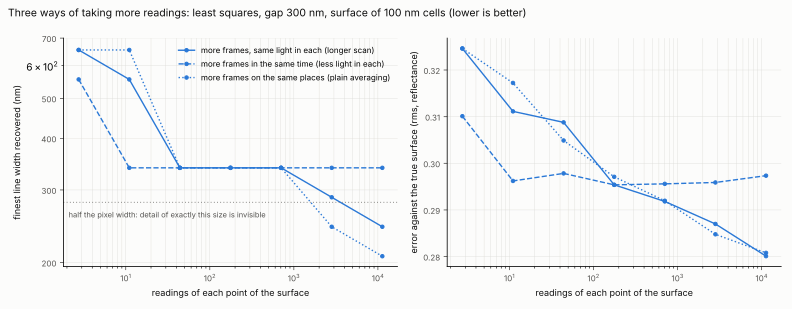
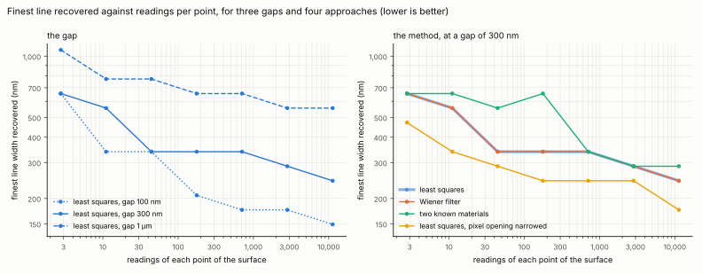
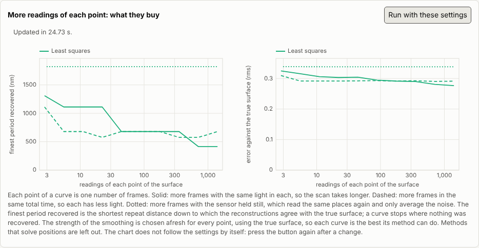

# Oversampling: what more readings of each point buy

Oversampling is reading every point of the surface many times, each time at
a different position under the pixels, and combining the readings. It is the
project's main lever, and how it trades against sharpness, noise and scan
time is to be shown throughout ([REQ-24](design.md#requirements)). This page
gives the tool that shows it, the first study made with it, and where the
number now appears in the rest of the project.

What the first study found, at simulation [level 1](level1.md) in one
dimension, in ordinary matt light, with the baseline pixel:

1. **New positions matter first, total light after that, and the second
   gain is slow.** At a gap of 300 nm the positions inside a pixel are all
   filled by about 176 readings of each point. Up to there the finest line
   recovered falls from about 655 nm to about 340 nm. From there to 11,292
   readings (64 times more) it falls to about 245 nm. A sensor held still,
   which reads one place per pixel however long it waits, recovers nothing
   finer than about 1,265 nm with any number of readings.
2. **The gap decides how much oversampling is worth.** With 11,292 readings
   of each point the finest line is about 150 nm at a gap of 100 nm, 245 nm
   at 300 nm and 560 nm at 1 µm. No number of readings in the range tried
   makes up for a wider gap.
3. **Splitting the same total light over more frames costs little and
   gains nothing once the positions are filled**, as long as the sensor's
   read noise is small beside the light in one reading. With a read noise of
   2 electrons nothing changes down to 39 electrons of light per reading.
   With 10 electrons the error starts to rise below about 150 electrons per
   reading.
4. **Knowing that the surface has only two materials can replace a great
   deal of oversampling, but only when the detail is nearly within reach.**
   On a surface of 240 nm cells at gaps of 200 nm and 300 nm it recovers the
   finest detail the surface has from between 46 and 728 readings of each
   point, where plain least squares has not got there with 11,651. At a gap
   of 400 nm, and on 100 nm cells at 300 nm, the same knowledge does not
   help and can do harm.
5. **A narrower pixel opening and oversampling work together.** An opening
   of 280 nm collects a quarter of the light, and with 176 readings of each
   point it already shows what the full pixel needs 11,292 for.

Every number on this page is Simulated unless labelled otherwise, and comes
from the stored runs in
[`results/oversampling/`](https://github.com/mithro/ccd-superres/tree/main/results/oversampling).
Terms are explained in the [glossary](glossary.md).

## 1. The number: readings of each point

The measure of oversampling used everywhere is the **readings of each
point**: how many readings were taken by a pixel that covered a given point
of the surface.

| How the instrument is run | What it does to the readings of each point | What it costs |
|---|---|---|
| Slower scan at the same frame rate | More, in proportion | Scan time, in proportion |
| Higher frame rate at the same speed | More, in proportion | Less light in each reading; more data to read out and store |
| Longer sensor along the scan | More, in proportion | A larger sensor |
| More passes over the same strip | More, in proportion | Scan time, in proportion |
| Sensor turned slightly, or motion that wanders | The same number, spread over more different positions | Nothing, if the positions are known or can be solved for |

*Table 1. What sets the readings of each point. In a single straight pass
the number is the pixels along the scan times the frames taken while the
sensor moves one pixel: 3,280 × 4, about 13,000, for the slow baseline scan
of the [design, section 5.2](design.md#52-scan). Derived here from the
geometry; the [scan calculator](calculator.md) computes it for any setting.*

On the short test surfaces used here the number is counted as the readings
taken, times the pixel spacing, divided by the length of the surface. The
surfaces repeat end to end and are shorter than the sensor, so the sensor
laps them, and the same scan gives a larger number on a shorter surface: the
default scan of 200 frames gives 194 to 569 readings of each point on the
four surfaces of the [first comparison](comparison.md), where a single pass
over a long surface would give 64 / 0.37 = 173. Numbers of readings are
therefore comparable within one surface, and only roughly between surfaces.

Two more numbers go with it, because the same count of readings can be worth
very different amounts:

- **Different positions per pixel.** Readings that land on a place already
  read only average the noise. Readings on new places also say what happens
  between the pixel centres. The count is of occupied 20 nm steps, scaled to
  one pixel width, so it cannot exceed 56 here.
- **Light per reading.** A reading with little light is noisier, and each
  reading also carries the sensor's own read noise, which does not shrink
  when the light does.

## 2. The tool

```
python -m ccdsr.oversampling approaches/least-squares.toml --out results/try
```

The command takes one or more [approach files](comparison.md), runs each at
a series of numbers of frames, and writes a table, a figure and a record of
every level. `--scene` picks the test surface, `--set` changes any setting
as in [`python -m ccdsr.run`](getting-started.md), `--frames` sets the
series and `--ways` picks among three ways of taking more readings:

| Way | What changes | What it stands for |
|---|---|---|
| `more-time` | More frames, the same light in each, the same step between frames | A slower scan or more passes: more readings and more total light |
| `same-time` | More frames, the same step, and less light in each so that the total light is fixed | The same total exposure cut into more, shorter readings. In the simulation the sensor covers the surface more times, each time with less light |
| `repeat` | More frames with the sensor held still | Plain averaging: more light and no new positions |

*Table 2. The three ways of taking more readings. `same-time` gives every
level the total light of 64 full frames, so levels with fewer frames have
more than the usual 2,500 electrons in a reading, up to 160,000, and the
simulation lets a pixel hold any amount. Motion during the exposure is not
included, so the benefit of a shorter exposure in freezing motion does not
appear. For `repeat` the sensor is cut to the 23 pixels that fit on the
surface once, with more frames to keep the number of readings the same:
a longer sensor would lap the surface and read several places per pixel
even when still.*

The code is
[`ccdsr/oversampling.py`](https://github.com/mithro/ccd-superres/blob/main/ccdsr/oversampling.py),
with tests in
[`tests/test_oversampling.py`](https://github.com/mithro/ccd-superres/blob/main/tests/test_oversampling.py).
Three points of method matter for reading the results.

**The smoothing is chosen afresh at every level.** A reconstruction prefers
a smooth picture to some degree, and the right degree falls as the noise
falls. An approach file fixes one strength, which suits one number of
readings, and with a fixed strength the result hardly changes with more
readings. Here the strength is tried over powers of ten from 100 down to
0.00000001 on three separate runs and the one with the lowest error against
the true surface is kept. The truth is used for that choice, so each curve
is close to the lowest error its method can reach. It is the error that is
made small and not the finest period, and the two do not always agree. A
real instrument does not know the truth and needs another rule, which is an
open item (section 5). `--fixed` keeps the approach's own strength.

**The finest period recovered is a new, continuous measure, and a lenient
one.** The bar groups of the [comparison](comparison.md) come in six sizes,
too few to follow a slow change. Here the reconstructions and the true
surface are both split into waves, and in each narrow band of periods the
part of the reconstructions that is in step with the truth is compared with
the strength of both. The finest period recovered is the short end of the
last band, going from coarse to fine, in which that agreement is at least a
half. A line width is taken as half the period. Three cautions:

- The bands are 18 % wide (wider at the coarse end, where each must hold at
  least three of the waves that fit on the surface), so the measure moves in
  steps of that size. Repeating the main case with twelve other sets of five
  runs moved single results by one step in about half the cases and by more
  at the smallest numbers of readings (found in review, [Review 17](review.md)).
  The study now uses ten runs. One step is not a difference.
- Agreement of a half is not a faithful copy. A reconstruction that is
  partly right in a band passes.
- Before it is measured, each reconstruction is slid sideways by up to
  three pixel spacings to where it best matches the truth, as in the
  comparison.

**The level 0 column is a rule of thumb for scale.** It applies the same
kind of rule as the
[design, section 4.2](design.md#42-what-a-huge-number-of-samples-buys-and-what-it-does-not)
in one dimension: a period counts as recoverable when the wave that survives
the blur stands above the noise of the readings averaged over half a period.
Here the wave is the difference between the two materials and the noise is
that of the simulated sensor; the wave's strength is taken over a band 18 %
wide, and the answer is the first period, from coarse to fine, at which it
fails. It does not look at where the readings fall. It is Derived here, and
it is a cross-check between two levels of the
[simulation chain](simulation-chain.md), not a prediction of what a
particular reconstruction shows.

## 3. The first study

| Setting | Value | Source |
|---|---|---|
| Test surface | Two materials (reflectance 0.2 and 1.0) in cells 100 nm wide, filled at random over 20 µm, with 3 µm of the darker material at each end; 26 µm long in all, repeating end to end | New scene `fine_layout`; the cell is the feature size of [REQ-3](design.md#requirements) |
| Second test surface | The same in cells 240 nm wide, in two different random fillings | Scene `random_layout` of the [comparison](comparison.md), and new scene `random_layout_b` |
| Pixel | Spacing 1,120 nm, edges soft over 0.3 µm (full width at half height) | Baseline of the [design, section 4.11](design.md#411-no-special-lighting-what-ordinary-light-can-reach-and-where-the-work-goes); the softness is an Assumption there |
| Light | Ordinary, matt surface, 550 nm | Level 1 default |
| Sensor | 64 pixels along the scan, moving 0.37 pixel per frame | Level 1 default |
| Light per reading | 2,500 electrons at full brightness, read noise 2 electrons | Level 1 default |
| Frames | 1, 4, 16, 64, 256, 1,024 and 4,096, giving 3 to 11,292 readings of each point | Chosen to end near the 13,000 of the baseline scan |
| Positions | Told to the reconstruction exactly | So that only the number of readings varies |
| Runs | 10 per level with different noise, and 3 more to choose the smoothing | Chosen after review showed 5 to be too few |

*Table 3. Settings of the first study.*

### 3.1 Three ways of taking more readings



*Figure 1. Left: the finest line width recovered against the readings of
each point, for least squares at a gap of 300 nm. Right: the error against
the true surface. Solid: a longer scan. Dashed: the same total light split
over more frames. Dotted: the sensor held still. Simulated, level 1.*

| Readings of each point | Different positions per pixel (moving) | Longer scan: finest line (nm) | Longer scan: error | Same total light: finest line (nm) | Same total light: error | Sensor held still: finest line (nm) | Sensor held still: error |
|---:|---:|---:|---:|---:|---:|---:|---:|
| 3 | 3 | 655 | 0.325 | 556 | 0.311 | 1,265 | 0.335 |
| 11 | 11 | 556 | 0.310 | 340 | 0.295 | 1,265 | 0.335 |
| 44 | 31 | 340 | 0.306 | 340 | 0.295 | 1,265 | 0.335 |
| 176 | 56 | 340 | 0.296 | 340 | 0.296 | 1,265 | 0.335 |
| 706 | 56 | 340 | 0.293 | 340 | 0.296 | 1,265 | 0.335 |
| 2,823 | 56 | 288 | 0.287 | 340 | 0.297 | 1,265 | 0.335 |
| 11,292 | 56 | 244 | 0.280 | 340 | 0.297 | 1,265 | 0.335 |

*Table 4. Least squares at a gap of 300 nm on the surface of 100 nm cells.
The finest line is half the finest period recovered. Positions are counted
in steps of 20 nm, so 56 per pixel is all of them; the still sensor has 1.
The error is the rms difference from the true surface in reflectance; it
stays near 0.3 in every row because most of the surface's detail is 100 nm
cells, which none of these settings recover. Simulated, level 1; full
tables in section 6.*

What the three columns say:

- **New positions come first.** The moving sensor fills the positions
  inside a pixel by 176 readings, and over that stretch the finest line
  halves, from 655 nm to 340 nm.
- **After that a longer scan gains slowly.** From 176 to 11,292 readings no
  new positions are added; the gain comes from total light alone, and it is
  64 times the scan time for 1.4 times the sharpness. This is the slow law
  of the
  [design, section 4.2](design.md#42-what-a-huge-number-of-samples-buys-and-what-it-does-not),
  now seen in a reconstruction and not only in a formula.
- **The curve has flat stretches. Part of the reason is that a pixel
  averages some patterns away.** A pattern repeating exactly every pixel
  width, or every half or third of it, fills each pixel with whole periods
  and leaves no trace in its reading. For this pixel those periods are
  1,120 nm, 560 nm and 373 nm, and the band that holds 560 nm is the one the
  curve waits in front of from 44 to 706 readings. The other part is the
  measure itself, which moves in steps: the narrowed opening of section 3.2
  has no blind period above 280 nm and its curve has a flat stretch too.
- **Cutting the same light into more readings changes nothing after the
  first few.** With the total light fixed, 11 readings of each point at
  different positions already give 340 nm, and 11,292 give the same. The
  error is flat too. The sensor's read noise of 2 electrons is too small to
  matter even at 39 electrons of light per reading. The first rows of this
  column have far more light in one reading than a real pixel holds
  (Table 2), so they show what total light does and are not settings to
  use.
- **A sensor held still gains nothing from waiting.** With one place read
  per pixel, the error is 0.335 and the finest line 1,265 nm at every level
  from 3 to 11,292 readings. Readings 1,120 nm apart cannot fix a period
  finer than 2,240 nm, whatever their noise.

A sensor with more read noise changes the fourth point. With 10 electrons
instead of 2, the error at the same total light rises from 0.297 at 176
readings to 0.308 at 11,292, where each reading has 39 electrons of light
(Table O9 in section 6). So how finely the exposure may be cut depends on
the sensor's read noise, which is one of the data items of the
[plan](plan.md#b-research-and-data-collection).

### 3.2 The gap, and the method



*Figure 2. Left: least squares at three gaps. Right: four approaches at a
gap of 300 nm. All with readings added by scanning longer, on the surface of
100 nm cells. Simulated, level 1.*

| Readings of each point | Gap 100 nm | Gap 300 nm | Gap 1 µm | Gap 300 nm, Wiener filter | Gap 300 nm, two known materials | Gap 300 nm, opening narrowed to 280 nm |
|---:|---:|---:|---:|---:|---:|---:|
| 3 | 655 | 655 | 1,265 | 655 | 910 | 472 |
| 11 | 340 | 556 | 910 | 556 | 910 | 340 |
| 44 | 340 | 340 | 655 | 340 | 655 | 288 |
| 176 | 207 | 340 | 655 | 340 | 910 | 244 |
| 706 | 176 | 340 | 655 | 340 | 910 | 244 |
| 2,823 | 176 | 288 | 556 | 288 | 910 | 244 |
| 11,292 | 149 | 244 | 556 | 244 | 910 | 176 |

*Table 5. Finest line width recovered (nm), half the finest period, on the
surface of 100 nm cells with readings added by scanning longer. The first
three columns are least squares. Simulated, level 1.*

- **The gap sets the level, and oversampling moves along it.** At 11,292
  readings the finest line is 149 nm, 244 nm and 556 nm for gaps of 100 nm,
  300 nm and 1 µm. The best-case estimate of the
  [design, Table 4.11b](design.md#411-no-special-lighting-what-ordinary-light-can-reach-and-where-the-work-goes)
  for 13,000 readings is 161 nm, 219 nm and 439 nm. The two are on the same
  scale and in the same order. They are not the same calculation: the
  design's is in two dimensions with full contrast, this one is in one
  dimension between reflectances of 0.2 and 1.0 on a surface the sensor
  laps, and one step of the measure is 18 %.
- **At a small gap oversampling keeps paying; at a large gap it stops
  early.** At 100 nm the line width more than halves between 44 and 11,292
  readings. At 1 µm it improves by 1.2 times over the same range and not at
  all over the last factor of four.
- **Least squares and the Wiener filter give the same curve** once each has
  its smoothing chosen. With exactly known positions they are two ways of
  doing the same thing.
- **A narrower opening changes the trade.** The opening of 280 nm has no
  blind periods above 280 nm and blurs less, so with 176 readings it
  already reaches 244 nm, and with 11,292 it reaches 176 nm, although every
  reading has a quarter of the light. Oversampling is what pays for the lost
  light.
- **Knowing the two materials does not help on this surface.** Its cells
  are far finer than what the blur passes at 300 nm. Forcing every point to
  one of two values then picks wrongly as often as rightly, and the lowest
  error is reached by smoothing so heavily that only coarse detail is left
  (error 0.336 against 0.280 for least squares at 11,292 readings).

### 3.3 Detail nearly within reach: knowing the two materials

| Readings of each point | Gap 200 nm: least squares | Gap 200 nm: two materials | Gap 300 nm: least squares | Gap 300 nm: two materials | Gap 300 nm, other filling: least squares | Gap 300 nm, other filling: two materials | Gap 400 nm: least squares | Gap 400 nm: two materials |
|---:|---:|---:|---:|---:|---:|---:|---:|---:|
| 3 | 1,310 | 1,310 | 1,310 | 1,310 | 1,310 | 1,112 | 1,310 | 1,310 |
| 11 | 679 | 1,310 | 1,310 | 1,310 | 800 | 1,310 | 1,310 | 1,310 |
| 46 | 576 | 298 | 679 | 679 | 679 | 679 | 800 | 1,310 |
| 182 | 576 | 253 | 576 | 253 | 679 | 679 | 679 | 679 |
| 728 | 576 | 253 | 576 | 253 | 576 | 253 | 576 | 1,310 |
| 2,913 | 414 | 253 | 576 | 253 | 576 | 253 | 576 | 679 |
| 11,651 | 414 | 253 | 414 | 253 | 414 | 253 | 576 | 679 |

*Table 6. Finest period recovered (nm) on surfaces of 240 nm cells, readings
added by scanning longer. These surfaces have almost nothing finer than a
period of about 250 nm, so 253 nm is the finest the measure can report on
them. Simulated, level 1; errors are in Tables O10 to O17 of section 6.*

| Readings of each point | Gap 200 nm: least squares | Gap 200 nm: two materials | Gap 300 nm: least squares | Gap 300 nm: two materials | Gap 400 nm: least squares | Gap 400 nm: two materials |
|---:|---:|---:|---:|---:|---:|---:|
| 46 | 0.233 | 0.234 | 0.253 | 0.286 | 0.267 | 0.296 |
| 728 | 0.200 | 0.163 | 0.216 | 0.193 | 0.230 | 0.296 |
| 11,651 | 0.171 | 0.151 | 0.195 | 0.195 | 0.211 | 0.289 |

*Table 7. Error against the true surface (rms, reflectance) for three rows
of Table 6, first filling. Simulated, level 1.*

What the tables show:

- **At gaps of 200 nm and 300 nm the knowledge of two materials reaches the
  finest detail these surfaces have, with moderate oversampling.** It does
  so from 46 readings of each point at 200 nm, from 182 at 300 nm on one
  filling and from 728 on the other. Least squares is at 414 nm with 11,651
  readings in all three cases.
- **It needs a minimum of readings.** Below that it is no better than least
  squares and its error is higher.
- **At 400 nm it fails.** The recovered period jumps between 679 nm and
  1,310 nm from row to row and the error stays near 0.29, well above least
  squares.
- **The gain in error is modest and not uniform.** At 300 nm the two errors
  are equal at 11,651 readings (0.195). At 200 nm two materials is better
  throughout the upper rows (0.151 against 0.171).
- **Review found it less steady than this table suggests.** With other
  noise at 300 nm the step to 253 nm came at 2,913 readings and not 182, and
  on one other filling it was not reached at all ([Review 17](review.md)).

So this kind of knowledge can stand in for a great deal of oversampling
when the detail is only a little beyond what the blur passes, and it stops
working, abruptly, a little further out. Where that edge lies, and whether
a sturdier method moves it, is the question this result raises for the
effort of [REQ-22](design.md#requirements) (Judgement). It is one kind of
knowledge, on two surfaces, in one dimension.

## 4. Where the number now appears

| Place | What was added |
|---|---|
| [Comparison runner](comparison.md) | Every run records its readings of each point, and the data table of every comparison lists them. The first comparison was rerun; its results are unchanged apart from the new column |
| [Interactive explorer](interactive-explorer.md) | A panel "More readings of each point: what they buy" reruns the ticked methods at 1 to 512 frames with every other setting as on the page, and draws the finest period recovered and the error against the readings of each point, for the three ways of Table 2 |
| Command line | `python -m ccdsr.oversampling`, section 2 |
| [Slot waves, Table 6](slot-waves.md) | The same trade for the two ways of lighting the chip, from the level 0 model (added earlier) |
| [Routes to 100 nm with ordinary light, Tables 5 to 7a](research/ordinary-light-routes.md) | How many times more readings each step in distance, edge softness and line width costs near contact, from the level 0 model in [`ccdsr/near_contact.py`](https://github.com/mithro/ccd-superres/blob/main/ccdsr/near_contact.py) (a separate study) |
| [Plan](plan.md#d-simulation-chain) | Item D1c, with what comes next |

*Table 8. Where oversampling is shown.*



*Figure 3. The panel in the interactive explorer, here for least squares on
the surface of 100 nm cells with the default settings (sharp pixel edges,
gap 300 nm). Solid, dashed and dotted are the three ways of Table 2.
Simulated, level 1; three runs per point.*

## 5. Limits, and what comes next

| Limit | Why it matters | Where it is dealt with |
|---|---|---|
| One dimension, level 1, matt ordinary light | Sensor tilt and passes spread positions in two dimensions, which one dimension cannot show; below a few micrometres the blur model itself is unconfirmed | [Plan](plan.md#d-simulation-chain) items D1c and D5 |
| Positions told exactly | Solving for positions also needs readings, and may need more of them than the picture does | Item D1c |
| The smoothing is chosen with the truth known, and for the lowest error | Each curve is near the best case for its method. A rule that uses only the readings (for instance the measured noise) has to be shown to come close. For the two-materials method the choice is unsteady from level to level | Item D1c |
| The surface repeats and is shorter than the sensor | The sensor laps the surface, so positions fill up sooner than in a real single pass, and the readings of each point are not the same number as for a single pass (section 1). Only the still-sensor case was corrected for it | Longer surfaces, item D1a |
| The finest-period measure is lenient and moves in 18 % steps | One step is not a difference. Agreement of a half can be reached by a partly right reconstruction, and mistakes common to all runs do not average away | A longer surface, and a stricter measure with a noise floor, item D1c |
| One pixel model | Softer or sharper pixel edges move every curve ([design, section 4.11](design.md#411-no-special-lighting-what-ordinary-light-can-reach-and-where-the-work-goes)) | The uncertain pixel response sampled over its range, item D1a |
| Light from behind the chip is not in the study | It is the leading ordinary-light route and has its own model | Item D2f, which is to report against readings of each point from the start |
| Computing time is not a column | It is not a reason to prefer one level over another ([REQ-23](design.md#requirements)); the largest level here takes seconds | |

*Table 9. What this first study does not cover.*

## 6. Full results

To repeat the study and redraw the figures (about 8 minutes on the build machine, measured):

```
python docs/diagrams/make_oversampling_diagrams.py --rerun
```

```{include} ../results/oversampling/tables.md
```
