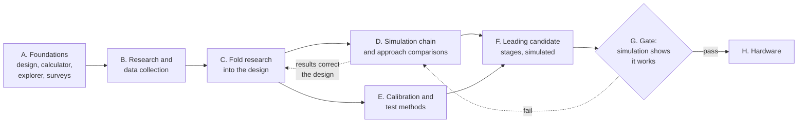

# Project plan

This page is the single list of what the project will do, in order, and where
each item stands. It is updated in the same pull request as the work it
describes, so the state shown here is the state of the repository.

The goal is a reconstructed picture of features of about 100 nm on silicon
chips, from a lensless image sensor scanned over the chip, spending
computation in preference to hardware
([design, section 1](design.md#1-purpose)).

The simulator is for exploring many different approaches, not one. Every
part of the instrument and the processing is a swappable component, an
approach is a named configuration of those components, and comparing
approaches side by side on the same scenes and measures is a deliverable in
its own right
([design, section 7.1](design.md#71-approaches-as-named-configurations)).

All real hardware work comes at the very end, and only for approaches that
the simulation has shown to work. Everything before the last phase is
research and simulation. What "shown to work" means is a defined gate
([design, section 4.9](design.md#49-simulation-first-the-unknown-pixel-response-and-the-gate-before-hardware)).

State marks: **Done** means merged into the main branch. **In progress**
means work exists on a branch or in another page under review. **Not
started** means nothing exists yet.

## Order of work

Deep research comes before the simulation build because each field below has
already solved a version of this problem, and their answers decide what the
simulator has to represent and which reconstruction is built first.

## A. Foundations

| Item | Where | State |
|---|---|---|
| Design: measurement model, resolution limits, the 100 nm target, staged path, motion blur, sensor control, randomness, use of the two-dimensional array, reconstruction | [design](design.md) | Done as a draft. Revised as research and simulation results arrive. |
| Level 0: scan calculator and analytic resolution model | [calculator](calculator.md), `ccdsr/` | Done |
| Trade-off explorer | [explorer](explorer.md), `explorer/` | Done |
| Plan for the simulation chain and its cross-checks | [simulation chain](simulation-chain.md) | Done as a plan |
| Optical elements study: filters, gratings, tubes, lighting, the optical limits for 100 nm | [optical elements](optical-elements.md) | Done as a study |
| Overview survey of reconstruction methods across fields | [reconstruction methods](reconstruction-methods.md) | Done as a survey |
| Documentation site source, with every figure generated by a script | `docs/`, [diagrams](diagrams.md) | Done |
| Documentation published on Read the Docs | `.readthedocs.yaml` | Not started. Needs Tim to import the repository on readthedocs.org. |

## B. Research and data collection

This phase is deliberately large. It has two parts: deep research into the
fields and sensors (B1 to B7), and collection of the data the simulator runs
on (R1 to R18). All of it comes before the simulation build.

### Deep research

Tim asked for deep research into the fields he named: reverse or inverse
beamforming, radar, satellite image reconstruction and similar fields. He also
asked for a deep dive into potential sensors and how to control them at
pixel level (B5 to B7). The
[reconstruction methods](reconstruction-methods.md) page is the overview.
Each item below goes deeper into one field than that overview does, from the
primary literature, and must answer stated questions for the design. Each
write-up is a page under `docs/research/`, with its sources listed and with
every claim marked as taken from a source, derived here, or assumed.

| Item | Field | Questions it must answer for the design | Write-up | State |
|---|---|---|---|---|
| B1 | Radar and synthetic aperture, including focusing from the data alone (autofocus) | How is an aperture built from motion when the path is not known exactly, and how accurately can the path be recovered from the data? Which autofocus methods carry over when only brightness is recorded and not the wave's phase? How do stripmap and spotlight modes map onto a scanned sensor with a fixed or steered light source? What sets their limits on resolution and on noise? | `docs/research/synthetic-aperture-radar.md` | Not started |
| B2 | Beamforming and array processing, forwards and inverse, from acoustics, sonar and radio astronomy | What does treating 8 million pixels as an array of receivers give beyond averaging? Which inverse and adaptive methods (minimum variance, subspace methods, deconvolution of the array response, self-calibration) apply to an array that records brightness only? How do radio telescopes calibrate thousands of unknown receiver gains from the observation itself, and does that carry over to pixel gains and pixel response? | `docs/research/beamforming.md` | Not started |
| B3 | Satellite and astronomical image reconstruction from many shifted frames | How do push-broom and time-delay-integration sensors handle motion smear, and what does that say about our readout schemes? How are many undersampled, shifted, noisy frames combined (drizzle, multi-frame super-resolution, lucky imaging), with what measured gain over the pixel size and at what noise cost? How is the registration between frames estimated and how accurate is it in practice? | `docs/research/multi-frame-reconstruction.md` | Not started |
| B4 | Ptychography and lensless coherent imaging | What is the finest detail demonstrated without a lens, in transmission and in reflection, and what limited it? What do position correction, mixed-state models and pixel super-resolution need from the data? How do coarse detector pixels limit the result, and how have others got round it? What overlap, pulse timing and number of lighting directions does stage 2 need? | `docs/research/ptychography.md` | Not started |
| B5 | Survey of candidate sensors: Raspberry Pi class CMOS sensors (IMX219, IMX477, IMX708), global-shutter sensors (IMX296 and similar), scientific CMOS, true CCDs including full-frame, frame-transfer and time-delay-integration types, and any sensor with documented or open pixel-level control | For each: pixel size and count, layers on the pixel face, noise, speed, price and availability. Which are plausible for this instrument, and what would each change in the resolution and sampling figures? | `docs/research/sensor-survey.md` | Not started |
| B6 | Pixel-level control of each candidate | What does each sensor expose for addressing, reset, exposure and readout of individual pixels, rows or windows: through its registers, through undocumented modes, or by driving its control lines directly? For CCDs, what do custom clocking of the shift registers and charge shifting in step with the motion allow? What documentation, datasheets, open drivers and reverse-engineering work exists for each? | `docs/research/sensor-control.md` | Not started |
| B7 | What each sensor choice allows in the simulator | Which implementations of the swappable readout model ([design, section 5.7](design.md#57-sensor-control-and-readout-as-a-replaceable-model)) each sensor makes real: random row order, per-row or per-pixel exposure, global shutter, repeated reads, charge shifting. What has been published about the response inside small pixels and their angular response, to set the uncertain range that stands in for a measurement until hardware exists? | `docs/research/sensor-control.md`, with one readout model per sensor in the simulator | Not started |

Each item ends with a short list of changes it recommends to the design, the
simulator parameters and the staged plan.

### Data collection

Research also means collecting the numbers and files the simulator will run
on, so that its inputs are real data with a known origin and not guesses.
Every item is committed under `data/` with a `SOURCE.md` beside it giving
where it came from, the date, the licence, and what was changed. Material
whose licence does not allow copying is not committed: the repository then
holds a script that fetches it and a note of what it is. Each item also has
a short page under `docs/data/` saying what was found and how good it is.

| Item | What is collected | Question it answers | Where it lives | State |
|---|---|---|---|---|
| R1 | Datasheets and register maps of the candidate sensors, and the register tables in their open drivers | Exactly what control each sensor offers, and its timing (feeds B5 to B7) | `data/sensors/`, `docs/data/sensors.md` | Not started |
| R2 | Published cross-sections and layer measurements of small pixels, including the IMX219 study already cited in the design | The layer order, thicknesses and materials for the pixel model at level 4 | `data/pixel-stack/`, `docs/data/pixel-stack.md` | Not started |
| R3 | Published measurements of pixel angular response, crosstalk between pixels and the response inside a pixel, for pixels of about 1 µm | The uncertain range for pixel response that stands in for the stage 0 measurement | `data/pixel-response/`, `docs/data/pixel-response.md` | Not started |
| R4 | Quantum efficiency against wavelength for the candidate sensors, with and without colour filter, including the near ultraviolet | Whether 405 nm and 365 nm light is detected, and how well | `data/sensors/qe/`, `docs/data/sensors.md` | Not started |
| R5 | Noise figures of the candidate sensors: read noise, full well, dark current, fixed pattern, row noise, digitiser step | The noise model, and when coded exposure or dither pays | `data/sensors/noise/`, `docs/data/sensors.md` | Not started |
| R6 | Optical constants (refractive index and absorption against wavelength, 190 to 1000 nm) of silicon, silicon dioxide, silicon nitride, aluminium, copper, tungsten, photoresist-like polymers and water | Materials for levels 3 and 4 | `data/materials/`, `docs/data/materials.md` | Not started |
| R7 | Real chip layouts as test scenes: open process kits and open-source chip layouts such as SkyWater 130 and GF180, with their layer thicknesses, turned into height and material maps | Realistic scenes at real design rules, in place of invented patterns | `data/scenes/layouts/`, `docs/data/scenes.md` | Not started |
| R8 | Published images of real chips: optical die photographs and electron microscope images with known scale | What real surfaces look like, including roughness, residue and defects, and scenes at about 100 nm, which the open processes above do not reach | `data/scenes/images/`, `docs/data/scenes.md` | Not started |
| R9 | What is on top of a finished chip: passivation and other covering layers, their thickness and roughness, and how chips are prepared for inspection | Whether the 100 nm features are at the surface or under a layer, which decides what the light meets | `docs/data/chip-surface.md` | Not started |
| R10 | Specifications of laser diodes, LEDs and ultraviolet sources at 405, 365 and shorter wavelengths: power, linewidth and coherence length, pulse rise time, beam quality, pointing stability, price | Which lighting schemes are buildable, and the source part of the uncertain ranges | `data/sources/`, `docs/data/sources.md` | Not started |
| R11 | Motion stages and vibration: speed stability, straightness, wobble and resolution of low-cost stages, and typical bench and building vibration spectra | The motion error model of the design, with real sizes | `data/motion/`, `docs/data/motion.md` | Not started |
| R12 | Gap control: how small and how stable a gap has been held over millimetres, in contact imaging, hard-disk heads and probe instruments | The realistic range for the gap and its stability | `docs/data/gap.md` | Not started |
| R13 | Benchmark table of published lensless, holographic and ptychographic results: wavelength, geometry, pixel size, resolution reached, reflection or transmission, what limited it | The yardstick every simulated approach is compared against, and a check that the simulator reproduces known results | `data/benchmarks/results.csv`, `docs/data/benchmarks.md` | Not started |
| R14 | Published raw datasets from lensless and ptychographic experiments that are free to reuse | Real data to run the reconstruction code on before any hardware exists | `data/benchmarks/datasets/` (fetch scripts), `docs/data/benchmarks.md` | Not started |
| R15 | Software to build on: ptychography packages, wave-optics and electromagnetic solvers (finite-difference and coupled-wave), ray tracers, graphics-card array libraries, layout readers. For each: licence, maintenance, speed, and a small trial run | Which libraries the levels are built on, and what must be written here | `docs/data/software.md`, trial scripts in `studies/software/` | Not started |
| R16 | Computing resources: what the available graphics cards and core counts can hold and how long the trial runs of R15 take | The size of patch and scene each level can afford | `docs/data/computing.md` | Not started |
| R17 | Reference cases with known answers: textbook diffraction results, published grating efficiencies, standard resolution targets | The fixed cases every simulation level must reproduce | `data/reference-cases/`, `tests/` | Not started |
| R18 | Prior art and patents on scanned lensless and contact imaging of chips | Whether this has been tried, what was learned, and what to avoid repeating | `docs/research/prior-art.md` | Not started |

## C. Fold the research into the design

| Item | What changes | State |
|---|---|---|
| C1 | Update the forward model, the reconstruction method and the simulator parameters in the [design](design.md) from the recommendations of B1 to B7 | Not started |
| C1a | Replace assumed numbers in the design, the calculator and the explorer with the collected data of R1 to R17, each with its source | Not started |
| C2 | Update the ranked shortlist in [reconstruction methods](reconstruction-methods.md) and the staged plan in [design, section 4.7](design.md#47-a-staged-path-to-the-picture-the-current-leading-candidate) | Not started |
| C3 | Settle the open questions at the end of the [design](design.md#11-build-stages-and-open-questions) with Tim | In progress. Answered so far: the goal is a picture, reached in stages. |

## D. Simulation chain

The levels and the checks between them are defined in the
[simulation chain](simulation-chain.md). Each level gets its own page with
method, assumptions, worked examples and cross-check results.

| Item | Level | State |
|---|---|---|
| D0 | Level 0: analytic calculator and explorer | Done |
| D1 | Shared scene description, raw frame format, readout scheme model, metrics, default scene of patterned silicon | Not started |
| D1a | Approach files and the comparison runner: an approach as a named configuration, several run against the same scenes, one table and set of figures on the same measures | Not started |
| D2 | Level 1: linear blur model with reconstruction, in one dimension and then two | Not started |
| D3 | Level 2: ray tracing | Not started |
| D4 | Level 3: scalar wave propagation, with the coherent slanted-light scheme | Not started |
| D5 | Level 4: full electromagnetic solver on small patches | Not started |
| D6 | Cross-checks between each pair of neighbouring levels | Not started |
| D7 | Approach comparisons, repeated as each level arrives: first at level 1 for the approaches it can represent, then at levels 3 and 4 for the coherent ones. Results committed and published. | Not started |

The explorer is extended with each level, so that every new parameter can be
explored as soon as it is modelled.

## E. Calibration and test methods

| Item | Content | State |
|---|---|---|
| E1 | Test scenes and measures: bar groups, star, point pairs, edges, the patterned silicon scene, resolution by Fourier ring correlation ([design, section 8](design.md#8-validation-plan)) | Planned in the design. Not built. |
| E2 | Calibration from the data: frame positions, speed, tilt, pixel gains, pixel response, noise maps | Planned in the design, sections 5.8, 5.9 and 6.4. Not built. |
| E3 | Honesty tests for results that use prior knowledge: reconstruction from a deliberately wrong starting layout, and each random process switched on and off | Planned in the design, sections 4.7 and 5.8. Not built. |
| E4 | A page of its own for calibration and test methods | Not started |

## F. Stages of the leading candidate, in simulation

These stages belong to the approach that looks strongest so far, slanted
coherent light with phase recovery. It is one candidate among those compared
in D7, and this section is rewritten if the comparisons favour another. The
stages are defined in
[design, section 4.7](design.md#47-a-staged-path-to-the-picture-the-current-leading-candidate)
and use the same numbers in the [optical elements](optical-elements.md)
study. All of them are carried out in the simulator only.

| Stage | Result, in simulation | State |
|---|---|---|
| 0 | The pixel response to fine light stripes and to angle, as an uncertain range swept in every run and narrowed by the electromagnetic level on a model of the pixel's layers | Not started |
| 1 | Coarse picture at micrometre scale, with positions and gains estimated from the data | Not started |
| 2 | True picture to 150 to 200 nm lines, with slanted pulsed 405 nm light | Not started |
| 3 | Detect, locate and fit: a partly inferred picture at about 100 nm | Not started |
| 4 | True picture at about 100 nm, with near-ultraviolet light or water in the gap | Not started |

## G. The gate before hardware

| Item | Content | State |
|---|---|---|
| G1 | Fix the targets per stage and the uncertain ranges for pixel response, gap, vibration, source and noise, before the runs | Not started |
| G2 | Run every candidate approach through the gate of [design, section 4.9](design.md#49-simulation-first-the-unknown-pixel-response-and-the-gate-before-hardware): agreed scenes and measures, robustness across the uncertain ranges, blind reconstruction, agreement between simulation levels, honesty about priors, repeatability, buildable on paper | Not started |
| G3 | Gate report per approach: pass or fail on each condition, hardware list, tolerances, first measurements to make | Not started |
| G4 | Tim's decision on which approaches go to hardware | Not started |

## H. Hardware, last

Nothing in this section starts before G4.

| Item | Content | State |
|---|---|---|
| H1 | Measure the pixel response of the real sensor (stage 0 on hardware) and rerun the gate with the measured value | Not started |
| H2 | Build and run stages 1 to 4 of the approaches that passed, each compared against its simulation | Not started |
| H3 | Feed measured behaviour back into the simulator as the reference model of the instrument | Not started |

## How the plan is kept

- Everything lives in this repository. Work that is not here does not count
  as done.
- Work arrives in small pull requests that are merged as each piece is
  ready.
- A pull request that completes or starts an item changes its state on this
  page.
