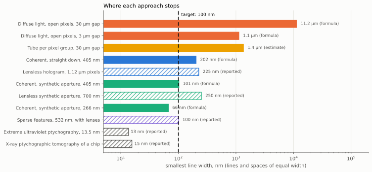
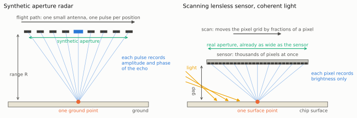
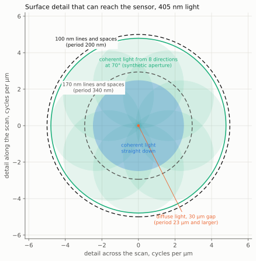
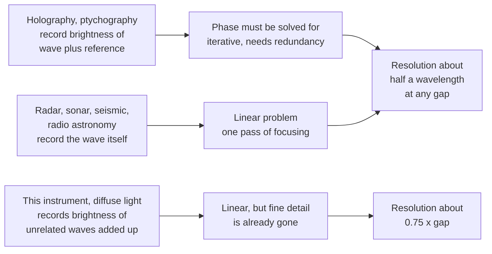
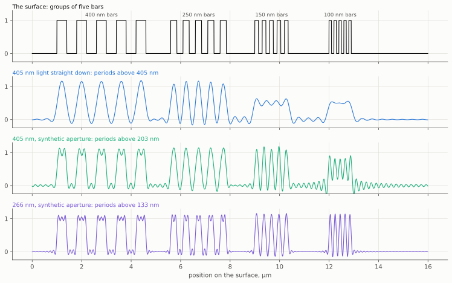
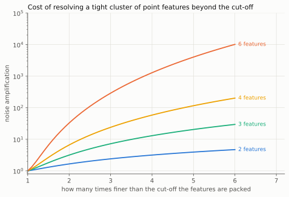
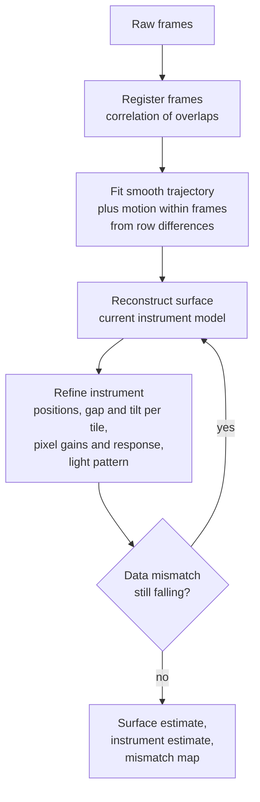
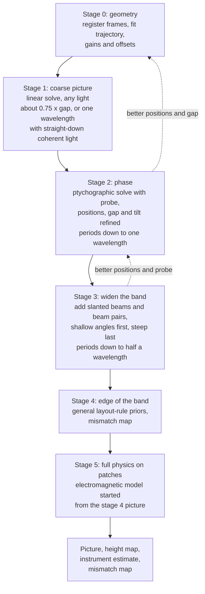

# Reconstruction methods from radar, astronomy and other imaging fields

Status: research survey for review. Nothing here is implemented in the
simulator. Numbers come from three places, and each is labelled: formulas,
small calculations in
[`diagrams/make_reconstruction_diagrams.py`](diagrams/make_reconstruction_diagrams.py),
and the published literature. Section 10 lists what the estimates leave out.

This page answers one question: which reconstruction ideas from radar, sonar,
radio astronomy, satellite imaging, tomography, ptychography, seismic imaging
and compressed sensing could be applied to the scanning lensless sensor, and
how far could they take it towards 100 nm features on silicon chips? It is
written to be read after the [design document](design.md) and the page on
[optical elements](optical-elements.md). Section 7 gives a ranked shortlist,
a staged reconstruction plan, and says how each item would appear in the
simulator and the reconstruction.

Three directions from Tim shape the page. The goal is to reconstruct a
picture of an unknown layout, and that may be done in several stages (section
7.2). Deliberately introducing randomness, and modelling the randomness that
is already there, is in scope (section 3.12). And the two-dimensional nature
of the sensor should be used to get more detail (section 3.13).

## In plain words

The instrument is a camera chip with its lens taken off, slid slowly across
the surface of a silicon chip while it takes thousands of pictures. With no
lens, each picture is a blur. The plan is for a computer to combine the
blurred pictures into one sharp picture, sharper than the camera's own pixels.

Other fields have done this kind of thing for decades. A radar satellite has
a small antenna and still makes sharp maps, by combining echoes collected
along its orbit. Radio astronomers combine dishes spread over a continent
into one telescope. Hospital scanners compute a picture of the inside of a
body from measurements that look nothing like a picture. This page asks what
those fields know that this project can borrow, and how small a detail the
borrowed methods could show. The target is detail about 100 nanometres
across, which is a thousand times finer than a human hair.

The answers, in order of importance:

- **The lighting has to change before the computing can help.** With ordinary
  light the blur destroys fine detail before it reaches the camera chip, and
  no amount of computing brings back what never arrived. With laser light the
  fine detail is not destroyed. It arrives scrambled into ripple patterns,
  and unscrambling ripple patterns is exactly what radar and its relatives
  know how to do.
- **Light itself sets a floor.** A wave cannot carry detail much smaller than
  half its own length across a gap. For violet laser light that floor is
  lines about 100 nanometres wide, which is the target itself. Lines of 150
  to 250 nanometres are a realistic first result. Going finer needs
  ultraviolet light or a drop of liquid between the two chips.
- **Lighting from several slanted directions doubles the sharpness.** This is
  the direct counterpart of a radar looking at the ground from many positions
  along its path.
- **The computer can work out its own mistakes.** Where exactly the sensor
  was for each picture, how far it was from the surface, and how each pixel
  differs from its neighbours can all be worked out from the pictures
  themselves. Every field surveyed does this.
- **Randomness helps in some places and not others.** Irregular motion and
  irregular lighting patterns make the problem easier to solve, as long as
  the computer then works out what they were. Random noise in the brightness
  readings never helps.
- **The sensor being a full grid of pixels, not a single line, matters.**
  Each picture is a complete snapshot taken in one instant, so nothing can
  shift between its parts.
- **It is done in stages.** A rough picture first, then each stage sharpens
  the one before. The sharper methods only work when started from a picture
  that is already roughly right.

The rest of the page gives the evidence for each of these, field by field,
with the technical detail kept. Technical terms are explained where they
first appear and collected in the next section.

## Terms used on this page

| Term | Meaning |
|---|---|
| Nanometre (nm), micrometre (µm) | A micrometre is a thousandth of a millimetre. A nanometre is a thousandth of a micrometre. The sensor's pixels are about 1.1 µm wide. The target detail is 100 nm, or 0.1 µm. |
| Wavelength | The distance from one crest of a light wave to the next. Violet laser light has a wavelength of 405 nm. |
| Gap | The distance between the face of the sensor and the surface being imaged. |
| Resolution | The smallest detail that can be told apart from its neighbours. |
| Period; lines and spaces | For a pattern of equal stripes, the period is the width of one line plus one space. "100 nm lines and spaces" has a period of 200 nm. |
| Band; cut-off | The band is the range of detail sizes a method can carry, from coarse to fine. The cut-off is the finest detail in the band. |
| Diffuse light | Ordinary light, as from a lamp or a matt surface: a jumble of unrelated waves going in all directions. |
| Coherent light | Light of a single colour whose waves stay in step with each other, as from a laser. |
| Phase | The timing of a wave: whether a crest or a trough is arriving at a given moment. It records how far the light has travelled, and so where it came from and the height of what it bounced off. |
| Interference; fringes | When two coherent waves overlap they add where their crests meet and cancel where crest meets trough. The result is a pattern of bright and dark stripes called fringes. |
| Hologram | A recording of the fringes made when light scattered from an object overlaps with an undisturbed reference beam. It contains the phase in a form a camera can record. |
| Speckle | The grainy random pattern of bright and dark spots made when laser light passes through or bounces off something rough. |
| Forward model | A calculation that predicts what the sensor would record for a given surface. |
| Reconstruction; inverse problem | Working backwards: finding the surface whose predicted recording matches the real one. |
| Blur; deconvolution | A blur spreads each point of the surface over a patch. Deconvolution is undoing a known blur by computation. |
| Noise; signal-to-noise | Noise is the random error in each measurement. Signal-to-noise is how much larger the wanted signal is than the noise. |
| Phase retrieval | Computing the phase that the camera could not record, from brightness measurements alone. |
| Synthetic aperture | A large receiver imitated by combining recordings taken from many positions or directions. |
| Ptychography | A method that moves an object through a patch of coherent light in small overlapping steps and computes a sharp image, phase included, from all the recordings together. Pronounced "tie-cog-raphy". |
| Registration | Working out how far one picture is shifted relative to another. |
| Calibration; self-calibration | Measuring the instrument's own properties. Self-calibration does it from the ordinary data, with no separate test. |
| Redundancy | Measuring the same thing many times in different ways. It is what makes self-calibration and phase retrieval possible. |
| Diversity | Measurements that differ in kind (different gap, lighting direction or light pattern), not only in position. |
| Prior | Something assumed about the surface before measuring, such as "it is made of a few materials with straight edges". |
| Sparse | Made of few, well-separated features. |
| Iteration | One round of an improve-and-check loop. Most methods here repeat such a round tens or hundreds of times. |
| Tile; patch | A small square of the surface that is processed on its own, so that many can be processed at once. |
| Full electromagnetic model | A simulation of light as it really is, an electric and magnetic wave, with no simplifications. Slow but accurate for detail smaller than the wavelength. |

## 1. Summary

The design document found that with diffuse light the gap sets the resolution
(smallest period about 0.75 times the gap). The optical elements page found
that only interference-based schemes escape the gap, and that they stop near
one wavelength. The target is 100 nm, which is a quarter of a wavelength of
violet light. The fields surveyed here have all faced a version of this
problem, and they agree on what computation can and cannot do.

**What computation can do.**

- Turn an interference pattern recorded by a moving sensor back into a sharp
  image at any gap. This is what synthetic aperture radar does with radio
  echoes and what ptychography does with light and X-rays. The same algorithms apply here once the light is coherent, meaning light
  of one colour whose waves stay in step, as from a laser.
- Double the resolution of straight-down coherent light by combining views
  lit from different directions (a synthetic aperture). The limit becomes a period of half a wavelength, where the period is the width of one
  line plus one space: 203 nm at 405 nm, which is lines and spaces 101 nm
  wide.
- Recover the phase that the sensor does not measure (the timing of the
  light wave, which says where the light came from), using the enormous
  redundancy of the scan.
- Estimate the scan positions, the gap, the tilt, the light pattern and the
  pixel response from the data itself. Every field here does this routinely
  under names such as autofocus, self-calibration and position refinement.
- Go somewhat beyond the half-wavelength limit for features that are sparse (few and well separated) or of known shape, and measure the size and position of known shapes to a
  few nanometres.

- Use the two-dimensional sensor fully: each frame records fine detail in
  both directions in one instant, a tilted or strip-patterned sensor gives
  every surface point many gaps and lighting conditions in one pass, and
  comparing pictures made from different parts of the sensor gives depth
  (section 3.13).

**What computation cannot do.**

- Recover detail that never reached the sensor. Detail finer than half a
  wavelength does not travel across a gap of more than a fraction of a
  wavelength. At a 1 µm gap a 200 nm period is attenuated by a factor of
  10¹² (calculation, section 2.1). No sample count overcomes that.
- Replace the missing phase for free. Radar measures amplitude and phase
  directly. A pixel measures brightness only. Phase has to be turned into
  brightness by interference before it reaches the pixel.
- Extrapolate far beyond the measured band. In every field the gain from
  better signal-to-noise alone is logarithmic: each tenfold increase in samples adds only the same small
  step. It is the same law the design document found for the gap.

**Where this leaves the 100 nm target.**

*Figure: the smallest line width each approach can show. The scale is
stretched so that each step to the left is ten times finer. Solid bars are
theoretical limits from formulas. Hatched bars are results reported in
published experiments. The dashed line is the 100 nm target, and a bar that
ends to the left of it can show 100 nm lines. The top three bars are the
instrument with ordinary light. The blue and green bars are laser light,
straight down and from several directions. The grey bars at the bottom use
X-rays or extreme ultraviolet light and are shown for comparison.*

Dense 100 nm lines and spaces sit exactly at the theoretical limit of a
synthetic aperture with 405 nm light in air. A realistic first coherent
instrument would resolve lines of 150 to 250 nm. Reaching 100 nm dense lines
needs near-ultraviolet light or a liquid in the gap, as well as the
computation. Isolated 100 nm features are an easier case: they show up in
the picture, at the right place, well before dense ones are separated
(section 4.4).

**Ranked shortlist**, weighted towards methods that form a picture of an
unknown layout (section 7 has the reasoning, the stages and the simulator
mapping):

1. Joint estimation of positions, gap, tilt, gains and pixel response from the
   data (radar autofocus, radio self-calibration, sonar micronavigation,
   satellite jitter estimation). Applies to every stage.
2. Coherent reconstruction with phase retrieval, treated as near-field
   ptychography (computing a sharp image from overlapping recordings of
   laser light).
3. Synthetic aperture from several slanted light directions, including beam
   pairs, so that fine detail is mixed down to fringes the pixels can see.
   This is the same arrangement the design and optical elements pages have
   converged on (slanted 405 nm laser beams in pairs).
4. Deliberate randomness: random scan jitter, random light pulses, and
   speckle or random-phase lighting, all estimated from the data.
5. Layout-rule priors (assumptions true of any chip, such as straight
   edges and a minimum line width) and sparse reconstruction, with maps of
   where the result disagrees with the raw data.
6. A full electromagnetic model inside the reconstruction, on small patches,
   as the last stage.
7. Statistically optimal linear combination for the first, diffuse-light
   stage, with a noise map.

These are stages of one pipeline, not alternatives: each produces a picture
that seeds the next (section 7.2).

Not recommended: adaptive beamforming methods that need the correlations of
the wave field (Capon, MUSIC), intensity interferometry, range compression,
adding noise to the pixel values beyond what dither needs, and learned priors
as the only safeguard.

## 2. One problem, three currencies

Every field on this page solves the same problem. A scene is seen through an
instrument that mixes and blurs it, and the scene is recovered by inverting a
model of the instrument. The design document writes this as `m = D S K ρ`. In words: the
measurements `m` are the true surface `ρ`, blurred (`K`), read off at the
places where the pixels happened to be (`S`), and scaled by the sensitivity
of each pixel (`D`).
The fields differ in three things only, and those three things are the
currencies that buy resolution:

| Currency | Radar and sonar | This instrument today | What would raise it |
|---|---|---|---|
| How much of the wave is measured | Amplitude and phase of every echo | Brightness only, of light with no fixed phase | Coherent light, so that phase shows up as fringes |
| How wide a range of directions is covered | Kilometres of flight path | Wide in principle (the sensor is far wider than the gap), wasted with diffuse light | Coherent light from several directions |
| How much is known about the scene beforehand | Often little | Not used yet | Chip layout rules, few materials, known cell shapes |

Computation converts these currencies into an image. It does not create them.

*Figure: left, a radar aircraft records an echo at each position along its
path, and the positions together act as one long antenna (the synthetic
aperture). Right, the scanning sensor is already a wide row of receivers
close to the surface. Blue lines show the wave from one point reaching every
receiver position. The note beside each drawing is the difference that
matters most: radar records the timing of the wave as well as its strength,
and a pixel records brightness only.*

### 2.1 Four hard limits

**Only detail coarser than half a wavelength crosses the gap.** A surface
pattern of period `P` sends light sideways at an angle given by
`sin(angle) = wavelength / P`. If `P` is smaller than the wavelength there is
no such angle. The light stays bound to the surface and dies away
exponentially with height (an evanescent wave). For a 200 nm period in 405 nm
light the field falls to 26 % at a height of 50 nm, 6.5 % at 100 nm, 0.03 % at
300 nm and 10⁻¹² at 1 µm (calculation). Lighting the surface at a slant
shifts the range of detail that does travel, so that the finest period becomes

    P_min = wavelength / (sin(light angle) + sin(largest collected angle))

In words: the finest period that gets through is the wavelength divided by a
number between 0 and 2. That number grows as the light arrives at a steeper
slant and as light leaving at steeper angles is collected. With light
arriving straight down and every angle collected the number is 1, and the
finest period is one wavelength. With light skimming in from the side it
approaches 2, and the finest period approaches half a wavelength. It can
never be less than that. This is the same formula that
gives the resolution of a spotlight radar from the range of angles it views
the target from [M13].

*Figure: a map of surface detail for 405 nm light. The centre of the map is
coarse detail and the edge is fine detail. The direction from the centre is
the direction in which the detail runs on the surface. Each shaded region is
the detail one kind of lighting can carry to the sensor. The dashed circles
mark two target sizes. A method can show a target only if the target's
circle lies inside the method's region.*

The chart is drawn the way radio astronomers draw the coverage of a telescope
array: each point is one fineness and direction of surface detail, and a
method can recover only what lies inside its region. The orange dot is the
diffuse-light instrument at a 30 µm gap. The blue disc is coherent light
arriving straight down. The green region is eight light directions at 70°
combined. The outer dashed circle is 100 nm lines and spaces. The inner one
is 170 nm lines and spaces, which is the finest local wiring in the published
rules of the open SkyWater 130 nm process [M101].

**A pixel measures brightness, not phase.** Radar, sonar, seismic and radio
receivers record the oscillation of the wave itself. Light oscillates about
10¹⁵ times a second and no pixel follows it. Phase can only be recorded by
letting the wave interfere with a reference wave, which turns phase into
bright and dark fringes. For a smooth chip surface the mirror-like reflection
is a ready-made reference. Recording those fringes is holography, and section 3.2 shows it is
historically the same thing as radar processing.

**The pixel is a receiver with limited bandwidth.** With no lens there is no
magnification, so the fringes on the sensor are as fine as the surface detail
that made them. A 1.12 µm pixel averages over five and a half periods of a
200 nm fringe. A pixel with perfectly sharp edges still passes 5 % of it,
which thousands of sub-pixel samples can recover. With edges softened over
0.1 µm it passes 0.04 %, and with the design's starting value of 0.3 µm it
passes nothing measurable (calculation). In coherent light the gap stops
being the wall and the pixel becomes the wall. Published lensless work
agrees: sub-pixel sampling improved the collected range of angles about
threefold on two very different sensors, and resolved 225 nm lines with
1.12 µm pixels and an ultraviolet LED [M104]. Section 4.3 gives the way
round this.

**The information is finite.** An imaging system passes a fixed number of
independent values, set by area, range of detail passed, time and
signal-to-noise. Resolution in one of these can be bought by spending
another [M1, M2]. The scan spends time to buy spatial detail, which is
legitimate. What cannot be done is to compute detail outside the measured
band from detail inside it: that is possible in mathematics but the noise
amplification grows exponentially with the amount of extrapolation
[M3, M4]. This is why every field below reports that pure processing gains
are a factor of about two at high signal-to-noise and no more.

### 2.2 What each kind of receiver records

*Diagram: three kinds of receiver on the left, the kind of computing
problem each one leads to in the middle, and the resolution that results on
the right.*

The instrument as designed is the third kind, at the bottom. Moving it to the middle
row is a change to the lighting, not to the sensor or the motion, and it is
what makes the methods of the first kind usable.

## 3. Field by field

Each field is described the same way: the idea, what plays which role in this
instrument, what it needs that the instrument lacks, what it could reach, and
what it costs to compute.

### 3.1 Beamforming and inverse beamforming

**The idea.** An array of receivers is steered after the fact. To listen in
one direction, delay each receiver's signal by the time the wave takes to
reach it from that direction, then add. Signals from that direction add up
and others cancel [M6]. Repeating this for every direction gives a map,
blurred by the array's response. Inverse beamforming and its relatives go
one step further and solve for the source distribution that explains the
array data, undoing that blur [M9]. In aeroacoustics (locating noise sources on aircraft and in wind tunnels)
this is done by deconvolving the beamformed map, that is, undoing its known
blur by computation, in methods such as DAMAS and CLEAN-SC
[M10, M11]. Adaptive methods (Capon, MUSIC) use the correlations between receivers (how alike the signals at two
receivers are, and with what delay) to resolve sources closer than the array's ordinary limit
[M7, M8].

| Beamforming | This instrument |
|---|---|
| Array element | One pixel |
| Delay and sum | Shift and add: place each sample where its pixel was and average |
| Inverse beamforming, DAMAS | The regularised least-squares solve of the design document: find the surface that best explains all the samples, with a mild preference for smooth answers |
| Steering in direction | With coherent light: numerical refocusing of the recorded fringes |

**What this shows.** The design's reconstruction already is inverse
beamforming. Shift and add is the delay-and-sum beamformer, and the
regularised inverse is the deconvolution step. The field's long experience is
that the deconvolution is worth doing and that its gain is bounded by the
array's response, which here is the gap blur.

**What does not transfer.** Capon and MUSIC need the correlation of the wave
field between every pair of receivers. Pixels give brightness, which has no
such correlation to offer. These methods also assume a few point sources.
Not recommended.

**Matched-field processing** is the variant worth keeping. Ocean acoustics
could not steer by simple delays because sound bends and bounces, so it
compares the data with full propagation simulations for each candidate source
position and picks the best match [M12]. That is the principle behind items
4 and 5 of the shortlist: compare the raw data with a simulation of what a
candidate surface would produce.

### 3.2 Synthetic aperture radar

**The idea.** A small antenna on an aircraft or satellite sends a pulse and
records the echo, amplitude and phase, at each position along its path. The
recorded echoes from many positions are combined as if they came from one
antenna as long as the path. In the simplest mode the achievable detail along
the path is half the antenna's own length, whatever the distance to the
ground [M13]. The combination step is a matched filter: for each ground
point, undo the phase that the changing distance imposed on its echoes and
add them (backprojection) [M16].

Radar and holography are one technique. Early synthetic aperture radar data
was recorded on photographic film and focused by shining laser light through
it, because the raw data is a hologram of the ground [M14]. The connection
runs both ways: synthetic aperture methods have since been demonstrated with
light, using a laser radar [M19], in interference microscopy [M20], in
holographic microscopy [M21, M22], with a moving camera on rough objects
[M23], and on a lensless sensor chip, where scanning the light direction gave
about 250 nm resolution at a 700 nm wavelength [M24].

| Radar | This instrument |
|---|---|
| Antenna | One pixel: a receiver two to three wavelengths wide |
| Transmitter, on the same platform | The light source. It moves with the sensor only if mounted on it |
| Pulse | Frame, or light pulse |
| Flight path | Scan |
| Recorded echo with phase | Fringes between light scattered by detail and the mirror-like reflection |
| Reference oscillator | The mirror-like reflection, or a second beam |
| Range from echo delay | No counterpart. Light crosses the gap in femtoseconds |
| Backprojection | Numerical propagation of the recorded field back to the surface |
| Synthetic aperture | The range of directions from which a point is lit and viewed |
| Autofocus | Estimating gap, tilt and positions from the data (section 5) |
| Two passes for terrain height [M17] | Two wavelengths or two gaps for surface height |

**Where the analogy holds.** With coherent light the recorded frame is a
hologram, and focusing it is the same computation as radar image formation.
The radar result that resolution does not depend on range matches the optical
elements page's finding that interference methods do not depend on the gap.
Radar's whole toolbox for unknown motion transfers (section 5).

**Where it breaks.**

- *The aperture is already there.* Radar synthesises a long antenna because
  it has one small one. This sensor is 3.7 mm wide and sits less than a
  millimetre from the surface, so it already collects light over nearly the
  full range of angles. Moving it does not widen the view. What the motion
  adds is sampling finer than the pixel, the radar counterpart of pulsing
  often enough, and redundancy for calibration.
- *Translation alone adds no new view.* If the light is a plain parallel beam
  and the sensor is bare, a shifted frame is the same pattern shifted.
  Radar gains from motion because its transmitter moves with it and lights
  each ground point from a changing angle. Here that needs the light to come
  from several directions, or a light pattern or mask that is fixed to the
  sensor (sections 3.7 and 4.3).
- *No range measurement.* Radar gets its second image dimension from echo
  delay. Here both lateral dimensions come from the pixel array, and height
  comes from phase.
- *Phase is not measured.* It must be recovered (section 3.8).

**What it could reach.** A period of the wavelength divided by the sum of the
two sines in section 2.1. With light at 70° and all angles collected that is
209 nm at a wavelength of 405 nm (formula). The published lensless figure of
250 nm at 700 nm [M24] would scale to about 145 nm at 405 nm if nothing but
wavelength mattered, which is an assumption.

*Figure: the top row is a test surface with four groups of five bars, 400,
250, 150 and 100 nm wide. Each row below is the best possible picture of it
under one kind of lighting. Where a group still shows five separate peaks,
bars of that size can be told apart. Where the group has merged into one
hump, they cannot.*

The rows show a ceiling, not an expected result: what a perfect
reconstruction with known phase and no noise would return. With 405 nm light
straight down, 250 nm bars pass and 150 nm bars do not. With a full synthetic
aperture at 405 nm, 150 nm bars pass cleanly and 100 nm bars are at the edge.
At 266 nm they pass.

**Processing gains beyond the band.** Radar has tried for decades to
extrapolate beyond its measured bandwidth by fitting models of point
reflectors. The gain is typically about a factor of two for strong isolated
reflectors [M18]. That is a fair expectation here too (section 3.10).

**Cost.** Backprojection costs (number of image points) × (number of
positions). Fast versions and Fourier-domain versions cost about the same as
a few fast Fourier transforms of the image [M13, M16]. A fast Fourier
transform is the standard, very efficient computation that splits a picture
into its coarse and fine ripples. It parallelises
perfectly over image tiles.

### 3.3 Radio astronomy aperture synthesis

**The idea.** A pair of antennas a distance apart measures one thing: how
strongly and with what delay their two signals are correlated. That number is
one Fourier component of the sky brightness (one ripple of a particular
fineness and direction; any picture can be built by adding such ripples), set by the spacing and
orientation of the pair (the van Cittert-Zernike theorem) [M25]. Many pairs,
and the rotation of the Earth carrying them round, fill in a patchy set of
components. The image is recovered from the patchy set by deconvolution:
CLEAN, which models the sky as points [M26], or modern sparse and
regularised methods [M30, M31]. Unknown gain and delay at each antenna are
solved for along with the image, using the fact that there are far more
pairs than antennas. This is self-calibration [M27, M28].

| Radio astronomy | This instrument |
|---|---|
| Antenna | Pixel |
| Correlator | Missing. Pixels cannot correlate light waves |
| Baseline (antenna spacing) | Difference in direction between two light paths |
| Coverage of Fourier components | The chart in section 2.1 |
| Earth rotation filling the coverage | The scan and the set of light directions |
| CLEAN, sparse imaging | Sparse reconstruction (section 3.10) |
| Self-calibration of antenna gains | Solving for pixel gains, positions and gap |
| Gridding of irregular samples [M102] | Accumulating samples onto the fine grid |
| Corrections for a non-flat array [M29] | Corrections for sensor tilt and gap variation |

**What transfers.** Three things. First, the habit of drawing the coverage
chart for every proposed configuration before building it. It shows at a
glance which detail a set of light directions and gaps can and cannot
recover, and it should be an output of the simulator. Second,
self-calibration, discussed in section 5. Third, the imaging pipeline of the
Event Horizon Telescope, which had badly corrupted phases and produced
images by fitting directly to quantities that are immune to per-antenna
errors, with several independent teams and methods cross-checking each other
[M31]. That practice of blind cross-checks fits Tim's request for a chain of
simulations checked against each other.

**A useful insight.** The theorem behind radio astronomy says that even
diffuse light carries fine detail across a gap. It is carried in the
correlation between the light at different places on the sensor, not in the
brightness. A sensor 3.7 mm wide at a gap of 30 µm would in principle have a
resolution near one wavelength if it could measure those correlations. It
cannot, but a fine mask or diffuser just above the pixels does the
correlating optically, turning correlations into brightness patterns. This is
how coded-aperture X-ray telescopes work [M32], and it is the physical reason
the coded masks of the optical elements page reach wavelength-scale
resolution.

**What does not transfer.** Intensity interferometry, which recovers
correlations from brightness fluctuations, needs detectors faster than the
light's fluctuations. A camera is many orders of magnitude too slow. Not
recommended.

**Cost.** Dominated by gridding and fast Fourier transforms, repeated for
tens to hundreds of deconvolution and calibration cycles. Radio astronomy
runs this on data volumes far larger than this instrument will produce.

### 3.4 Sonar and medical ultrasound

**The idea.** Synthetic aperture sonar is radar's method under water
[M33]. Its distinctive contribution is navigation from the data. The sonar
cannot know its own path to a fraction of a wavelength from instruments, so
it is designed with overlap: part of the array at one ping occupies the same
place as another part at the previous ping. Correlating the two overlapping
recordings gives the movement between pings. The reported accuracy is about
20 µm for sound with a wavelength near 1 cm, which is one five-hundredth of a
wavelength [M34].

Medical and industrial ultrasound add two more ideas. Record everything and
focus later: capture the response of every transmitter and receiver pair,
then compute a focused image at every point offline [M35, M37]. And combine
several plane-wave directions coherently, which reaches the quality of
focused imaging from a few tilted transmissions [M36]. Finally, ultrasound
localisation microscopy locates isolated bubbles one at a time, each to far
better than the resolution, and builds an image from millions of positions
[M38].

| Sonar and ultrasound | This instrument |
|---|---|
| Overlapping array sections between pings | Successive frames, which overlap almost completely |
| Micronavigation | Frame-to-frame registration (design section 6.4) |
| Record everything, focus offline | Tim's stated preference: keep raw frames, compute later |
| Coherent plane-wave compounding | Synthetic aperture from several light directions |
| Localising isolated bubbles | Locating isolated features and edges (section 4.4) |

**What transfers.** The registration plan in the design document is sonar
micronavigation. Sonar manages one five-hundredth of a wavelength from an
overlap of a few array elements. Here the overlap between frames is millions
of pixels, so positions known to a few nanometres from the data are a
reasonable expectation provided the surface has texture. The sonar literature
also supplies the error budget: errors in the step estimates add up along the
path, so long scans need each step measured more accurately, or need an
absolute reference such as the reconstructed image itself [M34].

**Cost.** Small. Registration is a few fast Fourier transforms per frame.

### 3.5 Satellite and astronomical image reconstruction

This is the field closest to the instrument as currently designed. It works
with brightness only, with linear models, and with detectors moved over a
scene at constant speed.

**Pushbroom and time-delay integration.** An Earth-observation satellite
carries a line of pixels across the track, and its orbit sweeps the line over
the ground. To collect more light, a time-delay-integration sensor has many
lines and shifts the accumulating charge from line to line in step with the
moving image [M39]. The scanning sensor here is the same thing done
digitally: each surface point is seen by every sensor row in turn, and the
rows are combined afterwards. Doing it afterwards removes the need to match
the scan speed to the row rate, and allows sub-pixel registration.

**Staggered arrays.** The SPOT 5 satellite produced 2.5 m images from two
lines of 5 m pixels offset by half a pixel, followed by interpolation,
deconvolution and denoising [M40]. Computed tomography scanners use the same
trick, offsetting the detector by a quarter of a pixel [M52]. The design's
tilt of the sensor is the general form of this.

**Jitter from parallax between lines.** Satellites with several detector
lines see each ground point at slightly different times. Differences between
the images of the different lines reveal platform wobble at a rate far above
what the attitude sensors provide. For the ASTER instrument this reduced
distortion from 0.2 to under 0.08 pixels [M41]. This sensor has 2464 rows
passing over each surface line, and a rolling shutter that exposes each row
at a slightly different time, so the same method can recover the motion
within a frame, not only between frames.

**Combining dithered images.** Astronomy combines undersampled exposures
taken at sub-pixel offsets: by drizzle (cited in the design document), by
solving in Fourier space [M42], and by an optimal linear combination that
also returns the noise and the exact blur of the output image [M43].
Astronomers also derive the response of a pixel to a point of light from the
dithered data itself, to an accuracy that supports position measurements of
0.02 pixels [M44]. Camera phones now do multi-frame super-resolution using
natural hand tremor as the source of sub-pixel offsets [M50], which is Tim's
point about using natural misalignment, in a shipped product.

**Known limits.** Registration and reconstruction have to be estimated
together [M45, M46], and their errors are coupled [M49]. The useful
magnification of reconstruction-based super-resolution is limited to small
factors, because the pixel area attenuates fine detail and the inversion
amplifies noise and registration error [M47, M48]. This agrees with the
design's own estimate of 3 to 7 times finer than a pixel at a small gap, and
with the threefold gain reported for lensless sensors [M104].

| Satellite and astronomy | This instrument |
|---|---|
| Line of pixels and orbital motion | Sensor rows and the scan |
| Time-delay integration | Combining all rows after the fact |
| Staggered lines | Tilted sensor |
| Jitter from inter-line parallax | Motion within a frame from row-to-row differences |
| Dither pattern | Natural misalignment and tilt |
| Effective point-spread function from the data | Pixel response and gap blur estimated from the data |
| Optimal linear combination with noise map | A linear reconstruction that reports its own uncertainty |

**What it could reach.** Nothing beyond the design document's figures. This
field confirms the diffuse-light design and improves how well it reaches its
own limit. It does not move the limit.

**Cost.** Linear, as in the design document. Learned multi-frame methods
exist [M51] but need training data that this project does not have.

### 3.6 Computed tomography

**The idea.** Many line-integral measurements through an object (each one is the
total amount of material along one straight line, as in an X-ray) from
different directions are inverted to give the interior. The classic solution
is filtered backprojection. The modern ones are iterative solvers that step
through the measurements a few at a time, and that accept prior knowledge
[M52]. These solvers are available as mature libraries for graphics cards
[M54].

Three things transfer.

- **Solvers.** The row-at-a-time iterative methods of tomography suit a
  problem where the data is too large to hold in memory and arrives frame by
  frame. They are an alternative to the conjugate-gradient solver of the
  design document (a standard step-by-step method for very large problems), and they make it easy to add constraints such as
  non-negativity.
- **Discrete tomography.** When the object is known to consist of a few
  materials, forcing the solution towards those few values gives good
  reconstructions from far less data [M55]. A chip surface is close to this
  case: metal, oxide and silicon. This is one of the layout priors of
  section 3.10.
- **Depth.** A chip is a stack of layers. Lighting a transparent object from
  many directions and recording brightness only is enough to recover
  three-dimensional structure [M53, M56], including when light scatters
  several times on the way through [M57]. On a chip this applies to the
  transparent oxide layers above the first opaque metal layer and no further.

**What does not transfer.** The measurements here are not line integrals, so
filtered backprojection itself has no use.

### 3.7 Ptychography and Fourier ptychography

**The idea.** Ptychography lights a small patch of the object with coherent
light, records the brightness of the diffracted light, moves the object by
less than the patch width, and repeats. Because neighbouring patches overlap,
the recordings share information, and an iterative algorithm finds the one
object that is consistent with all of them, phase included [M58, M59, M60].
The same algorithm solves for the light patch itself, which the field
calls the probe [M59, M103], for errors
in the positions [M61, M62], and for blurring from partial coherence,
vibration or movement during the exposure, by modelling the light as a
mixture of a few patterns, known as mixed states [M63, M65]. Fourier ptychography swaps the roles:
the object stays still and the light direction changes, which is a synthetic
aperture. It has been demonstrated in reflection as well as in transmission
[M70].

This is the field that matches the instrument most closely, and it is the one
that actually images chips at this scale. With X-rays it has imaged the
wiring of a processor in three dimensions at 14.6 nm resolution
[M74, M75]. With extreme ultraviolet light from a table-top source it has
imaged surfaces in reflection [M71], reached 12.6 nm resolution at a
wavelength of 13.5 nm [M72], and measured layer composition on chip
structures [M73]. Those results use the algorithms recommended on this page.
What separates them from this instrument is the wavelength, not the
computation.

| Ptychography | This instrument |
|---|---|
| Object | Complex reflectance of the surface: how much light each point reflects, and how much it delays the light, which gives height |
| Probe (the light patch) | The light pattern as seen in the sensor's frame, or a mask on the sensor |
| Scan positions | Frame positions along the scan |
| Overlap between positions | Nearly total: the sensor moves a fraction of a pixel per frame |
| Diffraction pattern | One frame |
| Probe retrieval | Solving for the light pattern, mask and pixel response |
| Position refinement | Solving for the scan trajectory |
| Mixed states | Modelling movement during the exposure and the light's bandwidth |
| Fly scan [M65] | The constant-rate scan |

**The near-field version** is the relevant one. With the sensor close to the
object the recorded pattern is a hologram, and translation of the object
through a structured light pattern provides the diversity needed to solve for
both object and light [M64]. The closest published instruments are the
lensless coded ptychography systems already cited on the optical elements
page, which resolved 308 nm lines while translating the sample over a sensor
with a thin scattering layer on it [M105].

**The condition that matters.** Translation gives new information only if
something in the system is not the same everywhere. With a perfectly uniform
parallel beam and a bare sensor, every frame is the same pattern shifted, and
the scan provides finer sampling but no help with phase. Diversity has to
come from one of:

- a light pattern that is fixed to the sensor and has structure (fringes,
  speckle, or simply the edge of the beam);
- a mask or scattering layer on the sensor;
- several light directions or colours;
- a gap that varies across the sensor.

The last item is worth noting. If the sensor is slightly tilted, so that the
gap changes from one edge to the other, then each surface point is recorded
at a continuous range of gaps as it passes underneath. Recording at several
gaps is a standard way to recover phase. The design document lists
non-parallelism as an error to be estimated. In coherent light it becomes a
resource, in the same way as natural misalignment of position. This follows
from the model and was not found in the literature searched, so it needs
confirming in the simulator.

A constant-rate scan also has a known weakness in ptychography: perfectly
regular positions leave the solution ambiguous in ways that irregular
positions do not [M103]. Natural jitter in the motion removes this. It is one
more reason to treat irregular motion as useful.

**What it needs.** Coherent light, and one of the sources of diversity above.

**What it could reach.** Half a wavelength in period at best, as in section
2.1. In practice the published visible-light lensless figures are 225 to
310 nm lines [M104, M105].

**Cost.** Each iteration visits every frame: one or two fast Fourier
transforms per frame per iteration, for tens to hundreds of iterations.
This is the heavy option. For 10⁴ frames of 8 million pixels and 100
iterations it is of the order of 10¹⁵ operations, which is hours on a few
graphics cards, not a research problem. The field has parallel
implementations that split the object into tiles across many graphics cards
[M67, M68], maximum-likelihood solvers that handle photon noise correctly
[M66] (they pick the surface under which the photon counts actually
recorded are the most probable), and implementations built on automatic differentiation (software that
works out by itself how each unknown should be changed to improve the fit),
in which
adding a new unknown such as tilt is a matter of adding it to the forward
model [M69].

### 3.8 Lensless holography and phase retrieval

The optical elements page covers the lensless holographic microscopes
themselves. This section covers the reconstruction side.

**The problem.** The sensor records the brightness of the sum of a reference
wave and the wave scattered by detail. Brightness is unchanged if the
scattered wave is replaced by its mirror image in phase, so a direct
refocusing gives the true image with an out-of-focus ghost on top of it (the
twin image). Removing the ghost means recovering the phase.

**The methods.** Alternate between the planes where something is known,
enforcing the measured brightness in each [M76, M77]. Or state the whole
problem as a fit and improve it step by step, each time changing the
estimate in the direction that most reduces the mismatch (gradient descent), which has guarantees when
there are enough measurements [M79]. The theory is clear on what "enough"
means: several times more independent brightness measurements than unknowns,
and measurements that differ in kind and not only in position [M78].

**Why this instrument is well placed.** The design document counts about
13 000 samples per pixel-sized area in one pass. A reconstruction on a 50 nm
grid has about 500 cells per pixel-sized area, so about 1000 unknowns for
brightness and height together. The measurements outnumber the unknowns
by more than ten to one before a second pass, colour or light direction is
added. That surplus is what pays for solving the phase and for the
calibration unknowns of section 5. The surplus only counts if the
measurements are diverse (section 3.7).

**For a smooth surface with small features the problem is linear.** The
optical elements page gives the linearised form, in which brightness depends
linearly on reflectance and height: doubling a feature doubles its effect,
and the effects of separate features simply add. Then no iterative phase retrieval is
needed, and the design's fast solver applies with two unknown maps. Chips
with nanometre-scale steps on a flat background are near this case.

**Autofocus.** The gap must be known to refocus. Holography estimates it
from the data by refocusing at trial distances and picking the sharpest
result, with sharpness measures built for this purpose [M80]. This is the
same idea as radar autofocus, and it works per tile, which gives a map of
gap and tilt across the sensor.

**Other variants.** Sparse reconstruction from a single hologram
[M82]. Neural networks trained to remove the twin image [M81], which need
training data and are not recommended as a first step.

### 3.9 Seismic imaging

**The idea.** Seismic surveys record waves that have travelled through the
ground from many sources to many receivers. Migration maps the recorded
waves back to where they were reflected. It is the same operation as radar
backprojection, done by running the wave equation backwards in time [M83].
Least-squares migration iterates it to remove the blur [M86]. Full-waveform
inversion goes all the way: simulate the complete wave physics for a trial
model of the ground, compare with the recordings, compute how to change the
model to reduce the mismatch, and repeat [M84, M87]. The direction in which to change the model (the gradient) comes from
one extra simulation run backwards (the adjoint method), whatever the number
of unknowns.

| Seismic imaging | This instrument |
|---|---|
| Shot (one source firing) | One light direction or one frame group |
| Migration | Refocusing |
| Least-squares migration | The design's regularised inverse |
| Full-waveform inversion | Fitting the wave-optics or full electromagnetic simulation to the frames |
| Starting from long wavelengths [M85] | Starting from the coarse linear reconstruction |

**Why it matters here.** Lines of metal 100 nm wide and a few hundred
nanometres tall are not thin marks on a flat surface. Light scatters between
neighbouring lines, polarisation (the direction in which the light wave vibrates) matters, and the simple models (surface
times light, then propagate) are wrong in detail. Seismic imaging met the
equivalent problem and its answer was to put the full physics inside the
inversion. The simulation chain already plans a full electromagnetic solver,
Meep, as its most accurate level, and Meep provides the adjoint calculation
that this needs [M89]. Used this way the top level of the chain becomes part
of the reconstruction and not only a check on it.

There is a second reason. Scattering between closely spaced features writes
some sub-wavelength information into the light that does travel. A
reconstruction that models multiple scattering can use it. An experiment with
elastic waves resolved detail finer than a third of a wavelength this way
[M88]. The gain is real but modest, and it depends on an accurate model.

**The known trap.** If the starting model is too far from the truth the fit
settles on a wrong answer that matches the data by being off by a whole
fringe. Seismic practice is to fit coarse detail first and add finer detail
in stages [M85]. Here that means: linear reconstruction, then coherent
reconstruction, then the full model, each started from the last.

**Cost.** The highest of any option. One iteration is two full simulations
per light direction. A three-dimensional electromagnetic simulation of a
patch a few micrometres across at 5 nm cells takes minutes on tens of cores
(an estimate, to be measured). A hundred iterations on one patch is hours on
a large machine, and patches are independent. This is exactly the profile
Tim described: hundreds of cores, no time limit. It is not feasible for a
whole sensor footprint, which is about 10⁶ such patches, so it is a tool for
selected regions.

### 3.10 Compressed sensing and prior knowledge

**The idea.** If the scene is known to be simple in some description (few
points, few edges, few distinct values) then far fewer measurements determine
it than its pixel count suggests, and it can be found by an optimisation that
prefers simple answers [M91]. Applied to resolution: a scene made of
separated points can be recovered exactly from its coarse detail alone,
provided the points are at least about two cut-off periods apart [M92]. Below
that separation recovery is still possible for positive scenes, but the noise
amplification grows as a power of how far the limit is exceeded, with the
power set by how many features are crowded together [M90, M93].

This has been done with light. Sparse arrangements of 100 nm features were
reconstructed from far-field brightness measurements at a wavelength of
532 nm, using sparsity both to extend the resolution and to recover the
phase [M94, M95]. That experiment used a microscope with lenses and
deliberately sparse test objects.

*Figure: how much harder it becomes to tell apart features that are closer
together than the limit allows. Across: how many times closer than the limit
they are. Up: how many times the noise in the result is magnified, on a
scale where each step is ten times more. Each curve is a cluster of two,
three, four or six neighbouring features. Two features are cheap to
separate. Six crowded features are hundreds to thousands of times harder.*

The curves are a best-case calculation: the positions of the features are
assumed known and only their brightnesses are solved for. Two features packed
three times closer than the cut-off allows cost a noise amplification of 2.4,
which a sixfold increase in samples pays for. Six features packed the same way
cost a factor of 290, or about 10⁵ times more samples. A dense grating is the
limit of many features, and is not recoverable at all. So priors rescue
isolated pairs and small clusters, and do not rescue dense wiring.

**What a chip offers as prior knowledge**, from weakest to strongest:

| Prior | Statement | Risk |
|---|---|---|
| Few materials | Each point is one of a few reflectance values [M55] | Low |
| Edges | The surface is piecewise constant with straight edges along two axes | Low |
| Layout rules | No line narrower or closer than the process allows; features on a grid | Medium: a defect may break the rules |
| Cell library | The surface is a tiling of a few hundred known cell layouts | High if the chip is not what it claims |
| Full layout | The design files are known; the task is to find differences | Appropriate when the question is "does this chip match?" |

**The honest caution.** A prior fills in what the data does not determine. A
strong prior produces a sharp, plausible image even where the data says
nothing, and for chip inspection the interesting places are exactly those
that break the expected pattern. Two safeguards are needed. First, always
report the mismatch between the raw data and the data simulated from the
reconstruction, as a map. Second, where the full layout is known, do not
reconstruct at all: simulate the frames the layout would produce and compare
them with the measured frames. This is matched-field processing from section
3.1 and it uses every bit of the data without amplifying noise.

Learned priors (denoisers plugged into the solver [M96], or networks) are
stronger and less transparent. They are not recommended until the simpler
priors have been tried.

**Cost.** Sparse solvers cost a small multiple of the plain inverse:
the same operations with a few times more iterations.

### 3.11 The chip industry's own optical methods

Chip makers measure features far smaller than the wavelength with visible and
ultraviolet light every day, and they do it without forming an image.
Scatterometry lights a test grating, measures how the reflection varies with
wavelength, angle and polarisation, and fits a rigorous electromagnetic
simulation of a parametrised line shape to the measurement [M99]. The result
is the line's width, height and wall angle. A related method records an
ordinary microscope's image at a series of focus positions and matches the
set against a simulated library, reaching nanometre sensitivity to
dimensions [M100].

These work because the question has been changed from "what does the surface
look like?" (millions of unknowns) to "what are these five dimensions?" A few
unknowns can be estimated to a precision far better than the resolution, in
the same way that the position of a single point of light can be measured to
a small fraction of its blurred width when enough photons are collected
[M97, M98].

For this instrument it means there are two possible products. One is a
picture, limited to about half a wavelength in period. The other is a set of
measured dimensions of structures of known type, which can be good to a few
nanometres. Tim's goal is the picture of an unknown layout, so the second is
not a substitute. It has a place as the final stage: once the picture shows
what kind of structure is at each place, fitting its dimensions with the full
electromagnetic model sharpens the picture's edges beyond what the band
allows, and the same model checks the picture against the raw data.

### 3.12 Deliberate randomness, across the fields

Tim has put deliberate randomness, and the modelling of randomness that is
already present, in scope. Nearly every field above uses randomness on
purpose somewhere. The uses fall into five kinds, and they differ a great
deal in what they buy.

| Kind | Examples elsewhere | What it buys | Here |
|---|---|---|---|
| Random positions | Randomly spaced antenna arrays [M108], random sampling [M111, M112], compressed-sensing MRI [M114], irregular ptychography scans [M103, M124] | Removes repeats and aliases (false copies of detail that appear when sampling is too regular or too coarse); turns structured errors into a faint even background | Random jitter added to the scan |
| Random waveforms | Noise radar [M107], coded exposure, random demodulation [M113] | No blind spots in time or frequency; every echo distinguishable | Random light pulse trains; random phases between beams |
| Random light patterns and masks | Coded apertures [M32], speckle lighting [M115, M116, M123], diffuser cameras, ghost and single-pixel imaging [M117, M118] | Makes phase retrieval unambiguous; mixes all fine detail down at once | Speckle or random-phase lighting; a scattering layer on the sensor |
| Random noise added to the signal | Dither [M109, M110], stochastic resonance [M119] | Removes quantisation steps so that averaging works below one step | Already supplied by photon noise in most conditions |
| Modelling existing randomness | Photon-noise likelihoods [M66, M122], autofocus and self-calibration (section 5), speckle interferometry [M121] | Uses the data at its true weight; turns unknown wobble into known positions | The calibration stage, and the noise model of the solver |

**Random positions.** A regularly spaced array has directions in which it
cannot tell one source from another. Spacing the elements randomly removes
those directions at the price of a low, even background of error, and the
theory of this dates from the 1960s [M108]. The same holds for sampling in
time [M111] and for image sampling in computer graphics [M112]. The design
document already met this effect: at 65.6 pixels per frame the samples fall
on only 5 distinct positions, and random position error of half a pixel
spreads them over the whole pixel. The fields agree that this is general.
Regular scans are the worst case for aliasing, for the ambiguities of
ptychography [M103], and for the evenness of overlap [M124]. The
recommendation is to add randomness to the scan on purpose (speed variation,
sideways dither, a slightly rough stage) and rely on estimating the positions
afterwards. The requirement, as the design says, is that the movement within
one exposure stays small.

**Random waveforms.** A noise radar transmits a random signal in place of a
repeating pulse. Because the signal never repeats, an echo can be matched to
exactly one delay, with no ambiguity, and interference averages away
[M107]. The counterpart here is the light pulse train. A single long exposure
during motion erases some detail sizes completely. A random on-off sequence
within the exposure keeps all of them, as the optical elements page notes
for coded exposure. A second counterpart is the relative phase between the
two beams of a pair. Stepping it gives phase-shifted copies of the same
fringes, and letting it take random, estimated values from frame to frame
does the same job with no phase control hardware.

**Random light patterns and masks.** This is the strongest use, and it does
three things.

- *It makes phase retrieval well posed.* With plain lighting, the brightness
  pattern is consistent with several different surfaces (the twin image and
  its relatives). With random lighting, or a random mask, theory shows the
  solution is unique apart from one overall constant [M120, M125]. This is
  the reason the coded masks and diffusers of the optical elements page work
  so well, and the reason the list of diversity sources in section 3.7
  starts with structured light.
- *It mixes all fine detail down at once.* A beam pair opens one window of
  detail sizes (section 4.3). Laser speckle contains interference patterns of
  every period down to half a wavelength, in every direction, so one speckle
  pattern does the work of many beam pairs. The price is that each detail
  size gets a small share of the contrast.
- *The pattern does not have to be known.* Structured-illumination microscopy
  has been done with speckle patterns that were never measured, solving for
  them along with the image [M115, M116], and near-field ptychography does
  the same with a speckle pattern as its probe [M123].

A speckle pattern fixed to the sensor, with the surface sliding beneath it,
is exactly the probe of section 3.7. The hardware is a laser diode shining
through ground glass. Beam pairs and speckle are complementary: pairs give
strong signal in chosen bands and need alignment, speckle gives weaker signal
in all bands and needs none.

The ceiling does not move. Speckle made from light that has travelled
through air has no grain finer than half a wavelength, so the limit is the
same quarter-wavelength line width as the synthetic aperture. The one
reported way round that is a scattering layer made of a material with a high
refractive index, in which the speckle grains are finer by that index. It
resolved structures below 100 nm with visible light [M126]. The object had to
sit on the surface of the layer, so this is a contact method and brings the
gap problem back.

**Random noise added to the signal.** A digitiser with fixed steps cannot see
a change smaller than one step, however many samples are averaged, unless
noise of about half a step or more is present before the digitiser. Then the
steps blur out and averaging recovers arbitrarily small changes
[M109, M110]. This matters here because the fine fringes are weak (5 % of
their true contrast or less after the pixel, section 2.1) and are recovered
by averaging thousands of samples. With the design's starting values (a pixel that holds at most 4500
electrons of charge, its full well, and electronics that add 3 electrons of
read noise) one step of a 10-bit readout is about 4 electrons. Photon noise at half of full
well is about 47 electrons, so the light dithers itself. Only in dark areas
does the noise (3 electrons of read noise) fall to the step size, and the
cure is a little more analogue gain (amplification before the
digitiser), not added noise. Stochastic resonance
[M119] is the same effect described for detectors with a threshold. It
offers nothing further for a sensor that is already linear and already
noisy. Beyond what dither needs, noise in the pixel values only costs
signal-to-noise.

**Modelling the randomness that is already there.**

- *Photon noise.* It follows known statistics, and solvers that weight each
  measurement by its true photon statistics, in place of treating all
  errors alike, recover weak signals
  better [M66, M122]. This matters most for the weak fine fringes.
- *Motion.* Section 5. The irregular part of the motion is the useful part,
  once estimated.
- *Fixed differences between pixels.* Gain, offset and the exact shape of
  each pixel's response vary randomly from pixel to pixel and do not change
  with time. Once measured they are a known random code built into the
  sensor at no cost, a weak version of a coded mask. Whether the variation
  in pixel shape is large enough to be useful is not known and would be
  measured during calibration.
- *Many short exposures, never one long one.* Astronomers found that a long
  exposure through the turbulent atmosphere loses fine detail for good, while
  the same time split into many short exposures keeps it, scrambled
  differently in each, and it can be recovered statistically [M121]. The
  same holds here for vibration and drift: short light pulses and many
  frames preserve what a long exposure averages away.

**What randomness cannot do.** It makes the problem better behaved, so that
small errors in the data cause only small errors in the picture (better
conditioning), and it removes ambiguities. It does not widen the band of detail that crosses
the gap, and random noise in the brightness values never adds information.

### 3.13 What a two-dimensional array adds, across the fields

Tim's direction is to use the two-dimensional nature of the sensor to get
more detail. Each field has moved from a single receiver, to a line, to a
two-dimensional array, and what the second dimension bought is well
documented.

| Field | With one receiver or one line | What a two-dimensional array added | Source |
|---|---|---|---|
| Radar | One synthetic aperture along the path; the other image axis must come from echo timing | Several receivers along the path fill in samples the pulse rate misses. Receivers across the path separate reflectors by height, giving a three-dimensional image | [M127, M128] |
| Radio astronomy | A line of antennas measures detail in one direction and waits for the Earth to turn | A two-dimensional layout measures detail in every direction at once. Many antenna pairs with the same spacing must agree, which calibrates every antenna without knowing the sky | [M25, M129] |
| Sonar | Overlap along the path gives movement along it | Overlap in two directions gives sideways movement and rotation as well | [M34] |
| Ultrasound | A line of elements images one slice | A matrix of elements images a volume, focused in both directions | [M35] |
| Satellites | A line scanner builds the picture line by line, and every line has its own pointing error | A frame is rigid: all its pixels share one instant and one pointing. Many lines give time-delay integration and jitter measurement | [M39, M41] |
| Tomography | A line detector reconstructs one slice per turn | An area detector reconstructs a volume from one turn | [M130] |
| Ptychography and holography | Not practical with a line | The two-dimensional recording is what makes each frame a complete interference pattern | [M59, M64] |

Mapped onto a sensor of 3280 by 2464 pixels moving over a chip, the second
dimension gives seven things. The first four add detail. The last three add
robustness and speed.

**1. Fine detail in both directions from one instant.** With coherent light
each frame is a complete two-dimensional interference pattern, recorded in
one light pulse. Detail along and across the scan is captured together, and
the range of angles collected is wide in both directions because the sensor
is far wider than the gap in both directions. A line of pixels would have to
assemble the same pattern from thousands of separate instants, and would
need the position between them known to a fraction of a wavelength. The
frame needs no such thing: within a frame the geometry is rigid. This is the
largest single benefit of the two-dimensional sensor, and it is what makes
the coherent methods of this page practical on cheap mechanics.

**2. Sub-pixel sampling across the scan with one scan axis.** The design
document already uses this: with the array turned slightly, the columns
supply sampling across the scan and the rows supply repeated looks along it.
One pass of the baseline gives every pixel-sized area about 13 000 samples
spread in both directions.

**3. Many gaps and many light conditions in one pass.** A surface point
travels under the whole length of the sensor, 2464 rows. Whatever varies
along that length is applied to the point in turn:

- a tilt of the sensor gives a continuous range of gaps (section 3.7);
- a speckle or fringe pattern fixed to the sensor gives a different lighting
  at every row;
- strips of the sensor can be prepared differently, for example bare, under
  a scattering layer, under a collimator plate, or under different colour
  filters. Multispectral satellites work this way, with one filter strip per
  band and the orbit carrying every ground point under each strip. One scan
  then collects several kinds of measurement of every point, which is the
  hardware form of recording the data for every stage in one pass (section
  7.2). The Bayer filter that is already on the sensor is a small-scale
  version.

**4. Depth from parts of the array.** Radar forms separate images from
separate parts of its aperture and compares them. If the focus distance is
wrong the images are displaced from each other, and the displacement
measures the error [M131]. The same works here. A picture refocused from the
left half of the sensor and one from the right half coincide only for
features at the assumed gap. Their displacement gives the true gap at every
point, which is a height map, and it separates layers at different depths in
a chip's transparent upper layers in the way multi-receiver radar separates
reflectors by height [M128]. With four quadrants this works in both
directions. In diffuse light the same comparison needs pixels that select
angle, as the collimator tubes of the optical elements page do, and is then
the parallax of a light-field camera [M132].

**5. Redundancy for self-calibration.** In one pass each surface point is
measured by thousands of different pixels, and each pixel measures millions
of different points. Radio astronomy calibrates its antennas from exactly
this kind of redundancy, with no knowledge of the sky [M129]. Here it fixes
the gain and offset of every pixel, and with enough passes the response
shape of every pixel, from the scan data alone. A line of pixels crossing
each point once has no such redundancy.

**6. Full geometry from a pair of frames.** Two overlapping frames give the
shift in both directions, the rotation between them, and the change in scale
that a change in gap produces. A plane fitted to the per-tile gap estimates
across the two-dimensional array gives the tilt about both axes from
thousands of tiles. A line gives one shift along itself and nothing else.

**7. Time resolution inside a frame.** With a rolling shutter the rows are
exposed in sequence, so the 2464 rows are also 2464 time samples per frame
(section 3.5).

**What the second dimension does not do.** It does not move the
half-wavelength limit, and making the array larger does not widen the range
of angles collected, because the sensor is already much wider than the gap.
More rows and columns give more redundancy, which helps logarithmically at
the band edge, and more area covered per second.

**In the simulator.** Items 1, 2, 6 and 7 are already implied by simulating
full frames. Item 3 needs every optical property (gap, probe, mask, filter,
tube) to be a map over the sensor and not a single value. Item 4 needs the
reconstruction to accept a chosen subset of pixels, with the displacement
between sub-aperture pictures as a standard diagnostic. Item 5 is part of
the calibration stage.

## 4. Closing the gap to 100 nm

### 4.1 The ladder

| Step | What changes | Finest lines and spaces | Source |
|---|---|---|---|
| 0 | Diffuse light, open pixels, 30 µm gap | 11 µm | Design document formula |
| 1 | Coherent light straight down, phase recovered | Half the wavelength at best: 203 nm at 405 nm. Reported: 225 nm with an ultraviolet LED [M104] | Formula, literature |
| 2 | Several light directions (synthetic aperture) | A quarter of the wavelength at best: 101 nm at 405 nm, 105 nm with light at 70°. Reported: 250 nm at 700 nm [M24] | Formula, literature |
| 3 | Shorter wavelength | 94 nm at 375 nm, 66 nm at 266 nm | Formula |
| 4 | Liquid in the gap, refractive index 1.5 (light's wavelength is shorter inside the liquid by this factor) | Step 2 or 3 divided by 1.5: 68 nm at 405 nm | Formula |
| 5 | Sparse features and layout priors | Up to two or three times finer than step 2, for isolated features only | Section 3.10 |
| 6 | Fit dimensions of known shapes | Nanometres, but dimensions and not an image | Section 3.11 |

Steps 1, 2, 5 and 6 are computation plus lighting. Steps 3 and 4 are
hardware. No step is a change to the sensor or to the scan.

The formula rows assume every angle is collected and the pixel passes every
fringe. Neither is true of a real sensor, which is why the reported figures
are about a factor of two short of the formulas. A fair expectation for a
first coherent version with 405 nm light is lines of 150 to 250 nm.

### 4.2 What "100 nm features" means on a chip

Taking the open SkyWater 130 nm process as an example of a chip with roughly
100 nm features: its finest local wiring is 170 nm lines with 170 nm spaces
[M101], a period of 340 nm. That is inside the synthetic aperture region at
405 nm with room to spare, and outside the reach of light straight down. A
synthetic aperture is therefore the step that matters for a chip of this
class.

Two cautions. The finest features of a chip are at the bottom of the stack,
under several layers of coarser wiring and insulation. Viewed from the top,
the surface layers are micrometres wide. Seeing the fine layers means
removing the layers above them or viewing a chip that was stopped part-way
through manufacture. And newer processes have features far below anything on
the ladder except step 6.

### 4.3 The pixel is the next wall, and mixing gets past it

Section 2.1 showed that fringes with a 200 nm period are almost invisible to
a 1.12 µm pixel. Radar met the same problem when its signals were wider in
bandwidth than its digitisers. The answer there is to mix the incoming
signal with a reference that is close to it in frequency, so that only the
slow difference has to be digitised.

The optical counterpart is to light the surface with two coherent beams at
once, from opposite sides. Detail on the surface that is nearly as fine as
the beams' own interference pattern scatters light from one beam into almost
the direction of the other beam's reflection. The two then interfere on the
sensor in coarse fringes, whose period is the difference between the detail
and the pattern. For 405 nm beams at 70° the pattern period is 215 nm
(formula), so detail with periods near 215 nm appears on the sensor as
fringes many micrometres wide, which the pixels record without loss.

This is the coherent form of the fringe lighting on the optical elements
page, and of structured-illumination microscopy [M106]. Several beam pairs
at different angles cover different bands of detail, and the set of bands is
read off the coverage chart of section 2.1. Chips have most of their edges
along two perpendicular directions, so two orientations of beam pairs cover
most of what matters.

The other ways past the pixel are the ones already on the optical elements
page: a scattering layer on the sensor, which does the mixing passively
[M105], and openings smaller than the pixel.

The two-beam argument is derived here from the wave model. The principle is
established in microscopy [M22, M106]. This lensless reflection arrangement
was not found in the literature searched, and it should be the first thing
the wave-optics level of the simulator is used to test.

### 4.4 Detecting is easier than resolving

A single 100 nm line on a plain background is not resolved by any step
before step 3. It is still seen. It scatters light, and it appears as a line
about half a wavelength wide whose brightness depends on its true width. Its
position can be measured to a few nanometres and its width inferred from its
brightness, given a model. Two such lines 100 nm apart look like one
brighter line. So the instrument's capabilities separate into three:

| Task | What limits it | Plausible with 405 nm light |
|---|---|---|
| Detect an isolated feature | Signal-to-noise | Well below 100 nm |
| Locate or measure an isolated feature or edge | Signal-to-noise and model accuracy | A few nanometres |
| Resolve dense features | Half a wavelength in period | 100 to 200 nm lines |

Tim's goal is the third row, a picture of an unknown layout. The first two
rows still matter to it. They say that a picture made at one stage shows
every feature in the right place even where it cannot yet separate close
neighbours, which is what makes it a sound starting point for the next stage
(section 7.2).

## 5. Estimating position, gap and instrument from the data

Every field surveyed has had to image with an imperfectly known instrument,
and every one arrived at the same solution: build redundancy into the
measurement, then solve for the instrument along with the image.

| Unknown here | Name elsewhere | How it is found | Source |
|---|---|---|---|
| Shift between frames | Sonar micronavigation | Correlate the overlapping part of successive recordings | [M34] |
| Motion within a frame | Satellite jitter estimation | Compare what different sensor rows saw of the same line at different times | [M41] |
| Slow drift of the whole trajectory | Position refinement | Gradient of the data mismatch with respect to each position | [M61, M62] |
| Gap and sensor tilt | Radar and holographic autofocus | Maximise sharpness per tile, or include in the fit | [M15, M80] |
| Pixel gain and offset | Radio self-calibration | Many more measurements than pixels; solve jointly with the image | [M27, M28] |
| Pixel response shape | Effective point-spread function | Fit to all samples of sharp features | [M44] |
| Light pattern, mask | Probe retrieval | Second unknown in the ptychographic solve | [M59, M103] |
| Movement during exposure, bandwidth | Mixed states, fly scans | Model the frame as a sum of a few shifted patterns | [M63, M65] |

*Diagram: the calibration loop. The surface and the instrument are
estimated in turn, each using the latest estimate of the other, until the
mismatch with the raw data stops falling.*

What the other fields teach about doing this safely:

- **Count the unknowns.** One pass gives about 10¹⁰ samples. The instrument
  unknowns are six numbers per frame, a few per pixel and a few per tile:
  about 10⁷ to 10⁸. The surface is 10⁸ to 10⁹. The data can support all of
  them, with a margin of ten or more.
- **Some things cannot be determined.** The absolute position of the image, a
  uniform brightness scale shared between light and surface, and a uniform
  gap that trades against wavelength are all invisible to the data. Radio
  astronomy and ptychography fix these by convention or by one external
  measurement. A known test target on the stage settles all of them.
- **Regular scans are the weak case.** Regularly spaced positions leave
  periodic errors undetermined [M103]. Irregular motion is better.
- **Start coarse.** Radar autofocus assumes the image is already nearly
  focused [M15]. Joint solving works when started from a good first estimate
  and fails when started from nothing. The registration and fitting steps of
  the design document provide that start.
- **A featureless surface gives nothing to hold on to.** All of these methods
  use the scene's own detail. Over bare polished silicon the positions come
  from the stage alone.

## 6. Cost and parallel scaling

Sizes follow the design document: one frame is 8 × 10⁶ samples, a scan is
about 10⁴ frames, and the fine grid for one sensor footprint is 10⁸ to 10⁹
cells. Costs are order-of-magnitude estimates, to be replaced by measurements.
"Transform" in the table means a fast Fourier transform, and "reads raw
frames" says how often the method has to go back to the full recorded data.

| Method | Work per iteration | Iterations | Reads raw frames | Parallel over | Scale |
|---|---|---|---|---|---|
| Shift and add, linear inverse | A few transforms of the grid | Tens | Once | Tiles | Minutes on one machine |
| Optimal linear combination | Small dense solve per output cell | 1 | Once | Output cells | Hours on tens of cores |
| Registration and jitter estimation | A few transforms per frame | 1 to 3 passes | Each pass | Frames | Minutes to an hour |
| Linearised coherent inverse | A few transforms of the grid per unknown map | Tens | Once | Tiles | Minutes to an hour |
| Ptychographic phase retrieval | One or two transforms per frame | 100 or more | Every iteration | Tiles and frames, graphics cards | Hours on a few graphics cards |
| The same with joint calibration | As above plus gradients for each unknown | Several hundred | Every iteration | Same | A day on a few graphics cards |
| Sparse or constrained solve | As the underlying method | Three to ten times more | As the underlying method | Tiles | Three to ten times the underlying method |
| Full electromagnetic fit | Two full simulations per light direction per patch | 100 | Small patch only | Patches, light directions | Hours per micrometre-scale patch on tens of cores |
| Compare with simulated layout | One simulation per patch | 1 | Once | Patches | The cost of the simulation |

Two structural points. Every method splits the surface into overlapping
tiles that are solved independently, because all the physics is local, so
hundreds of cores are used at full efficiency. And the methods that reread
the raw frames at every iteration need the frames on fast storage or in
memory: 10⁴ full frames at 10 bits are about 100 gigabytes.

## 7. Ranked shortlist, stages, and how each enters the simulator

Ranked for the goal Tim has stated: a picture of an unknown layout at about
100 nm, built up in stages. Methods that form a picture come first. Within
that, the order follows what each adds for its cost and how many stages it
serves.

| Rank | Technique | From | Needs | Reaches | Compute | Forms a picture |
|---|---|---|---|---|---|---|
| 1 | Joint estimation of positions, motion within frames, gap, tilt, gains and pixel response | Radar, sonar, radio astronomy, satellites | Nothing new | Makes every other method reach its own limit | Low to medium | Enables it |
| 2 | Coherent reconstruction with phase retrieval, as near-field ptychography | Ptychography, holography, radar | Coherent light and one source of diversity | Half-wavelength periods at any gap, plus height | High | Yes |
| 3 | Synthetic aperture from slanted beams and beam pairs | Radar, radio astronomy, ultrasound | Several laser diodes around the sensor | Quarter-wavelength lines in theory | High | Yes |
| 4 | Deliberate randomness: scan jitter, random pulses, speckle or random-phase light | Noise radar, random arrays, coded apertures, speckle microscopy | A diffuser, and position estimation | Same ceiling as rank 3, with better conditioning and fewer ambiguities | Same as ranks 2 and 3 | Yes |
| 5 | Layout-rule priors and sparse reconstruction, with mismatch maps | Compressed sensing, tomography, radio astronomy | General process rules only, not the layout | Up to two or three times beyond rank 3 for isolated features | Medium | Yes |
| 6 | Full electromagnetic model inside the reconstruction | Seismic imaging, chip metrology, ocean acoustics | The top level of the simulation chain | Sharper edges and correct dimensions on small patches | Very high | Yes, patch by patch |
| 7 | Optimal linear combination with a noise map | Astronomy | Nothing new | The design's diffuse-light limits, with known uncertainty | Medium | Yes, coarse |

Why this order:

1. **Joint estimation comes first** because every stage needs it, it uses
   only data the instrument already produces, and every field reports that
   unknown geometry, not noise, is what limits real results. It is also where
   the existing randomness in the motion is modelled and put to use.
2. **Coherent reconstruction** is the step that removes the gap from the
   resolution, as the optical elements page concluded. The contribution of
   this page is the reconstruction method (near-field ptychography with
   position and probe refinement) and the list of diversity sources that make
   it work, including sensor tilt.
3. **Synthetic aperture with beam pairs** is what brings the wiring of a
   130 nm class chip into range, and it gets past the pixel wall that
   coherent reconstruction would otherwise hit. The design and optical
   elements pages have arrived at the same arrangement from the optics side.
   This survey supports it from the reconstruction side: it is radar's
   synthetic aperture and radar's mixing receiver in optical form.
4. **Deliberate randomness** costs almost nothing in hardware and makes ranks
   2 and 3 more robust: jitter removes the weaknesses of a regular scan, and
   speckle lighting makes the phase problem unambiguous and covers every
   band at once. It is ranked below the beam pairs only because its signal
   per band is weaker.
5. **Priors** matter most at the edge of the band. For an unknown layout only
   the general ones apply (few materials, straight edges, minimum widths),
   and they need the safeguards of section 3.10.
6. **The full electromagnetic model** is the last stage. It is the only way
   to get correct edge positions and widths for features at and below 100 nm
   with visible light, and it needs a good picture to start from.
7. **Optimal linear combination** serves the first, coarse stage and gives
   the uncertainty map the design asks for. It is last because it does not
   move any limit.

### 7.1 Representation in the simulator and the reconstruction

Model levels are those of the [simulation chain](simulation-chain.md): 1 is
the linear blur model, 3 is scalar wave propagation, 4 is the full
electromagnetic solver. Parameter names are suggestions and extend the table
in section 10 of the optical elements page.

| Rank | Forward model additions | Reconstruction additions | Level | Test that shows it works |
|---|---|---|---|---|
| 1 | Already planned: speed error, wobble, yaw, gap offset and tilt, frame time jitter, gain and offset variation. Add `gap_tilt_mrad` as a two-axis tilt and `rolling_shutter_line_time`. Every optical property (gap, probe, mask, filter) as a map over the sensor, so that strips can differ. | A `calibrate` stage that alternates with `reconstruct`. Unknowns: trajectory as a smooth curve in time, gap and tilt per tile, per-pixel gain and offset, pixel response on a sub-pixel grid. Row-difference estimator for motion within frames. Reconstruction from a chosen part of the sensor, with the displacement between sub-aperture pictures as a gap and height diagnostic. | 1 | Reconstruction with estimated geometry matches reconstruction with true geometry, for each error in the design's noise table |
| 2 | Surface as complex reflectance. Propagation across the gap. Light described by `wavelengths_nm`, `bandwidth_nm`, `source_angle_mrad` and a complex `probe` in sensor coordinates. Brightness at the pixels. | Linearised two-map solver first. Then a gradient-based ptychographic solver with probe and position refinement and mixed states, written on an automatic differentiation library so that new unknowns are cheap. Autofocus per tile. | 3 | Recovers a test surface at several gaps with error independent of gap; fails as expected when diversity is removed |
| 3 | A list `beams`, each with direction, wavelength, polarisation, relative phase and on-time. Beams that are on together interfere. Pixel response as a function of angle. | The same solver with one data term per beam setting. A coverage chart for any beam set as a standard output. | 3, checked against 4 | Bar groups down to the predicted cut-off are resolved; coverage chart matches the measured transfer |
| 4 | `scan_jitter_nm` with a chosen spectrum, added on purpose. `pulse_pattern` drawn at random. `beam_phase` random per frame. `probe` generated as speckle with a grain size and seed. Per-pixel random response shape. Photon noise as true counting statistics. | Photon-noise likelihood in the solver. Speckle probe and beam phases as unknowns. | 1 and 3 | Random against regular on the same number of frames: fewer artefacts, same or better resolution, with the random quantities recovered |
| 5 | Test surfaces generated from layout rules: `min_width_nm`, `min_space_nm`, `grid_nm`, `materials`. Defects that break the rules. | Constraint terms: few-valued surface, straight edges, sparsity. Mismatch map as a standard output. | 1 and 3 | Priors improve rule-following surfaces and do not hide injected defects in the mismatch map |
| 6 | Patch-scale three-dimensional structures with material properties, simulated by the electromagnetic solver. | Patch refinement started from the stage before, using adjoint gradients. Dimensions of recognised structures as a by-product. | 4 | Recovers line width and height of a simulated grating to stated precision from level 4 data with noise |
| 7 | None. | Linear combination that returns the output blur, the noise level and how the noise in neighbouring cells is linked (the noise covariance), per tile. | 1 | Reported uncertainty matches the scatter over repeated noise realisations |

Two general requirements on the simulator follow from the survey:

- **Never reconstruct with the model that made the data.** Every field warns
  about this. The design document already generates ground truth on a finer
  grid. The chain should go further: data made at one level, reconstructed
  with the level below. That measures the error of the simpler model
  directly, and it is the cross-check Tim asked for.
- **Blind tests.** Following the radio astronomy practice [M31], keep some
  test surfaces whose truth the reconstruction code and its author never
  see.

### 7.2 Reconstructing in stages

Tim's direction is that the picture may be reconstructed in several stages.
The fields surveyed do the same, and for a specific reason. The linear
methods always converge but stop at a coarse picture. The methods that reach
fine detail (phase retrieval, joint calibration, full-model fitting) are not
guaranteed to converge from nothing: started far from the truth they settle
on a wrong answer that fits the data by being off by a whole fringe.
Started from a picture that is right at a coarser scale, they converge.
Seismic imaging formalised this as fitting long wavelengths first and adding
shorter ones in steps [M85]. Radio astronomy alternates imaging and
calibration, each pass starting from the last [M28]. Fourier ptychography
starts from the low-resolution picture and widens the band outwards.

*Diagram: the stages in order from top to bottom. Each box names what the
stage does and the finest detail it reaches. Solid arrows pass the picture
on to the next stage. Dotted arrows pass improved geometry back to earlier
stages.*

| Stage | Method (rank) | Starts from | Adds | Finest period, 405 nm light |
|---|---|---|---|---|
| 0 | Registration and calibration (1) | Raw frames | Trajectory, gains, first gap estimate | None yet |
| 1 | Linear solve (7), or linearised coherent solve (2) | Stage 0 geometry | First picture | 0.75 × gap in diffuse light; about 400 nm in coherent light |
| 2 | Ptychographic phase retrieval with joint refinement (1, 2, 4) | Stage 1 picture | Phase, height, removal of ghost images, refined geometry | About 400 nm |
| 3 | Synthetic aperture, one band at a time (3, 4) | Stage 2 picture and geometry | Finer bands from slanted beams, pairs or speckle | 210 nm at 70° |
| 4 | Priors and sparse solve (5) | Stage 3 picture | Detail at the edge of the band, isolated features beyond it | Somewhat below 200 nm for isolated features |
| 5 | Full electromagnetic refinement (6) | Stage 4 picture, patch by patch | Correct edges and dimensions | Set by model accuracy and noise |

Points that make the staging work:

- **Each stage is checked before the next begins.** The mismatch between the
  measured frames and frames simulated from the current picture should fall
  at every stage. A stage that does not lower it is not kept.
- **Later stages feed back.** A sharper picture gives better positions and a
  better gap map, which are passed back to earlier stages (dotted arrows).
- **Band by band.** Within stage 3 the slanted beams are added in order of
  angle, so that each new band of detail overlaps one already solved. This
  is the same rule as overlap between positions in ptychography.
- **One scan can serve every stage.** If the lights are pulsed in a repeating
  or random sequence from frame to frame (straight-down, each slanted beam,
  each pair, speckle), or if strips of the two-dimensional sensor are
  prepared differently (section 3.13), a single pass records the data for
  all stages, and the stages become a matter of which frames and which rows
  the solver is given. This follows
  the ultrasound practice of recording everything and focusing later
  [M37], and it suits Tim's preference for computation over hardware.
- **Stages are also a build order.** Each stage is a working reconstruction
  with a picture as output, so the simulator and the instrument can be built
  and tested one stage at a time. This matches the levels of the simulation
  chain: stages 0 and 1 need level 1, stages 2 to 4 need level 3, and stage 5
  needs level 4.

## 8. Analogies that break

Collected in one place, because each could mislead a design decision.

| Analogy | Where it breaks |
|---|---|
| "The moving sensor synthesises a larger aperture, as in radar" | The sensor is already a wide aperture. Motion gives sampling and redundancy. A larger aperture comes from the light directions. |
| "More frames give more resolution, as more pulses do in radar" | Only until the samples are dense enough. After that more frames lower the noise, which helps logarithmically at a band edge. |
| "Radar resolves far below its wavelength in range" | It does so with bandwidth and timing. There is no optical counterpart at these distances. |
| "A bigger sensor is a bigger aperture, so more detail" | The sensor is already much wider than the gap in both directions. The second dimension adds detail through rigid two-dimensional frames, gap and lighting diversity along the scan, and depth from sub-apertures, not through size. |
| "Phase can be computed afterwards" | Only if interference put it into the brightness, and only with diverse measurements. With diffuse light there is no phase to find. |
| "Noise can be used as a resource" | Random positions, random light patterns and random pulse timing can, when they are then estimated. Random noise in the brightness cannot, beyond the small amount that dither needs. |
| "Random lighting beats the wavelength limit" | It reaches the same half-wavelength period as any other far-field light. It gets there with fewer ambiguities. |
| "Sparse recovery beats the resolution limit" | For isolated features, by a small factor, at a noise cost that grows steeply with crowding. Not for dense patterns. |
| "X-ray ptychography images chips at 15 nm, so the algorithm can" | The wavelength did that. The algorithm delivered the wavelength's limit. |
| "Radio telescopes get resolution from baselines, so a wider sensor would help" | They measure correlations of the wave. Pixels do not, unless a mask converts correlation to brightness. |

## 9. Questions for Tim

Tim has settled two points since the first draft: the goal is a picture of an
unknown layout, reconstructed in stages, and deliberate randomness is in
scope. The questions that remain:

1. **What chips, and which layer?** A 130 nm class chip has 140 to 170 nm
   lines at the bottom of its stack and micrometre-wide lines at the top
   (section 4.2). Is the surface to be imaged the top of a finished chip, a
   chip with layers removed, or a wafer part-way through manufacture?
2. **Would near-ultraviolet light or a liquid in the gap be acceptable at a
   later stage?** They are the only items on the ladder that move the
   theoretical limit for dense patterns below 100 nm lines. With 405 nm light
   in air, dense 100 nm lines are at the limit and 150 nm lines are a
   realistic expectation.
3. **Are general process rules fair to assume for an unknown layout?** Few
   materials, straight edges along two axes and a minimum line width are
   true of almost any chip and help at the edge of the band (stage 4). They
   are optional.
4. **Is a diffuser in the light path acceptable alongside the beam pairs?**
   It is the cheapest form of deliberate randomness (section 3.12) and adds
   no moving parts.

## 10. Limits of these estimates

- All resolution formulas are scalar and far-field. They ignore
  polarisation, the response of the pixel with angle, and reflections between
  the sensor and the surface. Published results fall about a factor of two
  short of them.
- The pixel response to fine fringes (section 2.1) uses the design document's
  simple pixel model. The real response of an IMX219 pixel to light at steep
  angles is not known and would have to be measured.
- The ladder's reported figures come from transparent samples lit from
  behind, except the extreme ultraviolet results. Reflection from an opaque
  chip at a gap of under a millimetre is not demonstrated in the visible.
- Whether a stripped IMX219 responds usefully at 375 nm or 266 nm was not
  checked. The 225 nm result with an ultraviolet LED [M104] shows that an
  ordinary sensor works at some ultraviolet wavelength, which the abstract
  does not state.
- The sparse-feature calculation assumes known positions and a sharp
  cut-off. It is a lower bound on the cost.
- The two-beam mixing argument (section 4.3) and the use of sensor tilt as
  gap diversity (section 3.7) are derived here and were not found in the
  literature searched. Both need confirming in simulation.
- Depth from sub-apertures and differently prepared sensor strips (section
  3.13) are transfers from radar and satellite practice. No lensless
  instrument using them was found in the literature searched.
- The staging in section 7.2 is assembled from the practice of several
  fields. That each stage starts close enough to the truth for the next to
  converge is the thing the simulator has to show.
- The dither figures in section 3.12 use the design document's starting
  values for full well and read noise, which are themselves placeholders.
- The compute estimates in sections 3.7, 3.9 and 6 are from operation counts,
  not measurements.
- The SkyWater figures are from an unofficial copy of the published rules
  summary and should be checked against the official rules before being
  relied on.

## 11. References

Titles and identifiers were checked against the OpenAlex index. Figures
quoted from a paper are from its abstract, except [M74] and [M72], whose
figures are from the publisher's and laboratory's summaries.

Limits and information:

- [M1] Lukosz, "Optical systems with resolving powers exceeding the classical
  limit", Journal of the Optical Society of America, 1966.
  [doi:10.1364/josa.56.001463](https://doi.org/10.1364/josa.56.001463)
- [M2] Cox and Sheppard, "Information capacity and resolution in an optical
  system", Journal of the Optical Society of America A, 1986.
  [doi:10.1364/josaa.3.001152](https://doi.org/10.1364/josaa.3.001152)
- [M3] Slepian and Pollak, "Prolate spheroidal wave functions, Fourier
  analysis and uncertainty, I", Bell System Technical Journal, 1961.
  [doi:10.1002/j.1538-7305.1961.tb03976.x](https://doi.org/10.1002/j.1538-7305.1961.tb03976.x)
- [M4] Bertero and De Mol, "Super-resolution by data inversion", Progress in
  Optics, 1996.
  [doi:10.1016/s0079-6638(08)70314-7](https://doi.org/10.1016/s0079-6638(08)70314-7)

Beamforming:

- [M6] Van Veen and Buckley, "Beamforming: a versatile approach to spatial
  filtering", IEEE ASSP Magazine, 1988.
  [doi:10.1109/53.665](https://doi.org/10.1109/53.665)
- [M7] Capon, "High-resolution frequency-wavenumber spectrum analysis",
  Proceedings of the IEEE, 1969.
  [doi:10.1109/proc.1969.7278](https://doi.org/10.1109/proc.1969.7278)
- [M8] Schmidt, "Multiple emitter location and signal parameter estimation",
  IEEE Transactions on Antennas and Propagation, 1986.
  [doi:10.1109/tap.1986.1143830](https://doi.org/10.1109/tap.1986.1143830)
- [M9] Nuttall and Wilson, "Estimation of the acoustic field directionality
  by use of planar and volumetric arrays via the Fourier series method and
  the Fourier integral method", Journal of the Acoustical Society of America,
  1991. [doi:10.1121/1.401628](https://doi.org/10.1121/1.401628)
- [M10] Brooks and Humphreys, "A deconvolution approach for the mapping of
  acoustic sources (DAMAS) determined from phased microphone arrays", Journal
  of Sound and Vibration, 2006.
  [doi:10.1016/j.jsv.2005.12.046](https://doi.org/10.1016/j.jsv.2005.12.046)
- [M11] Sijtsma, "CLEAN based on spatial source coherence", International
  Journal of Aeroacoustics, 2007.
  [doi:10.1260/147547207783359459](https://doi.org/10.1260/147547207783359459)
- [M12] Baggeroer, Kuperman and Mikhalevsky, "An overview of matched field
  methods in ocean acoustics", IEEE Journal of Oceanic Engineering, 1993.
  [doi:10.1109/48.262292](https://doi.org/10.1109/48.262292)

Synthetic aperture radar and its optical relatives:

- [M13] Moreira et al., "A tutorial on synthetic aperture radar", IEEE
  Geoscience and Remote Sensing Magazine, 2013.
  [doi:10.1109/mgrs.2013.2248301](https://doi.org/10.1109/mgrs.2013.2248301)
- [M14] Cutrona, Leith, Porcello and Vivian, "On the application of coherent
  optical processing techniques to synthetic-aperture radar", Proceedings of
  the IEEE, 1966.
  [doi:10.1109/proc.1966.4987](https://doi.org/10.1109/proc.1966.4987)
- [M15] Wahl, Eichel, Ghiglia and Jakowatz, "Phase gradient autofocus: a
  robust tool for high resolution SAR phase correction", IEEE Transactions on
  Aerospace and Electronic Systems, 1994.
  [doi:10.1109/7.303752](https://doi.org/10.1109/7.303752)
- [M16] Ulander, Hellsten and Stenström, "Synthetic-aperture radar processing
  using fast factorized back-projection", IEEE Transactions on Aerospace and
  Electronic Systems, 2003.
  [doi:10.1109/taes.2003.1238734](https://doi.org/10.1109/taes.2003.1238734)
- [M17] Zebker and Goldstein, "Topographic mapping from interferometric
  synthetic aperture radar observations", Journal of Geophysical Research,
  1986. [doi:10.1029/jb091ib05p04993](https://doi.org/10.1029/jb091ib05p04993)
- [M18] Cuomo, "A bandwidth extrapolation technique for improved range
  resolution of coherent radar data", MIT Lincoln Laboratory project report,
  1992 (no DOI; held by the Defense Technical Information Center).
- [M19] Beck et al., "Synthetic-aperture imaging laser radar: laboratory
  demonstration and signal processing", Applied Optics, 2005.
  [doi:10.1364/ao.44.007621](https://doi.org/10.1364/ao.44.007621)
- [M20] Ralston, Marks, Carney and Boppart, "Interferometric synthetic
  aperture microscopy", Nature Physics, 2007.
  [doi:10.1038/nphys514](https://doi.org/10.1038/nphys514)
- [M21] Alexandrov, Hillman, Gutzler and Sampson, "Synthetic aperture Fourier
  holographic optical microscopy", Physical Review Letters, 2006.
  [doi:10.1103/physrevlett.97.168102](https://doi.org/10.1103/physrevlett.97.168102)
- [M22] Micó, Zalevsky, García-Martínez and García, "Synthetic aperture
  superresolution with multiple off-axis holograms", Journal of the Optical
  Society of America A, 2006.
  [doi:10.1364/josaa.23.003162](https://doi.org/10.1364/josaa.23.003162)
- [M23] Holloway et al., "SAVI: Synthetic apertures for long-range,
  subdiffraction-limited visible imaging using Fourier ptychography", Science
  Advances, 2017.
  [doi:10.1126/sciadv.1602564](https://doi.org/10.1126/sciadv.1602564)
- [M24] Luo, Greenbaum, Zhang and Ozcan, "Synthetic aperture-based on-chip
  microscopy", Light: Science & Applications, 2015.
  [doi:10.1038/lsa.2015.34](https://doi.org/10.1038/lsa.2015.34)

Radio astronomy:

- [M25] Thompson, Moran and Swenson, "Interferometry and Synthesis in Radio
  Astronomy", third edition, Springer, 2017 (open access).
  [doi:10.1007/978-3-319-44431-4](https://doi.org/10.1007/978-3-319-44431-4)
- [M26] Högbom, "Aperture synthesis with a non-regular distribution of
  interferometer baselines", Astronomy and Astrophysics Supplement, 1974
  (no DOI).
- [M27] Cornwell and Wilkinson, "A new method for making maps with unstable
  radio interferometers", Monthly Notices of the Royal Astronomical Society,
  1981. [doi:10.1093/mnras/196.4.1067](https://doi.org/10.1093/mnras/196.4.1067)
- [M28] Pearson and Readhead, "Image formation by self-calibration in radio
  astronomy", Annual Review of Astronomy and Astrophysics, 1984.
  [doi:10.1146/annurev.aa.22.090184.000525](https://doi.org/10.1146/annurev.aa.22.090184.000525)
- [M29] Cornwell, Golap and Bhatnagar, "The noncoplanar baselines effect in
  radio interferometry: the W-projection algorithm", IEEE Journal of Selected
  Topics in Signal Processing, 2008.
  [doi:10.1109/jstsp.2008.2005290](https://doi.org/10.1109/jstsp.2008.2005290)
- [M30] Wiaux, Jacques, Puy, Scaife and Vandergheynst, "Compressed sensing
  imaging techniques for radio interferometry", Monthly Notices of the Royal
  Astronomical Society, 2009.
  [doi:10.1111/j.1365-2966.2009.14665.x](https://doi.org/10.1111/j.1365-2966.2009.14665.x)
- [M31] Event Horizon Telescope Collaboration, "First M87 Event Horizon
  Telescope results. IV. Imaging the central supermassive black hole",
  Astrophysical Journal Letters, 2019.
  [doi:10.3847/2041-8213/ab0e85](https://doi.org/10.3847/2041-8213/ab0e85)
- [M32] Fenimore and Cannon, "Coded aperture imaging with uniformly redundant
  arrays", Applied Optics, 1978.
  [doi:10.1364/ao.17.000337](https://doi.org/10.1364/ao.17.000337)

Sonar and ultrasound:

- [M33] Hayes and Gough, "Synthetic aperture sonar: a review of current
  status", IEEE Journal of Oceanic Engineering, 2009.
  [doi:10.1109/joe.2009.2020853](https://doi.org/10.1109/joe.2009.2020853)
- [M34] Bellettini and Pinto, "Theoretical accuracy of synthetic aperture
  sonar micronavigation using a displaced phase-center antenna", IEEE Journal
  of Oceanic Engineering, 2002.
  [doi:10.1109/joe.2002.805096](https://doi.org/10.1109/joe.2002.805096)
- [M35] Jensen, Nikolov, Gammelmark and Pedersen, "Synthetic aperture
  ultrasound imaging", Ultrasonics, 2006.
  [doi:10.1016/j.ultras.2006.07.017](https://doi.org/10.1016/j.ultras.2006.07.017)
- [M36] Montaldo, Tanter, Bercoff, Benech and Fink, "Coherent plane-wave
  compounding for very high frame rate ultrasonography and transient
  elastography", IEEE Transactions on Ultrasonics, Ferroelectrics, and
  Frequency Control, 2009.
  [doi:10.1109/tuffc.2009.1067](https://doi.org/10.1109/tuffc.2009.1067)
- [M37] Holmes, Drinkwater and Wilcox, "Post-processing of the full matrix of
  ultrasonic transmit-receive array data for non-destructive evaluation",
  NDT & E International, 2005.
  [doi:10.1016/j.ndteint.2005.04.002](https://doi.org/10.1016/j.ndteint.2005.04.002)
- [M38] Errico et al., "Ultrafast ultrasound localization microscopy for deep
  super-resolution vascular imaging", Nature, 2015.
  [doi:10.1038/nature16066](https://doi.org/10.1038/nature16066)

Satellite and astronomical image reconstruction:

- [M39] Wong, Yao and Schlig, "TDI charge-coupled devices: design and
  applications", IBM Journal of Research and Development, 1992.
  [doi:10.1147/rd.361.0083](https://doi.org/10.1147/rd.361.0083)
- [M40] Latry and Rougé, "Super resolution: quincunx sampling and fusion
  processing", IEEE International Geoscience and Remote Sensing Symposium,
  2003. [doi:10.1109/igarss.2003.1293761](https://doi.org/10.1109/igarss.2003.1293761)
- [M41] Teshima and Iwasaki, "Correction of attitude fluctuation of Terra
  spacecraft using ASTER/SWIR imagery with parallax observation", IEEE
  Transactions on Geoscience and Remote Sensing, 2008.
  [doi:10.1109/tgrs.2007.907424](https://doi.org/10.1109/tgrs.2007.907424)
- [M42] Lauer, "Combining undersampled dithered images", Publications of the
  Astronomical Society of the Pacific, 1999.
  [doi:10.1086/316319](https://doi.org/10.1086/316319)
- [M43] Rowe, Hirata and Rhodes, "Optimal linear image combination",
  Astrophysical Journal, 2011.
  [doi:10.1088/0004-637x/741/1/46](https://doi.org/10.1088/0004-637x/741/1/46)
- [M44] Anderson and King, "Toward high-precision astrometry with WFPC2. I.
  Deriving an accurate point-spread function", Publications of the
  Astronomical Society of the Pacific, 2000.
  [doi:10.1086/316632](https://doi.org/10.1086/316632)
- [M45] Elad and Feuer, "Restoration of a single superresolution image from
  several blurred, noisy, and undersampled measured images", IEEE
  Transactions on Image Processing, 1997.
  [doi:10.1109/83.650118](https://doi.org/10.1109/83.650118)
- [M46] Hardie, Barnard and Armstrong, "Joint MAP registration and
  high-resolution image estimation using a sequence of undersampled images",
  IEEE Transactions on Image Processing, 1997.
  [doi:10.1109/83.650116](https://doi.org/10.1109/83.650116)
- [M47] Baker and Kanade, "Limits on super-resolution and how to break them",
  IEEE Transactions on Pattern Analysis and Machine Intelligence, 2002.
  [doi:10.1109/tpami.2002.1033210](https://doi.org/10.1109/tpami.2002.1033210)
- [M48] Lin and Shum, "Fundamental limits of reconstruction-based
  superresolution algorithms under local translation", IEEE Transactions on
  Pattern Analysis and Machine Intelligence, 2004.
  [doi:10.1109/tpami.2004.1261081](https://doi.org/10.1109/tpami.2004.1261081)
- [M49] Robinson and Milanfar, "Statistical performance analysis of
  super-resolution", IEEE Transactions on Image Processing, 2006.
  [doi:10.1109/tip.2006.871079](https://doi.org/10.1109/tip.2006.871079)
- [M50] Wronski et al., "Handheld multi-frame super-resolution", ACM
  Transactions on Graphics, 2019.
  [doi:10.1145/3306346.3323024](https://doi.org/10.1145/3306346.3323024)
- [M51] Märtens, Izzo, Krzic and Cox, "Super-resolution of PROBA-V images
  using convolutional neural networks", Astrodynamics, 2019.
  [doi:10.1007/s42064-019-0059-8](https://doi.org/10.1007/s42064-019-0059-8)
- [M102] Fessler and Sutton, "Nonuniform fast Fourier transforms using
  min-max interpolation", IEEE Transactions on Signal Processing, 2003.
  [doi:10.1109/tsp.2002.807005](https://doi.org/10.1109/tsp.2002.807005)

Tomography:

- [M52] Kak and Slaney, "Principles of Computerized Tomographic Imaging",
  IEEE Press 1988, reissued by SIAM 2001.
  [doi:10.1137/1.9780898719277](https://doi.org/10.1137/1.9780898719277)
- [M53] Wolf, "Three-dimensional structure determination of semi-transparent
  objects from holographic data", Optics Communications, 1969.
  [doi:10.1016/0030-4018(69)90052-2](https://doi.org/10.1016/0030-4018(69)90052-2)
- [M54] van Aarle et al., "Fast and flexible X-ray tomography using the ASTRA
  toolbox", Optics Express, 2016.
  [doi:10.1364/oe.24.025129](https://doi.org/10.1364/oe.24.025129)
- [M55] Batenburg and Sijbers, "DART: a practical reconstruction algorithm
  for discrete tomography", IEEE Transactions on Image Processing, 2011.
  [doi:10.1109/tip.2011.2131661](https://doi.org/10.1109/tip.2011.2131661)
- [M56] Tian and Waller, "3D intensity and phase imaging from light field
  measurements in an LED array microscope", Optica, 2015.
  [doi:10.1364/optica.2.000104](https://doi.org/10.1364/optica.2.000104)
- [M57] Chowdhury et al., "High-resolution 3D refractive index microscopy of
  multiple-scattering samples from intensity images", Optica, 2019.
  [doi:10.1364/optica.6.001211](https://doi.org/10.1364/optica.6.001211)

Ptychography:

- [M58] Rodenburg and Faulkner, "A phase retrieval algorithm for shifting
  illumination", Applied Physics Letters, 2004.
  [doi:10.1063/1.1823034](https://doi.org/10.1063/1.1823034)
- [M59] Thibault et al., "High-resolution scanning x-ray diffraction
  microscopy", Science, 2008.
  [doi:10.1126/science.1158573](https://doi.org/10.1126/science.1158573)
- [M60] Maiden and Rodenburg, "An improved ptychographical phase retrieval
  algorithm for diffractive imaging", Ultramicroscopy, 2009.
  [doi:10.1016/j.ultramic.2009.05.012](https://doi.org/10.1016/j.ultramic.2009.05.012)
- [M61] Guizar-Sicairos and Fienup, "Phase retrieval with transverse
  translation diversity: a nonlinear optimization approach", Optics Express,
  2008. [doi:10.1364/oe.16.007264](https://doi.org/10.1364/oe.16.007264)
- [M62] Maiden, Humphry, Sarahan, Kraus and Rodenburg, "An annealing
  algorithm to correct positioning errors in ptychography", Ultramicroscopy,
  2012. [doi:10.1016/j.ultramic.2012.06.001](https://doi.org/10.1016/j.ultramic.2012.06.001)
- [M63] Thibault and Menzel, "Reconstructing state mixtures from diffraction
  measurements", Nature, 2013.
  [doi:10.1038/nature11806](https://doi.org/10.1038/nature11806)
- [M64] Stockmar et al., "Near-field ptychography: phase retrieval for inline
  holography using a structured illumination", Scientific Reports, 2013.
  [doi:10.1038/srep01927](https://doi.org/10.1038/srep01927)
- [M65] Pelz et al., "On-the-fly scans for X-ray ptychography", Applied
  Physics Letters, 2014.
  [doi:10.1063/1.4904943](https://doi.org/10.1063/1.4904943)
- [M66] Odstrčil, Menzel and Guizar-Sicairos, "Iterative least-squares solver
  for generalized maximum-likelihood ptychography", Optics Express, 2018.
  [doi:10.1364/oe.26.003108](https://doi.org/10.1364/oe.26.003108)
- [M67] Nashed et al., "Parallel ptychographic reconstruction", Optics
  Express, 2014.
  [doi:10.1364/oe.22.032082](https://doi.org/10.1364/oe.22.032082)
- [M68] Wakonig et al., "PtychoShelves, a versatile high-level framework for
  high-performance analysis of ptychographic data", Journal of Applied
  Crystallography, 2020.
  [doi:10.1107/s1600576720001776](https://doi.org/10.1107/s1600576720001776)
- [M69] Kandel et al., "Using automatic differentiation as a general
  framework for ptychographic reconstruction", Optics Express, 2019.
  [doi:10.1364/oe.27.018653](https://doi.org/10.1364/oe.27.018653)
- [M70] Pacheco, Zheng and Liang, "Reflective Fourier ptychography", Journal
  of Biomedical Optics, 2016.
  [doi:10.1117/1.jbo.21.2.026010](https://doi.org/10.1117/1.jbo.21.2.026010)
- [M71] Seaberg et al., "Tabletop nanometer extreme ultraviolet imaging in an
  extended reflection mode using coherent Fresnel ptychography", Optica,
  2014. [doi:10.1364/optica.1.000039](https://doi.org/10.1364/optica.1.000039)
- [M72] Gardner et al., "Subwavelength coherent imaging of periodic samples
  using a 13.5 nm tabletop high-harmonic light source", Nature Photonics,
  2017. [doi:10.1038/nphoton.2017.33](https://doi.org/10.1038/nphoton.2017.33)
- [M73] Tanksalvala et al., "Nondestructive, high-resolution, chemically
  specific 3D nanostructure characterization using phase-sensitive EUV
  imaging reflectometry", Science Advances, 2021.
  [doi:10.1126/sciadv.abd9667](https://doi.org/10.1126/sciadv.abd9667)
- [M74] Holler et al., "High-resolution non-destructive three-dimensional
  imaging of integrated circuits", Nature, 2017.
  [doi:10.1038/nature21698](https://doi.org/10.1038/nature21698)
- [M75] Holler et al., "Three-dimensional imaging of integrated circuits with
  macro- to nanoscale zoom", Nature Electronics, 2019.
  [doi:10.1038/s41928-019-0309-z](https://doi.org/10.1038/s41928-019-0309-z)
- [M103] Thibault, Dierolf, Bunk, Menzel and Pfeiffer, "Probe retrieval in
  ptychographic coherent diffractive imaging", Ultramicroscopy, 2009.
  [doi:10.1016/j.ultramic.2008.12.011](https://doi.org/10.1016/j.ultramic.2008.12.011)
- [M105] Jiang et al., "Resolution-enhanced parallel coded ptychography for
  high-throughput optical imaging", ACS Photonics, 2021.
  [doi:10.1021/acsphotonics.1c01085](https://doi.org/10.1021/acsphotonics.1c01085)

Holography and phase retrieval:

- [M76] Gerchberg and Saxton, "A practical algorithm for the determination of
  phase from image and diffraction plane pictures", Optik, 1972 (no DOI).
- [M77] Fienup, "Phase retrieval algorithms: a comparison", Applied Optics,
  1982. [doi:10.1364/ao.21.002758](https://doi.org/10.1364/ao.21.002758)
- [M78] Shechtman et al., "Phase retrieval with application to optical
  imaging: a contemporary overview", IEEE Signal Processing Magazine, 2015.
  [doi:10.1109/msp.2014.2352673](https://doi.org/10.1109/msp.2014.2352673)
- [M79] Candès, Li and Soltanolkotabi, "Phase retrieval via Wirtinger flow:
  theory and algorithms", IEEE Transactions on Information Theory, 2015.
  [doi:10.1109/tit.2015.2399924](https://doi.org/10.1109/tit.2015.2399924)
- [M80] Zhang, Wang, Wu, Tamamitsu and Ozcan, "Edge sparsity criterion for
  robust holographic autofocusing", Optics Letters, 2017.
  [doi:10.1364/ol.42.003824](https://doi.org/10.1364/ol.42.003824)
- [M81] Rivenson, Zhang, Günaydın, Teng and Ozcan, "Phase recovery and
  holographic image reconstruction using deep learning in neural networks",
  Light: Science & Applications, 2018.
  [doi:10.1038/lsa.2017.141](https://doi.org/10.1038/lsa.2017.141)
- [M82] Brady, Choi, Marks, Horisaki and Lim, "Compressive holography",
  Optics Express, 2009.
  [doi:10.1364/oe.17.013040](https://doi.org/10.1364/oe.17.013040)
- [M104] Greenbaum et al., "Increased space-bandwidth product in pixel
  super-resolved lensfree on-chip microscopy", Scientific Reports, 2013.
  [doi:10.1038/srep01717](https://doi.org/10.1038/srep01717)
- [M106] Gustafsson, "Surpassing the lateral resolution limit by a factor of
  two using structured illumination microscopy", Journal of Microscopy, 2000.
  [doi:10.1046/j.1365-2818.2000.00710.x](https://doi.org/10.1046/j.1365-2818.2000.00710.x)

Seismic imaging and full-wave inversion:

- [M83] Baysal, Kosloff and Sherwood, "Reverse time migration", Geophysics,
  1983. [doi:10.1190/1.1441434](https://doi.org/10.1190/1.1441434)
- [M84] Tarantola, "Inversion of seismic reflection data in the acoustic
  approximation", Geophysics, 1984.
  [doi:10.1190/1.1441754](https://doi.org/10.1190/1.1441754)
- [M85] Bunks, Saleck, Zaleski and Chavent, "Multiscale seismic waveform
  inversion", Geophysics, 1995.
  [doi:10.1190/1.1443880](https://doi.org/10.1190/1.1443880)
- [M86] Nemeth, Wu and Schuster, "Least-squares migration of incomplete
  reflection data", Geophysics, 1999.
  [doi:10.1190/1.1444517](https://doi.org/10.1190/1.1444517)
- [M87] Virieux and Operto, "An overview of full-waveform inversion in
  exploration geophysics", Geophysics, 2009.
  [doi:10.1190/1.3238367](https://doi.org/10.1190/1.3238367)
- [M88] Simonetti, "Multiple scattering: the key to unravel the subwavelength
  world from the far-field pattern of a scattered wave", Physical Review E,
  2006. [doi:10.1103/physreve.73.036619](https://doi.org/10.1103/physreve.73.036619)
- [M89] Oskooi et al., "Meep: a flexible free-software package for
  electromagnetic simulations by the FDTD method", Computer Physics
  Communications, 2010.
  [doi:10.1016/j.cpc.2009.11.008](https://doi.org/10.1016/j.cpc.2009.11.008)

Compressed sensing, sparsity and localisation:

- [M90] Donoho, "Superresolution via sparsity constraints", SIAM Journal on
  Mathematical Analysis, 1992.
  [doi:10.1137/0523074](https://doi.org/10.1137/0523074)
- [M91] Candès, Romberg and Tao, "Robust uncertainty principles: exact signal
  reconstruction from highly incomplete frequency information", IEEE
  Transactions on Information Theory, 2006.
  [doi:10.1109/tit.2005.862083](https://doi.org/10.1109/tit.2005.862083)
- [M92] Candès and Fernandez-Granda, "Towards a mathematical theory of
  super-resolution", Communications on Pure and Applied Mathematics, 2014.
  [doi:10.1002/cpa.21455](https://doi.org/10.1002/cpa.21455)
- [M93] Morgenshtern and Candès, "Super-resolution of positive sources: the
  discrete setup", SIAM Journal on Imaging Sciences, 2016.
  [doi:10.1137/15m1016552](https://doi.org/10.1137/15m1016552)
- [M94] Gazit, Szameit, Eldar and Segev, "Super-resolution and reconstruction
  of sparse sub-wavelength images", Optics Express, 2009.
  [doi:10.1364/oe.17.023920](https://doi.org/10.1364/oe.17.023920)
- [M95] Szameit et al., "Sparsity-based single-shot subwavelength coherent
  diffractive imaging", Nature Materials, 2012.
  [doi:10.1038/nmat3289](https://doi.org/10.1038/nmat3289)
- [M96] Venkatakrishnan, Bouman and Wohlberg, "Plug-and-play priors for model
  based reconstruction", IEEE Global Conference on Signal and Information
  Processing, 2013.
  [doi:10.1109/globalsip.2013.6737048](https://doi.org/10.1109/globalsip.2013.6737048)
- [M97] Thompson, Larson and Webb, "Precise nanometer localization analysis
  for individual fluorescent probes", Biophysical Journal, 2002.
  [doi:10.1016/s0006-3495(02)75618-x](https://doi.org/10.1016/s0006-3495(02)75618-x)
- [M98] Betzig et al., "Imaging intracellular fluorescent proteins at
  nanometer resolution", Science, 2006.
  [doi:10.1126/science.1127344](https://doi.org/10.1126/science.1127344)

Randomness, coding and dither:

- [M107] Axelsson, "Noise radar using random phase and frequency modulation",
  IEEE Transactions on Geoscience and Remote Sensing, 2004.
  [doi:10.1109/tgrs.2004.834589](https://doi.org/10.1109/tgrs.2004.834589)
- [M108] Lo, "A mathematical theory of antenna arrays with randomly spaced
  elements", IEEE Transactions on Antennas and Propagation, 1964.
  [doi:10.1109/tap.1964.1138220](https://doi.org/10.1109/tap.1964.1138220)
- [M109] Roberts, "Picture coding using pseudo-random noise", IRE
  Transactions on Information Theory, 1962.
  [doi:10.1109/tit.1962.1057702](https://doi.org/10.1109/tit.1962.1057702)
- [M110] Gray and Stockham, "Dithered quantizers", IEEE Transactions on
  Information Theory, 1993.
  [doi:10.1109/18.256489](https://doi.org/10.1109/18.256489)
- [M111] Shapiro and Silverman, "Alias-free sampling of random noise",
  Journal of the Society for Industrial and Applied Mathematics, 1960.
  [doi:10.1137/0108013](https://doi.org/10.1137/0108013)
- [M112] Cook, "Stochastic sampling in computer graphics", ACM Transactions
  on Graphics, 1986.
  [doi:10.1145/7529.8927](https://doi.org/10.1145/7529.8927)
- [M113] Tropp, Laska, Duarte, Romberg and Baraniuk, "Beyond Nyquist:
  efficient sampling of sparse bandlimited signals", IEEE Transactions on
  Information Theory, 2010.
  [doi:10.1109/tit.2009.2034811](https://doi.org/10.1109/tit.2009.2034811)
- [M114] Lustig, Donoho and Pauly, "Sparse MRI: the application of compressed
  sensing for rapid MR imaging", Magnetic Resonance in Medicine, 2007.
  [doi:10.1002/mrm.21391](https://doi.org/10.1002/mrm.21391)
- [M115] Mudry et al., "Structured illumination microscopy using unknown
  speckle patterns", Nature Photonics, 2012.
  [doi:10.1038/nphoton.2012.83](https://doi.org/10.1038/nphoton.2012.83)
- [M116] Mangeat et al., "Super-resolved live-cell imaging using random
  illumination microscopy", Cell Reports Methods, 2021.
  [doi:10.1016/j.crmeth.2021.100009](https://doi.org/10.1016/j.crmeth.2021.100009)
- [M117] Shapiro, "Computational ghost imaging", Physical Review A, 2008.
  [doi:10.1103/physreva.78.061802](https://doi.org/10.1103/physreva.78.061802)
- [M118] Duarte et al., "Single-pixel imaging via compressive sampling", IEEE
  Signal Processing Magazine, 2008.
  [doi:10.1109/msp.2007.914730](https://doi.org/10.1109/msp.2007.914730)
- [M119] Gammaitoni, Hänggi, Jung and Marchesoni, "Stochastic resonance",
  Reviews of Modern Physics, 1998.
  [doi:10.1103/revmodphys.70.223](https://doi.org/10.1103/revmodphys.70.223)
- [M120] Fannjiang, "Absolute uniqueness of phase retrieval with random
  illumination", Inverse Problems, 2012.
  [doi:10.1088/0266-5611/28/7/075008](https://doi.org/10.1088/0266-5611/28/7/075008)
- [M121] Labeyrie, "Attainment of diffraction limited resolution in large
  telescopes by Fourier analysing speckle patterns in star images", Astronomy
  and Astrophysics, 1970 (no DOI).
- [M122] Thibault and Guizar-Sicairos, "Maximum-likelihood refinement for
  coherent diffractive imaging", New Journal of Physics, 2012.
  [doi:10.1088/1367-2630/14/6/063004](https://doi.org/10.1088/1367-2630/14/6/063004)
- [M123] Zhang et al., "Near-field Fourier ptychography: super-resolution
  phase retrieval via speckle illumination", Optics Express, 2019.
  [doi:10.1364/oe.27.007498](https://doi.org/10.1364/oe.27.007498)
- [M124] Huang et al., "Optimization of overlap uniformness for
  ptychography", Optics Express, 2014.
  [doi:10.1364/oe.22.012634](https://doi.org/10.1364/oe.22.012634)
- [M125] Candès, Li and Soltanolkotabi, "Phase retrieval from coded
  diffraction patterns", Applied and Computational Harmonic Analysis, 2015.
  [doi:10.1016/j.acha.2014.09.004](https://doi.org/10.1016/j.acha.2014.09.004)
- [M126] van Putten et al., "Scattering lens resolves sub-100 nm structures
  with visible light", Physical Review Letters, 2011.
  [doi:10.1103/physrevlett.106.193905](https://doi.org/10.1103/physrevlett.106.193905)

Two-dimensional arrays:

- [M127] Krieger, Gebert and Moreira, "Unambiguous SAR signal reconstruction
  from nonuniform displaced phase center sampling", IEEE Geoscience and
  Remote Sensing Letters, 2004.
  [doi:10.1109/lgrs.2004.832700](https://doi.org/10.1109/lgrs.2004.832700)
- [M128] Reigber and Moreira, "First demonstration of airborne SAR tomography
  using multibaseline L-band data", IEEE Transactions on Geoscience and
  Remote Sensing, 2000.
  [doi:10.1109/36.868873](https://doi.org/10.1109/36.868873)
- [M129] Liu, Tegmark, Morrison, Lutomirski and Zaldarriaga, "Precision
  calibration of radio interferometers using redundant baselines", Monthly
  Notices of the Royal Astronomical Society, 2010.
  [doi:10.1111/j.1365-2966.2010.17174.x](https://doi.org/10.1111/j.1365-2966.2010.17174.x)
- [M130] Feldkamp, Davis and Kress, "Practical cone-beam algorithm", Journal
  of the Optical Society of America A, 1984.
  [doi:10.1364/josaa.1.000612](https://doi.org/10.1364/josaa.1.000612)
- [M131] Calloway and Donohoe, "Subaperture autofocus for synthetic aperture
  radar", IEEE Transactions on Aerospace and Electronic Systems, 1994.
  [doi:10.1109/7.272285](https://doi.org/10.1109/7.272285)
- [M132] Levoy and Hanrahan, "Light field rendering", SIGGRAPH, 1996.
  [doi:10.1145/237170.237199](https://doi.org/10.1145/237170.237199)

Chip metrology and process rules:

- [M99] Diebold, Antonelli and Keller, "Perspective: Optical measurement of
  feature dimensions and shapes by scatterometry", APL Materials, 2018.
  [doi:10.1063/1.5018310](https://doi.org/10.1063/1.5018310)
- [M100] Attota, Germer and Silver, "Through-focus scanning-optical-microscope
  imaging method for nanoscale dimensional analysis", Optics Letters, 2008.
  [doi:10.1364/ol.33.001990](https://doi.org/10.1364/ol.33.001990)
- [M101] SkyWater SKY130 process design kit documentation, "Summary of key
  periphery rules" (unofficial mirror).
  <https://sky130-unofficial.readthedocs.io/en/latest/rules/summary.html>
