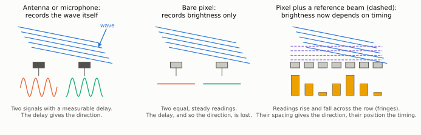
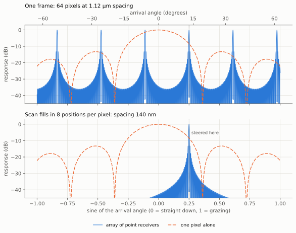
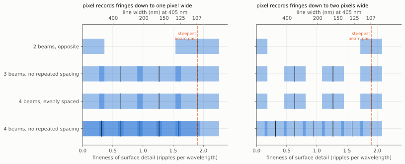
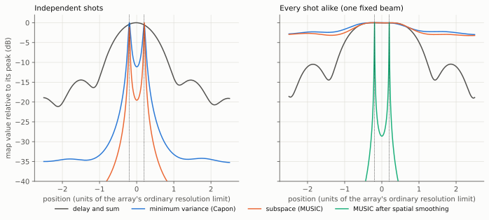
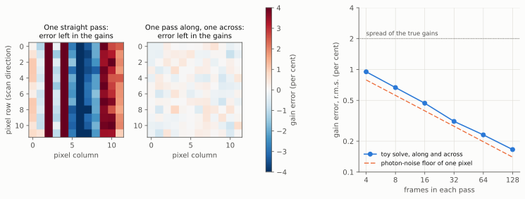
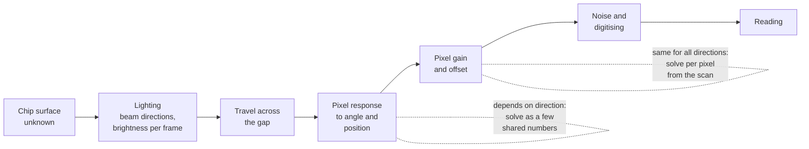

# Beamforming and array processing: what treating the pixels as an array gives

This is the write-up of plan item B2, one of the four deep research studies
of the [project plan](../plan.md). It covers beamforming and array
processing as practised in acoustics, sonar, medical ultrasound and radio
astronomy, and asks what those fields offer an image sensor that is scanned
over a chip. The overview of all fields is the
[reconstruction methods](../reconstruction-methods.md) survey. This page
goes deeper into one of them and does not repeat it.

Three sibling studies run beside this one, and this page only points to
them: radar and synthetic aperture (B1), satellite and astronomical
multi-frame reconstruction (B3), and ptychography and lensless coherent
imaging (B4).

No hardware is involved. Everything here is reading, reasoning and small
calculations, to feed the simulator.

A radio telescope, a sonar or an ultrasound scanner is a set of many small
receivers whose signals are combined by computation. That combining is
called beamforming, and the set is called an array. The image sensor in
this project has eight million pixels, so it is natural to ask whether it
can be treated as a very large array, and what that would give. Tim's
phrase for the idea was "reverse beamforming".

The plan asked three questions. The short answers are these.

1. **What does treating the pixels as an array give beyond averaging?**
   Averaging thousands of readings only reduces noise. The array view adds
   five things: a way to count whether enough numbers are recorded at all
   (one frame records about 120 times too few, and the scan has to supply
   the rest); an explanation of what the scan does (it fills the gaps
   between pixels, which removes false copies of the picture but does not
   remove the blur of a single pixel); the fact that a pixel becomes a true
   wave receiver once a steady reference beam shines on it, which the
   leading candidate already has in the form of the mirror reflection from
   the chip; a design rule for choosing the directions of the laser beams;
   and the means to calibrate the sensor from the scan itself.

2. **Which of the cleverer array methods work on a sensor that records only
   brightness?** On bare brightness readings, none of the famous
   sharper-than-normal methods (minimum variance, MUSIC) work, because they
   need the timing of the wave and a pixel throws that away. They start to
   work when two conditions are met: a reference beam is present, and the
   lighting is changed between shots so that the shots are unrelated to
   each other. Even then they suit a few isolated features and not a dense
   chip layout. They are worth having as a tool for isolated features and
   as a check, not as the main way of making the picture. The methods that
   do carry over fully are the ones that undo the array's known blur by
   fitting, which is what the design's reconstruction already is.

3. **How do radio telescopes calibrate thousands of unknown receiver gains
   from the observation itself, and does that carry over?** They rely on
   having far more measurements than unknowns, and on the same quantity
   being measured by many different pairs of antennas. It carries over to
   pixel gains very well, better than in radio, and astronomers and
   infrared camera makers have calibrated detector arrays this way since
   about 1990. A toy calculation on this page recovers hidden pixel gains
   to within 20 per cent of the best that photon noise allows. It also
   shows a trap: **one straight pass cannot tell a streak in the sensor
   from a streak on the chip**, and a second pass in a different direction,
   or passes shifted sideways by unrelated amounts, removes the trap. The
   shape of a pixel's response carries over only in part: differences
   between pixels can be found from the scan, but the shape common to all
   pixels cannot be separated from the chip's own fine detail without
   something extra.

The study also turned up ideas that were not on anyone's list. The main
ones: choose the laser beam directions so that no spacing between them is
repeated, which roughly halves the number of beams needed; change the
lighting between frames on purpose so that the sharper methods become
usable; borrow the correction that antenna test ranges apply for their
measuring probe, which is the same problem as the pixel's response; and
look at sensors whose pixels are built to sense the direction of light.

For scale: the laser light in the leading candidate has a wavelength of
405 nm, about 200 times smaller than the width of a hair. A pixel is
1.12 µm wide, nearly three wavelengths. The features wanted are 100 nm, a
quarter of a wavelength and one eleventh of a pixel.

## Terms used on this page

Terms already in the [glossary](../glossary.md) are not repeated here.

| Term | Meaning |
|---|---|
| Array | A set of receivers at known positions whose readings are combined by computation. |
| Beamforming | Combining the readings of an array so that it responds to waves from one chosen direction or point. "Steering" is choosing that direction. |
| Delay and sum | The simplest beamformer: shift each receiver's signal by the travel time from the chosen point, then add. |
| Array response | How strongly an array, steered to one direction, still responds to waves from other directions. Its width sets the ordinary resolution limit of the array. |
| Grating lobes | False directions that an array cannot tell from the true one, because its receivers are spaced more than half a wavelength apart. |
| Element pattern | How one receiver alone responds to waves from each direction. For a pixel, its response to light from each angle. |
| Reference beam | A steady, known beam of the same laser light that falls on the sensor together with the light from the chip. Radio engineers call it a local oscillator. |
| Fringes | The bright and dark stripes formed where two beams of the same laser light overlap. |
| Snapshot (shot) | One complete reading of the array at one moment. |
| Correlation matrix | A table with one entry for every pair of receivers, saying how alike their signals are, averaged over many shots. |
| Minimum variance (Capon) | A beamformer that chooses its own weights from the correlation matrix to suppress everything except the chosen direction. |
| Subspace methods (MUSIC) | Methods that split the correlation matrix into a part caused by a few sources and a part caused by noise, and locate the sources very sharply. |
| Co-array | The set of all differences between the positions of the receivers of an array, taken in pairs. It decides which detail the array can measure. |
| Redundancy | Two different pairs of receivers that measure the same thing. Useful for calibration, wasteful for coverage. |
| Gain | The factor by which one receiver, here one pixel, multiplies what it receives. |
| Degeneracy | A change to the unknowns that leaves every measurement unchanged, so that no amount of data can detect it. |
| Near field | The region within about a wavelength of a surface, where detail finer than the wavelength can still be sensed. |

## How claims are marked

The rules are those of the [references](../references.md) page.

- A key in square brackets, such as [[BF14](#bf14)], means the statement is
  taken from that source in [section 12](#12-references).
- **Derived here** means worked out on this page or by the script
  [`docs/diagrams/make_beamforming_diagrams.py`](https://github.com/mithro/ccd-superres/blob/main/docs/diagrams/make_beamforming_diagrams.py), which prints every derived
  number quoted here.
- **Estimate**, **Assumption**, **Judgement** and **Unverified** have their
  meanings from the references page.

How far the sources were checked: every source in section 12 was confirmed
to exist in a bibliographic database on 14 November 2026. For the sources
marked "checked against the abstract" in section 12, the statement made here was checked
against the paper's abstract. **No full text was read for this study.**
Where this page says something about a source that goes beyond its title
and abstract, that statement comes from general knowledge of the work and
is marked Unverified.

## 1. The questions and the answers

This text table is the summary. The sections that follow give the working.

| Question from the plan | Answer | Status | Section |
|---|---|---|---|
| What does treating 8 million pixels as an array give beyond averaging? | A count of whether enough is recorded; an account of what the scan does and does not fix; wave reception through a reference beam; a design rule for beam directions; self-calibration | Derived here, with sources | 2, 3, 4 |
| Do minimum variance and subspace methods apply to brightness only? | Not to bare brightness. Yes with a reference beam and lighting that changes between shots, for isolated features only | Sources and a toy calculation | 5 |
| Does deconvolution of the array response apply? | Yes, fully. It is the design's reconstruction under another name. Its limits for crowded features are known and steep | Sources | 5.4 |
| How do radio telescopes calibrate gains from the observation? | More measurements than unknowns, and repeated measurements of the same quantity. A few numbers always stay unfixed | Sources | 6.1 |
| Does it carry over to pixel gains? | Yes, with precedent on detector arrays. One straight pass leaves streaks unfixed | Sources and a toy calculation | 6.2 to 6.4 |
| Does it carry over to pixel response? | In part. Differences between pixels: yes. The shape common to all pixels: only with extra information | Derived here, with sources | 6.5 |

## 2. What kind of array the sensor is

### 2.1 Three kinds of receiver

An antenna, a microphone or an ultrasound element records the wave itself:
how large it is at each instant. Two such receivers a distance apart see the
same wave at slightly different times, and that delay is what tells an array
where the wave came from [[BF1](#bf1), [BF2](#bf2)].

A pixel does not do this. Light waves rise and fall about 740 million
million times a second at 405 nm, and a pixel only counts how much light
arrived during an exposure. Two pixels lit by one wave give two equal
readings, with no trace of the delay between them.

There is one way to get the delay back. If a second, steady beam of the same
laser light falls on the pixels together with the first, the two beams add
where their waves are in step and cancel where they are out of step. The
brightness then varies from pixel to pixel in fringes, and the spacing and
position of the fringes carry the direction and timing of the first wave.
This is holography, and it has been done directly on camera sensors for
decades [[BF61](#bf61), [BF59](#bf59)].

*Figure: what each kind of receiver records when a wave arrives at a slant.
Left: two antennas or microphones record the wave itself, and the delay
between the two traces gives its direction. Middle: two bare pixels record
only brightness, which is the same at both, so the direction is lost. Right:
with a steady reference beam (dashed) added, the brightness varies along a
row of pixels, and the pattern holds the direction and timing of the wave.
Illustrative, not to scale.*

**What this means for the project.** Whether the pixels form an "array" in
the full sense is not a property of the sensor. It is a property of the
lighting. With a lamp or with a laser alone, the pixels are eight million
independent light meters, and array processing reduces to placing each
reading correctly and averaging. With a reference beam, they are an array
of wave receivers, and nearly all of array processing applies.

The leading candidate of the design
([section 4.7](../design.md#47-a-staged-path-to-the-picture-the-current-leading-candidate))
already has a reference beam without having called it one. A silicon chip
is mirror-like, so most of each laser beam is reflected as from a mirror
and reaches the sensor as a strong, steady beam. The weak light scattered
by the fine features lands on top of it. The mirror reflection is the
reference, and the features are read through the fringes they make with it.
(Derived here. The same reading of the geometry is behind the "mixing"
described in the [survey](../reconstruction-methods.md).)

### 2.2 Spacing, false copies, and the blur of one pixel

Array theory has a firm rule about spacing. If receivers are more than half
a wavelength apart, the array cannot tell certain directions from each
other, and its response has several equal peaks called grating lobes
[[BF1](#bf1), [BF3](#bf3)]. It is the same effect as a wagon wheel
appearing to turn backwards on film.

The pixels are 1.12 µm apart and half a wavelength is 202.5 nm, so the
pixels are 5.5 times too far apart. For a single frame the consequences are
in the table.

**Table 2.2a: the pixel grid as an array at 405 nm.** Derived here
(`array_factor` in [the script](https://github.com/mithro/ccd-superres/blob/main/docs/diagrams/make_beamforming_diagrams.py)), for ideal square pixels as wide as their
spacing.

| Quantity | Value | Unit |
|---|--:|---|
| Pixel spacing | 1,120 | nm |
| Spacing needed for no false directions (half a wavelength) | 202.5 | nm |
| Ratio of the two | 5.53 | |
| Angle between a true direction and its first false copy, near straight down | 21.2 | degrees |
| Indistinguishable directions across the whole range of angles | 5 | |
| Angle from straight down at which one ideal pixel stops responding to fringes | 21.2 | degrees |

The scan changes this. Each frame is taken with the sensor moved by a
fraction of a pixel, so over many frames the surface is sampled at
positions much closer together than the pixels. In array terms the scan
fills in the missing receivers. Radar does the same thing with one antenna
on a moving aircraft, which is the subject of study B1.

*Figure: how strongly a row of pixels, used as an array and steered to
14.5 degrees (dotted line), responds to light arriving from every other
angle. Top: one frame of 64 pixels. The blue curve has five equal peaks, so
light from five directions cannot be told apart. Bottom: the same pixels
after the scan has filled in 8 positions per pixel. Only the true peak
remains. The orange dashed curve in both plots is the response of a single
ideal pixel, which is the same in both: the scan does not change it.
Vertical scale in decibels, where every 20 dB is a factor of ten in
response. Scalar plane-wave formula for ideal pixels, not a result of the
simulator.*

The figure shows the two halves of the story. The scan removes the false
copies completely. It does nothing to the orange curve, the response of one
pixel. A pixel averages the light over its own width, so fringes narrower
than the pixel are mostly averaged away before any computation can touch
them. In array terms: the scan fixes the array, but the element pattern
stays.

**Table 2.2b: share of a fringe pattern that one ideal pixel records**,
against the angle between the two beams that make the fringes, one of them
arriving straight down. Derived here from the sinc formula
([glossary](../glossary.md)), for an ideal pixel 1.12 µm wide with sharp
edges. The real response is unknown until hardware exists
([design, section 4.9](../design.md#49-simulation-first-the-unknown-pixel-response-and-the-gate-before-hardware)).

| Angle between the beams (degrees) | Share recorded (%) |
|--:|--:|
| 10 | 66.2 |
| 20 | 5.7 |
| 30 | 21.5 |
| 45 | 2.3 |
| 60 | 12.6 |
| 72 | 11.1 |

In words: only light arriving within about 20 degrees of the reference beam
makes fringes that a pixel records well. This is the "pixel is the next
wall" finding of the survey, seen from the array side. Section 4 shows how
the choice of beam directions works within it.

### 2.3 Counting what is wanted against what is recorded

Array designers count degrees of freedom: how many independent numbers a
wave can carry through an opening, against how many the receivers record
[[BF103](#bf103), [BF104](#bf104), [BF105](#bf105)]. The same count for
this instrument is short and worth having.

**Table 2.3: numbers wanted and numbers recorded, for the area of chip
under the sensor.** Derived here (`counting_tables` in [the script](https://github.com/mithro/ccd-superres/blob/main/docs/diagrams/make_beamforming_diagrams.py)).

| Quantity | Value | Unit |
|---|--:|---|
| Finest repeat distance that light at 405 nm can carry away from the surface | 202.5 | nm |
| Spacing of samples needed to describe it | 101.25 | nm |
| Samples of the surface under the 3.68 × 2.76 mm sensor | 991,000,000 | |
| Pixels in one frame | 8,081,920 | |
| Surface samples per pixel area | 122 | |
| The same if both brightness and height are wanted | 245 | |
| Frames needed at the very least | 123 | |

In words: one frame holds about 120 times too few numbers to describe the
surface at the finest detail light can carry. No processing of a single
frame can make up the difference. The scan must deliver at least 122
usefully different readings of every pixel-sized area for each lighting
condition, and twice that if height is wanted as well. This is a floor, not
a target: readings that repeat each other do not count, and noise raises
the need further.

**What this means for the project.** The scan calculator should report
this ratio (useful readings per pixel area, against 122 or 245) next to the
sample counts it already gives. It is the first test of any scan setting.

## 3. Beyond averaging

### 3.1 What averaging gives

Adding N readings of the same thing reduces the noise by the square root of
N. This is also all that delay-and-sum beamforming gives against noise
[[BF1](#bf1)], and it is what the design calls shift and add.

**Table 3.1: noise reduction from averaging.** Derived here.

| Readings combined | Noise falls by a factor of | The same in decibels (dB) |
|--:|--:|--:|
| 100 | 10.0 | 20 |
| 1,000 | 31.6 | 30 |
| 13,000 | 114.0 | 41 |
| 100,000 | 316.2 | 50 |

Averaging cannot recover detail that never reached the pixel. Everything
else in this section is about what the array view adds to it.

### 3.2 A reference beam lifts weak light above the sensor's own noise

A pixel has a small electrical noise of its own, about 3 electrons per
reading in the design's starting values. Scattered light weaker than that
is lost in a single reading. With a strong reference beam the weak light is
not read directly: it is read through the fringes it makes with the
reference, and the fringes are much larger than the weak light alone. Radio
receivers have worked this way for a century, and it has been shown on
camera sensors, where the sensitivity reached the limit set by the
graininess of light itself [[BF60](#bf60)].

**Table 3.2: one pixel, one reading, with and without a reference beam.**
Derived here (`counting_tables` in [the script](https://github.com/mithro/ccd-superres/blob/main/docs/diagrams/make_beamforming_diagrams.py)), from the design's starting values of 4,500
electrons full well and 3 electrons read noise. The reference is assumed to
fill the well and to be perfectly steady. "Signal-to-noise" is the size of
the wanted signal divided by the noise.

| Scattered light (electrons) | Signal-to-noise, read directly | Signal-to-noise, read through fringes |
|--:|--:|--:|
| 0.1 | 0.03 | 0.63 |
| 1.0 | 0.32 | 2.00 |
| 10.0 | 2.29 | 6.31 |
| 100.0 | 9.58 | 19.76 |

In words: with a reference beam, light too weak to register by itself
becomes measurable. The weakest scattered light that one reading can detect
is about 1 part in 18,000 of the reference (5.6 × 10⁻⁵), and combining a
thousand readings lowers that a thousandfold. The two columns measure
slightly different things (brightness on the left, the strength of the wave
on the right), so the comparison shows the principle and is not an exact
ratio.

The cost is that the reference fills most of the pixel's capacity, and its
own graininess is the noise floor. That leads to a limit.

### 3.3 What cannot be done after the light is detected

Radar and sonar arrays remove a strong unwanted signal by steering a "null"
towards it in the computation [[BF12](#bf12)]. It is tempting to do the
same with the bright mirror reflection from the chip, and keep only the
weak scattered light.

This does not work on a camera. Each pixel reading already contains the
random graininess of all the light that fell on it, and that graininess is
set by the bright beam. Subtracting the bright beam's known pattern in the
computer removes the pattern and leaves its noise. (Derived here from the
photon noise model [[Janesick](../references.md)].) An unwanted bright beam
can only be removed before detection, by geometry: arranging that it misses
the sensor. Whether to keep the mirror reflection as a reference (section
3.2) or steer it off the sensor to save pixel capacity is therefore a real
design choice, and the simulator should be able to do either.

### 3.4 Steering and focusing after the fact

Once the pixels record a wave, through the reference, the recorded pattern
can be focused by computation onto any distance and any direction after the
measurement. For a regular grid of receivers this is done with the fast
Fourier transform, at a cost that grows only slightly faster than the number
of receivers. Radio astronomy has proposed whole telescopes on this
principle [[BF80](#bf80), [BF81](#bf81)]. For a camera it is the standard
numerical refocusing of holography. The pixel grid is exactly the regular
grid these methods want, so beamforming all eight million pixels is cheap.
The costly methods are the ones in section 5.

## 4. Beam directions as a sparse array

This section applies one piece of array theory to a question the design
has left open: from how many directions must the laser light come, and from
which?

### 4.1 The idea of the co-array

An array that works with averages over pairs of receivers does not see the
sky through its receivers one by one. It sees it through every *pair*, and
what a pair measures depends only on the *difference* between the two
positions. The set of all such differences is called the co-array, and it,
not the array, decides what can be measured. The idea covers radar, sonar,
ultrasound and radio astronomy alike [[BF14](#bf14)].

Two consequences are well established.

- **A few receivers can do the work of many.** N receivers form about N²/2
  pairs. If the positions are chosen so that no difference is repeated, N
  receivers measure as many distinct things as a full array of about N²/2
  would. Layouts with this property have been tabulated since the 1960s
  [[BF15](#bf15)], and modern versions give the positions by formula
  [[BF16](#bf16), [BF17](#bf17)]. Radars that send from several antennas
  and receive on several use the same counting [[BF18](#bf18),
  [BF19](#bf19)].
- **Repeated differences are not useless.** Two pairs with the same
  difference must agree, and that agreement calibrates the receivers
  (section 6.1). An array designer chooses between coverage and
  redundancy.

### 4.2 Applied to the laser beams

Take the leading candidate: several laser beams from the same laser,
arriving at steep slants from different sides, a mirror-like chip, and
pixels that record fringes only when two waves arrive from nearly the same
direction (section 2.2).

Light from beam A that has been scattered by a fine ripple of the surface
leaves in a new direction. If that direction happens to lie close to the
mirror reflection of beam B, the two overlap on the sensor and make broad
fringes that the pixels can record. So the pair of beams (A, B) measures
those ripples of the surface whose fineness matches the *difference in
direction* between A and B, within a margin set by how fine a fringe the
pixels can record.

That is a co-array. The beams play the part of receivers, and the surface
detail that can be measured is the set of pairwise differences between the
beam directions, each widened by the pixel's margin. (Derived here, for a
thin surface that scatters weakly. Status: **Estimate**, to be tested at
simulation level 3. Not found stated in this form in the sources read.)

*Figure: which surface detail four sets of laser beams can measure, in one
dimension. Each row is one choice of beam directions. Blue bars are the
detail covered, and a black tick marks the centre of the bar for each pair
of beams. The bottom scale counts ripples per wavelength (finer to the
right) and the top scale gives the matching line width at 405 nm. The
orange dashed line is the finest detail the steepest pair of beams reaches,
with beams at 72 degrees either side. Left: if pixels record fringes as
narrow as one pixel. Right: if they record fringes only down to two pixels
wide, the safer assumption. White gaps are detail that no pair of beams
measures. Simple band model: it leaves out how strongly each pair responds.*

**Table 4.2: coverage for four sets of beam directions**, one dimension,
steepest beams at 72 degrees (sine 0.95). Derived here (`coarray` in the
script). Coverage is the share of all detail between coarse and the
steepest-pair limit that at least one pair measures.

| Beams | Sines of the beam angles | Pairs | Distinct spacings | Coverage, fringes down to one pixel (%) | Coverage, fringes down to two pixels (%) |
|--:|---|--:|--:|--:|--:|
| 2 | −0.95, +0.95 | 1 | 1 | 38.1 | 19.0 |
| 3 | −0.95, −0.32, +0.95 | 3 | 3 | 100.0 | 57.1 |
| 4, evenly spaced | −0.95, −0.32, +0.32, +0.95 | 6 | 3 | 100.0 | 57.1 |
| 4, no repeated spacing | −0.95, −0.63, +0.32, +0.95 | 6 | 6 | 100.0 | 100.0 |

In words:

- **Two opposite beams leave most detail unmeasured.** They measure the
  very finest detail and the coarse detail, with a wide hole between.
- **Four evenly spaced beams do no better than three.** Their six pairs
  have only three different spacings, so half the pairs repeat the others.
- **Four beams with no repeated spacing cover everything**, even under the
  safer assumption about the pixel. The positions (0, 1, 4 and 6 steps
  along the range) are the classic four-element layout of [[BF15](#bf15)]
  (Unverified: the layout is recalled from the paper, not re-read).

In two dimensions the same counting gives a first estimate of how many
beams the instrument needs: at least 6 beams if pixels record fringes down
to one pixel wide, and at least 10 if only down to two pixels wide,
provided no spacing is repeated. (Estimate, from the area to be covered
divided by the area one pair covers. A real two-dimensional layout will
need somewhat more.) With evenly spaced beams the number is roughly double.

Three cautions belong with this result.

- With all beams on at once, every pair contributes at once, together with
  unwanted terms from scattered light meeting other scattered light. The
  pairs have to be separated, either by switching beams on two at a time,
  as the design already proposes, or inside the reconstruction.
- A beam layout with no repeated spacing gives up the redundancy that would
  help calibrate the beams themselves. Keeping one or two repeated spacings
  on purpose is the array designer's usual compromise.
- The margin of the pixel is the unknown pixel response again. The two
  panels of the figure bracket it.

**What this means for the project.** The directions of the beams should be
a parameter that the simulator can lay out by rule, with "no repeated
spacing" as one of the rules, and the coverage chart of this section should
be drawn for every approach that uses more than one beam.

## 5. Sharper methods on a brightness-only array

### 5.1 What the methods are and what they need

Delay and sum has a fixed sharpness set by the size of the array. Two
families of methods do better.

**Minimum variance**, or Capon's method, lets the data choose the weights
given to each receiver, so that everything except the point of interest is
suppressed as far as possible [[BF4](#bf4)]. **Subspace methods**, of which
MUSIC is the best known, locate a small number of sources far more sharply
than the array's ordinary limit [[BF5](#bf5), [BF6](#bf6)]. Their accuracy
is well understood and can approach the best any method could reach
[[BF7](#bf7)]. In medical ultrasound, minimum variance gave narrower and
cleaner images of closely spaced wire targets than delay and sum
[[BF38](#bf38)].

All of them work from the correlation matrix, and that brings four needs.

**Table 5.1: what the sharper methods need, and whether this instrument
can supply it.** Text table. Needs are from the sources cited. The last two
columns are derived here.

| Need | Why | Bare pixels | Pixels with a reference beam |
|---|---|---|---|
| The wave itself at each receiver, not its brightness | The correlation between receivers is built from the wave [[BF2](#bf2)] | Not available | Available, through the fringes |
| Many shots in which the sources vary independently of each other | Otherwise the matrix cannot separate one source from another [[BF8](#bf8)] | Not applicable | Not with one fixed laser beam: every shot is alike. Available if the lighting is changed between shots |
| More shots than receivers, by a factor of about two | Otherwise the matrix is too noisy to invert [[BF9](#bf9)] (Unverified: the factor is recalled, not re-read) | Not applicable | Available only on small tiles of pixels (section 5.5) |
| An exact model of the array | Small errors in the model make the methods cancel the very signal they seek [[BF10](#bf10), [BF11](#bf11), [BF38](#bf38)] | Not applicable | Needs the calibration of section 6 first |

The second need is the one most easily missed. Everything the chip scatters
from one laser beam is locked in step with that beam, so in the language of
array processing all the "sources" are fully coherent. The standard methods
fail in that case. Two repairs are known. One is to make the shots differ,
which here means changing the direction or the relative timing of the beams
between frames. The other, spatial smoothing, averages over shifted copies
of a regular array, at the cost of a smaller effective array
[[BF8](#bf8)].

### 5.2 A toy demonstration

*Figure: three methods looking at two point scatterers (dotted lines) that
are closer together than the array's ordinary resolution limit, at 0.4 of
that limit. The array is a row of 32 samples that record the wave, as
pixels do with a reference beam. Left: 200 shots in which the lighting of
the two scatterers is unrelated from shot to shot. Delay and sum (grey)
shows one blob. Minimum variance (blue) and MUSIC (orange) show two sharp
peaks in the right places. Right: 200 shots that are all alike, as with one
fixed laser beam. Minimum variance and MUSIC now fail completely. MUSIC
after spatial smoothing (green) works again. Vertical scale in decibels
below each curve's peak. Toy calculation with a perfect model of the array
and noise one tenth the size of the signal.*

**Table 5.2: depth of the dip between the two scatterers**, in decibels.
Derived here (`adaptive_demo` in [the script](https://github.com/mithro/ccd-superres/blob/main/docs/diagrams/make_beamforming_diagrams.py)). A dip of more than 3 dB counts
as separated. A value near zero means one merged blob.

| Method | Independent shots (dB) | Every shot alike (dB) |
|---|--:|--:|
| Delay and sum | −0.5 | 0.0 |
| Minimum variance (Capon) | 10.6 | 0.0 |
| Subspace (MUSIC) | 18.4 | 0.0 |
| MUSIC after spatial smoothing | not run | 28.2 |

In words: the sharper methods do separate features closer than the ordinary
limit, but only when the lighting varies between shots or the array is
smoothed, and this toy case flatters them: two isolated points, a perfect
model, low noise.

### 5.3 Routes that work from brightness

Several groups have extended these methods to receivers that record only
brightness. Each is a possible component for the simulator.

**Table 5.3: published ways to use subspace and correlation methods
without recording the wave.** Text table.

| Route | How it works | What it needs | Source |
|---|---|---|---|
| Reference beam | Fringes with a steady beam record the wave. Everything in 5.1 then applies | A steady reference: here the mirror reflection | [[BF59](#bf59), [BF60](#bf60), [BF61](#bf61)] |
| Paired lighting | Light the scene with beam A, with beam B, and with both together. The three brightness readings give what the wave readings would have given. From these the full table needed by subspace methods is built | A chosen set of lighting combinations. Stated for weak, localised scatterers, exact when there is no noise | [[BF50](#bf50)] |
| Brightness-only MUSIC | A version of MUSIC derived for brightness data, valid even when light bounces between scatterers | A few point-like scatterers | [[BF48](#bf48)] |
| Lifting | Treat every product of two unknowns as a new unknown, which turns the brightness problem into a linear one that can be solved exactly for sparse scenes | Very large memory: the number of unknowns is squared | [[BF49](#bf49)] |
| Fluctuation statistics | If the brightness of each feature flickers independently, the statistics of the flicker over many frames sharpen the picture | Independent flicker of each point. Developed for fluorescent dyes that blink | [[BF51](#bf51), [BF52](#bf52)] |
| Random lighting | Light the scene with many random speckle patterns that need not be known. The frame-to-frame variation holds detail up to twice as fine as one frame | Many frames under changing speckle. Proved for fluorescence, where brightness simply adds | [[BF53](#bf53), [BF54](#bf54), [BF55](#bf55), [BF56](#bf56)] |

Two remarks.

The paired-lighting route [[BF50](#bf50)] is the closest published
relative of the design's beam pairs. It is worth a careful reading at full
text by whoever builds the stage 2 reconstruction, because it states which
lighting combinations are sufficient.

The last two routes come from fluorescence microscopy, where each point
glows independently. A chip surface under laser light does not behave like
that: its points reflect in step with each other. The published guarantee
of doubled resolution [[BF54](#bf54)] therefore does not transfer as it
stands. Whether a version holds for a reflecting surface is an open
question that the simulator can answer cheaply (**Judgement**). A related
optical method uses projected speckle on reflecting and transmitting
samples [[BF109](#bf109)].

### 5.4 Undoing the array's blur by fitting

The other way to beat delay and sum is to treat its blurred map as a known
blur of the true scene, and solve for the scene. Wind-tunnel acoustics has
compared many such methods on shared test cases [[BF32](#bf32)]: methods
that fit point sources one at a time, methods that fit the whole map, and
methods that prefer scenes made of few sources [[BF33](#bf33),
[BF34](#bf34), [BF35](#bf35)]. Array processing has the same family under
the name of sparse reconstruction [[BF20](#bf20), [BF21](#bf21),
[BF22](#bf22), [BF23](#bf23)], including versions that do not force
features onto a grid [[BF24](#bf24), [BF25](#bf25), [BF26](#bf26)].

This family needs no correlation matrix and no independent shots. It needs
only a model of how the scene produces the readings, and that is the
forward model the simulator is built around. The design's reconstruction is
a member of this family already, as the survey noted.

What this literature adds is a firm statement of the limit. Features can be
located more finely than the ordinary resolution limit, but the cost in
noise grows very fast with how crowded they are [[BF27](#bf27),
[BF28](#bf28)].

**Table 5.4: how the noise cost of separating crowded point features
grows.** The law is from [[BF28](#bf28)] (abstract): the error grows as the
"times finer" factor raised to the power 2p − 1, where p is the number of
features crowded within one resolution limit. The numbers are that scale
factor, worked out here (`crowding_table` in [the script](https://github.com/mithro/ccd-superres/blob/main/docs/diagrams/make_beamforming_diagrams.py)), not exact errors.

| Times finer than the ordinary limit | 1 feature alone | 2 crowded features | 3 crowded features |
|--:|--:|--:|--:|
| 1.5 | 1.5 | 3.4 | 7.6 |
| 2.0 | 2.0 | 8.0 | 32.0 |
| 3.0 | 3.0 | 27.0 | 243.0 |
| 4.0 | 4.0 | 64.0 | 1,024.0 |

In words: locating one isolated edge or line three times finer than the
limit costs a factor of 3 in noise, which thousands of readings easily pay
for (table 3.1). Separating three lines packed that tightly costs a factor
of 243. Dense rows of lines, which are what a chip mostly is, sit in the
right-hand columns. This puts a number on the survey's statement that
detecting and locating is far easier than resolving, and it is the reason
stage 3 of the leading candidate reports a partly inferred picture and not
a true one. Statistical analyses of two-point resolution reach the same
conclusion by another route [[BF29](#bf29), [BF30](#bf30)].

### 5.5 Cost: the correlation matrix does not fit

The methods of 5.1 need one number for every pair of receivers.

**Table 5.5: size of the correlation matrix.** Derived here
(`counting_tables` in [the script](https://github.com/mithro/ccd-superres/blob/main/docs/diagrams/make_beamforming_diagrams.py)), at 8 bytes per entry.

| Receivers treated as one array | Number of receivers | Entries | Memory (GB) | Such tiles on the sensor |
|---|--:|--:|--:|--:|
| Tile of 16 × 16 pixels | 256 | 65,536 | 0.0005 | 31,570 |
| Tile of 32 × 32 pixels | 1,024 | 1,048,576 | 0.008 | 7,892 |
| Tile of 64 × 64 pixels | 4,096 | 16,777,216 | 0.134 | 1,973 |
| Whole sensor | 8,081,920 | 6.5 × 10¹³ | 523,000 | 1 |

In words: correlation methods are possible only on small tiles of pixels,
each processed on its own. That suits the hundreds of processor cores Tim
has said are available, since tiles are independent jobs. Radio telescopes
with many antennas do the same, combining antennas into stations first
(Unverified: general knowledge of such instruments).

### 5.6 Verdict

**Judgement.** The survey's verdict of "not recommended" for minimum
variance and MUSIC is refined, not overturned:

- On bare brightness readings they do not apply.
- With the mirror reflection as reference and with lighting that changes
  between frames, they apply, on tiles, to isolated features: line ends,
  single defects, sparse contacts. That is a stage 3 tool.
- For the picture itself, fitting the forward model remains the method. It
  already gives what minimum variance would add, without needing
  independent shots.
- One cheap by-product is worth keeping. Ultrasound uses the agreement
  between the signals across the array as a quality measure for every
  point of the image [[BF39](#bf39), [BF40](#bf40)]. The same measure,
  computed between pictures refocused from different parts of the sensor,
  would flag regions where the model is wrong.

## 6. Self-calibration

### 6.1 How radio telescopes do it

A radio telescope with N antennas measures one number for every pair of
antennas, about N²/2 numbers, at every instant. Each antenna has one
unknown gain that drifts with time. So the unknowns grow as N and the
measurements as N², and beyond a handful of antennas there are far more
measurements than unknowns.

**Table 6.1: measurements against unknown gains in a radio array.**
Derived here from the pair-counting formula. The antenna counts are
examples of the sizes of real arrays (Unverified: recalled, not taken from
the sources' abstracts).

| Antennas | Pairs measured at each instant | Unknown gains | Measurements per unknown |
|--:|--:|--:|--:|
| 27 | 351 | 27 | 13.0 |
| 64 | 2,016 | 64 | 31.5 |
| 350 | 61,075 | 350 | 174.5 |

Three techniques use this surplus.

- **Closure quantities.** Certain combinations of three or four pairs are
  completely unaffected by the antenna gains, whatever they are. These can
  be used to make images with no calibration at all [[BF63](#bf63),
  [BF64](#bf64)].
- **Self-calibration.** Guess the image, solve for the gains that best fit
  it, improve the image using those gains, and repeat. This is the standard
  method [[BF65](#bf65)], and the survey cites its founding papers.
- **Redundant calibration.** Build the array so that many different pairs
  have exactly the same spacing. They should then measure exactly the same
  number, and any disagreement is due to the gains alone. The gains can be
  solved without knowing anything about the sky [[BF65](#bf65),
  [BF66](#bf66), [BF67](#bf67)].

The fast solvers for the gain step reduced its cost from growing as the
cube of the number of receivers to growing as the square [[BF71](#bf71)].

The field has also documented the limits, and they matter as much as the
method.

- **A few numbers always stay unfixed.** Redundant calibration leaves an
  overall brightness scale, an overall timing offset and a tilt in two
  directions undetermined, four numbers in all, which must come from
  outside knowledge [[BF66](#bf66), [BF67](#bf67)] (Unverified: the count
  of four is recalled from these papers. The abstract of [[BF67](#bf67)]
  says only that the method "resolves most of the internal degrees of
  freedom").
- **Real arrays are never perfectly redundant.** Antennas that are not
  quite identical, or not quite on the grid, leave errors in the solution
  [[BF67](#bf67)].
- **An incomplete guess of the image leaks into the gains.** If the sky
  model used in the loop leaves something out, the gains absorb part of the
  difference, and false sources appear or real ones are weakened
  [[BF69](#bf69), [BF70](#bf70)]. Redundant calibration is not immune
  [[BF68](#bf68)].
- **Gains that depend on direction are much harder.** Each antenna's
  sensitivity varies with direction, and so does the air above it. Solving
  for this needs bright known sources in several directions, or a model
  with few numbers [[BF72](#bf72), [BF75](#bf75), [BF76](#bf76),
  [BF77](#bf77), [BF78](#bf78), [BF79](#bf79)].

Sonar and radar have the matching problem of not knowing exactly where
their receivers are, and solve for the shape of the array from signals of
opportunity [[BF83](#bf83), [BF84](#bf84)]. The mathematics of when such
"solve for the instrument and the scene together" problems have a unique
answer has been worked out more recently [[BF85](#bf85), [BF86](#bf86),
[BF87](#bf87)].

### 6.2 The closest precedent is not radio

The radio problem has a nearer relative that uses a detector array just
like this one. In 1991 astronomers showed that the gain of every pixel of a
CCD can be found from several exposures of the same unknown scene, shifted
relative to each other, with no uniformly lit calibration frame at all
[[BF88](#bf88)]. Each patch of sky is seen by several different pixels, and
the pixels must agree.

The idea was developed in three directions that all bear on this project.

- **The pattern of shifts matters a great deal.** Some patterns of shifts
  encode the gains well at all scales and others do not. The good patterns
  resemble the antenna layouts of radio telescopes with good coverage
  [[BF89](#bf89), [BF90](#bf90)]. That is section 4's co-array again,
  applied to the scan path.
- **It works on live video.** Infrared cameras, whose pixels are very
  uneven, are corrected from the moving scene itself once the motion
  between frames is known [[BF91](#bf91), [BF92](#bf92)].
- **It works across a whole survey.** Large sky surveys calibrate every
  observation against every overlapping one, and design their overlaps for
  that purpose [[BF93](#bf93), [BF94](#bf94)].

### 6.3 Does it carry over

**Table 6.3: radio self-calibration mapped onto the scanning sensor.** Text
table. Derived here.

| Radio telescope | Scanning sensor | Carries over? |
|---|---|---|
| Antenna gain: a size and a timing offset, drifting over minutes | Pixel gain and offset: plain numbers, steady | Yes, and it is easier: no timing part, and no drift within a scan |
| Many pairs with the same spacing see the same thing | Many pixels pass over the same point of the chip | Yes. The redundancy is far greater: thousands of pixels per point |
| Four numbers left unfixed | Overall brightness, plus slow trends that trade against the frame-to-frame brightness of the light | Yes. Found in the toy calculation below |
| Imperfect redundancy | Pixels that differ in more than gain: shape of response, position errors | Yes, as a warning |
| Incomplete sky model leaks into gains | A reconstruction that is too smooth pushes real detail into the gain map | Yes, as a warning. Gains must be solved with a scene model at least as fine as the pixels |
| Sensitivity varying with direction | Pixel response varying with the angle of the light | Only as a model with few numbers (section 6.5) |
| Station or antenna positions | Frame positions, tilt and gap | Yes. Covered by the survey and by study B1 |

### 6.4 A toy calculation, and a trap

[The script](https://github.com/mithro/ccd-superres/blob/main/docs/diagrams/make_beamforming_diagrams.py) builds a toy sensor of 12 × 12 pixels with hidden gains that
vary by 2 per cent, scans it over a hidden random scene in whole-pixel
steps, lets the brightness of the light vary by 2 per cent from frame to
frame, adds photon noise, and solves for everything at once. Because every
reading is a product of a gain, a scene value and a frame brightness,
taking logarithms turns the problem into a set of sums that ordinary least
squares solves, as in [[BF88](#bf88)].

First, without any noise, it counts the degeneracies: the changes to the
unknowns that leave every reading unchanged.

**Table 6.4a: number of combinations the data cannot fix**, for four scan
patterns on the toy sensor. Derived here (`selfcal_demo` in [the script](https://github.com/mithro/ccd-superres/blob/main/docs/diagrams/make_beamforming_diagrams.py)).
One is the unavoidable minimum: the overall brightness scale.

| Scan pattern | Frame brightness known | Frame brightness unknown |
|---|--:|--:|
| One straight pass | 12 | 14 |
| Two passes, the second shifted sideways by 5 pixels | 5 | 8 |
| Three passes, shifted sideways by 0, 5 and 8 pixels | 1 | 4 |
| One pass along and one pass across | 1 | 4 |

In words:

- **One straight pass leaves one unknown per column.** A pixel column that
  is 1 per cent more sensitive gives exactly the same readings as a chip
  that is 1 per cent brighter along that track. No computation can tell
  them apart. This is the streaking familiar from line-scan satellite
  cameras, which study B3 covers.
- **One sideways shift is not enough.** It ties columns together in groups,
  and each group keeps one unknown.
- **Two sideways shifts with no common factor, or a second pass in another
  direction, remove all of it.** What remains is the overall scale alone.
- **If the brightness of each frame is not known, three more numbers stay
  unfixed**: the scale of the frame brightness, and a steady trend across
  the sensor in each of two directions, which can be traded against the
  frame brightness. That makes four, the same count as in radio (section
  6.1). A separate light monitor, or frames that overlap in time, removes
  them.

Tilting the sensor relative to the scan direction, as the design does to
get sampling across the scan, does not remove the trap. The argument does
not depend on the pixel grid: any smooth trend in sensitivity *across* the
direction of travel can be traded against the same trend in the chip.
(Derived here.) In practice random pixel-to-pixel gain differences average
out along a track and are not the worry. The worry is anything smooth and
fixed to the sensor, above all an uneven laser beam profile.

Then, with noise, the script solves for the gains.

*Figure: pixel gains solved from the scan alone, on a toy sensor of 12 × 12
pixels. Left: the error left in the solved gains after one straight pass,
in per cent. The columns are wrong by whole stripes, because the data
cannot fix them. Middle: the same after one pass along and one pass across.
The stripes are gone. Right: the error of the solved gains against the
number of frames in each pass (blue), with the best that photon noise
allows for a single pixel (orange dashed) and the 2 per cent spread of the
hidden gains (dotted). Toy calculation with whole-pixel steps, no blur, and
photon noise at 2,000 electrons per reading.*

**Table 6.4b: gain error against frames, toy sensor.** Derived here. The
floor is one divided by the square root of all the electrons a pixel
collected.

| Frames in each of the two passes | Gain error (%) | Photon-noise floor (%) | Ratio |
|--:|--:|--:|--:|
| 4 | 0.95 | 0.79 | 1.20 |
| 8 | 0.67 | 0.56 | 1.19 |
| 16 | 0.47 | 0.40 | 1.19 |
| 32 | 0.31 | 0.28 | 1.11 |
| 64 | 0.23 | 0.20 | 1.16 |
| 128 | 0.17 | 0.14 | 1.19 |

In words: the solve reaches within about 20 per cent of the floor, and the
error keeps falling as frames are added. Extending the floor to the real
sensor gives the scale of what is possible.

**Table 6.4c: photon-noise floor for one pixel's gain on the real
sensor.** Derived here. Estimate: it assumes the toy's behaviour holds at
full size, with blur and sub-pixel steps, which the simulator must confirm.

| Readings of the pixel in a scan | Electrons per reading | Floor on the gain error (%) |
|--:|--:|--:|
| 100 | 2,000 | 0.224 |
| 1,000 | 2,000 | 0.071 |
| 10,000 | 2,000 | 0.022 |
| 10,000 | 4,000 | 0.016 |

The design's starting value for the spread of pixel gains is 1 per cent.
A scan of a few hundred frames should therefore calibrate gains several
times better than they start, from the ordinary data.

**What this means for the project.** Self-calibration of gains should be
part of stage 1, as the design already intends. The scan plan must include
either a second direction or sideways shifts with no common factor. The
[calibration page](../calibration-and-test.md) lists three quantities the
data can never fix. This study adds the streak across the scan direction
as a fourth, which is fixable by the scan plan and not by an outside
measurement.

### 6.5 The pixel's response

A pixel's gain is one number. Its response is a shape: how its sensitivity
varies across its own width and with the angle of the light. This is the
key unknown of the whole design. Can the scan find it?

The argument has two parts. (Derived here, with the sources as support.)

- **Differences between pixels can be found.** If one pixel responds
  differently from its neighbours, it will disagree with them about every
  point of the chip that passes under both. That is the same redundancy
  that fixes the gains, and it can fix a few numbers per pixel in the same
  way.
- **The shape common to all pixels cannot be found from the scan alone.**
  If every pixel blurs the chip in the same way, the readings are the same
  as those of sharper pixels looking at a blurrier chip. This is the
  ambiguity of solving for a blur and a scene together, and it is only
  broken by knowing something about one of them [[BF86](#bf86),
  [BF87](#bf87)].

Other fields break the ambiguity in three ways, and all three are open to
this project.

- **Know something about the scene.** Astronomers find the combined blur of
  telescope and pixel from stars, which they know to be points
  [[BF95](#bf95)]. A chip has sharp straight edges, which serve the same
  purpose. A reference sample of known pattern does it more directly.
- **Describe the response with few numbers.** Radio astronomy does not
  solve for an antenna's full pattern from the sky. It uses a model with a
  few adjustable numbers [[BF72](#bf72), [BF76](#bf76)]. The calibration
  page already proposes this for the pixel.
- **Change the measurement so the two blurs behave differently.** Readings
  at several gaps, colours or beam angles change the optical blur and leave
  the pixel's own response fixed, which separates them.

One more field has met exactly this problem and has a standard cure, and it
appears in section 7.2.

### 6.6 The measurement written as a chain

Radio astronomy writes its whole instrument as a chain of simple steps,
each of which multiplies the signal by one effect, in the order the signal
meets them [[BF73](#bf73), [BF74](#bf74)]. Calibration software built on
that description can solve for any step while holding the others fixed.
The chain also makes plain which effects are the same for every direction
and which are not, and that distinction decides how hard each is to solve.

The design's software plan
([section 7.1](../design.md#71-approaches-as-named-configurations)) already
has swappable components. The lesson from radio astronomy is narrower:
keep the steps in physical order, keep each step's unknowns separate, and
make "solve for this step, holding the rest" a standard operation.

## 7. Arrays in the near field

Two fields use arrays close to the thing being measured. Neither was on the
original list.

### 7.1 Near-field acoustic holography

Acoustics has a method that images sound sources with detail much finer
than the wavelength of the sound. It places a grid of microphones very
close to the source, where the fine detail has not yet faded, and computes
the field back at the source surface [[BF36](#bf36), [BF37](#bf37)]. The
resolution is set by how close the microphones are and by how small a
signal they can detect above noise, not by the wavelength.

This is the acoustic twin of the project's near-field arrangement, and its
rule of thumb transfers directly: fine detail fades by a fixed number of
decibels for every step away from the surface, so the usable gap is the
range of signal sizes the sensor can handle divided by that rate of fading.

**Table 7.1: gap at which detail has faded by a given amount, at 405 nm.**
Derived here (`nearfield_table` in [the script](https://github.com/mithro/ccd-superres/blob/main/docs/diagrams/make_beamforming_diagrams.py)) from the standard fading law
[[Goodman](../references.md)]. The rule has the same form as the one used
in acoustic holography [[BF37](#bf37)] (Unverified: recalled from the book,
not re-read). "Faded by 40 dB" means the detail's signal is one hundredth
of its size at the surface.

| Line width (nm) | Angle of the light (degrees) | Fading per 100 nm of gap (dB) | Gap for 20 dB fading (nm) | Gap for 40 dB (nm) | Gap for 60 dB (nm) |
|--:|--:|--:|--:|--:|--:|
| 100 | 0 | 23.7 | 84 | 169 | 253 |
| 100 | 72 | 5.3 | 379 | 758 | 1,137 |
| 80 | 0 | 31.3 | 64 | 128 | 191 |
| 80 | 72 | 16.5 | 121 | 243 | 364 |
| 60 | 0 | 43.4 | 46 | 92 | 138 |
| 60 | 72 | 29.8 | 67 | 134 | 202 |
| 40 | 0 | 66.9 | 30 | 60 | 90 |
| 40 | 72 | 53.7 | 37 | 74 | 112 |

In words: with light straight down, 100 nm lines have faded a hundredfold
within 169 nm of the surface. With light at a steep slant the same lines
fade four and a half times more slowly, and are still at one hundredth
strength 758 nm away, about two wavelengths. Averaging can recover a
hundredfold loss (table 3.1). So slanted light does not only help in the
far-field arrangement. It also relaxes the gap that a near-field
arrangement would need for 100 nm lines, from a sixth of a micrometre to
most of a micrometre. For lines much finer than 100 nm the advantage
disappears. This agrees with the design's analysis and adds the
slanted-light column to it.

### 7.2 Antenna test ranges

To measure a large antenna, engineers scan a small probe over a flat plane
a few wavelengths in front of it, record the field, and compute what the
antenna does far away. It is a mature field with standards and decades of
error analysis [[BF96](#bf96)], and it is the nearest thing in the
literature to "a small sensor scanned over a plane close to the object".
Three of its methods answer problems this project has.

**Table 7.2: methods from near-field antenna measurement.** Text table.

| Their problem | Their method | The same problem here | Source |
|---|---|---|---|
| The probe is not a point. It has its own response to direction, which distorts the measurement | Probe compensation: sort the measurement by direction, and divide each direction by the probe's known response to it | The pixel's response to angle and to fine fringes | [[BF97](#bf97)] |
| The probe is not exactly where it should be | Processing that accepts readings at known but irregular positions, at a cost barely above the regular case | Frame positions that are irregular but can be estimated | [[BF98](#bf98)] |
| The timing of the wave is hard to measure at high frequencies | Measure brightness only, on two planes at different distances, and recover the timing by computation. Or add a reference signal and record fringes | Brightness-only pixels, with several gaps or a reference beam | [[BF99](#bf99), [BF100](#bf100), [BF101](#bf101)] |

The first row matters most. Probe compensation says that the pixel's
response is not an obstacle of a new kind. Once known, it is removed by a
division, direction by direction, and the only price is noise where the
response is small. Table 2.2b shows where that is: an ideal pixel responds
at 2 to 20 per cent beyond 20 degrees, so those directions cost a factor of
5 to 40 in noise, which averaging can pay (table 3.1). The response has to
be known, not large. That is one more reason the pixel response is the
quantity to pin down, and it is good news for whichever stage does so.
(Judgement, resting on the ideal-pixel figures.)

## 8. Ideas that were not on the list

Tim asked that the research turn up approaches nobody had named. This text
table lists what this study found, each with a verdict in the form the
plan's scouting uses.

| Idea | From | What it would give | Verdict |
|---|---|---|---|
| Choose beam directions so that no spacing between them repeats | Sparse arrays, section 4 | Full coverage with about half as many laser beams | Promote. Added to the plan as X17 |
| Plan the scan with a second direction, or sideways shifts with no common factor | Detector self-calibration, section 6.4 | Gains free of streaks, from the ordinary data | Promote. Added to the plan as X18 |
| Change the lighting between frames on purpose | Subspace methods, section 5 | Makes the sharper methods usable on isolated features; may give extra detail from frame-to-frame variation | Promote as a simulator experiment. Added to the plan as X19 |
| Probe compensation and the other methods of antenna test ranges | Section 7.2 | A standard, analysed way to remove the pixel's response once it is known | Promote. Added to the plan as X20 |
| Agreement between parts of the sensor as a quality map | Ultrasound, section 5.6 | A cheap flag for regions where the model is wrong | Promote as a diagnostic in the reconstruction |
| Keep the bright mirror reflection off the sensor | Section 3.3 | More of each pixel's capacity for the scattered light | Park. It gives up the reference beam. Compare both in the simulator |
| Sensors whose pixels sense the direction of light, using tiny gratings built over each pixel | Camera research [[BF106](#bf106)] | Pixels with a built-in, known response to angle | Pass to the sensor survey, B5. Hardware |
| Sensors whose pixels are true wave receivers, on a silicon photonics chip | [[BF107](#bf107), [BF108](#bf108)] | An optical array in the full radio sense | Reject for now. Published arrays are 4 × 4 and 8 × 8 pixels with resolution limited by pixel spacing [[BF107](#bf107)]. Noted for B5 |
| Sorting the light by its shape before detecting it, which removes the usual penalty for two close points | Quantum measurement theory [[BF31](#bf31)] | In principle, separation of close features at no extra noise cost | Reject for now. Needs precise optics in front of the sensor, and is stated for two glowing points, not a reflecting surface |
| Treat fixed sensor patterns and the moving scene as separable in space and time together | Airborne radar [[BF102](#bf102)] | Another view of self-calibration | Park. It leads to the same conditions as section 6.4 |

## 9. Recommended changes

Each study ends with the changes it recommends. Text table.

| Where | Change | Reason |
|---|---|---|
| Design, measurement model | State that with coherent light the mirror reflection acts as a reference beam, and make its presence on the sensor a setting | Sections 2.1, 3.2, 3.3 |
| Design, leading candidate, stage 2 | Lay out the beam directions by the no-repeated-spacing rule, and draw the coverage chart of section 4 for each layout. First estimate 6 to 10 beams | Section 4 |
| Design, scan plan | Require a second scan direction, or sideways shifts with no common factor, in any scan used for calibration | Section 6.4 |
| Calibration page | Add the streak across the scan direction to the list of what the data cannot fix, with the scan plan as its cure. Add a monitor of frame brightness, or its absence, as a stated choice | Section 6.4 |
| Calibration page | Solve for pixel response as differences per pixel plus a shared shape of few numbers. Treat the shared shape as needing a known scene, several gaps, or sharp edges | Section 6.5 |
| Scan calculator | Report useful readings per pixel area against the floor of 122, or 245 with height | Section 2.3 |
| Simulator parameters | Beam direction layout rule; reference beam on or off the sensor; lighting changed between frames (direction, relative timing, speckle); frame brightness known or unknown | Sections 3 to 6 |
| Simulator components | A tile-wise correlation step with minimum variance and MUSIC, as an optional stage 3 tool. An agreement map between parts of the sensor as a standard diagnostic | Sections 5.5, 5.6 |
| Simulator structure | Keep the forward model as an ordered chain with separate unknowns per step, and make "solve one step, hold the rest" standard | Section 6.6 |
| Staged plan | Gain self-calibration in stage 1 with the scan plan above. Sharper methods on isolated features in stage 3 | Sections 5.6, 6.4 |
| Reading list for the stage 2 build | Full-text reading of [[BF50](#bf50)] and [[BF14](#bf14)] | Sections 4.2, 5.3 |

## 10. Questions for Tim

1. **Can the stage move the sensor in two directions, or only one?** The
   streak-free calibration of section 6.4 needs either a second direction
   or passes shifted sideways by chosen amounts. Sideways shifts need only a
   coarse second axis.
2. **Is a small light monitor acceptable as hardware later?** One
   photodiode watching the laser removes three of the four unfixed numbers
   of section 6.4. Without it they must come from overlap between frames.
3. **Is changing the lighting from frame to frame acceptable?** Switching
   between beams is already in the design. Section 5 suggests also varying
   their relative timing or adding a moving diffuser, in simulation first.

## 11. Limits of this study

- **No full texts were read.** Statements about sources rest on abstracts,
  or where marked Unverified on general knowledge of well-known work. The
  two sources that most deserve a full reading are named in section 9.
- **The co-array result of section 4 is this page's own derivation.** It
  assumes a thin surface that scatters weakly and a strong mirror
  reflection. Real chip surfaces have height comparable to the wavelength
  and scatter strongly. The result needs testing at simulation levels 3
  and 4 before it is relied on.
- **Every calculation here is a toy.** One dimension or a 12 × 12 sensor,
  whole-pixel steps, ideal pixels, no blur. They show which effects exist
  and roughly how large they are. They are not predictions.
- **The pixel's real response is unknown**, as throughout the project.
  Tables 2.2b and 4.2 use an ideal pixel and bracket the uncertainty with
  two assumptions.
- **The sharper methods were tested with a perfect model.** Their known
  weakness is sensitivity to model error, which the toy does not include.
- **Sibling studies may overlap.** Motion-based filling of the array
  belongs to B1, streaking in line-scan cameras to B3, and reference-free
  recovery of the wave to B4. Where they reach different conclusions, the
  difference should be settled in plan item C1.

## 12. References

All entries were confirmed to exist in OpenAlex or Crossref on 14 November
2026. "Checked against the abstract" means the statement made on this page
was checked against the paper's abstract. "Existence checked only" means
only that the work exists as cited, and what this page says about it is
general knowledge of the work. No full text was read.

Textbook keys [Goodman] and [Janesick] are on the shared
[references](../references.md) page.

### Array processing: foundations

(bf1)=
[BF1] Van Veen and Buckley, "Beamforming: a versatile approach to spatial
filtering", IEEE ASSP Magazine, 1988.
[doi:10.1109/53.665](https://doi.org/10.1109/53.665). Existence checked only.

(bf2)=
[BF2] Krim and Viberg, "Two decades of array signal processing research: the
parametric approach", IEEE Signal Processing Magazine, 1996.
[doi:10.1109/79.526899](https://doi.org/10.1109/79.526899). Existence checked
only.

(bf3)=
[BF3] Van Trees, *Optimum Array Processing*, Wiley, 2002.
[doi:10.1002/0471221104](https://doi.org/10.1002/0471221104). Existence
checked only.

(bf4)=
[BF4] Capon, "High-resolution frequency-wavenumber spectrum analysis",
Proceedings of the IEEE, 1969.
[doi:10.1109/proc.1969.7278](https://doi.org/10.1109/proc.1969.7278).
Existence checked only.

(bf5)=
[BF5] Schmidt, "Multiple emitter location and signal parameter estimation",
IEEE Transactions on Antennas and Propagation, 1986.
[doi:10.1109/tap.1986.1143830](https://doi.org/10.1109/tap.1986.1143830).
Existence checked only.

(bf6)=
[BF6] Roy and Kailath, "ESPRIT: estimation of signal parameters via rotational
invariance techniques", IEEE Transactions on Acoustics, Speech, and Signal
Processing, 1989. [doi:10.1109/29.32276](https://doi.org/10.1109/29.32276).
Existence checked only.

(bf7)=
[BF7] Stoica and Nehorai, "MUSIC, maximum likelihood, and Cramer-Rao bound",
IEEE Transactions on Acoustics, Speech, and Signal Processing, 1989.
[doi:10.1109/29.17564](https://doi.org/10.1109/29.17564). Existence checked
only.

(bf8)=
[BF8] Shan, Wax and Kailath, "On spatial smoothing for direction-of-arrival
estimation of coherent signals", IEEE Transactions on Acoustics, Speech, and
Signal Processing, 1985.
[doi:10.1109/tassp.1985.1164649](https://doi.org/10.1109/tassp.1985.1164649).
Existence checked only.

(bf9)=
[BF9] Reed, Mallett and Brennan, "Rapid convergence rate in adaptive arrays",
IEEE Transactions on Aerospace and Electronic Systems, 1974.
[doi:10.1109/taes.1974.307893](https://doi.org/10.1109/taes.1974.307893).
Existence checked only.

(bf10)=
[BF10] Li, Stoica and Wang, "On robust Capon beamforming and diagonal
loading", IEEE Transactions on Signal Processing, 2003.
[doi:10.1109/tsp.2003.812831](https://doi.org/10.1109/tsp.2003.812831).
Existence checked only.

(bf11)=
[BF11] Carlson, "Covariance matrix estimation errors and diagonal loading in
adaptive arrays", IEEE Transactions on Aerospace and Electronic Systems, 1988.
[doi:10.1109/7.7181](https://doi.org/10.1109/7.7181). Existence checked only.

(bf12)=
[BF12] Frost, "An algorithm for linearly constrained adaptive array
processing", Proceedings of the IEEE, 1972.
[doi:10.1109/proc.1972.8817](https://doi.org/10.1109/proc.1972.8817).
Existence checked only.

### Co-arrays and sparse layouts

(bf14)=
[BF14] Hoctor and Kassam, "The unifying role of the coarray in aperture
synthesis for coherent and incoherent imaging", Proceedings of the IEEE, 1990.
[doi:10.1109/5.54811](https://doi.org/10.1109/5.54811). Checked against the
abstract.

(bf15)=
[BF15] Moffet, "Minimum-redundancy linear arrays", IEEE Transactions on
Antennas and Propagation, 1968.
[doi:10.1109/tap.1968.1139138](https://doi.org/10.1109/tap.1968.1139138).
Existence checked only.

(bf16)=
[BF16] Pal and Vaidyanathan, "Nested arrays: a novel approach to array
processing with enhanced degrees of freedom", IEEE Transactions on Signal
Processing, 2010.
[doi:10.1109/tsp.2010.2049264](https://doi.org/10.1109/tsp.2010.2049264).
Checked against the abstract.

(bf17)=
[BF17] Vaidyanathan and Pal, "Sparse sensing with co-prime samplers and
arrays", IEEE Transactions on Signal Processing, 2011.
[doi:10.1109/tsp.2010.2089682](https://doi.org/10.1109/tsp.2010.2089682).
Existence checked only.

(bf18)=
[BF18] Bliss and Forsythe, "Multiple-input multiple-output (MIMO) radar and
imaging: degrees of freedom and resolution", Asilomar Conference, 2003.
[doi:10.1109/acssc.2003.1291865](https://doi.org/10.1109/acssc.2003.1291865).
Existence checked only.

(bf19)=
[BF19] Li and Stoica, "MIMO radar with colocated antennas", IEEE Signal
Processing Magazine, 2007.
[doi:10.1109/msp.2007.904812](https://doi.org/10.1109/msp.2007.904812).
Existence checked only.

### Sparse reconstruction and the limits of super-resolution

(bf20)=
[BF20] Malioutov, Çetin and Willsky, "A sparse signal reconstruction
perspective for source localization with sensor arrays", IEEE Transactions on
Signal Processing, 2005.
[doi:10.1109/tsp.2005.850882](https://doi.org/10.1109/tsp.2005.850882).
Existence checked only.

(bf21)=
[BF21] Xenaki, Gerstoft and Mosegaard, "Compressive beamforming", Journal of
the Acoustical Society of America, 2014.
[doi:10.1121/1.4883360](https://doi.org/10.1121/1.4883360). Existence checked
only.

(bf22)=
[BF22] Gerstoft, Mecklenbräuker, Xenaki and Nannuru, "Multisnapshot sparse
Bayesian learning for DOA", IEEE Signal Processing Letters, 2016.
[doi:10.1109/lsp.2016.2598550](https://doi.org/10.1109/lsp.2016.2598550).
Existence checked only.

(bf23)=
[BF23] Stoica, Babu and Li, "SPICE: a sparse covariance-based estimation
method for array processing", IEEE Transactions on Signal Processing, 2011.
[doi:10.1109/tsp.2010.2090525](https://doi.org/10.1109/tsp.2010.2090525).
Existence checked only.

(bf24)=
[BF24] Candès and Fernandez-Granda, "Towards a mathematical theory of
super-resolution", Communications on Pure and Applied Mathematics, 2014.
[doi:10.1002/cpa.21455](https://doi.org/10.1002/cpa.21455). Existence checked
only.

(bf25)=
[BF25] Tang, Bhaskar, Shah and Recht, "Compressed sensing off the grid", IEEE
Transactions on Information Theory, 2013.
[doi:10.1109/tit.2013.2277451](https://doi.org/10.1109/tit.2013.2277451).
Checked against the abstract.

(bf26)=
[BF26] Liao and Fannjiang, "MUSIC for single-snapshot spectral estimation:
stability and super-resolution", Applied and Computational Harmonic Analysis,
2016.
[doi:10.1016/j.acha.2014.12.003](https://doi.org/10.1016/j.acha.2014.12.003).
Existence checked only.

(bf27)=
[BF27] Donoho, "Superresolution via sparsity constraints", SIAM Journal on
Mathematical Analysis, 1992.
[doi:10.1137/0523074](https://doi.org/10.1137/0523074). Existence checked
only.

(bf28)=
[BF28] Batenkov, Goldman and Yomdin, "Super-resolution of near-colliding point
sources", Information and Inference, 2021.
[doi:10.1093/imaiai/iaaa005](https://doi.org/10.1093/imaiai/iaaa005). Checked
against the abstract.

(bf29)=
[BF29] Smith, "Statistical resolution limits and the complexified Cramér-Rao
bound", IEEE Transactions on Signal Processing, 2005.
[doi:10.1109/tsp.2005.845426](https://doi.org/10.1109/tsp.2005.845426).
Existence checked only.

(bf30)=
[BF30] Shahram and Milanfar, "Imaging below the diffraction limit: a
statistical analysis", IEEE Transactions on Image Processing, 2004.
[doi:10.1109/tip.2004.826096](https://doi.org/10.1109/tip.2004.826096).
Existence checked only.

(bf31)=
[BF31] Tsang, Nair and Lu, "Quantum theory of superresolution for two
incoherent optical point sources", Physical Review X, 2016.
[doi:10.1103/physrevx.6.031033](https://doi.org/10.1103/physrevx.6.031033).
Checked against the abstract.

### Acoustic imaging and ultrasound

(bf32)=
[BF32] Merino-Martínez et al., "A review of acoustic imaging methods using
phased microphone arrays", CEAS Aeronautical Journal, 2019.
[doi:10.1007/s13272-019-00383-4](https://doi.org/10.1007/s13272-019-00383-4).
Existence checked only.

(bf33)=
[BF33] Yardibi, Li, Stoica and Cattafesta, "Sparsity constrained deconvolution
approaches for acoustic source mapping", Journal of the Acoustical Society of
America, 2008. [doi:10.1121/1.2896754](https://doi.org/10.1121/1.2896754).
Existence checked only.

(bf34)=
[BF34] Dougherty, "Functional beamforming for aeroacoustic source
distributions", AIAA/CEAS Aeroacoustics Conference, 2014.
[doi:10.2514/6.2014-3066](https://doi.org/10.2514/6.2014-3066). Existence
checked only.

(bf35)=
[BF35] Sijtsma, Merino-Martínez, Malgoezar and Snellen, "High-resolution
CLEAN-SC: theory and experimental validation", AIAA/CEAS Aeroacoustics
Conference, 2017.
[doi:10.2514/6.2017-3841](https://doi.org/10.2514/6.2017-3841). Existence
checked only.

(bf36)=
[BF36] Maynard, Williams and Lee, "Nearfield acoustic holography: I. Theory of
generalized holography and the development of NAH", Journal of the Acoustical
Society of America, 1985.
[doi:10.1121/1.392911](https://doi.org/10.1121/1.392911). Checked against the
abstract.

(bf37)=
[BF37] Williams, *Fourier Acoustics: Sound Radiation and Nearfield Acoustical
Holography*, Academic Press, 1999. Existence confirmed through a chapter
record,
[doi:10.1016/b978-012753960-7/50007-3](https://doi.org/10.1016/b978-012753960-7/50007-3).
Existence checked only.

(bf38)=
[BF38] Synnevåg, Austeng and Holm, "Adaptive beamforming applied to medical
ultrasound imaging", IEEE Transactions on Ultrasonics, Ferroelectrics, and
Frequency Control, 2007.
[doi:10.1109/tuffc.2007.431](https://doi.org/10.1109/tuffc.2007.431). Checked
against the abstract.

(bf39)=
[BF39] Mallart and Fink, "Adaptive focusing in scattering media through
sound-speed inhomogeneities: the van Cittert Zernike approach and focusing
criterion", Journal of the Acoustical Society of America, 1994.
[doi:10.1121/1.410562](https://doi.org/10.1121/1.410562). Existence checked
only.

(bf40)=
[BF40] Lediju, Trahey, Byram and Dahl, "Short-lag spatial coherence of
backscattered echoes: imaging characteristics", IEEE Transactions on
Ultrasonics, Ferroelectrics, and Frequency Control, 2011.
[doi:10.1109/tuffc.2011.1957](https://doi.org/10.1109/tuffc.2011.1957).
Existence checked only.

### Subspace imaging and brightness-only arrays

(bf48)=
[BF48] Marengo, Hernandez and Lev-Ari, "Intensity-only signal-subspace-based
imaging", Journal of the Optical Society of America A, 2007.
[doi:10.1364/josaa.24.003619](https://doi.org/10.1364/josaa.24.003619).
Checked against the abstract.

(bf49)=
[BF49] Chai, Moscoso and Papanicolaou, "Array imaging using intensity-only
measurements", Inverse Problems, 2011.
[doi:10.1088/0266-5611/27/1/015005](https://doi.org/10.1088/0266-5611/27/1/015005).
Checked against the abstract.

(bf50)=
[BF50] Novikov, Moscoso and Papanicolaou, "Illumination strategies for
intensity-only imaging", SIAM Journal on Imaging Sciences, 2015.
[doi:10.1137/140994617](https://doi.org/10.1137/140994617). Checked against
the abstract.

(bf51)=
[BF51] Dertinger, Colyer, Iyer, Weiss and Enderlein, "Fast, background-free,
3D super-resolution optical fluctuation imaging (SOFI)", PNAS, 2009.
[doi:10.1073/pnas.0907866106](https://doi.org/10.1073/pnas.0907866106).
Existence checked only.

(bf52)=
[BF52] Agarwal and Macháň, "Multiple signal classification algorithm for
super-resolution fluorescence microscopy", Nature Communications, 2016.
[doi:10.1038/ncomms13752](https://doi.org/10.1038/ncomms13752). Checked
against the abstract.

(bf53)=
[BF53] Mudry et al., "Structured illumination microscopy using unknown speckle
patterns", Nature Photonics, 2012.
[doi:10.1038/nphoton.2012.83](https://doi.org/10.1038/nphoton.2012.83).
Existence checked only.

(bf54)=
[BF54] Idier et al., "On the superresolution capacity of imagers using unknown
speckle illuminations", IEEE Transactions on Computational Imaging, 2018.
[doi:10.1109/tci.2017.2771729](https://doi.org/10.1109/tci.2017.2771729).
Checked against the abstract.

(bf55)=
[BF55] Mangeat et al., "Super-resolved live-cell imaging using random
illumination microscopy", Cell Reports Methods, 2021.
[doi:10.1016/j.crmeth.2021.100009](https://doi.org/10.1016/j.crmeth.2021.100009).
Existence checked only.

(bf56)=
[BF56] Labouesse et al., "Superresolution capacity of variance-based
stochastic fluorescence microscopy: from random illumination microscopy to
superresolved optical fluctuation imaging", Physical Review A, 2024.
[doi:10.1103/physreva.109.033525](https://doi.org/10.1103/physreva.109.033525).
Checked against the abstract.

(bf109)=
[BF109] García, Zalevsky and Fixler, "Synthetic aperture superresolution by
speckle pattern projection", Optics Express, 2005.
[doi:10.1364/opex.13.006073](https://doi.org/10.1364/opex.13.006073). Checked
against the abstract.

### Holography on camera sensors

(bf59)=
[BF59] Le Clerc, Collot and Gross, "Numerical heterodyne holography with
two-dimensional photodetector arrays", Optics Letters, 2000.
[doi:10.1364/ol.25.000716](https://doi.org/10.1364/ol.25.000716). Checked
against the abstract.

(bf60)=
[BF60] Gross and Atlan, "Digital holography with ultimate sensitivity", Optics
Letters, 2007.
[doi:10.1364/ol.32.000909](https://doi.org/10.1364/ol.32.000909). Checked
against the abstract.

(bf61)=
[BF61] Yamaguchi and Zhang, "Phase-shifting digital holography", Optics
Letters, 1997.
[doi:10.1364/ol.22.001268](https://doi.org/10.1364/ol.22.001268). Existence
checked only.

### Radio astronomy: calibration and imaging

(bf63)=
[BF63] Jennison, "A phase sensitive interferometer technique for the
measurement of the Fourier transforms of spatial brightness distributions of
small angular extent", Monthly Notices of the Royal Astronomical Society,
1958. [doi:10.1093/mnras/118.3.276](https://doi.org/10.1093/mnras/118.3.276).
Existence checked only.

(bf64)=
[BF64] Readhead and Wilkinson, "The mapping of compact radio sources from VLBI
data", Astrophysical Journal, 1978.
[doi:10.1086/156232](https://doi.org/10.1086/156232). Existence checked only.

(bf65)=
[BF65] Wieringa, "An investigation of the telescope based calibration methods
'redundancy' and 'self-cal'", Experimental Astronomy, 1992.
[doi:10.1007/bf00420576](https://doi.org/10.1007/bf00420576). Existence
checked only.

(bf66)=
[BF66] Liu, Tegmark, Morrison, Lutomirski and Zaldarriaga, "Precision
calibration of radio interferometers using redundant baselines", Monthly
Notices of the Royal Astronomical Society, 2010.
[doi:10.1111/j.1365-2966.2010.17174.x](https://doi.org/10.1111/j.1365-2966.2010.17174.x).
Checked against the abstract.

(bf67)=
[BF67] Dillon et al., "Redundant-baseline calibration of the Hydrogen Epoch of
Reionization Array", Monthly Notices of the Royal Astronomical Society, 2020.
[doi:10.1093/mnras/staa3001](https://doi.org/10.1093/mnras/staa3001). Checked
against the abstract.

(bf68)=
[BF68] Byrne et al., "Fundamental limitations on the calibration of redundant
21 cm cosmology instruments and implications for HERA and the SKA",
Astrophysical Journal, 2019.
[doi:10.3847/1538-4357/ab107d](https://doi.org/10.3847/1538-4357/ab107d).
Checked against the abstract.

(bf69)=
[BF69] Barry, Hazelton, Sullivan, Morales and Pober, "Calibration requirements
for detecting the 21 cm epoch of reionization power spectrum and implications
for the SKA", Monthly Notices of the Royal Astronomical Society, 2016.
[doi:10.1093/mnras/stw1380](https://doi.org/10.1093/mnras/stw1380). Existence.
Its finding is as summarised in the abstract of BF68.

(bf70)=
[BF70] Grobler, Nunhokee, Smirnov, van Zyl and de Bruyn, "Calibration
artefacts in radio interferometry. I. Ghost sources in Westerbork Synthesis
Radio Telescope data", Monthly Notices of the Royal Astronomical Society,
2014. [doi:10.1093/mnras/stu268](https://doi.org/10.1093/mnras/stu268).
Existence checked only.

(bf71)=
[BF71] Salvini and Wijnholds, "Fast gain calibration in radio astronomy using
alternating direction implicit methods: analysis and applications", Astronomy
and Astrophysics, 2014.
[doi:10.1051/0004-6361/201424487](https://doi.org/10.1051/0004-6361/201424487).
Checked against the abstract.

(bf72)=
[BF72] Wijnholds and van der Veen, "Multisource self-calibration for sensor
arrays", IEEE Transactions on Signal Processing, 2009.
[doi:10.1109/tsp.2009.2022894](https://doi.org/10.1109/tsp.2009.2022894).
Checked against the abstract.

(bf73)=
[BF73] Hamaker, Bregman and Sault, "Understanding radio polarimetry. I.
Mathematical foundations", Astronomy and Astrophysics Supplement Series, 1996.
[doi:10.1051/aas:1996146](https://doi.org/10.1051/aas:1996146). Existence
checked only.

(bf74)=
[BF74] Smirnov, "Revisiting the radio interferometer measurement equation. I.
A full-sky Jones formalism", Astronomy and Astrophysics, 2011.
[doi:10.1051/0004-6361/201016082](https://doi.org/10.1051/0004-6361/201016082).
Existence checked only.

(bf75)=
[BF75] Schwab, "Relaxing the isoplanatism assumption in self-calibration;
applications to low-frequency radio interferometry", Astronomical Journal,
1984. [doi:10.1086/113605](https://doi.org/10.1086/113605). Existence checked
only.

(bf76)=
[BF76] Bhatnagar, Cornwell, Golap and Uson, "Correcting direction-dependent
gains in the deconvolution of radio interferometric images", Astronomy and
Astrophysics, 2008.
[doi:10.1051/0004-6361:20079284](https://doi.org/10.1051/0004-6361:20079284).
Existence checked only.

(bf77)=
[BF77] van Weeren et al., "LOFAR facet calibration", Astrophysical Journal
Supplement Series, 2016.
[doi:10.3847/0067-0049/223/1/2](https://doi.org/10.3847/0067-0049/223/1/2).
Existence checked only.

(bf78)=
[BF78] Tasse et al., "Faceting for direction-dependent spectral
deconvolution", Astronomy and Astrophysics, 2018.
[doi:10.1051/0004-6361/201731474](https://doi.org/10.1051/0004-6361/201731474).
Existence checked only.

(bf79)=
[BF79] Kazemi et al., "Radio interferometric calibration using the SAGE
algorithm", Monthly Notices of the Royal Astronomical Society, 2011.
[doi:10.1111/j.1365-2966.2011.18506.x](https://doi.org/10.1111/j.1365-2966.2011.18506.x).
Existence checked only.

(bf80)=
[BF80] Tegmark and Zaldarriaga, "Fast Fourier transform telescope", Physical
Review D, 2009.
[doi:10.1103/physrevd.79.083530](https://doi.org/10.1103/physrevd.79.083530).
Existence checked only.

(bf81)=
[BF81] Thyagarajan, Beardsley, Bowman and Morales, "A generic and efficient
E-field Parallel Imaging Correlator for next-generation radio telescopes",
Monthly Notices of the Royal Astronomical Society, 2017.
[doi:10.1093/mnras/stx113](https://doi.org/10.1093/mnras/stx113). Existence
checked only.

### Solving for the instrument and the scene together

(bf83)=
[BF83] Rockah and Schultheiss, "Array shape calibration using sources in
unknown locations. Part I: far-field sources", IEEE Transactions on Acoustics,
Speech, and Signal Processing, 1987.
[doi:10.1109/tassp.1987.1165144](https://doi.org/10.1109/tassp.1987.1165144).
Existence checked only.

(bf84)=
[BF84] Weiss and Friedlander, "Array shape calibration using sources in
unknown locations: a maximum likelihood approach", IEEE Transactions on
Acoustics, Speech, and Signal Processing, 1989.
[doi:10.1109/29.45542](https://doi.org/10.1109/29.45542). Existence checked
only.

(bf85)=
[BF85] Balzano and Nowak, "Blind calibration of sensor networks", IPSN, 2007.
[doi:10.1109/ipsn.2007.4379667](https://doi.org/10.1109/ipsn.2007.4379667).
Existence checked only.

(bf86)=
[BF86] Ling and Strohmer, "Self-calibration and biconvex compressive sensing",
Inverse Problems, 2015.
[doi:10.1088/0266-5611/31/11/115002](https://doi.org/10.1088/0266-5611/31/11/115002).
Existence checked only.

(bf87)=
[BF87] Ahmed, Recht and Romberg, "Blind deconvolution using convex
programming", IEEE Transactions on Information Theory, 2014.
[doi:10.1109/tit.2013.2294644](https://doi.org/10.1109/tit.2013.2294644).
Existence checked only.

### Detector arrays calibrated from their own data

(bf88)=
[BF88] Kuhn, Lin and Loranz, "Gain calibrating nonuniform image-array data
using only the image data", Publications of the Astronomical Society of the
Pacific, 1991. [doi:10.1086/132932](https://doi.org/10.1086/132932). Checked
against the abstract.

(bf89)=
[BF89] Fixsen, Moseley and Arendt, "Calibrating array detectors",
Astrophysical Journal Supplement Series, 2000.
[doi:10.1086/313390](https://doi.org/10.1086/313390). Existence checked only.

(bf90)=
[BF90] Arendt, Fixsen and Moseley, "Dithering strategies for efficient
self-calibration of imaging arrays", Astrophysical Journal, 2000.
[doi:10.1086/308923](https://doi.org/10.1086/308923). Checked against the
abstract.

(bf91)=
[BF91] Hardie, Hayat, Armstrong and Yasuda, "Scene-based nonuniformity
correction with video sequences and registration", Applied Optics, 2000.
[doi:10.1364/ao.39.001241](https://doi.org/10.1364/ao.39.001241). Checked
against the abstract.

(bf92)=
[BF92] Hayat, Torres, Armstrong, Cain and Yasuda, "Statistical algorithm for
nonuniformity correction in focal-plane arrays", Applied Optics, 1999.
[doi:10.1364/ao.38.000772](https://doi.org/10.1364/ao.38.000772). Existence
checked only.

(bf93)=
[BF93] Padmanabhan et al., "An improved photometric calibration of the Sloan
Digital Sky Survey imaging data", Astrophysical Journal, 2008.
[doi:10.1086/524677](https://doi.org/10.1086/524677). Existence checked only.

(bf94)=
[BF94] Holmes, Hogg and Rix, "Designing imaging surveys for a retrospective
relative photometric calibration", Publications of the Astronomical Society of
the Pacific, 2012. [doi:10.1086/668656](https://doi.org/10.1086/668656).
Existence checked only.

(bf95)=
[BF95] Anderson and King, "Toward high-precision astrometry with WFPC2. I.
Deriving an accurate point-spread function", Publications of the Astronomical
Society of the Pacific, 2000.
[doi:10.1086/316632](https://doi.org/10.1086/316632). Existence checked only.

### Near-field antenna measurement

(bf96)=
[BF96] Yaghjian, "An overview of near-field antenna measurements", IEEE
Transactions on Antennas and Propagation, 1986.
[doi:10.1109/tap.1986.1143727](https://doi.org/10.1109/tap.1986.1143727).
Existence checked only.

(bf97)=
[BF97] Paris, Leach and Joy, "Basic theory of probe-compensated near-field
measurements", IEEE Transactions on Antennas and Propagation, 1978.
[doi:10.1109/tap.1978.1141855](https://doi.org/10.1109/tap.1978.1141855).
Existence checked only.

(bf98)=
[BF98] Wittmann, Alpert and Francis, "Near-field antenna measurements using
nonideal measurement locations", IEEE Transactions on Antennas and
Propagation, 1998. [doi:10.1109/8.668916](https://doi.org/10.1109/8.668916).
Checked against the abstract.

(bf99)=
[BF99] Isernia, Leone and Pierri, "Radiation pattern evaluation from
near-field intensities on planes", IEEE Transactions on Antennas and
Propagation, 1996. [doi:10.1109/8.496257](https://doi.org/10.1109/8.496257).
Existence checked only.

(bf100)=
[BF100] Yaccarino and Rahmat-Samii, "Phaseless bi-polar planar near-field
measurements and diagnostics of array antennas", IEEE Transactions on Antennas
and Propagation, 1999.
[doi:10.1109/8.768794](https://doi.org/10.1109/8.768794). Checked against the
abstract.

(bf101)=
[BF101] Laviada and Las-Heras, "Phaseless antenna measurement on non-redundant
sample points via Leith-Upatnieks holography", IEEE Transactions on Antennas
and Propagation, 2013.
[doi:10.1109/tap.2013.2262669](https://doi.org/10.1109/tap.2013.2262669).
Existence checked only.

### Other

(bf102)=
[BF102] Melvin, "A STAP overview", IEEE Aerospace and Electronic Systems
Magazine, 2004.
[doi:10.1109/maes.2004.1263229](https://doi.org/10.1109/maes.2004.1263229).
Existence checked only.

(bf103)=
[BF103] Miller, "Communicating with waves between volumes: evaluating
orthogonal spatial channels and limits on coupling strengths", Applied Optics,
2000. [doi:10.1364/ao.39.001681](https://doi.org/10.1364/ao.39.001681).
Existence checked only.

(bf104)=
[BF104] Piestun and Miller, "Electromagnetic degrees of freedom of an optical
system", Journal of the Optical Society of America A, 2000.
[doi:10.1364/josaa.17.000892](https://doi.org/10.1364/josaa.17.000892).
Existence checked only.

(bf105)=
[BF105] Lohmann, Dorsch, Mendlovic, Zalevsky and Ferreira, "Space-bandwidth
product of optical signals and systems", Journal of the Optical Society of
America A, 1996.
[doi:10.1364/josaa.13.000470](https://doi.org/10.1364/josaa.13.000470).
Existence checked only.

(bf106)=
[BF106] Wang, Gill and Molnar, "Light field image sensors based on the Talbot
effect", Applied Optics, 2009.
[doi:10.1364/ao.48.005897](https://doi.org/10.1364/ao.48.005897). Checked
against the abstract.

(bf107)=
[BF107] Aflatouni, Abiri, Rekhi and Hajimiri, "Nanophotonic coherent imager",
Optics Express, 2015.
[doi:10.1364/oe.23.005117](https://doi.org/10.1364/oe.23.005117). Checked
against the abstract.

(bf108)=
[BF108] Fatemi, Abiri and Hajimiri, "An 8×8 heterodyne lens-less OPA camera",
Conference on Lasers and Electro-Optics, 2017.
[doi:10.1364/cleo_at.2017.jw2a.9](https://doi.org/10.1364/cleo_at.2017.jw2a.9).
Existence checked only.

