# Satellite and astronomical image reconstruction from many shifted frames

Satellites and telescopes have the same problem as this instrument. Their
pixels are too coarse for the detail their optics deliver, the camera moves
while it looks, and the pointing wobbles. Over fifty years they have worked
out how to combine many slightly shifted, noisy pictures into one finer
picture, and how to work out the shifts from the pictures themselves. This
study reads that work for what it measured, not only what it proposed.

For a sense of scale: a pixel of the baseline sensor is 1.12 µm wide, about
one sixtieth of the width of a hair. A 100 nm chip feature is one eleventh
of that pixel. Positions therefore have to be known to about a hundredth of
a pixel.

This page is deep research study B3 of the [project plan](../plan.md#deep-research). It reaches six conclusions.

1. **Sum the rows in the computer, not on the chip.** Satellites shift the
   collected charge along the chip in step with the moving image. That only
   works if the speed is right to about one part in twice the number of rows
   summed. For this sensor's 2464 rows that would be 0.02%. Reading every
   row and lining the readings up afterwards removes the requirement, and
   turns speed error and wobble into things that are measured.
2. **Combining frames reliably gives pictures sampled 2 to 3 times finer
   than the pixel grid, and the published systems stop there** because they
   have between 2 and 35 frames. This instrument has about ten thousand
   readings of every pixel-sized patch, so it sits far outside that
   experience. The limit that remains is the pixel itself, which wipes out
   some detail sizes completely.
3. **Positions good to a hundredth of a pixel are routine, and a thousandth
   has been reached.** The best results come from treating the shape of the
   pixel's response and the positions as unknowns that are solved together.
4. **Weighting beats choosing.** Astronomers who keep only their sharpest
   frames throw away most of their light. Weighting every reading by how
   sharp it is, separately for each size of detail, is never worse and
   keeps all the light.
5. **A perfectly straight, regular scan is the worst case for
   calibration.** Survey astronomers found that a detector can only be
   calibrated from its own data if the same piece of sky lands on very
   different parts of it. A straight scan sends each surface point down a
   single column of pixels.
6. **Several ideas here are new to the project**: searching for the motion
   by brute force, building the pixel's response from the scan, a map of
   where the sampling is weak, a pixel response that changes with
   brightness, and sampling patterns matched to where the detail lies.
   They are listed in [section 6](#6-ideas-new-to-the-project).

None of this moves the physical limit set by the gap between sensor and
surface or by the wavelength of light
([design, section 4](../design.md#4-what-limits-the-resolution)). It decides
how close to that limit the instrument gets, and how much computation it
takes.

The page goes deeper into one field than
[section 3.5 of the reconstruction methods survey](../reconstruction-methods.md#35-satellite-and-astronomical-image-reconstruction)
and does not repeat it. Sibling studies cover radar (B1), arrays and
beamforming (B2) and ptychography (B4), and are only cross-referenced here.

## Terms used on this page

Other terms are in the shared [glossary](../glossary.md).

| Term | Meaning |
|---|---|
| Push-broom | A camera with one line of pixels that builds a picture line by line as it is carried over the scene, like a broom pushed across a floor. |
| Time-delay integration (TDI) | A sensor with many lines that moves the collected charge from line to line at the speed of the moving image, so one patch of scene is collected many times over and read once. |
| Dither | Here: a small deliberate shift of the camera between exposures, so that the pixel grid lands in a different place each time. |
| Undersampled | Said of a picture whose pixels are too coarse to record the finest detail the optics deliver. The lost detail does not vanish. It reappears as false coarse patterns, which is called aliasing. |
| Drizzle | The standard astronomical method for combining dithered frames: each input pixel is shrunk and "rained" onto a finer output grid. |
| Lucky imaging | Taking thousands of very short exposures through the unsteady atmosphere and keeping only the sharpest. |
| Point-spread function (PSF) | The blurred spot that a single point of light becomes in the picture. |
| Transfer function | For each fineness of pattern, the share of its contrast that survives the blur. The same information as the point-spread function, sorted by detail size. |
| Registration | Working out how far one frame is shifted against another. |
| Jitter | Fast unwanted wobble of the camera's pointing. |
| Co-addition | Adding registered frames together into one picture. |
| Sampling gain | How many times finer the combined picture's grid is than the pixel grid. It is not the same as a gain in sharpness ([section 3.3](#33-finer-sampling-is-not-finer-detail)). |

## How claims are marked

The labels are those of the shared
[references page](../references.md#how-claims-are-labelled).

| Mark | Meaning on this page |
|---|---|
| [[MF17](#mf17)] | Taken from that source in [section 9](#9-references). Each entry says whether the full text or only the abstract was read. |
| Derived here | Worked out on this page. Where a calculation is needed it is done by the named function in [`docs/diagrams/make_multiframe_diagrams.py`](https://github.com/mithro/ccd-superres/blob/main/docs/diagrams/make_multiframe_diagrams.py), which prints the number when run. |
| Estimate | A rough figure from this page's own simplified model, not confirmed by simulation. |
| Assumption | Chosen to make progress, with no source. |
| Judgement | A verdict or recommendation. |
| Unverified | Believed from memory or a secondary source, not checked against the primary one. |

Every "for this instrument" statement is this page's own reasoning,
**derived here**, and none has been tested in the simulator.

## 1. The questions and the short answers

The plan asks this study three questions. The table is a text table that
points to the section with the evidence.

| Question from the plan | Short answer | Where |
|---|---|---|
| How do push-broom and time-delay-integration sensors handle motion smear, and what does that say about our readout schemes? | They shift charge in step with the image, which needs the speed matched to a fraction of a percent and hides wobble inside the sum. Our readout should keep every row separate, with each row's exposure short, and do the sum afterwards. Charge shifting on the chip is only worth having if light is very scarce. | [Section 2](#2-motion-smear-how-scanning-cameras-handle-it) |
| How are many undersampled, shifted, noisy frames combined, with what measured gain and at what noise cost? | By placing readings on a finer grid (interlacing, drizzle), by solving a linear system (Fourier and optimal linear methods), or by fitting a model of the scene. Measured sampling gains are 2 to 3. The noise cost is small when there are a few times more frames than the minimum, and severe at the minimum. | [Sections 3](#3-combining-many-undersampled-frames) and [4](#4-lucky-imaging-choosing-or-weighting-frames) |
| How is the registration between frames estimated, and how accurate is it in practice? | By correlation of overlapping frames, refined by fitting a model of scene and instrument together. Practice reaches 0.02 pixels routinely and 0.001 to 0.002 pixels with a calibrated pixel response. | [Section 5](#5-registration-how-well-shifts-are-measured) |

## 2. Motion smear: how scanning cameras handle it

### 2.1 What the instruments do

A push-broom camera exposes each line for the time the scene takes to cross
one pixel, which is very little light. Time-delay integration (TDI) gets
more light by using many lines and moving the charge along with the image
[[MF1](#mf1)]. The figure shows the idea beside what this instrument can
do instead.

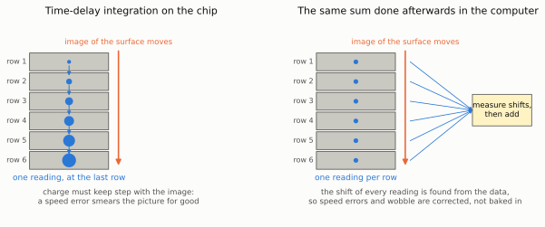

*Figure 1: two ways to collect the same patch of surface many times. Left:
time-delay integration. The charge collected from one patch (blue dot,
growing) is moved from row to row at the speed of the moving image and
read once at the last row. Right: every row is read separately and a
computer measures how far each reading has moved before adding them. Six
rows are drawn. Real sensors have from 128 to 4500. Illustrative, from
function `tdi_map`.*

**Table 2.1: scanning instruments that sum along the motion.** Figures are
from the sources in the last column.

| Instrument | Lines summed | Time to cross | Pixel size on the scene | What limits it | Source |
|---|--:|--:|---|---|---|
| Gaia star mapper (space) | 4500 | 4.42 s | 58.9 × 176.8 mas | Charge is moved at a fixed rate, so the spin rate must match. Bright stars use gates that shorten the sum to as few as 2 lines. | [[MF3](#mf3)] |
| HiRISE (Mars orbiter) | 8, 32, 64 or 128 | not stated | 1 µrad, 0.25 to 0.32 m | Smear above a quarter pixel if pointing moves more than 0.25 µrad in about 10 ms. Fewer lines are chosen when wobble is expected. | [[MF5](#mf5)] |
| ASTER short-wave infrared (Earth orbiter) | 6 separate lines, not summed | 356 ms between lines | not stated | Wobble between the lines shows as 0.2 pixels of mismatch | [[MF6](#mf6)] |
| Orthogonal-transfer CCD (telescope) | follows the image in both directions | up to 100 shifts per second | not applicable | After 100 s of tracking about 3% of the charge spreads into a halo | [[MF16](#mf16)] |

mas is a thousandth of a second of arc, and µrad a millionth of a radian.
Both are angles on the sky or ground.

Three weaknesses are documented.

**The speed must match.** If the charge and the image move at slightly
different speeds, the image slides across the charge during the sum. Over
$N$ lines with a fractional speed error $\delta$ the slide is $N\delta$
pixels, and a pattern with $f$ cycles per pixel keeps this share of its
contrast:

$$
\text{contrast kept} = \left|\frac{\sin(\pi N \delta f)}{\pi N \delta f}\right|
$$

In words: the smear grows with the number of lines summed, so the more
lines, the tighter the speed must be held. This uniform-smear formula is
**derived here** (function `tdi_mismatch`). Published analyses agree on the
trend: contrast falls as speed error and line count rise
[[MF11](#mf11), [MF12](#mf12)], one states that a 2% speed error costs 32%
of the contrast at the finest sampled pattern when the count goes from 32
to 96 lines [[MF13](#mf13)], and one that a 30% error with 16 lines leaves
almost none [[MF12](#mf12)]. The formula here gives a larger loss than
[[MF13](#mf13)] for the same case (contrast 0.84 at 32 lines and 0.04 at 96
lines). The abstracts do not give their formulas, so the difference is
unresolved and is marked **unverified**.

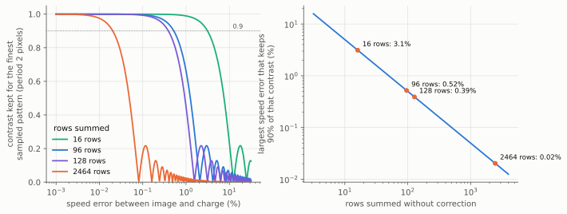

*Figure 2: what a speed error costs when rows are summed blindly. Left: the
contrast kept for the finest pattern a frame can sample (a period of two
pixels), against the speed error, for four numbers of rows. Right: the
largest speed error that keeps 90% of that contrast, against the number of
rows. Uniform-smear formula, derived here, from function `tdi_mismatch`.*

**Table 2.2: speed error allowed when rows are summed without correction**,
for 90% contrast at a period of two pixels (a total slide of half a
pixel). Derived here, function `tdi_mismatch`.

| Rows summed | Speed error allowed (%) | Contrast kept at a 2% error |
|--:|--:|--:|
| 16 | 3.1 | 0.96 |
| 32 | 1.6 | 0.84 |
| 96 | 0.52 | 0.04 |
| 128 | 0.39 | 0.19 |
| 2464 | 0.020 | 0.01 |

**Charge moves in steps while the image moves smoothly.** Each step leaves
the image to slide one line before the charge catches up. A study of
telescope drift scanning found that images narrower than about 0.85 pixels
(as a standard deviation) are badly stretched by this [[MF2](#mf2)]. In
sensors built with ordinary camera-chip technology the sum is done by
adding separate readings, which adds read noise each time, and designers
use moderate oversampling in space and time to get close to
charge-shifting performance [[MF10](#mf10)].

**Wobble is hidden inside the sum.** Motion faster than the crossing time
smears the picture and cannot be seen afterwards. Slower motion bends it.
HiRISE recovers the slower part after the fact, by comparing strips of the
scene that two overlapping detectors recorded at slightly different times
and solving for the wobble in terms of its frequencies [[MF5](#mf5)].
ASTER did the same with its six lines and cut the mismatch from 0.2 to
under 0.08 pixels [[MF6](#mf6)]. The French space agency now treats the
time offset between staggered lines as an asset that measures fast wobble
above what the gyroscopes can follow [[MF7](#mf7)].

### 2.2 What this says about our readout schemes

The [replaceable readout model](../design.md#57-sensor-control-and-readout-as-a-replaceable-model)
of the design lists what a readout scheme controls. The satellite
experience ranks the choices. This is a text table. All entries are
**derived here** from section 2.1 and are **judgements**.

| Readout choice | Verdict from this field | Reason |
|---|---|---|
| Read every row, each with an exposure of one line time, and add afterwards ("digital TDI") | Preferred | No speed matching. Wobble and speed error become measured quantities. Keeps the sub-pixel position of every row. One published digital scheme reports frame-to-frame motion fitted to better than 0.01 pixels [[MF14](#mf14)]. |
| Charge shifting on the chip (a true TDI sensor) | Park. Only if light is too scarce for digital summing. | Table 2.2: 2464 rows would need the speed right to 0.02%, and the sum destroys the information needed to measure the error. |
| Long exposure with the motion running | Reject for fine detail | It is TDI without the charge shifting: pure smear ([design, section 4.8](../design.md#48-motion-blur-cause-model-and-reversal)). |
| Shorter sums for bright areas, longer for dark | Worth modelling | Gaia switches the number of lines summed, from 4500 down to 2, to suit each star's brightness [[MF3](#mf3)]. The digital equivalent is to weight or drop rows per region after the fact, at no hardware cost. |
| Read only windows around what matters | Worth modelling as a second pass | Gaia sends down only small windows around detected stars [[MF3](#mf3)]. A fast coarse pass could choose the windows for a slow fine pass. |
| Rolling shutter, each row exposed at its own time | An asset, not a defect | It makes the sensor 2464 push-broom lines with known time offsets of 18.9 µs ([design, section 5.7](../design.md#57-sensor-control-and-readout-as-a-replaceable-model)), which is the arrangement HiRISE and ASTER use to measure wobble [[MF5](#mf5), [MF6](#mf6)]. Two detector lines leave blind frequencies where the wobble repeats exactly between them. Thousands of rows at different offsets leave none (**derived here**). |

**The price of digital summing is read noise.** Charge shifting reads once.
Digital summing reads $N$ times and adds read noise each time
[[MF10](#mf10)]. If each reading collects $s$ electrons of signal and the
read noise is $r$ electrons, the digital sum is as good as the on-chip one
only when photon noise dominates each reading, that is when $s$ is well
above $r^2$. In words: with a read noise of 3 electrons (**assumption**,
to be replaced by data item R2 of the plan) each one-line exposure needs
well over 9 electrons. This is the same conclusion as the design reached
for pulsed light ([design, section 4.8](../design.md#48-motion-blur-cause-model-and-reversal)):
the route needs a bright source. It is **derived here**.

## 3. Combining many undersampled frames

### 3.1 The family of methods

Every method starts from the same picture of the measurement, stated most
clearly for the Hubble telescope [[MF17](#mf17), [MF18](#mf18)]: the scene
is blurred by the optics, blurred again by the area of the pixel, and the
result is sampled once per pixel. A shift of the camera samples the same
blurred picture at new places. The methods differ in how they put the
samples back together.

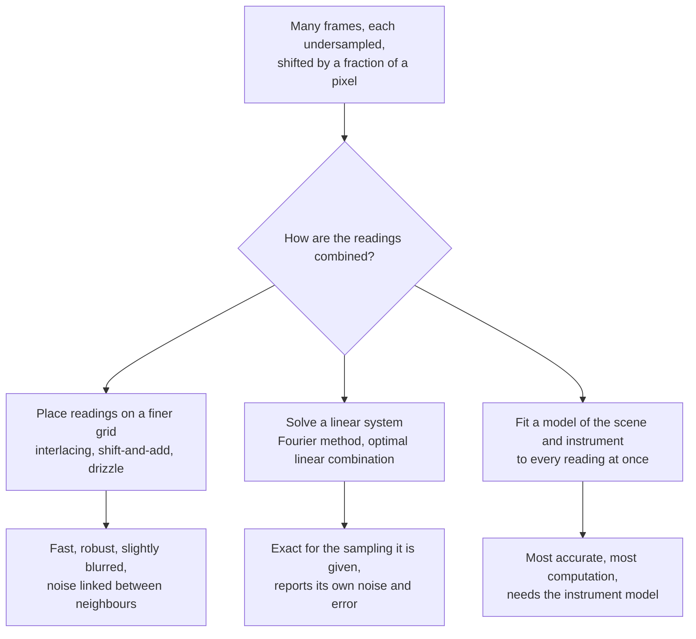

*Figure 3: the three families of methods for combining shifted frames, and
what each is known for. The design's main reconstruction
([design, section 6](../design.md#6-reconstruction)) belongs to the third
family. The first two are cheap first stages and cross-checks.*

**Table 3.1: methods for combining shifted frames.** A text table. "Read"
says how much of the source was read for this study.

| Method | What it does | Strength | Weakness | Source | Read |
|---|---|---|---|---|---|
| Interlacing | Puts each frame's readings on alternate points of a finer grid | No extra blur, noise stays independent | Needs shifts on an exact regular pattern | [[MF17](#mf17)] | Full text |
| Shift-and-add | Slides each pixel to its place and adds it onto a finer grid | Takes any shifts | Blurs by the pixel area a second time, and links the noise of neighbours | [[MF17](#mf17)] | Full text |
| Drizzle | Shift-and-add with each pixel shrunk to a smaller "drop" first | Takes any shifts, rotation and distortion. Weights each reading by its quality. Tolerates missing readings. | Does not undo any blur. Noise in neighbouring output pixels is linked. | [[MF17](#mf17)] | Full text |
| Fourier combination | Separates the overlapping false patterns algebraically, frequency by frequency | Exact, with no free settings | Needs pure shifts that are the same across the field | [[MF18](#mf18)] | Full text |
| Iterated drizzle | Starts from drizzle and repeats until the result, re-sampled, matches the frames | Removes drizzle's small artefacts and its extra blur | More frames needed when shifts are badly placed | [[MF20](#mf20)] | Abstract |
| Optimal linear combination | For each output point, finds the weights on nearby readings that best trade wanted blur shape against noise | Returns the noise and the error in blur shape for every output point. Works as a design tool for scan patterns. | Costly. Needs the pixel response and blur known in advance. | [[MF21](#mf21), [MF22](#mf22)] | Full text |
| Proper co-addition | Adds frames in the frequency domain, each weighted by its own transfer function | Loses no information for a steady scene, and its noise is independent from pixel to pixel | Assumes sampling is already adequate and noise is uniform | [[MF23](#mf23)] | Full text |
| Regularised fit | Finds the fine picture that best explains all frames, with a penalty against roughness | Handles blur and noise together | Result depends on the penalty | [[MF50](#mf50), [Farsiu2004](../references.md)] | Abstract |
| Learned combination | A neural network trained on examples | Best scores on satellite contests | Needs training data, and can invent detail | [[MF46](#mf46), [MF45](#mf45)] | Full text |

### 3.2 Measured gains and what they cost in noise

**Table 3.2: published gains from combining frames.** Sampling gain is the
ratio of the pixel grid to the output grid.

| System | Frames combined | Sampling gain | What was measured | Source | Read |
|---|--:|--:|---|---|---|
| Hubble Deep Field North | 9 pointings | 2.0 | Drops half a pixel wide. Photometry good to 0.015 magnitudes and star positions to 0.018 pixels in tests. | [[MF17](#mf17), [MF19](#mf19)] | Full text |
| Hubble Deep Field South | many, at varied angles | 2.5 | Output pixel 0.4 of an input pixel, drop 0.5 | [[MF19](#mf19)] | Full text |
| SPOT 5 satellite | 2 lines | 2.0 | 2.5 m pictures from two 5 m lines offset by half a pixel, followed by deblurring and noise removal. The paper notes only half the information of a true 2.5 m grid is present. | [[MF8](#mf8)] | Abstract |
| SkySat satellite, standard product | not stated | 1.25 | The operator's own product | [[MF45](#mf45)] | Full text |
| SkySat satellite, research methods | 35 | 2.0 | "A gain of 10 cm per pixel" in measured resolution over the standard product | [[MF44](#mf44), [MF45](#mf45)] | Full text |
| PROBA-V satellite | several, days apart | 3.0 | 300 m frames combined and scored against real 100 m frames. Learned methods beat interpolation on most scenes. | [[MF46](#mf46)] | Full text |
| Roman space telescope (simulated) | 4 to 6 | 4.4 | Output blur shape held to one part in a thousand where at least 5 frames overlap in the worst band. Fails where only 3 overlap. | [[MF22](#mf22)] | Full text |
| Mobile phone camera | a burst | not stated | Natural hand tremor supplies the shifts. 100 ms of computing per 12-megapixel frame on the phone. | [[MF47](#mf47)] | Full text |

The noise cost has three separate parts in this literature.

**Part 1: the method links the noise of neighbouring output pixels.** For
drizzle this is known exactly. If the drop is $p$ input pixels wide and the
output pixel $s$, with $r = p/s$, the true noise is larger than the noise
seen between neighbouring pixels by the factor

$$
R = \frac{r}{1 - 1/(3r)} \ \ (r \ge 1), \qquad R = \frac{1}{1 - r/3}\ \ (r \le 1)
$$

In words: the bigger the drop compared with the output pixel, the more each
reading is shared between neighbours and the more the picture looks
smoother than it is. For the usual settings, a drop of 0.6 and an output
pixel of 0.5, $R = 1.66$ [[MF17](#mf17)]. The information is not lost. It
has to be accounted for when judging what is real.

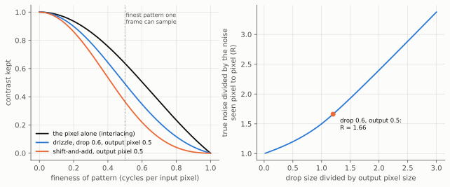

*Figure 4: left, the share of contrast kept against fineness of pattern
for three ways of combining frames. Black is the pixel alone, which is the
best any of them can do without deblurring. Drizzle (blue) loses a little
more, and shift-and-add (orange) a lot more. Right: drizzle's noise factor
R against the ratio of drop size to output pixel size. The dot marks the
usual settings. Formulas from [[MF17](#mf17)], plotted by function
`drizzle_kernel`.*

**Table 3.3: contrast kept by each combining method**, from the chain of
blurs in [[MF17](#mf17)], output pixel half an input pixel. Derived here,
function `drizzle_kernel`.

| Method | Contrast at a period of 2 pixels | Contrast at a period of 1.33 pixels | Noise factor R |
|---|--:|--:|--:|
| The pixel alone (interlacing) | 0.64 | 0.30 | 1.00 |
| Drizzle, drop 0.6 | 0.49 | 0.16 | 1.66 |
| Shift-and-add, drop 1.0 | 0.37 | 0.07 | 2.40 |

**Part 2: badly placed shifts amplify noise.** To sample $M$ times finer in
one direction, at least $M$ frames are needed, and they must not land on
the same sub-pixel positions. With exactly $M$ randomly placed frames the
problem is close to unsolvable. With more, it settles quickly
[[MF18](#mf18), [MF43](#mf43)]. The Hubble Fourier method found noise
"rises only slowly" as long as shifts are within about a tenth of a pixel
of the ideal pattern [[MF18](#mf18)]. The optimal-linear-combination
tests found that 4 frames on a perfect 2 × 2 pattern were not enough for
their telescope, 5 on a slanted pattern or 6 at random were, and that a 1%
difference in scale between frames raised the noise power more than
tenfold until the target sharpness was relaxed [[MF21](#mf21)]. The figure
reproduces the trend with a small calculation.

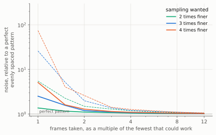

*Figure 5: the noise cost of leaving the shifts to chance. Along the
bottom, the number of frames as a multiple of the fewest that could work.
Up the side, the noise of the combined picture relative to the same number
of frames on a perfect pattern. Solid lines are the typical case and dashed
lines the unlucky one in ten. One dimension, shifts known exactly, 400
random trials per point, from function `random_dither_noise`. Derived
here.*

**Table 3.4: noise relative to a perfect pattern, random known shifts.**
Median and (in brackets) the worst one case in ten. Derived here, function
`random_dither_noise`, one dimension.

| Frames, as a multiple of the minimum | 2 times finer | 3 times finer | 4 times finer |
|--:|--:|--:|--:|
| 1 | 1.4 (5.5) | 2.5 (26) | 5.1 (75) |
| 2 | 1.11 (1.5) | 1.19 (2.0) | 1.29 (2.6) |
| 4 | 1.05 (1.19) | 1.08 (1.21) | 1.10 (1.27) |
| 12 | 1.02 (1.05) | 1.02 (1.05) | 1.03 (1.07) |

For this instrument the lesson is reassuring. With thousands of readings
per patch it runs at hundreds of times the minimum, where random placement
costs almost nothing. This supports the design's position that
[natural misalignment is a resource](../design.md#55-natural-misalignment-as-a-resource).
The exception is a regular scan whose shifts repeat, which is the case of
"exactly the minimum" in disguise, and the Roman telescope study shows what
it looks like: where the frames' grids drift in and out of step, stripes
of high noise and wrong blur shape appear across the picture
[[MF22](#mf22)].

**Part 3: undoing the pixel's own blur.** Drizzle states plainly that it
does not try to sharpen [[MF17](#mf17)], and satellite pipelines that do
sharpen accept more noise and then remove noise as a separate step
[[MF8](#mf8), [MF9](#mf9)]. This part is the real limit and is the subject
of the next section.

### 3.3 Finer sampling is not finer detail

A finer output grid does not mean finer detail. A pixel that collects light
evenly across its full width averages a pattern whose period equals that
width to exactly nothing. So "2 times finer sampling" from full-width
pixels contains no detail at the new grid's limit at all, which is the
SPOT 5 remark that only half the information is present [[MF8](#mf8)].
Theory papers on multi-frame methods reach the same view from the
algebra: the useful magnification is a small factor because the pixel
attenuates fine detail and the inversion amplifies noise and position
error [[MF41](#mf41), [MF42](#mf42), [MF40](#mf40)]. The often-quoted
limits of 1.6 times in practice and 5.7 times in theory are attributed to
[[MF42](#mf42)] from memory and are **unverified**.

Those analyses assume a handful of frames. The calculation below asks what
the pixel charges when readings are plentiful.

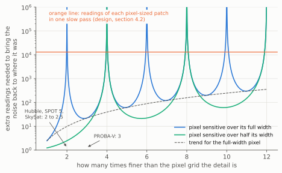

*Figure 6: what the pixel charges for detail finer than itself. Along the
bottom, how many times finer than the pixel grid the detail is. Up the
side, how many times more readings are needed to bring the noise back to
what it was for coarse detail. The blue curve is a pixel sensitive across
its full width. Its spikes are detail sizes it cannot see at all. The
green curve is a pixel sensitive over half its width, which moves the
blind sizes. The orange line is the number of readings one slow pass
already collects. The published systems of table 3.2 sit at the bottom
left. Derived here, function `pixel_cost`, ideal pixel with sharp edges.*

**Table 3.5: what an ideal full-width 1.12 µm pixel passes.** Derived
here, function `pixel_cost`.

| Times finer than the pixel grid | Period (pixels) | Period (nm) | Contrast kept | Extra readings needed |
|--:|--:|--:|--:|--:|
| 1.0 | 2.00 | 2240 | 0.64 | 2.5 |
| 1.5 | 1.33 | 1493 | 0.30 | 11 |
| 2.0 | 1.00 | 1120 | 0.00 | cannot be recovered |
| 3.0 | 0.67 | 747 | 0.21 | 22 |
| 5.0 | 0.40 | 448 | 0.13 | 62 |
| 7.0 | 0.29 | 320 | 0.09 | 121 |
| 9.0 | 0.22 | 249 | 0.07 | 200 |

Three things follow, all **derived here**.

- The budget of about 13 000 readings per patch
  ([design, section 4.2](../design.md#42-what-a-huge-number-of-samples-buys-and-what-it-does-not))
  is more than enough to pay the pixel's charge out to 9 times finer than
  the grid. The pixel is not what stops the instrument. The gap and the
  wavelength are, as the design says.
- The blind sizes are real and periodic: 1120 nm, 560 nm, 373 nm, 280 nm
  and so on for a full-width pixel. A reconstruction will show gaps in its
  detail at those sizes along the pixel axes unless something fills them.
  Readings from pixels with a different effective width do so: a turned
  sensor (the pixel is wider along its diagonal), binned readings, or
  motion smear of a known different length.
- The true pixel does not have sharp edges, and its real response sets
  where the blind sizes are. That response is the
  [key unknown of the design](../design.md#49-simulation-first-the-unknown-pixel-response-and-the-gate-before-hardware),
  and [section 6](#6-ideas-new-to-the-project) lists how astronomy
  measures it from ordinary data.

## 4. Lucky imaging: choosing or weighting frames

Through the atmosphere, a short exposure is occasionally almost perfect.
The chance of a good one falls steeply with telescope size: about
$5.6\,e^{-0.1557 (D/r_0)^2}$ for a telescope $D$ wide when the air is
steady over a width $r_0$ [[MF25](#mf25)]. In words: a telescope seven
times wider than the steady patch gets a good frame about one time in
400. Lucky imaging takes thousands of frames and keeps the best.

**Table 4.1: measured results of lucky imaging** on a 2.56 m telescope at
12 to 36 frames per second, from the full text of [[MF24](#mf24)].

| Share of frames kept (%) | Sharpness gain (times) | Signal-to-noise against keeping everything | Note |
|--:|--:|--:|---|
| 100 | about 1.5 | 1.0 | Shift-and-add on the brightest point alone already helps |
| 50 to 75 | about 2 | about equal to an ordinary long exposure | |
| 10 | 2.4 | not stated | One field: 0.63 to 0.26 arc seconds |
| 1 | up to 4 | 6.5 times worse | Not the 10 times worse that discarding 99% of the light suggests, because sharper images need less sky |

The guide star that frames are judged and aligned on needs about 150
detected photons per frame. Below that, frames are chosen on noise and
sharpness is lost [[MF24](#mf24)].

Later work shows that choosing whole frames is wasteful.

- Choosing separately for each fineness of detail, in the frequency
  domain, keeps 2 to 8 times more of the data for the same sharpness
  [[MF26](#mf26), [MF27](#mf27)].
- Measuring each frame's blur from reference stars in it, and dividing it
  out, "outperforms lucky imaging because it makes use of the entire PSF
  and reduces the need for frame selection" [[MF28](#mf28)].
- Solving for the scene and every frame's blur together, one frame at a
  time so thousands can be handled, also gives a picture finer than the
  pixel grid [[MF29](#mf29), [MF30](#mf30)].
- Proper co-addition gives the rule that covers all of these: add every
  frame, each weighted in the frequency domain by its own transfer
  function and its noise. The result holds all the information the frames
  held about a steady scene, and is "as narrow, or narrower than the PSF
  of the best image" [[MF23](#mf23)].

The figure applies that rule to a stand-in for this instrument: a scan
during which the blur varies, as it would if the gap or the vibration
changed.

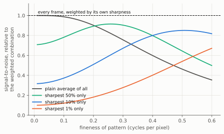

*Figure 7: choosing against weighting. 4000 simulated frames have blurs of
different widths. For each fineness of pattern along the bottom, the lines
show the signal-to-noise of four ways of combining them, as a fraction of
what weighting every frame by its own sharpness achieves (dashed line at
1). A plain average is fine for coarse detail and poor for fine detail.
Keeping only the sharpest frames is the reverse. Nothing beats the
weighted combination anywhere. Derived here, function `lucky_weighting`,
equal noise in every frame and blurs known exactly.*

**Table 4.2: signal-to-noise relative to the weighted combination.**
Derived here, function `lucky_weighting`.

| Combination | Coarse detail (0.05 cycles per pixel) | Medium (0.25) | Fine (0.50) |
|---|--:|--:|--:|
| Plain average of all frames | 1.00 | 0.83 | 0.46 |
| Sharpest 50% only | 0.73 | 0.91 | 0.64 |
| Sharpest 10% only | 0.33 | 0.59 | 0.85 |
| Sharpest 1% only | 0.11 | 0.23 | 0.54 |

**What transfers.** There is no atmosphere here, but the instrument has its
own unsteadiness: the gap changes with tilt and vibration, the stage speed
varies, and a tilted sensor has a different gap under every row
([reconstruction methods, section 3.13](../reconstruction-methods.md#313-what-a-two-dimensional-array-adds-across-the-fields)).
The rule is to never discard readings and never average them blindly, but
to weight each by its own transfer function. A full forward-model fit does
this automatically. The rule matters for the cheap first-stage picture and
for any scheme that is tempted to "use only the rows nearest the surface".

**Where it breaks.** Proper co-addition assumes each frame's blur is known
and the noise is uniform [[MF23](#mf23)]. Here the blur per row has to be
estimated first, and photon noise varies with brightness.

## 5. Registration: how well shifts are measured

### 5.1 What has been achieved

**Table 5.1: published accuracy of position and shift measurement.** The
last column converts the figure to this project's 1.12 µm pixel.

| System and method | Error (pixels) | Equivalent here (nm) | Source | Read |
|---|--:|--:|---|---|
| ASTER: wobble before correction | 0.2 | 224 | [[MF6](#mf6)] | Abstract |
| ASTER: after correction from its own six lines | under 0.08 | under 90 | [[MF6](#mf6)] | Abstract |
| Satellite image pairs matched by correlation in the frequency domain | 0.02 | 22 | [[MF37](#mf37)] | Abstract |
| Hubble: one bright star in one frame, random error | 0.02 | 22 | [[MF31](#mf31)] | Full text |
| Drizzle test: star positions after combining | 0.018 | 20 | [[MF17](#mf17)] | Full text |
| Digital time-delay integration: fitted frame-to-frame motion | under 0.01 | under 11 | [[MF14](#mf14)] | Abstract |
| Hubble: error left that depends on where in the pixel the star falls, after solving for the pixel response | under 0.002 | under 2.2 | [[MF31](#mf31)] | Full text |
| Gaia: one bright star crossing one detector (0.06 mas with 58.9 mas pixels) | 0.001 | 1.1 | [[MF4](#mf4), [MF3](#mf3)] | Full text |

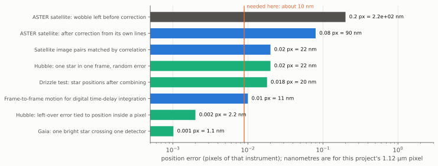

*Figure 8: the figures of table 5.1 on one scale. Each bar is a published
position error, in pixels of the instrument that achieved it. The label
converts it to nanometres for a 1.12 µm pixel. Blue bars are satellite
work and green bars astronomy. The orange line is what this project needs,
about 10 nm, which is one tenth of a 100 nm feature (**estimate**). From
function `accuracy_chart`.*

The requirement of about a hundredth of a pixel has been met by several
independent systems, and the two that go well beyond it share a feature:
both solve for the detailed response of the pixel as part of the
measurement.

### 5.2 How it is done, and what limits it

**The theoretical floor.** The smallest possible error in a measured shift
is set by the noise and by how much the picture changes when it is shifted
[[MF33](#mf33), [MF34](#mf34)]:

$$
\sigma_\text{shift} \ \ge\ \frac{\sigma_\text{noise}}{g\,\sqrt{N_\text{pix}}}
$$

Here $\sigma_\text{noise}$ is the noise in one pixel, $g$ is the typical
change in brightness from one pixel to the next, and $N_\text{pix}$ is the
number of pixels used. In words: more pixels and more texture give a
better shift, and a featureless picture gives none. For star positions the
same bound becomes "width of the star image divided by its
signal-to-noise", and careful methods come very close to it
[[MF36](#mf36)].

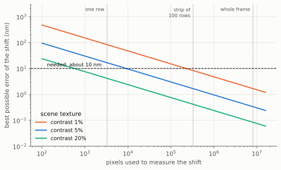

*Figure 9: the best possible error in a measured shift, in nanometres,
against the number of pixels used, for three strengths of scene texture.
Vertical lines mark one sensor row, a strip of 100 rows and a whole frame.
The dashed line is the 10 nm requirement. Photon noise on 5000 electrons
per pixel, texture that changes over 3 pixels. Derived here, function
`shift_bound`. These are assumptions, and a real lensless image may be
smoother, which makes every line higher.*

**Table 5.2: best possible shift error.** Derived here, function
`shift_bound`, under the assumptions in the caption of figure 9.

| Scene contrast (%) | One row, 3280 pixels (nm) | Strip of 100 rows (nm) | Whole frame (nm) |
|--:|--:|--:|--:|
| 1 | 83 | 8.3 | 1.7 |
| 5 | 17 | 1.7 | 0.33 |
| 20 | 4.1 | 0.41 | 0.08 |

The table sets a trade the design has to make. A whole frame fixes one
shift far better than needed. But motion inside a frame has to be measured
from fewer pixels, and a single row cannot do it on a faint scene. The
wobble can be followed at the rate of about one estimate per 100 rows,
which at 18.9 µs per row is roughly 500 estimates per second, and not
faster (**estimate**).

**Known obstacles, and the published answers.** A text table.

| Obstacle | What happens | Published answer | Source |
|---|---|---|---|
| Simple estimators are biased | Methods based on local slopes systematically under-read the shift | Iterate: shift one frame by the estimate and measure again. The iterated estimate reaches the theoretical floor. | [[MF33](#mf33), [MF34](#mf34)] |
| Undersampling corrupts the fine detail | False coarse patterns differ from frame to frame and pull the estimate | Register on the coarse detail only, which is free of false patterns | [[MF38](#mf38), [MF39](#mf39)] |
| Too little signal | Below a threshold of signal-to-noise no method can align two frames, and the error jumps instead of growing smoothly. Extra frames help in the region near the threshold. | Align against a combined reference, not frame against frame. Or search over the motion directly ([section 6](#6-ideas-new-to-the-project)). | [[MF35](#mf35)] |
| Pixel response and position are tangled | In undersampled pictures a wrong idea of the pixel's response shifts every measured position by an amount that depends on where the feature falls in the pixel. On Hubble this error was as large as the random error. | Solve for response and positions together, alternating, using dithers to break the tie | [[MF31](#mf31)] |
| Registration and reconstruction depend on each other | An error in one becomes an error in the other | Estimate them jointly | [[MF40](#mf40)] and [survey, section 3.5](../reconstruction-methods.md#35-satellite-and-astronomical-image-reconstruction) |
| Camera geometry is not perfect | Unrecorded wobble and errors in detector layout are "the current major limiting factors" for satellites | Model them and solve for them | [[MF32](#mf32)] |

## 6. Ideas new to the project

Tim asked for ideas beyond the ones he named. These came out of this
field. Each is given a verdict so it can be taken into the
[scouting list](../plan.md#scouting-finding-what-nobody-has-named-yet) of
the plan. All verdicts are **judgements**, and every "for this instrument"
statement is **derived here** and untested.

| No. | Idea | Where it comes from | For this instrument | Verdict |
|--:|---|---|---|---|
| 1 | **Search for the motion by brute force.** Add the frames along thousands of trial velocities and keep the one that gives the sharpest result. | Asteroid hunters detect objects too faint to see in any one frame this way, on graphics processors, and get ten times better positions than a long exposure [[MF51](#mf51)] | A start-up method when single frames are too noisy to register (the threshold of [[MF35](#mf35)]). Pure computation, and it parallelises perfectly. | Promote: simulator stage 0 |
| 2 | **Build the pixel's response from the scan.** Every sharp isolated feature that crosses the sensor samples the pixel response at a different sub-pixel place. Alternate between solving the response and the positions. | Hubble's effective point-spread function, built on a grid 4 times finer than the pixel from 3000 stars in 15 dithered frames [[MF31](#mf31)]. Kepler's pixel response function, from 19 189 stars at 121 dither positions [[MF52](#mf52)]. | Attacks the design's key unknown with no extra hardware, in the simulator first. Needs sharp features: edges of bond pads, particles, or the calibration marks of the [calibration plan](../calibration-and-test.md). | Promote: simulator component and test |
| 3 | **Test for position error against pixel phase.** Plot the leftover position error of features against where in the pixel they fell. A trend means the pixel model is wrong. | The diagnostic that exposed the problem on Hubble [[MF31](#mf31)] | A cheap acceptance test for any reconstruction, alongside those in the [calibration plan](../calibration-and-test.md) | Promote: benchmark test |
| 4 | **Design the scan so the sensor can calibrate itself.** Send each surface point across very different parts of the sensor. | "Do not use a regular, repeated tiling of the sky" [[MF53](#mf53)]. Dither patterns can be scored by how well they encode the detector's gains [[MF54](#mf54)]. The Sloan survey reached 1% calibration over a quarter of the sky from overlaps alone [[MF55](#mf55)]. | A straight scan sends each point down one column (figure 10). A turn of 1° crosses 43 columns. A second pass at right angles ties every column to every row. Radio astronomy's version of this is in study B2. | Promote: scan-pattern option |
| 5 | **Map where the sampling is weak, before reconstructing.** For each output point, compute the noise amplification and the error in blur shape that the sample positions imply. | The two maps that optimal linear combination returns, used to choose dither patterns for a space telescope [[MF21](#mf21), [MF22](#mf22)] | Extends the calculator's "largest hole" measure ([design, section 5.4](../design.md#54-scan-sampling-calculator)) into a map that predicts stripes from repeating shifts | Promote: calculator output |
| 6 | **A pixel response that changes with brightness.** Charge already collected pushes later charge towards neighbours, so bright spots come out up to 2% wider than faint ones. | Measured on thick astronomical CCDs [[MF56](#mf56)] | Breaks the assumption that the measurement is linear, most of all for high-contrast fringes. Size in small camera-phone pixels is **unverified**. | Park: optional sensor effect in the simulator, sized by study B5 |
| 7 | **Match the sampling pattern to where the detail lies.** The number of samples needed depends on the total area of fine-detail space that is occupied, not on the finest detail. | Sampling theory [[MF57](#mf57), [MF58](#mf58)], applied to satellite detector layouts [[MF9](#mf9)] | With beam pairs the detail arrives in separate islands ([design, section 4.7](../design.md#47-a-staged-path-to-the-picture-the-current-leading-candidate)). Tilt and frame spacing could be chosen so the islands' false copies interleave and do not overlap. | Promote to a research question for B4 and the simulator |
| 8 | **Reject bad readings by comparing with a prediction.** Combine, predict each frame from the combination, and mask readings that disagree by more than noise allows. | Drizzle's cosmic-ray step [[MF17](#mf17)] | Dust, hot pixels and mirror-like glints. The forward model already provides the prediction. | Promote: pipeline step |
| 9 | **Use a known feature in every frame as that frame's blur reference.** | Speckle holography [[MF28](#mf28)] | Gives the gap and tilt of each frame from the data. Needs isolated features. | Park until a scene library exists |
| 10 | **Track the image on the chip in two directions.** | Orthogonal-transfer CCD [[MF16](#mf16)] | Hardware doing what computation does better here | Reject, by the computation-first rule |
| 11 | **Control the shifts instead of freezing them.** A camera whose sensor jumps between exposures and is still during them. | The "jitter camera", built because motion blur was shown to limit multi-frame methods strongly [[MF49](#mf49)]. Controlled micro-scanning in infrared cameras [[MF50](#mf50)]. | The same conclusion as the design: short pulses or short exposures. A stepped stage is the hardware alternative. | Park |

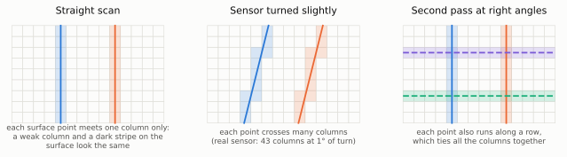

*Figure 10: why idea 4 matters. Each drawing is a small part of the pixel
grid, and each coloured line is the path of one point of the surface
across it during a pass. Shaded squares are the pixels that point meets.
Left: in a straight scan each point meets one column only, so a weak
column cannot be told from a dark stripe on the surface. Middle: turning
the sensor makes each point cross many columns. Right: a second pass at
right angles (dashed) runs along rows and ties all the columns together.
Illustrative, with the column count for the real sensor computed by
function `selfcal_tracks`.*

**Table 6.1: columns crossed by one surface point in one pass** of the
2464-row sensor. Derived here, function `selfcal_tracks`.

| Turn of the sensor (degrees) | Columns crossed |
|--:|--:|
| 0.0 | 1 |
| 0.1 | 4.3 |
| 0.5 | 22 |
| 1.0 | 43 |
| 5.0 | 216 |

## 7. What this means for the design and the simulator

The simulator has to stay neutral between approaches
([design, section 7.1](../design.md#71-approaches-as-named-configurations)).
The findings are therefore stated as components and tests, not as changes
to one approach. This is a text table of recommendations (**judgements**).

| Finding | Component or test it adds | Plan item it feeds |
|---|---|---|
| Sum rows in the computer | A "digital TDI" readout model, and a true charge-shifting model with a speed-error parameter for comparison (table 2.2) | B6, B7, D |
| Read noise is the price | Read noise per reading in the sensor model, so the two readout models can be compared at the same light level | R2, D |
| Drizzle and interlacing are fast and exact about their own noise | A drizzle-style first-stage reconstruction with its noise factor, as the quick-look picture and as a cross-check on the full solver | D |
| Weight, do not choose | A proper co-addition stage that weights each reading by its transfer function (table 4.2) | D |
| The pixel has blind detail sizes | Report resolution along and across the pixel axes separately, and include readings of different effective pixel width (table 3.5) | E, D |
| Registration reaches 0.01 pixels, and 0.001 with a solved pixel response | Registration as an iterated, joint estimate, tested against the bound of table 5.2 | E, F stage 0 |
| Wobble can be followed at about one estimate per 100 rows | A trajectory model with that time resolution, and a test that injects faster wobble to find where it fails | E |
| A regular scan is the worst case | Scan patterns with tilt, with a cross pass and with irregular spacing, scored by the weak-sampling map (idea 5) | D, E |

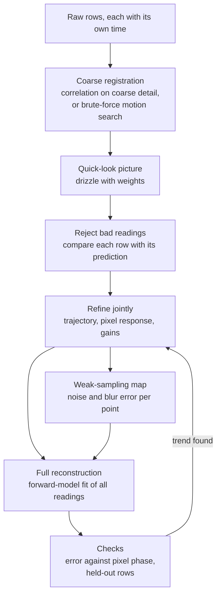

*Figure 11: the first stage of reconstruction as this field would build
it. Each box is a step taken from the sources in sections 2 to 6. The loop
at the bottom repeats the refinement until position errors no longer
depend on where in a pixel a feature fell. It fills in stage 0 of the
[staged reconstruction plan](../reconstruction-methods.md#72-reconstructing-in-stages).*

## 8. Limits of this study

- **Abstracts.** About half the sources were read in full. For the rest
  only the abstract was read, and section 9 says which. Figures from
  abstracts have not been checked against the papers' own tables.
- **One formula disagrees with a source.** The speed-error formula of
  section 2.1 gives a larger loss than one published abstract states. It
  is unresolved.
- **One-dimensional calculations.** Tables 3.4, 3.5, 4.2 and 5.2 come from
  small calculations with ideal pixels and exactly known shifts or blurs.
  They show trends. The simulator must replace them.
- **Different regime.** Every measured gain in table 3.2 comes from systems
  with lenses and between 2 and 35 frames. This instrument has no lens and
  thousands of readings. The methods transfer. The numbers may not.
- **Not covered.** Learned methods were read only for their measured
  gains. Solar and speckle interferometry methods beyond those cited were
  not surveyed. Coherent light changes the measurement from linear to
  non-linear, and that case belongs to study B4.
- **No review by Tim yet.** The verdicts in section 6 are proposals.

## 9. References

Each entry was checked to exist in a bibliographic database (OpenAlex or
Crossref) or by downloading it. "Full text" means the paper was read for
this study, "abstract" that only the abstract was. Sources that the survey
already lists are given with both keys.

Scanning sensors and time-delay integration:

(mf1)=
[MF1] Wong, Yao and Schlig, "TDI charge-coupled devices: design and
applications", IBM Journal of Research and Development, 1992.
[doi:10.1147/rd.361.0083](https://doi.org/10.1147/rd.361.0083). Abstract.
Survey key M39.

(mf2)=
[MF2] Gibson and Hickson, "Time-delay integration CCD read-out technique:
image deformation", Monthly Notices of the Royal Astronomical Society,
1992. [doi:10.1093/mnras/258.3.543](https://doi.org/10.1093/mnras/258.3.543).
Abstract.

(mf3)=
[MF3] Gaia Collaboration (Prusti et al.), "The Gaia mission", Astronomy
and Astrophysics, 2016.
[doi:10.1051/0004-6361/201629272](https://doi.org/10.1051/0004-6361/201629272).
Full text, section 3.3 on the focal plane.

(mf4)=
[MF4] Lindegren et al., "Gaia Data Release 2: the astrometric solution",
Astronomy and Astrophysics, 2018.
[doi:10.1051/0004-6361/201832727](https://doi.org/10.1051/0004-6361/201832727).
Full text, section 2.2 for the precision per detector crossing.

(mf5)=
[MF5] Sutton et al., "Correcting spacecraft jitter in HiRISE images",
International Archives of the Photogrammetry, Remote Sensing and Spatial
Information Sciences, 2017.
[doi:10.5194/isprs-archives-xlii-3-w1-141-2017](https://doi.org/10.5194/isprs-archives-xlii-3-w1-141-2017).
Full text.

(mf6)=
[MF6] Teshima and Iwasaki, "Correction of attitude fluctuation of Terra
spacecraft using ASTER/SWIR imagery with parallax observation", IEEE
Transactions on Geoscience and Remote Sensing, 2008.
[doi:10.1109/tgrs.2007.907424](https://doi.org/10.1109/tgrs.2007.907424).
Abstract. Survey key M41.

(mf7)=
[MF7] Latry and Delvit, "Staggered arrays for high resolution earth
observing systems", Proceedings of SPIE, 2009.
[doi:10.1117/12.825884](https://doi.org/10.1117/12.825884). Abstract.

(mf8)=
[MF8] Latry and Rougé, "Super resolution: quincunx sampling and fusion
processing", IEEE International Geoscience and Remote Sensing Symposium,
2003. [doi:10.1109/igarss.2003.1293761](https://doi.org/10.1109/igarss.2003.1293761).
Abstract. Survey key M40.

(mf9)=
[MF9] Almansa, Durand and Rougé, "Measuring and improving image
resolution by adaptation of the reciprocal cell", Journal of Mathematical
Imaging and Vision, 2004.
[doi:10.1023/b:jmiv.0000043739.51886.01](https://doi.org/10.1023/b:jmiv.0000043739.51886.01).
Existence checked. Neither abstract nor text was obtained, so it is cited
for its subject only. Also Latry, Fourest and Thiebaut, "Restoration
technique for Pleiades-HR panchromatic images", International Archives of
the Photogrammetry, Remote Sensing and Spatial Information Sciences, 2012.
[doi:10.5194/isprsarchives-xxxix-b1-555-2012](https://doi.org/10.5194/isprsarchives-xxxix-b1-555-2012).
Abstract, for deblurring followed by noise removal.

(mf10)=
[MF10] Lepage, Bogaerts and Meynants, "Time-delay-integration
architectures in CMOS image sensors", IEEE Transactions on Electron
Devices, 2009.
[doi:10.1109/ted.2009.2030648](https://doi.org/10.1109/ted.2009.2030648).
Abstract.

(mf11)=
[MF11] Li et al., "Velocity mismatch effect on the dynamic MTF of a TDI
image sensor", Applied Optics, 2021. Abstract, read through a literature
search service. The DOI was not confirmed.

(mf12)=
[MF12] Nie, Li, Yao and Xu, "Scanning modulation transfer function model
of TDI CMOS image sensor", Journal of Signal Processing Systems, 2015.
[doi:10.1007/s11265-015-0975-7](https://doi.org/10.1007/s11265-015-0975-7).
Abstract.

(mf13)=
[MF13] Wahballah, Bazan, El-Tohamy and Fathy, "Analysis of smear in
high-resolution remote sensing satellites", Proceedings of SPIE, 2016.
[doi:10.1117/12.2241634](https://doi.org/10.1117/12.2241634). Abstract.

(mf14)=
[MF14] Liu, Tao, Feng and Li, "Digital domain TDI-CMOS imaging based on
minimum search domain alignment", Sensors, 2025.
[doi:10.3390/s25113490](https://doi.org/10.3390/s25113490). Abstract.

(mf16)=
[MF16] Tonry, Burke and Schechter, "The orthogonal transfer CCD",
Publications of the Astronomical Society of the Pacific, 1997.
[arXiv:astro-ph/9705165](https://arxiv.org/abs/astro-ph/9705165). Abstract
of the full text.

Combining dithered frames:

(mf17)=
[MF17] Fruchter and Hook, "Drizzle: a method for the linear
reconstruction of undersampled images", Publications of the Astronomical
Society of the Pacific, 2002.
[doi:10.1086/338393](https://doi.org/10.1086/338393). Full text. Shared
key Fruchter2002.

(mf18)=
[MF18] Lauer, "Combining undersampled dithered images", Publications of
the Astronomical Society of the Pacific, 1999.
[doi:10.1086/316319](https://doi.org/10.1086/316319). Full text. Survey
key M42.

(mf19)=
[MF19] Casertano et al., "WFPC2 observations of the Hubble Deep Field
South", Astronomical Journal, 2000.
[doi:10.1086/316851](https://doi.org/10.1086/316851). Full text, sections
2.2 and 3.

(mf20)=
[MF20] Fruchter, "A new method for band-limited imaging with
undersampled detectors", Publications of the Astronomical Society of the
Pacific, 2011. [doi:10.1086/659313](https://doi.org/10.1086/659313).
Abstract.

(mf21)=
[MF21] Rowe, Hirata and Rhodes, "Optimal linear image combination",
Astrophysical Journal, 2011.
[doi:10.1088/0004-637x/741/1/46](https://doi.org/10.1088/0004-637x/741/1/46).
Full text. Survey key M43.

(mf22)=
[MF22] Hirata et al., "Simulating image coaddition with the Nancy Grace
Roman Space Telescope: I. Simulation methodology and general results",
Monthly Notices of the Royal Astronomical Society, 2024.
[doi:10.1093/mnras/stae182](https://doi.org/10.1093/mnras/stae182). Full
text.

(mf23)=
[MF23] Zackay and Ofek, "How to coadd images. II. A coaddition image that
is optimal for any purpose in the background-dominated noise limit",
Astrophysical Journal, 2017.
[doi:10.3847/1538-4357/836/2/188](https://doi.org/10.3847/1538-4357/836/2/188).
Full text.

Lucky imaging and blind methods:

(mf24)=
[MF24] Law, Mackay and Baldwin, "Lucky imaging: high angular resolution
imaging in the visible from the ground", Astronomy and Astrophysics, 2006.
[doi:10.1051/0004-6361:20053695](https://doi.org/10.1051/0004-6361:20053695).
Full text.

(mf25)=
[MF25] Fried, "Probability of getting a lucky short-exposure image
through turbulence", Journal of the Optical Society of America, 1978.
[doi:10.1364/josa.68.001651](https://doi.org/10.1364/josa.68.001651).
Abstract.

(mf26)=
[MF26] Garrel, Guyon and Baudoz, "A highly efficient lucky imaging
algorithm: image synthesis based on Fourier amplitude selection",
Publications of the Astronomical Society of the Pacific, 2012.
[doi:10.1086/667399](https://doi.org/10.1086/667399). Abstract. The
figure of 2 to 8 times is from simulation.

(mf27)=
[MF27] Mackay, "High-efficiency lucky imaging", Monthly Notices of the
Royal Astronomical Society, 2013.
[doi:10.1093/mnras/stt507](https://doi.org/10.1093/mnras/stt507). Abstract
of the full text.

(mf28)=
[MF28] Schödel, Yelda, Ghez et al., "Holographic imaging of crowded
fields: high angular resolution imaging with excellent quality at very low
cost", Monthly Notices of the Royal Astronomical Society, 2013.
[doi:10.1093/mnras/sts420](https://doi.org/10.1093/mnras/sts420). Abstract
of the full text.

(mf29)=
[MF29] Hirsch, Harmeling, Sra and Schölkopf, "Online multi-frame blind
deconvolution with super-resolution and saturation correction", Astronomy
and Astrophysics, 2011.
[doi:10.1051/0004-6361/200913955](https://doi.org/10.1051/0004-6361/200913955).
Abstract.

(mf30)=
[MF30] Schulz, "Multiframe blind deconvolution of astronomical images",
Journal of the Optical Society of America A, 1993.
[doi:10.1364/josaa.10.001064](https://doi.org/10.1364/josaa.10.001064).
Abstract.

Position measurement and registration:

(mf31)=
[MF31] Anderson and King, "Toward high-precision astrometry with WFPC2.
I. Deriving an accurate point-spread function", Publications of the
Astronomical Society of the Pacific, 2000.
[doi:10.1086/316632](https://doi.org/10.1086/316632). Full text. Survey
key M44.

(mf32)=
[MF32] Ayoub, Leprince, Binet, Lewis, Aharonson and Avouac, "Influence of
camera distortions on satellite image registration and change detection
applications", IEEE International Geoscience and Remote Sensing Symposium,
2008. [doi:10.1109/igarss.2008.4779184](https://doi.org/10.1109/igarss.2008.4779184).
Abstract.

(mf33)=
[MF33] Robinson and Milanfar, "Fundamental performance limits in image
registration", IEEE Transactions on Image Processing, 2004.
[doi:10.1109/tip.2004.832923](https://doi.org/10.1109/tip.2004.832923).
Abstract.

(mf34)=
[MF34] Pham, Bezuijen, van Vliet, Schutte and Luengo Hendriks,
"Performance of optimal registration estimators", Proceedings of SPIE,
2005. [doi:10.1117/12.603304](https://doi.org/10.1117/12.603304). Full
text, for the form of the bound.

(mf35)=
[MF35] Aguerrebere, Delbracio, Bartesaghi and Sapiro, "Fundamental limits
in multi-image alignment", IEEE Transactions on Signal Processing, 2016.
[doi:10.1109/tsp.2016.2600517](https://doi.org/10.1109/tsp.2016.2600517).
Full text of the preprint, abstract and section 1.

(mf36)=
[MF36] Mendez, Silva and Lobos, "Analysis and interpretation of the
Cramér-Rao lower-bound in astrometry: one-dimensional case", Publications
of the Astronomical Society of the Pacific, 2013.
[doi:10.1086/671126](https://doi.org/10.1086/671126). Abstract of the full
text.

(mf37)=
[MF37] Leprince, Barbot, Ayoub and Avouac, "Automatic and precise
orthorectification, coregistration, and subpixel correlation of satellite
images, application to ground deformation measurements", IEEE Transactions
on Geoscience and Remote Sensing, 2007.
[doi:10.1109/tgrs.2006.888937](https://doi.org/10.1109/tgrs.2006.888937).
Abstract.

(mf38)=
[MF38] Vandewalle, Süsstrunk and Vetterli, "A frequency domain approach
to registration of aliased images with application to super-resolution",
EURASIP Journal on Advances in Signal Processing, 2006.
[doi:10.1155/asp/2006/71459](https://doi.org/10.1155/asp/2006/71459).
Abstract.

(mf39)=
[MF39] Stone, Orchard, Chang and Martucci, "A fast direct Fourier-based
algorithm for subpixel registration of images", IEEE Transactions on
Geoscience and Remote Sensing, 2001.
[doi:10.1109/36.957286](https://doi.org/10.1109/36.957286). Existence
checked, cited for its subject only.

Limits of multi-frame methods:

(mf40)=
[MF40] Robinson and Milanfar, "Statistical performance analysis of
super-resolution", IEEE Transactions on Image Processing, 2006.
[doi:10.1109/tip.2006.871079](https://doi.org/10.1109/tip.2006.871079).
Abstract. Survey key M49.

(mf41)=
[MF41] Baker and Kanade, "Limits on super-resolution and how to break
them", IEEE Transactions on Pattern Analysis and Machine Intelligence,
2002. [doi:10.1109/tpami.2002.1033210](https://doi.org/10.1109/tpami.2002.1033210).
Abstract. Survey key M47.

(mf42)=
[MF42] Lin and Shum, "Fundamental limits of reconstruction-based
superresolution algorithms under local translation", IEEE Transactions on
Pattern Analysis and Machine Intelligence, 2004.
[doi:10.1109/tpami.2004.1261081](https://doi.org/10.1109/tpami.2004.1261081).
Abstract. Survey key M48.

(mf43)=
[MF43] Traonmilin, Ladjal and Almansa, "On the amount of regularization
for super-resolution interpolation", European Signal Processing
Conference, 2012. <https://hal.science/hal-00824670>. Full text, sections
1 and 3.

Satellite and camera multi-frame results:

(mf44)=
[MF44] Anger, Ehret, de Franchis and Facciolo, "Fast and accurate
multi-frame super-resolution of satellite images", ISPRS Annals of the
Photogrammetry, Remote Sensing and Spatial Information Sciences, 2020.
[doi:10.5194/isprs-annals-v-1-2020-57-2020](https://doi.org/10.5194/isprs-annals-v-1-2020-57-2020).
Full text, abstract and figure 1.

(mf45)=
[MF45] Nguyen, Anger, Davy, Arias and Facciolo, "Self-supervised
multi-image super-resolution for push-frame satellite images", IEEE/CVF
Conference on Computer Vision and Pattern Recognition Workshops, 2021.
[doi:10.1109/cvprw53098.2021.00123](https://doi.org/10.1109/cvprw53098.2021.00123).
Full text, section 1 and figure 1.

(mf46)=
[MF46] Märtens, Izzo, Krzic and Cox, "Super-resolution of PROBA-V images
using convolutional neural networks", Astrodynamics, 2019.
[doi:10.1007/s42064-019-0059-8](https://doi.org/10.1007/s42064-019-0059-8).
Full text of the preprint, abstract and section 1.

(mf47)=
[MF47] Wronski et al., "Handheld multi-frame super-resolution", ACM
Transactions on Graphics, 2019.
[doi:10.1145/3306346.3323024](https://doi.org/10.1145/3306346.3323024).
Full text of the preprint, abstract and section 1. Survey key M50.

(mf49)=
[MF49] Ben-Ezra, Zomet and Nayar, "Video super-resolution using
controlled subpixel detector shifts", IEEE Transactions on Pattern
Analysis and Machine Intelligence, 2005.
[doi:10.1109/tpami.2005.129](https://doi.org/10.1109/tpami.2005.129).
Abstract.

(mf50)=
[MF50] Hardie, Barnard, Bognar, Armstrong and Watson, "High-resolution
image reconstruction from a sequence of rotated and translated frames and
its application to an infrared imaging system", Optical Engineering, 1998.
[doi:10.1117/1.601623](https://doi.org/10.1117/1.601623). Abstract.

Ideas of section 6:

(mf51)=
[MF51] Shao, Nemati, Zhai et al., "Finding very small near-Earth
asteroids using synthetic tracking", Astrophysical Journal, 2014.
[doi:10.1088/0004-637x/782/1/1](https://doi.org/10.1088/0004-637x/782/1/1).
Full text of the preprint, abstract and section 3.

(mf52)=
[MF52] Bryson et al., "The Kepler pixel response function",
Astrophysical Journal Letters, 2010.
[doi:10.1088/2041-8205/713/2/l97](https://doi.org/10.1088/2041-8205/713/2/l97).
Full text of the preprint.

(mf53)=
[MF53] Holmes, Hogg and Rix, "Designing imaging surveys for a
retrospective relative photometric calibration", Publications of the
Astronomical Society of the Pacific, 2012.
[doi:10.1086/668656](https://doi.org/10.1086/668656). Abstract of the full
text.

(mf54)=
[MF54] Arendt, Fixsen and Moseley, "Dithering strategies for efficient
self-calibration of imaging arrays", Astrophysical Journal, 2000.
[doi:10.1086/308923](https://doi.org/10.1086/308923). Abstract.

(mf55)=
[MF55] Padmanabhan et al., "An improved photometric calibration of the
Sloan Digital Sky Survey imaging data", Astrophysical Journal, 2008.
[doi:10.1086/524677](https://doi.org/10.1086/524677). Abstract.

(mf56)=
[MF56] Antilogus, Astier, Doherty, Guyonnet and Regnault, "The
brighter-fatter effect and pixel correlations in CCD sensors", Journal of
Instrumentation, 2014.
[doi:10.1088/1748-0221/9/03/c03048](https://doi.org/10.1088/1748-0221/9/03/c03048).
Abstract of the full text.

(mf57)=
[MF57] Landau, "Necessary density conditions for sampling and
interpolation of certain entire functions", Acta Mathematica, 1967.
[doi:10.1007/bf02395039](https://doi.org/10.1007/bf02395039). Existence
checked, cited for the standard result only. **Unverified** against the
text.

(mf58)=
[MF58] Papoulis, "Generalized sampling expansion", IEEE Transactions on
Circuits and Systems, 1977.
[doi:10.1109/tcs.1977.1084284](https://doi.org/10.1109/tcs.1977.1084284).
Existence checked, cited for the standard result only. **Unverified**
against the text.
