# Routes to 100 nm that keep ordinary light

The [design](../design.md#411-no-special-lighting-what-ordinary-light-can-reach-and-where-the-work-goes)
found that under ordinary light the finest lines the instrument can
picture are set by how far the sensor's silicon is from the chip's
features, and that this puts lines 100 nm wide out of reach. Two
requirements therefore pull against each other: a picture of features of
about 100 nm ([REQ-3](../design.md#requirements)), and no special lighting
([REQ-6](../design.md#requirements)). Both are to be kept
([REQ-22](../design.md#requirements)). This page looks for every way to
keep both. It is plan item
[B8](../plan.md#b-research-and-data-collection) and a scouting study under
[REQ-20](../design.md#requirements), which asks for approaches beyond
those already named. It ends with a ranked shortlist for the simulator.

For a sense of scale: a line 100 nm wide is one thousandth of the width of
a hair, about a quarter of the wavelength of blue light, and one eleventh
of the width of a pixel of the baseline sensor.

The study reaches eight conclusions. All figures are estimates from simple
models unless a source is given, and none has been measured. A line width
is quoted at one of two strengths. **Just detectable** means the pattern
is as strong as the noise, which is the measure the design uses.
**Clean** means the pattern is five times the noise, which takes 25 times
the readings and is what a usable picture needs.

1. **Both requirements can be kept, but only by going close.** Detail
   finer than the wavelength of the light does not travel. It stays within
   a few tens of nanometres of the chip, whatever the light. Ordinary
   light does not prevent it being read there. So the routes that could
   reach a true picture of 100 nm lines all bring something sharp to
   within about 100 nm of the features: a metal mask on the sensor, or the
   pixel's own silicon.
2. **What has to be sharp is the edge of the pixel, not its size.** A
   pixel 1,120 nm wide whose edge is sharp to within 100 nm, held 100 nm
   from the features, makes 100 nm lines just detectable with the baseline
   scan and clean with about 15 times the baseline scan, two hours over
   each point. The baseline pixel, with edges assumed soft over 300 nm,
   does not reach 100 nm at any distance.
3. **Close to the chip, more readings buy more than they did, at a steep
   price.** The earlier finding that a thousand times more readings
   improves the result only 1.2 to 1.8 times holds wherever a blur removes
   the detail exponentially, which is everywhere the sensor is away from
   the chip. A sharp pixel touching the surface would gain 5.6 times. In
   between, readings can be traded for distance. For clean 100 nm lines
   with a sharp edge the model asks for 2.6 times the baseline scan at
   100 nm, 25 times at 140 nm (three hours over each point) and 770 times
   at 200 nm (four days). At 300 nm it asks for four years. An edge soft
   over 100 nm multiplies each of these by six.
4. **A mask of narrow slits at many angles is a route new to the project
   and the best supported here.** A slit passes thousands of times more
   light than a small hole of the same width, and a computation of the
   kind a medical scanner uses turns readings from slits at many angles
   into a picture. One slit turned through many angles has been shown to
   work with millimetre waves [[OL27](#ol27), [OL28](#ol28)]. What is new
   here is a fixed slit on every pixel, so that the two-dimensional sensor
   supplies all the angles at once, in ordinary light. In a first
   two-dimensional test with the baseline scan, slits 50 nm from the
   features recovered most of a layout of 100 nm lines, where open pixels
   with sharp edges 100 nm away recovered little.
5. **Near contact needs four things that are not lighting**: the layer of
   interest at the very top of the chip, a sensor face stripped to bare
   silicon or to a mask, a way of holding tens of nanometres over at least
   part of the sensor, and a path for the light. A candidate exists for
   each, and none is proven for this use. The light path is the weakest.
   Light from the side cannot enter. What remains is a plain lamp behind
   the chip, which needs near-infrared light or a chip thinned to a few
   micrometres, or a lamp behind the sensor.
6. **The colour of the lamp decides which route works.** In near-infrared
   light a bare-silicon pixel cannot record 100 nm lines even with walls,
   because the pattern cannot travel inside silicon either. Bare-silicon
   pixels therefore need red or bluer light, which reaches the surface
   only through a chip thinned to a few micrometres. The slit mask works
   in any colour.
7. **Without going close, ordinary light stops at about the limit of a
   good microscope.** A tiny immersion lens on each pixel could reach
   lines of 100 nm to 150 nm in blue light, but it needs liquid on the
   chip and gives up the lensless arrangement
   ([REQ-1](../design.md#requirements)). Knowledge of the chip can carry a
   picture somewhat further as an inferred picture, and colour and
   polarisation can measure the width and direction of 100 nm lines in
   regular areas without picturing them. Neither is a true picture, and
   every result must say which kind it is.
8. **Every one of these waits for a wave calculation.** The models here
   treat light as rays or as a simple fading wave, and they disagree with
   each other by a factor of two to three in strength at these distances.
   Only the full electromagnetic level of the
   [simulation chain](../simulation-chain.md) can settle them. That is
   computing, not hardware, and it is the first thing to do.

Computing cost and mathematical difficulty are not reasons to drop or
down-rank a route ([REQ-23](../design.md#requirements)). Each route below
states its computing cost, and the ranking in
[section 9](#9-ranked-shortlist) is by the resolution a route can reach and
the evidence for it. What more readings buy is treated for every route
([REQ-24](../design.md#requirements)), mainly in
[section 2](#2-oversampling-what-more-readings-buy).

## Terms used on this page

Other terms are in the shared [glossary](../glossary.md).

| Term | Meaning |
|---|---|
| Ordinary light | Light of which nothing is asked except that it is there and steady: room light, a lamp, one plain light-emitting diode. The project's reading of where "special" begins is [Table 4.11a of the design](../design.md#411-no-special-lighting-what-ordinary-light-can-reach-and-where-the-work-goes). |
| Line width | The width of one line in a pattern of equal lines and spaces. The repeat distance (period) is twice the line width. |
| True picture | A picture in which every feature shown was carried to the sensor by the light. |
| Inferred picture | A picture completed with knowledge about the chip, which holds only as far as that knowledge holds. |
| Distance | On this page, the distance from the chip's features to the place where the light is sensed: the pixel's silicon, or the openings of a mask. It adds up whatever covers the features, the air gap, and whatever covers the silicon. |
| Edge softness | The width over which a pixel's response falls from full to nothing at its edge, given as the full width at half height. |
| Near contact | Sensor and chip closer than about 100 nm over some area. |
| Reading | One value from one pixel in one frame. The baseline scan takes 13,000 readings of every pixel-sized patch of the chip ([design, section 5.2](../design.md#52-scan)). Each reading is taken as 2,500 electrons, which gives a signal 50 times its own noise. |
| Just detectable, clean | The two strengths at which a line width is quoted: the pattern equal to the noise, and the pattern five times the noise. Clean takes 25 times the readings of just detectable. |
| Level 0, level 1 | The first two levels of the [simulation chain](../simulation-chain.md). Level 0 is a formula that estimates the finest line from the scan settings. Level 1 simulates the readings with a simple blur and reconstructs the surface from them. |
| Oversampling | Taking many more readings of each patch than the picture has points, so that noise averages down and fine positions are filled in. |
| Walls between pixels | Trenches filled with glass that some sensors have between neighbouring pixels through the full depth of the silicon, to stop light and charge crossing. Sensor makers call it deep trench isolation. |
| Delayering | Removing a chip's upper layers, by polishing or etching, until a chosen layer is exposed. |

## How claims are marked

The labels are those of the shared
[references page](../references.md#how-claims-are-labelled).

| Mark | Meaning on this page |
|---|---|
| [[OL3](#ol3)] | Taken from that source in [section 12](#12-references). Each entry says whether the abstract was read or only the existence was checked. |
| Derived here | Worked out on this page from stated starting points. |
| Estimate | A figure from this page's simple models in [`ccdsr/near_contact.py`](https://github.com/mithro/ccd-superres/blob/main/ccdsr/near_contact.py) and [`ccdsr/resolution.py`](https://github.com/mithro/ccd-superres/blob/main/ccdsr/resolution.py). The script [`docs/diagrams/make_ordinary_light_diagrams.py`](https://github.com/mithro/ccd-superres/blob/main/docs/diagrams/make_ordinary_light_diagrams.py) prints every number in the tables. |
| Estimate (simulated) | An Estimate that comes from running the level 1 simulator, or the small two-dimensional solver in that script, with noise. It is still the project's own simplified model. |
| Assumption | Chosen to make progress, with no source. |
| Judgement | A verdict or ranking. |
| Unverified | Believed from memory or general knowledge, not checked against a source. |

## 1. Where the detail goes

A pattern on the chip marks the light that leaves it. If the pattern
repeats over a distance longer than the wavelength, the marked light
travels away as ordinary beams and can be collected at any distance. If it
repeats over a shorter distance, the marked light cannot travel. It forms
a field that clings to the surface and fades with height
[[Goodman](../references.md#textbooks-and-standard-methods)]. Lines 100 nm
wide repeat every 200 nm, which is less than half the wavelength of blue
light, so they are of the second kind.

The strength left at a height `d` above a pattern of repeat distance `p`,
lit by light of wavelength `w`, is

    strength = exp( -2 π d × sqrt( 1/p² - 1/w² ) )

In words: the finer the pattern, the faster it fades, and for patterns
much finer than the wavelength the wavelength hardly matters. The height
over which the strength falls by a factor of 2.7 is the fade length of
Table 1.

| Line width (nm) | Repeat distance (nm) | Fade length in air, blue light of 450 nm (nm) | Fade length in oil, blue light (nm) | Fade length in air, near-infrared light of 1,050 nm (nm) |
|--:|--:|--:|--:|--:|
| 75 | 150 | 25 | 28 | 24 |
| 100 | 200 | 36 | 43 | 32 |
| 150 | 300 | 64 | does not fade | 50 |
| 200 | 400 | 139 | does not fade | 69 |

*Table 1. How quickly fine patterns fade with height above the chip.
Derived here from the formula above, by `fade_length_nm`. "Does not fade"
means the pattern is coarse enough to travel. Oil is taken to slow light
by a factor of 1.5 (Unverified, a typical value for immersion oil). The
figures are for light arriving straight on.*

Two things follow from Table 1. Changing the colour of the light changes
little: for 100 nm lines the fade length is 32 nm to 36 nm from blue to
near-infrared. And nothing about the light being special or ordinary
enters the formula. The detail is there, in ordinary light, within a few
tens of nanometres of the chip. The difficulty is only that the sensor's
silicon is normally a micrometre away.

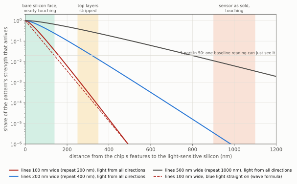

*Figure 1. The share of a pattern's strength that reaches the sensor's
silicon, against the distance between them. The solid curves use the
model of the design for light arriving from all directions. The dashed
curve is the formula above for blue light arriving straight on. The two
agree to within a factor of two for blue light up to about 300 nm
(Table 2). The shaded bands mark three
arrangements: a sensor as sold touching the chip (about 1,000 nm), a
sensor with its top layers stripped (about 300 nm), and a bare silicon
face nearly touching (under 140 nm). At 1,000 nm, 100 nm lines are weaker
than one part in a million million. At 100 nm they keep about a tenth of
their strength. Estimate.*

| Distance (nm) | Share left, light from all directions | Share left, blue light straight on | Share left, near-infrared straight on | First column divided by second | First column divided by third |
|--:|--:|--:|--:|--:|--:|
| 30 | 0.63 | 0.43 | 0.40 | 1.5 | 1.6 |
| 50 | 0.39 | 0.24 | 0.21 | 1.6 | 1.8 |
| 100 | 0.11 | 0.060 | 0.046 | 1.8 | 2.3 |
| 140 | 0.035 | 0.019 | 0.013 | 1.8 | 2.6 |
| 200 | 0.0062 | 0.0036 | 0.0021 | 1.7 | 3.0 |
| 300 | 0.00032 | 0.00022 | 0.000096 | 1.5 | 3.4 |
| 1,000 | 1.6 × 10⁻¹³ | 6.0 × 10⁻¹³ | 4.0 × 10⁻¹⁴ | 0.27 | 4.0 |

*Table 2. Strength of a pattern of 100 nm lines left after a distance.
The first column is the "matt" model that
[Table 4.11b of the design](../design.md#411-no-special-lighting-what-ordinary-light-can-reach-and-where-the-work-goes)
uses. The next two are the formula above. Estimate.*

The two models do not agree closely. Up to 300 nm the matt model gives 1.5
to 1.8 times more strength than the formula for blue light, and 1.6 to 3.4
times more than the formula for near-infrared light. The matt model is
used for first estimates below because the design uses it, and it is the
more hopeful of the two. Where it matters, the tables below give the
formula's figure beside it. Neither is confirmed, and the difference
between them is a measure of how uncertain every figure on this page is.

There are only three ways round this, and every route on this page is one
of them or a mixture.

| Way | What it does | Routes |
|---|---|---|
| Go close | Put something sharp within the fade length of the features | Sections [3](#3-going-close-the-pixels-own-silicon) to [5](#5-what-near-contact-needs-besides-the-sensor) |
| Shorten the wave | Fill the space with something that slows light, so that finer patterns travel, and collect them with a lens | [Section 6](#6-without-going-close-a-tiny-immersion-lens-on-each-pixel) |
| Know the answer in part | Use knowledge of the chip to choose between the few pictures that the readings allow | [Section 7](#7-knowledge-of-the-chip-and-measuring-without-a-picture) |

*Table 3. The three ways to recover detail finer than the wavelength.*

Going close is an old idea, from 1928 [[OL1](#ol1)], and it is how the
instruments of Table 4 picture detail far below the wavelength. The table
gives the published results in their own units and then scaled to blue
light, by the ratio of the wavelengths.

| Instrument | Wavelength used, as published | Detail resolved, as published | Detail as a share of the wavelength | The same, scaled to blue light of 450 nm (nm) | How close the probe was | Source | How the figures were checked |
|---|--:|--:|--:|--:|---|---|---|
| A small hole scanned over a surface, with microwaves | 3 cm | 0.5 mm | 1/60 | 7.5 | Well under a wavelength | [[OL2](#ol2)] | Unverified: from memory of the paper |
| A metal slit turned through many angles, with millimetre waves, and a tomographic reconstruction | 5 mm | better than 0.11 mm | better than 1/45 | 10 | Not stated in the abstract | [[OL27](#ol27)] | Abstract |
| The same method, later version | 5 mm | about 80 µm, the width of the slit | 1/62 | 7.2 | Not stated in the abstract | [[OL28](#ol28)] | Abstract |
| A drawn glass fibre with a tiny opening, visible light | about 0.5 µm | 12 nm | 1/43 | 10 | One fiftieth of the wavelength | [[OL3](#ol3)] | Abstract |
| A silicon light detector on a sharp tip | visible | not stated in the abstract | not stated | not scaled | Tip radius under 50 nm | [[OL7](#ol7)] | Abstract |
| A silicon light detector built into a scanning tip | visible | not stated in the abstract | not stated | not scaled | In the fading field | [[OL8](#ol8)] | Abstract |

*Table 4. Published instruments that go close. The first two columns of
figures keep each paper's own units. The scaled column is Derived here:
the share of the wavelength multiplied by 450 nm. The slit rows are the
earlier work closest to
[section 4](#4-going-close-a-metal-mask-with-slits-at-many-angles). The
last two rows matter because the detector is silicon held in the fading
field itself, which is what a bare pixel in near contact would be.*

These instruments use one probe and scan it. The baseline sensor has
eight million pixels. The question for this project is whether its pixels
can act as eight million probes at once.

## 2. Oversampling: what more readings buy

The number of readings of each patch of the chip is set by the scan: how
slowly the sensor moves, how fast it takes frames, how many pixels pass
over each point, and how many passes are made
([calculator](../calculator.md)). The earlier finding was that a thousand
times more readings improves the finest line only 1.2 to 1.8 times
([design, section 4.2](../design.md#42-what-a-huge-number-of-samples-buys-and-what-it-does-not)).
This section looks at where that holds, why, and what changes it.

### 2.1 Two regimes

More readings average the noise down by the square root of their number.
Whether that buys finer detail depends on how quickly the detail weakens
as it gets finer.

| What weakens the detail | How the strength falls as the line width `L` shrinks | Gain in fineness from a thousand times more readings (times) |
|---|---|--:|
| A sharp pixel edge alone, lines running along the edge | In proportion to `L` | 5.6 |
| A sharp pixel edge alone, detail fine in both directions | In proportion to `L` squared | 3.2 |
| A soft pixel edge | As exp( -constant / L² ) | 1.3 to 1.5 |
| Distance from the chip | As exp( -constant × distance / L ) | 1.3 to 1.8 |

*Table 5. The two regimes. Derived here from the transfer factors of
[`ccdsr/resolution.py`](https://github.com/mithro/ccd-superres/blob/main/ccdsr/resolution.py).
The first two rows are power laws and the other two are exponentials.
Against a power law, more readings always buy a fixed factor. Against an
exponential, each further step in fineness costs a larger multiple of
readings than the one before. In the first row the line width falls as the
readings to the power one quarter. That comes from two square roots: the
noise falls as the square root of the readings, and the patch over which a
line of width `L` is judged holds readings in proportion to `L` squared.
It holds for long lines parallel to a pixel edge, which is the case the
level 0 model computes. For detail that is fine in both directions the
pixel's response falls as `L` squared and the power is one sixth (second
row; Derived here, not computed by the model).*

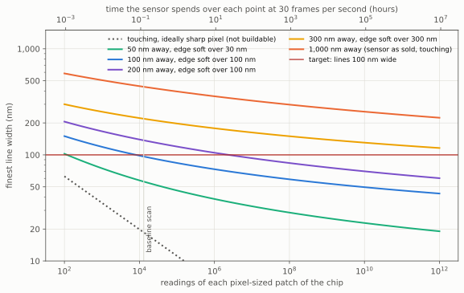

*Figure 2. Finest line width against the number of readings of each
pixel-sized patch, from a hundred to a million million. The top scale
gives the time the sensor must spend over each point at 30 frames per
second. The dotted line is the power law of a sharp pixel touching the
chip. Every buildable case bends away from it: the further from the chip
and the softer the edge, the flatter the curve. The curves for 100 nm and
200 nm distance cross the 100 nm target within reach; the curve for
300 nm does not within any practical time. The curves are for lines that
are just detectable; a clean line needs 25 times the readings, which
moves every curve to the right by that factor. Estimate.*

| Distance (nm) | Edge softness (nm) | Finest line, baseline scan, just detectable (nm) | The same with 1,000 times more readings (nm) | Gain (times) | Finest line, baseline scan, clean (nm) | The same with 1,000 times more readings (nm) |
|--:|--:|--:|--:|--:|--:|--:|
| 0 | 0 | 19 | 3 | 5.6 | 42 | 7 |
| 50 | 30 | 56 | 32 | 1.7 | 81 | 40 |
| 100 | 100 | 97 | 64 | 1.5 | 127 | 76 |
| 140 | 100 | 113 | 75 | 1.5 | 147 | 89 |
| 200 | 100 | 137 | 92 | 1.5 | 176 | 109 |
| 300 | 300 | 219 | 161 | 1.4 | 266 | 183 |
| 1,000 | 300 | 439 | 321 | 1.4 | 527 | 367 |
| 3,000 | 300 | 1,014 | 768 | 1.3 | 1,186 | 867 |

*Table 6. What a thousand times more readings buy at eight settings.
Estimate, by `finest_line` and `oversampling_exponent`. The just
detectable figures of the last three rows repeat
[Table 4.11b of the design](../design.md#411-no-special-lighting-what-ordinary-light-can-reach-and-where-the-work-goes).
The first row cannot be built and is shown as the limit.*

So the earlier finding is right wherever it was applied, and it is not a
law of the instrument. It is a property of being away from the chip. The
gain per reading rises as the distance and the softness fall, but slowly:
at every setting that can be built it stays between 1.3 and 1.7 times per
thousandfold.

### 2.2 Trading readings for distance

A gain of 1.5 times sounds small. Near the target it matters, because it
turns a distance that just fails into one that works. Table 7 gives the
readings needed to reach 100 nm lines.

| Distance (nm) | Readings needed, just detectable, sharp edge | Readings needed, clean, sharp edge | Time over each point (hours) | Readings needed, clean, edge soft over 100 nm | Time over each point (hours) | Readings needed, clean, sharp edge, wave formula for red light |
|--:|--:|--:|--:|--:|--:|--:|
| 50 | 100 | 2,500 | 0.023 | 15,000 | 0.14 | 7,700 |
| 100 | 1,400 | 34,000 | 0.32 | 200,000 | 1.9 | 150,000 |
| 140 | 13,000 | 320,000 | 3.0 | 1,900,000 | 18 | 1,600,000 |
| 200 | 400,000 | 10,000,000 | 94 | 60,000,000 | 560 | 59,000,000 |
| 250 | 7,700,000 | 190,000,000 | 1,800 | 1.1 × 10⁹ | 11,000 | 1.1 × 10⁹ |
| 300 | 150,000,000 | 3.7 × 10⁹ | 35,000 | 2.2 × 10¹⁰ | 210,000 | 2.3 × 10¹⁰ |
| 400 | 6.1 × 10¹⁰ | 1.5 × 10¹² | 14,000,000 | 9.1 × 10¹² | 84,000,000 | 8.7 × 10¹² |

*Table 7. Readings of each pixel-sized patch needed for lines 100 nm
wide, and the time the sensor must spend over each point at 30 frames per
second, which is the readings divided by 30. Estimate, by
`readings_needed`. The baseline scan is 13,000 readings, about seven
minutes. The first five columns of figures use the matt model. The last
uses the formula of section 1 for red light of 630 nm arriving straight
on, the harsher model; for near-infrared light it gives figures 1.3 to
1.5 times higher again. A pixel with edges soft over 300 nm does not
appear: at 140 nm it would need 1.2 × 10¹¹ readings for a just detectable
line.*

Four things follow from Table 7 (Derived from it).

- **Each extra 50 nm of distance costs ten to thirty times the
  readings.** Readings can therefore buy back about 50 nm to 100 nm of
  distance, from 100 nm out to 140 nm or 200 nm, at a cost of hours to
  days over each point. They cannot buy back much more: 250 nm costs
  months, and 300 nm costs years.
- **The answer depends on the model by a factor of five.** The wave
  formula asks for four to six times the readings of the matt model at
  the same distance. The honest statement for a sharp edge at 100 nm is
  "between 34,000 and 150,000 readings", which is 3 to 12 times the
  baseline scan.
- **Time is the price, not computing.** The sensor's pixels all read at
  once, so the time over each point is the same whether one square
  micrometre or the whole sensor's area is wanted. Three hours over each
  point is acceptable for an instrument that images one chip carefully.
  Four days is hard to hold steady
  ([section 2.3](#23-what-stops-readings-from-being-added-without-end)).
  The computation grows only in proportion to the readings.
- **Light is the same currency as readings, and there is light to
  spare.** A reading here is 2,500 electrons. Table 7a gives the lamp
  that fills such a reading 30 times a second. Every figure is far below
  the brightness of sunlight, which is about 100 mW/cm² (Unverified;
  general knowledge). A sensor that takes frames ten times faster under a
  lamp ten times brighter gives the same result in a tenth of the time
  (Derived here; whether such sensors and modes exist is for
  [plan](../plan.md#b-research-and-data-collection) item B5).

| Light path | Share of the lamp's light on a pixel's area that is detected | Lamp brightness needed at the chip (mW/cm²) |
|---|--:|--:|
| Near-infrared lamp of 1,050 nm behind a chip 500 µm thick, open pixel | 0.0008 | 1.4 |
| The same, behind a slit 100 nm wide | 0.000036 | 32 |
| Red lamp of 630 nm behind a chip thinned to 5 µm, open pixel | 0.034 | 0.056 |
| The same, behind a slit 100 nm wide | 0.0015 | 1.3 |

*Table 7a. The lamp needed for readings of 2,500 electrons at 30 frames
per second. Estimate, by `lamp_needed_mw_per_cm2`. The share for
near-infrared is from the [backlight](../backlight.md) page. The share
for red light is Derived here by `red_share` in the diagram script: three
silicon faces each passing 65 %, a chip 5 µm thick passing 19 %, and a
pixel 3 µm deep absorbing 63 %. The slit rows multiply by the slit's
share of Table 13.*

### 2.3 What stops readings from being added without end

The noise that averages down is the random part. Three things do not
average down, and they set the real limit of oversampling (Judgement).

| Limit | Why it does not average | What deals with it |
|---|---|---|
| The pixel's response is not known exactly | At 200 nm distance the 100 nm lines arrive at 0.6 % of their strength (Table 2). An error of that size in the assumed shape of the pixel's edge looks like fine detail | The response is solved from the same readings, as the [multi-frame study](multi-frame-reconstruction.md#6-ideas-new-to-the-project) proposes. More readings help here: the response is a few numbers and the readings are millions |
| The distance is not known exactly | The strength depends on the distance exponentially, so an error of 5 nm in the distance changes the strength of 100 nm lines by 13 % (Derived here from the formula of section 1) | The distance is solved per region from the coarse detail, whose fading it also sets, and from readings at two heights ([section 8](#8-smaller-ideas-and-ideas-set-aside)) |
| Drift over a long scan | A scan of hours or days sees the lamp, the temperature and the gap wander | The lamp is followed with monitor pixels ([REQ-7](../design.md#requirements)); the scan is made as many short passes, each with its own position, gap and brightness, not one slow pass |

*Table 8. What limits oversampling in practice.*

### 2.4 Other kinds of oversampling

The count of readings is one of four quantities that can be oversampled.
The others decide whether the readings are spent well. The size of the
pixel is a fifth lever on the count itself. For a pixel of half the
width, with the same edge softness, the model asks for 16 times fewer
readings, and so 16 times less time over each point, for the same line:
150,000 against 2,400,000 at 200 nm with an edge soft over 100 nm
(Estimate, by `finest_line` with a pixel of 560 nm). That assumes each
reading still holds 2,500 electrons, which needs a lamp four times
brighter. With the same lamp the gain is 4 times (Derived here: a quarter
of the light halves the signal-to-noise of each reading). Smaller pixels
do not move the limit set by distance and edge softness.

| What is oversampled | What it needs for 100 nm lines | How the scan supplies it |
|---|---|---|
| Positions along and across the scan | A reading at least every 50 nm in both directions | Along the scan: a step per frame that is not a simple fraction of a pixel. Across: a sensor turned so that neighbouring rows are offset by 50 nm, which is a slope of 1 in 22 (Derived here: 1,120 nm ÷ 50 nm) |
| Directions, for a mask of slits ([section 4](#4-going-close-a-metal-mask-with-slits-at-many-angles)) | A slit direction about every 5° to 15° | The two-dimensional sensor carries all directions at once, one per pixel |
| Heights | Readings at two or more distances from the chip | A sensor that is slightly domed or tilted has every distance somewhere on it ([section 5.2](#52-holding-tens-of-nanometres)) |
| Time within a frame | An exposure during which the sensor moves under 50 nm | At the baseline speed of 8.4 µm/s, an exposure of 6 ms or less (Derived here) |

*Table 9. The four kinds of oversampling.*

## 3. Going close: the pixel's own silicon

The first route makes the pixel itself the probe. Nothing is added to the
sensor. Layers are taken away until the light-sensitive silicon is at the
face, and the face is brought to within about 100 nm of the features.

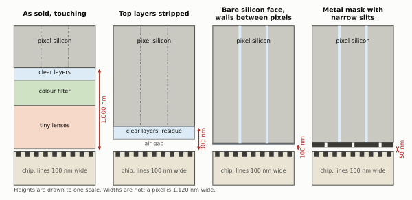

*Figure 3. Four sensor faces above the same chip, with heights drawn to
one scale. From left: the sensor as sold, where lenses and colour filter
keep the silicon about 1,000 nm away; the top layers stripped, leaving
about 300 nm; a bare silicon face with glass-filled walls between the
pixels, nearly touching; and a metal mask with one narrow slit per pixel,
where the light is sensed at the slit and what lies behind it no longer
counts. Thicknesses of the first two are Estimates from
[design, section 5.3](../design.md#53-the-sensor-stack-and-what-removing-the-lenses-leaves).*

### 3.1 How close and how sharp

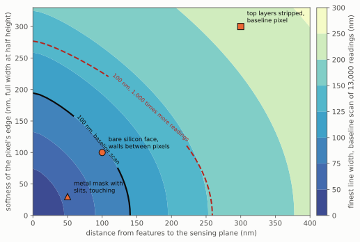

*Figure 4. Finest just detectable line width for every combination of
distance and edge softness, for the baseline scan. Inside the solid black
contour the model gives lines of 100 nm or finer. The dashed red contour is the same
boundary with a thousand times more readings. The square is the stripped
baseline pixel, the circle a bare-silicon pixel with walls, the triangle a
slit mask. Estimate.*

| Distance (nm) | Edge sharp (nm) | Edge soft over 50 nm (nm) | Edge soft over 100 nm (nm) | Edge soft over 150 nm (nm) | Edge soft over 300 nm (nm) |
|--:|--:|--:|--:|--:|--:|
| 30 | 40 | 51 | 69 | 88 | 145 |
| 50 | 53 | 61 | 77 | 94 | 149 |
| 100 | 80 | 85 | 97 | 111 | 161 |
| 140 | 100 | 103 | 113 | 126 | 172 |
| 200 | 127 | 130 | 137 | 148 | 189 |
| 300 | 169 | 171 | 176 | 184 | 219 |

*Table 10a. Finest just detectable line width with the baseline scan of
13,000 readings. Estimate, by `finest_line`, the same level 0 model as
[Table 4.11b of the design](../design.md#411-no-special-lighting-what-ordinary-light-can-reach-and-where-the-work-goes).*

| Distance (nm) | Edge sharp (nm) | Edge soft over 50 nm (nm) | Edge soft over 100 nm (nm) | Edge soft over 150 nm (nm) | Edge soft over 300 nm (nm) |
|--:|--:|--:|--:|--:|--:|
| 30 | 64 | 73 | 92 | 112 | 174 |
| 50 | 79 | 86 | 101 | 120 | 179 |
| 100 | 111 | 115 | 127 | 142 | 194 |
| 140 | 135 | 138 | 147 | 160 | 208 |
| 200 | 167 | 170 | 176 | 187 | 229 |
| 300 | 217 | 219 | 224 | 232 | 266 |

*Table 10b. Finest clean line width with the baseline scan. Estimate, by
`finest_line` with a margin of five. With the wave formula for red or
near-infrared light in place of the matt model, the sharp-edge column
reads 93 nm at 50 nm and 128 nm to 132 nm at 100 nm.*

The target needs both numbers at once: a distance of about 100 nm or less
and an edge sharp to about 100 nm or less. With the baseline scan that
makes 100 nm lines just detectable (97 nm in Table 10a) and gives clean
lines of 127 nm. Clean lines of 100 nm with the baseline scan need 50 nm
and an edge soft over no more than 100 nm, or the 15 times more readings
of Table 7. The baseline pixel's assumed softness of 300 nm fails at any
distance. That softness is an Assumption of the design, and it now
matters more than any other number.

### 3.2 Where a sharp edge can come from

A pixel's edge is soft for two reasons. Light that enters near the edge
spreads sideways as it travels down through the silicon, and the charge
it frees wanders before it is collected. Two things can stop both.

**Walls between the pixels.** Sensors with pixels of about a micrometre
are now commonly built with glass-filled trenches between the pixels, to
stop exactly this leakage (Unverified; general knowledge of the
industry). A first demonstration on pixels of 1.12 µm,
the size of the baseline pixel, halved the leakage between neighbours
[[OL16](#ol16)]. With a wall through the full depth, light that has
entered one pixel's silicon is reflected back by the wall and stays
there, so the pixel collects whatever crossed its own face. Its edge is
then as sharp as the wall is narrow, of the order of 100 nm (Unverified;
typical trench widths are from memory). Whether the baseline sensor has
such walls is not known and is a question for
[plan](../plan.md#b-research-and-data-collection) item B5. The argument
holds only for light whose pattern can travel inside silicon, which the
end of this section takes up.

**Light that is absorbed before it spreads.** Without walls, a fine
pattern that has entered the silicon drifts sideways with depth: its
bright lines move across and swap with its dark lines. The pixel adds up
what is absorbed at every depth, which smears the pattern. Light that is
absorbed in the first few hundred nanometres is smeared least.

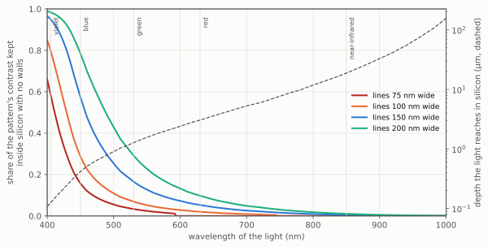

*Figure 5. The share of a fine pattern's contrast that survives inside
silicon without walls, against the wavelength of the light, for four line
widths (left scale), and the depth the light reaches (dashed, right
scale). Violet light is absorbed within about 120 nm and keeps most of
the pattern. Green light travels more than a micrometre and loses nearly
all of it. The curves are the upper bound of Table 11. The top scale
names the colours. Estimate.*

| Light | Wavelength (nm) | Depth reached in silicon (nm) | Contrast kept at best, 75 nm lines | Contrast kept at best, 100 nm lines | Contrast kept at best, 150 nm lines | Contrast kept at best, 200 nm lines | Contrast kept, 100 nm lines, light straight on |
|---|--:|--:|--:|--:|--:|--:|--:|
| Violet | 405 | 124 | 0.59 | 0.80 | 0.95 | 0.98 | 0.64 |
| Blue | 450 | 415 | 0.16 | 0.29 | 0.57 | 0.78 | 0.08 |
| Green | 530 | 1,270 | 0.03 | 0.07 | 0.17 | 0.29 | 0.00 |
| Red | 630 | 3,050 | 0.00 | 0.02 | 0.05 | 0.10 | 0.00 |
| Near-infrared | 850 | 18,700 | 0.00 | 0.00 | 0.01 | 0.01 | 0.00 |
| Near-infrared | 1,050 | 613,000 | 0.00 | 0.00 | 0.00 | 0.00 | 0.00 |

*Table 11. Smearing of a fine pattern inside silicon that has no walls.
Derived here, by `silicon_pattern_survival`: the pattern's bright lines
drift at a rate set by the wavelength and the refractive index, the light
is absorbed over the depth shown, and the pattern is averaged with that
weight. "At best" is for light bent to one side only, where the pattern
slides sideways as it goes down. Light arriving straight on is bent to
both sides, the pattern fades and reverses in place, and the contrast
kept is the square of the "at best" figure (last column). The truth for a
lamp lies between the two. Silicon's optical constants are from Green's
table [[OL26](#ol26)], already in the repository. The table applies to a
weak pattern on a bright background and ignores the wandering of the
charge.*

Table 11 says that without walls only violet light, and at best blue,
keeps the detail inside the pixel.

Walls remove the smearing, but only for light whose pattern can travel
inside silicon at all. Silicon slows red light of 630 nm by a factor of
3.9, so its wavelength inside silicon is 162 nm, shorter than the 200 nm
repeat of 100 nm lines. The pattern travels down the pixel at a slant,
the walls reflect it, and the pixel collects it. This holds for
wavelengths up to about 740 nm. Near-infrared light of 1,050 nm is slowed
3.6 times, to 295 nm, which is longer than the repeat. The pattern then
cannot travel inside silicon either. It clings to the silicon's face and
fades over 43 nm, while the pixel collects light over its whole depth of
about 3,000 nm. The pattern's share of the reading is cut to about
1.4 % of what it was at the face, which costs about 5,000 times the
readings (Derived here from the formula of section 1 with silicon's
refractive index; printed by the diagram script. The pixel depth of
3,000 nm is an Assumption).

This shapes the rest of the page. A bare-silicon pixel with walls needs
red or bluer light. The slit mask of
[section 4](#4-going-close-a-metal-mask-with-slits-at-many-angles) does
not: the light is sensed at the slit, and what happens to the pattern
behind it does not matter. Which light can reach the chip in near contact
is the subject of [section 5.3](#53-getting-light-to-the-surface).

### 3.3 What has to come off the sensor

The face of a back-illuminated sensor carries, from the outside in,
lenses, a colour filter, a metal grid, thin clear coatings, and then
silicon ([design, section 5.3](../design.md#53-the-sensor-stack-and-what-removing-the-lenses-leaves)).
For this route everything above the silicon has to go, or be thinned to a
few tens of nanometres. Sensors are made this way for a different
purpose: to detect soft X-rays, which cannot pass even a thin coating. One
such sensor has a dead layer on its silicon only 5 nm thick
[[OL21](#ol21)]. Its pixels are several micrometres wide, which for this
route does not matter, since it is the edge that has to be sharp and not
the pixel that has to be small (Derived from Table 10a). Whether it has
walls between its pixels is not stated in the abstract.

### 3.4 Evidence from the simulator

The [level 1](../simulation-chain.md) simulator in one dimension was run
at these distances, with bars from 200 nm down to 80 nm wide, a pixel of
1,120 nm, random frame-to-frame position changes that are known to the
solver, and the plain least-squares solver.

| Distance (nm) | Edge softness (nm) | Contrast recovered, 740 readings | Contrast recovered, 7,400 readings | Contrast recovered, 74,000 readings |
|--:|--:|--:|--:|--:|
| 50 | 0 | 0.76 ± 0.06 | 0.85 ± 0.05 | 0.83 ± 0.04 |
| 100 | 0 | 0.66 ± 0.10 | 0.84 ± 0.10 | 0.85 ± 0.08 |
| 100 | 100 | 0.43 ± 0.25 | 0.58 ± 0.11 | 0.80 ± 0.04 |
| 140 | 0 | 0.35 ± 0.16 | 0.54 ± 0.21 | 0.74 ± 0.08 |
| 140 | 100 | 0.15 ± 0.09 | 0.52 ± 0.10 | 0.59 ± 0.17 |
| 200 | 0 | 0.08 ± 0.04 | 0.17 ± 0.16 | 0.46 ± 0.11 |
| 300 | 0 | 0.06 ± 0.02 | 0.06 ± 0.03 | 0.06 ± 0.03 |
| 300 | 300 | 0.05 ± 0.03 | 0.02 ± 0.01 | 0.02 ± 0.02 |

*Table 12. Contrast of bars 100 nm wide in the reconstruction, as mean
and spread over six runs with different noise. The true value is 0.85.
Estimate (simulated), level 1, one dimension, by `level1_near_contact` in
the diagram script. The smoothing of the solver is reduced in proportion
to the number of readings. Readings are per pixel-sized stretch of the
line. A line scan has no second direction to spend readings on, so to
compare with Table 7 each count is multiplied by 11.2, the pixel width
divided by the bar width: the three columns correspond to 8,300, 83,000
and 830,000 readings of a pixel-sized patch, which is 0.6, 6 and 64 times
the baseline scan.*

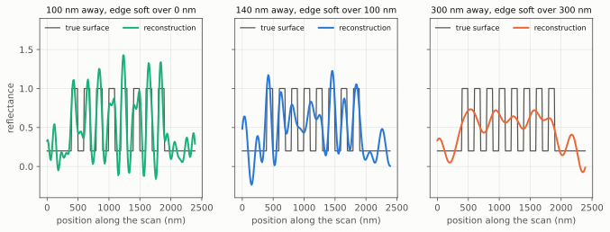

*Figure 6. The group of eight bars 100 nm wide (grey) and its
reconstruction from 74,000 readings at three settings, one run each. At
100 nm with a sharp edge all eight bars appear in the right places, with
heights that are wrong by up to half and small false peaks outside the
group. At 140 nm with an edge soft over 100 nm most bars appear and some
are merged or missing. At 300 nm with the baseline pixel the
reconstruction shows five broad bumps where there are eight bars: detail
that is not there. Estimate (simulated), level 1.*

The simulator agrees with the estimates in three respects. Bars of 100 nm
are recovered at 100 nm and not at 300 nm. A soft edge costs about as
much as 40 nm of distance. And a hundred times more readings raises the
contrast recovered at 140 nm from 0.35 to 0.74 and at 200 nm from 0.08 to
0.46, but does nothing at 300 nm. The middle column, six times the
baseline scan, recovers about two thirds of the contrast at 100 nm with a
soft edge, which is in line with the 15 times that Table 7 asks for a
clean result. This confirms the reconstruction, not the physics. Level 1
uses the same blur model as the estimates, so only a wave calculation can
confirm that the blur at 100 nm is what the model says.

## 4. Going close: a metal mask with slits at many angles

The second route adds one thing to the sensor: a thin metal film on its
face, with one narrow opening over each pixel. The light is then sensed
at the opening. Its edges are as sharp as the metal can be cut, and
everything behind the film, including a soft pixel, stops counting. This
is how the closest earlier instrument to this project worked: a line of
small holes on a sensor, with the sample carried across it
[[Heng2006](../references.md#closest-earlier-instruments-and-reconstruction-methods)],
and its makers measured how such a hole collects light from a nearby
point [[OL6](#ol6)].

The [optical elements](../optical-elements.md#51-sub-pixel-openings) page
set small openings aside because at any gap then in view the gap
dominated. In near contact that no longer applies.

The idea of a slit as a probe, with a tomographic reconstruction, is
published. A metal slit much narrower than the wavelength and about a
wavelength long was scanned over objects at many angles with millimetre
waves of 60 GHz, a wavelength of 5 mm, and a two-dimensional picture was
computed with the method of medical scanners. It resolved better than
one forty-fifth of the wavelength [[OL27](#ol27)], and later detail equal
to the slit width of about 80 µm [[OL28](#ol28)]. Scaled to blue light of
450 nm those are 10 nm and 7 nm (Table 4). The authors also proposed a
slit on the end of an optical fibre [[OL27](#ol27)]. That work used one
slit and turned it. What this page adds is a fixed slit on every pixel of
a sensor, each at a different angle, read in ordinary light. No
publication of that arrangement was found in a brief search (Table 23).

### 4.1 Holes pass almost no light; slits pass plenty

A round hole much smaller than the wavelength passes very little light:
the share falls as the fourth power of its width [[OL4](#ol4)], and a
hole narrower than about half a wavelength also chokes the light along
its length. A long slit behaves differently. It always passes the half of
the light whose electric field points across it, however narrow it is
[[OL5](#ol5)].

| Opening | Width (nm) | Share of an open pixel's light, blue 450 nm | Share of an open pixel's light, red 630 nm | Share of an open pixel's light, near-infrared 1,050 nm |
|---|--:|--:|--:|--:|
| Round hole | 50 | 4.0 × 10⁻⁹ | 9.8 × 10⁻¹⁰ | 1.2 × 10⁻¹⁰ |
| Round hole | 100 | 1.2 × 10⁻⁵ | 2.7 × 10⁻⁶ | 3.2 × 10⁻⁷ |
| Round hole | 200 | 6.9 × 10⁻³ | 1.3 × 10⁻³ | 1.4 × 10⁻⁴ |
| Slit across the pixel | 50 | 0.022 | 0.022 | 0.022 |
| Slit across the pixel | 100 | 0.045 | 0.045 | 0.045 |
| Slit across the pixel | 200 | 0.089 | 0.089 | 0.089 |

*Table 13. Light passed by one opening in a metal film 50 nm thick, as a
share of what the open pixel would collect. Estimate, by `hole_light` and
`slit_light`, for an ideal metal: the hole's share of the pixel's area,
times Bethe's fourth-power law [[OL4](#ol4)], times the choking along the
hole's length. Real metals pass somewhat more through holes
(Unverified). A slit is taken to pass half the light and its resonances
are ignored.*

A slit 100 nm wide passes about 4,000 times more blue light than a hole
100 nm wide, and 140,000 times more near-infrared (Derived from Table
13). That is the difference between a usable instrument and one that
needs millions of times more readings to make up the light.

### 4.2 A slit sees a line; many angles make a picture

A slit resolves fine detail only across its width. Along its length it
averages. One slit direction therefore gives a picture that is sharp in
one direction only. The remedy is the one a medical scanner uses: measure
along lines in many directions and let the computation combine them. Here
no rotation is needed, because the sensor has millions of pixels and each
can carry a slit in a different direction. The scan carries every slit
across every point of the chip.

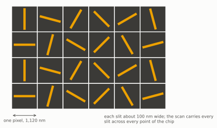

*Figure 7. Top view of a patch of the sensor. Each square is one pixel
covered by metal, with a slit about 100 nm wide (yellow) in one of twelve
directions. Illustrative, to scale except that real slits would be cut to
the full width of the pixel.*

A first test in two dimensions was run for this page. A layout of lines
100 nm wide, running both ways, was read by four arrangements with the
same number of readings, noise included, and reconstructed by least
squares. It was run twice: with the baseline scan of 13,000 readings of
each pixel-sized patch, and with 116 times as many.

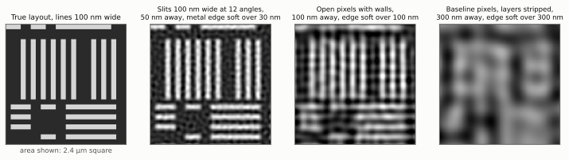

*Figure 8. Left column: the true layout, 2.4 µm across, with lines 100 nm
wide. Then the reconstruction from slits 100 nm wide in twelve
directions, 50 nm from the features; from open pixels with walls, 100 nm
from the features; and from stripped baseline pixels, 300 nm away. Top
row: the baseline scan. Bottom row: 116 times the baseline scan. With the
baseline scan the slits show nearly every line, the walled pixels show
hints of the lines among false detail, and the baseline pixels show
nothing. With 116 times the readings the walled pixels show every line
too. Estimate (simulated), by `slit_demo` in the diagram script.*

| Arrangement | Distance (nm) | Edge softness (nm) | Error of the picture, baseline scan (root mean square, reflectance) | Points on the wrong side, baseline scan (%) | Error of the picture, 116 times the baseline (root mean square, reflectance) | Points on the wrong side, 116 times the baseline (%) |
|---|--:|--:|--:|--:|--:|--:|
| Slits 100 nm wide in twelve directions | 50 | 30 | 0.198 | 4.2 | 0.154 | 1.0 |
| Slits 100 nm wide in twelve directions | 100 | 100 | 0.309 | 23.0 | 0.192 | 3.5 |
| Open pixels with walls | 100 | 100 | 0.307 | 22.0 | 0.217 | 5.5 |
| Baseline pixels, top layers stripped | 300 | 300 | 0.354 | 31.6 | 0.340 | 31.4 |
| A blank picture at the layout's mean level | not applicable | not applicable | 0.374 | 32 | 0.374 | 32 |

*Table 14. Error of the reconstructions of Figure 8, and of one
arrangement not drawn there. The layout's two levels are 0.2 and 1.0. A
point is on the wrong side when the reconstruction puts it on the other
side of the midway level of 0.6 from the truth. The last row is the score
of a picture with no information in it. Estimate (simulated).*

Table 14 says four things.

- With the baseline scan, slits 50 nm from the features recover the
  layout: 4 % of points are wrong, against 32 % for a blank picture.
- With the baseline scan, open pixels with walls at 100 nm do not: 22 %
  wrong. That agrees with Table 10b, where this setting gives clean lines
  of 127 nm, not 100 nm. They do with 116 times the readings (5.5 %).
- At equal distance and softness the slits are no better than the open
  pixels with the baseline scan (23 % against 22 %) and a little better
  with more readings (3.5 % against 5.5 %). The slit's advantage is
  therefore not the slit itself. It is that a mask's openings can sit
  closer to the chip than a pixel's silicon can, and that their edges are
  as sharp as metal can be cut, on a sensor whose own pixels may have
  neither property.
- The baseline pixel at 300 nm gains nothing from 116 times the readings.

The test flatters every arrangement in four ways, and its absolute scores
should not be relied on (Judgement). The amount of smoothing was chosen
for each as the one giving the lowest error against the truth, which a
real reconstruction cannot do. The readings were made with the same blur
model that the solver then used, so no error of the model is included.
The layout was treated as repeating at its borders. And the positions of
all readings were taken as known exactly. The comparison between
arrangements is less affected, since all four share these advantages.

In the level 0 model the slit and the open pixel reach nearly the same
line width when both have equally sharp edges at the same distance: at
50 nm with an edge soft over 30 nm, 48 nm against 56 nm just detectable
and 66 nm against 81 nm clean (Estimate). At 100 nm with an edge soft
over 100 nm the slit gives 109 nm clean.

### 4.3 What it costs

| Item | Cost |
|---|---|
| Hardware | A metal film 50 nm to 100 nm thick on the sensor face, with slits cut by the same methods that make chips. It is made once and is fixed to the sensor. It waits for the gate of [REQ-15](../design.md#requirements) |
| Light | A slit passes 2 % to 9 % of an open pixel's light (Table 13), and the lamp must be that much brighter to fill each reading: about 32 mW/cm² of near-infrared light behind a full-thickness chip (Table 7a). With the reading filled, the loss in signal-to-noise is small (Derived here: what an edge contributes to fine detail does not depend on how wide the opening is, and a narrower opening lets in less background) |
| Where the lamp must be | Behind the chip. With the lamp behind the sensor the metal reflects nearly all the lamp's light straight back into the pixel, and only the slit's share reaches the chip and returns. The chip's share of the reading is then at most about 2 %, which costs up to 2,000 times the readings (Derived here from the slit's share of Table 13 against two passes of the lamp's light through the pixel; printed by the diagram script) |
| Computing | A tomographic solve over all slit directions. In the test, twelve kernels and a few hundred iterations for 65,000 unknowns; at full size, a tiled solve of the kind already planned ([design, Table 4.11d](../design.md#411-no-special-lighting-what-ordinary-light-can-reach-and-where-the-work-goes), item 11) |
| What it pictures | With the lamp behind the chip, whatever blocks the light: the chip's metal, as a shadow. Layers that near-infrared light passes through, such as silicon and glass, show weakly or not at all (Judgement) |
| Risks | Slits pass one polarisation, so lines along a slit and across it look different, which the model must include. A slit's own resonances were ignored. Both need the wave level of the simulation chain |

*Table 15. Costs of the slit mask.*

## 5. What near contact needs besides the sensor

Sections 3 and 4 need three more things besides the prepared sensor: the
right layer at the top of the chip, a way to hold the distance, and a
path for the light.

### 5.1 The layer of interest at the top of the chip

A finished chip has its finest features at the bottom of a stack several
micrometres thick, under coarser wiring and a protective coat. From above
they are far outside any fade length. They can be reached only if the
layers above are removed. This is routine in the analysis of chips, where
layers are taken off one at a time and each is photographed, usually with
an electron microscope [[OL18](#ol18)]. For this project it is
preparation of the sample, done once per layer, and it destroys the
layers removed. The surface left by careful polishing is flat to a few
tens of nanometres over the width of a chip (Unverified), which is what
near contact also needs. Whether such preparation is acceptable is a
question for a decision ([section 10](#10-what-the-simulator-needs)).

### 5.2 Holding tens of nanometres

The design judged a gap of 100 nm over the whole sensor to be out of
reach. Three ideas make it less so.

**A touching zone, not a touching sensor.** A sensor that is very
slightly domed touches a flat chip at one point and stands off elsewhere
by the square of the distance from that point, divided by twice the
dome's radius. The zone that is within 100 nm is then large.

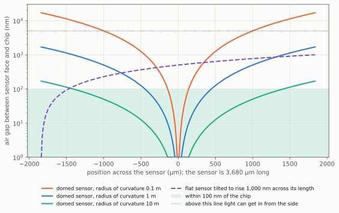

*Figure 9. The air gap between sensor and chip across the sensor's
length, for sensors domed with a radius of 0.1 m, 1 m and 10 m, and for a
flat sensor tilted to rise 1,000 nm from one end to the other. The shaded
band is within 100 nm of the chip. Derived here from the geometry of a
sphere on a flat.*

| Shape of the sensor face | Width of the zone within 50 nm (µm) | Pixels in it | Width of the zone within 100 nm (µm) | Pixels in it |
|---|--:|--:|--:|--:|
| Domed, radius 0.1 m | 200 | 25,000 | 280 | 50,000 |
| Domed, radius 1 m | 630 | 250,000 | 890 | 500,000 |
| Domed, radius 10 m | 2,000 | 2,500,000 | 2,800 | 5,000,000 |
| Flat, rising 1,000 nm over its length | 180 | 400,000 | 370 | 810,000 |

*Table 16. Size of the zone held close. For a dome the zone is a disc and
the width is its diameter. For the tilted flat sensor it is a band across
the sensor. Derived here, by `contact_zone_sphere` and
`contact_band_wedge`. A dome of radius 1 m means the middle of the sensor
stands 1.7 µm proud of its ends, which thinned sensors may do by
themselves (Unverified).*

A dome of 1 m gives half a million pixels within 100 nm. The pixels
outside the zone are not wasted. They are at every larger distance, so
one scan gives the coarse picture, the positions and the calibration from
the far pixels and the fine picture from the near ones. The readings per
pass fall in proportion to the zone's width, which Table 7 prices.

**Riding on a film.** Hard disk drives hold a head a few nanometres above
a spinning disk on a film of air that the motion itself drags under the
head [[OL17](#ol17)]. The head is about a millimetre across, and earlier
generations rode at 50 nm to 100 nm (Unverified; from memory). The
sensor's continuous motion ([REQ-10](../design.md#requirements)) is the
same ingredient, though the baseline speed of 8.4 µm/s is about a million
times slower than a disk's surface (Unverified: a disk speed of about
10 m/s is from memory), and the film thickness falls with speed. A
liquid film is far more viscous than air and forms at far lower speeds
(Unverified). Whether a liquid film counts as "liquid in the gap" is the
open question of
[design, section 11](../design.md#11-build-stages-and-open-questions),
item 12.

**Measuring the gap from the readings.** The distance does not have to be
held exactly if it is known. It sets how quickly detail fades with
fineness, and the coarse detail shows that fading clearly. The gap can
therefore be solved region by region from the same readings, as the
positions are ([design, section 6.4](../design.md#64-estimating-motion-from-the-data)).

Sliding contact wears both surfaces and gathers dust. A particle of
100 nm under the sensor lifts the zone around it. This is the main
practical risk of the route (Judgement), and it is hardware experience
that the simulator cannot supply.

### 5.3 Getting light to the surface

The [light entry](../light-entry.md) estimate found that light from the
side does not pass a slot lower than about 5,000 nm. In near contact the
slot is fifty times lower still, so side light is out.

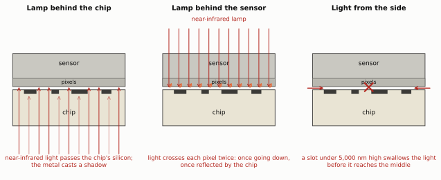

*Figure 10. Three ways to light a chip in near contact. Left: a lamp
behind the chip, near-infrared for a chip of full thickness or red for a
chip thinned to a few micrometres; the chip's silicon lets the light
through and its metal casts a shadow. Middle: a near-infrared lamp behind
the sensor; the light passes down through the pixels, reflects off the
chip and passes up through the pixels again. Right: light from the side,
which the slot does not pass. Illustrative.*

| Path | What the pixel reads | What it needs | Bare-silicon pixels with walls (section 3) | Slit mask (section 4) | Counts as ordinary light? |
|---|---|---|---|---|---|
| Near-infrared lamp behind a chip of full thickness | The shadow of the chip's metal | The back of the chip exposed and polished | No: the pattern cannot travel in silicon ([section 3.2](#32-where-a-sharp-edge-can-come-from)) | Yes | Open: [design, section 11](../design.md#11-build-stages-and-open-questions), item 12 |
| Red lamp behind a chip thinned to a few micrometres | The shadow of the chip's metal | The chip thinned from the back as well as delayered from the front, leaving a film a few micrometres thick that must stay flat | Yes | Yes | Yes: a plain red lamp |
| Near-infrared lamp behind the sensor | The lamp's own light plus the chip's reflection | The back of the sensor opened so that light can pass its mounting and wiring | No, as in the first row | Poorly: the chip's share of the reading is at most about 2 % (Table 15) | Open, as in the first row |
| Red lamp behind the sensor | The lamp's own light, two thirds of it absorbed on the way down, plus the chip's reflection | As above | Not assessed | Poorly, as above | Yes |
| From the side | Nothing | Nothing helps below 5,000 nm | No | No | Ordinary, but does not work |

*Table 17. Light paths in near contact, and which route each serves.
Judgement, built on the sections cited.*

| Quantity | Value | Kind of claim |
|---|--:|---|
| Share of a near-infrared lamp's light detected through a chip 500 µm thick | 0.0008 | Estimate, from the [backlight](../backlight.md) page |
| Share of a red lamp's light detected through a chip 5 µm thick | 0.034 | Estimate, Table 7a |
| Contrast between metal and bare silicon with a near-infrared lamp behind the sensor | 0.19 | Estimate, by `through_sensor_contrast` |
| Reflectance of metal assumed for that contrast | 0.95 | Assumption |
| Reflectance of bare silicon assumed for that contrast | 0.31 | Assumption |

*Table 17a. The figures behind Table 17. The contrast of 0.19 treats the
sensor's face and the chip as two separate mirrors. In near contact the
gap is far thinner than the wavelength and the two reflect as one stack,
so the true value depends strongly on the gap and may differ by a factor
of two or more either way. How much light passes the sensor's wiring is
not known.*

The light path therefore sorts the routes (Judgement). The slit mask
works with the least preparation of the chip: a near-infrared lamp behind
a chip of full thickness, which is the arrangement the
[backlight](../backlight.md) page already describes. Bare-silicon pixels
need red light, and red light reaches the surface from behind only
through a chip thinned to a film a few micrometres thick, which is much
heavier preparation. A lamp behind the sensor serves neither route well
on these estimates.

A lamp behind the sensor shining through it is how a different kind of
instrument already looks at chips: from the back, through the chip's own
silicon, with a silicon lens pressed against it. That method has reached
0.23 µm [[OL13](#ol13)] and, more recently, lines 100 nm wide
[[OL14](#ol14)], in near-infrared light. It shows that near-infrared
light can carry 100 nm detail when the space it travels through is
silicon, which slows light 3.5 times. It uses a lens and a laser, so it
is not this project's instrument.

### 5.4 Is near contact still the same project?

It keeps the lensless sensor, the continuous scan, the many pixels, the
oversampling and the heavy computation. It changes the gap from "as small
as practical" to "almost none, over a zone", and it asks for a prepared
chip and a prepared sensor. Both preparations are hardware work and wait
for the gate ([REQ-15](../design.md#requirements)). Until then the route
is simulated like any other.

## 6. Without going close: a tiny immersion lens on each pixel

The second way of Table 3 is to make the detail travel. In a material
that slows light by a factor `n`, patterns down to the wavelength divided
by `n` travel freely, and a lens that collects light over all directions
can then picture a repeat distance down to the wavelength divided by
twice `n` [[Goodman](../references.md#textbooks-and-standard-methods)].
This is how the best ordinary microscopes work, with oil between lens and
sample (Unverified; general knowledge), and it sets what ordinary light
can do at a distance.

| Space between chip and lens | Finest repeat distance in blue light of 450 nm (nm) | Contrast left for 100 nm lines |
|---|--:|--:|
| Air | 225 | 0.00 |
| Oil, which slows light 1.5 times | 150 | 0.14 |
| A solid that slows light 2.0 times, touching the chip | 112 | 0.32 |

*Table 18. The limit of a perfect lens in ordinary blue light. Derived
here from the textbook response of a lens under light from all
directions. A solid only works if it touches the chip to within the fade
length of Table 1, so its row is a form of near contact.*

The sensor as sold has a lens on every pixel. Those lenses are weak and
are removed ([REQ-1](../design.md#requirements)). A strong lens in their
place, a glass bead a few micrometres across sitting in oil just above
the chip, would make each pixel a small immersion microscope looking at
one spot, and the scan would build the picture. Beads used this way under
a microscope with ordinary white light were reported to show detail of
50 nm [[OL10](#ol10)]. A later, careful analysis of how such resolution
should be measured found smaller gains [[OL11](#ol11)]: about one sixth
to one seventh of the wavelength (Unverified; from memory of the paper,
not in its abstract). The solid immersion lens is the engineered form of
the same idea [[OL12](#ol12)].

| Point | Assessment |
|---|---|
| What it could reach | Lines of 100 nm to 150 nm in blue light with oil, at a contrast of 14 % or less for 100 nm (Table 18; Judgement on the range) |
| What it avoids | Near contact. The bead sits several micrometres above the chip, where side light can enter ([light entry](../light-entry.md)) |
| What it gives up | The lensless arrangement, and a dry chip. Liquid in the gap is undecided ([design, section 11](../design.md#11-build-stages-and-open-questions), item 12) |
| What limits it | It cannot go finer than Table 18 whatever the oversampling: this is a hard cut-off, not an exponential fade. The features must still be within a micrometre or so of the top of the chip |
| Computing | Modest. The bead's blur is removed as in level 1 |

*Table 19. Assessment of an immersion lens per pixel.*

This is the only route found that keeps a true picture near 100 nm
without near contact, and it conflicts with one requirement and one open
question. It is listed for a decision, not recommended (Judgement).

## 7. Knowledge of the chip, and measuring without a picture

The third way of Table 3 does not bring more detail to the sensor. It
uses what is known about chips to choose between the pictures that the
readings allow. The project already has it as reconstruction by
elimination ([REQ-19](../design.md#requirements);
[page](../constrained-reconstruction.md)).

### 7.1 How far knowledge can carry a picture

The level 1 [comparison](../comparison.md#what-it-found) tried one piece
of knowledge: that only two materials are present. In good conditions it
cut the error of the picture from 0.199 to 0.159 on a random layout and
from 0.115 to 0.064 on isolated lines. Across a wide gap it did not help
(0.334 against 0.293). The comparison did not measure how much finer a
line it lets through. Mathematics gives the order to expect: knowing that
a scene is made of a few separate features lets them be told apart closer
together than the blur would allow, but the noise is amplified by a power
of the factor gained that grows with the number of features crowded
together [[M90](../reconstruction-methods.md#m90),
[M93](../reconstruction-methods.md#m93), [OL19](#ol19)]. A gain of 1.5 to
2 in line width is therefore plausible and a gain of 4 is not
(Judgement; no simulation at this scale supports a figure yet).

Applied to this page's numbers: a sensor with sharp edges at 300 nm gives
a clean true picture of lines of about 170 nm with 310,000 readings, 24
times the baseline scan and about three hours over each point (Estimate,
printed by the diagram script; with the baseline scan the clean figure
is 217 nm, Table 10b). A gain of 1.7 from known materials would bring
that to about 100 nm as an inferred picture (Judgement on the gain).
Design rules, where known, narrow the choice further; they are optional
and never assumed ([REQ-8](../design.md#requirements)).

A learned version of the same idea, a network trained on many simulated
or real layouts, belongs here too. It needs no stated rules, only
examples. What it produces is an inferred picture, and it must pass the
tests against invented detail of the
[calibration plan](../calibration-and-test.md) like any other.

Oversampling pays well on this route. Choosing between a handful of
candidate layouts is a yes-or-no decision, and the chance of a wrong
decision falls exponentially as readings are added (Derived here, from
the behaviour of any test between two fixed alternatives in random
noise). That is the opposite of the picture-making case of Table 5.

### 7.2 Measuring 100 nm lines without picturing them

A region of regular lines finer than the instrument can picture still
looks different from a plain region. Its brightness depends on colour and
on the direction of polarisation of the light, in a way set by the width,
spacing and direction of the lines. Chip factories measure line widths to
a nanometre this way
([optical elements, section 9.5](../optical-elements.md#95-measuring-100-nm-features-without-resolving-them)).
Ordinary unpolarised white light is enough if the sensor sorts the light:
the colour filter already on the baseline sensor sorts colour, and
sensors exist with a tiny wire grid over each pixel, in four directions,
that sort polarisation [[OL20](#ol20)].

The result is a map, at the resolution of the true picture, that says for
each cell "lines of about this width, this spacing, in this direction".
It works at any distance at which the cell itself can be pictured. It is
a measurement fitted to a model and not a picture, it works only where
the pattern is regular, and it does not need near contact (Judgement).
Lone features far narrower than the limit can likewise be detected,
located and measured
([reconstruction methods, section 4.4](../reconstruction-methods.md#44-detecting-is-easier-than-resolving)).

## 8. Smaller ideas, and ideas set aside

| Idea | What it offers | Verdict |
|---|---|---|
| Readings at two heights | The fine detail changes by a known factor between two distances and the coarse detail hardly changes. The difference isolates the fine part and measures the distance. A domed or tilted sensor gives every height in one scan ([section 5.2](#52-holding-tens-of-nanometres)) | Adopt as part of any near-contact approach (Judgement) |
| A high-index solid layer on the sensor face | Slows the light, so less fades inside the layer | No gain unless the layer itself is within the fade length of the chip, which is the same near contact ([plan](../plan.md#scouting-finding-what-nobody-has-named-yet), item X2). Set aside |
| Liquid in a thin gap | Lengthens the fade length for 100 nm lines from 36 nm to 43 nm (Table 1), and can act as the film of section 5.2 | A small optical gain. Worth having only for the mechanics. Depends on the open question about liquid |
| Layered metal "superlens" films | Carry the fading field across a few tens of nanometres | Demonstrated only in ultraviolet light and in contact [[OL24](#ol24)]. Set aside |
| Tiny scatterers on the sensor face, with the height shaken | Each scatterer turns the fading field into travelling light; shaking the height marks that part of the signal | The marked part is a ten-thousandth of the reading or less (Estimate, from the size of a 50 nm particle against a pixel). Seeing a signal that small takes about 40,000 readings, three times the baseline scan (Derived here: one divided by the share times the signal-to-noise of 50, squared). The cost is small; how much of the fading field a scatterer really converts is unknown. Worth one wave calculation |
| Light guided along the sensor's face or the chip's glass layers, leaking onto the surface | Lights the chip in near contact without passing through silicon, as some tip instruments do [[OL25](#ol25), [OL8](#ol8)] | A plain lamp at the edge, but a purpose-built light path. Unverified; needs the wave level. Worth one calculation |
| The chip's own glow | A working chip gives off faint light where its transistors switch [[OL22](#ol22)]. Separate glowing points can be located far more finely than the blur, to the blur divided by the square root of the light collected [[OL23](#ol23)], and switching them at different times separates them. No lighting at all | Locates working transistors; does not picture the layout. Needs a powered chip and very long exposures. Recorded under [plan](../plan.md#scouting-finding-what-nobody-has-named-yet) item X8 |
| An array of tiny electrodes in place of the light sensor | Chips made for biology carry electrodes about 180 nm across at a pitch under a micrometre and sense what is near each one by its electrical capacitance [[OL15](#ol15)] (dimensions from memory: Unverified). Metal against glass is a strong contrast. No light at all | A different sensor, outside the optical instrument, and it needs the same near contact. Recorded as an alternative that satisfies "no special lighting" completely |
| Smaller pixels | More edges over each patch of the chip | 4 to 16 times fewer readings for a pixel of half the width ([section 2.4](#24-other-kinds-of-oversampling)). No change to the limit, which the edge and the distance set (Table 10a). Adopt where a sensor with sharp-edged smaller pixels exists |
| Reshaping the pixel's response through the sensor's control lines ([REQ-12](../design.md#requirements)) | Shifting or resizing the collecting region electrically | The scan already supplies every shift. It does not sharpen an edge that is soft for optical reasons (Judgement). Useful for timing, not for this |

*Table 20. Other ideas considered. Judgement throughout, with sources
where given.*

## 9. Ranked shortlist

The ranking is by the finest true picture a route can reach and by how
well that is supported. Computing cost does not enter it
([REQ-23](../design.md#requirements)).

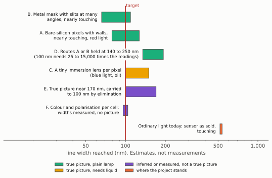

*Figure 11. The line width each route on the shortlist could reach,
against the 100 nm target. Green bars are true pictures under a plain
lamp, drawn from the clean line widths of Table 21 with the baseline
scan; the yellow bar needs liquid, purple bars are inferred pictures or
measurements. The bottom bar is where ordinary light stands in the design
today. Each range is an Estimate from Table 21 and is not a measurement.
The bars for route F and for today mark single values and are drawn a few
per cent wide so that they can be seen.*

| Rank | Route | Finest clean lines as a true picture, baseline scan (nm) | Kind of result at 100 nm | What a thousand times more readings buy | Light it needs | Truly no special lighting? | Main cost | Evidence so far |
|--:|---|--:|---|--:|---|---|---|---|
| 1 | B. A metal mask of slits at many angles, in near contact ([section 4](#4-going-close-a-metal-mask-with-slits-at-many-angles)) | 66 to 109 | True picture of what blocks light | Lines 1.7 times finer | A lamp behind the chip, of any colour the chip passes | A plain near-infrared lamp: open question | A patterned metal film on the sensor, a delayered chip, near contact | Level 0; a two-dimensional test that works with the baseline scan at 50 nm (Table 14); the method published at millimetre waves [[OL27](#ol27)] |
| 2 | A. Bare-silicon pixels with walls, in near contact ([section 3](#3-going-close-the-pixels-own-silicon)) | 79 to 127 | True picture | Lines 1.5 times finer | Red or bluer light, so a chip thinned to a few micrometres | Yes: a plain red lamp | A stripped sensor with walls, a chip delayered and thinned, near contact | Level 0; level 1 in one dimension (Table 12); the two-dimensional test needs about 100 times the baseline scan at 100 nm (Table 14) |
| 3 | D. Route A or B held further off, at 140 nm to 250 nm, with many more readings ([section 2.2](#22-trading-readings-for-distance)) | 135 to 193 | True picture with 25 to 15,000 times the baseline scan | Everything: this route is oversampling. Lines 1.5 times finer | As route A or B | As route A or B | Three hours to months over each point; calibration to a few parts in a thousand | Level 0 and level 1 (Tables 7 and 12) |
| 4 | C. A tiny immersion lens per pixel ([section 6](#6-without-going-close-a-tiny-immersion-lens-on-each-pixel)) | 100 to 150 | True picture at a contrast of 14 % or less | Little: a hard cut-off | Blue light, from the side | Yes for the light. Needs liquid, which is undecided, and gives up the lensless arrangement | Lenses on the pixels, liquid on the chip | Textbook limit and published microscopes only |
| 5 | E. A true picture near 170 nm at 300 nm distance, carried towards 100 nm by elimination ([section 7.1](#71-how-far-knowledge-can-carry-a-picture)) | 217 | Inferred picture | Lines 1.4 times finer in the true picture; far fewer wrong choices between candidates | Whatever the true picture uses | As the true picture | 24 times the baseline scan, knowledge of the materials. The answer is an inferred picture | Level 1 at larger scale shows a lower error, not yet a finer line |
| 6 | F. Colour and polarisation per cell ([section 7.2](#72-measuring-100-nm-lines-without-picturing-them)) | none | Measurement of widths in regular areas, no picture | Widths 32 times more precise, the usual square root | Plain white light | Yes | A model of regular patterns | Factory practice with special light; not simulated here |

*Table 21. The ranked shortlist. Judgement, built on the Estimates of the
tables cited. The line widths are clean figures with the baseline scan
from Table 10b and the level 0 model: for B, a slit 50 nm away
with an edge soft over 30 nm, to a slit 100 nm away with an edge soft
over 100 nm; for A, a sharp edge 50 nm away, to an edge soft over 100 nm
at 100 nm; for D, a sharp edge at 140 nm to 250 nm. The readings for D
are for clean 100 nm lines with a sharp edge (Table 7). Routes A, B and D
are one family and share most of their costs; E and F can be added to any
of them.*

Route B is placed first for three reasons (Judgement). It reaches the
finest line in the model, because a mask can sit closer and be sharper
than silicon. It is the only route that recovered the test layout with
the baseline scan. And it works with the light path that needs the least
preparation of the chip. Route A was placed first in an earlier draft of
this page. The independent review showed that its case rested on
near-infrared light, in which a bare pixel cannot record the pattern, so
it now depends on a chip thinned to a film.

The summary is this. The design's finding stands: ordinary light at a
micrometre from the chip cannot picture 100 nm lines, and no computation
changes that. What this study adds is that the finding is about the
micrometre and not about the light. With the sensing plane within about
50 nm to 100 nm of the features, the simple models here give clean
100 nm lines under a plain lamp with between one and a few tens of times
the baseline scan. The models are not confirmed, they differ from each
other by a factor of about five in readings, and whether the result
holds in reality depends on a wave calculation that has not been run and
on hardware that waits for the gate.

## 10. What the simulator needs

Every route can be tried in simulation before any hardware exists
([REQ-15](../design.md#requirements)). The items are in the order that
would most quickly confirm or kill the shortlist.

| Order | Work | Route | Level of the [simulation chain](../simulation-chain.md) | What it settles |
|--:|---|---|---|---|
| 1 | A small two-dimensional cross-section with full electromagnetics: a grating of 100 nm lines, an air gap of 20 nm to 300 nm, a metal film with a slit, both polarisations, a lamp behind the chip | B | 4 | Slit throughput, edge sharpness, resonances, and whether the fade is what the simple models say |
| 2 | The same cross-section with bare silicon, with and without glass walls, in red and in near-infrared light, lit from behind the chip and from behind the sensor | A, D | 4 | Whether walls give a sharp edge in red light, and whether near-infrared light fails as section 3.2 derives. This is the check that decides between routes A and B |
| 3 | Edge softness, distance and readings as swept settings in the comparison, with the bars of Table 12 as a scene; new approach files `near-contact-walls` and `near-contact-slits` (planned) | A, B, D | 1 | The trade of Table 7 in the simulator, with position solving switched on |
| 4 | Slit pixels in the two-dimensional level 1: a footprint per pixel, turned by a per-pixel angle; the tomographic solve; how many angles and what slit width are best | B | 1, two dimensions | Whether the test of Figure 8 survives unknown positions, gain errors, a realistic scan, smoothing chosen without the truth, and readings made by a finer model than the solver's |
| 5 | Distance as an unknown per region, solved from the readings; a domed or tilted sensor as a scene setting | A, B, D | 1 | Table 8, second row; the two-height idea |
| 6 | Pixel response solved from the scan at the accuracy that Table 8 asks for | D | 1 | Whether oversampling can be pushed to a million readings |
| 7 | Elimination at 300 nm distance on 100 nm layouts, with and without rules, with the tests against invented detail | E | 1 | How large a gain in line width knowledge of the chip gives at this scale |
| 8 | A lens footprint with a hard cut-off as a blur model | C | 1 | Only if liquid and lenses are accepted |

*Table 22. Simulator work that follows from the shortlist. The first two
items are [plan](../plan.md#d-simulation-chain) item D5
brought forward with new first cases. The two-dimensional wave solver
already in the repository
([`ccdsr/fdfd.py`](https://github.com/mithro/ccd-superres/blob/main/ccdsr/fdfd.py),
used by the [side-light wave calculation](../slot-waves.md)) handles one
polarisation; the slit needs the other as well.*

Two settings already exist for item 3: `optics.gap_nm` and
`optics.edge_sigma_nm` in the
[approach files](../comparison.md#running-it-and-adding-to-it). The level
1 runs of this page used them unchanged.

Four questions for a decision, in addition to items 12 and 13 of
[design, section 11](../design.md#11-build-stages-and-open-questions):

1. Is preparing the chip, by removing layers down to the one of interest,
   acceptable? Without it no route reaches features below the top layer.
2. Is thinning the chip to a film a few micrometres thick acceptable as
   well? Route A depends on it.
3. Is a sensor in sliding near contact with the chip acceptable at the
   hardware stage, with the wear that goes with it?
4. Does a plain near-infrared lamp behind the chip count as ordinary
   light? Route B in its simplest form depends on it.

## 11. Limits of this study

| Limit | Consequence |
|---|---|
| The blur model is the design's "matt" model, which is built from rays | Below about a wavelength it is an extrapolation. Table 2 shows it gives 1.5 to 3.4 times more strength than the simple wave formula, and Table 7 that this changes the readings needed about fivefold |
| No full electromagnetic calculation was run | Edge sharpness with walls, slit behaviour, light passing the sensor's wiring, and the pattern inside the pixel are all unconfirmed. A first attempt with the repository's wave solver did not finish in the time available and is not reported |
| The level 0 model is for long lines parallel to a pixel edge | Detail fine in both directions gains less from readings (Table 5) |
| The level 1 runs are in one dimension | Their reading counts need the conversion given under Table 12 |
| The two-dimensional test assumes known positions, equal gains, no drift, a layout that repeats at its borders, the same model for making and solving the readings, and smoothing chosen against the truth | It shows the principle of the slit mask and the order of the arrangements, not its robustness or its absolute scores |
| Sources were checked to exist; most were read only as abstracts, and none in full | Figures marked Unverified are from memory. Where a conclusion rests on such a figure the text says so |
| Whether the baseline sensor, or any available sensor, has full-depth walls and a strippable face was not researched | It decides whether route A can use a bought sensor. It belongs to [plan](../plan.md#b-research-and-data-collection) items B5 to B7 |
| The mechanics of near contact, wear and dust were not modelled | The main practical risk of routes A, B and D is outside what the simulator can show |
| The pixel's depth (3,000 nm) and the reflectances used are Assumptions | The near-infrared argument of section 3.2 and Table 17a scale with them |
| The literature search for the slit mask was brief | The single-slit method was found only at the independent review. "Not found" for a slit on every pixel means not found in this search, not that it has never been done |

*Table 23. Limits of this study.*

To repeat the numbers and figures:

```
python docs/diagrams/make_ordinary_light_diagrams.py
python -m pytest tests/test_near_contact.py
```

The first takes about three minutes and prints every number in the
tables. With `--fast` it skips the two simulations and takes under half a
minute. The code is
[`ccdsr/near_contact.py`](https://github.com/mithro/ccd-superres/blob/main/ccdsr/near_contact.py),
the tests are
[`tests/test_near_contact.py`](https://github.com/mithro/ccd-superres/blob/main/tests/test_near_contact.py),
and the script is
[`docs/diagrams/make_ordinary_light_diagrams.py`](https://github.com/mithro/ccd-superres/blob/main/docs/diagrams/make_ordinary_light_diagrams.py).

## 12. References

Each entry was matched in a bibliographic database (OpenAlex) on 15
November 2026 (OL27 and OL28 on 18 November 2026). "Abstract" means the abstract was read for this study and
the claim cited is in it. "Existence only" means nothing beyond the title
was used, or the figure quoted is from memory and is marked Unverified
where it appears. No source was read in full. Shared keys (Goodman,
Heng2006) are on the [references](../references.md) page, and M90 and M93
are on the [reconstruction methods](../reconstruction-methods.md#11-references)
page. The key OL9 is not used.

Going close:

(ol1)=
[OL1] Synge, "A suggested method for extending microscopic resolution
into the ultra-microscopic region", Philosophical Magazine, 1928.
[doi:10.1080/14786440808564615](https://doi.org/10.1080/14786440808564615).
Existence only.

(ol2)=
[OL2] Ash and Nicholls, "Super-resolution aperture scanning microscope",
Nature, 1972. [doi:10.1038/237510a0](https://doi.org/10.1038/237510a0).
Existence only.

(ol3)=
[OL3] Betzig, Trautman, Harris, Weiner and Kostelak, "Breaking the
diffraction barrier: optical microscopy on a nanometric scale", Science,
1991. [doi:10.1126/science.251.5000.1468](https://doi.org/10.1126/science.251.5000.1468).
Abstract.

(ol4)=
[OL4] Bethe, "Theory of diffraction by small holes", Physical Review,
1944. [doi:10.1103/physrev.66.163](https://doi.org/10.1103/physrev.66.163).
Existence only; the fourth-power law is the standard result quoted from
it.

(ol5)=
[OL5] Takakura, "Optical resonance in a narrow slit in a thick metallic
screen", Physical Review Letters, 2001.
[doi:10.1103/physrevlett.86.5601](https://doi.org/10.1103/physrevlett.86.5601).
Existence only.

(ol6)=
[OL6] Heng, Cui, Knapp, Wu, Yaqoob, McDowell, Psaltis and Yang,
"Characterization of light collection through a subwavelength aperture
from a point source", Optics Express, 2006.
[doi:10.1364/oe.14.010410](https://doi.org/10.1364/oe.14.010410).
Abstract.

(ol7)=
[OL7] Davis, Williams and Neuzil, "Micromachined submicrometer photodiode
for scanning probe microscopy", Applied Physics Letters, 1995.
[doi:10.1063/1.114223](https://doi.org/10.1063/1.114223). Abstract.

(ol8)=
[OL8] Akamine, Kuwano and Yamada, "Scanning near-field optical microscope
using an atomic force microscope cantilever with integrated photodiode",
Applied Physics Letters, 1996.
[doi:10.1063/1.116504](https://doi.org/10.1063/1.116504). Abstract.

(ol25)=
[OL25] Reddick, Warmack and Ferrell, "New form of scanning optical
microscopy", Physical Review B, 1989.
[doi:10.1103/physrevb.39.767](https://doi.org/10.1103/physrevb.39.767).
Existence only.

(ol27)=
[OL27] Bae, Okamoto, Fujii, Mizuno and Nozokido, "Experimental
demonstration for scanning near-field optical microscopy using a metal
micro-slit probe at millimeter wavelengths", Applied Physics Letters,
1997. [doi:10.1063/1.120397](https://doi.org/10.1063/1.120397). Abstract.

(ol28)=
[OL28] Nozokido, Bae and Mizuno, "Scanning near-field millimeter-wave
microscopy using a metal slit as a scanning probe", IEEE Transactions on
Microwave Theory and Techniques, 2001.
[doi:10.1109/22.910553](https://doi.org/10.1109/22.910553). Abstract.

Sensors:

(ol16)=
[OL16] Kitamura and others, "Suppression of crosstalk by using backside
deep trench isolation for 1.12 μm backside illuminated CMOS image
sensor", International Electron Devices Meeting, 2012.
[doi:10.1109/iedm.2012.6479093](https://doi.org/10.1109/iedm.2012.6479093).
Abstract.

(ol20)=
[OL20] Yamazaki and others, "Four-directional pixel-wise polarization
CMOS image sensor using air-gap wire grid on 2.5-μm back-illuminated
pixels", International Electron Devices Meeting, 2016.
[doi:10.1109/iedm.2016.7838378](https://doi.org/10.1109/iedm.2016.7838378).
Existence only.

(ol21)=
[OL21] Harada, Teranishi, Watanabe, Zhou, Bogaerts and Wang,
"High-exposure-durability, high-quantum-efficiency (>90%)
backside-illuminated soft-X-ray CMOS sensor", Applied Physics Express,
2020. [doi:10.7567/1882-0786/ab5b5e](https://doi.org/10.7567/1882-0786/ab5b5e).
Abstract.

(ol26)=
[OL26] Green, "Self-consistent optical parameters of intrinsic silicon at
300 K including temperature coefficients", Solar Energy Materials and
Solar Cells, 2008.
[doi:10.1016/j.solmat.2008.06.009](https://doi.org/10.1016/j.solmat.2008.06.009).
The table is in the repository as
[`ccdsr/data/silicon_green2008.csv`](https://github.com/mithro/ccd-superres/blob/main/ccdsr/data/silicon_green2008.csv).

Lenses and immersion:

(ol10)=
[OL10] Wang, Guo, Li, Luk'yanchuk, Khan, Liu, Chen and Hong, "Optical
virtual imaging at 50 nm lateral resolution with a white-light
nanoscope", Nature Communications, 2011.
[doi:10.1038/ncomms1211](https://doi.org/10.1038/ncomms1211). Existence
only; the figure of 50 nm is in the title.

(ol11)=
[OL11] Allen and others, "Super-resolution microscopy by movable
thin-films with embedded microspheres: resolution analysis", Annalen der
Physik, 2015.
[doi:10.1002/andp.201500194](https://doi.org/10.1002/andp.201500194).
Abstract.

(ol12)=
[OL12] Mansfield and Kino, "Solid immersion microscope", Applied Physics
Letters, 1990. [doi:10.1063/1.103828](https://doi.org/10.1063/1.103828).
Existence only.

(ol13)=
[OL13] Ippolito, Goldberg and Ünlü, "High spatial resolution subsurface
microscopy", Applied Physics Letters, 2001.
[doi:10.1063/1.1381574](https://doi.org/10.1063/1.1381574). Abstract.

(ol14)=
[OL14] Agarwal, Chen, Koh, Sheppard and Chen, "Crossing the resolution
limit in near-infrared imaging of silicon chips: targeting 10-nm node
technology", Physical Review X, 2015.
[doi:10.1103/physrevx.5.021014](https://doi.org/10.1103/physrevx.5.021014).
Abstract.

(ol24)=
[OL24] Fang, Lee, Sun and Zhang, "Sub-diffraction-limited optical imaging
with a silver superlens", Science, 2005.
[doi:10.1126/science.1108759](https://doi.org/10.1126/science.1108759).
Existence only.

Mechanics and chips:

(ol17)=
[OL17] Marchon, Pitchford, Hsia and Gangopadhyay, "The head-disk
interface roadmap to an areal density of 4 Tbit/in²", Advances in
Tribology, 2013. [doi:10.1155/2013/521086](https://doi.org/10.1155/2013/521086).
Abstract.

(ol18)=
[OL18] Torrance and James, "The state-of-the-art in IC reverse
engineering", Cryptographic Hardware and Embedded Systems, 2009.
[doi:10.1007/978-3-642-04138-9_26](https://doi.org/10.1007/978-3-642-04138-9_26).
Existence only.

(ol22)=
[OL22] Kash and Tsang, "Dynamic internal testing of CMOS circuits using
hot luminescence", IEEE Electron Device Letters, 1997.
[doi:10.1109/55.596927](https://doi.org/10.1109/55.596927). Existence
only.

(ol15)=
[OL15] Laborde and others, "Real-time imaging of microparticles and
living cells with CMOS nanocapacitor arrays", Nature Nanotechnology,
2015. [doi:10.1038/nnano.2015.163](https://doi.org/10.1038/nnano.2015.163).
Existence only.

Mathematics:

(ol19)=
[OL19] Candès and Fernandez-Granda, "Towards a mathematical theory of
super-resolution", Communications on Pure and Applied Mathematics, 2014.
[doi:10.1002/cpa.21455](https://doi.org/10.1002/cpa.21455). Existence
only.

(ol23)=
[OL23] Thompson, Larson and Webb, "Precise nanometer localization
analysis for individual fluorescent probes", Biophysical Journal, 2002.
[doi:10.1016/s0006-3495(02)75618-x](https://doi.org/10.1016/s0006-3495(02)75618-x).
Existence only.
