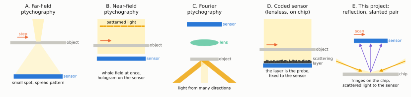
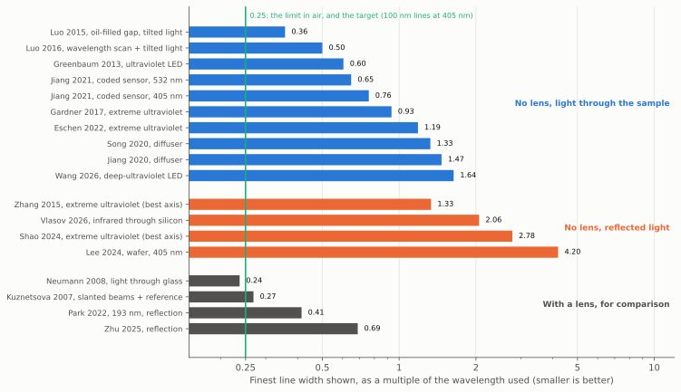
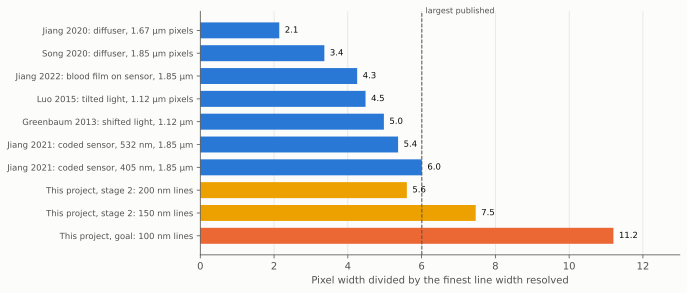
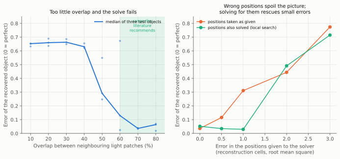
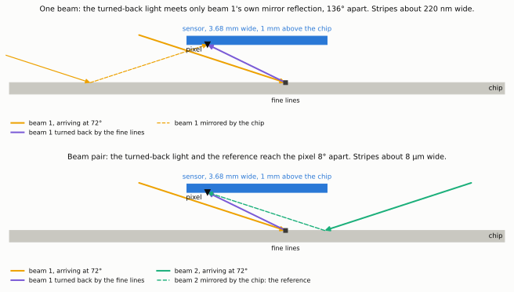
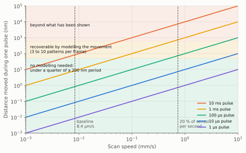
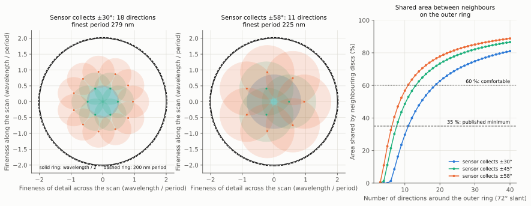
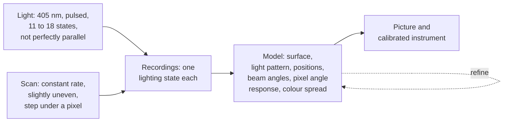
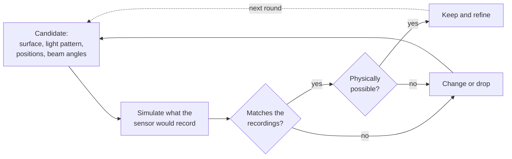

# Ptychography and lensless coherent imaging

This is deep research item B4 of the [project plan](../plan.md). It goes
further into one field than the overview in
[reconstruction methods, sections 3.7 and 3.8](../reconstruction-methods.md#37-ptychography-and-fourier-ptychography),
and does not repeat it. The plan asks four questions of this study. They are
answered in section 1, and the evidence for each answer follows. The
main findings come first.

Nothing on this page is a hardware step. Everything it recommends is a
setting, a model or a test in the simulator
([design, section 4.9](../design.md#49-simulation-first-the-unknown-pixel-response-and-the-gate-before-hardware)).

**Ptychography** (the "p" is silent) is a way of taking a picture without a
lens. A laser lights the object, a bare sensor records the pattern of ripples
the light makes, the object is moved a little and the pattern is recorded
again, many times over. Because each recording shares part of the object
with its neighbours, a computer can work out the one object that explains
all the recordings. It is the method the project's leading candidate uses.

This study read what the field has published and asked how close anyone has
come to what the project wants: lines 100 nm wide on a silicon chip, which
is a quarter of the wavelength of the violet laser light planned (405 nm),
and eleven times narrower than one pixel of the sensor. For scale, a human
hair is about 70,000 nm across.

What it found:

- **Nobody has done this without a lens.** With light passing *through* a
  thin sample, the best lensless results are lines 225 to 310 nm wide. With
  light *reflected* from a surface, which is the only option for a chip, the
  best lensless result with visible light is 1,700 nm. The project is aiming
  seventeen times finer than the nearest published instrument of its
  kind. That is the size of the step, and the simulator has to show it can
  be made before anything is built.
- **The physics allows it, and it has been done with a lens.** A microscope
  using two slanted laser beams, the same trick as the project's beam pair,
  reached lines 170 nm wide with red light, which is 0.27 of its wavelength.
  The same fraction of violet light is 109 nm. So the limit the project is
  working towards is real. What is new is doing it with a bare sensor.
- **The pixel is the main obstacle, and the beam pair changes what is asked
  of it.** Published lensless instruments resolve lines up to six times
  narrower than their pixels. The project needs eleven times. The study
  found that a beam pair does not ask the pixel to see stripes finer than
  itself. It asks the pixel to accept light arriving at a very steep slant,
  about 72 degrees off straight-on. Nobody has published how a pixel of this
  size responds at such a slant, so it stays the largest unknown.
- **The computing side is in good shape.** Solving for the scan positions,
  for the blur from moving during a flash, and for a laser that is not one
  pure colour are all standard, published techniques. The project's scan
  gives far more overlap between recordings than they need.
- **A grating can replace the need for a pure-colour laser.** An earlier
  page found that an ordinary laser diode gives clear stripes only in a
  strip a fraction of a millimetre wide. Chip-making research solved the
  same problem thirty years ago by splitting the beam with a fine grating,
  which makes stripes whose spacing does not depend on the colour. This is
  a new candidate for the plan.
- **Chips are a hard case for this method, in a way that matters.** Regular
  repeating patterns, which chips are full of, confuse it. The published
  cures are to give the light some structure of its own, such as a random
  speckle or a spreading beam, and to record the bare light once on a blank
  area.

## Words used on this page

Terms shared with other pages are in the [glossary](../glossary.md). Terms
specific to this page:

| Term | Meaning |
|---|---|
| Probe | The patch of light that falls on the object, or more generally whatever stays fixed while the object moves through it. In this project it is the light pattern as seen from the moving sensor. |
| Overlap | The share of one light patch that also falls inside the next one. |
| Line width (half-pitch) | The width of one line in a row of equal lines and spaces. The repeat distance (period, or pitch) is twice this. Papers quote either, and this page converts everything to line width. |
| Numerical aperture (NA) | The sine of the widest angle of light a system uses, times the refractive index of what the light travels in. In air it cannot exceed 1. The finest line width is the wavelength divided by twice the sum of the NA of the lighting and the NA of the detection. |
| Mixed states (modes) | Treating each recording as the sum of a few different patterns added in brightness, used to model blur from movement, vibration or impure colour. |
| Fly scan | Recording while the object moves continuously, as this project does, in place of stopping for each recording. |
| Specular reflection | The mirror reflection of a beam: the part that leaves at the same angle it arrived. |
| Reference | A plain beam that reaches the sensor together with the light from the object, so that the two interfere and the object's light can be read. |
| Achromatic | Not depending on colour (wavelength). |
| Extreme ultraviolet | Light with a wavelength of about 10 to 60 nm, made by special sources. Far shorter than anything a laser diode gives. |

## How claims are marked

Citations such as [[P8](#p8)] link to the reference list in section 13. Each
entry there says how its numbers were read:

| Mark in section 13 | Meaning |
|---|---|
| Full text | The number was read in the paper's text |
| Abstract | The number was read in the paper's abstract only |
| Secondary | The number comes from a summary or press page, not the paper |
| Recalled | Stated from general knowledge of the paper and not checked. Treated as **Unverified**. |

The labels **Derived here**, **Estimate**, **Assumption**, **Judgement** and
**Unverified** have the meanings given on the
[references page](../references.md#how-claims-are-labelled). Working for
derived numbers is in [`docs/diagrams/make_ptychography_diagrams.py`](https://github.com/mithro/ccd-superres/blob/main/docs/diagrams/make_ptychography_diagrams.py), which
prints them.

## 1. The four questions, answered

| Question from the plan | Short answer | Section |
|---|---|---|
| What is the finest detail demonstrated without a lens, in transmission and in reflection, and what limited it? | Transmission, visible and ultraviolet light: line widths of 225 to 310 nm, 0.36 to 0.76 of the wavelength. Reflection, visible light: 1,700 nm, 4.2 wavelengths. Reflection at any wavelength: 1.3 wavelengths at best. Limits named by the authors: the angles the pixel accepts, the pixel's size and shape, signal at steep angles, the purity of the light, and in reflection the room needed to get light in. | 3 |
| What do position correction, mixed-state models and pixel super-resolution need from the data? | Overlap of 60 % or more between neighbouring recordings; positions that are not perfectly regular; starting positions good to about one reconstruction cell, or a model of the motion; one extra pattern per few cells of movement during a flash; many more readings than unknowns. The project's scan supplies all of these with a wide margin. | 5 |
| How do coarse detector pixels limit the result, and how have others got round it? | The record is a line width one sixth of the pixel. Three ways round: many shifted recordings plus a measured pixel shape; slanted or speckled lighting that turns fine detail into coarse; a known scattering layer just above the pixels. All three end at the same wall, the steepest angle of light the pixel will accept. | 4 |
| What overlap, pulse timing and number of lighting directions does stage 2 need? | Overlap: 60 % of the lit strip, against 99.99 % available. Pulse: under 6 ms at the baseline speed, or under 70 µs at 0.74 mm/s, and ten times longer if the movement is modelled. Directions: 11 to 18 lighting states to cover all detail down to the limit, more if the pixel accepts only a narrow cone. | 8 |

Status of the table: the first three rows summarise published work cited in
the sections named. The last row is **Derived here** and is an
**Estimate** until the simulator repeats it.

## 2. The family of methods

Five arrangements matter here. They share one idea, many overlapping
recordings of brightness solved together, and differ in where the sensor
sits and what is moved.

*Figure: five arrangements of ptychography, seen from the side and not to
scale. A: a small spot of light, with the sensor far away, and the object
stepped sideways. B: the whole field lit with patterned light and the sensor
close by. C: a lens forms the picture and the direction of the light is
changed between recordings. D: a scattering layer is fixed just above the
pixels and the object slides past. E: the project's leading candidate, in
which slanted beams light the chip from the sides and the sensor above
collects the scattered light as it scans. Yellow is light, grey the object,
blue the sensor, orange arrows show what moves.*

**Table 2a: the arrangements compared.** A text table.

| Arrangement | What moves | What sets the finest detail | Best fit to this project |
|---|---|---|---|
| A. Far field [[P14](#p14)] | Object, in steps comparable to the spot | The angle the sensor spans as seen from the object | The algorithms come from here |
| B. Near field (reconstruction methods, [M64](../reconstruction-methods.md#m64)) | Object, through patterned light | Pixel size and the angles the pixel accepts | The geometry of a close sensor |
| C. Fourier ([Zheng2013](../references.md#textbooks-and-standard-methods)) | Nothing; the light direction changes | Steepest lighting angle plus the lens's own angle | The idea of many lighting directions |
| D. Coded sensor [[P6](#p6), [P8](#p8)] | Object, or the sensor [[P11](#p11), [P13](#p13)] | The angles the layer and pixel accept | The closest published instruments, in transmission |
| E. Slanted reflection (this project) | Sensor, continuously | Slant of the light plus the angles the pixel accepts | Not yet demonstrated by anyone |

Arrangement D deserves attention because it is the nearest thing to this
instrument that exists. A group at the University of Connecticut fixes a
thin layer of microscopic scatterers a fraction of a millimetre above the
pixels and slides the sample past, or slides the sensor [[P8](#p8), [P11](#p11), [P13](#p13)].
The layer plays the part of the probe. They have run it in continuous motion
at about 60 µm/s with positions recovered from the pictures themselves
[[P8](#p8)], and at 30 frames per second with the sensor moving [[P12](#p12)]. All of
this is with light passing through the sample, except one demonstration on
silicon chips in reflection that gives no resolution figure in its abstract
[[P13](#p13)].

## 3. The finest detail demonstrated

### 3.1 Without a lens, light passing through the sample

**Table 3.1a: published lensless results in transmission.** Line width is
the half-pitch. The last column is the line width divided by the wavelength:
0.25 is the limit in air and is also the project's target.

| Source | Method | Wavelength (nm) | Pixel (µm) | Gap to sensor (mm) | Line width (nm) | Line width / wavelength |
|---|---|--:|--:|--:|--:|--:|
| [[P3](#p3)] | Shifted and tilted light, oil-filled gap | 700 | 1.12 | 0.1 | 250 | 0.36 |
| [[P4](#p4)] | Wavelength scan and tilted light | 500 | 1.12 | 0.1 to 0.5 | 250 | 0.50 |
| [[P2](#p2)] | Shifted light, measured pixel shape | 372 | 1.12 | 0.05 to 0.15 | 225 | 0.60 |
| [[P8](#p8)] | Coded sensor | 532 | 1.85 | 0.3 | 345 | 0.65 |
| [[P8](#p8)] | Coded sensor | 405 | 1.85 | 0.3 | 308 | 0.76 |
| [[P11](#p11)] | Coded sensor, laser | 405 | 1.85 | 0.8 | 308 | 0.76 |
| [[P7](#p7)] | Diffuser between sample and sensor | 415 | 1.85 | not stated | 550 | 1.33 |
| [[P6](#p6)] | Diffuser between sample and sensor | 532 | 1.67 | 1 | 780 | 1.47 |
| [[P11](#p11)] | Coded sensor, deep-ultraviolet LED | 266 | 1.85 | 0.8 | 435 | 1.64 |
| [[P22](#p22)] | Far field, extreme ultraviolet | 13.5 | not applicable | 22.6 | 12.6 | 0.93 |
| [[P23](#p23)] | Far field, extreme ultraviolet | 13.5 | not applicable | not stated | 16 | 1.19 |

Notes on the table. The wavelength for [[P4](#p4)] is the middle of a scanned range
of 480 to 531 nm. For [[P8](#p8)] and [[P11](#p11)] the gap is from the coded layer to the
pixels; the sample sits 0.2 to 2 mm beyond that in [[P11](#p11)]. The 250 nm of [[P3](#p3)]
and the 225 nm of [[P2](#p2)] are read as half-pitch because the papers' own
aperture figures imply it (**Judgement**).

What the table shows:

- **The best ratio, 0.36, needed three things at once** [[P3](#p3)]: light tilted
  to ±51°, oil filling the gap, and a gap of 0.1 mm. Oil shortens the
  wavelength by its refractive index of 1.52. In air, with the sample a
  millimetre away, nothing published is better than 0.76.
- **A shorter wavelength did not help by itself.** With a 266 nm LED the
  coded sensor resolved 435 nm, worse than the 308 nm it reached with a
  405 nm laser, and the authors put this down to the LED's poorer coherence
  [[P11](#p11)]. The same 308 nm figure appears in three papers from that group
  [[P8](#p8), [P11](#p11), [P12](#p12)]. Whether that is a wall or simply the finest bar on their
  test target could not be established from the texts (**Unverified**).
- **The limits the authors name** are, in order of how often they appear:
  the angles the pixel accepts and the weak signal at steep angles [[P3](#p3), [P7](#p7), [P10](#p10)]; pixel size and the shape of the pixel's response [[P2](#p2), [P5](#p5), [P8](#p8)];
  coherence of the source [[P5](#p5), [P11](#p11)]; and the gap, which sets how wide an
  area each point's light spreads over [[P5](#p5)].

A design rule from this literature that the simulator should carry: for a
source with a spread of wavelengths $\Delta\lambda$, sharp imaging needs

$$
z < \frac{2\lambda^2}{\Delta\lambda}
$$

where $z$ is the gap [[P5](#p5)]. In words: the less pure the colour, the closer
the sensor must be. A 2 nm spread at 405 nm allows 0.16 mm, and a 0.5 nm
spread allows 0.66 mm (**Derived here** from the formula). This is the same
effect as the narrow strip of section 6, met from another direction, and it
applies to straight-down light as well as to beam pairs.

### 3.2 Without a lens, light reflected from the sample

A chip is opaque to violet light, so this is the case that matters.

**Table 3.2a: published lensless results in reflection.**

| Source | Method | Wavelength (nm) | Angle from straight-on (°) | Line width or resolution (nm) | Divided by wavelength |
|---|---|--:|--:|--:|--:|
| [[P17](#p17)] | Speckle-lit ptychography of wafers, beam splitter | 405 | 0 | 1,700 | 4.2 |
| [[P15](#p15)] | Holography with a tilted reference, beam splitter | not stated | 0 | 2,000 | not known |
| [[P18](#p18)] | Single-shot phase recovery through silicon | 1,064 | 0 | 2,190 | 2.1 |
| [[P19](#p19)] | Ptychography, extreme ultraviolet | 30 | not stated | 40 by 80 | 1.3 by 2.7 |
| [[P20](#p20)] | Ptychography, extreme ultraviolet | 18 | 70 | 50 by 100 | 2.8 by 5.6 |
| [[P21](#p21)] | Ptychography, soft X-ray | 1.63 | 45 | 22 | 14 |

Notes. [[P17](#p17)] and [[P15](#p15)] give "resolution" by their own definitions, not a
measured line width; a second reading of [[P17](#p17)] found its smallest resolved
bars to be about 2,400 nm wide. [[P21](#p21)] reports a full period of 45 nm, halved
here. The wavelength of [[P21](#p21)] is converted here from its photon energy.

What the table shows:

- **With visible light, lensless reflection imaging is at 1.7 to 2 µm.**
  The statement in the design that it is undemonstrated below about 2 µm
  holds, narrowly. Every such instrument whose layout could be confirmed
  sends the light in through a beam splitter, straight down. That pushes
  the sensor millimetres to centimetres away and limits the angles it
  collects: [[P17](#p17)] works at a combined numerical aperture of about 0.24
  (**Derived here** from its own formula). Its authors say that near-field
  ptychography in reflection "remains relatively unexplored" because the
  sensor must sit close to the sample [[P17](#p17)].
- **The project's slanted beams with no beam splitter aim at exactly that
  gap.** No published instrument was found that lights a surface from the
  side and holds a bare sensor close above it. Three recent papers that
  might come closer could not be read: [[P29](#p29)] includes visible-laser data at
  70°, and three others are listed in section 12.
- **At shorter wavelengths, reflection ptychography reaches about one
  wavelength, unevenly.** The best is 1.3 wavelengths in one direction and
  2.7 in the other [[P19](#p19)]. The unevenness comes from the slant: the light
  patch is stretched along the direction of tilt, which halves the
  resolution that way [[P20](#p20)]. The project plans several directions of light,
  which evens this out.
- **The slant itself must be known very well.** Reflection ptychography at
  70° needed the angle to ±0.05° [[P29](#p29)], and two groups now solve for it
  inside the reconstruction [[P29](#p29), [P30](#p30)]. The simulator should treat beam
  angles as unknowns to be solved, not as settings.

### 3.3 With a lens, and on real chips, for comparison

**Table 3.3a: results with a lens.** These show what the light itself
allows.

| Source | Method | Wavelength (nm) | Sample | Line width (nm) | Divided by wavelength |
|---|---|--:|---|--:|--:|
| [[P70](#p70)] | Slanted beams entering through glass | 633 | Lines on glass | 150 | 0.24 |
| [[P68](#p68)] | Slanted beams and a reference beam | 633 | Line gratings | 170 | 0.27 |
| [[P25](#p25)] | Fourier ptychography in reflection | 193 | Line targets | 80 | 0.41 |
| [[P28](#p28)] | Fourier ptychography in reflection, layered | 632 | Test target on mirror | 435 | 0.69 |
| [[P26](#p26)] | Fourier ptychography in reflection | not stated | Test target, chip | 244 | not known |

**Table 3.3b: ptychography of real chips,** all with X-rays or extreme
ultraviolet light passing through a thinned sample.

| Source | Light | Resolution (nm) | Sample preparation | Read from |
|---|---|--:|---|---|
| [[P32](#p32)] | Hard X-ray | 14.6 | Pillar 11 µm wide cut from the chip | Secondary |
| [[P33](#p33)] | Hard X-ray | 18.9 | Chip thinned, region 40 µm wide | Secondary |
| [[P34](#p34)] | Hard X-ray | 4 | Cut sample, about 40 hours | Abstract; time is secondary |
| [[P35](#p35)] | Hard X-ray | under 20 | Wafer polished to 240 µm | Abstract |
| [[P23](#p23)] | Extreme ultraviolet, 13.5 nm | 16 | Thin slice of a chip | Abstract |

*Figure: how fine each published result is, measured in wavelengths of the
light it used. Shorter bars are better. The green line at 0.25 is both the
limit for light in air and the project's target of 100 nm lines with 405 nm
light. Blue: no lens, light through the sample. Orange: no lens, reflected
light. Grey: with a lens. No lensless result reaches the line. Two results
with a lens come close to it, and one passes it by sending the light in
through glass. Values and sources are in tables 3.1a, 3.2a and 3.3a.*

What this means for the project:

- The target ratio of 0.25 has been approached to within a tenth, with a
  lens, by a method built on slanted beam pairs (section 7). The light
  permits it.
- The best lensless reflection result with visible light is seventeen times
  short of it. Between the two lies everything this project has to show in
  simulation.
- Real chips have been imaged at 4 to 20 nm, but only with X-rays, from a
  large facility, on samples cut from the chip. That is the comparison plan
  item X7 will make in full.

## 4. Coarse pixels

The project's pixel is 1,120 nm wide. A 100 nm line is eleven times
narrower.

### 4.1 How far below the pixel others have reached

*Figure: how many times narrower than a pixel the finest resolved line was,
for published lensless instruments (blue), and what the project's stage 2
(yellow) and final goal (orange) require. The dashed line marks the largest
published value, 6.0. Stage 2 at 200 nm lines is inside what has been done.
The 100 nm goal asks for nearly twice the record. Values are from table
4.1a.*

**Table 4.1a: pixel width against line width resolved.**

| Source | How the pixel limit was got round | Pixel (nm) | Line width (nm) | Ratio |
|---|---|--:|--:|--:|
| [[P8](#p8)] | Coded layer on the sensor, 405 nm | 1,850 | 308 | 6.0 |
| [[P8](#p8)] | Coded layer on the sensor, 532 nm | 1,850 | 345 | 5.4 |
| [[P2](#p2)] | Shifted light and measured pixel shape | 1,120 | 225 | 5.0 |
| [[P3](#p3)] | Tilted light | 1,120 | 250 | 4.5 |
| [[P9](#p9)] | Film of blood cells on the sensor | 1,850 | 435 | 4.3 |
| [[P7](#p7)] | Diffuser | 1,850 | 550 | 3.4 |
| [[P6](#p6)] | Diffuser | 1,670 | 780 | 2.1 |
| This project, stage 2 | | 1,120 | 150 to 200 | 5.6 to 7.5 |
| This project, goal | | 1,120 | 100 | 11.2 |

### 4.2 Three ways round, and the wall behind all of them

**Table 4.2a: the mechanisms.** A text table.

| Mechanism | How it works | Depends on the pixel's fine shape? | Sources |
|---|---|---|---|
| Many shifted recordings, then divide out the pixel | Each recording samples the pattern at a different offset. Put together they sample it finely, and the known blur of the pixel is removed by computation. | Yes. Fine stripes must survive being added up across the pixel. | [[P1](#p1), [P2](#p2), [P4](#p4)] |
| Denser scan in place of finer pixels | In ptychography, a detector that samples too coarsely can be made up for by moving in smaller steps. | Partly | [[P55](#p55), [P56](#p56)] |
| Slanted or speckled light | Fine detail in the object is shifted to coarse detail in the light that reaches the sensor. | No | [[P3](#p3), [P17](#p17), [P73](#p73)] |
| A known scattering layer above the pixels | The layer turns steep light into shallower light before it reaches the pixels. The pixel is then modelled as a plain box. | No | [[P6](#p6), [P7](#p7), [P8](#p8)] |

The first row is what the project's enormous number of samples naturally
provides, and it is the weakest of the four for this target. The only
published estimate of the response shape of a 1.12 µm pixel is indirect: a
smooth bump about 550 nm wide, fitted by trial on a colour sensor with its
microlenses still on [[P2](#p2)]. Taken at face value, such a pixel passes about
0.5 % of the contrast of the 450 nm period those authors resolved, and
essentially none of a 200 nm period (**Derived here** from their figure; an
extrapolation, not a measurement). This agrees with the design's own table
4.6b and makes the same point: reading 200 nm stripes directly through the
pixel is not a sound plan.

There is also a cost in noise. When the pixel passes only a small share of a
stripe pattern, the signal shrinks by that share while the noise from the
light does not [[P79](#p79)]. A response of 5 % means four hundred times more light
for the same quality (**Derived here**: one over 0.05 squared).

The other rows all move the problem from the pixel's *shape* to the pixel's
*angles*. Two of the coded-sensor papers say so directly: resolution is
"limited by the maximum scattering angle that can be detected by the imager,
not the pixel size" [[P7](#p7)], and is set by the largest detectable angle [[P10](#p10)].
An earlier instrument found that pixel acceptance angles capped it at a
numerical aperture of 0.8 to 0.9, about 53° to 64°, under straight-down
light [[P3](#p3)].

### 4.3 What is known about how pixels respond

**Table 4.3a: published evidence.** A text table.

| Evidence | What it says | Limits of it | Source |
|---|---|---|---|
| Pixel shape fitted from reconstructions | A 1.12 µm pixel behaves like a bump about 550 nm wide | Indirect; microlenses on; assumes no leakage between pixels | [[P2](#p2)] |
| Pixel measured by edge and by rotation | A 1.85 µm pixel is more sensitive at its centre. Its response to angle was measured by turning the sensor in a plain beam. Leaving both out of the model cost 25 % in resolution (390 against 308 nm). | The angle curve itself was not retrieved | [[P8](#p8)] |
| Advice from the same group | Smaller pixels leak more between neighbours, which "may be challenging to quantitatively model". They recommend 1.85 µm. | A warning about the 1.12 µm choice | [[P10](#p10)] |
| Stripes projected on sensors | Sensors do respond far above their sampling limit, measured to ten times it | Old sensors with small sensitive spots, not modern small pixels | [[P77](#p77), [P78](#p78)] |

No published measurement was found of how a backside-illuminated pixel of
about 1 µm responds to light beyond about 60°, or to stripes several times
finer than itself. The search for this was cut short by a search limit, so
this is **Unverified** as an absence. It is the subject of plan items B7 and
R3.

What this means for the project:

- The pixel model in the simulator needs two separate parts, as in [[P8](#p8)]: a
  response to *angle*, applied to the light wave, and a response to
  *position inside the pixel*, applied to brightness. The design currently
  carries one "edge softness" number.
- Leakage between neighbouring pixels needs to be a parameter too.
- Two published laboratory methods would measure all of this on the real
  sensor when the hardware phase comes: turning the sensor in a plain beam
  [[P8](#p8)], and laying two-beam stripes on it at exact multiples of the pixel
  spacing [[P77](#p77), [P78](#p78)]. They are noted for plan item H1 and are not proposed
  now.

## 5. What the algorithms need from the data

### 5.1 Overlap

Neighbouring recordings must share enough of the object. The field's
standard figure is 60 % [[P54](#p54)], a theory paper proves about 50 % as the
least that pins the answer down [[P42](#p42)], and a spiral pattern of positions
does better than a grid for the same number of recordings [[P57](#p57)].

*Figure: a small ptychography calculation run for this page. Left: how
wrong the recovered object is (0 is perfect) against the overlap between
neighbouring light patches, with the light patch itself also unknown. Below
about 50 % the solve fails. Above 60 % it works. Dots are three different
test objects and the line is their median. Right: the same, against errors
in the positions given to the solver, measured in cells of the
reconstruction grid. Orange: positions trusted as given. Green: each
position also searched one cell each way. Errors of up to one cell are repaired. At two cells and beyond this simple search fails. Status: **Derived
here** (function `fig_toy`). A toy on a 128 by 128 grid with photon noise,
not the project's geometry.*

**Table 5.1a: the toy's numbers.** **Derived here.**

| Overlap (%) | 80 | 70 | 60 | 50 | 40 | 30 |
|---|--:|--:|--:|--:|--:|--:|
| Error of the recovered object | 0.06 | 0.04 | 0.13 | 0.29 | 0.63 | 0.66 |

For Fourier ptychography, where the direction of light changes, the rule is
that the regions of detail seen under neighbouring directions must share at
least 35 % of their area [[P58](#p58), [P41](#p41)]. Section 8 uses that figure.

### 5.2 Irregular positions, and what can never be recovered

A perfectly regular grid of positions leaves the answer ambiguous: whole
families of false solutions fit the data, growing with the square of the
step [[P42](#p42)]. A small random disturbance of the grid removes them, leaving
only an overall brightness and an overall tilt of phase undetermined [[P42](#p42), [P43](#p43)]. For this project that is good news twice over. The natural unevenness
of the scan is useful, as the design already argues, and where the scan is
too even a deliberate jitter is cheap.

What the data can never fix, when positions are also unknowns, is an overall
shift, and the overall scale, rotation and skew of the position grid, which
trade against the gap and the wavelength (**Judgement**, consistent with
[[P43](#p43)] and with the three outside facts of
[calibration and test, section 3.2](../calibration-and-test.md#32-what-the-data-can-never-tell-three-outside-facts)).

### 5.3 Position correction

**Table 5.3a: published methods.** A text table.

| Method | What it reports | Source |
|---|---|---|
| Compare successive estimates of the object and nudge the positions | Accuracy finer than one cell within "several tens of iterations", at optical and X-ray wavelengths | [[P37](#p37)] |
| Treat positions as unknowns in the fit | Corrects "large errors"; the size of error that can be recovered shrinks as noise rises and overlap falls | [[P38](#p38)] |
| Use the slope of the recorded patterns | Accuracy finer than one cell | [[P40](#p40)] |
| Fit positions with a model of the whole stage (scale, rotation, skew) | Faster and more robust than freeing every position | [[P39](#p39)] |
| The same idea for lighting angles | Angles recovered across ±2 grid steps, ±45° of rotation and a scale error of 0.5 to 1.75, but only because a rigid model was imposed. Searching each angle freely was 26 times slower and less robust. | [[P41](#p41)] |

No paper's abstract gave the largest position error that can be corrected,
and the full texts that hold those figures could not be reached. The toy
above gives one cell for the simplest search. The lesson that is
supported is from [[P41](#p41)] and [[P39](#p39)]: **describe the motion with a few numbers
and solve for those.** A constant-rate scan is the ideal case: speed,
direction, start, and a slowly varying wobble. This matches what the design
proposes in its section 6.4, and it is the same conclusion radar reaches
(plan item B1).

### 5.4 Blur from movement during a flash

Published fly scans model the blur by letting each recording be the sum of
several patterns. One study with a visible laser gives numbers [[P50](#p50)]:

**Table 5.4a: movement during one recording against patterns needed**
[[P50](#p50)]. The last two columns are **Derived here** from its figures.

| Speed (µm/s) | Movement in one recording (µm) | In reconstruction cells | Patterns needed | One pattern only |
|--:|--:|--:|--:|---|
| 150 | 18 | 3.1 | 3 | Usable |
| 300 | 36 | 6.1 | 4 | Usable |
| 450 | 61 | 10.3 | 6 | Fails |
| 600 | 72 | 12.2 | 10 | Fails |

So movement of a few cells needs no special treatment, movement of ten
cells needs about ten patterns, and the count grows in step with the
distance moved. Two refinements matter here. When the path is known, one
pattern summed along the path does better than several free ones,
especially in noise [[P52](#p52)]. And the method assumes the same blur in every
recording [[P50](#p50)], which a constant-rate scan provides. Other fly-scan work
reports a 25-fold saving in time [[P51](#p51)], and the fastest chip imaging to
date uses bursts of short exposures with the jitter solved afterwards
[[P34](#p34)].

### 5.5 Impure colour and flicker in the light

The same sum-of-patterns model handles a source that is not one pure colour
and a beam that is not perfectly steady [[P44](#p44)]. Published refinements:

- When the cause is a spread of wavelengths, modelling the wavelengths
  directly beats generic patterns, and the spectrum does not have to be
  known beforehand [[P47](#p47)].
- Several wavelengths at once can be separated from one recording [[P49](#p49)]
  (**Unverified**: recalled, the database holds no abstract).
- A beam that wanders from recording to recording can be modelled as a
  small set of shapes mixed differently each time [[P46](#p46)]. This was used to
  image a chip slice [[P23](#p23)].
- The patterns are not unique unless constrained, so they must be compared
  only after being put in a standard form [[P45](#p45)].

No paper read gave the largest spread of wavelengths that can be tolerated.
That figure has to come from the simulator.

### 5.6 Noise, and how the fit is scored

How the mismatch between model and data is scored matters. Scoring on
brightness directly fails under noise and under small errors in the model.
Scoring on the square root of brightness, or on the probability of the
photon counts, tolerates both, because both kinds of error grow with
brightness [[P61](#p61)]. At low light the choice of noise model changes the
artefacts [[P62](#p62)]. The design's intention to use a photon-noise score is
supported. No source gave a rule for photons needed per unknown.

### 5.7 Regular patterns: a known weakness that chips will trigger

A sample that repeats regularly sends its light into a few separate
directions. Their relative timing is not recorded in brightness, the
recordings barely change as the sample moves, and the reconstruction shows
grid artefacts and mixes up object and light [[P22](#p22), [P24](#p24)]. Memory arrays, gate
rows and via grids are exactly this kind of sample.

**Table 5.7a: published cures.** A text table.

| Cure | Result reported | Source |
|---|---|---|
| Record the bare light once and hold the solver to it | Resolution improved from 60 nm to 12.6 nm | [[P22](#p22)] |
| Light with a wide enough cone that neighbouring directions overlap. The cone's numerical aperture must exceed the wavelength divided by twice the repeat distance. A ring-shaped beam does this efficiently. | A 300 nm defect found in a 9 µm grid; signal over 135 times that of a plain beam | [[P24](#p24)] |
| Speckled or otherwise structured light | Simulation: fit improved up to a hundredfold for a plain spot, less with structured light | [[P17](#p17), [P36](#p36)] |

For the project, the rule in the second row has a direct consequence. A
plain parallel beam has a cone of almost zero. At 405 nm, a pattern
repeating every 1 µm needs a cone of numerical aperture above 0.2, about
±12° (**Derived here** from the formula in [[P24](#p24)]). **The slanted beams
should therefore not be perfectly parallel.** A laser diode's light spreads
by about that much before any lens is put in front of it
(**Unverified**, general knowledge of diodes; plan item R10), so the
cheapest structured beam may be an uncollimated one. A weak diffuser in
each beam is the alternative. This also answers the condition in
reconstruction methods, section 3.7, that the scan gives new information
only if the light is not the same everywhere.

## 6. Coherence, and the narrow strip

The [calibration and test page](../calibration-and-test.md#33-a-finding-stripes-across-the-whole-sensor-need-a-pure-colour)
found that two beams from an ordinary laser diode make clear stripes only in
a strip well under a millimetre wide. This section reports how the field
has dealt with the same problem.

The basic rule is that light can only interfere where the two routes it
took differ by less than the coherence length [[P63](#p63)]. Lensless microscopes
that work with LEDs do so by keeping every route nearly equal: sample within
a millimetre or two of the sensor, source centimetres away, small angles
only [[P64](#p64)].

**Table 6a: ways round the narrow strip, ranked.** A text table. The
ranking is a **Judgement**.

| Rank | Way | Hardware added | What it costs | Sources |
|--:|---|---|---|---|
| 1 | Split the beam with a grating, so that the stripe spacing does not depend on colour | One fine grating | The grating must be made and aligned | [[P65](#p65), [P66](#p66), [P67](#p67)] |
| 2 | Accept the strip and scan through it | None | Fewer useful readings of each point. The strip's fade-out is a known shape that acts as the probe. | Calibration page |
| 3 | Model the spread of colours in the reconstruction | None | More unknowns, more computing. Recovers part of the contrast. | [[P47](#p47), [P44](#p44)] |
| 4 | A single-frequency laser | A dearer source | Money | Calibration page |
| 5 | Give up interference between the two beams and treat them as separate lights | None | Loses the reference, and with it the coarse stripes of section 7 | [[P49](#p49), [P72](#p72)] |

**The grating is the new finding.** Chip-making research needed stripes of
100 nm period over centimetres from excimer lasers, whose colour is far
less pure than a diode's. Two matched gratings did it: the spacing of the
stripes is set by the grating and not by the wavelength, and the depth over
which they stay clear depends only on how point-like the source is [[P65](#p65)].
Areas of about 10 cm² at 100 nm period were exposed this way [[P66](#p66)]. A
related method gives a stationary fine pattern from a broad-band source at
any distance behind a single grating [[P67](#p67)].

For this project (**Derived here**, to be confirmed in the simulator):

| Quantity | Value | Unit |
|---|--:|---|
| Grating period that sends 405 nm light out at ±72° | 426 | nm |
| Stripe period this gives, at any wavelength | 213 | nm |
| Stripe period from a stock grating of 2,400 lines per millimetre | 208 | nm |
| Angle of the beams from that stock grating at 405 nm | 76.4 | ° |

There is a second benefit, also **Derived here**. Light from one beam that
has been turned back by fine lines on the chip, and the mirror reflection
of the other beam, then differ in direction by an amount that does not
depend on wavelength either. The coarse stripes they form on the sensor
(section 7) line up for every colour in the source. With beams split by
mirrors that is not so, and each colour's stripes sit at a different
spacing.

This is put forward as a candidate, not a decision. It adds one part, which
runs against the preference for computation over hardware, but the part is
passive and it removes the need for a special laser. It is added to the
plan as scouting candidate X17.

Separately, the rule quoted in section 3.1 applies to all coherent schemes
on this project, not only beam pairs: with a 1 mm gap, a source whose
wavelengths spread by more than about 0.3 nm blurs the finest detail
(**Derived here** from the formula of [[P5](#p5)]).

## 7. Has beam-pair mixing been done before?

Yes, with a lens, and the papers repay reading because they answer several
of the project's open questions.

A group at the University of New Mexico lit samples with steeply slanted
laser beams so that fine detail was shifted into the range a modest lens
could pass, and added a reference beam to read it. With red light and a lens
of numerical aperture 0.4 they resolved a grating of 170 nm lines and
isolated features of 180 nm [[P68](#p68)]. They then removed the separate reference
by adding a *second slanted beam at the edge of the lens's range*, which
acts as the reference and shifts the recorded detail to a coarse,
"intermediate" spacing [[P69](#p69)]. That is the project's beam pair. They give
the limit as a line width of a quarter of the wavelength in air [[P68](#p68), [P82](#p82)],
and passed it only by bringing the light in through glass in contact with
the sample [[P70](#p70)]. Another group showed the same mixing on a reflecting
sample [[P71](#p71)].

Two points from this literature correct or sharpen the project's own
documents.

**First: stripes on the chip add nothing by themselves.** For light that is
scattered (as opposed to fluorescent light), lighting with stripes is
exactly the same as lighting with the two slanted beams that make the
stripes, and the finest detail is set by the slant of the light plus the
angles the detector collects [[P72](#p72)]. The beam pair does not push the limit
beyond what the two beams reach one at a time.

**Second: what the pair does provide is a reference travelling almost the
same way as the light being measured.** This is the useful part, and it
changes what is asked of the pixel.

*Figure: the rays that meet at one pixel, drawn to scale for a sensor
3.68 mm wide held 1 mm above the chip. Top: with one beam, light turned
back by fine lines on the chip (violet) reaches the pixel from the right,
and the only plain light to compare it with is the same beam's mirror
reflection arriving from the left (dashed yellow). The two cross at 136°
and make stripes about 220 nm apart, far finer than the pixel. Bottom: with
a pair, the mirror reflection of the second beam (dashed green) arrives
from almost the same direction as the turned-back light, 8° apart. Their
stripes are about 8 µm apart, which the pixels read easily. Status:
**Derived here** (function `fig_beat_path`), straight rays only.*

**Table 7a: the numbers behind the figure.** **Derived here**, for 405 nm
light at 72° and a 1 mm gap.

| Quantity | Value | Unit |
|---|--:|---|
| Stripe period at the sensor, turned-back light at 58° against the reference at 72° | 4.0 | µm |
| The same for turned-back light at 64° | 7.9 | µm |
| Stripe period against the beam's own mirror reflection | 219 to 225 | nm |
| Angle at which both arrive at the pixel, from straight-on | 58 to 72 | ° |
| Sideways distance light at 72° travels per millimetre of gap | 3.08 | mm |
| Distance on the chip between the fine lines and the spot that reflects the reference | 1.03 | mm |
| Smallest gap at which any chip under the sensor is lit by both beams | 0.60 | mm |
| Part of the sensor's width reached by both the turned-back light and the reference | 1.03 | mm |
| Change in the difference between the two routes, per millimetre across the sensor | 1.9 | mm |

Consequences, all **Derived here** and to be tested at simulation level 3:

- **The unknown changes from "does the pixel see 200 nm stripes" to "does
  the pixel accept light at 60° to 72°".** The design treats these as one
  number. They are different questions, and the second is more hopeful:
  light arriving at a slant still enters silicon, whereas stripes five
  times finer than the pixel are averaged away by simple geometry. Section
  4.3 says what is known, which is little.
- **The sensor body shadows the chip.** Light at 72° has to enter under the
  edge of the sensor. Below a gap of 0.6 mm no point under this sensor is
  lit from both sides. At 1 mm, about a quarter of the sensor's width
  receives both the turned-back light and its reference. The useful part of
  the sensor is a band, not the whole area, and the band depends on the
  gap. A smaller sensor, or lighting along the sensor's short side, changes
  these figures. The simulator must trace this shadowing.
- **Reference and signal come from spots a millimetre apart on the chip.**
  The reference is therefore not a clean plain wave: it carries the
  picture of whatever it reflected from. The reconstruction has to treat
  both as parts of one unknown surface, which ptychography does.
- **The narrow strip appears on the sensor too.** The difference between
  the two routes changes by 1.9 mm for each millimetre across the sensor,
  the same rate the calibration page found on the chip. An ordinary diode
  therefore gives coarse stripes over a band of the sensor well under half
  a millimetre wide, unless one of the measures of section 6 is taken.

## 8. What stage 2 needs

Stage 2 of the leading candidate is the true picture at 150 to 200 nm lines
with slanted, pulsed 405 nm light
([design, section 4.7](../design.md#47-a-staged-path-to-the-picture-the-current-leading-candidate)).
The requirements below are **Derived here** from the published rules of
section 5 and are **Estimates** until the simulator confirms them.

### 8.1 Overlap and step

**Table 8.1a: largest step per recording of one lighting state.**

| What is lit | Width (µm) | Step at 60 % overlap (µm) | Step at 80 % overlap (µm) |
|---|--:|--:|--:|
| Whole sensor, one pattern | 3,680 | 1,472 | 736 |
| Stripe band, diode with 0.5 nm spread | 160 | 64 | 32 |
| Stripe band, diode with 2 nm spread | 40 | 16 | 8 |
| Baseline scan, for comparison | | 0.28 | |

The baseline step of 0.28 µm is an overlap of 99.99 % of the sensor. The
overlap rule is met with a margin of tens to thousands of times, even
inside the narrowest stripe band. The scan could be much faster than the
baseline, or the surplus can be spent on cycling through many lighting
states, which is what section 8.3 needs. What sets the step in practice is
not overlap but sampling finer than the pixel, which the tilted scan
provides.

### 8.2 Pulse timing

*Figure: how far the sensor moves during one flash of light, against scan
speed, for five flash lengths. In the green band the movement is under a
quarter of a 200 nm period and can be ignored. In the yellow band it can be
recovered by modelling the movement with 3 to 10 patterns per recording, by
analogy with table 5.4a. Above that nothing has been demonstrated. The two
dashed lines are the design's baseline speed and its faster worked example.
Status: **Derived here** (function `fig_pulse`).*

**Table 8.2a: longest pulse.** The "ignored" column allows 50 nm of
movement. The "modelled" column allows 600 nm, twelve cells of 50 nm, the
largest movement recovered in [[P50](#p50)].

| Scan speed (mm/s) | Longest pulse, movement ignored (ms) | Longest pulse, movement modelled (ms) |
|--:|--:|--:|
| 0.0084 | 6.0 | 71 |
| 0.74 | 0.068 | 0.82 |

At the baseline speed the pulse can be as long as 6 ms, a fifth of the
frame time, and needs no special electronics. At the faster example it must
be tens of microseconds, which a laser diode does easily. The two beams of a
pair must be on together. Different pairs can share a frame only if the
model separates them, which costs redundancy [[P58](#p58)], so the first plan is one
lighting state per frame.

### 8.3 Number of lighting directions

Each lighting direction lets the sensor see one disc of the surface's
detail. The disc's radius is the sine of the widest angle the pixel
accepts, and it is centred on the sine of the slant of the light. To cover
all detail down to the limit, the discs must tile the range and each must
share at least 35 % of its area with a neighbour (section 5.1).

*Figure: which detail each lighting direction makes visible. Each disc is
one lighting direction. The axes are fineness of detail in the two
directions on the chip, in units of the wavelength divided by the period,
so further from the centre is finer. The blue disc is light straight down,
green an inner ring of slanted directions, orange the outer ring at 72°.
The solid ring is the limit, a period of half a wavelength, and the dashed
ring just outside it is a 200 nm period. Left: a pixel accepting ±30°
needs 18 directions and reaches a 279 nm period. Middle: a pixel accepting
±58° needs 11 and reaches 225 nm. Right: the share of area that
neighbouring discs on the outer ring have in common, against the number of
directions on that ring. Status: **Derived here** (function
`fig_angle_coverage`), treating the pixel as responding evenly inside its
acceptance angle and not at all outside.*

**Table 8.3a: lighting directions needed,** for 405 nm light with the
outer ring at 72°. The count includes one straight-down direction.

| Pixel accepts (±°) | Shared area required (%) | Rings | Directions per ring | Total directions | Finest period (nm) | Finest line (nm) |
|--:|--:|--:|---|--:|--:|--:|
| 30 | 35 | 2 | 6, 11 | 18 | 279 | 140 |
| 30 | 60 | 3 | 6, 13, 19 | 39 | 279 | 140 |
| 45 | 35 | 2 | 4, 8 | 13 | 244 | 122 |
| 45 | 60 | 3 | 4, 9, 14 | 28 | 244 | 122 |
| 58 | 35 | 2 | 3, 7 | 11 | 225 | 113 |
| 58 | 60 | 2 | 6, 11 | 18 | 225 | 113 |

Reading the table:

- **Eleven to eighteen lighting states is the working figure.** Because
  the scan passes every point under the sensor thousands of times, cycling
  through eighteen states still leaves each state hundreds of recordings of
  every point.
- **An inner ring is needed, not only the steep one.** With only the 72°
  ring and a pixel accepting ±30°, there is a gap between the coarse detail
  seen straight-down and the fine detail seen at the slant, and the two
  cannot be joined. The design and the optical elements study describe the
  steep beams only. An inner ring near 28° is a new requirement.
- **A beam pair joins opposite discs directly,** through the reference of
  section 7, without needing a chain of overlaps between them. Pairs may
  therefore reduce the count. That is a question for the simulator.
- **The pixel's acceptance angle sets the answer twice:** it sets how many
  directions are needed, and it sets the finest line reached. To pass
  200 nm lines (a 400 nm period) is easy for any pixel. To reach 113 nm
  needs ±58°.

### 8.4 Summary for stage 2

**Table 8.4a: stage 2 requirements in one place.** **Estimates.**

| Requirement | Value | Unit | From |
|---|--:|---|---|
| Overlap of the lit band between recordings | 60 or more | % | Section 5.1 |
| Lighting states | 11 to 18 | | Table 8.3a |
| Slant of the inner ring | about 28 | ° | Table 8.3a |
| Spread of angles within each beam | 12 or more | ± ° | Section 5.7 |
| Pulse at 8.4 µm/s | 6 or less | ms | Table 8.2a |
| Pulse at 0.74 mm/s | 68 or less | µs | Table 8.2a |
| Beam angle, known or solved to | 0.05 | ° | [[P29](#p29)] |
| Gap, for both beams to reach under the sensor | 0.6 or more | mm | Table 7a |
| Spread of wavelengths at a 1 mm gap, with mirror-split beams | 0.3 or less | nm | Section 6 |

## 9. Recovering the picture without exact positions

Tim's direction (14 November 2026): "Combining the results with simulation
should allow recovery based on working out potential possible solutions and
eliminating ones which are physically impossible even without exact
positioning information."

This is how the field already works, and it is the strongest reason to
build on it. A ptychographic reconstruction is a search among candidate
answers. Each candidate is a surface, a light pattern and a set of
positions. A simulation of the instrument predicts what the sensor would
have recorded for that candidate, and the candidate is kept, changed or
dropped according to how well the prediction matches the recordings and
whether it breaks a physical rule. The position of each recording is one of
the things searched for, not something that has to be supplied.

### 9.1 What the field has shown about unknown positions

**Table 9.1a: recovering positions from the data.** A text table.

| What was unknown | How it was found | Result reported | Source |
|---|---|---|---|
| Every position, starting from a rough guess | Try random nudges of each position, keep those that fit better, shrink the nudges over time | Positions corrected without extra hardware | [[M62](../reconstruction-methods.md#m62)] |
| Every position | Compare successive estimates of the object | Finer than one cell in tens of iterations | [[P37](#p37)] |
| Every position, and the light pattern | One fit with all of them as unknowns | "Large errors" corrected; the limit depends on noise and overlap | [[P38](#p38)], [[M61](../reconstruction-methods.md#m61)] |
| The stage's scale, rotation and skew | A few numbers describing the whole scan | More robust than freeing every position | [[P39](#p39)] |
| Every lighting angle | A rigid model of the lamp, then a small search | Errors of ±2 grid steps, ±45° of rotation and scale from 0.5 to 1.75 all recovered | [[P41](#p41)] |
| The tilt of the sample | Tilt as an unknown in the fit | ±0.05° at a 70° slant | [[P29](#p29), [P30](#p30)] |
| Sample shifts in a hand-held or moving instrument | Shifts read from the pictures themselves | Working instruments with no precise stage | [[P8](#p8), [P12](#p12)] |

So exact positioning is not needed, and published instruments run without
it. The requirement that replaces it is redundancy: enough overlap, and
positions that are not perfectly regular (section 5.2). The project has
both.

Two limits carry over. First, a search that only tries nearby positions
finds the answer only if it starts near it: one cell in the toy of section
5.1, a few cells in the literature. Wider errors need either the wider
random search of [[M62](../reconstruction-methods.md#m62)], or a start at coarse detail where a cell
is large, followed by finer and finer detail (the coarse-to-fine order of
[reconstruction methods, section 5](../reconstruction-methods.md#5-estimating-position-gap-and-instrument-from-the-data)),
or a model of the motion with few unknowns. A constant-rate scan is nearly
the best case for the last of these: its positions are a straight line in
time plus a small wobble. Second, some things can never be eliminated
because every choice fits the data equally well: where the picture's origin
is, its overall scale, and an overall tilt of phase [[P43](#p43)]. They are fixed
by one outside measurement, as the calibration page sets out.

### 9.2 Physical rules used to eliminate candidates

**Table 9.2a: constraints the field uses, and what each rules out.** A text
table. The last column is a **Judgement**.

| Rule | What it eliminates | Used by | Carries over to chips? |
|---|---|---|---|
| The object occupies a known region | Answers that put structure where there is none; the mirror-image ghost | [[M77](../reconstruction-methods.md#m77)] | Partly: a chip fills the field, but blank areas and die edges serve |
| The light pattern is the one recorded on a blank area | Answers that trade detail between the light and the object | [[P22](#p22)]: 60 nm improved to 12.6 nm | Yes. Bare silicon beside the circuit is the blank area. |
| The bare surface's reflectance is known | Answers with the wrong background level, which regular patterns otherwise allow | [[P36](#p36)], in simulation | Yes. Silicon's reflectance is tabulated (plan item R6). |
| Edges are sharp and areas between them flat | Rippled and noisy answers | [[P27](#p27), [P28](#p28)] | Yes. Chip layouts are flat areas with straight edges. |
| A surface cannot reflect more light than falls on it | Answers with reflectance above one | General physics (**Unverified** as a published constraint in this field) | Yes, at no cost |
| The surface is made of a few known materials at a few known heights | Every in-between value | Derived in [reconstruction methods, section 3.10](../reconstruction-methods.md#310-compressed-sensing-and-prior-knowledge) | Yes. This is the strongest rule a chip offers. |
| The chip is a stack of layers | Ghost detail that belongs to another layer | [[P76](#p76), [P28](#p28)] | Yes, and needed for chips with glass over metal |
| The motion is smooth | Position sets that jump about | [[P39](#p39), [P41](#p41)] | Yes. The scan is constant-rate. |
| The same answer must come from separate halves of the data | Detail that the method invented | [Calibration and test, section 7](../calibration-and-test.md#7-tests-that-catch-invented-detail) | Yes |

### 9.3 What the simulator adds beyond the field's practice

Published ptychography uses a fast, simplified model of light inside the
search. The project's chain of simulators allows a stricter kind of
elimination, which is what Tim's direction points at (**Judgement**; none
of this has been run):

- **Eliminate by a more exact simulation than the one used to search.**
  Candidates found with the fast wave model (level 3) can be checked on
  small patches with the full electromagnetic solver (level 4). A candidate
  that the exact physics cannot reproduce is dropped. The chip industry's
  model-fitting measurements work this way
  ([reconstruction methods, section 3.11](../reconstruction-methods.md#311-the-chip-industrys-own-optical-methods)).
- **Search over layouts, not pixels.** If candidates are restricted to
  things that could be manufactured, with lines of legal width on a grid,
  the number of candidates falls enormously and each can be simulated
  exactly. This is stage 3 of the leading candidate.
- **Keep several candidates alive.** Where two candidates fit equally
  well, the honest output is both, with the measurement that would tell
  them apart. The simulator can then say which extra lighting state or scan
  pass would eliminate one.
- **Many starts in parallel.** Starting the search from many different
  guesses of position and surface on hundreds of cores, and keeping the
  answers that agree, is a direct use of the computing Tim has offered and a
  standard guard against false solutions.

The safeguard that must go with all of this is the one the calibration page
already sets: a rule strong enough to eliminate wrong answers is strong
enough to manufacture a plausible one. Every result that leans on a
physical rule is also run with the rule weakened, and from a deliberately
wrong start, and only the detail that survives counts as seen.

## 10. Ideas this study turned up

Tim asked that the research find things he had not named. These came out
of the reading. Each is one line here, and the ones marked for the plan
have been added to it.

**Table 10a: ideas, most promising first.** A text table. The order is a
**Judgement**.

| Idea | What it is | Why it matters here | Source | Plan |
|---|---|---|---|---|
| Grating-split beams | Stripes whose spacing does not depend on colour | Removes the narrow strip with a passive part and an ordinary diode | [[P65](#p65), [P66](#p66)] | New X17 |
| Uncollimated or speckled beams | Light with a spread of angles or a random pattern | Cures the regular-pattern failure, and gives the scan something to work with | [[P24](#p24), [P17](#p17), [P73](#p73)] | New X18 |
| Bare-light recording | One recording on blank silicon, used to pin down the light | Took one experiment from 60 nm to 12.6 nm on a regular sample. Costs nothing. | [[P22](#p22)] | Simulator test |
| Two-part pixel model | Angle response and within-pixel response as separate, fitted parts | Worth 25 % in resolution in the nearest published instrument | [[P8](#p8)] | Design change |
| Dimming the mirror reflection | A partly transparent stop on the bright direct beam | Gained four orders of magnitude in usable brightness range and doubled resolution in an X-ray instrument. On this project the equivalent is alternating long and short exposures, or a beam pair whose reference is weaker than usual. | [[P74](#p74)] | Simulator test |
| Coded layer on the sensor | A known scattering layer a fraction of a millimetre above the pixels | The only route shown to beat the pixel by a factor of six. Already listed in optical elements, section 5.2; this study adds that it has been run in continuous motion. | [[P8](#p8), [P12](#p12)] | Existing |
| Layered model of the chip | Treat the chip as several thin layers in turn | Chips are stacks of glass-like layers over metal. A single-surface model gives ghost detail from other layers. | [[P76](#p76), [P28](#p28)] | X15 |
| Two polarisations | Record with the light's electric field along and across the lines | Metal lines narrower than the wavelength reflect the two very differently, which is extra information for no optical cost | [[P75](#p75)] | Simulator test |
| Rolling shutter as a clock | Each row of the sensor is read at a slightly different time | Lighting could be switched row by row, giving many lighting states within one frame | [[P80](#p80)] | B7 |
| Sensor in the far field, scanned | A coded sensor far from the sample, moved to build a wide collecting area | Shown on silicon chips in reflection. Avoids the shadowing of section 7 at the cost of a long working distance. | [[P13](#p13)] | X14 |

Ideas already in the project's documents that this study found support
for: sensor tilt as a source of recordings at several gaps (the classical
multi-distance method), natural scan jitter as an asset [[P42](#p42)], and solving
for the instrument from the data [[P39](#p39), [P41](#p41), [P29](#p29)].

## 11. Recommended changes

To the design:

1. **Split the pixel unknown in two**: response to angle of arrival, out to
   75°, and response to position within the pixel, plus leakage between
   neighbours. Replace "responds to 200 nm stripes" as the key unknown of
   section 4.6 with "accepts light at 60° to 72°", for beam-pair
   approaches.
2. **State that stripes on the chip do not raise the limit** [[P72](#p72)], and
   that the pair's role is to provide a nearby reference (section 7).
3. **Add an inner ring of lighting directions** near 28° to stage 2.
4. **Add the shadowing of the chip by the sensor body** as a constraint on
   gap and sensor size.
5. **Make the beams slightly spreading or speckled by default.**
6. **Correct the benchmark**: lensless reflection is demonstrated at 1.7 µm
   with 405 nm light [[P17](#p17)], not "undemonstrated below about 2 µm".

7. **Record Tim's elimination principle in the reconstruction section**:
   positions are searched for, candidates are tested against simulation,
   and physical rules remove the impossible ones (section 9). The simulator
   build thread owns that change.

To the simulator parameters:

| Parameter | Meaning | Suggested range | Unit |
|---|---|--:|---|
| `pixel_angle_response` | Share of light accepted against angle of arrival | curve from 0 to 75 | ° |
| `pixel_crosstalk` | Share of a pixel's light read by each neighbour | 0 to 20 | % |
| `beam_divergence` | Half-angle of the spread within each beam | 0 to 15 | ° |
| `beam_speckle` | Strength of random structure in each beam | 0 to 1 | |
| `splitter` | How the pair is made: mirrors or grating | | |
| `lighting_states` | Directions and pairs cycled through | 4 to 40 | |
| `inner_ring_angle` | Slant of the inner ring | 20 to 40 | ° |
| `flyscan_modes` | Patterns summed per recording to model movement | 1 to 10 | |
| `spectral_modes` | Wavelengths modelled within the source's spread | 1 to 7 | |
| `beam_angle_error` | Error in each beam's slant, to be solved | 0 to 0.5 | ° |
| `sensor_shadow` | Whether the sensor body blocks light | on or off | |

The ranges are **Assumptions** for sweeping, chosen to bracket the
published values in this page.

To the plan:

- New scouting candidates X17 (grating-split, colour-independent stripes)
  and X18 (spreading, speckled or ring-shaped beams for regular patterns).
- Data item R13 (benchmark table) can start from tables 3.1a, 3.2a, 3.3a
  and 4.1a.
- Hardware item H1 should use the two published pixel measurements of
  section 4.3 when its time comes.
- The gate (G1) should include a regular-pattern scene, since that is
  where this method is known to fail. The calibration page's benchmark
  already has a grating scene.

## 12. Limits of this study

- **Most figures come from abstracts.** Section 13 marks each source.
  Publisher sites blocked several full texts, including the ones that hold
  the tolerances for position correction [[P37](#p37), [P38](#p38)] and fly scans [[P51](#p51), [P52](#p52)].
- **The literature search was cut short** by a daily limit on the
  bibliographic database part-way through. Searches for visible-light
  reflection ptychography of wafers, and for measurements of small-pixel
  response at steep angles, are the least complete. "Nothing found" in
  those two areas is weaker than it reads.
- **Three possibly closer results were not read**: Chen et al., "Resolution-enhanced
  reflection ptychography with axial distance calibration", 2023
  ([doi:10.1016/j.optlaseng.2023.107684](https://doi.org/10.1016/j.optlaseng.2023.107684));
  Huang et al., "Rapid and high-accuracy oblique-illuminated reflective
  ptychography without pre-correction", 2025
  ([doi:10.1016/j.optlaseng.2025.109016](https://doi.org/10.1016/j.optlaseng.2025.109016));
  and Wang et al., "Reflective ptychography using deep ultraviolet 193-nm
  solid-state lasers", 2026
  ([doi:10.1016/j.measurement.2026.123386](https://doi.org/10.1016/j.measurement.2026.123386)).
  They exist in the database; their figures are unknown.
- **Papers define resolution differently.** The ratio columns compare
  orders of magnitude, not exact values.
- **Everything in sections 6 to 8 marked "Derived here" uses straight rays
  and simple formulas.** None of it has been through a wave calculation.
  The toy reconstruction is a small far-field case, not the project's
  geometry.
- **Sibling studies** B1 (radar), B2 (beamforming) and B3 (multi-frame)
  cover motion estimation, array calibration and frame combination. This
  page only points to them.

## 13. References

This list is part of the project's shared bibliography, indexed on the
[references page](../references.md). Every entry was matched by its
identifier against the OpenAlex database, or for preprints against arXiv,
which confirms the work exists as cited. The last line of each entry says
where its numbers were read, as explained under "How claims are marked".
Keys beginning with M are in the
[reconstruction methods list](../reconstruction-methods.md#11-references).

(p1)=
[[P1](#p1)] Bishara, Su, Coskun and Ozcan, "Lensfree on-chip microscopy over a wide field-of-view using pixel super-resolution", Optics Express, 2010.
[doi:10.1364/oe.18.011181](https://doi.org/10.1364/oe.18.011181).
Numbers read from: Abstract.

(p2)=
[[P2](#p2)] Greenbaum, Luo, Khademhosseinieh, Su, Coskun and Ozcan, "Increased space-bandwidth product in pixel super-resolved lensfree on-chip microscopy", Scientific Reports, 2013.
[doi:10.1038/srep01717](https://doi.org/10.1038/srep01717).
Numbers read from: Full text.

(p3)=
[[P3](#p3)] Luo, Greenbaum, Zhang and Ozcan, "Synthetic aperture-based on-chip microscopy", Light: Science & Applications, 2015.
[doi:10.1038/lsa.2015.34](https://doi.org/10.1038/lsa.2015.34).
Numbers read from: Full text.

(p4)=
[[P4](#p4)] Luo, Zhang, Göröcs, Feizi and Ozcan, "Pixel super-resolution using wavelength scanning", Light: Science & Applications, 2016.
[doi:10.1038/lsa.2016.60](https://doi.org/10.1038/lsa.2016.60).
Numbers read from: Full text.

(p5)=
[[P5](#p5)] Zhang, Sun, Chen and Zuo, "Resolution analysis in a lens-free on-chip digital holographic microscope", IEEE Transactions on Computational Imaging, 2020.
[doi:10.1109/tci.2020.2964247](https://doi.org/10.1109/tci.2020.2964247).
Numbers read from: Full text (arXiv 1906.06231).

(p6)=
[[P6](#p6)] Jiang et al., "Wide-field, high-resolution lensless on-chip microscopy via near-field blind ptychographic modulation", Lab on a Chip, 2020.
[doi:10.1039/c9lc01027k](https://doi.org/10.1039/c9lc01027k).
Numbers read from: Full text.

(p7)=
[[P7](#p7)] Song et al., "Super-resolved multispectral lensless microscopy via angle-tilted, wavelength-multiplexed ptychographic modulation", Optics Letters, 2020.
[doi:10.1364/ol.394923](https://doi.org/10.1364/ol.394923).
Numbers read from: Full text.

(p8)=
[[P8](#p8)] Jiang et al., "Resolution-enhanced parallel coded ptychography for high-throughput optical imaging", ACS Photonics, 2021. Also [M105] of the reconstruction methods list.
[doi:10.1021/acsphotonics.1c01085](https://doi.org/10.1021/acsphotonics.1c01085).
Numbers read from: Full text (arXiv 2112.08144).

(p9)=
[[P9](#p9)] Jiang et al., "Blood-coated sensor for high-throughput ptychographic cytometry on a Blu-ray disc", ACS Sensors, 2022.
[doi:10.1021/acssensors.1c02704](https://doi.org/10.1021/acssensors.1c02704).
Numbers read from: Full text.

(p10)=
[[P10](#p10)] Jiang et al., "Spatial- and Fourier-domain ptychography for high-throughput bio-imaging", Nature Protocols, 2023.
[doi:10.1038/s41596-023-00829-4](https://doi.org/10.1038/s41596-023-00829-4).
Numbers read from: Full text, read in part.

(p11)=
[[P11](#p11)] Wang et al., "Deep-ultraviolet ptychographic pocket-scope (DART): mesoscale lensless molecular imaging with label-free spectroscopic contrast", eLight, 2026.
[doi:10.1186/s43593-025-00103-y](https://doi.org/10.1186/s43593-025-00103-y).
Numbers read from: Full text (arXiv 2511.06122).

(p12)=
[[P12](#p12)] Wang et al., "Video-rate gigapixel ptychography via space-time neural field representations", preprint, 2025.
[arXiv:2511.06126](https://arxiv.org/abs/2511.06126).
Numbers read from: Full text.

(p13)=
[[P13](#p13)] Song et al., "Synthetic aperture ptychography: coded sensor translation for joint spatial-Fourier bandwidth expansion", Photonics Research, 2022.
[doi:10.1364/prj.460549](https://doi.org/10.1364/prj.460549).
Numbers read from: Abstract.

(p14)=
[[P14](#p14)] Maiden, Humphry, Zhang and Rodenburg, "Superresolution imaging via ptychography", Journal of the Optical Society of America A, 2011.
[doi:10.1364/josaa.28.000604](https://doi.org/10.1364/josaa.28.000604).
Numbers read from: Abstract.

(p15)=
[[P15](#p15)] Lee, Yaglidere and Ozcan, "Field-portable reflection and transmission microscopy based on lensless holography", Biomedical Optics Express, 2011.
[doi:10.1364/boe.2.002721](https://doi.org/10.1364/boe.2.002721).
Numbers read from: Abstract.

(p17)=
[[P17](#p17)] Lee et al., "Lens-free reflective topography for high-resolution wafer inspection", Scientific Reports, 2024.
[doi:10.1038/s41598-024-59496-4](https://doi.org/10.1038/s41598-024-59496-4).
Numbers read from: Abstract and full text, read in part.

(p18)=
[[P18](#p18)] Vlasov, Shevkunov, Egiazarian, Guina and Viheriälä, "Reflective lensless through-silicon phase imaging for advanced semiconductor packaging metrology", Applied Physics Letters, 2026.
[doi:10.1063/5.0333722](https://doi.org/10.1063/5.0333722).
Numbers read from: Abstract.

(p19)=
[[P19](#p19)] Zhang et al., "High contrast 3D imaging of surfaces near the wavelength limit using tabletop EUV ptychography", Ultramicroscopy, 2015.
[doi:10.1016/j.ultramic.2015.07.006](https://doi.org/10.1016/j.ultramic.2015.07.006).
Numbers read from: Abstract.

(p20)=
[[P20](#p20)] Shao, Weerdenburg, Seifert, Urbach, Mosk and Coene, "Wavelength-multiplexed multi-mode EUV reflection ptychography based on automatic differentiation", Light: Science & Applications, 2024.
[doi:10.1038/s41377-024-01558-3](https://doi.org/10.1038/s41377-024-01558-3).
Numbers read from: Full text, read in part.

(p21)=
[[P21](#p21)] Guenzing et al., "Soft X-ray reflection ptychography", preprint, 2026.
[arXiv:2601.20261](https://arxiv.org/abs/2601.20261).
Numbers read from: Full text.

(p22)=
[[P22](#p22)] Gardner et al., "Subwavelength coherent imaging of periodic samples using a 13.5 nm tabletop high-harmonic light source", Nature Photonics, 2017. Also [M72] of the reconstruction methods list.
[doi:10.1038/nphoton.2017.33](https://doi.org/10.1038/nphoton.2017.33).
Numbers read from: Full text (arXiv 2403.19766).

(p23)=
[[P23](#p23)] Eschen et al., "Material-specific high-resolution table-top extreme ultraviolet microscopy", Light: Science & Applications, 2022.
[doi:10.1038/s41377-022-00797-6](https://doi.org/10.1038/s41377-022-00797-6).
Numbers read from: Abstract.

(p24)=
[[P24](#p24)] Wang et al., "High-fidelity ptychographic imaging of highly periodic structures enabled by vortex high harmonic beams", Optica, 2023.
[doi:10.1364/optica.498619](https://doi.org/10.1364/optica.498619).
Numbers read from: Full text (arXiv 2301.05563).

(p25)=
[[P25](#p25)] Park, Bae, Choi and Sohn, "High numerical aperture reflective deep ultraviolet Fourier ptychographic microscopy for nanofeature imaging", APL Photonics, 2022.
[doi:10.1063/5.0102413](https://doi.org/10.1063/5.0102413).
Numbers read from: Abstract.

(p26)=
[[P26](#p26)] Lee, Chon and Ahn, "Reflective Fourier ptychographic microscopy using a parabolic mirror", Optics Express, 2019.
[doi:10.1364/oe.27.034382](https://doi.org/10.1364/oe.27.034382).
Numbers read from: Abstract.

(p27)=
[P27] Wang et al., "Fourier ptychographic topography", Optics Express, 2023.
[doi:10.1364/oe.481712](https://doi.org/10.1364/oe.481712).
Numbers read from: Abstract.

(p28)=
[[P28](#p28)] Zhu et al., "Reflection-mode multi-slice Fourier ptychographic tomography", preprint, 2025.
[arXiv:2503.12246](https://arxiv.org/abs/2503.12246).
Numbers read from: Full text.

(p29)=
[[P29](#p29)] Senhorst, Shao, Weerdenburg, Horsten, Porter and Coene, "Mitigating tilt-induced artifacts in reflection ptychography via optimization of the tilt angles", Optics Express, 2024.
[doi:10.1364/oe.542569](https://doi.org/10.1364/oe.542569).
Numbers read from: Abstract.

(p30)=
[[P30](#p30)] de Beurs et al., "aPIE: an angle calibration algorithm for reflection ptychography", Optics Letters, 2022.
[doi:10.1364/ol.453655](https://doi.org/10.1364/ol.453655).
Numbers read from: Abstract.

(p32)=
[[P32](#p32)] Holler et al., "High-resolution non-destructive three-dimensional imaging of integrated circuits", Nature, 2017. Also [M74] of the reconstruction methods list.
[doi:10.1038/nature21698](https://doi.org/10.1038/nature21698).
Numbers read from: Secondary.

(p33)=
[[P33](#p33)] Holler et al., "Three-dimensional imaging of integrated circuits with macro- to nanoscale zoom", Nature Electronics, 2019. Also [M75].
[doi:10.1038/s41928-019-0309-z](https://doi.org/10.1038/s41928-019-0309-z).
Numbers read from: Secondary.

(p34)=
[[P34](#p34)] Aidukas et al., "High-performance 4-nm-resolution X-ray tomography using burst ptychography", Nature, 2024.
[doi:10.1038/s41586-024-07615-6](https://doi.org/10.1038/s41586-024-07615-6).
Numbers read from: Abstract; acquisition time is secondary.

(p35)=
[[P35](#p35)] Deng et al., "Nanoscale x-ray imaging of circuit features without wafer etching", Physical Review B, 2017.
[doi:10.1103/physrevb.95.104111](https://doi.org/10.1103/physrevb.95.104111).
Numbers read from: Abstract.

(p36)=
[[P36](#p36)] Ansuinelli et al., "Coherent diffractive imaging simulations for wafer inspection of periodic structures", Journal of Micro/Nanopatterning, Materials, and Metrology, 2025.
[doi:10.1117/1.jmm.24.4.041403](https://doi.org/10.1117/1.jmm.24.4.041403).
Numbers read from: Abstract.

(p37)=
[[P37](#p37)] Zhang et al., "Translation position determination in ptychographic coherent diffraction imaging", Optics Express, 2013.
[doi:10.1364/oe.21.013592](https://doi.org/10.1364/oe.21.013592).
Numbers read from: Abstract.

(p38)=
[[P38](#p38)] Tripathi, McNulty and Shpyrko, "Ptychographic overlap constraint errors and the limits of their numerical recovery using conjugate gradient descent methods", Optics Express, 2014.
[doi:10.1364/oe.22.001452](https://doi.org/10.1364/oe.22.001452).
Numbers read from: Abstract.

(p39)=
[[P39](#p39)] Odstrčil, Menzel and Guizar-Sicairos, "Iterative least-squares solver for generalized maximum-likelihood ptychography", Optics Express, 2018. Also [M66].
[doi:10.1364/oe.26.003108](https://doi.org/10.1364/oe.26.003108).
Numbers read from: Abstract; the stage model is recalled.

(p40)=
[[P40](#p40)] Dwivedi, Konijnenberg, Pereira and Urbach, "Lateral position correction in ptychography using the gradient of intensity patterns", Ultramicroscopy, 2018.
[doi:10.1016/j.ultramic.2018.04.004](https://doi.org/10.1016/j.ultramic.2018.04.004).
Numbers read from: Abstract.

(p41)=
[[P41](#p41)] Eckert, Phillips and Waller, "Efficient illumination angle self-calibration in Fourier ptychography", Applied Optics, 2018.
[doi:10.1364/ao.57.005434](https://doi.org/10.1364/ao.57.005434).
Numbers read from: Full text (arXiv 1804.03299).

(p42)=
[[P42](#p42)] Fannjiang, "Raster grid pathology and the cure", Multiscale Modeling & Simulation, 2019.
[doi:10.1137/18m1227354](https://doi.org/10.1137/18m1227354).
Numbers read from: Abstract.

(p43)=
[[P43](#p43)] Fannjiang and Chen, "Blind ptychography: uniqueness and ambiguities", Inverse Problems, 2020.
[doi:10.1088/1361-6420/ab6504](https://doi.org/10.1088/1361-6420/ab6504).
Numbers read from: Abstract.

(p44)=
[[P44](#p44)] Thibault and Menzel, "Reconstructing state mixtures from diffraction measurements", Nature, 2013. Also [M63].
[doi:10.1038/nature11806](https://doi.org/10.1038/nature11806).
Numbers read from: Recalled.

(p45)=
[[P45](#p45)] Li, Edo, Batey, Rodenburg and Maiden, "Breaking ambiguities in mixed state ptychography", Optics Express, 2016.
[doi:10.1364/oe.24.009038](https://doi.org/10.1364/oe.24.009038).
Numbers read from: Abstract.

(p46)=
[[P46](#p46)] Odstrčil et al., "Ptychographic coherent diffractive imaging with orthogonal probe relaxation", Optics Express, 2016.
[doi:10.1364/oe.24.008360](https://doi.org/10.1364/oe.24.008360).
Numbers read from: Abstract.

(p47)=
[[P47](#p47)] Yao et al., "Broadband X-ray ptychography using multi-wavelength algorithm", Journal of Synchrotron Radiation, 2021.
[doi:10.1107/s1600577520014708](https://doi.org/10.1107/s1600577520014708).
Numbers read from: Abstract.

(p49)=
[[P49](#p49)] Batey, Claus and Rodenburg, "Information multiplexing in ptychography", Ultramicroscopy, 2014.
[doi:10.1016/j.ultramic.2013.12.003](https://doi.org/10.1016/j.ultramic.2013.12.003).
Numbers read from: Recalled; the database holds no abstract.

(p50)=
[[P50](#p50)] Huang et al., "Fly-scan ptychography", Scientific Reports, 2015.
[doi:10.1038/srep09074](https://doi.org/10.1038/srep09074).
Numbers read from: Full text.

(p51)=
[[P51](#p51)] Deng et al., "Continuous motion scan ptychography: characterization for increased speed in coherent x-ray imaging", Optics Express, 2015.
[doi:10.1364/oe.23.005438](https://doi.org/10.1364/oe.23.005438).
Numbers read from: Abstract.

(p52)=
[[P52](#p52)] Odstrčil, Holler and Guizar-Sicairos, "Arbitrary-path fly-scan ptychography", Optics Express, 2018.
[doi:10.1364/oe.26.012585](https://doi.org/10.1364/oe.26.012585).
Numbers read from: Abstract; the summed-path model is recalled.

(p54)=
[[P54](#p54)] Bunk et al., "Influence of the overlap parameter on the convergence of the ptychographical iterative engine", Ultramicroscopy, 2008.
[doi:10.1016/j.ultramic.2007.08.003](https://doi.org/10.1016/j.ultramic.2007.08.003).
Numbers read from: Recalled; the database holds no abstract. The 60 % figure is the one widely quoted from this paper..

(p55)=
[[P55](#p55)] Edo et al., "Sampling in x-ray ptychography", Physical Review A, 2013.
[doi:10.1103/physreva.87.053850](https://doi.org/10.1103/physreva.87.053850).
Numbers read from: Abstract.

(p56)=
[[P56](#p56)] Batey et al., "Reciprocal-space up-sampling from real-space oversampling in x-ray ptychography", Physical Review A, 2014.
[doi:10.1103/physreva.89.043812](https://doi.org/10.1103/physreva.89.043812).
Numbers read from: Abstract.

(p57)=
[[P57](#p57)] Huang et al., "Optimization of overlap uniformness for ptychography", Optics Express, 2014. Also [M124].
[doi:10.1364/oe.22.012634](https://doi.org/10.1364/oe.22.012634).
Numbers read from: Abstract.

(p58)=
[[P58](#p58)] Sun, Chen, Zhang and Zuo, "Sampling criteria for Fourier ptychographic microscopy in object space and frequency space", Optics Express, 2016.
[doi:10.1364/oe.24.015765](https://doi.org/10.1364/oe.24.015765).
Numbers read from: Abstract.

(p61)=
[[P61](#p61)] Yeh et al., "Experimental robustness of Fourier ptychography phase retrieval algorithms", Optics Express, 2015.
[doi:10.1364/oe.23.033214](https://doi.org/10.1364/oe.23.033214).
Numbers read from: Full text (arXiv 1511.02986).

(p62)=
[[P62](#p62)] Godard, Allain, Chamard and Rodenburg, "Noise models for low counting rate coherent diffraction imaging", Optics Express, 2012.
[doi:10.1364/oe.20.025914](https://doi.org/10.1364/oe.20.025914).
Numbers read from: Abstract.

(p63)=
[[P63](#p63)] Spence, Weierstall and Howells, "Coherence and sampling requirements for diffractive imaging", Ultramicroscopy, 2004.
[doi:10.1016/j.ultramic.2004.05.005](https://doi.org/10.1016/j.ultramic.2004.05.005).
Numbers read from: Secondary: abstract as quoted on the publisher page.

(p64)=
[[P64](#p64)] Mudanyali et al., "Compact, light-weight and cost-effective microscope based on lensless incoherent holography for telemedicine applications", Lab on a Chip, 2010.
[doi:10.1039/c000453g](https://doi.org/10.1039/c000453g).
Numbers read from: Full text.

(p65)=
[[P65](#p65)] Yen, Anderson, Ghanbari, Schattenburg and Smith, "Achromatic holographic configuration for 100-nm-period lithography", Applied Optics, 1992.
[doi:10.1364/ao.31.004540](https://doi.org/10.1364/ao.31.004540).
Numbers read from: Abstract.

(p66)=
[[P66](#p66)] Savas, Schattenburg, Carter and Smith, "Large-area achromatic interferometric lithography for 100 nm period gratings and grids", Journal of Vacuum Science & Technology B, 1996.
[doi:10.1116/1.588613](https://doi.org/10.1116/1.588613).
Numbers read from: Abstract.

(p67)=
[[P67](#p67)] Solak and Ekinci, "Achromatic spatial frequency multiplication: a method for production of nanometer-scale periodic structures", Journal of Vacuum Science & Technology B, 2005.
[doi:10.1116/1.2121735](https://doi.org/10.1116/1.2121735).
Numbers read from: Abstract.

(p68)=
[[P68](#p68)] Kuznetsova, Neumann and Brueck, "Imaging interferometric microscopy–approaching the linear systems limits of optical resolution", Optics Express, 2007.
[doi:10.1364/oe.15.006651](https://doi.org/10.1364/oe.15.006651).
Numbers read from: Abstract.

(p69)=
[[P69](#p69)] Neumann, Kuznetsova and Brueck, "Structured illumination for the extension of imaging interferometric microscopy", Optics Express, 2008.
[doi:10.1364/oe.16.006785](https://doi.org/10.1364/oe.16.006785).
Numbers read from: Abstract.

(p70)=
[[P70](#p70)] Neumann, Kuznetsova and Brueck, "Optical resolution below λ/4 using synthetic aperture microscopy and evanescent-wave illumination", Optics Express, 2008.
[doi:10.1364/oe.16.020477](https://doi.org/10.1364/oe.16.020477).
Numbers read from: Abstract.

(p71)=
[[P71](#p71)] Chowdhury, Dhalla and Izatt, "Structured oblique illumination microscopy for enhanced resolution imaging of non-fluorescent, coherently scattering samples", Biomedical Optics Express, 2012.
[doi:10.1364/boe.3.001841](https://doi.org/10.1364/boe.3.001841).
Numbers read from: Abstract.

(p72)=
[[P72](#p72)] Wicker and Heintzmann, "Resolving a misconception about structured illumination", Nature Photonics, 2014.
[doi:10.1038/nphoton.2014.88](https://doi.org/10.1038/nphoton.2014.88).
Numbers read from: Recalled; the database holds no abstract.

(p73)=
[[P73](#p73)] Zhang et al., "Near-field Fourier ptychography: super-resolution phase retrieval via speckle illumination", Optics Express, 2019. Also [M123].
[doi:10.1364/oe.27.007498](https://doi.org/10.1364/oe.27.007498).
Numbers read from: Abstract.

(p74)=
[[P74](#p74)] Wilke, Vassholz and Salditt, "Semi-transparent central stop in high-resolution X-ray ptychography using Kirkpatrick–Baez focusing", Acta Crystallographica Section A, 2013.
[doi:10.1107/s0108767313019612](https://doi.org/10.1107/s0108767313019612).
Numbers read from: Abstract.

(p75)=
[[P75](#p75)] Ferrand, Baroni, Allain and Chamard, "Quantitative imaging of anisotropic material properties with vectorial ptychography", Optics Letters, 2018.
[doi:10.1364/ol.43.000763](https://doi.org/10.1364/ol.43.000763).
Numbers read from: Abstract.

(p76)=
[[P76](#p76)] Maiden, Humphry and Rodenburg, "Ptychographic transmission microscopy in three dimensions using a multi-slice approach", Journal of the Optical Society of America A, 2012.
[doi:10.1364/josaa.29.001606](https://doi.org/10.1364/josaa.29.001606).
Numbers read from: Abstract.

(p77)=
[[P77](#p77)] Greivenkamp and Lowman, "Modulation transfer function measurement of sparse-array sensors using a self-calibrating fringe pattern", Applied Optics, 1994.
[doi:10.1364/ao.33.005029](https://doi.org/10.1364/ao.33.005029).
Numbers read from: Abstract.

(p78)=
[[P78](#p78)] Battula, Georgiev, Gille and Goma, "Contrast computation methods for interferometric measurement of sensor modulation transfer function", Journal of Electronic Imaging, 2018.
[doi:10.1117/1.jei.27.1.013015](https://doi.org/10.1117/1.jei.27.1.013015).
Numbers read from: Abstract.

(p79)=
[[P79](#p79)] Verpillat, Joud, Atlan and Gross, "Digital holography at shot noise level", Journal of Display Technology, 2010.
[doi:10.1109/jdt.2010.2044366](https://doi.org/10.1109/jdt.2010.2044366).
Numbers read from: Full text (arXiv 1206.1591).

(p80)=
[[P80](#p80)] Antipa, Oare, Bostan, Ng and Waller, "Video from stills: lensless imaging with rolling shutter", IEEE International Conference on Computational Photography, 2019.
[doi:10.1109/iccphot.2019.8747341](https://doi.org/10.1109/iccphot.2019.8747341).
Numbers read from: Abstract.

(p82)=
[[P82](#p82)] Kuznetsova, Neumann and Brueck, "Imaging interferometric microscopy", Journal of the Optical Society of America A, 2008.
[doi:10.1364/josaa.25.000811](https://doi.org/10.1364/josaa.25.000811).
Numbers read from: Abstract.
