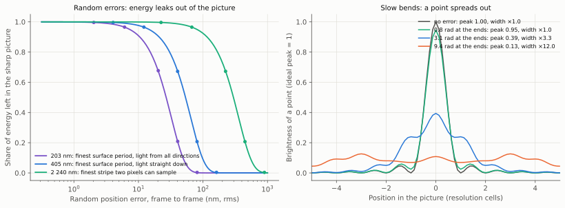
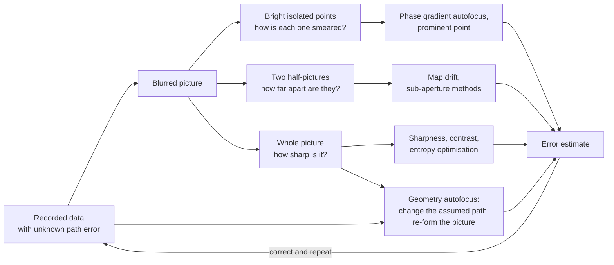
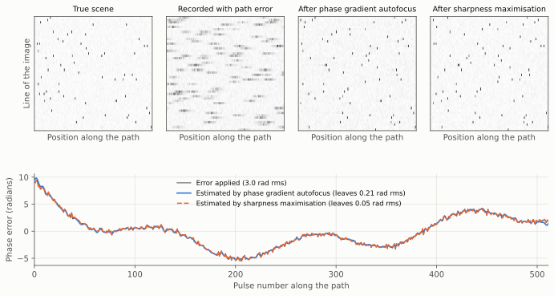
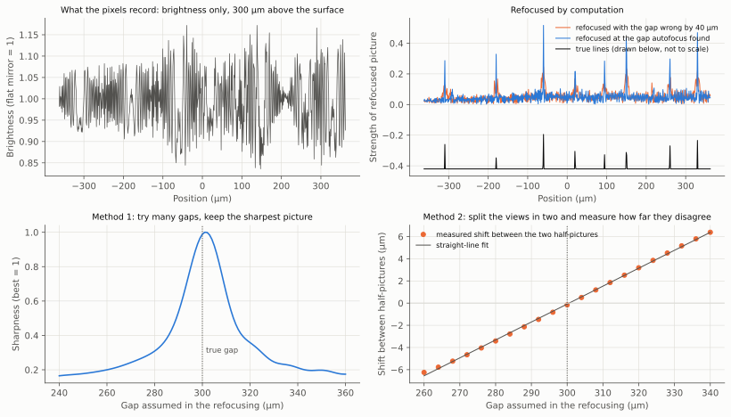
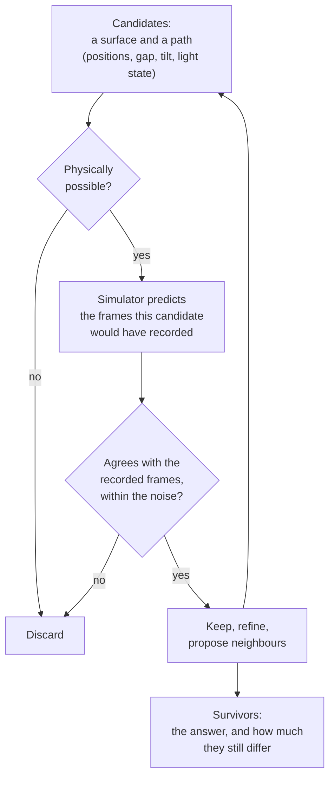
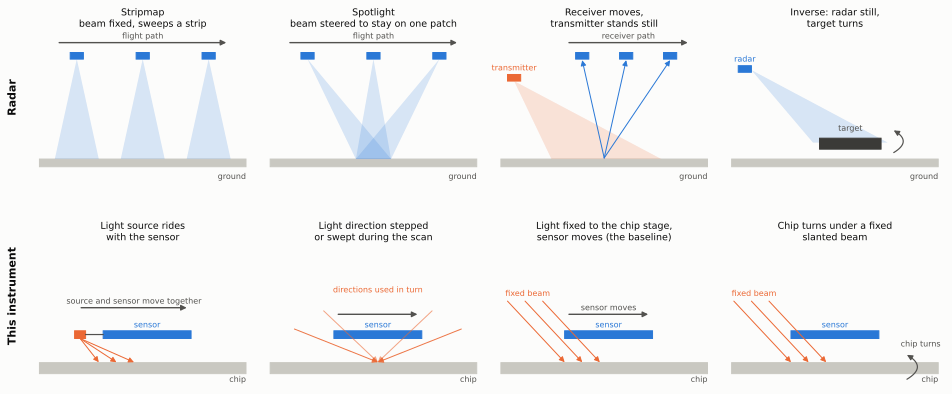
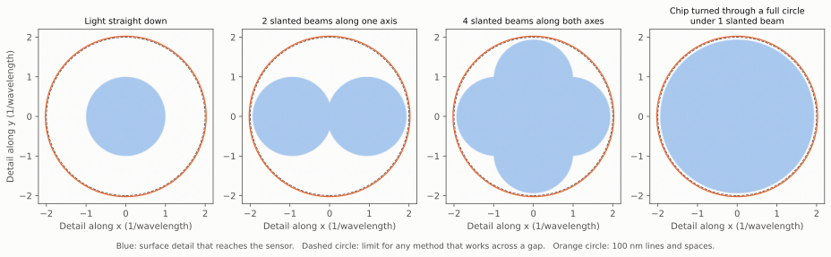
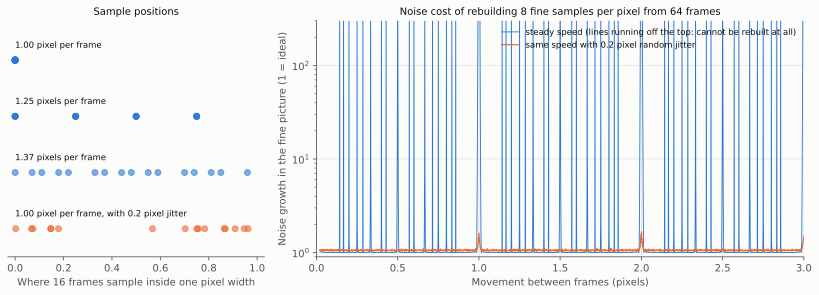
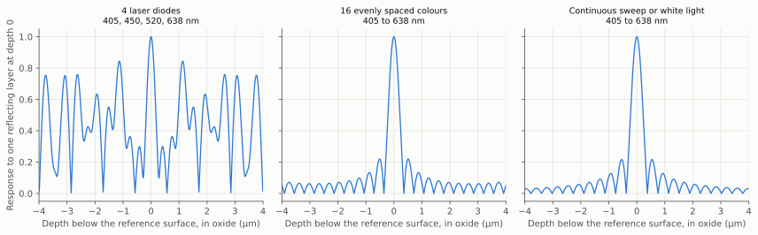

# Radar and synthetic aperture methods, including autofocus

This page is the deep study for item B1 of the [project plan](../plan.md). It
goes further into one field, synthetic aperture radar, than the
[overview survey of reconstruction methods](../reconstruction-methods.md)
does, and it answers the four questions the plan sets for it:

1. How is an aperture built from motion when the path is not known exactly,
   and how accurately can the path be recovered from the data?
2. Which autofocus methods carry over when only brightness is recorded and
   not the wave's phase?
3. How do stripmap and spotlight modes map onto a scanned sensor with a
   fixed or steered light source?
4. What sets radar's limits on resolution and on noise?

It does not repeat the overview. Beamforming and arrays (B2), satellite and
astronomical multi-frame reconstruction (B3) and ptychography (B4) have
their own studies and are only pointed to from here. No hardware work is
proposed: everything on this page feeds the simulator.

A radar on an aircraft takes a sharp picture of the ground with a small
antenna by recording echoes all along its flight and combining them in a
computer. The combination only works if the aircraft's path is known to a
small fraction of the radio wavelength, which no navigation system
delivers. Radar engineers solved this decades ago with **autofocus**: the
blurred picture itself is used to work out where the aircraft really was.

This project has the same problem at a scale a hundred thousand times
smaller. The sensor slides over the chip, the positions are not known well
enough, and the gap between sensor and chip is not known well enough
either. The comparison of sizes is worth keeping in mind: a radar
wavelength is a few centimetres, about the width of a finger; the violet
laser light here has a wavelength of 405 nm, about a two-hundredth of the
width of a hair; and one pixel of the sensor is 1.12 µm wide, almost three
of those wavelengths.

What this study found:

- **The radar recipe for unknown motion carries over, with one change.**
  Radar corrects the recorded wave. This instrument records only
  brightness, so the correction has to be made to the description of the
  instrument (positions, gap, tilt, the state of the light) and the picture
  recomputed. Two of radar's oldest autofocus methods need only brightness
  pictures and work here as they are. A small calculation on this page
  finds a 300 µm gap to within 1 to 2 µm from one brightness-only
  recording, by both methods.
- **How well the path must be known depends on where the light source is
  mounted and how fine a pattern is rebuilt.** If the light is fixed to
  the chip's stage, the sensor's position must be known to between 6 and
  36 nm. If fine stripes of light are made by a pair of beams, the
  position of those stripes on the chip must be known to about 3 nm,
  wherever the light is mounted, but that is a single unknown number per
  frame and is exactly the kind of unknown radar autofocus was built to
  find.
- **Radar's multi-receiver work puts numbers on a hazard the design
  already notes: scan speeds at which the frames keep sampling the same
  places.** If the sensor moves a simple fraction of a pixel between
  frames, such as exactly one pixel or one and a quarter, the fine picture
  cannot be rebuilt. This page calls these blind speeds. Radar's cure is
  to vary the timing on purpose. In the calculation on this page a random
  jitter of 0.2 pixel removes every blind speed; a jitter much smaller
  than the fine sample spacing does not.
- **Radar does not escape its own resolution limit by much.** With strong,
  isolated reflectors and a very clean signal, processing gains a factor of
  about two beyond the nominal limit, in line with what the overview
  assumed. Radar's large gains come from more angles and more bandwidth,
  and from measuring the position of an isolated reflector far more finely
  than it can separate two.
- **Several ideas here were not on the project's list**: turning the chip
  under one fixed beam in place of several lasers, stepping the colour of
  the light to separate the chip's layers by depth, comparing a chip
  against a known-good chip to see differences far smaller than the
  resolution, and using isolated specks on the chip as built-in reference
  points. They are listed in [section 8](#8-ideas-this-study-adds) with a
  verdict each.

## Terms used on this page

Terms shared with other pages are in the [glossary](../glossary.md). The
ones this page leans on:

| Term | Meaning |
|---|---|
| Synthetic aperture radar (SAR) | A radar that moves, records the echo at many positions, and combines the recordings by computation as if they came from one antenna as long as the path flown. |
| Phase | Where a wave is in its cycle of crest and trough when it arrives. Radar records it. A camera pixel does not: it records brightness only. |
| Phase error | The amount by which the assumed timing of a recording is wrong, in radians. A full cycle is 6.28 radians. It comes from not knowing the path exactly. |
| Autofocus | Working out the phase errors, or the path errors behind them, from the recorded data alone, and removing them. |
| Phase gradient autofocus (PGA) | The most widely used radar autofocus. It finds the bright points in the blurred picture and reads the error from the way each one is smeared. |
| Map drift | An autofocus that makes two pictures from two halves of the recording and measures how far one is shifted against the other. |
| Sharpness | A single number that is larger for a crisp picture than for a blurred one, for example the sum of the squares of the brightness. |
| Stripmap, spotlight | Two ways of flying a radar. In stripmap the beam points sideways at a fixed angle and sweeps a strip. In spotlight the beam is turned during the flight to stay on one patch. |
| Bistatic | Transmitter and receiver in different places. Monostatic means they are together. |
| Inverse synthetic aperture | The radar stays still and the target moves or turns. |
| Sidelobes | Faint false copies or halos beside each bright point of a picture, caused by the sharp edge of the range of detail that was recorded. |
| Speckle | The grainy pattern coherent waves make when many small reflectors share one picture element. |
| Looks (multilook) | Independent pictures of the same scene that are averaged to reduce speckle, at the cost of resolution. |
| Blind speed | This page's label for a scan speed at which successive frames fall on the same sample positions, so that some detail is never measured. In radar the same words are used for a different effect on moving targets. |
| Stepped frequency | Measuring distance by sending many pure tones one after another and combining them, in place of timing a short pulse. |
| Period | The width of one line plus one space of a regular pattern. Lines of 100 nm with 100 nm spaces have a period of 200 nm. |

## How claims are marked

The labels are those of the shared
[references page](../references.md#how-claims-are-labelled).

| Mark | Meaning on this page |
|---|---|
| [[SA1](#sa1)] | Taken from source SA1 in [section 12](#12-references). Each entry says whether the abstract or the full text was read. A figure quoted from a source is from its abstract unless the entry says full text. |
| Derived here | Worked out on this page. Where a calculation is needed it is done by the script [`make_sar_diagrams.py`](https://github.com/mithro/ccd-superres/blob/main/docs/diagrams/make_sar_diagrams.py), which draws every figure on this page and prints every number quoted from it. |
| Estimate | A rough figure from this page's own simplified reasoning. |
| Unverified | A standard textbook rule that could not be checked against a source text for this study. |
| Judgement | A verdict or ranking: an opinion reached from the evidence. |

The columns headed "This instrument", and every statement about how a radar
idea maps onto the instrument, are this page's own reasoning. They are all
**derived here**, and none has yet been tested in the simulator.

## 1. Summary of answers

| Question from the plan | Short answer | Section |
|---|---|---|
| How is an aperture built when the path is not known exactly? | Navigation gets close, and autofocus finds the rest from the data. Low-order errors (wrong speed, slow bends) are removed almost completely. Fast errors are not, and must be kept small by the hardware or modelled. | [2](#2-how-radar-builds-an-aperture-from-an-uncertain-path), [3](#3-autofocus-the-families-and-what-each-needs) |
| How accurately can the path be recovered? | Published results range from a fiftieth of a wavelength in optical holography to a five-hundredth of a wavelength for sonar. For this instrument the need is about 3 to 40 nm depending on where the light is mounted. | [4](#4-how-well-the-path-must-be-known-and-how-well-it-can-be-found) |
| Can the surface be recovered without exact positions, by eliminating impossible candidates? | Yes: it is how radar autofocus already works. The physical rules do the eliminating, the search must run coarse to fine, and a few quantities stay undetermined whatever is done. | [5.4](#54-proposing-candidates-and-eliminating-the-impossible), [5.5](#55-time-as-a-source-of-rules) |
| Which autofocus methods carry over to brightness-only data? | Map drift and sharpness maximisation carry over directly. Phase gradient autofocus carries over only where a strong reference wave makes the recording a hologram. Geometry autofocus is the best model for the full solver. | [5](#5-autofocus-when-only-brightness-is-recorded) |
| How do stripmap and spotlight map onto the instrument? | The baseline, light fixed to the stage, is neither: it is radar's "stationary transmitter, moving receiver" case. Stripmap is a light that rides with the sensor. Spotlight is a light direction that is stepped or swept. Turning the chip is inverse synthetic aperture. | [6](#6-radar-modes-and-the-instrument) |
| What sets the limits on resolution and noise? | Resolution: the range of angles and wavelengths covered, then sidelobes. Noise: speckle and coarse digitising matter more than detector noise, and added-up weak signals survive well. Processing gains about a factor of two beyond the nominal limit for isolated features. | [7](#7-what-limits-radar-and-what-that-means-here) |

## 2. How radar builds an aperture from an uncertain path

### 2.1 The mechanism

A point on the ground returns an echo to every position along the flight.
The distance to the point changes along the path, so the echo's phase
changes from pulse to pulse in a known pattern. Image formation undoes that
pattern for each ground point and adds the pulses up. In the simplest mode
the finest detail along the path is half the antenna's own length, at any
distance [[SA1](#sa1)]. The longer synthetic aperture at long range exactly
cancels the spreading of the beam, which is why the resolution does not
depend on range [[SA2](#sa2)].

The pulses must be frequent enough: at least one for every half antenna
length flown [[SA1](#sa1)]. With fewer, features appear "at multiple or wrong
positions" in the picture [[SA1](#sa1)]. [Section 6.3](#63-sampling-many-receivers-and-blind-speeds)
returns to this rule, because the instrument has its own version of it.

There is a second way to see the same thing, which is the one that maps
most cleanly onto optics. Each pulse measures one slice of the scene's
spatial frequency content, that is, of its make-up in coarse and fine
ripples: the motion-compensated data "represents the three-dimensional
Fourier transform of the object reflectivity density" [[SA3](#sa3)], and each
pulse is a slice of it [[SA4](#sa4)]. The flight collects slices from a range
of directions. The wider the range of directions, the finer the ripples
covered, and the sharper the picture. This is the same statement as the
overview's rule that the range of light directions sets the limit
([reconstruction methods, section 2.1](../reconstruction-methods.md#21-four-hard-limits)).

### 2.2 Why the path matters so much

The phase of an echo changes by a full cycle when the round-trip distance
changes by one wavelength. An aircraft that is a quarter of a wavelength
from where the processor thinks it is puts that pulse half a cycle out, and
it subtracts where it should add. Radar wavelengths are centimetres, and
aircraft do not fly to millimetres.

What navigation leaves behind, and what radar treats as tolerable, from a
Sandia National Laboratories report on motion measurement for radar
[[SA5](#sa5), full text]:

| Kind of phase error | Limit with no autofocus (degrees) | Same limit as a distance at 18 mm wavelength (µm) | Removed by ordinary autofocus? |
|---|---:|---:|---|
| Slow bend across the aperture (quadratic), peak | 90 | 2 300 | Yes |
| Cubic, peak | 30 | 750 | Yes |
| Ripple (sinusoidal), peak | 1 | 25 | Not if fast |
| Random from pulse to pulse, standard deviation | 1 | 25 | No |

*Table: allowed phase errors for a high-quality radar picture, and whether
autofocus lifts the limit. Values from [[SA5](#sa5)]. The distance column is
the report's own conversion for a radar of 18 mm wavelength, where the wave
travels out and back.*

The pattern in this table is the main lesson of the field for this project:

- **Slow errors are cheap.** A wrong speed, a slow bend in the path, a
  wrong distance to the scene: autofocus removes these almost completely,
  and a much-used textbook rule that the path must be known to about one
  sixteenth of a wavelength (quoted in [[SA6](#sa6)], full text, from the
  textbooks [[SA7](#sa7), [SA8](#sa8)], which were not read for this study)
  applies only before autofocus.
- **Fast errors are expensive.** Fast ripple and pulse-to-pulse random
  errors "will generally not be adequately mitigated" [[SA5](#sa5)]. They
  spread energy out of every bright point into a haze. A random phase error
  acts like added noise whose power, relative to the signal, equals the
  variance of the phase error in radians squared [[SA5](#sa5)].
- **Autofocus has a capture range.** If the error is so large that a point
  wanders by more than one resolution cell in the other direction of the
  picture, "conventional autofocus algorithms fail" [[SA9](#sa9), full text].
  The cure is to estimate first at coarse resolution and refine
  [[SA9](#sa9), [SA10](#sa10)].

*Figure: what position errors do to a picture built by adding up many
recordings. Left: random errors from frame to frame. Each curve is for one
size of stripe being rebuilt, and shows the share of its energy that still
adds up correctly; the rest is scattered as haze. Dots are a random
simulation, lines are the formula. An error of one sixth of the stripe
period loses two thirds of the energy. Right: a slow bend in the path
leaves the energy in place but spreads each point. A bend of 0.8 radians at
the ends of the aperture is harmless; 3.1 radians triples the width.
Derived here.*

## 3. Autofocus: the families and what each needs

*Diagram: where each family of autofocus takes its information from.*

| Family | What it estimates | What it needs from the scene | Known weakness | Sources |
|---|---|---|---|---|
| Map drift (sub-aperture) | A few low-order terms: the shift between pictures made from parts of the aperture gives the slope of the error across it | Any contrast that survives in the part-pictures | Poor with high-order errors and low contrast; blind to errors that vary faster than one sub-aperture | [[SA11](#sa11), [SA12](#sa12), [SA10](#sa10)] |
| Phase gradient autofocus | One phase per pulse, with no assumed shape of error; as usually run it corrects the slow part and leaves fast pulse-to-pulse error [[SA5](#sa5)] | Bright, fairly isolated points in many lines of the picture | Needs data with phase; the original estimator is slightly biased | [[SA13](#sa13), [SA14](#sa14), [SA15](#sa15)] |
| Sharpness, contrast or entropy optimisation | Either one phase per pulse or the coefficients of a smooth curve | Depends on the measure: some reward bright points, some reward dark shadows | Local best answers that are not the true one; cost of many trial pictures | [[SA16](#sa16), [SA17](#sa17), [SA18](#sa18), [SA19](#sa19), [SA20](#sa20)] |
| Multichannel autofocus | One phase per pulse, in one linear solve with no iteration | A region of the picture known to be empty | Needs that empty region | [[SA21](#sa21)] |
| Joint picture and error with a sparse prior | Picture and phase errors in turn | A scene made of few features | Tied to the sparsity assumption | [[SA22](#sa22)] |
| Geometry autofocus | The path itself: a handful of numbers such as speed, heading and acceleration | Contrast | The search grows quickly with the number of path parameters | [[SA6](#sa6), [SA23](#sa23), [SA24](#sa24)] |
| Autofocus fused with navigation | The path, using the focus measure as one more sensor beside the motion sensors | Contrast | Some directions of path error show up far better than others | [[SA25](#sa25)] |

*Table: the main families of radar autofocus. A text table. Characteristics
are from the abstracts of the sources, except [[SA6](#sa6)] and
[[SA12](#sa12)], which were read in full.*

Four points from this literature matter for the design.

**Phase gradient autofocus is close to the best possible when its
assumptions hold.** Its maximum-likelihood form is reported "essentially to
achieve the Cramér–Rao lower bound on estimation-error variance for all but
small values of target-to-clutter ratio", converging "typically in only one
or two iterations" [[SA14](#sa14)]. The Cramér–Rao bound is the smallest
error any method could reach. The formula of the bound was not available in
the texts read for this study.

**The two oldest families complement each other.** A direct comparison
found both "perform well if high-order phase errors are not present", that
map drift degrades faster when they are, and that "poor contrast increases
the error in the map drift estimate" [[SA12](#sa12), full text]. Map drift is
cheap, needs no search and gives the sign of the error. Phase gradient
autofocus assumes no shape for the error. Practical systems run the first to
get close and the second to finish.

**Phase-only correction is not enough when the geometry itself is wrong.**
On a low-frequency radar with a very long aperture, correcting phases with
phase gradient autofocus left the picture unfocused, "far from satisfying",
because the error moved points between cells as well as changing their
phase. Searching over the path geometry inside the image formation fixed
it: a 2 050 m aperture length assumed in place of the true 2 000 m was
recovered to within 5 cm [[SA6](#sa6), full text]. The authors note the
limit of the idea as they ran it: "an exhaustive 6-D geometry search is not
a feasible" option, so they varied one parameter at a time. A search by
gradient, which present-day automatic differentiation makes easy, is the
natural successor. One search for a radar paper doing exactly that found
none, which is weak evidence and is recorded as "not found", not "absent".
Ptychography already works this way for scan positions
[[SA26](#sa26), [SA27](#sa27)], which is the subject of study B4.

**All of them need something to hold on to.** Low scene contrast "may
degrade the performance of most of the existing autofocus methods"
[[SA28](#sa28)]. The overview made the same point about bare polished
silicon.

A rehearsal of the two main methods, on invented radar-like data:

*Figure: a rehearsal of radar autofocus on invented data. Top, from the
left: a scene of isolated bright points; the same scene formed from
recordings whose timing was disturbed by an unknown path error; and the
picture after each of two autofocus methods. Bottom: the phase error that
was applied (grey), and what each method worked out from the blurred
picture (blue and orange), across the 512 pulses. A constant, a steady
slope and whole turns of phase do not blur a picture and cannot be found
by autofocus, so they have been removed from the comparison using the
known error. Both estimates follow the applied error closely. Derived here, a one-dimensional toy with fixed random seed.*

| Quantity | Value (radians, rms) |
|---|---:|
| Phase error applied | 2.96 |
| Left after phase gradient autofocus | 0.21 |
| Left after sharpness maximisation | 0.05 |

*Table: the rehearsal's numbers. Derived here (function `fig_autofocus` of
the diagram script). The applied error has a slow part and a random
pulse-to-pulse part of 0.25 radians. Phase gradient autofocus removes the
slow part and leaves about the size of the random part, which is the
limit described in [section 2.2](#22-why-the-path-matters-so-much).
Sharpness maximisation with one free phase per pulse removes both here,
because the scene is an easy one, with strong isolated points and little
noise. These numbers check that the methods are implemented correctly and
illustrate them; they are not a prediction for the instrument.*

## 4. How well the path must be known, and how well it can be found

### 4.1 What other fields have achieved

| Field | What was estimated from the data | Reported accuracy | Unit | As a share of the wavelength or cell | Source |
|---|---|---:|---|---|---|
| Sonar | Sideways movement between pings | 20 | µm | About 1/500 of the wavelength (own arithmetic, wavelength near 1 cm) | [[SA29](#sa29)] |
| Optical holography, computer simulation under ideal conditions | Phase error across the aperture, more than 15 independent recordings | 0.02 | wavelengths rms | 1/50 | [[SA30](#sa30)] |
| Optical holography, the same simulation | The same, with 2 recordings | 0.10 | wavelengths rms | 1/10 | [[SA30](#sa30)] |
| Radar, signal-based tracking | Distance to the scene, from correlating part-pictures | 0.02 | resolution cells | 1/50 | [[SA31](#sa31), full text] |
| Radar, low frequency | Length of a 2 000 m aperture | 0.05 | m | 1/40 000 of the length | [[SA6](#sa6), full text] |
| Radar, airborne | Track error | 0.02 | m | Not stated in abstract | [[SA32](#sa32)] |
| Optical synthetic aperture, moving camera | Shift between overlapping recordings, against the motor | 0.2 | pixels | Difference between 135 measured and 134.8 commanded | [[SA34](#sa34), full text] |

*Table: published accuracy of recovering motion or phase from the data
itself. The sonar entry is a theoretical accuracy, and is the same result
the overview quoted as 0.002 wavelengths. The holography entries are
simulations. No radar abstract read for this study gave the phase error
left after autofocus in radians.*

Before autofocus, airborne radar is typically left with "deviations in the
order of centimeters" between the real and the assumed track
[[SA35](#sa35)], against wavelengths of a few centimetres. So autofocus
routinely starts from an error of the same size as the wavelength and ends
a factor of tens to hundreds below it.

Sonar adds a warning about long apertures. Its position estimate is built
up from ping-to-ping steps, and the errors of the steps accumulate, which
"set[s] an upper limit to the [aperture] length achievable in practice"
[[SA29](#sa29)]. An instrument that estimates each frame's position only
from its overlap with the previous frame will drift in the same way. The
remedy, in sonar and here, is to tie the positions together through the
picture as a whole and not only through neighbours.

### 4.2 What this instrument needs

The radar tolerances are in radians of phase. To turn them into nanometres
for the instrument, the question is: which pattern moves when the sensor
is misplaced, and how fine is it? A position error $\delta$ puts a stripe
pattern of period $\Lambda$ out of step by a phase

$$\phi = 2\pi\,\delta/\Lambda .$$

In words: a position error does harm in proportion to how large it is
compared with the stripes being rebuilt, and an error of a whole period is
a full cycle. For random errors with standard deviation $\sigma_\phi$
radians, the share of energy that still adds up correctly is
$\exp(-\sigma_\phi^2)$ (derived here, confirmed by the random simulation in
the figure of [section 2.2](#22-why-the-path-matters-so-much)), which is
the optical form of the radar rule quoted there from [[SA5](#sa5)].

The answer depends on where the light source is mounted, which the design
has not fixed.

| Arrangement | What a sensor position error disturbs | Period that sets the tolerance (nm) | Random error for 1 % of energy lost (nm, rms) | Random error for 10 % lost (nm, rms) | Radar's strict 1° rule (nm, rms) |
|---|---|---:|---:|---:|---:|
| Light fixed to the chip stage, stripes on the sensor read directly | Where the pixels sample a pattern that is fixed in space | 2 240 | 36 | 113 | 6.2 |
| Light fixed to the stage, light straight down, full detail wanted | The same, with the pattern rebuilt to the finest detail the light carries | 405 | 6.4 | 20 | 1.1 |
| Beam pair, any mounting: the position of the light's own stripes on the chip (not a sensor position) | Where the light's own stripes sit on the chip | 203 to 215 | 3.2 | 10 | 0.6 |

*Table: how well positions must be known, for three cases. The first two
rows are tolerances on the sensor's position. The third is a tolerance on
the position of the stripes of light, which is set by the two beam paths
and not by where the sensor is. The 2 240 nm
period is the finest stripe two pixels of 1 120 nm can sample. 405 nm and
203 nm are the finest surface periods for light straight down and from all
directions ([overview, section 1](../reconstruction-methods.md#1-summary)).
A beam pair at 70° makes stripes of period 215 nm. Derived here (function
`fig_phase_tolerance`); the last column converts the radar rule of
[[SA5](#sa5)] by the formula above.*

Three conclusions, all derived here and all to be tested in the simulator:

1. **With the light on the chip stage, the sensor's position matters
   only as finely as the pattern being rebuilt at the sensor.** That is 36
   nm if only the stripes the pixels sample directly are used, and 6.4 nm
   if the pattern is rebuilt to the finest detail that light straight
   down carries: between 2 and 11 times looser than the 3.2 nm of the
   finest stripes. In radar terms the light is the transmitter, and a
   transmitter that does not move adds no path error of its own. If
   instead a light source making a fine pattern rides with the sensor,
   every sensor position error moves that pattern on the chip, and the
   3.2 nm applies to the sensor position itself.
2. **A beam pair adds one unknown per frame, and it is radar's kind of
   unknown.** The stripes a beam pair lays on the chip shift by a full
   period when the two beam paths change by one wavelength relative to
   each other, which a small temperature change or vibration will do. The
   position of the stripes is therefore unknown for each frame, to be
   found from the data, with a need of about 3 nm. This is one number per
   frame affecting the whole frame alike: the direct counterpart of the
   one phase per pulse that phase gradient autofocus estimates. It should
   be an explicit unknown in the simulator's instrument model.
3. **Slow errors will be found, fast ones must be bounded.** By the radar
   experience of [section 2.2](#22-why-the-path-matters-so-much), a wrong
   scan speed, a slow drift and a tilt are recoverable. Vibration at
   frequencies comparable to the frame rate is the fast, random kind. The
   data item on vibration spectra in the plan (R11) decides whether it is
   within the table's limits, and the simulator should sweep it.

Whether the data can deliver these accuracies is a separate question from
whether the instrument needs them. The published fractions in
[section 4.1](#41-what-other-fields-have-achieved), a fiftieth to a
five-hundredth of the relevant scale, would give 0.4 to 4 nm on a 203 nm
period and 4 to 45 nm on a 2 240 nm period (estimate: direct scaling of
those fractions, which assumes similar signal quality, and the best of
them are a simulation and a theoretical bound, not measurements). On that
scaling the first row of the table is comfortable and the last row is at
the edge.

## 5. Autofocus when only brightness is recorded

Radar autofocus corrects the recorded wave by multiplying each pulse by a
phase. A pixel records brightness, so there is no recorded wave to correct.
What survives the change is the logic: a picture formed with the wrong
assumptions is blurred in a way that reveals the wrong assumption.

### 5.1 What carries over

| Family | Needs recorded phase? | How it carries over to this instrument | Verdict (judgement) |
|---|---|---|---|
| Map drift | No. It compares the brightness of two part-pictures. | Form pictures from two halves of the range of views and measure their shift. Gives the gap error, with its sign, per tile. Rehearsed in [section 5.3](#53-a-rehearsal-the-gap-from-one-brightness-only-recording). | Use first, as the cheap coarse step |
| Sharpness, contrast, entropy | No. The measure is computed on the brightness of the picture. | Change the assumed gap, tilt, positions or light state, re-form the picture, keep what is sharpest. Rehearsed in section 5.3. | Use, per tile and for the global geometry |
| Phase gradient autofocus | Yes | Applies where a strong mirror-like reflection acts as a reference wave and the recording is a hologram ([section 5.2](#52-what-the-phaseless-radar-literature-adds)). Then one unknown per frame, such as the stripe position of a beam pair, can be estimated from the bright isolated features in many tiles at once. | Adapt for the per-frame light state |
| Multichannel autofocus | Yes, and a region known to be empty | Bare silicon between structures is a region where the scattered wave is known to be zero. | Park: worth one simulator test |
| Geometry autofocus, navigation fusion | No in principle: it optimises the path against a focus measure | The model for the full solver: a few global numbers first (speed, heading, tilt, gap, frame timing), then per-frame corrections, by gradient | Use as the frame of the calibration stage |
| Sparse-prior joint estimation | No in principle | Already in the overview's shortlist as layout-rule priors. See also [section 5.4](#54-proposing-candidates-and-eliminating-the-impossible). | Covered by the overview |

*Table: which radar autofocus families survive the loss of recorded phase.
A text table. The reasoning is derived here; the verdicts are judgements.*

The sharpness idea did not begin in radar. It was introduced for ordinary
telescope pictures, which are brightness only: sharpness "is maximized only
when the phase distortion of the incoming light is zero" [[SA36](#sa36)].
It was then shown that the sharpness of a speckled coherent picture is, on
average, proportional to that of the matching ordinary picture
[[SA37](#sa37)], which is what lets one idea serve both. Which sharpness
measure is best depends on the scene: "some metrics emphasize making
shadows darker, and other emphasize making bright points brighter"
[[SA17](#sa17)]. A chip has both dark and bright regular structure, so the
choice of measure is something the simulator should compare and not
assume.

Optics has already borrowed both families:

| Borrowed method | Where | Result | Source |
|---|---|---|---|
| Sharpness maximisation | Holograms of a rough object | Phase corrected to better than 1/50 wavelength rms with more than 15 recordings | [[SA30](#sa30)] |
| Sharpness maximisation, with registration by correlation | A camera scanned to build a 218 megapixel synthetic aperture hologram | Resolution at the theoretical limit of the aperture | [[SA38](#sa38)] |
| Map drift | The same laboratory's holograms | Shifts between part-pictures gave the error as a smooth curve with terms up to the seventh power | [[SA39](#sa39)] |
| Map drift, then sharpness, coarse to fine | Holographic imaging of the living eye | Map drift served "as a rough first estimation"; sharpness with 42 unknowns finished; the estimate was made at low resolution first and then refined | [[SA40](#sa40), full text in part] |
| Sharpness on the light direction | A lensless sensor with 1.12 µm pixels and slanted light | Errors of a few degrees in the light direction were found from the data; left uncorrected they "would result in a loss of spatial resolution" | [[SA41](#sa41), full text] |
| Position correction inside the reconstruction | Lensless brightness-only holography, 1.67 µm pixels | Uncorrected sub-pixel drift "brings disastrous distortions"; correcting it inside the iteration beat registering the frames beforehand | [[SA42](#sa42)] |

*Table: radar-style autofocus already demonstrated with light. A text
table. The last two rows are brightness-only recordings on bare sensors,
the closest published cases to this instrument.*

### 5.2 What the phaseless radar literature adds

A small literature asks directly what synthetic aperture imaging can do
when the receiver measures only intensity. Its findings are consistent,
and they agree with what ptychography found by another road.

| Finding | Conditions | Source |
|---|---|---|
| Resolution is the same as with measured phase | Enough diversity of lighting positions and frequencies; simulation | [[SA43](#sa43), full text; [SA44](#sa44)] |
| If the direct wave is much stronger than the scattered one, brightness data can be focused by the ordinary method as if phase had been measured, at about twice the cost of the ordinary method | The scattered wave must be weak compared with the direct wave; simulated at light wavelengths | [[SA45](#sa45), full text] |
| The hard part is tying the unknown phase of each receiver position to the others | Solved there with several frequencies and a sparse scene | [[SA43](#sa43)] |
| Tolerant of noise: usable pictures with noise as strong as the signal | Simulation | [[SA43](#sa43)] |
| Two-surface phase recovery "is a highly nonlinear algorithm, prone to get trapped in local minima" | Antenna measurement ranges, no reference wave | [[SA46](#sa46)] |
| A reference wave built into each element lets the phase be recovered at each position independently of the path | Millimetre-wave experiment | [[SA47](#sa47)] |
| The reference need not be a real second beam: it can be synthesised | Microwave experiment | [[SA48](#sa48)] |

*Table: findings on synthetic aperture imaging from intensity alone. A
text table.*

What this means here (derived here):

- **Mirror-like silicon is an asset.** The strong plain reflection from
  flat silicon is exactly the "direct wave much stronger than the scattered
  wave" that makes brightness-only data behave like data with phase
  [[SA45](#sa45)]. Where that holds, the whole linear radar toolbox applies
  to the recorded frames, including phase gradient autofocus.
- **It will not hold everywhere.** The same source reports artefacts when
  the scattering is strong or the receivers are close to the scatterer
  [[SA45](#sa45)]. Over dense metal wiring the scattered wave is not weak.
  The simulator should report, per tile, the ratio of scattered to
  reflected light, and switch from the linear method to the full
  phase-recovering solver where the ratio is high.
- **A reference beat is the robust way to carry phase.** Experiments that
  worked without restrictions on the path had a reference at every
  position [[SA47](#sa47)]; those without one fought local minima
  [[SA46](#sa46)]. The beam-pair scheme of the design is a form of built-in
  reference, which supports it as the leading candidate from the radar side.
- **No published experiment matches this instrument.** The literature check
  found no intensity-only synthetic aperture experiment with a free-running
  scan at constant speed and no reference. The nearest is a 2022
  demonstration that translated a lensless sensor carrying a coded
  layer, placed far from the object, with reflective silicon chips among
  its test objects, and synthesised a 20 mm aperture from a 5 mm
  sensor, with "a fourfold gain in resolution" [[SA49](#sa49)]. That work
  belongs to study B4 and is noted here because its authors frame it as a
  synthetic aperture.

### 5.3 A rehearsal: the gap from one brightness-only recording

To check that the two brightness-only methods do work in this geometry, a
one-dimensional calculation was run with the instrument's own numbers:
405 nm light straight down on a flat mirror carrying eight narrow lines
(300 to 1 200 nm wide), a sensor of 1.12 µm pixels 300 µm above it, and
photon noise for 4 000 photons per pixel, which is within the 4 500
electron capacity the design assumes for one reading. The pixels record brightness
only. The recording is then refocused by computation for a range of
assumed gaps.

*Figure: finding the gap from a brightness-only recording. Top left: what
the pixels record 300 µm above eight narrow lines, a pattern of ripples
with no visible lines. Top right: the same recording refocused by
computation. With the gap wrong by 40 µm (orange) the lines are smeared;
at the gap that autofocus found (blue) they are sharp. Bottom left: method
1, sharpness against the gap assumed, which peaks near the true gap (dotted
line). Bottom right: method 2, radar's map drift. Two pictures are made
from the left-going and right-going halves of the views, and the shift
between them is plotted against the gap assumed. It crosses zero about
1 µm from the true gap, and its sign says which way to correct. Derived here, a
one-dimensional wave calculation.*

| Method | Mean gap found over 20 noise trials (µm) | Error of the mean (µm) | Scatter over the trials (µm) |
|---|---:|---:|---:|
| True value | 300.00 | | |
| Sharpness maximisation, search over gaps | 301.58 | +1.58 | 0.24 |
| Map drift, from refocusing at two gaps only | 300.77 | +0.77 | 0.15 |

*Table: result of the rehearsal over 20 recordings that differ only in
their noise. For scale, the depth of focus of this arrangement is 12.4 µm,
so both methods find the gap to about a tenth of the depth of focus, with
a small steady bias and a smaller scatter. The single recording drawn in
the figure gave 301.8 µm by sharpness and 301.1 µm by a line through 21
gaps. Derived here (function `fig_gap_autofocus`).*

Both methods are biased by the width of the features, because a wide
feature refocused from brightness alone carries a ghost of itself (the overview calls
it the twin image) that shifts the best apparent focus:

| Width of the lines (nm) | Bias of sharpness (µm) | Bias of map drift (µm) |
|---:|---:|---:|
| 300 | +0.1 | +0.7 |
| 1 000 | +0.8 | +1.4 |
| 2 000 | +1.7 | +2.5 |
| 4 000 | +12.0 | +5.2 |
| 8 000 | +6.9 | +3.1 |

*Table: bias of the two gap estimates against the width of the lines, with
no noise. Derived here. Features narrower than about two pixels give a
bias of a micrometre or two. Wider features give a bias up to the depth of
focus.*

What the rehearsal shows and does not show:

- Both of radar's brightness-only autofocus methods work on this geometry
  without any phase being recorded, and they agree with each other.
- Map drift needs no search: two refocusings give a line whose zero
  crossing is the answer. That makes it the natural first step, per tile,
  giving a map of the gap and therefore the tilt.
- The bias means these methods give a starting value, not the final one.
  The final value has to come from the joint solve, which models the ghost
  instead of ignoring it. This is the same division of labour as in radar,
  where map drift gets close and a second method finishes
  [[SA12](#sa12)].
- The rehearsal is one-dimensional, uses light straight down, and uses only
  the stripes the pixels can sample directly. It says nothing about the
  slanted-beam stages.

### 5.4 Proposing candidates and eliminating the impossible

Tim's suggestion (14 November 2026) is that combining the recordings with
the simulator should allow recovery without exact position information:
work out the possible solutions, and eliminate the ones that are
physically impossible. Radar does this already, under several names, and
its experience says both that it works and where it stops.

*Diagram: recovery by elimination. The simulator predicts what each
candidate would have recorded. Candidates that break a physical rule, or
that disagree with the recording, are discarded, and the survivors are
refined.*

| How radar and its relatives do it | What is proposed | What eliminates candidates | Result reported | Source |
|---|---|---|---|---|
| Geometry autofocus | Candidate flight paths | The picture each path gives is scored for focus | A 50 m error in a 2 000 m aperture length recovered to 5 cm, with no navigation data of that accuracy | [[SA6](#sa6), full text] |
| Sharpness search from many starting points | Candidate error curves | Sharpness; several starting guesses guard against a wrong best answer | Second, third and fourth order errors "successfully sensed" | [[SA37](#sa37)] |
| Multichannel autofocus | Every possible set of phase errors at once | A rule about the scene: part of the picture is known to be empty. Only one set of errors leaves it empty | "A unique solution", found directly with no iteration | [[SA21](#sa21)] |
| Constant-modulus formulation | The same | A rule about the instrument: the error changes only the timing of each pulse, never its strength | Phase gradient and multichannel autofocus shown to be the same constrained problem, solved better by a more costly method | [[SA90](#sa90)] |
| Sparse joint estimation | Picture and errors in turn | A rule about the scene: it is made of few features | Sharper pictures and corrected errors together | [[SA22](#sa22)] |
| Intensity-only array imaging | All scenes consistent with the brightness data | The scene is sparse | Sparse scenes recovered "exactly" | [[SA91](#sa91)] |
| Fusion with navigation | Candidate paths | The laws of motion: a platform cannot jump, so the path must be smooth | The along-path position error falls as focus improves | [[SA25](#sa25)] |

*Table: radar's forms of "propose candidates and eliminate the
impossible". A text table. Results are from abstracts unless marked.*

What this says for the instrument (derived here):

- **The idea is sound and is how the field already works.** Every method
  in the table recovers a path that was not measured, by keeping only the
  candidates that are consistent with the data and with a rule. None needs
  exact position information to begin with.
- **The rules do the eliminating, so they should be written down.** The
  physical rules available here are stronger than most of radar's:

  | Rule | What it eliminates |
  |---|---|
  | A passive surface reflects no more light than falls on it | Candidates with reflectance above 1 |
  | A chip is made of a few known materials with sharp edges | Smooth in-between values |
  | Detail finer than half a wavelength does not cross the gap | Candidates whose predicted frames contain it |
  | The sensor is rigid: every pixel shares one position, tilt and gap per frame | Position errors that differ from pixel to pixel |
  | The sensor has mass and moves at a nearly constant rate | Paths that jump between frames |
  | Bare silicon scatters nothing | Phase errors that put light into known-empty regions |
  | Light and electrons are counted in whole numbers with known statistics | Candidates whose mismatch with the data is larger, or smaller, than the noise allows |

  *Table: physical rules that can eliminate candidates. A text table.
  Derived here.*

- **Enumeration does not scale; guided search does.** The radar authors
  who searched over geometry found that "an exhaustive 6-D geometry
  search is not a feasible" option [[SA6](#sa6)]. With some 10⁷ instrument
  unknowns ([overview, section 5](../reconstruction-methods.md#5-estimating-position-gap-and-instrument-from-the-data))
  candidates cannot be listed. What works is elimination in stages:
  coarse candidates first (a handful of global numbers such as speed,
  heading, tilt and gap, where enumeration is affordable), then refinement
  by gradient from the survivors, from several starting points.
- **Elimination cannot remove what the data cannot see.** A proof for the
  closely related problem of ptychography with an unknown light pattern
  shows that, even with ideal data, the solution is fixed only up to "a
  constant scaling factor and an affine phase factor" [[SA92](#sa92)]: an
  overall brightness scale, and a uniform shift and tilt of phase. No rule
  about the data removes these. They are the anchors the calibration page
  already lists, and they need the physical rules above (reflectance at
  most 1 fixes the scale) or one outside measurement.
- **Wrong survivors are possible when the rules are weak.** Recovering
  phase from brightness with no reference is "prone to get trapped in
  local minima" [[SA46](#sa46)]. The safeguard used in radar and optics is
  to keep several survivors and report how much they differ, which is also
  an honest measure of how well the surface is known. The simulator should
  report that spread and not a single answer.

### 5.5 Time as a source of rules

Tim added (14 November 2026) that the temporal properties of the real
world can also be used to eliminate incorrect or impossible solutions.
Radar leans on time in exactly this way, because a radar recording is a
sequence in time before it is anything else.

| What radar assumes about time | How it is used to eliminate candidates | Source |
|---|---|---|
| The platform's path is smooth, because the platform has mass | The focus measure is combined with the laws of motion, so only smooth paths are candidates | [[SA25](#sa25)] |
| Path errors are slow compared with a part of the aperture | Map drift assumes this; it is blind "to error fluctuation faster than subaperture duration", so anything it finds is slow by construction | [[SA10](#sa10)] |
| Slow and fast errors have different causes and different cures | They are budgeted and corrected separately ([section 2.2](#22-why-the-path-matters-so-much)) | [[SA5](#sa5), full text] |
| A steady vibration has a signature | A ripple in the error at one frequency gives "symmetric paired echoes" beside every bright point, at a spacing set by the frequency, so a vibration can be recognised and named from the picture | [[SA65](#sa65), full text] |
| The same ground point is seen at different times from different directions, and it has not changed | The pictures from early and late views must agree; their disagreement gives the rate of change of the path error | [[SA93](#sa93), [SA94](#sa94)] |
| Errors of step-by-step tracking accumulate in a known way with the number of steps | Sets how long an aperture can be before the path must be tied down by other means | [[SA29](#sa29)] |
| The scene is static between two passes | Whatever fails to match between passes is change or noise, not scene | [[SA80](#sa80), [SA95](#sa95)] |
| Some points stay stable for years | Only points whose signal is steady over time are trusted, and they are measured to millimetres | [[SA76](#sa76)] |

*Table: radar's uses of time to rule out candidates. A text table, from
abstracts unless marked.*

The temporal rules available to this instrument (derived here):

| Fact about time | What it eliminates |
|---|---|
| The chip does not change during the scan | Any candidate in which the surface differs from frame to frame. Every frame must be explained by one surface. |
| A feature on the chip crosses the sensor at the scan speed; a speck on the sensor does not move across it at all | Features that stay on the same pixels in every frame belong to the sensor, and are removed from the surface. Features that move at any other rate are stray light or reflections. |
| The sensor has mass, so its position changes smoothly | Paths with jumps. With a bound on acceleration, the position in one frame limits the next. |
| A rolling-shutter sensor reads its rows one after another at a known rate | Each row has its own time stamp, so motion faster than the frame rate is sampled thousands of times per frame and cannot hide between frames |
| Vibration sits at a few fixed frequencies; thermal drift is slow; photon and read noise are independent from one reading to the next | A wobble in the estimated path is accepted only if it has the signature of one of these. Noise cannot explain anything that persists across frames, and drift cannot explain anything fast. |
| Light pulses are fired at known instants | Candidates for when each reading collected its light |
| Two passes over the same chip see the same chip | Whatever differs between passes is instrument, not surface |

*Table: temporal rules for the instrument. A text table. Derived here.*

Two of these rows are stronger than their radar counterparts. A radar
scene is only roughly static, with trees and water that move, whereas a
chip on a stage is static to the accuracy that matters. And a radar
antenna gives one sample of the path error per pulse, whereas a
rolling-shutter sensor gives one per row. The separation of sensor-fixed
from chip-fixed features by their rate of motion has no direct radar
source and is this page's own suggestion.

## 6. Radar modes and the instrument

### 6.1 The four arrangements

*Figure: four ways of flying a radar (top row) and the arrangement of the
instrument that corresponds to each (bottom row). Blue is the receiver:
the radar antenna above, the sensor below. Orange is the transmitter: the
radar's own beam above, the light below. From the left: stripmap, where
transmitter and receiver travel together with a fixed beam; spotlight,
where the beam is turned to dwell on one patch; a stationary transmitter
with a moving receiver; and the inverse case where the target turns.
Illustrative, not to scale.*

| Radar mode | What sets its resolution along the path | Published figures | Counterpart in the instrument | What it would give here |
|---|---|---|---|---|
| Stripmap | Half the antenna length; a smaller antenna has a wider beam and sees each point from more directions [[SA1](#sa1)] | 3 m over a 30 km swath for one satellite [[SA1](#sa1)] | A light source that rides with the sensor and lights each surface point from a changing direction as it passes | New views from motion alone, at the price of the tight tolerance of [section 4.2](#42-what-this-instrument-needs) |
| Spotlight | The angle through which the beam is turned while dwelling on the patch | 0.24 m staring against 1.1 m sliding for the same satellite [[SA50](#sa50), full text of preprint] | Stepping or sweeping the light direction during the scan | The stage 2 and stage 3 schemes of the design: several slanted directions |
| In-between modes that sweep or step the beam (known as sliding spotlight, TOPS and ScanSAR) | A deliberate trade of resolution for area covered [[SA1](#sa1), [SA51](#sa51), [SA52](#sa52)] | 16 m over a 120 km wide scene in one acquisition [[SA51](#sa51), full text] | Spending frames on more area and fewer light directions, or the reverse | A dial for the trade-off explorer: area per hour against resolution |
| Stationary transmitter, moving receiver | The receiver's motion only: "only the moving platform contributes" [[SA53](#sa53)] | The mirror-image experiment, a fixed receiver under a moving satellite transmitter, lost a factor of √2 in resolution, after part of the loss was regained through a longer observation [[SA54](#sa54), full text] | Light fixed to the chip stage, sensor moving. **This is the baseline.** | No new views from motion. Motion gives sampling and redundancy only |
| Inverse synthetic aperture | The angle through which the target turns [[SA55](#sa55), [SA56](#sa56)] | Aircraft imaged from their own motion [[SA56](#sa56)] | Turning the chip under a fixed slanted beam | Every direction in the surface covered with one beam ([section 6.2](#62-coverage-fixed-beams-against-a-turning-chip)) |
| Circular | A full circle of directions | "the maximum attainable resolution of a fraction of the wavelength" [[SA1](#sa1)]; 55 µm with terahertz waves in a band centred near a wavelength of 214 µm, roughly a quarter of the centre wavelength (own arithmetic) [[SA57](#sa57)] | The same as the row above, or a ring of sources | The quarter-wavelength line width the overview takes as the far-field ceiling |

*Table: radar modes, their published performance, and the instrument
arrangement each corresponds to. A text table. The last two columns are
derived here.*

The mapping settles a point the overview left as an analogy that breaks.
The overview said that the moving sensor does not synthesise a larger
aperture "as in radar". Radar agrees: its own stationary-transmitter case
gains nothing in viewing directions from the transmitter, and the receiver
here is already an array that covers the directions the motion would have
added. The textbook formulas for these resolutions (wavelength divided by
twice the angle turned through, and the quarter-wavelength limit for a
full circle) could not be checked against a source text for this study and
are **unverified**; the sourced statements are the ones in the table.

### 6.2 Coverage: fixed beams against a turning chip

Each direction of slanted light moves a different part of the surface's
fine detail into the range that reaches the sensor. The figure shows which
detail is covered, in the two directions across the chip, for four
arrangements.

*Figure: which surface detail reaches the sensor for four lighting
arrangements, with 405 nm light and slanted beams at 70°. Each map has
detail along one direction of the chip across and along the other
direction up. Further from the centre is finer. Blue is covered. The
dashed circle is the limit for any method that works across a gap, and the
orange circle, almost on top of it, is 100 nm lines and spaces. It is the
best case, assuming every direction of light leaving the surface can be
used. Derived here from the same scalar formula as the overview.*

| Arrangement | Number of lasers | Finest period along the wiring directions (nm) | Finest period at 45° to them (nm) |
|---|---:|---:|---:|
| Light straight down | 1 | 405 | 405 |
| Two slanted beams along one axis | 2 | 209 | 287 |
| Four slanted beams along both axes | 4 | 209 | 287 |
| Chip turned through a full circle under one beam | 1 | 209 | 209 |

*Table: finest surface period covered, from the figure above. Derived here
(function `fig_rotation_coverage`). The "two beams" row reaches 209 nm
along its own axis only; across that axis it covers no detail finer than
about 1 200 nm, which is worse than light straight down.*

Two things follow (derived here):

- **Four beams lined up with the chip's wiring are well matched to a
  chip.** Wiring runs in two perpendicular directions, and four beams
  along those directions give the full 209 nm exactly there. The loss, to
  287 nm, is on the diagonals, where chips have little. The beams must be
  aligned to the wiring, which is a new requirement.
- **Turning the chip does the same job with one laser** and covers every
  direction evenly. It trades lasers for a rotation stage and for a harder
  registration problem, since frames must then be matched in angle as well
  as position. Radar's inverse synthetic aperture literature is about
  exactly that problem: the turning motion of the target is not known and
  is estimated from the data [[SA56](#sa56), [SA18](#sa18), [SA19](#sa19)].
  The plan already has a seeded candidate for rotating the chip (X14);
  this is the argument for testing it.

### 6.3 Sampling, many receivers and blind speeds

Radar's sampling rule is one pulse per half antenna length
[[SA1](#sa1)]. When a radar wants to pulse more slowly than that, to cover
a wider swath, it uses several receiving antennas in a row along the
flight direction. Each pulse then gives several samples, and N antennas
allow the pulse rate to drop by a factor of N [[SA58](#sa58), full text].
This works for any spacing of the resulting samples provided they "do not
coincide". When they do coincide the reconstruction "becomes impossible",
and close to coincidence the noise in the picture rises
[[SA58](#sa58)]. With well-spaced samples the cost is small: a design
example quotes about 0.2 dB of added noise [[SA59](#sa59), full text].

The instrument is the extreme case of this arrangement: thousands of
receivers in a row along the scan, moving a fraction of their own spacing
between frames. So it inherits the hazard of coinciding samples. If the
sensor moves exactly one pixel between frames, every frame samples the
same places inside the pixel grid, and no detail finer than a pixel can be
rebuilt however many frames are taken. The design already notes this
([section 5.4](../design.md#54-scan-sampling-calculator) and
[section 5.5](../design.md#55-natural-misalignment-as-a-resource)): regular
motion can put all readings on a few repeated positions. What the radar
work adds is the size of the effect and a tested cure. This page calls
such a speed a **blind speed**; the label is borrowed, and in radar it
normally means something else.

*Figure: blind speeds. Left: where 16 successive frames sample inside one
pixel width. At 1.37 pixels per frame the samples spread evenly. At 1.25
they fall on only four places. At exactly 1 they all fall on the same
place. With a random jitter of 0.2 pixel added to the 1-pixel case
(orange) they spread again. Right: the factor by which noise grows when 8
fine samples per pixel are rebuilt from 64 frames, against the movement
per frame. 1 is ideal. Blue lines running off the top are blind speeds,
where the fine picture cannot be rebuilt at all: every movement that is a
fraction of a pixel with a denominator below 8, such as a half, a third or
five quarters. Shorter spikes are speeds very close to one of those. The
orange curve is the same calculation with the jitter added. Derived here,
a one-dimensional calculation that ignores the blur of the pixel's own
width.*

| Case | Share of speeds with noise more than doubled (%) | Typical noise growth | Worst noise growth |
|---|---:|---:|---:|
| Steady speed | 5.8 | 1.00 | Unbounded |
| Steady speed plus 0.2 pixel random jitter, typical outcome of 8 trials | 0.00 | 1.06 | 1.67 |
| The same, every single trial counted | 0.08 | 1.06 | 5.4 |

*Table: the calculation behind the figure, for 8 fine samples per pixel
from 64 frames, over 2 504 movements from 0.02 to 3 pixels per frame in
steps of 1/840 pixel. Derived here (function `fig_blind_speeds`). The
share for a steady speed depends on the number of frames: 24.8 % with 16
frames and 2.6 % with 256.*

The jitter has to be large enough, and it has to be known. At exactly one
pixel per frame the noise growth is 1.5 with a jitter of 0.2 pixel, about
140 with 0.1 pixel, and over 20 000 with 0.05 pixel (derived here, the
same function). The jitter must be comparable to the spacing of the fine
samples, here one eighth of a pixel, or larger. And each frame's actual
position must still be found to the tolerances of
[section 4.2](#42-what-this-instrument-needs), from the data.

Radar reaches for the same cure in neighbouring problems. A study with
randomly timed pulses found "significantly improved" resolution along the
path where regular timing at the same average rate gave an unusable
picture [[SA62](#sa62), full text]. "Staggered" radars vary the interval
between pulses continuously for a different reason, to move around the
moments when the radar cannot listen because it is transmitting
[[SA60](#sa60)], and report the same benefit in kind: the leftover errors
appear "as a noise-like disturbance rather than localized artifacts"
[[SA61](#sa61)].

For the design (derived here): the scan calculator should flag blind
speeds; the frame timing or the scan speed should be made deliberately
irregular, which costs nothing in hardware; and the existing sensor tilt
of the design already breaks the coincidence across the scan direction.
This is a concrete case of Tim's point that randomness and misalignment
are a resource, and it matches the design's section on
[natural misalignment](../design.md#55-natural-misalignment-as-a-resource).

### 6.4 Depth without timing: stepping the colour

The overview noted that radar gets one of its two picture dimensions from
the echo's delay, and that light crosses the gap far too fast to time.
Radar has a second way of measuring distance that needs no timing. A
stepped-frequency radar sends pure tones one after another and combines
them; the distance resolution is the speed of light divided by twice the
total span of frequencies, the same as for a short pulse of that bandwidth
[[SA1](#sa1) for the bandwidth rule; the stepped form is **unverified**
textbook knowledge]. Light can do this by changing colour. A chip is a
stack of layers a fraction of a micrometre to a micrometre apart, so the
question is whether a practical span of colours separates them.

*Figure: how sharply a reflecting layer can be placed in depth by combining
measurements at several colours, for depths inside the chip's glass-like
oxide. Each plot is the response to a single layer at depth 0: a single
narrow peak is good, and other peaks are false layers. Left: the four
common laser diode colours. Centre: sixteen colours evenly spaced in
frequency over the same span. Right: a continuous sweep or white light.
Derived here, an ideal calculation with no noise. It assumes the phase of
the reflection is known at every colour against a common reference.*

| Quantity | Value | Unit |
|---|---:|---|
| Span of 405 to 638 nm, as frequency | 270 | THz |
| Depth resolution from that span, in air | 0.55 | µm |
| Depth resolution from that span, in oxide | 0.38 | µm |
| Range of depth without false copies, 16 even steps, in oxide | 5.7 | µm |

*Table: depth resolution from stepping the colour across the visible
range. Derived here (function `fig_depth_from_colour`), taking the
refractive index of oxide as 1.46 (assumption; data item R6 of the plan
will supply measured values).*

The result is clear (derived here): the visible span gives a depth
resolution of about 0.4 µm inside the chip, comparable to the spacing of
the upper layers, but **four laser colours are not enough**. They give a response
full of false peaks. Sixteen evenly spaced colours, or white light, give a
clean one. Radar has a method for filling gaps between a few measured
bands by fitting a model of point reflectors, demonstrated by fusing two
narrow bands into the equivalent of a much wider one
[[SA63](#sa63), full text of the companion article]; it relies on few,
distinct reflectors, which a layered chip may or may not offer.

Two cautions apply. The calculation assumes the phase of the reflection
is known at each colour. A brightness-only sensor gets that only by
letting the reflection from the top surface act as the reference, which
measures depth differences but cannot tell above from below without a
further measurement, and separate lasers do not keep a fixed phase
relation to each other. And light does not pass through metal, so only
what lies under the transparent oxide between the wires is reached.

This is the radar view of what optics calls white-light or swept-source
interferometry, and an optical synthetic aperture microscope has been built
on the principle [[SA64](#sa64)]. It belongs with the plan's depth
candidate (X15), and it is recorded here as support for testing that
candidate with a tunable or broadband source and not with a few fixed
lasers.

## 7. What limits radar, and what that means here

### 7.1 Resolution, sidelobes and what processing adds

A radar picture's resolution is fixed by the span of directions and
frequencies it covers ([section 2.1](#21-the-mechanism)). Because the
coverage ends abruptly, every bright point comes with sidelobes. Radar
treats sidelobes as a limit in their own right, since the sidelobes of a
strong reflector hide weak ones nearby.

| Treatment of the data | Highest sidelobe, relative to the peak (dB) | Width of a point, relative to no weighting | Source |
|---|---:|---:|---|
| None | -13 | 1.00 | [[SA65](#sa65), full text] |
| Smooth weighting designed for -35 dB (Taylor window) | -35 | 1.18 | [[SA65](#sa65)] |
| Smooth weighting (Hamming window) | -43 | 1.81 | [[SA66](#sa66), full text] |

*Table: the price of suppressing sidelobes. Weighting the data smoothly
before forming the picture lowers the sidelobes and widens every point.
The Hamming row is the source's statement of sidelobes 30 dB lower than
with no weighting, converted here, and its width was measured lower down
the peak than the other rows, so it overstates the widening. Spatially
variant apodization, not in the table, is a non-linear method that picks, at each point of the picture, the
weighting that gives the smallest value, and is reported to remove
sidelobes "without degrading mainlobe resolution" [[SA67](#sa67)]; its
abstract gives no figure.*

For a chip this matters more than for most radar scenes (derived here). A
chip is made of strong, regular, sharp-edged features, the worst case for
sidelobes, and a faint feature beside a bright wire is exactly what a
picture of a layout must show. The simulator's measures should include
sidelobe level beside resolution, and spatially variant apodization is a
cheap candidate for the linear stages.

How far has radar pushed past its nominal resolution by processing?

| Method | Gain over nominal resolution | Conditions | Source |
|---|---:|---|---|
| Bandwidth extrapolation by linear prediction | 2 to 3 | Two points; signal 35 dB above noise | [[SA68](#sa68), full text] |
| The same family, on aircraft | 2 or more | "routinely"; beyond 3 the result depends on how well the model was fitted | [[SA66](#sa66), full text] |
| Adaptive spectral estimation ("high-definition" imaging) | About 2 | Real pictures: 0.30 m improved to about 0.15 m | [[SA69](#sa69), [SA70](#sa70), full text] |
| Super spatially variant apodization | 2 | Synthetic points; signal 33 dB above noise | [[SA71](#sa71), patent, full text] |
| Sparse reconstruction of two points, radar tomography | 1.5 to 25 | Separating two points half the time; 10 to 100 measurements; signal 0 to 10 dB above noise | [[SA72](#sa72)] |
| Sparse reconstruction, real satellite data | Half of the detected pairs closer than the nominal limit | City buildings | [[SA73](#sa73)] |

*Table: published gains beyond the nominal resolution by processing alone.
A gain of 2 means features half the nominal size were separated.*

The numbers agree with the overview's estimate of "about a factor of two
for strong isolated reflectors", now with sources that state their
conditions. They also show where the factor comes from: it needs a clean
signal and a scene of few points. The practical ceiling on signal quality
for real radar data was put at about 30 dB [[SA68](#sa68)]. The mathematics
says the same: without noise, point features can be recovered exactly if
they are far enough apart (at least twice the finest period that was
measured), and with noise even such well-separated points are recovered
with an error that grows as the noise multiplied by the square of the gain
sought [[SA74](#sa74), full text]. Without the assumption of few features,
"stable recovery … is impossible" [[SA75](#sa75)]. The large factors in the
tomography row are for exactly two points and are a statement about that
case only.

For the 100 nm target (judgement): radar gives no reason to expect more
than a factor of about two beyond the half-wavelength limit from
processing, and only for sparse features. That is consistent with the
staged plan, where dense 100 nm lines need a shorter wavelength or liquid
in the gap, and isolated 100 nm features come from stage 3.

### 7.2 Finding is easier than separating

Radar measures the position of an isolated reflector far more finely than
its resolution:

| What was measured | Accuracy | Resolution of the picture | Source |
|---|---|---|---|
| Position of a reference reflector, satellite radar | 2.6 cm | Of the order of 1 m (own context, not in the abstract) | [[SA33](#sa33)] |
| Motion of stable ground points over time | Millimetres | Metres | [[SA76](#sa76)] |
| Shift between two pictures | "a small fraction of a resolution cell" | | [[SA77](#sa77)] |
| Displacement in a scene, noise radar | Below 1 mm | | [[SA78](#sa78)] |

*Table: locating against resolving in radar. A text table: the sources
give accuracies in words or single values.*

The stable ground points of the second row work because "the dimension of
the [scatterer] is smaller than the resolution cell" [[SA76](#sa76)]: a
single dominant feature in a cell has a clean, repeatable signal. This is
the radar form of the design's stage 3 (detect, locate and fit), and it
supports that stage's premise.

**Coherent change detection** is the same strength used differently. Two
radar pictures of the same scene taken from the same path are compared
wave against wave, and the comparison can "detect very subtle scene
changes to the sub-resolution cell scattering structure that may be
undetectable using incoherent techniques" [[SA79](#sa79), summary of a
report that could not be opened; [SA80](#sa80)]. For a chip, the two
pictures could be a chip and a known-good copy, or a chip and the
simulator's prediction from its intended layout (derived here). That
changes the task from picturing an unknown layout to finding where a chip
differs from an expected one, which is easier and is what chip inspection
mostly wants. It is added to the plan as a candidate.

### 7.3 Noise

| Radar finding | Source | Meaning for the instrument (derived here) |
|---|---|---|
| A single coherent picture of a rough scene has speckle with contrast 1: the grain is as strong as the picture | [[SA81](#sa81)] | Applies to rough parts of a chip (grainy metal), not to flat silicon |
| Speckle "cannot be reduced by increasing the transmit signal power" | [[SA1](#sa1), full text] | More light does not help against speckle |
| Averaging M independent pictures lowers speckle by √M, and they must differ in angle, frequency, polarisation or time | [[SA81](#sa81)] | The several light directions and colours already planned double as looks |
| Averaging by area costs resolution; non-local methods claim to avoid most of that cost | [[SA1](#sa1), [SA82](#sa82)] | A late-stage option, open source code exists |
| An optical synthetic aperture picture was formed with the signal below the noise in every single recording | [[SA83](#sa83)] | Weak scattered light per frame is acceptable if the frames add up coherently |
| Radar data digitised to 2 bits per sample still gives a signal 14 dB above the digitising error in the picture | [[SA84](#sa84), full text] | The picture is built from so many samples that each can be coarse |
| Digitising to 1 bit keeps only the sign and still gives pictures without "appreciable degradation"; the loss is about 2 dB when the noise is larger than the signal | [[SA85](#sa85), [SA86](#sa86), full text of introduction, reporting earlier work] | The same |
| This works only because noise is present before digitising: without it the error is "highly correlated with the small signal" and gives false sidelobes; noise "whiten[s] the quantization noise" | [[SA65](#sa65), full text] | A faint scattered signal on a bright reflection can fall below one digitiser step. Photon noise then acts as the dither. Where it is too small, noise must be added. |

*Table: radar findings on noise and digitising. A text table.*

The last three rows are radar's contribution to Tim's question about
deliberate randomness. They support, from an independent field, the
design's use of dither, a small deliberate noise added before digitising
([design, section 5.8](../design.md#58-randomness-as-a-tool)), and they add
a specific check: in every simulated run, compare the photon noise per
reading with the digitiser step, because the benefit depends on the first
exceeding the second.

Radar also uses random transmitted signals in place of regular pulses and
gets pictures "comparable" to conventional ones
[[SA78](#sa78), [SA87](#sa87)]. The overview covers this under random
waveforms, and nothing found here changes its verdict.

## 8. Ideas this study adds

Tim asked that the research turn up approaches he had not named. These
came out of the radar literature. Each has a verdict (judgement) and, where
promoted, a row in the [plan](../plan.md).

| Idea | Where it comes from | What it would need | Verdict |
|---|---|---|---|
| Treat the stripe position of each beam pair as one unknown per frame, found by a phase-gradient style estimate across all tiles | Phase gradient autofocus [[SA13](#sa13)] | Computation only | Promote: into the instrument model (C1) |
| Map drift on brightness pictures as the first, cheap estimate of gap and tilt per tile | Sub-aperture autofocus [[SA11](#sa11)]; rehearsed in [section 5.3](#53-a-rehearsal-the-gap-from-one-brightness-only-recording) | Computation only | Promote: calibration stage |
| Blind speeds quantified, and irregular frame timing or speed as the cure | Multichannel and randomly timed radar [[SA58](#sa58), [SA62](#sa62)] | Computation, and a timing setting | Promote: calculator, explorer and readout models |
| Geometry autofocus by gradient: a few global path numbers first, then per-frame terms | Factorized geometrical autofocus [[SA6](#sa6)]; navigation fusion [[SA25](#sa25)] | Computation only | Promote: structure of the joint solver |
| Mount the light on the chip stage, so that sensor position errors do not move the light pattern on the chip (2 to 11 times looser tolerance) | Stationary-transmitter radar [[SA53](#sa53)]; [section 4.2](#42-what-this-instrument-needs) | A design choice, no added parts | Promote: a comparison between two named approaches |
| Align four beams with the wiring directions, or turn the chip under one beam | Inverse and circular synthetic aperture [[SA56](#sa56), [SA1](#sa1)] | Alignment, or a rotation stage | Test in simulation; feeds candidate X14 |
| Step the colour over 16 or more values, or use white light, to separate layers by depth | Stepped-frequency radar; sparse-band fusion [[SA63](#sa63)] | A tunable or broadband source | Test in simulation; feeds candidate X15 |
| Compare against a known-good chip or the simulated layout to detect sub-resolution differences | Coherent change detection [[SA80](#sa80)] | A reference chip or layout | Promote as a new candidate (X-B1-1) |
| Use isolated specks, vias and corners as built-in reference points whose smeared image is the instrument's point response for that tile | Prominent-point processing behind phase gradient autofocus [[SA13](#sa13)]; reference reflectors in optical synthetic aperture work [[SA83](#sa83)] | Computation only | Promote as a new candidate (X-B1-2) |
| Report the ratio of scattered to mirror-reflected light per tile, and use the fast linear method only where it is small | Migration without phases [[SA45](#sa45)] | Computation only | Promote: a simulator diagnostic |
| Suppress sidelobes without losing resolution by spatially variant apodization | [[SA67](#sa67)] | Computation only | Test in simulation at the linear stages |
| Use bare silicon between structures as the "known empty region" of multichannel autofocus | [[SA21](#sa21)] | Computation only | Park until the simpler methods are tested |

*Table: ideas from radar that were not on the project's list. A text
table. All mappings to the instrument are derived here and untested.*

## 9. Recommended changes

To the [design](../design.md) (plan item C1):

1. Add the mounting of the light source (on the chip stage, or on the
   sensor carriage) as an explicit design variable, with the position
   tolerances of [section 4.2](#42-what-this-instrument-needs).
2. Add the stripe position of each beam pair, per frame, to the list of
   unknowns estimated from the data.
3. Split motion error in the noise model into slow (speed, drift, tilt:
   recoverable) and fast (vibration near the frame rate: must be bounded),
   following [section 2.2](#22-why-the-path-matters-so-much).
4. Add blind speeds to the sampling section, and irregular timing as a
   readout option.
5. Add sidelobe level to the validation measures.
6. Write the physical rules of [section 5.4](#54-proposing-candidates-and-eliminating-the-impossible)
   into the reconstruction as explicit constraints, search in stages from
   coarse candidates to fine, and report the spread of the surviving
   solutions. Include the temporal rules of
   [section 5.5](#55-time-as-a-source-of-rules). The simulator build thread
   owns this change.

To the simulator (plan items D1 to D7):

| Parameter or component | Proposed form | Why |
|---|---|---|
| `light_mount` | `"stage"` or `"carriage"` | [Section 4.2](#42-what-this-instrument-needs) |
| `beam_pair_phase` | One value per frame per pair, with a drift and a random part | Section 4.2 |
| `motion_error` | Separate slow terms (polynomial in time) and a fast random term with a chosen spectrum | [Section 2.2](#22-why-the-path-matters-so-much) |
| `frame_timing` | `"regular"`, `"staggered"` or `"random"`, with a jitter size | [Section 6.3](#63-sampling-many-receivers-and-blind-speeds) |
| `chip_rotation` | A list of chip angles | [Section 6.2](#62-coverage-fixed-beams-against-a-turning-chip) |
| `wavelengths_nm` | Allow a list of 16 or more, or a spectrum | [Section 6.4](#64-depth-without-timing-stepping-the-colour) |
| Constraints | A named, swappable list: reflectance at most 1, few materials, band limit, rigid sensor, smooth path, empty regions, one unchanging surface, features moving at the scan rate | [Sections 5.4 and 5.5](#54-proposing-candidates-and-eliminating-the-impossible) |
| Solution spread | Several reconstructions from different starting candidates, with their disagreement reported | Section 5.4 |
| Autofocus components | `map_drift`, `sharpness`, `phase_gradient`, `geometry`, each swappable and comparable | [Section 5](#5-autofocus-when-only-brightness-is-recorded) |
| Diagnostics | Scattered-to-reflected ratio per tile; photon noise against digitiser step; sidelobe level | [Sections 5.2](#52-what-the-phaseless-radar-literature-adds), [7.3](#73-noise), [7.1](#71-resolution-sidelobes-and-what-processing-adds) |

*Table: proposed simulator parameters. A text table. Names are
suggestions.*

To the staged plan: none of the stages changes. The calibration stage
should run coarse to fine, as radar does: map drift per tile, then
sharpness on the global geometry, then the joint solve.

To the [plan](../plan.md): B1 is marked done, two candidates are added
(X-B1-1 and X-B1-2 in the table above), and candidates X14 and X15 gain
the evidence of sections 6.2 and 6.4.

## 10. Where the radar analogy breaks

The overview lists the main breaks
([reconstruction methods, section 8](../reconstruction-methods.md#8-analogies-that-break)).
This study adds:

| Tempting statement | What is actually true |
|---|---|
| "Radar autofocus can be applied to the frames" | Only where a strong reflection makes the frames holograms. Elsewhere the correction is to the instrument model, and the picture is recomputed. |
| "Radar tolerates path errors of a sixteenth of a wavelength, so we need 25 nm" | That rule is for slow errors before autofocus. Fast random errors must be about ten times smaller, and the relevant length is the stripe period, not the wavelength. |
| "Radar's phase errors are the same for the whole picture" | True for a distant scene. Here the sensor is closer to the chip than its own width, so a tilt or a gap error differs across the picture. Estimates must be made per tile. Radar meets this as "space-variant" error and handles it the same way [[SA10](#sa10), [SA88](#sa88)]. |
| "Speckle limits radar pictures, so it will limit ours" | Speckle needs many random reflectors per picture element. Flat silicon and regular wiring are not that. Sidelobes are the more likely limit. |
| "Multichannel radar shows thousands of pixels allow thousands of times faster scanning" | The pulse rate drops by the number of channels only until the samples coincide, and the blur of each pixel's own width is not undone by having more of them. |

## 11. Limits of this study

- **Most sources were read as abstracts.** Entries in
  [section 12](#12-references) say which were read in full. A figure with no
  "full text" note is from an abstract.
- **Two standard textbooks were not read**: Carrara, Goodman and Majewski
  [[SA7](#sa7)] and Jakowatz and others [[SA8](#sa8)]. The rules usually
  credited to them (a quarter-cycle limit on slow phase error, sidelobe
  energy equal to the variance of fast phase error) are replaced here by
  equivalent statements from a report that was read [[SA5](#sa5)], or
  marked unverified.
- **Three formulas could not be found in any text that could be opened**:
  spotlight resolution as wavelength over twice the angle, the
  quarter-wavelength limit for a full circle, and the lateral resolution
  formula of near-field millimetre-wave imaging. They are marked
  unverified where used, and nothing on this page depends on them.
- **No formula for the Cramér–Rao bound on autofocus was seen**, although
  several sources state that they derive one [[SA14](#sa14), [SA28](#sa28),
  [SA29](#sa29), [SA89](#sa89)]. The accuracy figures of
  [section 4.1](#41-what-other-fields-have-achieved) are reported results,
  not bounds.
- **The calculations are one-dimensional toys** with idealised pixels and
  no model of the pixel's internal response. They show that an idea works
  in principle and give its scale. The simulator levels are what will
  test them.
- **Every mapping from radar to the instrument is this page's own
  reasoning**, and none has been through the simulator.
- **The literature search could have missed work.** In particular, "no
  intensity-only synthetic aperture experiment with a free-running scan"
  and "no radar autofocus by automatic differentiation" are statements
  about what a search found, not proofs of absence.

## 12. References

Each entry was checked to exist against a bibliographic database by its
DOI, unless it says otherwise. "Abstract" means only the abstract was
read; "full text" means the paper or an open copy of it was read, at least
in the part quoted.

Tutorials, foundations and textbooks:

(sa1)=
[SA1] Moreira, Prats-Iraola, Younis, Krieger, Hajnsek and Papathanassiou,
"A tutorial on synthetic aperture radar", IEEE Geoscience and Remote
Sensing Magazine, 2013.
[doi:10.1109/MGRS.2013.2248301](https://doi.org/10.1109/MGRS.2013.2248301).
Full text. The same paper as M13 of the overview.

(sa2)=
[SA2] Cutrona, Vivian, Leith and Hall, "A high-resolution radar
combat-surveillance system", IRE Transactions on Military Electronics, 1961. [doi:10.1109/IRET-MIL.1961.5008330](https://doi.org/10.1109/IRET-MIL.1961.5008330).
Abstract.

(sa3)=
[SA3] Walker, "Range-Doppler imaging of rotating objects", IEEE
Transactions on Aerospace and Electronic Systems, 1980.
[doi:10.1109/TAES.1980.308875](https://doi.org/10.1109/TAES.1980.308875).
Abstract.

(sa4)=
[SA4] Munson, O'Brien and Jenkins, "A tomographic formulation of
spotlight-mode synthetic aperture radar", Proceedings of the IEEE, 1983.
[doi:10.1109/PROC.1983.12698](https://doi.org/10.1109/PROC.1983.12698).
Abstract.

(sa5)=
[SA5] Doerry, "Motion measurement for synthetic aperture radar", Sandia
National Laboratories report SAND2015-20818, 2015.
[doi:10.2172/1167411](https://doi.org/10.2172/1167411). Full text.

(sa7)=
[SA7] Carrara, Goodman and Majewski, *Spotlight Synthetic Aperture Radar:
Signal Processing Algorithms*, Artech House, 1995. Not read. Existence
confirmed only through citations of it in [SA6].

(sa8)=
[SA8] Jakowatz, Wahl, Eichel, Ghiglia and Thompson, *Spotlight-Mode
Synthetic Aperture Radar: A Signal Processing Approach*, Kluwer, 1996.
[doi:10.1007/978-1-4613-1333-5](https://doi.org/10.1007/978-1-4613-1333-5).
Not read.

Autofocus and motion compensation:

(sa6)=
[SA6] Torgrimsson, Dammert, Hellsten and Ulander, "Factorized geometrical
autofocus for synthetic aperture radar processing", IEEE Transactions on
Geoscience and Remote Sensing, 2014.
[doi:10.1109/TGRS.2014.2300347](https://doi.org/10.1109/TGRS.2014.2300347).
Full text.

(sa9)=
[SA9] Doerry, "Autofocus correction of excessive migration in synthetic
aperture radar images", Sandia National Laboratories report SAND2004-4770,
2004. [doi:10.2172/919639](https://doi.org/10.2172/919639). Full text.

(sa10)=
[SA10] Cantalloube and Nahum, "Multiscale local map-drift-driven
multilateration SAR autofocus using fast polar format image synthesis",
IEEE Transactions on Geoscience and Remote Sensing, 2011.
[doi:10.1109/TGRS.2011.2161319](https://doi.org/10.1109/TGRS.2011.2161319).
Abstract.

(sa11)=
[SA11] Calloway and Donohoe, "Subaperture autofocus for synthetic aperture
radar", IEEE Transactions on Aerospace and Electronic Systems, 1994.
[doi:10.1109/7.272285](https://doi.org/10.1109/7.272285). Abstract.

(sa12)=
[SA12] Calloway, Jakowatz, Thompson and Eichel, "Comparison of synthetic
aperture radar autofocus techniques: phase gradient versus subaperture",
Proceedings of SPIE, 1991.
[doi:10.1117/12.49837](https://doi.org/10.1117/12.49837). Full text (open
copy of the Sandia report).

(sa13)=
[SA13] Wahl, Eichel, Ghiglia and Jakowatz, "Phase gradient autofocus: a
robust tool for high resolution SAR phase correction", IEEE Transactions
on Aerospace and Electronic Systems, 1994.
[doi:10.1109/7.303752](https://doi.org/10.1109/7.303752). Abstract. The
same paper as M15 of the overview.

(sa14)=
[SA14] Jakowatz and Wahl, "Eigenvector method for maximum-likelihood
estimation of phase errors in synthetic-aperture-radar imagery", Journal
of the Optical Society of America A, 1993.
[doi:10.1364/JOSAA.10.002539](https://doi.org/10.1364/JOSAA.10.002539).
Abstract.

(sa15)=
[SA15] Eichel, Ghiglia and Jakowatz, "Speckle processing method for
synthetic-aperture-radar phase correction", Optics Letters, 1989.
[doi:10.1364/OL.14.000001](https://doi.org/10.1364/OL.14.000001). Abstract.

(sa16)=
[SA16] Fienup, "Synthetic-aperture radar autofocus by maximizing
sharpness", Optics Letters, 2000.
[doi:10.1364/OL.25.000221](https://doi.org/10.1364/OL.25.000221). Abstract.

(sa17)=
[SA17] Fienup and Miller, "Aberration correction by maximizing generalized
sharpness metrics", Journal of the Optical Society of America A, 2003.
[doi:10.1364/JOSAA.20.000609](https://doi.org/10.1364/JOSAA.20.000609).
Abstract.

(sa18)=
[SA18] Berizzi and Corsini, "Autofocusing of inverse synthetic aperture
radar images using contrast optimization", IEEE Transactions on Aerospace
and Electronic Systems, 1996.
[doi:10.1109/7.532282](https://doi.org/10.1109/7.532282). Abstract.

(sa19)=
[SA19] Li Xi, Liu Guosui and Ni Jinlin, "Autofocusing of ISAR images based
on entropy minimization", IEEE Transactions on Aerospace and Electronic
Systems, 1999. [doi:10.1109/7.805442](https://doi.org/10.1109/7.805442).
Abstract.

(sa20)=
[SA20] Morrison, Do and Munson, "SAR image autofocus by sharpness
optimization: a theoretical study", IEEE Transactions on Image Processing,
2007. [doi:10.1109/TIP.2007.903252](https://doi.org/10.1109/TIP.2007.903252).
Abstract.

(sa21)=
[SA21] Morrison, Do and Munson, "MCA: a multichannel approach to SAR
autofocus", IEEE Transactions on Image Processing, 2009.
[doi:10.1109/TIP.2009.2012883](https://doi.org/10.1109/TIP.2009.2012883).
Abstract.

(sa22)=
[SA22] Önhon and Çetin, "A sparsity-driven approach for joint SAR imaging
and phase error correction", IEEE Transactions on Image Processing, 2012.
[doi:10.1109/TIP.2011.2179056](https://doi.org/10.1109/TIP.2011.2179056).
Abstract.

(sa23)=
[SA23] Hellsten, Dammert and Åhlander, "Autofocus in fast factorized
backprojection for processing of SAR images when geometry parameters are
unknown", IEEE Radar Conference, 2010.
[doi:10.1109/RADAR.2010.5494549](https://doi.org/10.1109/RADAR.2010.5494549).
Abstract.

(sa24)=
[SA24] Ash, "An autofocus method for backprojection imagery in synthetic
aperture radar", IEEE Geoscience and Remote Sensing Letters, 2012.
[doi:10.1109/LGRS.2011.2161456](https://doi.org/10.1109/LGRS.2011.2161456).
Abstract.

(sa25)=
[SA25] Sjanic and Gustafsson, "Simultaneous navigation and synthetic
aperture radar focusing", IEEE Transactions on Aerospace and Electronic
Systems, 2015.
[doi:10.1109/TAES.2015.120820](https://doi.org/10.1109/TAES.2015.120820).
Abstract.

(sa90)=
[SA90] Liu, Wiesel and Munson, "Synthetic aperture radar autofocus via
semidefinite relaxation", IEEE Transactions on Image Processing, 2013.
[doi:10.1109/TIP.2013.2249084](https://doi.org/10.1109/TIP.2013.2249084).
Abstract.

(sa93)=
[SA93] Prats and Mallorquí, "Estimation of azimuth phase undulations with
multisquint processing in airborne interferometric SAR images", IEEE
Transactions on Geoscience and Remote Sensing, 2003.
[doi:10.1109/TGRS.2003.814140](https://doi.org/10.1109/TGRS.2003.814140).
Abstract.

(sa94)=
[SA94] Reigber, Prats and Mallorquí, "Refined estimation of time-varying
baseline errors in airborne SAR interferometry", IEEE Geoscience and
Remote Sensing Letters, 2006.
[doi:10.1109/LGRS.2005.860482](https://doi.org/10.1109/LGRS.2005.860482).
Abstract.

(sa26)=
[SA26] Guizar-Sicairos and Fienup, "Phase retrieval with transverse
translation diversity: a nonlinear optimization approach", Optics Express,
2008. [doi:10.1364/OE.16.007264](https://doi.org/10.1364/OE.16.007264).
Abstract.

(sa27)=
[SA27] F. Zhang and others, "Translation position determination in
ptychographic coherent diffraction imaging", Optics Express, 2013.
[doi:10.1364/OE.21.013592](https://doi.org/10.1364/OE.21.013592). Abstract.

(sa28)=
[SA28] Xu, Peng and Xia, "Parametric autofocus of SAR imaging: inherent
accuracy limitations and realization", IEEE Transactions on Geoscience and
Remote Sensing, 2004.
[doi:10.1109/TGRS.2004.837335](https://doi.org/10.1109/TGRS.2004.837335).
Abstract.

(sa29)=
[SA29] Bellettini and Pinto, "Theoretical accuracy of synthetic aperture
sonar micronavigation using a displaced phase-center antenna", IEEE
Journal of Oceanic Engineering, 2002.
[doi:10.1109/JOE.2002.805096](https://doi.org/10.1109/JOE.2002.805096).
Abstract.

(sa31)=
[SA31] Kirk, "Signal based motion compensation for synthetic aperture
radar", report to the United States Department of Energy, 1999.
[doi:10.2172/764587](https://doi.org/10.2172/764587). Full text in part.

(sa32)=
[SA32] Gao, Qiu, Cheng, Lv and Ding, "A robust track error estimation
method for airborne SAR based on accuracy analysis model", Remote Sensing,
2022. [doi:10.3390/rs14225769](https://doi.org/10.3390/rs14225769).
Abstract.

(sa35)=
[SA35] de Macedo, Scheiber and Moreira, "An autofocus approach for
residual motion errors with application to airborne repeat-pass SAR
interferometry", IEEE Transactions on Geoscience and Remote Sensing, 2008.
[doi:10.1109/TGRS.2008.924004](https://doi.org/10.1109/TGRS.2008.924004).
Abstract.

(sa88)=
[SA88] Fornaro, "Trajectory deviations in airborne SAR: analysis and
compensation", IEEE Transactions on Aerospace and Electronic Systems,
1999. [doi:10.1109/7.784069](https://doi.org/10.1109/7.784069). Abstract.

(sa89)=
[SA89] Gatt, Jacob, Bradford, Marron and Krause, "Performance bounds of
the phase gradient autofocus algorithm for synthetic aperture ladar",
Proceedings of SPIE, 2009.
[doi:10.1117/12.822216](https://doi.org/10.1117/12.822216). Abstract.

Autofocus and synthetic apertures with light:

(sa30)=
[SA30] Thurman and Fienup, "Phase-error correction in digital holography",
Journal of the Optical Society of America A, 2008.
[doi:10.1364/JOSAA.25.000983](https://doi.org/10.1364/JOSAA.25.000983).
Abstract.

(sa34)=
[SA34] Le Clerc, Gross and Collot, "Synthetic-aperture experiment in the
visible with on-axis digital heterodyne holography", Optics Letters, 2001.
[doi:10.1364/OL.26.001550](https://doi.org/10.1364/OL.26.001550). Full
text (open preprint).

(sa36)=
[SA36] Muller and Buffington, "Real-time correction of atmospherically
degraded telescope images through image sharpening", Journal of the
Optical Society of America, 1974.
[doi:10.1364/JOSA.64.001200](https://doi.org/10.1364/JOSA.64.001200).
Abstract.

(sa37)=
[SA37] Paxman and Marron, "Aberration correction of speckled imagery with
an image-sharpness criterion", Proceedings of SPIE, 1988.
[doi:10.1117/12.948527](https://doi.org/10.1117/12.948527). Abstract.

(sa38)=
[SA38] Tippie, Kumar and Fienup, "High-resolution synthetic-aperture
digital holography with digital phase and pupil correction", Optics
Express, 2011.
[doi:10.1364/OE.19.012027](https://doi.org/10.1364/OE.19.012027). Abstract.

(sa39)=
[SA39] Tippie and Fienup, "Sub-aperture techniques applied to phase-error
correction in digital holography", Digital Holography and
Three-Dimensional Imaging, Optical Society of America, 2011.
[doi:10.1364/DH.2011.DMA4](https://doi.org/10.1364/DH.2011.DMA4). Abstract.

(sa40)=
[SA40] Hillmann, Spahr, Hain, Sudkamp, Franke, Pfäffle, Winter and
Hüttmann, "Aberration-free volumetric high-speed imaging of in vivo
retina", Scientific Reports, 2016.
[doi:10.1038/srep35209](https://doi.org/10.1038/srep35209). Full text in
part.

(sa41)=
[SA41] Luo, Greenbaum, Zhang and Ozcan, "Synthetic aperture-based on-chip
microscopy", Light: Science & Applications, 2015.
[doi:10.1038/lsa.2015.34](https://doi.org/10.1038/lsa.2015.34). Full text.
The same paper as M24 of the overview.

(sa42)=
[SA42] Zhang, Sun, Chen, Li and Zuo, "Adaptive pixel-super-resolved
lensfree in-line digital holography for wide-field on-chip microscopy",
Scientific Reports, 2017.
[doi:10.1038/s41598-017-11715-x](https://doi.org/10.1038/s41598-017-11715-x).
Abstract, and full text in part.

(sa49)=
[SA49] Song, Jiang, Wang, Guo, Wang, Zhang and Zheng, "Synthetic aperture
ptychography: coded sensor translation for joint spatial-Fourier bandwidth
expansion", Photonics Research, 2022.
[doi:10.1364/PRJ.460549](https://doi.org/10.1364/PRJ.460549). Abstract.

(sa64)=
[SA64] Ralston, Marks, Carney and Boppart, "Interferometric synthetic
aperture microscopy", Nature Physics, 2007.
[doi:10.1038/nphys514](https://doi.org/10.1038/nphys514). Not read for
this study beyond a summary. The same paper as M20 of the overview.

(sa83)=
[SA83] Barber and Dahl, "Synthetic aperture ladar imaging demonstrations
and information at very low return levels", Applied Optics, 2014.
[doi:10.1364/AO.53.005531](https://doi.org/10.1364/AO.53.005531). Abstract.

Imaging from intensity alone:

(sa43)=
[SA43] Moscoso, Novikov, Papanicolaou and Tsogka, "Synthetic aperture
imaging with intensity-only data", IEEE Transactions on Computational
Imaging, 2020.
[doi:10.1109/TCI.2019.2919272](https://doi.org/10.1109/TCI.2019.2919272).
Full text (open preprint).

(sa44)=
[SA44] Moscoso, Novikov, Papanicolaou and Tsogka, "Multifrequency
interferometric imaging with intensity-only measurements", SIAM Journal on
Imaging Sciences, 2017.
[doi:10.1137/16M1105955](https://doi.org/10.1137/16M1105955). Abstract.

(sa45)=
[SA45] Bardsley and Guevara Vasquez, "Kirchhoff migration without phases",
Inverse Problems, 2016.
[doi:10.1088/0266-5611/32/10/105006](https://doi.org/10.1088/0266-5611/32/10/105006).
Full text (open preprint).

(sa46)=
[SA46] Rodríguez Varela, Fernández Álvarez, Galocha Iragüen, Sierra
Castañer and Breinbjerg, "Numerical and experimental investigation of
phaseless spherical near-field antenna measurements", IEEE Transactions on
Antennas and Propagation, 2021.
[doi:10.1109/TAP.2021.3090846](https://doi.org/10.1109/TAP.2021.3090846).
Abstract.

(sa47)=
[SA47] Laviada, Arboleya-Arboleya, Álvarez-López, García-González and
Las-Heras, "Phaseless synthetic aperture radar with efficient sampling for
broadband near-field imaging: theory and validation", IEEE Transactions on
Antennas and Propagation, 2015.
[doi:10.1109/TAP.2014.2378262](https://doi.org/10.1109/TAP.2014.2378262).
Abstract.

(sa48)=
[SA48] Smith, Leach and Sambell, "Microwave indirect holographic imaging
using an adaptation of optical techniques", IEEE Microwave and Wireless
Components Letters, 2003.
[doi:10.1109/LMWC.2003.817134](https://doi.org/10.1109/LMWC.2003.817134).
Abstract.

(sa91)=
[SA91] Chai, Moscoso and Papanicolaou, "Array imaging using intensity-only
measurements", Inverse Problems, 2011.
[doi:10.1088/0266-5611/27/1/015005](https://doi.org/10.1088/0266-5611/27/1/015005).
Abstract.

(sa92)=
[SA92] Fannjiang and Chen, "Blind ptychography: uniqueness and
ambiguities", Inverse Problems, 2020.
[doi:10.1088/1361-6420/ab6504](https://doi.org/10.1088/1361-6420/ab6504).
Abstract.

Modes, geometry and sampling:

(sa50)=
[SA50] Ge, Rodriguez Gonzalez, Wang, Shi and Zhu, "Spaceborne staring
spotlight SAR tomography: a first demonstration with TerraSAR-X", preprint
[arXiv:1807.06826](https://arxiv.org/abs/1807.06826), 2018. Full text of
the preprint. The journal version was not checked.

(sa51)=
[SA51] Prats, Scheiber, Mittermayer, Meta and Moreira, "Processing of
sliding spotlight and TOPS SAR data using baseband azimuth scaling", IEEE
Transactions on Geoscience and Remote Sensing, 2010.
[doi:10.1109/TGRS.2009.2027701](https://doi.org/10.1109/TGRS.2009.2027701).
Full text.

(sa52)=
[SA52] De Zan and Monti Guarnieri, "TOPSAR: terrain observation by
progressive scans", IEEE Transactions on Geoscience and Remote Sensing,
2006. [doi:10.1109/TGRS.2006.873853](https://doi.org/10.1109/TGRS.2006.873853).
Abstract.

(sa53)=
[SA53] Wang, Loffeld, Neo, Nies, Walterscheid, Espeter, Klare and Ender,
"Focusing bistatic SAR data in airborne/stationary configuration", IEEE
Transactions on Geoscience and Remote Sensing, 2010.
[doi:10.1109/TGRS.2009.2027700](https://doi.org/10.1109/TGRS.2009.2027700).
Abstract.

(sa54)=
[SA54] Sanz-Marcos, Lopez-Dekker, Mallorqui, Aguasca and Prats, "SABRINA:
a SAR bistatic receiver for interferometric applications", IEEE Geoscience
and Remote Sensing Letters, 2007.
[doi:10.1109/LGRS.2007.894144](https://doi.org/10.1109/LGRS.2007.894144).
Full text.

(sa55)=
[SA55] Brown, "Synthetic aperture radar", IEEE Transactions on Aerospace
and Electronic Systems, 1967.
[doi:10.1109/TAES.1967.5408745](https://doi.org/10.1109/TAES.1967.5408745).
Abstract.

(sa56)=
[SA56] Chen and Andrews, "Target-motion-induced radar imaging", IEEE
Transactions on Aerospace and Electronic Systems, 1980.
[doi:10.1109/TAES.1980.308873](https://doi.org/10.1109/TAES.1980.308873).
Abstract.

(sa57)=
[SA57] Kubiczek and Balzer, "100 μm resolution terahertz imaging
via inverse spherical SAR imaging by THz time-domain spectroscopy", IEEE
Journal of Microwaves, 2026.
[doi:10.1109/JMW.2026.3712778](https://doi.org/10.1109/JMW.2026.3712778).
Abstract.

(sa58)=
[SA58] Krieger, Gebert and Moreira, "Unambiguous SAR signal reconstruction
from nonuniform displaced phase center sampling", IEEE Geoscience and
Remote Sensing Letters, 2004.
[doi:10.1109/LGRS.2004.832700](https://doi.org/10.1109/LGRS.2004.832700).
Full text.

(sa59)=
[SA59] Gebert, Krieger and Moreira, "Multichannel azimuth processing in
ScanSAR and TOPS mode operation", IEEE Transactions on Geoscience and
Remote Sensing, 2010.
[doi:10.1109/TGRS.2010.2041356](https://doi.org/10.1109/TGRS.2010.2041356).
Full text.

(sa60)=
[SA60] Villano, Krieger and Moreira, "Staggered SAR: high-resolution
wide-swath imaging by continuous PRI variation", IEEE Transactions on
Geoscience and Remote Sensing, 2014.
[doi:10.1109/TGRS.2013.2282192](https://doi.org/10.1109/TGRS.2013.2282192).
Abstract.

(sa61)=
[SA61] Villano, Krieger, Jäger and Moreira, "Staggered SAR: performance
analysis and experiments with real data", IEEE Transactions on Geoscience
and Remote Sensing, 2017.
[doi:10.1109/TGRS.2017.2731047](https://doi.org/10.1109/TGRS.2017.2731047).
Abstract.

(sa62)=
[SA62] Liu and Boufounos, "High resolution SAR imaging using random pulse
timing", Mitsubishi Electric Research Laboratories report TR2011-058
(presented at the IEEE International Geoscience and Remote Sensing
Symposium, 2011). No DOI. Full text.

(sa63)=
[SA63] Cuomo, Piou and Mayhan, "Ultrawide-band coherent processing", IEEE
Transactions on Antennas and Propagation, 1999.
[doi:10.1109/8.777137](https://doi.org/10.1109/8.777137). Abstract, and
the full text of the article of the same title in the Lincoln Laboratory
Journal, 1997.

Resolution, sidelobes and super-resolution:

(sa65)=
[SA65] Doerry, "Anatomy of a SAR impulse response", Sandia National
Laboratories report SAND2007-5042, 2007. No DOI; held by the United States
Office of Scientific and Technical Information, record 920461. Full text.

(sa66)=
[SA66] Moore, Zuerndorfer and Burt, "Enhanced imagery using
spectral-estimation-based techniques", Lincoln Laboratory Journal, 1997.
No DOI. Full text.

(sa67)=
[SA67] Stankwitz, Dallaire and Fienup, "Nonlinear apodization for sidelobe
control in SAR imagery", IEEE Transactions on Aerospace and Electronic
Systems, 1995. [doi:10.1109/7.366309](https://doi.org/10.1109/7.366309).
Abstract.

(sa68)=
[SA68] Borison, Bowling and Cuomo, "Super-resolution methods for wideband
radar", Lincoln Laboratory Journal, 1992. No DOI. Full text. The readable
companion to M18 of the overview.

(sa69)=
[SA69] Benitz, "High-definition vector imaging", Lincoln Laboratory
Journal, 1997. No DOI. Full text.

(sa70)=
[SA70] Novak, Owirka, Brower and Weaver, "The automatic target-recognition
system in SAIP", Lincoln Laboratory Journal, 1997. No DOI. Full text.

(sa71)=
[SA71] Stankwitz and Kosek, "Super spatially variant apodization (Super
SVA)", United States patent 5,686,922. Full text. The conference paper by
the same authors could not be located.

(sa72)=
[SA72] Zhu and Bamler, "Super-resolution power and robustness of
compressive sensing for spectral estimation with application to spaceborne
tomographic SAR", IEEE Transactions on Geoscience and Remote Sensing,
2012. [doi:10.1109/TGRS.2011.2160183](https://doi.org/10.1109/TGRS.2011.2160183).
Abstract.

(sa73)=
[SA73] Zhu and Bamler, "Demonstration of super-resolution for tomographic
SAR imaging in urban environment", IEEE Transactions on Geoscience and
Remote Sensing, 2012.
[doi:10.1109/TGRS.2011.2177843](https://doi.org/10.1109/TGRS.2011.2177843).
Abstract.

(sa74)=
[SA74] Candès and Fernandez-Granda, "Towards a mathematical theory of
super-resolution", Communications on Pure and Applied Mathematics, 2014.
[doi:10.1002/cpa.21455](https://doi.org/10.1002/cpa.21455). Full text
(open preprint).

(sa75)=
[SA75] Donoho, "Superresolution via sparsity constraints", SIAM Journal on
Mathematical Analysis, 1992.
[doi:10.1137/0523074](https://doi.org/10.1137/0523074). Abstract.

Locating, change detection and noise:

(sa33)=
[SA33] Eineder, Minet, Steigenberger, Cong and Fritz, "Imaging geodesy:
toward centimeter-level ranging accuracy with TerraSAR-X", IEEE
Transactions on Geoscience and Remote Sensing, 2011.
[doi:10.1109/TGRS.2010.2060264](https://doi.org/10.1109/TGRS.2010.2060264).
Abstract.

(sa76)=
[SA76] Ferretti, Prati and Rocca, "Permanent scatterers in SAR
interferometry", IEEE Transactions on Geoscience and Remote Sensing, 2001.
[doi:10.1109/36.898661](https://doi.org/10.1109/36.898661). Abstract.

(sa77)=
[SA77] Bamler and Eineder, "Accuracy of differential shift estimation by
correlation and split-bandwidth interferometry for wideband and delta-k
SAR systems", IEEE Geoscience and Remote Sensing Letters, 2005.
[doi:10.1109/LGRS.2004.843203](https://doi.org/10.1109/LGRS.2004.843203).
Abstract.

(sa78)=
[SA78] Tarchi, Lukin, Fortuny-Guasch, Mogyla, Vyplavin and Sieber, "SAR
imaging with noise radar", IEEE Transactions on Aerospace and Electronic
Systems, 2010.
[doi:10.1109/TAES.2010.5545184](https://doi.org/10.1109/TAES.2010.5545184).
Abstract.

(sa79)=
[SA79] Preiss and Stacy, "Coherent change detection: theoretical
description and experimental results", Defence Science and Technology
Organisation report DSTO-TR-1851, Australia, 2006. No DOI. Not read: the
quotation is from a search summary of the report.

(sa80)=
[SA80] Preiss, Gray and Stacy, "Detecting scene changes using synthetic
aperture radar interferometry", IEEE Transactions on Geoscience and Remote
Sensing, 2006.
[doi:10.1109/TGRS.2006.872910](https://doi.org/10.1109/TGRS.2006.872910).
Abstract.

(sa95)=
[SA95] Zebker and Villasenor, "Decorrelation in interferometric radar
echoes", IEEE Transactions on Geoscience and Remote Sensing, 1992.
[doi:10.1109/36.175330](https://doi.org/10.1109/36.175330). Abstract.

(sa81)=
[SA81] Goodman, "Some fundamental properties of speckle", Journal of the
Optical Society of America, 1976.
[doi:10.1364/JOSA.66.001145](https://doi.org/10.1364/JOSA.66.001145).
Abstract.

(sa82)=
[SA82] Deledalle, Denis, Tupin, Reigber and Jäger, "NL-SAR: a unified
nonlocal framework for resolution-preserving (Pol)(In)SAR denoising", IEEE
Transactions on Geoscience and Remote Sensing, 2015.
[doi:10.1109/TGRS.2014.2352555](https://doi.org/10.1109/TGRS.2014.2352555).
Abstract.

(sa84)=
[SA84] Kuduvalli, Dutkiewicz and Cumming, "Synthetic aperture radar signal
data compression using block adaptive quantization", NASA Technical
Reports Server document 19950008176, 1994. No DOI. Full text.

(sa85)=
[SA85] Franceschetti, Pascazio and Schirinzi, "Processing of signum coded
SAR signal: theory and experiments", IEE Proceedings F, 1991.
[doi:10.1049/ip-f-2.1991.0025](https://doi.org/10.1049/ip-f-2.1991.0025).
Abstract.

(sa86)=
[SA86] Jin, Zhu, Wu and others, "One-bit LFMCW radar: spectrum analysis
and target detection", preprint
[arXiv:1905.09440](https://arxiv.org/abs/1905.09440), 2019. Full text of
the introduction, which reports the results of earlier work.

(sa87)=
[SA87] Garmatyuk and Narayanan, "Ultra-wideband continuous-wave random
noise arc-SAR", IEEE Transactions on Geoscience and Remote Sensing, 2002.
[doi:10.1109/TGRS.2002.807009](https://doi.org/10.1109/TGRS.2002.807009).
Abstract.
