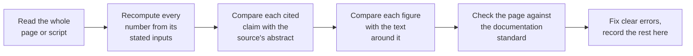

# Review record

This page records which parts of the project have been checked by someone
other than their author, what was checked, and what was found. A page,
script or figure that is not listed here as reviewed has not been reviewed.

The rule, from Tim on 14 November 2026: "Make sure that all assets are being
properly reviewed." Every page, figure script, data table and reference list
gets an independent check before or soon after it is merged. The reviewer is
given the material and its sources, not the author's conclusions.

## How a review is done

*Diagram: the six steps of a review, in order from left to right. The last
step either corrects an error in the same pull request or writes it into the
findings table below.*

The documentation standard is the one in the
[project plan](plan.md#documentation-standard): plain English, sources,
diagrams, tables, and links for every file that is mentioned.

## Review 1: everything merged before 14 November 2026

The first review covered the material that had been merged without an
independent check. It was done on 14 November 2026 against commit
[`74ece17`](https://github.com/mithro/ccd-superres/commit/74ece17) of the
main branch.

Two groups of material were left out because their own authors were still
working on them: [simulation level 1](level1.md) with its code and tests,
and the research studies under `docs/research/` (planned at the time).

### State of each asset

The columns say what was done for each asset. "All" means every instance was
checked. "Sample" means some were checked and the count is given. "No" means
the check was not done, and the reason is in
[what was not checked](#what-was-not-checked).

| Asset | Read in full | Numbers recomputed | Sources compared with abstracts | Figures compared with text | Findings | State |
|---|---|---|---|---|--:|---|
| [Project plan](plan.md) | Yes | Not applicable | Not applicable | Status chart | 1 | Reviewed, fixed |
| [Design](design.md) | Yes | All tables and worked examples | No | Sample: 2 of 14 | 6 | Reviewed, fixed |
| [Simulation chain](simulation-chain.md) | Yes | All | Not applicable | 1 of 1 | 1 | Reviewed, fixed |
| [Optical elements](optical-elements.md) | Yes | All tables and worked examples | Sample: 6 of about 70 | Sample: 3 of 20 | 3 | Reviewed, fixed |
| [Reconstruction methods](reconstruction-methods.md) | Body yes; reference list from entry M19 on not read | All in the body | Sample: 3 of about 110, the same papers | Sample: 1 of 18 | 3 | Reviewed in part, fixed |
| [Calibration and test methods](calibration-and-test.md) | Yes | All tables and worked examples | No | Sample: 2 of 15 | 2 | Reviewed, fixed |
| [Glossary](glossary.md) | Yes | Not applicable | Not applicable | Not applicable | 0 | Reviewed |
| [References](references.md) | Yes | Not applicable | No | Not applicable | 0 | Reviewed for form only |
| [Calculator page](calculator.md) | Yes | All: output of the calculator matches the page | Not applicable | Not applicable | 0 | Reviewed |
| [Explorer page](explorer.md) | Yes | By the parity test | Not applicable | Not applicable | 0 | Reviewed in part |
| [Diagrams page](diagrams.md) | Yes | Not applicable | Not applicable | Not applicable | 1 | Reviewed, fixed |
| [`ccdsr/resolution.py`](https://github.com/mithro/ccd-superres/blob/main/ccdsr/resolution.py) | Yes | Design tables 4.2, 4.6a, 4.6b and 4.8 reproduced from it | Not applicable | Not applicable | 0 | Reviewed |
| [`ccdsr/sampling.py`](https://github.com/mithro/ccd-superres/blob/main/ccdsr/sampling.py) | In part | Design table 5.4 and the coverage figures reproduced from it | Not applicable | Not applicable | 0 | Reviewed in part |
| [`explorer/`](https://github.com/mithro/ccd-superres/tree/main/explorer) | No | By the parity test against the Python model | Not applicable | Not applicable | 0 | Not reviewed line by line |
| Four figure scripts in [`docs/diagrams/`](https://github.com/mithro/ccd-superres/tree/main/docs/diagrams) | Two functions only | The two functions behind finding 1 | Not applicable | Not applicable | 1 | Not reviewed line by line |
| [`tests/`](https://github.com/mithro/ccd-superres/tree/main/tests) | No | All 41 tests pass | Not applicable | Not applicable | 0 | Run, not read |
| Rendered site on [Read the Docs](https://ccd-superres.readthedocs.io/en/latest/) | All 13 pages loaded | Not applicable | Not applicable | Not applicable | 0 | Reviewed |

On the rendered site every image loaded, every flow chart drew, no formula
was left as raw text and every link within a page found its target. The
local build of the site gave no warnings.

### Findings

Severity is "Error" where a stated number or mechanism was wrong,
"Inconsistent" where two pages disagreed, "Stale" where a status had been
overtaken, and "Gap" where something was missing. None of the findings
changes a conclusion of the design. Finding 1 changes a worked example and
is the one worth knowing about.

| No. | Where | Severity | What was found | What was done |
|--:|---|---|---|---|
| 1 | [Design 4.6](design.md#46-the-target-100-nm-features-on-silicon-chips), [optical elements 9.3](optical-elements.md), two figures | Error | The worked example for beam pairs used chip detail of 200 nm period beating against 213 nm stripes of light. At 405 nm in air, light cannot carry a 200 nm period away from the surface at any angle (the limit is 203 nm, and 225 nm with a 72° beam and ±58° collection), so that example cannot work. The simple picture that multiplies two brightnesses hides this. The page's own limit table already gave the right limits. | Example changed to 225 nm detail, which gives a beat of about 4 µm over 3.5 pixels. The wave explanation and its two conditions were added. Both figures were redrawn. |
| 2 | [Design 4.8](design.md#48-motion-blur-cause-model-and-reversal), table | Error | Coded exposure was said to pass about $1/\sqrt{N/2}$ of the contrast. The code and section 12 of the design give $1/\sqrt{N}$. | Corrected to $1/\sqrt{N}$. |
| 3 | Design, optical elements, reconstruction methods, calibration and test | Inconsistent | "Edge softness" of a pixel was a full width at half height on two pages and a standard deviation on the other two, without saying so. The same "100 nm" therefore gave 2.3% on one page and 0.04% on another. Each number was right for its own definition. | Each table now names its measure, gives the factor of 2.355 between them, and links to the other. The design's starting value is stated in both forms. |
| 4 | [Design 4.6](design.md#46-the-target-100-nm-features-on-silicon-chips), [calibration and test](calibration-and-test.md) summary | Inconsistent | The strip in which beam-pair stripes stay visible was "well under 0.1 mm" on one page and "about a sixth of a millimetre" on the other. The derivation gives 0.04 to 0.16 mm for a wavelength spread of 2 to 0.5 nm. | Both pages now give the range. The spread of the real diode is marked as an assumption until plan item R10. |
| 5 | Design, simulation chain, plan, [README](https://github.com/mithro/ccd-superres/blob/main/README.md) | Stale | Four places said the simulator was not written or that the site was not published. Level 1 exists and the site is live. | Statuses updated. |
| 6 | [Diagrams page](diagrams.md) | Gap | The page said all figures come from one script and did not list the twenty optical elements figures. | Section added, wording corrected. |
| 7 | [Reconstruction methods 2.1](reconstruction-methods.md), and the label of one bar in its ladder figure | Gap | "Resolved 225 nm lines with 1.12 µm pixels" cites a paper whose abstract confirms the line width, the light source and the threefold gain, but not the pixel size. | The pixel size is labelled Unverified in the text. The figure label is unchanged and still to be checked against the full paper. |
| 8 | [Reconstruction methods 7.2](reconstruction-methods.md) | Inconsistent | Its stages 0 to 5 are steps of the calculation and do not match the instrument stages 0 to 4 of the design, and nothing said so. | A note now maps one numbering onto the other. |
| 9 | All reviewed pages | Gap | Files were named as bare paths and not linked. Pages carried separate "In plain words" sections, which Tim has since asked to be folded into the main text ("Don't write 'In plain words' sections, just write the text in plain words from the beginning"). | Every bare path to an existing file is now a link ([pull request 27](https://github.com/mithro/ccd-superres/pull/27)). On the design, simulation chain, optical elements, reconstruction methods, calibration and test, and references pages the plain text now opens the page with no separate heading, and the 21 section leads on the optical elements page lost their label and are the first paragraph of their section. The plan page and level 1 are done by their own thread. |

### Smaller observations, not changed

| Where | Observation |
|---|---|
| [Design 5.1](design.md) | The note that the camera module ships with "IMX219 (or IMX355 from November 2026)" was read second-hand. It is already marked to be checked before buying hardware. |
| [Design 4.6](design.md) | "About 17,300 stripes" is 3.67 mm divided by 213 nm, which is 17,240. Fine as a round figure. |
| Design and calibration | The pixel passes 5.4% of a 200 nm stripe by the exact formula and 5.7% by the upper envelope. Both appear, each labelled. |
| Two figures | In `optics-hundred-nm` the legend lies over one curve, and in `recon-ladder` one label lies over the dashed target line. Both stay readable. |
| [Plan](plan.md) and [references](references.md) on the site | One table on each page is wider than the page and scrolls sideways. |

### What was not checked

| Not checked | Why | What it means |
|---|---|---|
| Most cited sources against the claims made from them | Done later the same day: see [review 2](#review-2-cited-sources-against-their-abstracts). | |
| Full texts of any paper | Only abstracts were available. | Figures taken from a paper's body, not its abstract, rest on the author's reading. |
| The reference list of reconstruction methods from entry M19 on | Time. | Entries may have errors of form. |
| The explorer's JavaScript, the figure scripts and the tests, line by line | Time. They were checked through their outputs: the parity test, the recomputed tables and the figures viewed. | A fault that does not show in those outputs would not have been found. |
| A sentence-by-sentence plain-English pass of the technical sections | Time. The openings and section leads are plain. Dense passages remain, and the [plan](plan.md#state-of-each-page) already lists design sections 3.2, 5.3 and 6.3 and the simulation chain tables as still to be gone through. | A non-expert will still find parts of the design and the reference tables hard going. |
| 59 of the 69 figures against their text | Time. All 69 load on the site; 10 were compared with their captions and numbers. | A figure could disagree with its text unnoticed. |

These are the first items for the next review.

### Derivations by this project that others should know rest on assumptions

| Claim | Where | Checked how | Rests on |
|---|---|---|---|
| Beam-pair stripes stay visible only in a strip 0.04 to 0.16 mm wide with an ordinary laser diode | [Calibration and test 3.3](calibration-and-test.md) | Formula and arithmetic rederived | A Gaussian spectrum 0.5 to 2 nm wide. Real diodes vary, and some run in a single colour at some currents. Plan item R10 measures it. |
| A pixel passes about 2% of the contrast of 200 nm stripes if its edges are soft over 100 nm (full width at half height) | [Design, table 4.6b](design.md#46-the-target-100-nm-features-on-silicon-chips) | Recomputed from the code | A Gaussian model of the pixel's edges. The real response of the sensor is unknown until hardware. |
| Lines of 110 to 145 nm are the limit at 405 nm in air | [Design 4.6](design.md#46-the-target-100-nm-features-on-silicon-chips), [optical elements 9.2](optical-elements.md) | Formula and arithmetic rederived | The collection angle of the bare pixel (±30° to ±58°), which is an assumption. |

## Review 2: cited sources against their abstracts

Review 1 compared only six cited papers with their abstracts. This review
did the rest on 14 November 2026, against commit
[`3111a7f`](https://github.com/mithro/ccd-superres/commit/3111a7f) of the
main branch. Level 1 and the research studies under `docs/research/` are
again left to their own threads.

For each paper with a DOI (the permanent identifier of a published paper),
the title, first author, year and abstract were fetched from the open index
[OpenAlex](https://openalex.org). Every sentence and table row on the page
that cites the paper was then read beside the abstract. A claim counts as
supported if the abstract states it or is plainly about the same thing. A
specific number counts as confirmed only if the abstract contains it.

### What was compared

| Page | Sources cited | Found in the index | Have an abstract and were compared | No abstract in the index | No DOI (books, reports, web pages) | Claims contradicted | Specific figures not in the abstract |
|---|--:|--:|--:|--:|--:|--:|--:|
| [Optical elements](optical-elements.md#14-references) | 67 | 65 | 51 | 14 | 2 | 1 | 1 |
| [Reconstruction methods](reconstruction-methods.md#11-references) | 129 | 124 | 104 | 20 | 5 | 0 | 1 |
| [Calibration and test](calibration-and-test.md#14-references) | 52 | 43 | 29 | 14 | 9 | 0 | 0 |
| [References](references.md) and [design, section 9](design.md#9-related-work) | 14 | 14 | 10 | 4 | 0 | 0 | 0 |
| All pages | 262 | 246 | 194 | 52 | 16 | 1 | 2 |

The same paper is often cited on more than one page under different keys,
so the 246 entries are 216 different papers, of which 177 have an abstract
in the index. All 216 identifiers resolve to a paper whose title, first
author and year match the entry, and none is marked as retracted.

### Findings

| No. | Where | Severity | What was found | What was done |
|--:|---|---|---|---|
| 10 | [Optical elements 9.4](optical-elements.md), sources O48 and O49 | Error | The page gave 13.5 nm as the wavelength of both extreme-ultraviolet instruments. The abstract of O48 says 29.5 nm; only O49 used 13.5 nm. The same sentence called these the wavelengths "chip factories themselves use", but all four sources are research instruments. | Sentence corrected. |
| 11 | [Optical elements 3](optical-elements.md), source O13 | Gap | "300 µm thick collimator made by X-ray lithography": the abstract confirms deep X-ray lithography and a thickness well under 1 mm, but not 300 µm. | Figure labelled Unverified. |
| 12 | [Reconstruction methods](reconstruction-methods.md), sources M94 and M95 | Gap | "100 nm features reconstructed at a wavelength of 532 nm" is cited to both. The abstract of M94 supports the method but gives neither number, and M95 has no abstract in the index. | Recorded here. To be checked against the full text of M95. |

Everything else that could be compared was supported. Specific figures that
were confirmed in an abstract include 225 nm lines, 250 nm at 700 nm,
308 nm lines and 240 mm² in 15 s, 0.78 µm, 660 nm, 80 nm lines at 193 nm,
±18° acceptance, particles of 70 to 200 nm, 20 nm defects, 20 µm sonar
micronavigation, image distortion reduced from 0.2 to under 0.08 pixels,
star positions to 0.02 pixels, and resolution better than a third of a
wavelength with elastic waves.

### Still not checked after review 2

| Not checked | Keys | Why |
|---|---|---|
| Sources with no abstract in the index | Optical elements: O1, O3, O15, O25, O42, O45, O49, O50, O52, O57, O58, O61, O65, O66. Reconstruction methods: M4, M10, M20, M35, M37, M38, M51, M53, M60, M62, M63, M72, M74, M75, M89, M95, M97, M103, M115, M125. Calibration and test: T13, T15, T16, T25, T26, T27, T29, T30, T31, T34, T38, T39, T40, T44. References: HarwitSloane, vanHeel2005, Maiden2009, Zheng2013. | Mostly Nature-family, Elsevier and book publishers, which do not release abstracts to the index. Each needs the publisher's page or the paper. |
| Figures that rest on those sources | 14.6 nm for X-ray imaging of a processor (M74, M75), 12.6 nm at 13.5 nm (M72), the regular-scan weakness of ptychography (O61, M103, T15) | Same reason. The pages already say the first two are from publishers' summaries. |
| Sources with no DOI | O35, O67, M18, M26, M76, M101, M121, T2, T42, T46 to T52 | Textbooks, reports and web pages. The pages already mark the web sources as read in summary. |
| Full texts | All | Only abstracts were read, so a claim taken from the body of a paper is supported only as far as the abstract goes. |

## Review 3: the multi-frame reconstruction study

The [multi-frame reconstruction study](research/multi-frame-reconstruction.md),
its script
[`make_multiframe_diagrams.py`](https://github.com/mithro/ccd-superres/blob/main/docs/diagrams/make_multiframe_diagrams.py)
and its figures were reviewed on 14 November 2026, before merging, in
[pull request 25](https://github.com/mithro/ccd-superres/pull/25). The
reviewer was given the commit and the texts of 27 of the cited papers, and
not the author's reasoning.

### What was checked

| Check | Coverage | Result |
|---|---|---|
| Page read in full | All | 19 findings, the main ones below |
| Claims compared with the full text of the source | About 60 claims from 25 papers | 5 wrong or overstated, the rest correct |
| DOIs resolved to the stated title, authors and venue | 50 of 50 with a DOI | All correct. One entry without a confirmed DOI (MF11) stays marked. |
| Derived numbers compared with the script's output | Every derived table | All matched. Two assumptions and one rounding bug found in the script. |
| Figures opened and compared with captions | 9 of 9 | 5 with defects |
| Links and anchors | All 147 | All resolve |
| Documentation standard | All parts | Plain wording and links met. Seven data tables mixed words and numbers. |

### Main findings and what was done

| Finding | Where | What was done |
|---|---|---|
| "A thousandth of a pixel has been reached" rested on Gaia's photon-noise floor. The scatter Gaia actually finds is about five times larger, and its authors blame calibration. | Section 5.1, opening | Both figures are now given, and the conclusion is reversed: knowledge of the pixel response is the limit |
| "A hundredth of a pixel is routine" was not what the table showed. Routine is a fiftieth. | Section 5.1, opening | Restated: the requirement is at the edge of published practice |
| The best-case shift error assumed 5000 electrons per pixel, above the 4500 electron full well of the design | Table 5.2, figure 9 | Recomputed at half full well. Faint scenes now need about 150 rows per estimate, not 100. |
| "The pixel is not what stops the instrument" held only for patterns along a pixel axis | Section 3.3 | Diagonal case added to table 3.5, and the statement limited |
| Published systems stop at 2 to 3 times finer mainly because of their optics, not their frame count | Opening, table 3.2 | Reworded |
| A rounding bug put one point of figure 5 at the wrong frame count, and too few trials made the worst-case figures noisy | Script, table 3.4 | Fixed, 5000 trials, checked against the exact answer for the simplest case |
| One figure was drawn differently on every run | Script | Fixed |
| Data tables held words in number columns | Tables 2.1, 3.2, 3.4, 3.5, 4.1, 5.1, 6.1 | Split into data tables and text tables |

### Not checked

- Sources marked "abstract" or "existence only" on the page were not read
  further. Section 9 of the page lists them.
- Full texts of the sources that section 5.3 of the page marks "existence
  only" or "unverified" were not read.

### Second pass: section 5.3 and the fixes

Section 5.3 of the page, on recovery without measured positions, was
written after the first pass. A second reviewer checked it, its toy
calculation, the five redrawn figures and the changed tables on the same
day, before merging.

| Check | Coverage | Result |
|---|---|---|
| Toy calculation re-implemented independently | All of table 5.3 | Every number reproduced. The count of 322 patterns that obey the layout rule was confirmed by a separate method. |
| Changed tables recomputed | Samples from tables 3.4, 3.5, 5.1 and 5.2 | All correct |
| Claims of section 5.3 compared with sources | All with a text or abstract available | 13 findings, the main ones below |
| Reference entries MF60 to MF73 against Crossref | 13 of 14 | All correct. MF59 has no DOI and stays marked unverified. |

| Finding | What was done |
|---|---|
| The page said Gaia's smooth pointing model rules out jerks. The source says the spacecraft does make sudden small jumps, and the smooth model works only after they are measured and subtracted. | Row rewritten, and the same caution added to the point about the stage |
| The "steady speed" case of the toy is exactly steady and in whole cells, so its near-perfect result is a best case | Assumptions stated beside the calculation and in the caption, and the conclusion limited |
| "Struck off" was not what the script does, and the true pattern fell below the cut in 1 of 20 trials at 20 frames | Wording corrected, the case reported on the page, and the script now prints such cases |
| Several rows stated things from titles or memory without saying so | Marked unverified |
| One table row mixed two different methods | Split into two rows |

## Review 4: the beamforming and array processing study

The [beamforming and array processing](research/beamforming.md) study was
reviewed on 14 November 2026, before it was merged, in
[pull request 24](https://github.com/mithro/ccd-superres/pull/24). There
were two rounds, by two different reviewers. The second covered section 8,
which was written after the first round, and checked the corrections made
after the first. Each reviewer was given the page, its figure script
[`make_beamforming_diagrams.py`](https://github.com/mithro/ccd-superres/blob/main/docs/diagrams/make_beamforming_diagrams.py)
and the sources, and not the author's conclusions.

### What was checked

| Asset | Read in full | Numbers recomputed | Sources compared with abstracts | Figures compared with text | Findings | State |
|---|---|---|---|---|--:|---|
| [Study page](research/beamforming.md), sections 1 to 7 and 9 to 13 | Yes | All tables, by running the script and by independent arithmetic | All 28 then marked as checked by abstract, and 6 more | 5 of 5 | 27 | Reviewed, fixed |
| [Figure script](https://github.com/mithro/ccd-superres/blob/main/docs/diagrams/make_beamforming_diagrams.py) | Yes | Run, and the scan patterns of the gain calculation varied | Not applicable | Not applicable | Counted above | Reviewed, fixed |
| [Study page](research/beamforming.md), section 8, and every table and caption changed after the first round | Yes | All, by running the script. Table 8.3 by listing every layout, and tables 2.3, 3.2 and 5.4 and the figures of section 7 by independent arithmetic | 3 of 3 new ones marked as checked by abstract. The 13 other new sources for title, authors, journal and year only | 6 of 6 | 16 | Reviewed, fixed |
| Rows added to the [plan](plan.md), [index](index.md), [diagrams page](diagrams.md) and [glossary](glossary.md) | Yes | Not applicable | Not applicable | Not applicable | Counted above | Reviewed, fixed |

### Findings that changed what the page says

| No. | Where | Severity | What was found | What was done |
|--:|---|---|---|---|
| B2-1 | [Section 6.4](research/beamforming.md#64-a-toy-calculation-and-a-trap), summary, plan | Error | The page said one sideways shift is not enough to remove streaks and that shifts "with no common factor" are needed. That came from testing only a shift of 5 pixels. A shift of d pixels leaves patterns that repeat every d columns, so a shift of 1 pixel leaves only the overall scale. | Table and text redone with five scan patterns. The advice is now a small shift together with larger ones, with the larger ones marked as an estimate. |
| B2-2 | Section 6.4 and question 2 | Error | "Frames that overlap in time" was offered as a cure for the three numbers left unfixed when frame brightness is unknown. It is not one. | Removed. Only a light monitor or a brightness model with fewer numbers than frames fixes them. |
| B2-3 | [Section 2.2](research/beamforming.md#22-spacing-false-copies-and-the-blur-of-one-pixel), figure | Error | The figure shows six equal peaks at the steering angle drawn. The caption and text said five. The angle scale along the top was misplaced. | Caption, text and table corrected, and the scale fixed. |
| B2-4 | [Section 5.4](research/beamforming.md#54-undoing-the-arrays-blur-by-fitting), table | Error | The crowding law was applied to a single isolated feature, which it does not cover, and its condition on noise was left out. | Column removed, condition added to the table. |
| B2-5 | [Section 2.3](research/beamforming.md#23-counting-what-is-wanted-against-what-is-recorded) | Error | The count of 122 numbers per pixel area used a square where light can only carry a disc, and was stated per lighting condition when it is a total. | Now 96, or 192 with height, as a total. |
| B2-6 | [Section 3.2](research/beamforming.md#32-a-reference-beam-lifts-weak-light-above-the-sensors-own-noise), table | Error | The reference beam was assumed to fill the pixel, leaving no room for the fringes, and the figures were for the best position along a fringe only. | Reference at half the pixel's capacity, and a column for the average position added. |
| B2-7 | [Section 7.1](research/beamforming.md#71-near-field-acoustic-holography) | Gap | Under slanted light only one of the two directions into which lines send their detail fades slowly, and it needs the opposite beam as its reference. | Both stated. |
| B2-8 | Sources | Gap | Several statements cited to sources checked only for existence carried no "Unverified" label. One source marked as checked by abstract (BF36) was not supported by its abstract. Four abstract-checked statements went further than the abstract. | A blanket rule added under "How claims are marked", six sources promoted to checked by abstract, BF36 demoted, the four statements reworded. |
| B2-9 | Whole page | Gap | Ten paragraphs opened with the label "In words:", which Tim has asked not to use. | Labels removed and the text folded in. |

| B2-10 | [Section 8.2](research/beamforming.md#82-a-toy-calculation) | Gap | "Contrast" was not defined (it is the typical variation of the scene, about 0.4 of the step between its two levels). Errors above 100 per cent, which are worse than a blank picture, were compared as if they meant something. The text did not say that two methods are told the size of the noise and one is told the stage's average step. | All three stated. Comparisons limited to the noise levels where they mean something. |
| B2-11 | [Section 8.3](research/beamforming.md#83-eliminating-layouts-a-chip-cannot-have) | Gap | A source on signals of constant strength was cited for a rule about signals with few values, and "the same saving" claimed more than the sources show. | Reworded and marked Unverified. |

The second round found no wrong number. The other findings were smaller: wording of captions, a panel label, a
column split in two, a flow chart drawn in the wrong order, and bare
mentions of the script that were not links. All were fixed.

### What was not checked

| Not checked | Why | What it means |
|---|---|---|
| Full texts of any paper | Only abstracts were available. | A statement that goes beyond an abstract rests on the author's general knowledge and is Unverified. |
| The sources marked "existence checked only" against their abstracts, apart from the six promoted | Time. | The page treats everything said about them as Unverified. |
| The 13 new sources of section 8 marked "existence checked only" against their abstracts | Only their titles, authors, journals and years were checked. | The page treats everything said about them as Unverified. |
| The last method of [section 8.2](research/beamforming.md#82-a-toy-calculation) when the stage's average step is not given | Not calculated. | Its advantage is shown only for a known average step. |
| The derivation of [section 4](research/beamforming.md#4-beam-directions-as-a-sparse-array) against a wave calculation | It needs simulation levels 3 and 4. | The beam-layout result is an estimate until then. |

## Review 5: simulation level 1 and reconstruction by elimination

[Simulation level 1](level1.md) and
[reconstruction by elimination](constrained-reconstruction.md) were each
reviewed on 14 November 2026 by a reviewer who was given the code, tests,
figure scripts and pages, and not the author's conclusions. Each reviewer
also changed the code on purpose in small ways ("mutants") to see whether
the tests would notice.

| Asset | Reviewed in | When |
|---|---|---|
| [`ccdsr/level1.py`](https://github.com/mithro/ccd-superres/blob/main/ccdsr/level1.py), [`ccdsr/level1_2d.py`](https://github.com/mithro/ccd-superres/blob/main/ccdsr/level1_2d.py), their tests and the [level 1 page](level1.md) | [Pull request 30](https://github.com/mithro/ccd-superres/pull/30) | After pull requests 22 and 23 had merged, before position estimation merged |
| [`ccdsr/constrained.py`](https://github.com/mithro/ccd-superres/blob/main/ccdsr/constrained.py), [`tests/test_constrained.py`](https://github.com/mithro/ccd-superres/blob/main/tests/test_constrained.py), [`make_constrained_diagrams.py`](https://github.com/mithro/ccd-superres/blob/main/docs/diagrams/make_constrained_diagrams.py) and the [elimination page](constrained-reconstruction.md) | The pull request that added them | Before merging |

*Table: what review 5 covered.*

### Findings on level 1 and what was done

| No. | Severity | What was found | What was done |
|--:|---|---|---|
| 1 | Error | The table of speed errors scored positions without removing the common shift that no method can know, so the errors shown were an artefact. | Scoring now aligns positions first. |
| 2 | Error | The formula for noise on measured contrast left out the error on the mean. | Factor added, and checked against 400 simulated runs. |
| 3 | Gap | 12 of 13 deliberate code changes went unnoticed by the tests. | Independent tests added. All 13 are now caught. |
| 4 | Source | A ptychography paper was cited for a claim it does not make. | Citation removed and the claim marked Unverified. |
| 5 | Wording | Several results were stated more strongly than the runs supported; the blur check compared the code with itself. | Reworded. |

### Findings on reconstruction by elimination and what was done

| No. | Severity | What was found | What was done |
|--:|---|---|---|
| 1 | Error | The gain credited to reflectance limits came from using lighter smoothing than the plain fit it was compared with. | All methods are compared at the same smoothing. Limits of 0 and 1 alone give no gain; two known materials do. |
| 2 | Error | The misfit favoured bright candidates, and the threshold was said to be "set by trial". | Term added to the misfit; threshold now follows from the number of candidates and the accepted chance of rejecting the truth. |
| 3 | Error | Elimination always returned an answer, even with wrong assumptions, and the test scans gave away the overall position. | An absolute test near the region can answer "nothing fits"; the overall position is unknown in the experiments and is searched. |
| 4 | Gap | Tables rested on 5 to 8 random scans, which flattered the smooth-path rule. | 24 to 40 scans, with solved counts as well as medians. |
| 5 | Gap | The smooth-path rule was shown only for motion that suits it. | Sweeps over stiffness and kind of motion added; the page says it fails for frame-to-frame shake. |
| 6 | Gap | Several deliberate code changes survived the tests; some quoted numbers were typed by hand; figures changed from run to run. | Tests added; the script prints every number on the page; figure files are now the same on every run. |

### Second review of the reworked elimination approach

A second reviewer, again given the code and pages and not the author's
conclusions, checked the rework. It confirmed the statistics, found no
information about the truth leaking into the method, and reproduced tables
3 to 6, 9 and 10 and one row of table 8 of the page.

| No. | Severity | What was found | What was done |
|--:|---|---|---|
| 1 | Error | Table 10 compared a plain fit at usual smoothing and wrong positions with the constrained fit at light smoothing and found positions, so it mixed three gains. | Column added for a plain fit with the same smoothing and positions: 0.32 against 0.57. |
| 2 | Error | The position read out for the surviving layout could be wrong by a whole cell, because the same surface has two labels. | Replaced by a readout of the place on the surface (`surviving_edges_nm`), with a test. |
| 3 | Gap | "Placed within 20 nm" and the medians of table 10 were not printed by the script. | Both are now printed. |
| 4 | Gap | Two deliberate code changes survived the tests (the fit threshold and the window of readings used). | Three tests added. |
| 5 | Gap | The method is told the brightness of the light and the noise sizes, which the page did not say. | Said, and tested: brightness wrong by 2 % gives "nothing fits". |
| 6 | Gap | The path stiffness was chosen on the same scans the result was reported on. | The combined test was repeated on 24 fresh scans, with the same counts. |
| 7 | Wording | Medians quoted without saying they cover solved scans only; a guarantee stated without its conditions; the region tested stands alone. | Reworded, and added to the table of limits. |

### Not checked

Level 1 in two dimensions has no position estimation yet, so none was
reviewed. The second reviewer did not rerun table 7, the other rows of
table 8, or the full test suite. The fixes made after the second review
were checked by the tests and by rerunning the experiments.

## Review 6: the research studies folded into the design

[Design, section 4.10](design.md#410-what-the-four-research-studies-changed)
and the smaller edits that go with it were reviewed on 14 November 2026,
before merging. The reviewer was given the change and the four study pages,
and checked every table row and edited sentence against the study section
it cites.

| No. | Severity | What was found | What was done |
|--:|---|---|---|
| 1 | Error | The gap range of section 5.2 (20 nm to 0.5 mm) contradicted the new minimum gap of 0.6 mm. | Range widened to 2 mm, and the minimum is stated as applying to steep laser beams only. |
| 2 | Error | The cure for streaks in pixel gains was given as one pass shifted by a pixel. The study showed that only on a toy sensor of 12 columns and advises shifts at several scales. | Row, section 6.4 and the wording corrected. |
| 3 | Error | "Every reading falls on one of 4 places inside a pixel" left out that this is along the scan only and matters when 8 fine samples are wanted. The 0.2 pixel jitter was worked out for a different step. | Reworded; the size of the variation is left to the simulator. |
| 4 | Gap | Six rows dropped a condition the study attaches (beam spread, laser purity, beam count, lighting states, read-noise price, the gain from weighing candidates). | Conditions added to each row. |
| 5 | Gap | Fourteen recommended settings and components were missing from Table 4.10c. | Added. |
| 6 | Wording | Table captions claimed a single status for values of mixed status; two links pointed at the wrong section. | Captions and links corrected. |

*Table: findings of review 6. Not checked: the studies' own derivations,
scripts and references.*
