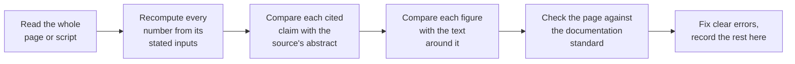

# Review record

This page records which parts of the project have been checked by someone
other than their author, what was checked, and what was found. A page,
script or figure that is not listed here as reviewed has not been reviewed.

The rule ([REQ-21](design.md#requirements)): all assets are properly reviewed. Every page, figure script, data table and reference list
gets an independent check before or soon after it is merged. The reviewer is
given the material and its sources, not the author's conclusions.

## How a review is done

*Diagram: the six steps of a review, in order from left to right. The last
step either corrects an error in the same pull request or writes it into the
findings table below.*

The documentation standard is the one in the
[project plan](plan.md#documentation-standard): plain English, sources,
diagrams, tables, and links for every file that is mentioned.

## Review 1: everything merged before 14 November 2026

The first review covered the material that had been merged without an
independent check. It was done on 14 November 2026 against commit
[`74ece17`](https://github.com/mithro/ccd-superres/commit/74ece17) of the
main branch.

Two groups of material were left out because their own authors were still
working on them: [simulation level 1](level1.md) with its code and tests,
and the research studies under `docs/research/` (planned at the time).

### State of each asset

The columns say what was done for each asset. "All" means every instance was
checked. "Sample" means some were checked and the count is given. "No" means
the check was not done, and the reason is in
[what was not checked](#what-was-not-checked).

| Asset | Read in full | Numbers recomputed | Sources compared with abstracts | Figures compared with text | Findings | State |
|---|---|---|---|---|--:|---|
| [Project plan](plan.md) | Yes | Not applicable | Not applicable | Status chart | 1 | Reviewed, fixed |
| [Design](design.md) | Yes | All tables and worked examples | No | Sample: 2 of 14 | 6 | Reviewed, fixed |
| [Simulation chain](simulation-chain.md) | Yes | All | Not applicable | 1 of 1 | 1 | Reviewed, fixed |
| [Optical elements](optical-elements.md) | Yes | All tables and worked examples | Sample: 6 of about 70 | Sample: 3 of 20 | 3 | Reviewed, fixed |
| [Reconstruction methods](reconstruction-methods.md) | Body yes; reference list from entry M19 on not read | All in the body | Sample: 3 of about 110, the same papers | Sample: 1 of 18 | 3 | Reviewed in part, fixed |
| [Calibration and test methods](calibration-and-test.md) | Yes | All tables and worked examples | No | Sample: 2 of 15 | 2 | Reviewed, fixed |
| [Glossary](glossary.md) | Yes | Not applicable | Not applicable | Not applicable | 0 | Reviewed |
| [References](references.md) | Yes | Not applicable | No | Not applicable | 0 | Reviewed for form only |
| [Calculator page](calculator.md) | Yes | All: output of the calculator matches the page | Not applicable | Not applicable | 0 | Reviewed |
| [Explorer page](explorer.md) | Yes | By the parity test | Not applicable | Not applicable | 0 | Reviewed in part |
| [Diagrams page](diagrams.md) | Yes | Not applicable | Not applicable | Not applicable | 1 | Reviewed, fixed |
| [`ccdsr/resolution.py`](https://github.com/mithro/ccd-superres/blob/main/ccdsr/resolution.py) | Yes | Design tables 4.2, 4.6a, 4.6b and 4.8 reproduced from it | Not applicable | Not applicable | 0 | Reviewed |
| [`ccdsr/sampling.py`](https://github.com/mithro/ccd-superres/blob/main/ccdsr/sampling.py) | In part | Design table 5.4 and the coverage figures reproduced from it | Not applicable | Not applicable | 0 | Reviewed in part |
| [`explorer/`](https://github.com/mithro/ccd-superres/tree/main/explorer) | No | By the parity test against the Python model | Not applicable | Not applicable | 0 | Not reviewed line by line |
| Four figure scripts in [`docs/diagrams/`](https://github.com/mithro/ccd-superres/tree/main/docs/diagrams) | Two functions only | The two functions behind finding 1 | Not applicable | Not applicable | 1 | Not reviewed line by line |
| [`tests/`](https://github.com/mithro/ccd-superres/tree/main/tests) | No | All 41 tests pass | Not applicable | Not applicable | 0 | Run, not read |
| Rendered site on [Read the Docs](https://ccd-superres.readthedocs.io/en/latest/) | All 13 pages loaded | Not applicable | Not applicable | Not applicable | 0 | Reviewed |

On the rendered site every image loaded, every flow chart drew, no formula
was left as raw text and every link within a page found its target. The
local build of the site gave no warnings.

### Findings

Severity is "Error" where a stated number or mechanism was wrong,
"Inconsistent" where two pages disagreed, "Stale" where a status had been
overtaken, and "Gap" where something was missing. None of the findings
changes a conclusion of the design. Finding 1 changes a worked example and
is the one worth knowing about.

| No. | Where | Severity | What was found | What was done |
|--:|---|---|---|---|
| 1 | [Design 4.6](design.md#46-the-target-100-nm-features-on-silicon-chips), [optical elements 9.3](optical-elements.md), two figures | Error | The worked example for beam pairs used chip detail of 200 nm period beating against 213 nm stripes of light. At 405 nm in air, light cannot carry a 200 nm period away from the surface at any angle (the limit is 203 nm, and 225 nm with a 72° beam and ±58° collection), so that example cannot work. The simple picture that multiplies two brightnesses hides this. The page's own limit table already gave the right limits. | Example changed to 225 nm detail, which gives a beat of about 4 µm over 3.5 pixels. The wave explanation and its two conditions were added. Both figures were redrawn. |
| 2 | [Design 4.8](design.md#48-motion-blur-cause-model-and-reversal), table | Error | Coded exposure was said to pass about $1/\sqrt{N/2}$ of the contrast. The code and section 12 of the design give $1/\sqrt{N}$. | Corrected to $1/\sqrt{N}$. |
| 3 | Design, optical elements, reconstruction methods, calibration and test | Inconsistent | "Edge softness" of a pixel was a full width at half height on two pages and a standard deviation on the other two, without saying so. The same "100 nm" therefore gave 2.3% on one page and 0.04% on another. Each number was right for its own definition. | Each table now names its measure, gives the factor of 2.355 between them, and links to the other. The design's starting value is stated in both forms. |
| 4 | [Design 4.6](design.md#46-the-target-100-nm-features-on-silicon-chips), [calibration and test](calibration-and-test.md) summary | Inconsistent | The strip in which beam-pair stripes stay visible was "well under 0.1 mm" on one page and "about a sixth of a millimetre" on the other. The derivation gives 0.04 to 0.16 mm for a wavelength spread of 2 to 0.5 nm. | Both pages now give the range. The spread of the real diode is marked as an assumption until plan item R10. |
| 5 | Design, simulation chain, plan, [README](https://github.com/mithro/ccd-superres/blob/main/README.md) | Stale | Four places said the simulator was not written or that the site was not published. Level 1 exists and the site is live. | Statuses updated. |
| 6 | [Diagrams page](diagrams.md) | Gap | The page said all figures come from one script and did not list the twenty optical elements figures. | Section added, wording corrected. |
| 7 | [Reconstruction methods 2.1](reconstruction-methods.md), and the label of one bar in its ladder figure | Gap | "Resolved 225 nm lines with 1.12 µm pixels" cites a paper whose abstract confirms the line width, the light source and the threefold gain, but not the pixel size. | The pixel size is labelled Unverified in the text. The figure label is unchanged and still to be checked against the full paper. |
| 8 | [Reconstruction methods 7.2](reconstruction-methods.md) | Inconsistent | Its stages 0 to 5 are steps of the calculation and do not match the instrument stages 0 to 4 of the design, and nothing said so. | A note now maps one numbering onto the other. |
| 9 | All reviewed pages | Gap | Files were named as bare paths and not linked. Pages carried separate "In plain words" sections, which the documentation standard has since folded into the main text. | Every bare path to an existing file is now a link ([pull request 27](https://github.com/mithro/ccd-superres/pull/27)). On the design, simulation chain, optical elements, reconstruction methods, calibration and test, and references pages the plain text now opens the page with no separate heading, and the 21 section leads on the optical elements page lost their label and are the first paragraph of their section. The plan page and level 1 are done by their own thread. |

### Smaller observations, not changed

| Where | Observation |
|---|---|
| [Design 5.1](design.md) | The note that the camera module ships with "IMX219 (or IMX355 from November 2026)" was read second-hand. It is already marked to be checked before buying hardware. |
| [Design 4.6](design.md) | "About 17,300 stripes" is 3.67 mm divided by 213 nm, which is 17,240. Fine as a round figure. |
| Design and calibration | The pixel passes 5.4% of a 200 nm stripe by the exact formula and 5.7% by the upper envelope. Both appear, each labelled. |
| Two figures | In `optics-hundred-nm` the legend lies over one curve, and in `recon-ladder` one label lies over the dashed target line. Both stay readable. |
| [Plan](plan.md) and [references](references.md) on the site | One table on each page is wider than the page and scrolls sideways. |

### What was not checked

| Not checked | Why | What it means |
|---|---|---|
| Most cited sources against the claims made from them | Done later the same day: see [review 2](#review-2-cited-sources-against-their-abstracts). | |
| Full texts of any paper | Only abstracts were available. | Figures taken from a paper's body, not its abstract, rest on the author's reading. |
| The reference list of reconstruction methods from entry M19 on | Time. | Entries may have errors of form. |
| The explorer's JavaScript, the figure scripts and the tests, line by line | Time. They were checked through their outputs: the parity test, the recomputed tables and the figures viewed. | A fault that does not show in those outputs would not have been found. |
| A sentence-by-sentence plain-English pass of the technical sections | Time. The openings and section leads are plain. Dense passages remain, and the [plan](plan.md#state-of-each-page) already lists design sections 3.2, 5.3 and 6.3 and the simulation chain tables as still to be gone through. | A non-expert will still find parts of the design and the reference tables hard going. |
| 59 of the 69 figures against their text | Time. All 69 load on the site; 10 were compared with their captions and numbers. | A figure could disagree with its text unnoticed. |

These are the first items for the next review.

### Derivations by this project that others should know rest on assumptions

| Claim | Where | Checked how | Rests on |
|---|---|---|---|
| Beam-pair stripes stay visible only in a strip 0.04 to 0.16 mm wide with an ordinary laser diode | [Calibration and test 3.3](calibration-and-test.md) | Formula and arithmetic rederived | A Gaussian spectrum 0.5 to 2 nm wide. Real diodes vary, and some run in a single colour at some currents. Plan item R10 measures it. |
| A pixel passes about 2% of the contrast of 200 nm stripes if its edges are soft over 100 nm (full width at half height) | [Design, table 4.6b](design.md#46-the-target-100-nm-features-on-silicon-chips) | Recomputed from the code | A Gaussian model of the pixel's edges. The real response of the sensor is unknown until hardware. |
| Lines of 110 to 145 nm are the limit at 405 nm in air | [Design 4.6](design.md#46-the-target-100-nm-features-on-silicon-chips), [optical elements 9.2](optical-elements.md) | Formula and arithmetic rederived | The collection angle of the bare pixel (±30° to ±58°), which is an assumption. |

## Review 2: cited sources against their abstracts

Review 1 compared only six cited papers with their abstracts. This review
did the rest on 14 November 2026, against commit
[`3111a7f`](https://github.com/mithro/ccd-superres/commit/3111a7f) of the
main branch. Level 1 and the research studies under `docs/research/` are
again left to their own threads.

For each paper with a DOI (the permanent identifier of a published paper),
the title, first author, year and abstract were fetched from the open index
[OpenAlex](https://openalex.org). Every sentence and table row on the page
that cites the paper was then read beside the abstract. A claim counts as
supported if the abstract states it or is plainly about the same thing. A
specific number counts as confirmed only if the abstract contains it.

### What was compared

| Page | Sources cited | Found in the index | Have an abstract and were compared | No abstract in the index | No DOI (books, reports, web pages) | Claims contradicted | Specific figures not in the abstract |
|---|--:|--:|--:|--:|--:|--:|--:|
| [Optical elements](optical-elements.md#14-references) | 67 | 65 | 51 | 14 | 2 | 1 | 1 |
| [Reconstruction methods](reconstruction-methods.md#11-references) | 129 | 124 | 104 | 20 | 5 | 0 | 1 |
| [Calibration and test](calibration-and-test.md#14-references) | 52 | 43 | 29 | 14 | 9 | 0 | 0 |
| [References](references.md) and [design, section 9](design.md#9-related-work) | 14 | 14 | 10 | 4 | 0 | 0 | 0 |
| All pages | 262 | 246 | 194 | 52 | 16 | 1 | 2 |

The same paper is often cited on more than one page under different keys,
so the 246 entries are 216 different papers, of which 177 have an abstract
in the index. All 216 identifiers resolve to a paper whose title, first
author and year match the entry, and none is marked as retracted.

### Findings

| No. | Where | Severity | What was found | What was done |
|--:|---|---|---|---|
| 10 | [Optical elements 9.4](optical-elements.md), sources O48 and O49 | Error | The page gave 13.5 nm as the wavelength of both extreme-ultraviolet instruments. The abstract of O48 says 29.5 nm; only O49 used 13.5 nm. The same sentence called these the wavelengths "chip factories themselves use", but all four sources are research instruments. | Sentence corrected. |
| 11 | [Optical elements 3](optical-elements.md), source O13 | Gap | "300 µm thick collimator made by X-ray lithography": the abstract confirms deep X-ray lithography and a thickness well under 1 mm, but not 300 µm. | Figure labelled Unverified. |
| 12 | [Reconstruction methods](reconstruction-methods.md), sources M94 and M95 | Gap | "100 nm features reconstructed at a wavelength of 532 nm" is cited to both. The abstract of M94 supports the method but gives neither number, and M95 has no abstract in the index. | Recorded here. To be checked against the full text of M95. |

Everything else that could be compared was supported. Specific figures that
were confirmed in an abstract include 225 nm lines, 250 nm at 700 nm,
308 nm lines and 240 mm² in 15 s, 0.78 µm, 660 nm, 80 nm lines at 193 nm,
±18° acceptance, particles of 70 to 200 nm, 20 nm defects, 20 µm sonar
micronavigation, image distortion reduced from 0.2 to under 0.08 pixels,
star positions to 0.02 pixels, and resolution better than a third of a
wavelength with elastic waves.

### Still not checked after review 2

| Not checked | Keys | Why |
|---|---|---|
| Sources with no abstract in the index | Optical elements: O1, O3, O15, O25, O42, O45, O49, O50, O52, O57, O58, O61, O65, O66. Reconstruction methods: M4, M10, M20, M35, M37, M38, M51, M53, M60, M62, M63, M72, M74, M75, M89, M95, M97, M103, M115, M125. Calibration and test: T13, T15, T16, T25, T26, T27, T29, T30, T31, T34, T38, T39, T40, T44. References: HarwitSloane, vanHeel2005, Maiden2009, Zheng2013. | Mostly Nature-family, Elsevier and book publishers, which do not release abstracts to the index. Each needs the publisher's page or the paper. |
| Figures that rest on those sources | 14.6 nm for X-ray imaging of a processor (M74, M75), 12.6 nm at 13.5 nm (M72), the regular-scan weakness of ptychography (O61, M103, T15) | Same reason. The pages already say the first two are from publishers' summaries. |
| Sources with no DOI | O35, O67, M18, M26, M76, M101, M121, T2, T42, T46 to T52 | Textbooks, reports and web pages. The pages already mark the web sources as read in summary. |
| Full texts | All | Only abstracts were read, so a claim taken from the body of a paper is supported only as far as the abstract goes. |

## Review 3: the multi-frame reconstruction study

The [multi-frame reconstruction study](research/multi-frame-reconstruction.md),
its script
[`make_multiframe_diagrams.py`](https://github.com/mithro/ccd-superres/blob/main/docs/diagrams/make_multiframe_diagrams.py)
and its figures were reviewed on 14 November 2026, before merging, in
[pull request 25](https://github.com/mithro/ccd-superres/pull/25). The
reviewer was given the commit and the texts of 27 of the cited papers, and
not the author's reasoning.

### What was checked

| Check | Coverage | Result |
|---|---|---|
| Page read in full | All | 19 findings, the main ones below |
| Claims compared with the full text of the source | About 60 claims from 25 papers | 5 wrong or overstated, the rest correct |
| DOIs resolved to the stated title, authors and venue | 50 of 50 with a DOI | All correct. One entry without a confirmed DOI (MF11) stays marked. |
| Derived numbers compared with the script's output | Every derived table | All matched. Two assumptions and one rounding bug found in the script. |
| Figures opened and compared with captions | 9 of 9 | 5 with defects |
| Links and anchors | All 147 | All resolve |
| Documentation standard | All parts | Plain wording and links met. Seven data tables mixed words and numbers. |

### Main findings and what was done

| Finding | Where | What was done |
|---|---|---|
| "A thousandth of a pixel has been reached" rested on Gaia's photon-noise floor. The scatter Gaia actually finds is about five times larger, and its authors blame calibration. | Section 5.1, opening | Both figures are now given, and the conclusion is reversed: knowledge of the pixel response is the limit |
| "A hundredth of a pixel is routine" was not what the table showed. Routine is a fiftieth. | Section 5.1, opening | Restated: the requirement is at the edge of published practice |
| The best-case shift error assumed 5000 electrons per pixel, above the 4500 electron full well of the design | Table 5.2, figure 9 | Recomputed at half full well. Faint scenes now need about 150 rows per estimate, not 100. |
| "The pixel is not what stops the instrument" held only for patterns along a pixel axis | Section 3.3 | Diagonal case added to table 3.5, and the statement limited |
| Published systems stop at 2 to 3 times finer mainly because of their optics, not their frame count | Opening, table 3.2 | Reworded |
| A rounding bug put one point of figure 5 at the wrong frame count, and too few trials made the worst-case figures noisy | Script, table 3.4 | Fixed, 5000 trials, checked against the exact answer for the simplest case |
| One figure was drawn differently on every run | Script | Fixed |
| Data tables held words in number columns | Tables 2.1, 3.2, 3.4, 3.5, 4.1, 5.1, 6.1 | Split into data tables and text tables |

### Not checked

- Sources marked "abstract" or "existence only" on the page were not read
  further. Section 9 of the page lists them.
- Full texts of the sources that section 5.3 of the page marks "existence
  only" or "unverified" were not read.

### Second pass: section 5.3 and the fixes

Section 5.3 of the page, on recovery without measured positions, was
written after the first pass. A second reviewer checked it, its toy
calculation, the five redrawn figures and the changed tables on the same
day, before merging.

| Check | Coverage | Result |
|---|---|---|
| Toy calculation re-implemented independently | All of table 5.3 | Every number reproduced. The count of 322 patterns that obey the layout rule was confirmed by a separate method. |
| Changed tables recomputed | Samples from tables 3.4, 3.5, 5.1 and 5.2 | All correct |
| Claims of section 5.3 compared with sources | All with a text or abstract available | 13 findings, the main ones below |
| Reference entries MF60 to MF73 against Crossref | 13 of 14 | All correct. MF59 has no DOI and stays marked unverified. |

| Finding | What was done |
|---|---|
| The page said Gaia's smooth pointing model rules out jerks. The source says the spacecraft does make sudden small jumps, and the smooth model works only after they are measured and subtracted. | Row rewritten, and the same caution added to the point about the stage |
| The "steady speed" case of the toy is exactly steady and in whole cells, so its near-perfect result is a best case | Assumptions stated beside the calculation and in the caption, and the conclusion limited |
| "Struck off" was not what the script does, and the true pattern fell below the cut in 1 of 20 trials at 20 frames | Wording corrected, the case reported on the page, and the script now prints such cases |
| Several rows stated things from titles or memory without saying so | Marked unverified |
| One table row mixed two different methods | Split into two rows |

### Third pass: original units and scaled units

On 14 November 2026 the page gained a section that gives satellite and
telescope figures in their own units and then scaled to nanometres, in
[pull request 38](https://github.com/mithro/ccd-superres/pull/38). A third
reviewer checked that change before merging.

| Check | Coverage | Result |
|---|---|---|
| Every scaled number and unit conversion recomputed | All | All correct |
| Original-unit figures compared with the cited source | All with a text available | 1 wrong, 3 resting on unlabelled assumptions |
| Figure compared with caption and tables | 1 of 1 | Labels and caption corrected |
| Links, anchors and build | All | Clean |

| Finding | What was done |
|---|---|
| SkySat's 50 to 70 cm is the pixel of the operator's enlarged product, not of the camera | Camera pixel reworked to 0.75 m, and every figure built on it corrected |
| Hubble's position errors were given in thousandths of a second of arc as if published that way. They are published in pixels, and the conversion assumes which of the camera's detectors was used. | Marked as an assumption wherever they appear. One converted figure with no basis was removed. |
| "Finer than anything the field has done" compared a resolution aim with grid spacings, and counted a simulation as done | Rewritten as a judgement that separates flown systems from simulated ones and grids from measured gains |
| The reason given for the scaling rule claimed that a bare pixel sees only its own width of surface | Replaced: the rule matches sample spacing only, not blur |
| Time is not scaled, but two passages read as if it were | Said so plainly |
| Several passages still gave pixels only | Scaled values added |

Not checked: the full texts of the Hubble position paper (MF31), the
drizzle paper (MF17) and the SPOT 5 paper (MF8) were not available to the
reviewer.

## Review 4: the beamforming and array processing study

The [beamforming and array processing](research/beamforming.md) study was
reviewed on 14 November 2026, before it was merged, in
[pull request 24](https://github.com/mithro/ccd-superres/pull/24). There
were two rounds, by two different reviewers. The second covered section 8,
which was written after the first round, and checked the corrections made
after the first. Each reviewer was given the page, its figure script
[`make_beamforming_diagrams.py`](https://github.com/mithro/ccd-superres/blob/main/docs/diagrams/make_beamforming_diagrams.py)
and the sources, and not the author's conclusions.

### What was checked

| Asset | Read in full | Numbers recomputed | Sources compared with abstracts | Figures compared with text | Findings | State |
|---|---|---|---|---|--:|---|
| [Study page](research/beamforming.md), sections 1 to 7 and 9 to 13 | Yes | All tables, by running the script and by independent arithmetic | All 28 then marked as checked by abstract, and 6 more | 5 of 5 | 27 | Reviewed, fixed |
| [Figure script](https://github.com/mithro/ccd-superres/blob/main/docs/diagrams/make_beamforming_diagrams.py) | Yes | Run, and the scan patterns of the gain calculation varied | Not applicable | Not applicable | Counted above | Reviewed, fixed |
| [Study page](research/beamforming.md), section 8, and every table and caption changed after the first round | Yes | All, by running the script. Table 8.3 by listing every layout, and tables 2.3, 3.2 and 5.4 and the figures of section 7 by independent arithmetic | 3 of 3 new ones marked as checked by abstract. The 13 other new sources for title, authors, journal and year only | 6 of 6 | 16 | Reviewed, fixed |
| Rows added to the [plan](plan.md), [index](index.md), [diagrams page](diagrams.md) and [glossary](glossary.md) | Yes | Not applicable | Not applicable | Not applicable | Counted above | Reviewed, fixed |

### Findings that changed what the page says

| No. | Where | Severity | What was found | What was done |
|--:|---|---|---|---|
| B2-1 | [Section 6.4](research/beamforming.md#64-a-toy-calculation-and-a-trap), summary, plan | Error | The page said one sideways shift is not enough to remove streaks and that shifts "with no common factor" are needed. That came from testing only a shift of 5 pixels. A shift of d pixels leaves patterns that repeat every d columns, so a shift of 1 pixel leaves only the overall scale. | Table and text redone with five scan patterns. The advice is now a small shift together with larger ones, with the larger ones marked as an estimate. |
| B2-2 | Section 6.4 and question 2 | Error | "Frames that overlap in time" was offered as a cure for the three numbers left unfixed when frame brightness is unknown. It is not one. | Removed. Only a light monitor or a brightness model with fewer numbers than frames fixes them. |
| B2-3 | [Section 2.2](research/beamforming.md#22-spacing-false-copies-and-the-blur-of-one-pixel), figure | Error | The figure shows six equal peaks at the steering angle drawn. The caption and text said five. The angle scale along the top was misplaced. | Caption, text and table corrected, and the scale fixed. |
| B2-4 | [Section 5.4](research/beamforming.md#54-undoing-the-arrays-blur-by-fitting), table | Error | The crowding law was applied to a single isolated feature, which it does not cover, and its condition on noise was left out. | Column removed, condition added to the table. |
| B2-5 | [Section 2.3](research/beamforming.md#23-counting-what-is-wanted-against-what-is-recorded) | Error | The count of 122 numbers per pixel area used a square where light can only carry a disc, and was stated per lighting condition when it is a total. | Now 96, or 192 with height, as a total. |
| B2-6 | [Section 3.2](research/beamforming.md#32-a-reference-beam-lifts-weak-light-above-the-sensors-own-noise), table | Error | The reference beam was assumed to fill the pixel, leaving no room for the fringes, and the figures were for the best position along a fringe only. | Reference at half the pixel's capacity, and a column for the average position added. |
| B2-7 | [Section 7.1](research/beamforming.md#71-near-field-acoustic-holography) | Gap | Under slanted light only one of the two directions into which lines send their detail fades slowly, and it needs the opposite beam as its reference. | Both stated. |
| B2-8 | Sources | Gap | Several statements cited to sources checked only for existence carried no "Unverified" label. One source marked as checked by abstract (BF36) was not supported by its abstract. Four abstract-checked statements went further than the abstract. | A blanket rule added under "How claims are marked", six sources promoted to checked by abstract, BF36 demoted, the four statements reworded. |
| B2-9 | Whole page | Gap | Ten paragraphs opened with the label "In words:", which the documentation standard does not allow. | Labels removed and the text folded in. |

| B2-10 | [Section 8.2](research/beamforming.md#82-a-toy-calculation) | Gap | "Contrast" was not defined (it is the typical variation of the scene, about 0.4 of the step between its two levels). Errors above 100 per cent, which are worse than a blank picture, were compared as if they meant something. The text did not say that two methods are told the size of the noise and one is told the stage's average step. | All three stated. Comparisons limited to the noise levels where they mean something. |
| B2-11 | [Section 8.3](research/beamforming.md#83-eliminating-layouts-a-chip-cannot-have) | Gap | A source on signals of constant strength was cited for a rule about signals with few values, and "the same saving" claimed more than the sources show. | Reworded and marked Unverified. |

The second round found no wrong number. The other findings were smaller: wording of captions, a panel label, a
column split in two, a flow chart drawn in the wrong order, and bare
mentions of the script that were not links. All were fixed.

### What was not checked

| Not checked | Why | What it means |
|---|---|---|
| Full texts of any paper | Only abstracts were available. | A statement that goes beyond an abstract rests on the author's general knowledge and is Unverified. |
| The sources marked "existence checked only" against their abstracts, apart from the six promoted | Time. | The page treats everything said about them as Unverified. |
| The 13 new sources of section 8 marked "existence checked only" against their abstracts | Only their titles, authors, journals and years were checked. | The page treats everything said about them as Unverified. |
| The last method of [section 8.2](research/beamforming.md#82-a-toy-calculation) when the stage's average step is not given | Not calculated. | Its advantage is shown only for a known average step. |
| The derivation of [section 4](research/beamforming.md#4-beam-directions-as-a-sparse-array) against a wave calculation | It needs simulation levels 3 and 4. | The beam-layout result is an estimate until then. |

## Review 5: simulation level 1 and reconstruction by elimination

[Simulation level 1](level1.md) and
[reconstruction by elimination](constrained-reconstruction.md) were each
reviewed on 14 November 2026 by a reviewer who was given the code, tests,
figure scripts and pages, and not the author's conclusions. Each reviewer
also changed the code on purpose in small ways ("mutants") to see whether
the tests would notice.

| Asset | Reviewed in | When |
|---|---|---|
| [`ccdsr/level1.py`](https://github.com/mithro/ccd-superres/blob/main/ccdsr/level1.py), [`ccdsr/level1_2d.py`](https://github.com/mithro/ccd-superres/blob/main/ccdsr/level1_2d.py), their tests and the [level 1 page](level1.md) | [Pull request 30](https://github.com/mithro/ccd-superres/pull/30) | After pull requests 22 and 23 had merged, before position estimation merged |
| [`ccdsr/constrained.py`](https://github.com/mithro/ccd-superres/blob/main/ccdsr/constrained.py), [`tests/test_constrained.py`](https://github.com/mithro/ccd-superres/blob/main/tests/test_constrained.py), [`make_constrained_diagrams.py`](https://github.com/mithro/ccd-superres/blob/main/docs/diagrams/make_constrained_diagrams.py) and the [elimination page](constrained-reconstruction.md) | [Pull request 33](https://github.com/mithro/ccd-superres/pull/33), in two rounds | Before merging |

*Table: what review 5 covered.*

### Findings on level 1 and what was done

| No. | Severity | What was found | What was done |
|--:|---|---|---|
| 1 | Error | The table of speed errors scored positions without removing the common shift that no method can know, so the errors shown were an artefact. | Scoring now aligns positions first. |
| 2 | Error | The formula for noise on measured contrast left out the error on the mean. | Factor added, and checked against 400 simulated runs. |
| 3 | Gap | 12 of 13 deliberate code changes went unnoticed by the tests. | Independent tests added. All 13 are now caught. |
| 4 | Source | A ptychography paper was cited for a claim it does not make. | Citation removed and the claim marked Unverified. |
| 5 | Wording | Several results were stated more strongly than the runs supported; the blur check compared the code with itself. | Reworded. |

### Findings on reconstruction by elimination and what was done

| No. | Severity | What was found | What was done |
|--:|---|---|---|
| 1 | Error | The gain credited to reflectance limits came from using lighter smoothing than the plain fit it was compared with. | All methods are compared at the same smoothing. Limits of 0 and 1 alone give no gain; two known materials do. |
| 2 | Error | The misfit favoured bright candidates, and the threshold was said to be "set by trial". | Term added to the misfit; threshold now follows from the number of candidates and the accepted chance of rejecting the truth. |
| 3 | Error | Elimination always returned an answer, even with wrong assumptions, and the test scans gave away the overall position. | An absolute test near the region can answer "nothing fits"; the overall position is unknown in the experiments and is searched. |
| 4 | Gap | Tables rested on 5 to 8 random scans, which flattered the smooth-path rule. | 24 to 40 scans, with solved counts as well as medians. |
| 5 | Gap | The smooth-path rule was shown only for motion that suits it. | Sweeps over stiffness and kind of motion added; the page says it fails for frame-to-frame shake. |
| 6 | Gap | Several deliberate code changes survived the tests; some quoted numbers were typed by hand; figures changed from run to run. | Tests added; the script prints every number on the page; figure files are now the same on every run. |

### Second review of the reworked elimination approach

A second reviewer, again given the code and pages and not the author's
conclusions, checked the rework. It confirmed the statistics, found no
information about the truth leaking into the method, and reproduced tables
3 to 6, 9 and 10 and one row of table 8 of the page.

| No. | Severity | What was found | What was done |
|--:|---|---|---|
| 1 | Error | Table 10 compared a plain fit at usual smoothing and wrong positions with the constrained fit at light smoothing and found positions, so it mixed three gains. | Column added for a plain fit with the same smoothing and positions: 0.32 against 0.57. |
| 2 | Error | The position read out for the surviving layout could be wrong by a whole cell, because the same surface has two labels. | Replaced by a readout of the place on the surface (`surviving_edges_nm`), with a test. |
| 3 | Gap | "Placed within 20 nm" and the medians of table 10 were not printed by the script. | Both are now printed. |
| 4 | Gap | Two deliberate code changes survived the tests (the fit threshold and the window of readings used). | Three tests added. |
| 5 | Gap | The method is told the brightness of the light and the noise sizes, which the page did not say. | Said, and tested: brightness wrong by 2 % gives "nothing fits". |
| 6 | Gap | The path stiffness was chosen on the same scans the result was reported on. | The combined test was repeated on 24 fresh scans, with the same counts. |
| 7 | Wording | Medians quoted without saying they cover solved scans only; a guarantee stated without its conditions; the region tested stands alone. | Reworded, and added to the table of limits. |

### Not checked

Level 1 in two dimensions has no position estimation yet, so none was
reviewed. The second reviewer did not rerun table 7, the other rows of
table 8, or the full test suite. The fixes made after the second review
were checked by the tests and by rerunning the experiments.

## Review 6: the research studies folded into the design

[Design, section 4.10](design.md#410-what-the-four-research-studies-changed)
and the smaller edits that go with it were reviewed on 14 November 2026,
before merging, in [pull request 33](https://github.com/mithro/ccd-superres/pull/33). The reviewer was given the change and the four study pages,
and checked every table row and edited sentence against the study section
it cites.

| No. | Severity | What was found | What was done |
|--:|---|---|---|
| 1 | Error | The gap range of section 5.2 (20 nm to 0.5 mm) contradicted the new minimum gap of 0.6 mm. | Range widened to 2 mm, and the minimum is stated as applying to steep laser beams only. |
| 2 | Error | The cure for streaks in pixel gains was given as one pass shifted by a pixel. The study showed that only on a toy sensor of 12 columns and advises shifts at several scales. | Row, section 6.4 and the wording corrected. |
| 3 | Error | "Every reading falls on one of 4 places inside a pixel" left out that this is along the scan only and matters when 8 fine samples are wanted. The 0.2 pixel jitter was worked out for a different step. | Reworded; the size of the variation is left to the simulator. |
| 4 | Gap | Six rows dropped a condition the study attaches (beam spread, laser purity, beam count, lighting states, read-noise price, the gain from weighing candidates). | Conditions added to each row. |
| 5 | Gap | Fourteen recommended settings and components were missing from Table 4.10c. | Added. |
| 6 | Wording | Table captions claimed a single status for values of mixed status; two links pointed at the wrong section. | Captions and links corrected. |

*Table: findings of review 6. Not checked: the studies' own derivations,
scripts and references.*

## Review 7: approach files and the comparison runner

The [comparison page](comparison.md), the code behind it
([`ccdsr/approaches.py`](https://github.com/mithro/ccd-superres/blob/main/ccdsr/approaches.py),
[`ccdsr/compare.py`](https://github.com/mithro/ccd-superres/blob/main/ccdsr/compare.py)),
its tests, the 13 approach files and the committed results were reviewed on
14 November 2026, before merging, in
[pull request 34](https://github.com/mithro/ccd-superres/pull/34). The reviewer was given the code and pages
and not the author's conclusions, reran the comparison, and changed the code
on purpose in 16 small ways to see whether the tests would notice.

It confirmed that no reconstruction can see the truth, that the light
collected scales with the pixel opening, that all approaches start from the
same readings count, start position and motion errors, and that every number
in the findings table matched the result tables.

| No. | Severity | What was found | What was done |
|--:|---|---|---|
| 1 | Error | "A fast scan loses nothing" was an effect of the simulated surface repeating: the fast scan passed over the same strip six times and so took as many readings of it as the slow scan. | The fast scans now cover the same strip once, with a sixth of the readings. The finding is restated, and the repeating surface is listed as a caution and a limit. |
| 2 | Error | "Position solving repairs it fully" hid runs that failed outright behind a good median (3 of 10 on one scene). | The worst run and the count of lost runs are tabled beside every median, and the finding is reworded. |
| 3 | Error | Four of the six headline findings were stated more broadly than the tables supported. | All six rewritten against the tables, with the exceptions stated. |
| 4 | Error | The "finest bar period" measure rewarded noise: a noisy picture could score better than a clean one. | The measure now checks that the bars are in the right place and not stronger than one and a half times the truth, and prints "none" when nothing passes. |
| 5 | Gap | "Wrong material" was near 5 % for an all-dark answer on a scene that is 5 % bright. | Now averaged over the two materials, so an all-dark answer scores 50 %. |
| 6 | Gap | The page did not say that the reconstruction is given the exact blur, light level and noise sizes, or that a position readout is exact. | Said under the fairness rules and in the table of limits. |
| 7 | Gap | The recorded code version was the commit before the code existed; computing times made the tables differ on every run. | The comparison is rerun from committed code, the version is marked if code or inputs had uncommitted changes, and times are kept in a separate file. |
| 8 | Gap | 10 of 16 deliberate code changes survived the tests. | Tests added for alignment, seeds, options, pooled runs, summaries, table text and rounding. |
| 9 | Minor | Terms unexplained (TOML, seed), mixed units in one column, Python 3.11 now needed. | Fixed on the page. |

*Table: findings of review 7. Not checked by the reviewer: the rendered
page, link targets and the internals of the reconstructions, which review 5
covered. The corrections were checked by the tests and by rerunning the
comparison, not by a further reviewer.*

## Review 8: the getting started page, the one-command run and three answered questions

The [getting started page](getting-started.md), the command behind it
([`ccdsr/run.py`](https://github.com/mithro/ccd-superres/blob/main/ccdsr/run.py)),
its tests, and the places where the answers on the light monitor and on
chip design rules were written into the [design](design.md) and the
[plan](plan.md) were reviewed on 14 November 2026, before merging. The
reviewer was given the commit and the exact wording of the answers and not the author's
conclusions. It ran every command on the page, tried deliberately bad
inputs, and compared each quotation with its original.

It confirmed that every command on the page runs, that the picture on the
page is exactly the one the command saves, that the example changes of
settings take effect, that the listed defaults match the code, that the
design values in the first table match the design, and that all links
resolve.

| No. | Severity | What was found | What was done |
|--:|---|---|---|
| 1 | Error | `False`, `no` or `off` given for a yes-or-no setting was read as a word, which counts as yes. Photon noise stayed on when switched off this way. | The usual spellings of true and false are understood, and a value of the wrong kind is refused with the setting named. Tested. |
| 2 | Error | The first table gave a sensor tilt of 3.6° as what the two-dimensional code does. It is 0° unless set; 3.6° is the worked example. | Corrected. |
| 3 | Error | The elimination page said in one table that a minimum-width rule is used and in another that it is not. | The first table now says the tests use none. |
| 4 | Gap | The project's own interpretation was recorded as a stated requirement in four places: that rule-based approaches are optional and compared, that no approach may depend on design rules, that brightness is modelled as a slow drift, and that "lighting conditions" means the brightness of the light source. The question about using pixels was written as a decision. | Each is now labelled as the project's interpretation, and the pixel idea is recorded as something to consider. |
| 5 | Gap | The beamforming study's questions and three places that list layout rules as inputs did not show the answers. | A note on the study's questions, and "optional, also run without" added in the design and plan. |
| 6 | Gap | One date in the plan was stretched to cover an earlier answer. | Reworded. |
| 7 | Gap | Impossible values were accepted: a negative gap (which scored better than the default), no frames, no light. | Every setting has an allowed range and is refused outside it, in approach files, changes and conditions. Tested. |
| 8 | Gap | A missing approach file or an unwritable picture path ended in a Python error trace; several mistyped changes gave messages that did not name the setting. | One-line messages that name the setting. Tested. |
| 9 | Gap | Following the page left `run.png` and `results/mine/` as new files in the repository. | Both are ignored by git. |
| 10 | Wording | First table: "finest detail aimed for" was neither the aim nor the default result; elimination was listed as runnable by the command; partner beams were stated as decided; a unit column repeated the units. The default of `positions` and the claim about where level 1 is valid were loose. | Table rewritten with units in the cells; the validity statement now cites the [simulation chain](simulation-chain.md#where-each-level-is-valid). |
| 11 | Minor | A quotation dropped its opening words without a mark; a caption did not match its drawing; an import sat inside a loop. | Fixed. |

*Table: findings of review 8. Not checked by the reviewer: installing from a
fresh clone, the explorer's "100 nm on silicon" preset, the Python examples
linked from step 6, and how the diagram of what runs today is drawn in a
browser. The corrections were checked by the tests and by a strict build of
the pages, not by a second review.*

## Review 9: click to enlarge for images and flow charts

The viewer that opens any image or flow chart when it is clicked
([`docs/_static/image-zoom.js`](https://github.com/mithro/ccd-superres/blob/main/docs/_static/image-zoom.js),
[`docs/_static/image-zoom.css`](https://github.com/mithro/ccd-superres/blob/main/docs/_static/image-zoom.css),
loaded from
[`docs/conf.py`](https://github.com/mithro/ccd-superres/blob/main/docs/conf.py))
was reviewed on 14 November 2026, before merging, in
[pull request 37](https://github.com/mithro/ccd-superres/pull/37). The
reviewer was given the commit and what it was meant to do, and not the
author's tests or conclusions. It built the pages and drove them in the
Chromium browser with a mouse, a keyboard and an emulated phone touch screen.

It confirmed that the strict build passes, that all 136 pictures on the site
(108 images and 28 flow charts) open, show fully, zoom and close, that the
page returns to where it was, that light and dark themes both work, that
images which are links to other places still follow their links, and that
search, printing and the [explorer](explorer.md) are unaffected.

| No. | Severity | What was found | What was done |
|--:|---|---|---|
| 1 | Error | On a touch screen, tapping beside the picture to close it also tapped whatever lay underneath on the page, which could follow a link or open a different picture. | The viewer now acts on the tap itself and swallows it. Retested on an emulated phone at the two places the reviewer gave. |
| 2 | Gap | Escape and the zoom keys stopped working once keyboard focus had left the viewer's buttons, for example after a right click. | Keys are listened for on the whole page while the viewer is open. Retested. |
| 3 | Gap | An image given a set width could not be opened from the keyboard: Enter went to the image file. No page has one today. | Handled. |
| 4 | Gap | In the fitted view, at a window of 1280 by 720, the caption lay over the edge of 40 of the 136 pictures and the buttons over 35. | The fitted view leaves room for both. Retested on 95 pictures over six pages: none overlap. |
| 5 | Gap | Five files left behind by installing the package had been committed. | Removed, and ignored by git. |
| 6 | Minor | Ctrl with + or - was taken by the viewer, blocking the browser's own zoom. | Left to the browser. |
| 7 | Minor | The flow chart extension's own full-screen view copied our markings, so Enter there opened a second viewer on top. | Our viewer only opens from the page body. Retested. |
| 8 | Minor | A flow chart caption carried a stray link mark, a figure showed its short description and not its caption, and captions were squeezed on a phone. | Fixed. |
| 9 | Minor | A two-finger pinch zoomed but did not move the picture; Escape during a drag left the wrong cursor. | Fixed. |
| 10 | Minor | A drawing written into a page as raw markup, which no page has, would not be covered. | Said in the script's opening comment. |
| 11 | Minor | A screen reader hears each picture as a button, not an image; the phone Back button leaves the page and does not close the viewer; resizing the window resets the zoom. | Not changed. |

*Table: findings of review 9. Not checked by the reviewer: Firefox, Safari,
real phones and tablets (touch was emulated in Chromium), a real screen
reader, and the pages as served by Read the Docs. The corrections were
checked by the author's browser tests, not by a second review.*

## Review 10: the interactive explorer

The [interactive explorer](interactive-explorer.md), its code
([`ccdsr/gui.py`](https://github.com/mithro/ccd-superres/blob/main/ccdsr/gui.py) and the page in
[`ccdsr/gui_static/`](https://github.com/mithro/ccd-superres/tree/main/ccdsr/gui_static)),
its tests and its documentation were reviewed on 14 and 15 November 2026,
before merging. The reviewer was given the code and the request and not the
author's conclusions. It ran the page in a real browser and tried to break
it, compared what the page shows with what Python computes, registered a
made-up method and surface to test that nothing is tied to one approach, and
made 34 deliberate breakages in a copy to see whether the tests would notice.

It confirmed that the explorer's scores equal those of the command line and
the comparison runner, that no method is given the truth, that answers are
never shown out of order, that the server listens on the local computer
only, and that the documentation's ranges, limits and captions match the
code apart from the points below.

| No. | Severity | What was found | What was done |
|--:|---|---|---|
| 1 | Error | "Spacing of sample positions" showed the movement per frame (414 nm), not the spacing of samples (about 11 nm once all frames and pixels are put together). A reader would wrongly conclude the surface was under-sampled. | Renamed "Movement between frames", and the real largest gap between sample positions is computed and shown beside it. |
| 2 | Error | In two dimensions, a small sensor or few frames left most of the picture unscanned, and the scores were then meaningless (shares of -0.8 and 46.9). | Only scanned parts are scored; unscanned parts are drawn in blue and reported as "not scanned". The slider minimums were raised. |
| 3 | Error | "Reset all" and loading an approach file did not reset the options of unticked methods. | They do now. Tested in the browser. |
| 4 | Error | A hand-edited or damaged page address gave a blank, dead page. | Saved settings are checked against the defaults piece by piece, and anything unusable falls back. Tested with four damaged addresses. |
| 5 | Error | One method raising an unexpected error took the whole answer down, and the page then wrongly said the simulator was not running. Numbers too large to send had the same effect. | Every method is guarded on its own, the server always answers, and missing numbers are shown as "no number". Tested with a method that fails on purpose. |
| 6 | Error | Two requests at once could lose a solver warning. | Requests are handled one at a time. |
| 7 | Error | The pixel-opening slider went past the pixel spacing, against the documentation. | The slider stops at the current spacing. |
| 8 | Gap | 30 of 34 deliberate breakages survived the tests: almost nothing that is drawn was checked. | Tests now compare the facts with hand-worked values, the drawn reconstruction, path, readings and blurred surface with the simulator's own, and table cells and diagram text in the browser with what Python sent. The explorer now has 31 Python test cases and a browser run of about 45 checks. |
| 9 | Gap | The page did not say that reconstructions are slid sideways to best match the truth before scoring, nor that the two-dimensional view is told exact positions. | Both are said on the page and in the documentation. |
| 10 | Gap | "Different lines across the scan" was the same number for a useful tilt and a useless one. | Replaced by the largest gap, across the scan, between the lines the pixels trace. |
| 11 | Gap | Some settings inside the slider ranges took 6 s to 40 s; a very long wander or light pattern could exhaust memory. | Smaller size limits, limits on the wander length and pattern length, a limit of 100 solver steps in two dimensions, a running clock while working, and a new fact, the share of the surface a pixel passed over, with the slow case explained. |
| 12 | Gap | Another web page open in the same browser could make the local server do work; a stalled request held a thread for ever. | Requests from other sites are refused, and stalled requests time out. Tested. |
| 13 | Gap | Colours repeated after six methods; surface labels repeated facts that could go stale; the repeating surface's flattering effect on sample counts was not stated. | Further colours are generated, surface descriptions are worked out from the surfaces themselves, and the effect is stated under Limits. |
| 14 | Wording | Error messages used code names and raw Python text; the scores table did not explain "finest period shown" or shares below 0 and above 1; fixed counts in the documentation would go stale. | Messages name the control as labelled on the page, the table is explained beneath it, and the counts are removed. |
| 15 | Minor | A clipped axis label, a jagged curve, an overlapping axis title, the true path hidden under a solved one, the next-frame outline hidden behind the pixels, a diagram number that disagreed with the table, the approach file's name lost on reload. | All fixed. |
| 16 | Usability | No first step for a newcomer; the main sliders were pushed down by method options. | Four "things to try first" buttons, and method options folded away until opened. |

*Table: findings of review 10. Not checked by the reviewer: Windows and
macOS, browsers other than Chromium, the copy button, an installation that
is not editable, and the physics inside the simulator, which reviews 5 and 7
covered. The corrections were checked by the tests and by a strict build of
the pages, not by a second review. Left as they are: the page still shows
errors only at the top and does not mark the control at fault, and at phone
width all controls come before the results.*

## Review 11: ordinary light as the main line of work, and requirements stated without names

Two changes were reviewed on 15 November 2026, before merging: the new
[section 4.11 of the design](design.md#411-no-special-lighting-what-ordinary-light-can-reach-and-where-the-work-goes)
with the matching changes to the [plan](plan.md) and the other pages
([REQ-6](design.md#requirements)), and the rewording of every page so that
requirements are stated in their own right and numbered
([plan, documentation standard](plan.md#requirements-not-attributions)).
The first reviewer was given the pages, the code and the requirement, and
not the author's conclusions. It recomputed the tables from
[`ccdsr/resolution.py`](https://github.com/mithro/ccd-superres/blob/main/ccdsr/resolution.py)
and compared every quoted result with the page it came from.

| No. | Severity | What was found | What was done |
|--:|---|---|---|
| 1 | Error | The table of what ordinary light can reach assumed an ideally sharp pixel, while the design's own baseline pixel has edges soft over 0.3 µm. With the baseline pixel 100 nm is out of reach at any distance. | Table 4.11b now gives both, and the conclusions use the baseline pixel. |
| 2 | Error | The table was presented as what ordinary light gives. The matt model describes a mirror-like chip only when light arrives evenly from all directions, and the sensor blocks most of them. | The table is stated as a best case, with the reason. |
| 3 | Error | "About two thirds of the distance" was given as a rule. The ratio runs from about 0.6 to 1.5 over the practical range. | Replaced by "roughly the same size as the distance", with the range. |
| 4 | Error | The text said the pixel response matters much less under ordinary light. Below a micrometre it costs as much as the distance. | Corrected in sections 4.9 and 4.11, and the pixel response stays in the main line of work in the plan. |
| 5 | Error | The distance was described as the air gap. It also includes the chip's own top layers and the layers on the pixel. | Stated in section 4.11 and in the table heading. |
| 6 | Error | Simulation level 1 was said to agree with the table. A plain fit shows 800 nm bars at a 300 nm gap; 480 nm needs a narrowed opening or known materials. | The caption and Table 4.11c say exactly what was shown. Position solving losing track in 2 or 3 runs of 10 is now stated as well. |
| 7 | Error | Side light was said to travel up to 1.8 mm; the half-width is about 1.4 mm, and the slot is 500 to 5,000 times longer than high. Ray tracing was named as the tool, though it is not valid in so shallow a slot. | Numbers corrected. A rough estimate is now the first item of work, with a wave calculation after. |
| 8 | Error | The answer on lighting was said to settle the questions on liquid in the gap and on lighting constraints. It settles neither. | Section 11 and plan item C3 corrected; liquid in the gap is listed as undecided. |
| 9 | Gap | Several pages still presented the laser route as the current plan: the design's opening summary and sections 7.1 and 11, [level 1](level1.md), the build order of the [simulation chain](simulation-chain.md), the plan's flow chart and status figure, [reconstruction methods](reconstruction-methods.md), the [index](index.md) and the [glossary](glossary.md). | All changed or given a dated note. "Set aside" is now a defined state in the plan. |
| 10 | Gap | The order of work left out items the research pages had already identified: gap and wedge from the data, pixel response from the scan, uncertainty maps, rejecting bad readings, comparison with a known-good chip, coarse-to-fine search, the tests against invented detail, colour channels. | Added to Table 4.11d. |
| 11 | Wording | "Ruled out" was stronger than the requirement, which says special lighting is not assumed. Light pulsed in time was not placed on either side of the line. | Wording changed throughout; pulsed light is in Table 4.11a, with the sensor's own shutter read as ordinary. |

*Table: findings of review 11, first reviewer.*

A second reviewer, again given the pages and not the author's conclusions,
then checked the corrected text and the rewording of the requirements
against the wording the pages had before. It recomputed every cell of
Table 4.11b and found them correct, confirmed that the quoted simulation
results match their pages, and found no person named anywhere in the pages.

| No. | Severity | What was found | What was done |
|--:|---|---|---|
| 12 | Error | Three requirements had been made stronger or weaker by the rewording: REQ-6 said special lighting "is not used" where the requirement is an assumption that it is not wanted; REQ-19 had become "a required approach" where it says what should be possible; REQ-5 and REQ-8 had changed "happens" to "may happen" and "should not" to "must not". | Each restored. REQ-6 is now marked as an assumption given. |
| 13 | Error | Parts of requirements had moved into the interpretation column or been lost: comparing approaches as a deliverable, the deep dive into sensors, and that the lighting for height is undecided. | Moved back into REQ-14, REQ-20 and REQ-2. |
| 14 | Error | Two conclusions did not follow from Table 4.11b: that soft pixel edges cost as much as the distance up to 1,000 nm (true only below about 150 nm), and that 450 nm lines need the pixel's layers removed (that is the row for the sensor as sold). | Both corrected, and the limits of the "1.2 to 1.8" and "at any distance" statements are stated. |
| 15 | Gap | The conflict between the 100 nm goal (REQ-3) and ordinary light (REQ-6) was not listed as an open question, nor was height under ordinary light. | Added as item 14 of the design's open questions. |
| 16 | Gap | Ray tracing was named in the plan and the simulation chain as the first tool for light entry, against the design. Section 4.10 of the design had no note that "leading candidate" means the laser route. The getting started page gave the 140 nm figure without its condition. | All aligned with section 4.11. |
| 17 | Gap | Quotations of a person's words remained in three research pages, and one pronoun in this record. | Reworded as requirements. |
| 18 | Minor | The date column claimed the day each requirement was added, which was not checked. Approach files named without links, "wedge" unexplained, three unlabelled claims. | The column is now "Recorded by". The rest fixed. |

*Table: findings of review 11, second reviewer. Not checked by either
reviewer: the content of the figures, links to other sites, and the bodies
of the older research pages beyond the lines that changed. The corrections
to the second reviewer's findings were checked by a strict build of the
pages and not by a third review.*

## Review 12: the estimate of ordinary light entering under the sensor

The [light entry](light-entry.md) page, its code
([`ccdsr/light_entry.py`](https://github.com/mithro/ccd-superres/blob/main/ccdsr/light_entry.py)),
its tests and figures, and the matching changes to the design and plan
were reviewed on 15 November 2026, before merging. The reviewer was given
the material and not the author's conclusions. It derived the model again
from scratch, wrote its own program that follows rays one at a time and
compared the two, recomputed the tables, and broke the code on purpose in
a copy to see whether the tests noticed.

It confirmed the derivation, the reflection formulas, the far-in rule and
its coefficient, and the tables for gaps up to 30 µm. Its own program
agreed with the code within 1 % to 3 % far from the edge and within 12 %
at 46 gaps from the edge.

| No. | Severity | What was found | What was done |
|--:|---|---|---|
| 1 | Error | The headline numbers for gaps under about 5 µm were far too high. Light squeezed into a slot cannot travel flatter than a certain angle, and the rays the model relied on at those gaps are flatter than that, so they cannot exist. | The limit is now in the code and on the page (Table 3). The conclusion became stronger: at those gaps side light does not reach the middle of the sensor. The ray model's readings are given only for 5 µm and more. |
| 2 | Error | The page said scattering by the chip's edges "could restore the best case". It left out that the first features shade the rest, that scattered light bounces again and makes a halo, and that only edges across the light scatter strongly. | Reworded to "might give a picture of edges near the lit side", with the three limits. |
| 3 | Error | The rows for gaps of 100 µm and 500 µm were wrong by up to a factor of 2, because the model treats the loss as smooth and that needs many touches. | Rows removed; the model is used only beyond 30 gaps from the edge, and the page says so. |
| 4 | Error | The gain from aiming a lamp along the slot was given as up to 60 times with no change to the blur. It is 4 to 7 times, and the blur gets worse. | Corrected. |
| 5 | Gap | The table of other ways in undersold near-infrared light through the chip from behind, and did not say that the baseline sensor is lit from its back face or that light through the sensor would pass the light-sensitive layer first. The chip's own glass layers were not mentioned. | Table 6 rewritten with near-infrared first; a first estimate of it is a new plan item (D2e). |
| 6 | Gap | The page and the plan disagreed on item numbers, the plan still sent the question to ray tracing, and the design kept two statements that the new finding contradicts. | Aligned. |
| 7 | Gap | The size of the mark a feature leaves was not given, and the reading's definition hid a factor of up to 1.6. | Both stated. |
| 8 | Gap | The tests did not catch a 4 % scale error or a wrong definition of the typical ray, and the main pinned value was the code's own output. | Tests added against the rule worked out by hand, against a direct calculation of the typical ray, and for the new wave limit. |
| 9 | Wording | The derivation was in the code only; "Fresnel formulas", "polarisation" and "near-infrared" were not explained; a label in Figure 1 was crossed by an arrow. | Derivation is Table 1a of the page; terms explained and added to the [glossary](glossary.md); figure fixed. |

*Table: findings of review 12. Not checked by the reviewer: the sources
(none was read), the figures in their published form, and anything that
needs a wave simulation: finding 1 rests on a hand estimate. The
corrections were checked by the tests and a strict build of the pages, not
by a second review. The refractive indices on the page remain Unverified.*

## Review 13: the estimate for near-infrared light from behind the chip

The [backlight](backlight.md) page, its code
([`ccdsr/backlight.py`](https://github.com/mithro/ccd-superres/blob/main/ccdsr/backlight.py)),
the silicon table, the tests and figures, and the matching changes to the
design and plan were reviewed on 15 November 2026, before merging. The
reviewer was given the material and not the author's conclusions. It
derived each formula again, recomputed every table, compared the silicon
table with known values, and broke the code on purpose in a copy to see
whether the tests noticed.

It confirmed all the arithmetic, the silicon table, the formulas and the
derivation of the smearing through the pixel's depth. Its findings were
about conclusions stated more strongly than the model supports.

| No. | Severity | What was found | What was done |
|--:|---|---|---|
| 1 | Error | The page said the gap could be large without saying that this needs the back of the chip to be exposed and polished. A ground back face scatters the light and the result is lost; the package blocks it altogether. | Added as the first row of what the estimate leaves out, and the summary, design and plan now state the condition. |
| 2 | Error | The 280 nm figure treats the metal as a thin screen. Openings that narrow in metal of real thickness pass little light. | Presented as the model's limit, with about half a micrometre as the practical expectation. |
| 3 | Error | "Crosses any gap" lacked three conditions: the light staying in step with itself across the gap, the steep angles of detail near the wavelength, and the variety the reconstruction needs to unscramble a dense layout. | All three stated; the 30 µm row removed; the last is written into plan item D2f. |
| 4 | Error | The table of smearing through the pixel's depth gave the upper envelope without saying so. The true value passes through zero. "Floor" was too strong, since a tilted lamp removes the effect for a chosen period. | Labelled, with the caveat. |
| 5 | Error | A table in the design had a cell moved to the wrong row. | Fixed. |
| 6 | Gap | "Enough light arrives" was not supported by any lamp power or exposure. | Reworded as far more than from the side, with sufficiency a judgement pending lamp data. The range of exposure factors corrected. |
| 7 | Gap | Doping was called a possible show-stopper without a size; structures in the silicon were called a weak effect; ripples between bare silicon faces were understated; near-infrared light leaking between pixels was not mentioned. | Each restated with its likely size, labelled Unverified where it rests on general knowledge. |
| 8 | Gap | The light entry page still described this route as having no numbers. | Updated. |
| 9 | Gap | Two deliberate breakages were not caught by the tests. | Two tests added. |
| 10 | Wording | Terms unexplained; one file name not linked; three table cells without a label. | Fixed, and "free carriers" added to the [glossary](glossary.md). |

*Table: findings of review 13. Not checked by the reviewer: the silicon
table row by row against the paper, the cited microscope papers, the real
depth and response of the baseline sensor's pixels, and anything that
needs a wave simulation. The corrections were checked by the tests and a
strict build of the pages, not by a second review.*

## Review 14: the wave calculation for light from the side

The [slot waves](slot-waves.md) page, its code
([`ccdsr/slot_modes.py`](https://github.com/mithro/ccd-superres/blob/main/ccdsr/slot_modes.py),
[`ccdsr/fdfd.py`](https://github.com/mithro/ccd-superres/blob/main/ccdsr/fdfd.py),
[`ccdsr/edge_scatter.py`](https://github.com/mithro/ccd-superres/blob/main/ccdsr/edge_scatter.py)),
the tests and figures, and the matching changes to the design and plan
were reviewed on 15 November 2026, before merging. The reviewer was given
the material and not the author's conclusions. It derived the condition
for a wave to travel along the slot again, found the waves by a brute
force search and compared them with the code's, checked how each wave's
power is set, read the wave solver line by line (the grid formula, the
absorbing border and the power flow), and repeated the feature runs with a
finer grid, a thicker border and a longer run-in. It also added up three
waves at six wavelengths to stand in for lamp light.

It confirmed the waves, their loss rates and powers, the solver, and that
the feature runs do not depend on the grid, the border or the run-in
length.

| No. | Severity | What was found | What was done |
|--:|---|---|---|
| 1 | Error | The page said under 1 % of the light a feature removes goes up into the sensor, measured against a misleading total. | Table 4 now gives the change in the pixel directly above the line beside the largest change and where it falls. |
| 2 | Error | Waves and rays were said to agree at large gaps without a figure. They differ by 6 % and 13 %, because the ray model counts all light not reflected as absorbed. | The differences and the reason are stated. |
| 3 | Error | The wording of three new requirements (REQ-22 to REQ-24) mixed what was required with this project's reading of it. | The reading moved to the interpretation column. |
| 4 | Error | Light from behind was called better "on every count". It needs the chip's back exposed and polished, which side light does not. | Replaced by the comparison table with that condition in it. |
| 5 | Gap | The light entry page still said the wave calculation was to come. | Updated. |
| 6 | Gap | The wave solver's loss rate was said to match the mode solution at a 10 nm grid. It is 3 % low there (10 % low at 20 nm). | Both figures stated. |
| 7 | Gap | "Half a wavelength" did not say whether it meant a line or a period. | A period of 275 nm, which is lines of about 140 nm. |
| 8 | Gap | The tests did not check a slot with unlike walls, that waves give more light than rays, where the mark falls, or that power is conserved. | Assertions and one test added. |
| 9 | Wording | The judgement on turning side-light readings back into a picture leaned on computing cost, against REQ-23; one label and two links were missing. | The judgement rests on how little the reading above a feature changes, and the route stays in the plan. Label and links added. |

*Table: findings of review 14. Not checked by the reviewer: aluminium
features on the 20 nm grid against a finer one, the 10 µm gap and the
1,000 nm feature at finer spacing, features in three dimensions or with
the other polarisation, the inside of the backlight model, and the figures
in their published form. The corrections were checked by the tests and a
strict build of the pages, not by a second review.*

## Review 15: the front page and sidebar grouped into sections

The [front page](index.md) listed every page in one long table, and the
sidebar showed the same 25 pages as one flat list. The pages are now grouped
into seven sections, in the table and in the sidebar alike, and the sidebar
uses shorter page names. No page was moved, so every address is unchanged.
The review was done on 18 November 2026, before the change was merged.

The reviewer was given the change and the pages, not the reasons for the
grouping. It compared the old and new lists of pages and table rows, read
the opening of every page to judge where it belongs, built the pages with
warnings treated as errors, and checked that all 1,144 links between pages
in the built site lead to a file that exists.

It confirmed that all 25 pages appear exactly once, that no table row was
lost, that the build has no warnings and that no link is broken.

| No. | Severity | What was found | What was done |
|--:|---|---|---|
| 1 | Gap | The section "Calibration and testing" holds one page. | Kept, because the calibration and test stage of the [project plan](plan.md) will add pages to it. |
| 2 | Gap | The section "Reference" was described as look-up pages, but also holds the review record and the diagrams page. | The description now says look-up pages and project records. |
| 3 | Wording | "The parts that run today" suggested the lighting pages have no running code. They do. | The description now names the calculator, the explorers and the simulator. |
| 4 | Wording | Nine pages had one name in the table and another in the sidebar. | The table uses the sidebar names. |
| 5 | Wording | The sidebar name "Satellite and astronomy multi-frame" had no noun. | Renamed "Multi-frame imaging in astronomy". |

*Table: findings of review 15. Not checked by the reviewer: how the sidebar
looks in a browser and at phone width, links to a place within a page,
links to other sites, and the text of the table rows against the pages they
describe. The corrections were checked by a strict build of the pages, not
by a second review.*

## Review 16: the scouting study of routes to 100 nm that keep ordinary light

The [routes that keep ordinary light](research/ordinary-light-routes.md)
page, its code
([`ccdsr/near_contact.py`](https://github.com/mithro/ccd-superres/blob/main/ccdsr/near_contact.py)),
its tests
([`tests/test_near_contact.py`](https://github.com/mithro/ccd-superres/blob/main/tests/test_near_contact.py)),
its figure script
([`docs/diagrams/make_ordinary_light_diagrams.py`](https://github.com/mithro/ccd-superres/blob/main/docs/diagrams/make_ordinary_light_diagrams.py))
and its eleven figures were reviewed on 15 November 2026, before merging.
The reviewer was given the material and not the author's conclusions. It
recomputed every table from the code, derived the fading formula and the
smearing inside silicon again, reran the two simulations with other
settings, deliberately broke the code in several places to see whether
the tests noticed, searched the literature for the slit mask, compared the
cited claims with the abstracts, and built the pages.

It confirmed the numbers in every table, the formulas, the links and the
build. It did not confirm the ranking or several of the conclusions
drawn from the numbers. The page's first-placed route changed as a
result.

| No. | Severity | What was found | What was done |
|--:|---|---|---|
| 1 | Error | The two-dimensional test of the slit mask was run with 116 times the baseline scan, and the page did not say so. With the baseline scan, open pixels with walls at 100 nm nearly fail. | The test is run and reported at both numbers of readings, with a fourth arrangement (slits at the same distance and softness as the open pixels) and the score of a blank picture. |
| 2 | Error | Every "finest line" was the width at which the pattern equals the noise. A clean picture needs 25 times the readings. | Line widths are given as just detectable and as clean throughout, and the conclusions quote the clean figures. |
| 3 | Error | The case for bare-silicon pixels with walls rested on near-infrared light. In that light a pattern of 100 nm lines cannot travel inside silicon, and the pixel records about 1.4 % of it. | Section 3.2 derives this. The route is paired with red light through a thinned chip and is ranked second. The slit mask, which does not have the problem, is ranked first. |
| 4 | Error | A slit mask lit by a lamp behind the sensor gives a signal of at most about 2 % of the reading. | Stated in Table 15 and Table 17. The slit mask is paired with a lamp behind the chip. |
| 5 | Error | The contrast with a lamp behind the sensor left out the reflection of the sensor's own face. It is 0.19, not 0.23, and depends strongly on the gap. | The function and its test are corrected, and the dependence on the gap is stated. |
| 6 | Error | The "matt" model and the wave formula were said to agree within a factor of two. For near-infrared light they differ by up to 3.4 times, and the readings needed differ about fivefold. | Table 2 gives the ratios, Table 7 gives the wave formula's readings beside the matt model's, and the opening says how far the models differ. |
| 7 | Error | The slit with a tomographic reconstruction was described as not found in the literature. It was published in 1997 and 2001 with millimetre waves. | Cited as OL27 and OL28, in millimetres and then scaled, and the claim of novelty is narrowed to a fixed slit on every pixel. |
| 8 | Error | Section 7.1 gave a gain of 1.7 from knowing the two materials, taken from the wrong row of the comparison, and called repeat distances line widths. | The section now quotes what the comparison measured, a lower error, and marks the gain as a judgement. |
| 9 | Error | The readings needed by tiny scatterers were given as a hundred million. The page's own figures give about 40,000. | Corrected, and the verdict changed. |
| 10 | Gap | The conclusion on trading readings for distance quoted the column for a perfectly sharp edge without saying so. | The conclusion states the edge assumed and what a soft edge costs. |
| 11 | Gap | The lamp brightness that the reading count assumes was not stated. | Table 7a gives the lamp needed for each light path. |
| 12 | Gap | Smaller pixels were dismissed. A pixel of half the width needs 4 to 16 times fewer readings. | Stated in section 2.4 and Table 20. |
| 13 | Gap | The smearing inside silicon was an upper bound, and the quarter-power law holds only for lines parallel to a pixel edge. | Table 11 gives both bounds, and Table 5 gives the law for detail fine in both directions. |
| 14 | Gap | The level 1 reading counts, in one dimension, could not be compared with the estimates. | The conversion is given under Table 12. |
| 15 | Gap | The tests did not notice six deliberate breaks in the code. | Pins added for Bethe's law, the cut-off of a round hole, the refractive index in the fading formula, the default face of the sensor, the oversampling power, a value of the table of openings, the smearing by hand, the margin, the wave formula and the lamp. |
| 16 | Wording | Seven statements claimed more than the evidence: "each has a workable candidate", "only a near-infrared lamp", "from failing to working", "reach the target in every model", "every instrument", "no claim rests on a single unread source", and the caption of Figure 6. | Each is replaced by what the tables show. |
| 17 | Wording | Against the documentation standard: units and prose inside cells of four tables, a label ("Simulated") that is not one of the shared labels, "level 0" not explained, two unlabelled claims, five mentions without links, a skipped reference key, a wrong running time in the script, and figures that changed on every run. | Tables 4, 16, 17 and 21 are rebuilt, the label is "Estimate (simulated)", the terms table explains the levels, labels and links are added, the skipped key is noted, and the figures are now written the same on every run. |
| 18 | Wording | Labels overlapped in four figures, and two bars of the ranking figure had widths that came from no table. | Labels moved; the caption says which bars mark a single value. |

*Table: findings of review 16. The reviewer's twenty findings are grouped
here into eighteen rows. Not checked by the reviewer: any of the physics
against a full electromagnetic calculation, the cited papers beyond their
abstracts, the mechanics of near contact, and the figures in their
published form. A first wave calculation of a pixel's edge was started
during the corrections and did not finish, so nothing from it is used.
The corrections were extensive: they changed the ranking, added tables
7a, 10b and 17a and the sources OL27 and OL28, and rewrote the opening.
They were checked by the tests and a strict build of the pages, not by a
second review, so the corrected page as a whole is less well reviewed
than the first draft was.*

## Review 17: oversampling as a central axis

The [oversampling](oversampling.md) page, its code
([`ccdsr/oversampling.py`](https://github.com/mithro/ccd-superres/blob/main/ccdsr/oversampling.py)),
the stored study, the tests and figures, the new panel of the interactive
explorer, the readings of each point in the comparison tables, and the
matching changes to the design and plan were reviewed on 18 November 2026,
before merging. The reviewer was given the material and not the author's
conclusions. It reran every stored record, recomputed the page's tables,
repeated the main cases with other noise, other random fillings of the test
surface, other gaps and a shorter sensor, derived the level 0 rule again,
and broke the code in 21 ways in a copy to see whether the tests noticed.

It confirmed that all stored numbers reproduce exactly, that every table
entry matched the stored runs, that the gap and narrow-opening findings hold
with other noise, and that the rerun of the first comparison differs from
the earlier one only by the new column. Its findings were about conclusions
stronger than the evidence and about one case distorted by the test
surface.

| No. | Severity | What was found | What was done |
|--:|---|---|---|
| 1 | Error | The page said more readings help only where they land on new positions. Its own tables showed the positions all filled from 176 readings, with the gain continuing after that. | Reworded: new positions matter until they are filled, after which the gain comes from total light and is slow. The design sentence changed to match. |
| 2 | Error | The column for a sensor held still was produced by the sensor being longer than the repeating test surface: its far pixels landed between its near ones. With a sensor that fits on the surface the still case gains nothing at any number of readings. | The still case now uses only the pixels that fit on the surface once, with position errors switched off. The study was rerun and the column replaced. |
| 3 | Error | The finding that knowing the two materials outweighs any number of readings did not hold with other noise, on another random filling, or at a gap of 400 nm. | The study now includes gaps of 200 nm and 400 nm and a second filling. The finding is stated with those limits, with the reviewer's less favourable cases beside it, and the plan item softened. |
| 4 | Gap | The measure of the finest period recovered can report periods finer than the readings support, and its coarse bands held one or no wave of the surface. | Bands are joined until each holds at least three waves. The page states what the measure cannot do. A stricter measure is a next step in the plan. |
| 5 | Gap | "Differences of two steps are significant" was not shown; repeats with other noise moved results by a step in half the cases. | Removed. The study uses ten runs in place of five, and the page says one step is not a difference. |
| 6 | Gap | The range of smoothing strengths tried was too short at the strong end for the two-materials method, and the choice makes the error small, not the finest period. | Range extended a hundredfold at the strong end; the page says what is made small. |
| 7 | Gap | The level 0 rule returned whichever of several answers its solver met first, which produced a jump in the tables. | It now takes the first failure going from coarse to fine, judged over a band as the measure is. |
| 8 | Gap | The "same time" way was not what its table said (the step between frames is kept, so the surface is covered more times), its first rows put far more light in a reading than a pixel holds, and the conclusion ignored read noise. | Table and finding reworded with those conditions. |
| 9 | Gap | The comparison with the design's best-case table was called agreement; the two calculations differ in several ways. | Now "the same scale and order", with the differences listed. |
| 10 | Wording | The flat stretches were put down to the pixel's blind periods alone; the stepped measure contributes. | Both stated. |
| 11 | Gap | 15 of 21 deliberate breakages passed the tests. | Six tests added or strengthened, with exact values for the position count, the level 0 rule, the pass mark of the measure and the choice of smoothing. |
| 12 | Gap | In the explorer, the still case was not still when shake was set, and the chart can be empty on smooth surfaces without saying why. | The still case switches shake off; the help text says the chart can be empty. |
| 13 | Wording | Running time overstated; one table cell without a source; the surface's plain margins not mentioned; the readings of each point depend on the length of the test surface, which was not said; a formula written twice. | All corrected; the formula now lives in one place. |

*Table: findings of review 17. Not checked by the reviewer: the explorer's
page in a browser and its screenshot, the figures by eye, the full test
suite, the noisy-sensor case beyond one other set of runs, the gap and
narrow-opening cases on other surfaces, and anything in two dimensions. The
corrections were checked by the tests, a rerun of the study and a strict
build of the pages, not by a second review.*

## Review 18: the routes that keep ordinary light folded into the design and plan

The changes that carry the
[routes that keep ordinary light](research/ordinary-light-routes.md) study
into the [design](design.md) (section 4.11 with Table 4.11e, and items 15
to 18 of section 11) and the [plan](plan.md) (items B5, B8, C3, D5 and D2g
to D2i) were reviewed on 18 November 2026, before merging. The reviewer was
given the changes and the study, and not the author's view of them. It
compared every number and statement with the study, read the neighbouring
older text for contradictions, and checked the plan rows against the
study's list of simulator work.

It confirmed every number in Table 4.11e, the readings and times quoted,
the "just detectable" label added to Table 4.11b, the four questions, and
all references and links.

| No. | Severity | What was found | What was done |
|--:|---|---|---|
| 1 | Gap | Older text still said without qualification that 100 nm is out of reach of ordinary light: the opening summary, a conclusion under Table 4.11b and two rows of that table. | Each now says at a micrometre from the chip, and for the baseline pixel at any distance, and points to the near-contact routes. |
| 2 | Gap | "More computation does not close the gap" stood beside a route that is nothing but more readings. | The study's figures for trading readings against distance near the chip are added to that conclusion. |
| 3 | Gap | Routes A to F and stages A to D used the same letters. | The table's caption says they are different. |
| 4 | Gap | The table left out whether each route truly has no special lighting. | The open points are stated for the slit mask and the immersion lens. |
| 5 | Wording | Evidence for three routes had lost its unfavourable half. | Restored. |
| 6 | Wording | "Every route" goes within 100 nm, against the table's own route D; widths attributed to level 1 as well as level 0; "these decide whether any route reaches 100 nm". | Each reworded to what the study says. |
| 7 | Gap | The plan rows had lost light from behind the sensor, the runs without layout rules and against invented detail, the two strengths of line width, and any action on pixel edge softness. | Added to D5, D2i, D2g and B5. |
| 8 | Wording | One paragraph unlabelled and wrong about its place in the order; a term unexplained; rows out of order; two questions that overlap older ones not linked to them. | Fixed. |

*Table: findings of review 18. Not checked by the reviewer: the study's own
numbers against its code (covered by review 16), the plan-status figure,
and the pages as rendered. The corrections were checked by a strict build
of the pages, not by a second review.*
