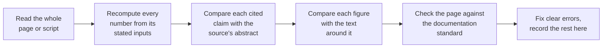

# Review record

This page records which parts of the project have been checked by someone
other than their author, what was checked, and what was found. A page,
script or figure that is not listed here as reviewed has not been reviewed.

The rule, from Tim on 14 November 2026: "Make sure that all assets are being
properly reviewed." Every page, figure script, data table and reference list
gets an independent check before or soon after it is merged. The reviewer is
given the material and its sources, not the author's conclusions.

## How a review is done

*Diagram: the six steps of a review, in order from left to right. The last
step either corrects an error in the same pull request or writes it into the
findings table below.*

The documentation standard is the one in the
[project plan](plan.md#documentation-standard): plain English, sources,
diagrams, tables, and links for every file that is mentioned.

## Review 1: everything merged before 14 November 2026

The first review covered the material that had been merged without an
independent check. It was done on 14 November 2026 against commit
[`74ece17`](https://github.com/mithro/ccd-superres/commit/74ece17) of the
main branch.

Two groups of material were left out because their own authors were still
working on them: [simulation level 1](level1.md) with its code and tests,
and the research studies under `docs/research/` (planned at the time).

### State of each asset

The columns say what was done for each asset. "All" means every instance was
checked. "Sample" means some were checked and the count is given. "No" means
the check was not done, and the reason is in
[what was not checked](#what-was-not-checked).

| Asset | Read in full | Numbers recomputed | Sources compared with abstracts | Figures compared with text | Findings | State |
|---|---|---|---|---|--:|---|
| [Project plan](plan.md) | Yes | Not applicable | Not applicable | Status chart | 1 | Reviewed, fixed |
| [Design](design.md) | Yes | All tables and worked examples | No | Sample: 2 of 14 | 6 | Reviewed, fixed |
| [Simulation chain](simulation-chain.md) | Yes | All | Not applicable | 1 of 1 | 1 | Reviewed, fixed |
| [Optical elements](optical-elements.md) | Yes | All tables and worked examples | Sample: 6 of about 70 | Sample: 3 of 20 | 3 | Reviewed, fixed |
| [Reconstruction methods](reconstruction-methods.md) | Body yes; reference list from entry M19 on not read | All in the body | Sample: 3 of about 110, the same papers | Sample: 1 of 18 | 3 | Reviewed in part, fixed |
| [Calibration and test methods](calibration-and-test.md) | Yes | All tables and worked examples | No | Sample: 2 of 15 | 2 | Reviewed, fixed |
| [Glossary](glossary.md) | Yes | Not applicable | Not applicable | Not applicable | 0 | Reviewed |
| [References](references.md) | Yes | Not applicable | No | Not applicable | 0 | Reviewed for form only |
| [Calculator page](calculator.md) | Yes | All: output of the calculator matches the page | Not applicable | Not applicable | 0 | Reviewed |
| [Explorer page](explorer.md) | Yes | By the parity test | Not applicable | Not applicable | 0 | Reviewed in part |
| [Diagrams page](diagrams.md) | Yes | Not applicable | Not applicable | Not applicable | 1 | Reviewed, fixed |
| [`ccdsr/resolution.py`](https://github.com/mithro/ccd-superres/blob/main/ccdsr/resolution.py) | Yes | Design tables 4.2, 4.6a, 4.6b and 4.8 reproduced from it | Not applicable | Not applicable | 0 | Reviewed |
| [`ccdsr/sampling.py`](https://github.com/mithro/ccd-superres/blob/main/ccdsr/sampling.py) | In part | Design table 5.4 and the coverage figures reproduced from it | Not applicable | Not applicable | 0 | Reviewed in part |
| [`explorer/`](https://github.com/mithro/ccd-superres/tree/main/explorer) | No | By the parity test against the Python model | Not applicable | Not applicable | 0 | Not reviewed line by line |
| Four figure scripts in [`docs/diagrams/`](https://github.com/mithro/ccd-superres/tree/main/docs/diagrams) | Two functions only | The two functions behind finding 1 | Not applicable | Not applicable | 1 | Not reviewed line by line |
| [`tests/`](https://github.com/mithro/ccd-superres/tree/main/tests) | No | All 41 tests pass | Not applicable | Not applicable | 0 | Run, not read |
| Rendered site on [Read the Docs](https://ccd-superres.readthedocs.io/en/latest/) | All 13 pages loaded | Not applicable | Not applicable | Not applicable | 0 | Reviewed |

On the rendered site every image loaded, every flow chart drew, no formula
was left as raw text and every link within a page found its target. The
local build of the site gave no warnings.

### Findings

Severity is "Error" where a stated number or mechanism was wrong,
"Inconsistent" where two pages disagreed, "Stale" where a status had been
overtaken, and "Gap" where something was missing. None of the findings
changes a conclusion of the design. Finding 1 changes a worked example and
is the one worth knowing about.

| No. | Where | Severity | What was found | What was done |
|--:|---|---|---|---|
| 1 | [Design 4.6](design.md#46-the-target-100-nm-features-on-silicon-chips), [optical elements 9.3](optical-elements.md), two figures | Error | The worked example for beam pairs used chip detail of 200 nm period beating against 213 nm stripes of light. At 405 nm in air, light cannot carry a 200 nm period away from the surface at any angle (the limit is 203 nm, and 225 nm with a 72° beam and ±58° collection), so that example cannot work. The simple picture that multiplies two brightnesses hides this. The page's own limit table already gave the right limits. | Example changed to 225 nm detail, which gives a beat of about 4 µm over 3.5 pixels. The wave explanation and its two conditions were added. Both figures were redrawn. |
| 2 | [Design 4.8](design.md#48-motion-blur-cause-model-and-reversal), table | Error | Coded exposure was said to pass about $1/\sqrt{N/2}$ of the contrast. The code and section 12 of the design give $1/\sqrt{N}$. | Corrected to $1/\sqrt{N}$. |
| 3 | Design, optical elements, reconstruction methods, calibration and test | Inconsistent | "Edge softness" of a pixel was a full width at half height on two pages and a standard deviation on the other two, without saying so. The same "100 nm" therefore gave 2.3% on one page and 0.04% on another. Each number was right for its own definition. | Each table now names its measure, gives the factor of 2.355 between them, and links to the other. The design's starting value is stated in both forms. |
| 4 | [Design 4.6](design.md#46-the-target-100-nm-features-on-silicon-chips), [calibration and test](calibration-and-test.md) summary | Inconsistent | The strip in which beam-pair stripes stay visible was "well under 0.1 mm" on one page and "about a sixth of a millimetre" on the other. The derivation gives 0.04 to 0.16 mm for a wavelength spread of 2 to 0.5 nm. | Both pages now give the range. The spread of the real diode is marked as an assumption until plan item R10. |
| 5 | Design, simulation chain, plan, [README](https://github.com/mithro/ccd-superres/blob/main/README.md) | Stale | Four places said the simulator was not written or that the site was not published. Level 1 exists and the site is live. | Statuses updated. |
| 6 | [Diagrams page](diagrams.md) | Gap | The page said all figures come from one script and did not list the twenty optical elements figures. | Section added, wording corrected. |
| 7 | [Reconstruction methods 2.1](reconstruction-methods.md), and the label of one bar in its ladder figure | Gap | "Resolved 225 nm lines with 1.12 µm pixels" cites a paper whose abstract confirms the line width, the light source and the threefold gain, but not the pixel size. | The pixel size is labelled Unverified in the text. The figure label is unchanged and still to be checked against the full paper. |
| 8 | [Reconstruction methods 7.2](reconstruction-methods.md) | Inconsistent | Its stages 0 to 5 are steps of the calculation and do not match the instrument stages 0 to 4 of the design, and nothing said so. | A note now maps one numbering onto the other. |
| 9 | All reviewed pages | Gap | Files were named as bare paths and not linked. Pages carried separate "In plain words" sections, which Tim has since asked to be folded into the main text. | Being done in two follow-up pull requests. This row is updated when they merge. |

### Smaller observations, not changed

| Where | Observation |
|---|---|
| [Design 5.1](design.md) | The note that the camera module ships with "IMX219 (or IMX355 from November 2026)" was read second-hand. It is already marked to be checked before buying hardware. |
| [Design 4.6](design.md) | "About 17,300 stripes" is 3.67 mm divided by 213 nm, which is 17,240. Fine as a round figure. |
| Design and calibration | The pixel passes 5.4% of a 200 nm stripe by the exact formula and 5.7% by the upper envelope. Both appear, each labelled. |
| Two figures | In `optics-hundred-nm` the legend lies over one curve, and in `recon-ladder` one label lies over the dashed target line. Both stay readable. |
| [Plan](plan.md) and [references](references.md) on the site | One table on each page is wider than the page and scrolls sideways. |

### What was not checked

| Not checked | Why | What it means |
|---|---|---|
| Most cited sources against the claims made from them | Six abstracts were compared and all six supported their claims. The service used to look papers up reached its daily limit before the other 210 or so could be compared. | The page authors record that each source was checked to exist. Whether each one supports its claim is confirmed for six only. |
| Full texts of any paper | Only abstracts were available. | Figures taken from a paper's body, not its abstract, rest on the author's reading. |
| The reference list of reconstruction methods from entry M19 on | Time. | Entries may have errors of form. |
| The explorer's JavaScript, the figure scripts and the tests, line by line | Time. They were checked through their outputs: the parity test, the recomputed tables and the figures viewed. | A fault that does not show in those outputs would not have been found. |
| 59 of the 69 figures against their text | Time. All 69 load on the site; 10 were compared with their captions and numbers. | A figure could disagree with its text unnoticed. |

These are the first items for the next review.

### Derivations by this project that others should know rest on assumptions

| Claim | Where | Checked how | Rests on |
|---|---|---|---|
| Beam-pair stripes stay visible only in a strip 0.04 to 0.16 mm wide with an ordinary laser diode | [Calibration and test 3.3](calibration-and-test.md) | Formula and arithmetic rederived | A Gaussian spectrum 0.5 to 2 nm wide. Real diodes vary, and some run in a single colour at some currents. Plan item R10 measures it. |
| A pixel passes about 2% of the contrast of 200 nm stripes if its edges are soft over 100 nm (full width at half height) | [Design, table 4.6b](design.md#46-the-target-100-nm-features-on-silicon-chips) | Recomputed from the code | A Gaussian model of the pixel's edges. The real response of the sensor is unknown until hardware. |
| Lines of 110 to 145 nm are the limit at 405 nm in air | [Design 4.6](design.md#46-the-target-100-nm-features-on-silicon-chips), [optical elements 9.2](optical-elements.md) | Formula and arithmetic rederived | The collection angle of the bare pixel (±30° to ±58°), which is an assumption. |
