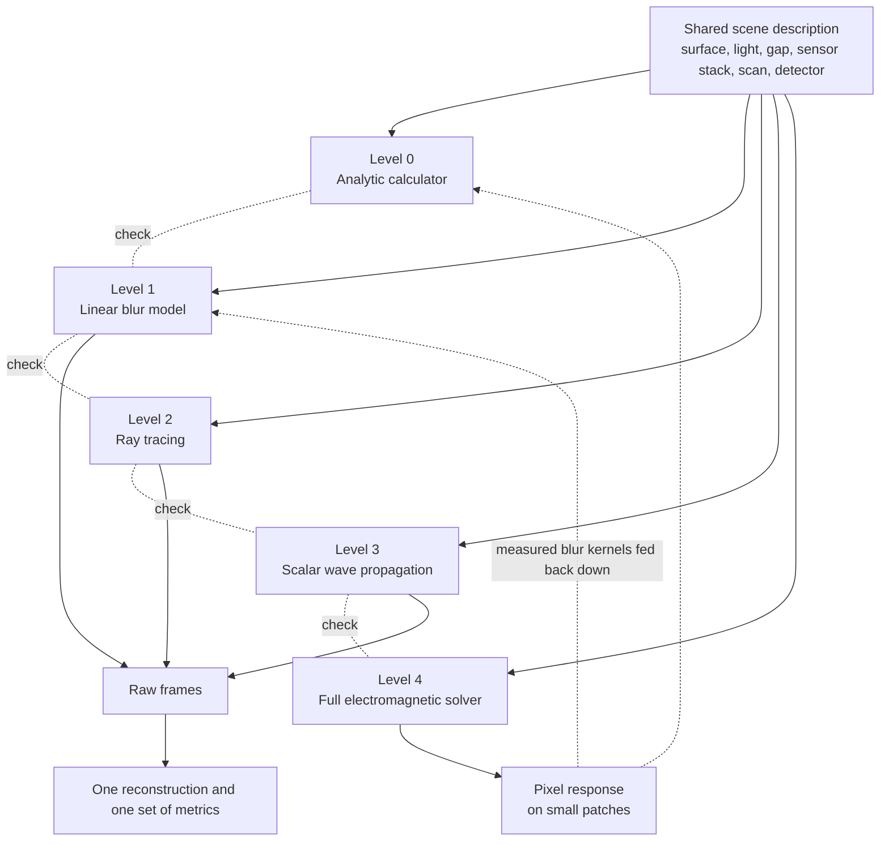
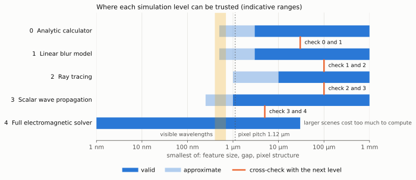

# The simulation chain

Status: plan for review. Level 0 is implemented. Levels 1 to 4 are not.

The simulator is built as a chain of five levels. Each level is more accurate
and slower than the one before it, every level reads the same description of
the scene and the sensor, and each neighbouring pair is checked against each
other on scenes where both should be right. No single level is trusted on its
own word.

## The levels

| Level | Method | Adds over the level before | Typical cost | Output |
|---|---|---|---|---|
| 0 | Analytic calculator. Closed-form transfer functions and sampling geometry ([calculator](calculator.md), [explorer](explorer.md)). | Starting point | Milliseconds | Resolution estimate, sampling figures |
| 1 | Linear blur model. The surface is a flat brightness map, blurred once by a fixed kernel and read off at every sample position, with noise and motion errors ([design](design.md), section 3). | Real surfaces, real sample positions, noise, motion errors, and actual reconstruction | Seconds | Raw frames |
| 2 | Ray tracing. Light as straight lines through three-dimensional geometry. | Surface height, shadowing, lighting geometry, the sensor stack as shapes, arbitrary pixel layouts | Minutes | Raw frames, pixel footprints |
| 3 | Scalar wave propagation. The light field is carried across the gap as a wave (angular spectrum method), with the surface and the sensor face as thin layers that change amplitude and phase. | Diffraction and interference in the gap, including height read through interference | Minutes | Raw frames, pixel footprints |
| 4 | Full electromagnetic solver. Maxwell's equations on a grid (finite-difference time-domain, for example Meep) or for periodic structures (rigorous coupled-wave analysis). | Near-field coupling, polarisation, sub-wavelength features, the real materials and shapes inside a pixel | Hours, small patches only | Pixel response on a patch |

## Where each level is valid

The horizontal axis is the smallest dimension that matters in the scene:
feature size, gap, or structure inside a pixel. The ranges are indicative and
will be replaced by measured ones as the cross-checks run.

| Level | Trust it when | It breaks down because |
|---|---|---|
| 0 and 1 | The surface is flat and diffuse, and the blur kernel in use is right for the gap. With the analytic kernel that means dimensions of several micrometres or more. With a kernel measured at a higher level, as far as that level reaches. | They have no physics of their own beyond the kernel. Height, shadowing and interference are absent. |
| 2 | Every dimension is many wavelengths: about 10 µm and up. Indicative between 1 and 10 µm. | Rays have no wave nature. They predict sharp shadows and no interference. The pixels themselves, at 1.12 µm, are about two wavelengths across. |
| 3 | Features are about a wavelength or larger and heights are small compared with feature widths. | Surfaces are treated as infinitely thin layers and light as a single scalar. Steep, deep or sub-wavelength structures and polarisation are wrong. |
| 4 | Always, within classical optics. | Nothing physical. Cost limits it to patches of a few tens of micrometres in two dimensions, or a few micrometres in three. |

The project's target, features of about 100 nm on silicon chips, lies where
only level 4 is valid: the features are well below the wavelength of visible
light and the surface is mirror-like, so the matt-surface kernel of levels 0
and 1 does not apply either
([design, section 4.6](design.md#46-the-target-100-nm-features-on-silicon-chips)).
The first hardware, at micrometre scale, lies where levels 1 to 3 overlap.
That is why the chain is needed: the lower levels make large scans and
reconstruction practical, and the upper levels tell us how far the lower ones
can be believed.

## The shared scene description

Every level takes the same input, a single scene description held in one file
per scene. A level uses the parts it can represent and reports the parts it
ignores, so a result always states its own blind spots.

| Part | Contents | Used by |
|---|---|---|
| Surface | Height map, reflectance map, material (refractive index and absorption) | 0 and 1 use reflectance only. 2 adds height. 3 adds height as phase. 4 uses everything. |
| Light | Spectrum, direction, angular spread, coherence | 0 and 1 assume a uniform glow. 2 uses direction and spread. 3 and 4 use all of it. |
| Gap | Distance, tilt between sensor and surface | All levels |
| Sensor stack | Pixel pitch and count, layers with thickness, shape and material, sensitive area, acceptance angle | 0 and 1 use pitch and a kernel. 2 uses shapes. 3 uses thin-layer equivalents. 4 uses everything. |
| Scan | Speed, direction, frame rate, exposure, motion errors | 0 to 3. Level 4 produces a pixel response that the lower levels scan. |
| Detector | Full well, read noise, gain variation, bit depth | 1 to 3 |

The default scene is the project's target: smooth, mirror-like silicon
carrying lines, spaces, corners, line ends and contact-like squares 100 nm
wide and tens of nanometres high on a 200 nm period, in metal or oxide, with
one deliberate defect. A scaled copy with 2 µm features is kept beside it for
the levels and gaps where the 100 nm version is out of range.

Outputs are shared too. Levels 1 to 3 write raw frames in one format, so the
reconstruction and the metrics do not know which level produced them. Every
level from 2 up can also write the footprint of a pixel on the surface, which
is the blur kernel that levels 0 and 1 consume.

## Cross-checks between neighbouring levels

Each check runs both levels on the same scene, inside the range where both
should be valid, and compares against a tolerance agreed in advance. The
tolerances below are proposals. A check that fails is a finding: either a bug
or a boundary of validity, and both are worth knowing.

| Pair | Scene | Compared | Proposed tolerance |
|---|---|---|---|
| 0 and 1 | Flat surface with sinusoidal brightness at a ladder of periods, gap 30 µm | Contrast of each period in the level 1 frames against the analytic transfer function | 2% of the predicted contrast, down to a contrast of 1/1000 |
| 0 and 1 | Any scan setting | Samples per point, shift per frame, sub-pixel positions | Exact |
| 0 and 1 | Flat grey surface with noise | Noise after averaging against the predicted square-root law | 10% |
| 1 and 2 | Flat diffuse surface, point source, gap 100 µm, uniform light | Ray-traced pixel footprint against the analytic kernel | 3% of peak, limited by the number of rays |
| 1 and 2 | Flat diffuse test pattern, gap 100 µm | Raw frames from both | 3% root-mean-square difference |
| 2 and 3 | Opaque straight edge, gap 100 µm, broadband light | Position of the shadow edge, and the brightness profile after smoothing over the diffraction scale | Edge within half the diffraction scale, profile within 5% |
| 2 and 3 | Same scene with the wavelength in level 3 reduced tenfold | Convergence of level 3 towards level 2 | Difference shrinks as predicted |
| 3 and 4 | Two-dimensional cross-section 20 µm wide, features of two wavelengths or more, heights under a tenth of a wavelength | Brightness at the detector plane | 5% root-mean-square difference |
| 3 and 4 | Same scene with features shrunk below a wavelength | Where the two diverge | No tolerance. The divergence is recorded as the limit of level 3. |
| 4 alone | Flat interface, and a simple grating | Reflection against the textbook Fresnel result, grating orders against published values, convergence with grid spacing | 1% |

Two further rules:

- **Kernels flow downwards.** Whenever a higher level produces a pixel
  footprint for a configuration, that kernel replaces the analytic one in
  levels 0 and 1 for that configuration. The fast levels then inherit the
  accuracy of the slow ones without their cost.
- **Disagreement outside the overlap is expected and documented.** Each pair
  is also run on a scene just beyond the lower level's range, to show where
  and how it fails. These results go into the documentation next to the
  passing ones.

The checks live in the test suite. The quick ones run on every change. The
slow ones (levels 3 and 4) run on demand and their results are committed and
published in the documentation.

## Build order

| Step | Content | Result |
|---|---|---|
| 1 | Level 0: calculator and explorer | Done |
| 2 | Shared scene description, raw frame format, metrics | The interface every level uses |
| 3 | Level 1 in one dimension, then two, with reconstruction | First surface reconstructions |
| 4 | Checks between levels 0 and 1 | Analytic estimates confirmed or corrected |
| 5 | Motion errors and motion estimation at level 1 | Tolerances for the mechanics |
| 6 | Level 2: ray tracing | Height, lighting geometry, sensor stack, sampling schemes |
| 7 | Checks between levels 1 and 2 | Measured kernels fed back to levels 0 and 1 |
| 8 | Level 3: scalar wave propagation | Diffraction and interference, height through interference |
| 9 | Checks between levels 2 and 3 | Measured limit of ray tracing |
| 10 | Level 4: electromagnetic solver on small patches | Pixel response at nanometre scale |
| 11 | Checks between levels 3 and 4 | Measured limit of scalar waves, kernels for nanometre gaps |

The build also follows the staged path to a 100 nm picture in
[section 4.7 of the design](design.md#47-a-staged-path-to-the-picture): steps
3 to 5 cover its stage 1, and stages 2 to 4 need levels 3 and 4.

Because the 100 nm target is decided by levels 3 and 4, one option is to
bring a two-dimensional cross-section at level 4 forward, straight after step
2, to check the estimates in section 4.6 of the design before the rest is
built. That is a proposal for Tim, not a decision.

All processing is offline and may use graphics cards and hundreds of cores,
so every level is built to run as many independent jobs: tiles of surface,
bundles of rays, patches for the electromagnetic solver and points of a
parameter sweep. Levels 1 and 3 are written against an array interface that
runs on a processor or a graphics card.

Libraries are a choice for each step when it starts. Candidates for level 4
are Meep for the time-domain solver and an existing coupled-wave package for
periodic structures. Levels 1 to 3 need only NumPy and SciPy.
