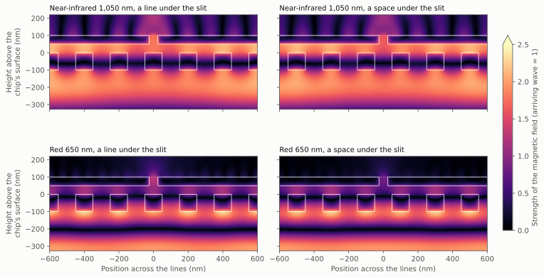

# A slit over fine lines, with waves

The study of [routes that keep ordinary light](research/ordinary-light-routes.md)
ranked first a metal film on the sensor with one narrow slit per pixel,
held within about 100 nm of the chip and lit by a plain lamp behind the
chip (its route B). That ranking rested on simple models: detail finer
than the wavelength fades with distance at a known rate, a slit passes
half the light that falls on it, and the slit reads whatever lies directly
under it. The study said plainly that none of this had been checked with a
wave calculation. This page is that check. It is the first item brought
forward under item D5 of the [plan](plan.md#d-simulation-chain), and it
serves [REQ-22](design.md#requirements) (keep both the 100 nm goal and
ordinary light) and [REQ-15](design.md#requirements) (no hardware until
simulation shows a method works).

The answers (all Simulated in the cross-section of section 1, unless
marked):

- **The slit does see lines 100 nm wide, and from a gap of 100 nm
  outward the detail fades at the simple model's rate.** As the lines
  pass under the slit the reading swings up and down. Between gaps of
  100 nm and 300 nm the swing falls by a factor of 2.7 for every 33 nm
  in near-infrared light and every 35 nm in red, against 32 nm and
  33 nm in the simple model. Closer than 100 nm the fall is uneven.
- **How strong the swing is depends on the colour.** In near-infrared
  light of 1,050 nm, which passes through a chip of full thickness, the
  swing is 0.27 to 0.75 of the simple model's, and it is the same for
  slits 1,000 nm to 1,800 nm apart. In red light of 650 nm it is 1.2 to
  3.7 times the simple model's at gaps up to 200 nm. In blue light of
  450 nm the swing changes more than three-fold with the distance
  between slits, so the blue figures describe this particular
  arrangement and not a slit in general.
- **Only half the lamp's light takes part, and the other half does no
  harm.** Light whose electric field points across the slit passes. Light
  whose field points along the slit is stopped twice, by the lines and by
  the slit, and adds 0.04 % to 6 % to the reading.
- **The amount of near-infrared light a slit passes cannot be given as
  one number.** It changes eight-fold with the distance between slits,
  three-fold with the wavelength between 1,000 nm and 1,100 nm, and
  six-fold with the direction of the lamp's light. In red and blue it is
  steady with the distance between slits: half the simple estimate in
  red and equal to it in blue. Over lines it also changes with the gap.
- **The slit is not a purely local probe.** One line placed 150 nm to
  300 nm to the side of the slit changes the reading by tens of per
  cent. A reconstruction that treats each reading as "what is under the
  slit" would be wrong. The forward model has to be a wave model.
- **In near-infrared and red light the reading is highest with a metal
  line under the slit, not a space.** The slit does not record a shadow
  picture of the lines.
- **Fine metal lines are themselves a polarising filter.** Lines 100 nm
  wide pass 81 % of near-infrared light whose field points across them
  and 1.3 % of light whose field points along them. A slit lying across
  such lines would therefore be nearly dark (Judgement, from two
  separate two-dimensional results; it needs a three-dimensional
  calculation).
- **Route B is not ruled out, and it is harder than the simple model
  said** (Judgement). In near-infrared light the lines show 0.27 to 0.75
  as strongly as assumed, which costs 1.8 to 14 times the readings. The
  reading level cannot be predicted simply. The reconstruction needs a
  wave model, and whether slits at many angles work at all over fine
  lines is open.

Everything here is in a two-dimensional cross-section, at one wavelength
at a time, with light arriving from one direction, and with every slit
the same and evenly spaced. Section 12 lists what that leaves out. Code:
[`ccdsr/slit_waves.py`](https://github.com/mithro/ccd-superres/blob/main/ccdsr/slit_waves.py)
and
[`ccdsr/fdfd.py`](https://github.com/mithro/ccd-superres/blob/main/ccdsr/fdfd.py);
tests:
[`tests/test_slit_waves.py`](https://github.com/mithro/ccd-superres/blob/main/tests/test_slit_waves.py);
saved runs:
[`results/slit-waves/readings.json`](https://github.com/mithro/ccd-superres/blob/main/results/slit-waves/readings.json).

## How claims are marked

| Mark | Meaning |
|---|---|
| Simulated | Computed here with the wave solver, for the idealised cross-section of section 1 |
| Derived here | Worked out on this page from stated figures |
| Estimate | A rough figure from a simple model |
| Judgement | A conclusion drawn from the results, which could be argued |
| A key in square brackets | Taken from the source of that key in the [list of sources](#sources) |

*Table 1. Marks used on this page.*

## 1. What was calculated


*Figure 1. The cross-section, drawn to scale for a gap of 50 nm and a slit
of 50 nm. Everything continues unchanged into the page, so the slit runs
along the lines. The picture repeats sideways every 1,200 nm. Drawn by
[`make_slit_wave_diagrams.py`](https://github.com/mithro/ccd-superres/blob/main/docs/diagrams/make_slit_wave_diagrams.py).*

The chip is at the bottom of Figure 1 and the sensor at the top. Light
from a lamp behind the chip travels up through the chip's glass, meets
metal lines set into the top of the glass, crosses an air gap, and meets
a metal film lying on the sensor's silicon. The film has one slit. Light
that gets into the silicon is counted as the reading. The lines are then
moved sideways under the slit in small steps (25 nm for lines 100 nm
wide), which is what a scan does, and the reading is recorded at each
step.

Two numbers summarise each case:

- the **mean reading**: the share of the light arriving on one repeat of
  the picture (about one pixel) that reaches the silicon, averaged over
  the positions of the lines;
- the **swing**: the size of the part of the reading that rises and falls
  once for each line that passes, as a share of the mean reading. A swing
  of 0 means the slit does not see the lines. A swing of 1 means the
  reading goes between zero and twice its mean.

The light is described by the direction of its electric field. "Across"
means across the slit and the lines, and "along" means along them. The
code and the physics literature call these p (or TM) and s (or TE). A lamp gives equal amounts of both.

| Setting | Values | Why |
|---|---|---|
| Lines | Copper, 100 nm wide, 100 nm apart, 100 nm thick, flush with the top of the glass. Also 60, 75, 150 and 200 nm wide, one line alone, and aluminium | The 100 nm target of the project; copper is the usual metal of fine chip wiring |
| Gap | 20, 50, 100, 150, 200 and 300 nm of air | The range asked for by the [routes study](research/ordinary-light-routes.md#10-what-the-simulator-needs), Table 22, item 1 |
| Film | Aluminium, 50 nm and 100 nm thick, on silicon | The film of the routes study, Table 15 |
| Slit | 50 nm and 100 nm wide (200 nm also, without lines) | As the routes study |
| Light | 1,050 nm (near-infrared), 650 nm (red), 450 nm (blue); field across and along; straight up, and slanted 30° in the glass | 1,050 nm passes through a chip of full thickness ([backlight](backlight.md)); red and blue need a chip thinned to a few micrometres |
| Repeat, which is also the distance between slits | 1,200 nm; and 1,000 nm to 2,400 nm as checks | A whole number of lines near the 1,120 nm pixel pitch. The repeat turns out to matter (sections 3 and 4) |
| Grid | 2.5 nm, and 1.25 nm as a check | See section 2 |

*Table 2. What was varied. 2,222 cross-sections in all.*

| Material | 1,050 nm | 650 nm | 450 nm | Source |
|---|--:|--:|--:|---|
| Aluminium (film) | 1.39 + 10.08i | 1.56 + 7.71i | 0.63 + 5.45i | [[SW1](#sw1)] |
| Copper (lines) | 0.35 + 6.93i | 0.24 + 3.63i | 1.24 + 2.39i | [[SW2](#sw2)] |
| Silicon (sensor) | 3.556 + 0.0001i | 3.844 + 0.014i | 4.691 + 0.086i | The table of Green (2008) in [`ccdsr/data`](https://github.com/mithro/ccd-superres/blob/main/ccdsr/data/silicon_green2008.csv), as on the [backlight](backlight.md) page |
| Glass (chip) | 1.46 | 1.46 | 1.46 | Round value; fused silica is 1.45 to 1.47 over this range [[SW3](#sw3)] |

*Table 3. Refractive index of each material: the first number bends
light, the second (with the i) absorbs it. The metal values are
interpolated from published tables kept in
[`ccdsr/data`](https://github.com/mithro/ccd-superres/tree/main/ccdsr/data).*

## 2. The solver and how it was checked

The wave solver of the [slot waves](slot-waves.md) page handled one
direction of the electric field. For this page it gained a second entry
point, `solve_periodic`, for structures that repeat sideways, in both
field directions. It solves Maxwell's equations on a grid of points, at
one wavelength, with nothing left out except what the grid spacing
cannot show.

Each check below compares the solver with a result known from theory. All
are in the tests.

| Check | Known result | Solver |
|---|---|---|
| Light entering flat glass at 0°, 30° and 60°, both field directions | Fresnel's formulas for reflection at a flat surface [[BornWolf](references.md)] | Within 0.002 of the share passed |
| Glass at Brewster's angle (55.6°, the one angle at which a clear material reflects none of the light with its field across), field across | Nothing reflects [[BornWolf](references.md)] | 1.000 passed, within 0.002 |
| Light entering flat silicon at 30° | Fresnel's formulas | Within 0.006 |
| A layer of air between glass and silicon, 50 nm and 300 nm thick | The textbook formula for one layer [[BornWolf](references.md)] | Within 1 % |
| Fine detail above a grating finer than the wavelength | Fades as exp(−distance ÷ fade length) [[Goodman](references.md)] | Within 2 % over 125 nm, both field directions |
| A slit narrower than half a wavelength in a perfect metal, field along | Light falls as exp(−2κt) with thickness t, where κ² = (π ÷ width)² − (2π ÷ wavelength)² | Within 25 % (one grid cell changes the slit's width by 2.5 %) |
| The same, field across | Passes, with nearly complete passage at thicknesses a little under half a wavelength [[SW4](#sw4), [SW5](#sw5)] | Peak above 0.85; below 0.5 away from it |
| Glass, air, an unbroken aluminium film 50 nm thick, silicon; light straight on and slanted 30°, both field directions | The textbook formula for a stack of layers [[BornWolf](references.md)] | Within 3 % of a share of about 0.0005 |
| Clear materials only | Light in equals light out | Within 0.5 % |
| Slanted light on one repeat of a structure and on two repeats side by side | The same answer | Equal to six figures |

*Table 4. Checks of the solver against theory. Simulated; the known
results are from the sources given.*

One error was found and corrected this way. For the field across, the
first version averaged the wrong quantity between neighbouring grid
points at a boundary between two materials, and its answers changed by
up to a factor of two when the grid was made finer. With the right
average (one over the mean of the squared index) the answers settle, and
a test now compares two grid spacings.

| Light | Gap (nm) | Mean reading, grid 2.5 nm | Mean reading, grid 1.25 nm | Difference | Swing, grid 2.5 nm | Swing, grid 1.25 nm | Difference |
|---|--:|--:|--:|--:|--:|--:|--:|
| Near-infrared 1,050 nm | 20 | 0.0578 | 0.0601 | -3.8 % | 0.267 | 0.262 | +2.0 % |
| Near-infrared 1,050 nm | 100 | 0.0227 | 0.0233 | -2.5 % | 0.0286 | 0.0283 | +0.9 % |
| Red 650 nm | 20 | 0.0119 | 0.0124 | -3.5 % | 0.832 | 0.825 | +0.9 % |
| Red 650 nm | 100 | 0.00430 | 0.00446 | -3.7 % | 0.122 | 0.120 | +0.9 % |
| Blue 450 nm | 20 | 0.00510 | 0.00513 | -0.5 % | 0.0356 | 0.0213 | +67.0 % |
| Blue 450 nm | 100 | 0.00516 | 0.00515 | +0.2 % | 0.306 | 0.300 | +2.0 % |

*Table 5. The same cases at two grid spacings, slit 50 nm, field across.
Simulated. Readings are 0 % to 4 % low on the coarser grid and swings
within 2 %, except blue at 20 nm, where the swing is small and is not to
be trusted.*

The grid is closed above and below by layers that absorb outgoing light,
with some plain material between them and the structure. Light leaving
at a shallow angle needs more of both.

| Light | Gap (nm) | Mean reading, standard room | Mean reading, more room | Difference | Swing, standard room | Swing, more room | Difference |
|---|--:|--:|--:|--:|--:|--:|--:|
| Near-infrared 1,050 nm | 50 | 0.05175 | 0.05181 | -0.12 % | 0.09035 | 0.09023 | +0.13 % |
| Near-infrared 1,050 nm | 150 | 0.01357 | 0.01358 | -0.08 % | 0.007645 | 0.007642 | +0.04 % |
| Red 650 nm | 50 | 0.006351 | 0.006351 | -0.00 % | 0.4056 | 0.4056 | +0.00 % |
| Red 650 nm | 300 | 0.04439 | 0.04439 | -0.00 % | 3.748 × 10⁻⁴ | 3.746 × 10⁻⁴ | +0.04 % |
| Blue 450 nm | 50 | 0.004229 | 0.004229 | +0.01 % | 0.03883 | 0.03862 | +0.53 % |
| Blue 450 nm | 100 | 0.005162 | 0.005164 | -0.05 % | 0.3056 | 0.3052 | +0.11 % |

*Table 6. The same cases with twice the thickness of absorbing layer,
twice the glass below and four times the silicon above. Slit 50 nm,
field across, slits 1,200 nm apart, light straight up. Simulated. The
standard room is enough for these. It is not enough for other distances
between slits or for slanted light, where readings changed by up to a
factor of four; every such run on this page uses the larger room. The
runs with slits 2,400 nm apart use the standard room and their readings
are about 4 % low (found by the independent review).*

## 3. Light through the slit over plain glass

Before any lines are added, how much light does a slit pass? The routes
study took a slit to pass all of the light with its field across and none
of the rest, so that a slit passes half the lamp's light falling on its
own area ([its Table 13](research/ordinary-light-routes.md#41-holes-pass-almost-no-light-slits-pass-plenty)).

| Light | Arrangement | Field across | Field along | Lamp (both) | Lamp, as a share of the open pixel | Simple estimate of that share | Lamp (both), range over gaps of 20 nm to 300 nm |
|---|---|--:|--:|--:|--:|--:|--:|
| Near-infrared 1,050 nm | Open pixel, no film | 0.79 | 0.79 | 0.79 | 1.0 |  | 0.55 to 0.82 |
| Near-infrared 1,050 nm | Unbroken film 50 nm | 0.0013 | 0.0013 | 0.0013 | 0.0016 |  | 7.5 × 10⁻⁴ to 0.0014 |
| Near-infrared 1,050 nm | Unbroken film 100 nm | 3.1 × 10⁻⁶ | 3.1 × 10⁻⁶ | 3.1 × 10⁻⁶ | 4.0 × 10⁻⁶ |  | 1.8 × 10⁻⁶ to 3.5 × 10⁻⁶ |
| Near-infrared 1,050 nm | Slit 50 nm, film 50 nm | 0.048 | 0.0025 | 0.025 | 0.032 | 0.021 | 0.015 to 0.027 |
| Near-infrared 1,050 nm | Slit 100 nm, film 50 nm | 0.11 | 0.012 | 0.060 | 0.076 | 0.042 | 0.035 to 0.066 |
| Near-infrared 1,050 nm | Slit 200 nm, film 50 nm | 0.16 | 0.083 | 0.12 | 0.15 | 0.083 | 0.071 to 0.14 |
| Near-infrared 1,050 nm | Slit 50 nm, film 100 nm | 0.065 | 3.1 × 10⁻⁵ | 0.032 | 0.041 | 0.021 | 0.019 to 0.037 |
| Near-infrared 1,050 nm | Slit 100 nm, film 100 nm | 0.14 | 9.9 × 10⁻⁴ | 0.071 | 0.090 | 0.042 | 0.041 to 0.083 |
| Near-infrared 1,050 nm | Slit 200 nm, film 100 nm | 0.18 | 0.027 | 0.10 | 0.13 | 0.083 | 0.061 to 0.12 |
| Red 650 nm | Open pixel, no film | 0.71 | 0.71 | 0.71 | 1.0 |  | 0.51 to 0.78 |
| Red 650 nm | Unbroken film 50 nm | 4.0 × 10⁻⁴ | 4.0 × 10⁻⁴ | 4.0 × 10⁻⁴ | 5.7 × 10⁻⁴ |  | 2.6 × 10⁻⁴ to 5.3 × 10⁻⁴ |
| Red 650 nm | Unbroken film 100 nm | 2.3 × 10⁻⁷ | 2.4 × 10⁻⁷ | 2.3 × 10⁻⁷ | 3.3 × 10⁻⁷ |  | 1.5 × 10⁻⁷ to 3.1 × 10⁻⁷ |
| Red 650 nm | Slit 50 nm, film 50 nm | 0.020 | 0.0016 | 0.011 | 0.016 | 0.021 | 0.0081 to 0.018 |
| Red 650 nm | Slit 100 nm, film 50 nm | 0.058 | 0.014 | 0.036 | 0.050 | 0.042 | 0.028 to 0.065 |
| Red 650 nm | Slit 200 nm, film 50 nm | 0.11 | 0.070 | 0.088 | 0.12 | 0.083 | 0.072 to 0.16 |
| Red 650 nm | Slit 50 nm, film 100 nm | 0.041 | 2.2 × 10⁻⁵ | 0.021 | 0.029 | 0.021 | 0.017 to 0.041 |
| Red 650 nm | Slit 100 nm, film 100 nm | 0.074 | 0.0014 | 0.038 | 0.053 | 0.042 | 0.032 to 0.071 |
| Red 650 nm | Slit 200 nm, film 100 nm | 0.099 | 0.028 | 0.063 | 0.089 | 0.083 | 0.057 to 0.12 |
| Blue 450 nm | Open pixel, no film | 0.56 | 0.56 | 0.56 | 1.0 |  | 0.44 to 0.68 |
| Blue 450 nm | Unbroken film 50 nm | 5.0 × 10⁻⁴ | 5.1 × 10⁻⁴ | 5.1 × 10⁻⁴ | 9.0 × 10⁻⁴ |  | 4.0 × 10⁻⁴ to 8.0 × 10⁻⁴ |
| Blue 450 nm | Unbroken film 100 nm | 2.5 × 10⁻⁷ | 2.5 × 10⁻⁷ | 2.5 × 10⁻⁷ | 4.5 × 10⁻⁷ |  | 2.0 × 10⁻⁷ to 4.0 × 10⁻⁷ |
| Blue 450 nm | Slit 50 nm, film 50 nm | 0.044 | 0.0024 | 0.023 | 0.042 | 0.021 | 0.023 to 0.057 |
| Blue 450 nm | Slit 100 nm, film 50 nm | 0.057 | 0.014 | 0.035 | 0.063 | 0.042 | 0.035 to 0.084 |
| Blue 450 nm | Slit 200 nm, film 50 nm | 0.077 | 0.054 | 0.065 | 0.12 | 0.083 | 0.065 to 0.14 |
| Blue 450 nm | Slit 50 nm, film 100 nm | 0.027 | 4.2 × 10⁻⁵ | 0.013 | 0.024 | 0.021 | 0.0098 to 0.017 |
| Blue 450 nm | Slit 100 nm, film 100 nm | 0.043 | 0.0018 | 0.023 | 0.040 | 0.042 | 0.019 to 0.033 |
| Blue 450 nm | Slit 200 nm, film 100 nm | 0.066 | 0.029 | 0.047 | 0.084 | 0.083 | 0.047 to 0.091 |

*Table 7. Share of the arriving light that reaches the silicon, with
plain glass under the film (no lines), slits 1,200 nm apart, at a gap of
50 nm; the last column gives the range over all six gaps. Simulated. The
simple estimate is half the slit's share of the 1,200 nm repeat.*

The slit rows of Table 7 are for slits exactly 1,200 nm apart, and for
near-infrared light that matters a great deal.

| Light | Slits apart (nm) | Reading, field across | Light through one slit (nm of width) | As a multiple of the slit's own width |
|---|--:|--:|--:|--:|
| Near-infrared 1,050 nm | 1,000 | 0.034 | 33.8 | 0.68 |
| Near-infrared 1,050 nm | 1,100 | 0.0069 | 7.56 | 0.15 |
| Near-infrared 1,050 nm | 1,120 | 0.011 | 12.7 | 0.25 |
| Near-infrared 1,050 nm | 1,200 | 0.048 | 57.9 | 1.2 |
| Near-infrared 1,050 nm | 1,400 | 0.013 | 17.8 | 0.36 |
| Near-infrared 1,050 nm | 1,600 | 0.013 | 20.9 | 0.42 |
| Near-infrared 1,050 nm | 1,800 | 0.022 | 39.4 | 0.79 |
| Red 650 nm | 1,000 | 0.026 | 26.5 | 0.53 |
| Red 650 nm | 1,100 | 0.025 | 27.6 | 0.55 |
| Red 650 nm | 1,120 | 0.025 | 27.9 | 0.56 |
| Red 650 nm | 1,200 | 0.020 | 24.6 | 0.49 |
| Red 650 nm | 1,400 | 0.020 | 28.1 | 0.56 |
| Red 650 nm | 1,600 | 0.017 | 26.4 | 0.53 |
| Red 650 nm | 1,800 | 0.015 | 27.1 | 0.54 |
| Blue 450 nm | 1,000 | 0.056 | 55.7 | 1.1 |
| Blue 450 nm | 1,100 | 0.047 | 51.5 | 1.0 |
| Blue 450 nm | 1,120 | 0.046 | 51.3 | 1.0 |
| Blue 450 nm | 1,200 | 0.044 | 53.3 | 1.1 |
| Blue 450 nm | 1,400 | 0.038 | 53.2 | 1.1 |
| Blue 450 nm | 1,600 | 0.033 | 53.6 | 1.1 |
| Blue 450 nm | 1,800 | 0.030 | 54.0 | 1.1 |

*Table 8. A 50 nm slit over plain glass at a gap of 50 nm, field across,
for seven distances between slits. Simulated. "Light through one slit" is
the reading times the distance between slits: the width of arriving light
that one slit collects. The simple estimate is the slit's own width, 1.0
in the last column. 1,120 nm is the pixel pitch of the baseline sensor.*

What Tables 7 and 8 show (Derived here from them):

- In red light a 50 nm slit collects the light of about half its own
  width, and in blue light about all of it, whatever the distance between
  slits. The simple estimate is right in blue and twice too high in red.
- In near-infrared light a slit collects between 0.15 and 1.2 times its
  own width, depending on the distance between slits. At 1,200 nm, the
  distance used for the rest of this page, it is at the top of that
  range. At the 1,120 nm pitch of the baseline sensor it is 0.25. The
  cause was not established. Evenly spaced slits can pass light sideways
  to each other along the film (see section 7), and a real mask with
  slits at many angles would not be evenly spaced in this way, so the
  figure for a real mask is not known (Unverified).
- A slit 50 nm wide passes at most 8 % as much of the "along" light as of
  the "across" light, and far less in a film 100 nm thick. A slit 200 nm
  wide passes much of both, and stops being a polarising element.
- A film 50 nm thick is not fully opaque. It leaks 0.04 % to 0.13 % of
  the light over the whole pixel, which is 2 % to 5 % of what a 50 nm
  slit passes in Table 7. A film 100 nm thick leaks under 0.0004 %.

## 4. Lines 100 nm wide under the slit


*Figure 2. Swing of the reading against the gap, for lines 100 nm wide
and light with its field across the slit, slits 1,200 nm apart. Solid:
wave calculation. Dashed: the simple model. The vertical scale is
logarithmic: each step is a factor of ten. Simulated.*

The simple model that the routes study used predicts the swing in three
steps (Derived here): stripes that are fully dark and fully clear have a
once-per-line part 4 ÷ π = 1.27 times their mean; a gap g multiplies that
by exp(−g ÷ fade length), with the fade length of
[`near_field_transfer`](https://github.com/mithro/ccd-superres/blob/main/ccdsr/near_contact.py);
and a slit of width w averages it by sin(πw ÷ p) ÷ (πw ÷ p) for lines of
period p. This is the routes study's simplest model (its "level 0",
formulas only) with perfectly sharp slit edges.

| Light | Slit (nm) | Gap (nm) | Mean reading | Swing, wave calculation | Swing, simple model | Wave ÷ simple | Reading is highest over a | Full readings to detect a known, endless set of lines |
|---|--:|--:|--:|--:|--:|--:|---|--:|
| Near-infrared 1,050 nm | 50 | 20 | 0.058 | 0.27 | 0.62 | 0.43 | line | under 1 |
| Near-infrared 1,050 nm | 50 | 50 | 0.052 | 0.090 | 0.25 | 0.37 | line | 2.4 |
| Near-infrared 1,050 nm | 50 | 100 | 0.023 | 0.029 | 0.052 | 0.54 | line | 24 |
| Near-infrared 1,050 nm | 50 | 150 | 0.014 | 0.0076 | 0.011 | 0.68 | line | 342 |
| Near-infrared 1,050 nm | 50 | 200 | 0.010 | 0.0018 | 0.0024 | 0.75 | line | 6,159 |
| Near-infrared 1,050 nm | 50 | 300 | 0.0099 | 7.3 × 10⁻⁵ | 1.1 × 10⁻⁴ | 0.66 | line | 3,778,601 |
| Near-infrared 1,050 nm | 100 | 20 | 0.10 | 0.19 | 0.44 | 0.44 | line | under 1 |
| Near-infrared 1,050 nm | 100 | 50 | 0.10 | 0.047 | 0.17 | 0.27 | line | 9.2 |
| Near-infrared 1,050 nm | 100 | 100 | 0.046 | 0.016 | 0.037 | 0.43 | line | 77 |
| Near-infrared 1,050 nm | 100 | 150 | 0.028 | 0.0043 | 0.0079 | 0.55 | line | 1,066 |
| Near-infrared 1,050 nm | 100 | 200 | 0.022 | 1.0 × 10⁻³ | 0.0017 | 0.59 | line | 20,099 |
| Near-infrared 1,050 nm | 100 | 300 | 0.022 | 3.4 × 10⁻⁵ | 7.8 × 10⁻⁵ | 0.44 | line | 16,856,180 |
| Red 650 nm | 50 | 20 | 0.012 | 0.83 | 0.63 | 1.3 | line | under 1 |
| Red 650 nm | 50 | 50 | 0.0064 | 0.41 | 0.26 | 1.6 | line | under 1 |
| Red 650 nm | 50 | 100 | 0.0043 | 0.12 | 0.058 | 2.1 | line | 1.4 |
| Red 650 nm | 50 | 150 | 0.0048 | 0.032 | 0.013 | 2.5 | line | 19 |
| Red 650 nm | 50 | 200 | 0.0089 | 0.0078 | 0.0029 | 2.7 | line | 330 |
| Red 650 nm | 50 | 300 | 0.044 | 3.7 × 10⁻⁴ | 1.5 × 10⁻⁴ | 2.6 | line | 142,385 |
| Red 650 nm | 100 | 20 | 0.026 | 0.55 | 0.45 | 1.2 | line | under 1 |
| Red 650 nm | 100 | 50 | 0.018 | 0.32 | 0.18 | 1.7 | line | under 1 |
| Red 650 nm | 100 | 100 | 0.013 | 0.098 | 0.041 | 2.4 | line | 2.1 |
| Red 650 nm | 100 | 150 | 0.015 | 0.028 | 0.0092 | 3.1 | line | 26 |
| Red 650 nm | 100 | 200 | 0.029 | 0.0075 | 0.0021 | 3.7 | line | 356 |
| Red 650 nm | 100 | 300 | 0.12 | 4.4 × 10⁻⁴ | 1.0 × 10⁻⁴ | 4.3 | line | 102,419 |
| Blue 450 nm | 50 | 20 | 0.0051 | 0.036 | 0.65 | 0.055 | space | 16 |
| Blue 450 nm | 50 | 50 | 0.0042 | 0.039 | 0.28 | 0.14 | space | 13 |
| Blue 450 nm | 50 | 100 | 0.0052 | 0.31 | 0.069 | 4.4 | space | under 1 |
| Blue 450 nm | 50 | 150 | 0.014 | 0.14 | 0.017 | 8.4 | space | under 1 |
| Blue 450 nm | 50 | 200 | 0.034 | 0.039 | 0.0041 | 9.4 | space | 13 |
| Blue 450 nm | 50 | 300 | 0.0070 | 0.0025 | 2.5 × 10⁻⁴ | 10 | line | 3,250 |
| Blue 450 nm | 100 | 20 | 0.0068 | 0.045 | 0.46 | 0.097 | space | 9.9 |
| Blue 450 nm | 100 | 50 | 0.0057 | 0.21 | 0.20 | 1.0 | space | under 1 |
| Blue 450 nm | 100 | 100 | 0.0072 | 0.37 | 0.049 | 7.7 | space | under 1 |
| Blue 450 nm | 100 | 150 | 0.021 | 0.17 | 0.012 | 14 | space | under 1 |
| Blue 450 nm | 100 | 200 | 0.043 | 0.042 | 0.0029 | 15 | space | 11 |
| Blue 450 nm | 100 | 300 | 0.0092 | 0.0026 | 1.7 × 10⁻⁴ | 15 | line | 2,986 |

*Table 9. Lines 100 nm wide and 100 nm apart under the slit, field
across, film 50 nm thick, slits 1,200 nm apart. Simulated, except the
last column, which is an Estimate of a different and much easier task
than making a picture: every reading is taken as filled to 2,500
electrons, with only the noise of counting them, and all N readings go to
finding one number, the size of the swing of lines whose spacing and
direction are already known. The swing then has a noise of
√(2 ÷ (2,500 N)), and the column gives the N at which the swing is five
times that. It is not comparable with the reading counts of the routes
study, which fill an open pixel, not a slit, and solve for a whole
picture; those are thousands of times larger. Its use is to show how the
cost grows with the gap.*

| Light | Gap (nm) | Quantity | Slits 1,000 nm apart | Slits 1,200 nm apart | Slits 1,400 nm apart | Slits 1,600 nm apart | Slits 1,800 nm apart |
|---|--:|---|--:|--:|--:|--:|--:|
| Near-infrared 1,050 nm | 50 | Light through one slit (nm of width) | 37.6 | 62.2 | 11.0 | 24.2 | 44.4 |
| Near-infrared 1,050 nm | 50 | Swing | 0.093 | 0.090 | 0.10 | 0.092 | 0.092 |
| Near-infrared 1,050 nm | 50 | Reading is highest over a | line | line | line | line | line |
| Near-infrared 1,050 nm | 150 | Light through one slit (nm of width) | 8.82 | 16.3 | 4.71 | 6.04 | 11.2 |
| Near-infrared 1,050 nm | 150 | Swing | 0.0080 | 0.0076 | 0.0066 | 0.0080 | 0.0082 |
| Near-infrared 1,050 nm | 150 | Reading is highest over a | line | line | line | line | line |
| Red 650 nm | 50 | Light through one slit (nm of width) | 8.55 | 7.62 | 8.82 | 8.35 | 8.39 |
| Red 650 nm | 50 | Swing | 0.42 | 0.41 | 0.41 | 0.41 | 0.40 |
| Red 650 nm | 50 | Reading is highest over a | line | line | line | line | line |
| Red 650 nm | 300 | Light through one slit (nm of width) | 57.7 | 53.3 | 52.4 | 54.0 | 53.8 |
| Red 650 nm | 300 | Swing | 9.6 × 10⁻⁵ | 3.7 × 10⁻⁴ | 3.3 × 10⁻⁵ | 1.0 × 10⁻⁴ | 2.2 × 10⁻⁴ |
| Red 650 nm | 300 | Reading is highest over a | line | line | space | line | line |
| Blue 450 nm | 50 | Light through one slit (nm of width) | 5.95 | 5.07 | 5.57 | 5.40 | 5.46 |
| Blue 450 nm | 50 | Swing | 0.018 | 0.039 | 0.018 | 0.010 | 0.025 |
| Blue 450 nm | 50 | Reading is highest over a | line | space | space | space | space |
| Blue 450 nm | 100 | Light through one slit (nm of width) | 6.79 | 6.20 | 6.26 | 6.50 | 6.08 |
| Blue 450 nm | 100 | Swing | 0.088 | 0.31 | 0.14 | 0.24 | 0.18 |
| Blue 450 nm | 100 | Reading is highest over a | space | space | space | space | space |

*Table 10. The same lines under a 50 nm slit, for five distances between
slits. Simulated.*

| Light | Mean reading | Swing | Reading is highest over a |
|---|--:|--:|---|
| Wavelength 1,000 nm, straight up | 0.025 | 0.11 | line |
| Wavelength 1,025 nm, straight up | 0.037 | 0.099 | line |
| Wavelength 1,050 nm, straight up | 0.052 | 0.090 | line |
| Wavelength 1,075 nm, straight up | 0.072 | 0.076 | line |
| Wavelength 1,100 nm, straight up | 0.032 | 0.077 | line |
| Wavelength 1,050 nm, slanted 0° in the glass | 0.052 | 0.090 | line |
| Wavelength 1,050 nm, slanted 5° in the glass | 0.053 | 0.088 | line |
| Wavelength 1,050 nm, slanted 10° in the glass | 0.015 | 0.090 | line |
| Wavelength 1,050 nm, slanted 20° in the glass | 0.019 | 0.082 | line |
| Wavelength 1,050 nm, slanted 30° in the glass | 0.090 | 0.056 | line |

*Table 11. Near-infrared light of five wavelengths and five directions:
lines 100 nm wide, slit 50 nm, gap 50 nm, slits 1,200 nm apart.
Simulated.*

What Tables 9 to 11 and Figure 2 show:

- **Near-infrared swing.** It is 0.27 at a gap of 20 nm, 0.090 at 50 nm
  and 0.029 at 100 nm for a 50 nm slit, and falls steadily. It is 0.37
  to 0.75 of the simple model's for the 50 nm slit and 0.27 to 0.59 for
  the 100 nm slit. It does not depend on the distance between slits
  (0.090 to 0.10 at 50 nm, 0.0066 to 0.0082 at 150 nm), and changes
  from 0.11 to 0.077 between wavelengths of 1,000 nm and 1,100 nm and
  from 0.090 to 0.056 between light straight up and slanted 30°. This is
  the firmest result on the page.
- **The same loss put another way.** In the simple model, a slit whose
  edges were blurred over 57 nm to 122 nm (full width at half maximum of
  a Gaussian blur) would lose as much (Derived here). The routes study
  assumed 30 nm to 100 nm. This is only a way of comparing: the ratio
  changes with the gap, and the simple model's stripes are black where
  the real lines pass 81 % of this light (section 6), so the loss is not
  literally a softness of the edges.
- **Red swing.** It is 0.83, 0.41 and 0.12 at 20 nm, 50 nm and 100 nm,
  and 1.2 to 3.7 times the simple model's at gaps up to 200 nm, counting
  both slit widths. At 50 nm it does not depend on the distance between
  slits (0.40 to 0.42). At 300 nm it does (0.00003 to 0.0004), so the
  red figures at 300 nm in Table 9 hold only for slits 1,200 nm apart.
- **Blue swing.** At a gap of 100 nm it is anywhere from 0.088 to 0.31
  depending on the distance between slits, and at 50 nm from 0.010 to
  0.039, with the bright and dark positions changing places. The blue
  rows of Table 9 are therefore results for this arrangement only. Why
  blue behaves this way was not established (Unverified); copper
  absorbs blue light where it reflects red and near-infrared (Table 3).
- **Which position is bright.** In near-infrared at every gap, and in red
  at gaps up to 200 nm, the reading is highest when a metal line is
  under the slit, not a space, at every distance between slits tried.
  That is the opposite of a shadow picture. The first two-dimensional
  test of the routes study treated readings as sums of shadow, so on
  this point the wave calculation contradicts it.
- **Mean reading.** In near-infrared the light through one slit changes
  from 11 nm to 62 nm of width with the distance between slits (Table
  10), from 0.025 to 0.072 with wavelength and from 0.015 to 0.090 with
  direction (Table 11). In red and blue it is steady with the distance
  between slits (7.6 nm to 8.8 nm of width in red at 50 nm). It also
  changes with the gap: in near-infrared the reading at 50 nm is 2.3 to
  4.3 times the reading at 150 nm, at every distance between slits.
- **A wider slit loses some swing and gains light.** A 100 nm slit gives
  0.5 to 0.7 of the swing of a 50 nm slit in near-infrared and 0.7 to
  1.2 of it in red, with 1.7 to 3.3 times the light (slits 1,200 nm
  apart).



*Figure 3. Strength of the magnetic field in the cross-section at a gap
of 50 nm, with a line (left) and a space (right) under the slit. White
outlines mark the metal; the dotted line is the top of the film, with
the silicon above it. In near-infrared the field between the film and
the chip is 1.4 to 2.2 times the arriving wave's, as it is in front of
any good mirror. Simulated.*


*Figure 4. Mean reading against the gap, field across, slits 1,200 nm
apart. Solid: over the lines. Dotted: over plain glass. Simulated. The
near-infrared curves would sit up to eight times lower at other
distances between slits (Tables 8 and 10).*

For a real instrument the unsteady reading level cuts both ways
(Judgement). The exposure cannot be set once for all gaps and patterns,
and the level cannot be predicted from a simple rule. A lamp with a
band of colours and directions would average some of this out, which
was not calculated. And the level carries information about the gap,
which is the quantity that most needs to be known.

## 5. Finer and coarser lines


*Figure 5. Swing against the gap for lines of five widths, slit 50 nm,
field across, slits 1,200 nm apart. Solid: wave calculation. Dashed:
simple model. Simulated.*

| Light | Line width (nm) | Period (nm) | Fade length, simple model (nm) | Fade length fitted to the wave calculation, gaps 20 nm to 150 nm (nm) | The same, gaps 100 nm to 300 nm (nm) | Far fit ÷ simple | Swing at 20 nm | Swing at 50 nm | Swing at 100 nm | Swing at 150 nm | Swing at 200 nm | Swing at 300 nm |
|---|--:|--:|--:|--:|--:|--:|--:|--:|--:|--:|--:|--:|
| Near-infrared 1,050 nm | 60 | 120 | 19.2 | 20.9 | 19.6 | 1.0 | 0.083 | 0.014 | 0.0016 | 1.5 × 10⁻⁴ | 1.2 × 10⁻⁵ | 6.1 × 10⁻⁸ |
| Near-infrared 1,050 nm | 75 | 150 | 24.1 | 26.6 | 24.6 | 1.0 | 0.16 | 0.035 | 0.0066 | 0.0010 | 1.5 × 10⁻⁴ | 2.0 × 10⁻⁶ |
| Near-infrared 1,050 nm | 100 | 200 | 32.4 | 37.5 | 33.3 | 1.0 | 0.27 | 0.090 | 0.029 | 0.0076 | 0.0018 | 7.3 × 10⁻⁵ |
| Near-infrared 1,050 nm | 150 | 300 | 49.8 | 66.5 | 51.5 | 1.0 | 0.41 | 0.26 | 0.13 | 0.058 | 0.023 | 0.0027 |
| Near-infrared 1,050 nm | 200 | 400 | 68.9 | 93.6 | 70.9 | 1.0 | 0.82 | 0.55 | 0.34 | 0.20 | 0.10 | 0.021 |
| Red 650 nm | 60 | 120 | 19.4 | 22.2 | 19.6 | 1.0 | 0.29 | 0.086 | 0.0093 | 8.4 × 10⁻⁴ | 6.8 × 10⁻⁵ | 3.5 × 10⁻⁷ |
| Red 650 nm | 75 | 150 | 24.5 | 28.9 | 25.1 | 1.0 | 0.47 | 0.17 | 0.032 | 0.0051 | 7.3 × 10⁻⁴ | 1.2 × 10⁻⁵ |
| Red 650 nm | 100 | 200 | 33.5 | 40.0 | 34.5 | 1.0 | 0.83 | 0.41 | 0.12 | 0.032 | 0.0078 | 3.7 × 10⁻⁴ |
| Red 650 nm | 150 | 300 | 53.8 | 100 | 110 | 2.0 | 0.97 | 0.98 | 0.20 | 0.38 | 0.038 | 0.050 |
| Red 650 nm | 200 | 400 | 80.8 | -29.4 | 110 | 1.4 | 0.0027 | 1.2 | 1.3 | 0.74 | 0.21 | 0.22 |
| Blue 450 nm | 60 | 120 | 19.8 | 29.6 | 24.1 | 1.2 | 0.014 | 0.047 | 0.0053 | 2.8 × 10⁻⁴ | 1.0 × 10⁻⁵ | 1.3 × 10⁻⁶ |
| Blue 450 nm | 75 | 150 | 25.3 | 24.8 | 36.8 | 1.5 | 0.18 | 0.073 | 0.017 | 8.6 × 10⁻⁴ | 4.4 × 10⁻⁵ | 6.1 × 10⁻⁵ |
| Blue 450 nm | 100 | 200 | 35.5 | -71.5 | 40.6 | 1.1 | 0.036 | 0.039 | 0.31 | 0.14 | 0.039 | 0.0025 |
| Blue 450 nm | 150 | 300 | 64.1 | 259 | 168 | 2.6 | 0.90 | 0.65 | 0.91 | 0.45 | 0.37 | 0.25 |
| Blue 450 nm | 200 | 400 | 139 | 127 | -177 | -1.3 | 1.3 | 0.86 | 0.16 | 0.64 | 0.45 | 0.69 |

*Table 12. Lines of five widths, each with spaces of the same width, slit
50 nm, field across, slits 1,200 nm apart. Simulated. The fade length is
the gap over which the swing falls by a factor of 2.7. A negative fitted
value means the swing did not fall with the gap over that range.*

In near-infrared light, from a gap of 100 nm outward, the fade length
from the wave calculation equals the simple model's within 4 % for every
line width. That is the simple model's central claim, and it holds.
Closer in, the swing falls more slowly than that: for 100 nm lines the
fade length from one gap to the next is 28 nm, 43 nm and 38 nm, and the
fit over 20 nm to 150 nm gives 1.1 to 1.4 times the simple figure. Note
that the swing is a share of the mean reading, and the mean reading
itself falls with the gap in near-infrared (section 4). The swing
counted in light, not as a share, fades over 26 nm.

Lines 60 nm wide give a near-infrared swing of 0.083 at a gap of 20 nm
and 0.014 at 50 nm.

In red light the far fit matches for lines up to 100 nm wide. For wider
lines in red and blue (150 nm and 200 nm) the swing is large at every
gap and does not fall steadily. Why was not established (Unverified).
The blue values depend on the distance between slits, as section 4
showed for 100 nm lines, and the wide red ones were not checked for
that.

## 6. The other half of the light, and lines as a polarising filter

| Light | Gap (nm) | Mean reading, field across | Mean reading, field along | Along ÷ across | Swing, field across | Swing, field along | Swing, lamp (both) |
|---|--:|--:|--:|--:|--:|--:|--:|
| Near-infrared 1,050 nm | 20 | 0.058 | 3.7 × 10⁻⁵ | 6.5 × 10⁻⁴ | 0.27 | 0.28 | 0.27 |
| Near-infrared 1,050 nm | 50 | 0.052 | 2.1 × 10⁻⁵ | 4.1 × 10⁻⁴ | 0.090 | 0.16 | 0.090 |
| Near-infrared 1,050 nm | 100 | 0.023 | 1.2 × 10⁻⁵ | 5.3 × 10⁻⁴ | 0.029 | 0.052 | 0.029 |
| Near-infrared 1,050 nm | 150 | 0.014 | 8.8 × 10⁻⁶ | 6.5 × 10⁻⁴ | 0.0076 | 0.014 | 0.0076 |
| Near-infrared 1,050 nm | 200 | 0.010 | 8.0 × 10⁻⁶ | 7.8 × 10⁻⁴ | 0.0018 | 0.0032 | 0.0018 |
| Near-infrared 1,050 nm | 300 | 0.0099 | 1.1 × 10⁻⁵ | 0.0011 | 7.3 × 10⁻⁵ | 1.4 × 10⁻⁴ | 7.3 × 10⁻⁵ |
| Red 650 nm | 20 | 0.012 | 8.2 × 10⁻⁵ | 0.0069 | 0.83 | 0.54 | 0.82 |
| Red 650 nm | 50 | 0.0064 | 5.5 × 10⁻⁵ | 0.0086 | 0.41 | 0.32 | 0.40 |
| Red 650 nm | 100 | 0.0043 | 4.4 × 10⁻⁵ | 0.010 | 0.12 | 0.096 | 0.12 |
| Red 650 nm | 150 | 0.0048 | 5.7 × 10⁻⁵ | 0.012 | 0.032 | 0.022 | 0.032 |
| Red 650 nm | 200 | 0.0089 | 1.4 × 10⁻⁴ | 0.016 | 0.0078 | 0.0040 | 0.0076 |
| Red 650 nm | 300 | 0.044 | 3.2 × 10⁻⁴ | 0.0073 | 3.7 × 10⁻⁴ | 7.0 × 10⁻⁶ | 3.7 × 10⁻⁴ |
| Blue 450 nm | 20 | 0.0051 | 1.9 × 10⁻⁴ | 0.037 | 0.036 | 0.64 | 0.057 |
| Blue 450 nm | 50 | 0.0042 | 1.5 × 10⁻⁴ | 0.035 | 0.039 | 0.37 | 0.050 |
| Blue 450 nm | 100 | 0.0052 | 2.1 × 10⁻⁴ | 0.041 | 0.31 | 0.095 | 0.30 |
| Blue 450 nm | 150 | 0.014 | 8.5 × 10⁻⁴ | 0.059 | 0.14 | 0.014 | 0.13 |
| Blue 450 nm | 200 | 0.034 | 4.8 × 10⁻⁴ | 0.014 | 0.039 | 9.4 × 10⁻⁴ | 0.038 |
| Blue 450 nm | 300 | 0.0070 | 1.5 × 10⁻⁴ | 0.022 | 0.0025 | 6.3 × 10⁻⁴ | 0.0024 |

*Table 13. The two field directions, lines 100 nm wide, slit 50 nm, film
50 nm. Simulated. The lamp's reading is the mean of the two.*

Light with its field along the slit adds 0.04 % to 0.11 % to the reading
in near-infrared, 0.7 % to 1.6 % in red and 1.4 % to 5.9 % in blue. A
plain lamp, which gives both kinds equally, therefore loses half its
light and almost none of its swing. No polarising filter is needed.

The reason is partly the slit and partly the lines themselves. Metal
lines much finer than the wavelength pass light whose field points
across them and reflect light whose field points along them. This is
how a wire-grid polarising filter works [[SW6](#sw6)].

| Light | Line and space width (nm) | Field across the lines | Field along the lines | Across ÷ along |
|---|--:|--:|--:|--:|
| Near-infrared 1,050 nm | 60 | 0.86 | 0.0056 | 151 |
| Near-infrared 1,050 nm | 75 | 0.84 | 0.0077 | 110 |
| Near-infrared 1,050 nm | 100 | 0.81 | 0.013 | 64 |
| Near-infrared 1,050 nm | 150 | 0.74 | 0.034 | 22 |
| Near-infrared 1,050 nm | 200 | 0.65 | 0.083 | 7.8 |
| Red 650 nm | 60 | 0.40 | 0.019 | 21 |
| Red 650 nm | 75 | 0.36 | 0.024 | 15 |
| Red 650 nm | 100 | 0.31 | 0.040 | 7.6 |
| Red 650 nm | 150 | 0.23 | 0.11 | 2.1 |
| Red 650 nm | 200 | 0.11 | 0.29 | 0.39 |
| Blue 450 nm | 60 | 0.11 | 0.015 | 7.3 |
| Blue 450 nm | 75 | 0.098 | 0.020 | 4.8 |
| Blue 450 nm | 100 | 0.083 | 0.042 | 2.0 |
| Blue 450 nm | 150 | 0.066 | 0.25 | 0.26 |
| Blue 450 nm | 200 | 0.22 | 0.25 | 0.88 |

*Table 14. Share of the arriving light that passes copper lines 100 nm
thick into bare silicon 50 nm above them, with no film: what an open
pixel would collect over such lines. Simulated.*

Two consequences, both Judgement because this cross-section can only
hold a slit that runs along the lines:

- A slit turned to lie across dense fine lines needs light whose field
  is along the lines, which the lines reflect. In near-infrared light
  over 100 nm lines it would receive about 1/64 of the light that a slit
  along the lines receives. The mask of slits at many angles would then
  give readings whose level depends strongly on the angle between each
  slit and the lines below it. That is information about the direction
  of the wiring, and it also means the readings are not the simple
  shadow sums that the first two-dimensional test of the routes study
  assumed.
- The same applies with no mask at all. An open pixel over dense fine
  wiring sees mostly light of one field direction.

Both need a three-dimensional wave calculation to confirm.

## 7. One line alone: how local is the slit?


*Figure 6. Change in the reading caused by one copper line 100 nm wide,
against where the line is, for a 50 nm slit and field across. The grey
band is the width of the line when centred. Solid: slits 1,200 nm apart.
Dashed: the same at a gap of 50 nm with slits 2,400 nm apart.
Simulated.*

| Light | Gap (nm) | Change in reading, line under the slit | Largest change | Line's distance from the slit at the largest change (nm) | Full width at half of the change under the slit (nm) |
|---|--:|--:|--:|--:|--:|
| Near-infrared 1,050 nm | 20 | +131.5 % | +131.5 % | 0 | 169 |
| Near-infrared 1,050 nm | 50 | +116.6 % | +116.6 % | 0 | 220 |
| Near-infrared 1,050 nm | 100 | +87.0 % | +87.0 % | 0 | 250 |
| Near-infrared 1,050 nm | 200 | +26.9 % | +26.9 % | 0 | 209 |
| Red 650 nm | 20 | +107.0 % | +107.0 % | 0 | 72.9 |
| Red 650 nm | 50 | +50.3 % | -76.0 % | 150 | 74.7 |
| Red 650 nm | 100 | +27.6 % | +89.9 % | 600 | 76.3 |
| Red 650 nm | 200 | -4.5 % | +68.6 % | 600 | 860 |
| Blue 450 nm | 20 | -79.4 % | -86.4 % | 75 | 291 |
| Blue 450 nm | 50 | -51.1 % | -80.8 % | 75 | 351 |
| Blue 450 nm | 100 | -47.6 % | +72.1 % | 325 | 459 |
| Blue 450 nm | 200 | -28.2 % | +40.3 % | 600 | 805 |

*Table 15. Response to one line, slits 1,200 nm apart. Simulated. The
line repeats with the slits, so a line "600 nm away" is half way between
two slits and is really one line per slit.*

| Light | Gap (nm) | Line under the slit, slits 1,200 nm apart | The same, 2,400 nm apart | Line 150 nm to the side, 1,200 nm apart | The same, 2,400 nm apart | Line 300 nm to the side, 1,200 nm apart | The same, 2,400 nm apart | Line 600 nm to the side, 1,200 nm apart | The same, 2,400 nm apart |
|---|--:|--:|--:|--:|--:|--:|--:|--:|--:|
| Near-infrared 1,050 nm | 50 | +117 % | +123 % | +39 % | +36 % | +0 % | -8 % | -21 % | -9 % |
| Near-infrared 1,050 nm | 100 | +87 % | +70 % | +33 % | +20 % | -11 % | -17 % | -25 % | -12 % |
| Red 650 nm | 50 | +50 % | +46 % | -76 % | -75 % | -2 % | -24 % | +25 % | +6 % |
| Red 650 nm | 100 | +28 % | -6 % | -68 % | -66 % | -33 % | -27 % | +90 % | +29 % |
| Blue 450 nm | 50 | -51 % | -52 % | -43 % | -43 % | +62 % | +63 % | +2 % | -0 % |
| Blue 450 nm | 100 | -48 % | -52 % | -65 % | -58 % | +55 % | +48 % | -31 % | -17 % |

*Table 16. The same response at two distances between slits, to show
which parts belong to one slit and one line and which to the regular
arrangement. Simulated.*

A slit that read only what lies under it would give a response as wide
as the line and the slit together, about 100 nm here, and nothing
further out. The wave calculation gives something else. The parts that
agree between the two distances in Table 16 can be taken as belonging to
one slit and one line:

- In near-infrared light at a gap of 50 nm, one line under the slit
  more than doubles the reading, and a line 150 nm to the side still
  raises it by 36 % to 39 %. The response is a single peak about 200 nm
  wide, twice the width of the line.
- In red light a line under the slit raises the reading by about half
  at a gap of 50 nm, and a line 150 nm to the side cuts it by three
  quarters, at both distances between slits. The central peak is sharp,
  about 75 nm wide, but it has deep troughs on each side.
- In blue light a line under the slit halves the reading, a line 150 nm
  to the side cuts it by 43 % to 65 %, and a line 300 nm to the side
  raises it by 48 % to 63 %.

The parts that differ belong to the regular arrangement, and would be
different in a real mask: everything at 600 nm, and the centre of the
red response at a gap of 100 nm (+28 % against −6 %).

Slits and grooves in a metal film are known to affect each other over
many wavelengths through light that runs along the metal's surface
[[SW7](#sw7), [SW8](#sw8)]. That is a likely cause of the broad part
(Judgement; not shown here).

What this means (Judgement): the reading has a sharp part, which carries
the fine detail and fades with the gap as sections 4 and 5 describe, and
a broad part, which depends on everything within a few hundred
nanometres of the slit and on the neighbouring slits. For a regular set
of lines the broad part is the same at every position, which is why the
swing of section 4 is unaffected. For a real layout it is not, and it is
as large as the sharp part. A reconstruction that models each reading as
a weighted sum of what is under the slit will fit real readings badly.
It needs a wave model as its forward model. That is a matter of
computing cost, which [REQ-23](design.md#requirements) says is never a
reason to drop an approach.

## 8. Variations

| Light | Gap (nm) | Baseline | Film 100 nm thick | Aluminium lines | Light slanted 30° in the glass |
|---|--:|--:|--:|--:|--:|
| Near-infrared 1,050 nm | 20 | 0.058 / 0.27 | 0.081 / 0.29 | 0.081 / 0.19 | 0.11 / 0.15 |
| Near-infrared 1,050 nm | 50 | 0.052 / 0.090 | 0.065 / 0.083 | 0.055 / 0.081 | 0.090 / 0.056 |
| Near-infrared 1,050 nm | 100 | 0.023 / 0.029 | 0.027 / 0.027 | 0.023 / 0.026 | 0.063 / 0.019 |
| Near-infrared 1,050 nm | 150 | 0.014 / 0.0076 | 0.016 / 0.0072 | 0.014 / 0.0072 | 0.043 / 0.0062 |
| Near-infrared 1,050 nm | 200 | 0.010 / 0.0018 | 0.012 / 0.0017 | 0.010 / 0.0017 | 0.032 / 0.0019 |
| Near-infrared 1,050 nm | 300 | 0.0099 / 7.3 × 10⁻⁵ | 0.013 / 6.3 × 10⁻⁵ | 0.0097 / 7.0 × 10⁻⁵ | 0.022 / 1.5 × 10⁻⁴ |
| Red 650 nm | 20 | 0.012 / 0.83 | 0.013 / 0.13 | 0.015 / 0.63 | 0.021 / 0.79 |
| Red 650 nm | 50 | 0.0064 / 0.41 | 0.015 / 0.45 | 0.0069 / 0.33 | 0.015 / 0.38 |
| Red 650 nm | 100 | 0.0043 / 0.12 | 0.011 / 0.15 | 0.0039 / 0.15 | 0.012 / 0.13 |
| Red 650 nm | 150 | 0.0048 / 0.032 | 0.014 / 0.035 | 0.0040 / 0.041 | 0.012 / 0.045 |
| Red 650 nm | 200 | 0.0089 / 0.0078 | 0.024 / 0.0054 | 0.0065 / 0.0094 | 0.014 / 0.014 |
| Red 650 nm | 300 | 0.044 / 3.7 × 10⁻⁴ | 0.066 / 2.3 × 10⁻⁴ | 0.079 / 5.7 × 10⁻⁴ | 0.025 / 0.0010 |
| Blue 450 nm | 20 | 0.0051 / 0.036 | 0.0039 / 0.38 | 0.018 / 0.33 | 0.0065 / 1.2 |
| Blue 450 nm | 50 | 0.0042 / 0.039 | 0.0039 / 0.33 | 0.0089 / 0.68 | 0.0040 / 0.87 |
| Blue 450 nm | 100 | 0.0052 / 0.31 | 0.0023 / 0.12 | 0.043 / 0.032 | 0.0034 / 0.41 |
| Blue 450 nm | 150 | 0.014 / 0.14 | 0.0033 / 0.13 | 0.10 / 0.064 | 0.0047 / 0.17 |
| Blue 450 nm | 200 | 0.034 / 0.039 | 0.0082 / 0.060 | 0.12 / 0.039 | 0.0047 / 0.066 |
| Blue 450 nm | 300 | 0.0070 / 0.0025 | 0.0022 / 0.012 | 0.069 / 0.012 | 0.018 / 0.0060 |

*Table 17. Mean reading / swing for three changes to the baseline (film
50 nm, copper lines, light straight up), slit 50 nm, field across, slits
1,200 nm apart. Simulated.*

- **A film 100 nm thick** changes the near-infrared swing by under 15 %
  and passes 15 % to 40 % more light, with no leak through the metal. In
  red at 20 nm the swing drops from 0.83 to 0.13, which shows how finely
  balanced the smallest gaps are.
- **Aluminium lines** in place of copper lower the near-infrared swing
  by 30 % at a gap of 20 nm and by 10 % or less beyond, and change the
  red swing by 20 % to 30 % at gaps up to 200 nm. In blue they change
  everything.
- **Slanted light** gives a near-infrared swing 0.55 to 0.8 of the
  straight-up value at gaps to 150 nm. In red it is within 10 % at gaps
  to 100 nm and larger beyond. Table 11 has the directions in between:
  the near-infrared swing at 50 nm stays between 0.056 and 0.090, while
  the mean reading goes from 0.015 to 0.090. A real lamp sends light
  over a range of directions, and what that averages to was not
  calculated.

## 9. What this means for the slit mask

| Assumption of the routes study | Wave result | Verdict |
|---|---|---|
| Detail of period p fades with gap g as exp(−g ÷ fade length), 32 nm to 36 nm for 100 nm lines | From 100 nm outward: 33 nm in near-infrared, 35 nm in red. Closer in: uneven, 28 nm to 43 nm | Confirmed from 100 nm outward |
| The slit's edges are soft over 30 nm to 100 nm | Near-infrared swing 0.27 to 0.75 of the sharp-edged model's, as much loss as 57 nm to 122 nm of softness. Red swing above the sharp-edged model's at gaps to 200 nm | Near-infrared is at or beyond the cautious end. Red is better than assumed |
| A slit passes half the lamp's light on its area | Red: half of that. Blue: about that. Near-infrared: 0.15 to 1.2 times that, depending on the distance between slits. Over lines it also depends on gap, wavelength and direction | Not a constant. Unknown for a real mask in near-infrared |
| Light with the field along the slit is not passed | It adds 0.04 % to 6 % | Confirmed |
| Each reading is a sum of shadow over what lies under the slit | In near-infrared and red the reading is highest over a line, and lines 150 nm to 300 nm to the side change it by tens of per cent | Not confirmed. A wave forward model is needed |
| Any colour the chip passes will do, and bluer is sharper | Near-infrared and red give steady swings; blue depends on the arrangement | Changed: blue is not the safe choice with copper lines |
| Slits at many angles give sums along many directions | Fine lines pass one field direction, so a slit across them is expected to be nearly dark | Open. Needs three dimensions |

*Table 18. The routes study's assumptions about route B against this
page. The left column is from
[its sections 3 and 4](research/ordinary-light-routes.md#4-going-close-a-metal-mask-with-slits-at-many-angles);
the verdicts are Judgement.*

What the swing means for the number of readings (Derived here). The
noise of a reconstruction grows as one over the strength of the detail,
so the readings needed grow as one over its square. Against the
sharp-edged simple model at the same gap:

- near-infrared, with 0.27 to 0.75 of the swing, needs 1.8 to 14 times
  the readings;
- red at gaps up to 200 nm, with 1.2 to 3.7 times the swing, needs 0.07
  to 0.7 times the readings;
- each fade length of extra gap (33 nm to 35 nm) costs 7.4 times the
  readings, and each 50 nm costs 10 to 18 times (Table 9).

This is the exchange between oversampling and distance that
[REQ-24](design.md#requirements) asks to be stated. The routes study
gave route B clean lines of 66 nm to 109 nm, from a slit 50 nm away
with edges soft over 30 nm to a slit 100 nm away with edges soft over
100 nm. The near-infrared result is at or somewhat beyond the 109 nm
end of that range (Judgement). The simple model was not rerun with the
wave figures, and the reading counts of that study are not confirmed or
replaced here: they also depend on the amount of light, which this page
shows cannot yet be stated for a real mask.

## 10. What changes in the plan

| Change | Where |
|---|---|
| The first part of the wave check of the near-contact routes is done; the wave solver handles both field directions and structures that repeat | [Plan](plan.md#d-simulation-chain), item D5 |
| The slit model for level 1 must take its response from the wave calculation: its strength, which position is bright, the broad part, and a reading level that depends on gap, colour and the layout of the slits | [Plan](plan.md#d-simulation-chain), items D2g and D2h |
| A three-dimensional wave calculation of a slit turned across the lines, and of slits that are not evenly spaced, is needed before the mask of slits at many angles can be trusted | [Plan](plan.md#d-simulation-chain), item D5 |
| A lamp with a band of colours and directions should be calculated, since single colours and directions give reading levels that differ several-fold | [Plan](plan.md#d-simulation-chain), item D5 |
| The design's table of routes records the wave result for route B | [Design, section 4.11](design.md#411-no-special-lighting-what-ordinary-light-can-reach-and-where-the-work-goes), Table 4.11e |

*Table 19. What this page changes.*

## 11. How to repeat it

```
python docs/diagrams/make_slit_wave_diagrams.py            # figures and tables from the saved runs, half a minute
python docs/diagrams/make_slit_wave_diagrams.py --rerun    # redo all 2,222 cross-sections, about two hours on four cores
python -m pytest -q tests/test_slit_waves.py
```

One cross-section from Python:

```python
from ccdsr.slit_waves import SlitCase, scan

result = scan(SlitCase(wavelength_nm=1050.0, polarisation="p", gap_nm=50.0, slit_nm=50.0))
print(result.mean, result.swing, result.brightest_over)
```

For any distance between slits other than 1,200 nm, or for slanted
light, use `SlitCase(...).roomy()`, which leaves more room round the
structure (Table 6).

## 12. Limits

| Limit | Effect |
|---|---|
| Two dimensions | The slit runs along the lines and both are endlessly long. A slit across the lines, line ends, corners and real layouts are not covered |
| Every slit is the same and they are evenly spaced | The near-infrared reading level, the blue swings and the outer part of the response to one line depend on the spacing (Tables 8, 10 and 16). A real mask has slits at many angles and is a different arrangement. The near-infrared and red swings do not depend on it |
| One wavelength, one direction, perfectly regular light | The reading level changes several-fold across 100 nm of wavelength and 30° of direction (Table 11). A lamp has a band of both, and the average was not calculated |
| The lines sit at the top surface of the chip, with only glass beneath | A real chip has more wiring below the layer of interest, which the light meets first, and may have a covering layer above it. Removing layers is an open question ([design, section 11](design.md#11-build-stages-and-open-questions), item 15) |
| Flat surfaces and square corners | Real lines have sloped sides and rough surfaces |
| Published values for thick films of metal | Thin films and narrow wires absorb somewhat more. Aluminium lines were tried in place of copper (Table 17) |
| The reading is all light entering the silicon under one whole repeat | Some of it travels steeply sideways in the silicon and would land in neighbouring pixels. How much of the light a pixel turns into signal is also not modelled; in near-infrared a pixel absorbs only a small share ([backlight](backlight.md)) |
| Grid of 2.5 nm with stepped boundaries | Readings up to 4 % low, swings within 2 %, except where the swing is small (Table 5) |
| The count of readings in Table 9 is for an easier task than making a picture | It shows how cost grows with gap, not how many readings an instrument needs |
| Causes are mostly not established | The page reports what the calculation gives. Where it says why, the reason is marked Judgement or Unverified |

*Table 20. Limits of these calculations.*

## Sources

(sw1)=
(sw2)=
(sw3)=
(sw4)=
(sw5)=
(sw6)=
(sw7)=
(sw8)=
| Key | Source | Used for |
|---|---|---|
| SW1 | A. D. Rakić, "Algorithm for the determination of intrinsic optical constants of metal films: application to aluminum", *Applied Optics* 34, 4755 (1995), [doi:10.1364/AO.34.004755](https://doi.org/10.1364/AO.34.004755). Values as tabulated in the refractiveindex.info database. Record checked | Refractive index of aluminium |
| SW2 | P. B. Johnson and R. W. Christy, "Optical constants of the noble metals", *Physical Review B* 6, 4370 (1972), [doi:10.1103/PhysRevB.6.4370](https://doi.org/10.1103/PhysRevB.6.4370). Values as tabulated in the refractiveindex.info database. Record checked | Refractive index of copper |
| SW3 | I. H. Malitson, "Interspecimen comparison of the refractive index of fused silica", *Journal of the Optical Society of America* 55, 1205 (1965), [doi:10.1364/JOSA.55.001205](https://doi.org/10.1364/JOSA.55.001205). Record checked; the range 1.45 to 1.47 is read from the database's table of its formula | Refractive index of glass |
| SW4 | Y. Takakura, "Optical resonance in a narrow slit in a thick metallic screen", *Physical Review Letters* 86, 5601 (2001), [doi:10.1103/PhysRevLett.86.5601](https://doi.org/10.1103/PhysRevLett.86.5601). Record checked; paper not read in full | A narrow slit passes the field across it and resonates with thickness |
| SW5 | J. A. Porto, F. J. García-Vidal and J. B. Pendry, "Transmission resonances on metallic gratings with very narrow slits", *Physical Review Letters* 83, 2845 (1999), [doi:10.1103/PhysRevLett.83.2845](https://doi.org/10.1103/PhysRevLett.83.2845). Record checked; paper not read in full | Rows of narrow slits pass nearly all the light at resonance |
| SW6 | G. R. Bird and M. Parrish, "The wire grid as a near-infrared polarizer", *Journal of the Optical Society of America* 50, 886 (1960), [doi:10.1364/JOSA.50.000886](https://doi.org/10.1364/JOSA.50.000886). Record checked; paper not read in full | Fine metal lines as a polarising filter |
| SW7 | P. Lalanne and J. P. Hugonin, "Interaction between optical nano-objects at metallo-dielectric interfaces", *Nature Physics* 2, 551 (2006), [doi:10.1038/nphys364](https://doi.org/10.1038/nphys364). Record checked; paper not read in full | Slits and grooves in metal affect each other through light along the surface |
| SW8 | H. F. Schouten and others, "Plasmon-assisted two-slit transmission: Young's experiment revisited", *Physical Review Letters* 94, 053901 (2005), [doi:10.1103/PhysRevLett.94.053901](https://doi.org/10.1103/PhysRevLett.94.053901). Record checked; paper not read in full | Light through one slit depends on a second slit several wavelengths away |
| BornWolf, Goodman | In the [shared reference list](references.md) | Reflection at flat surfaces and layers; fading of fine detail |
| Green 2008 | M. A. Green, *Solar Energy Materials and Solar Cells* 92, 1305 (2008), as cited on the [backlight](backlight.md) page | Refractive index of silicon |

*Table 21. Sources. "Record checked" means the publication was found in
a bibliographic database with matching title, authors and year.*
