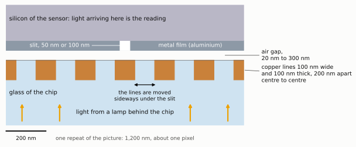
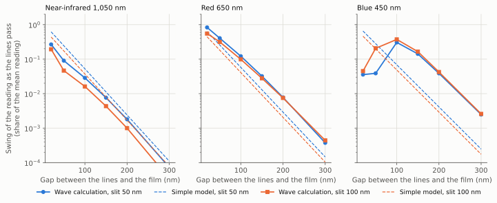
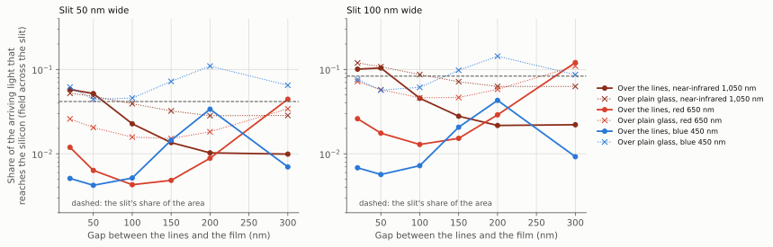
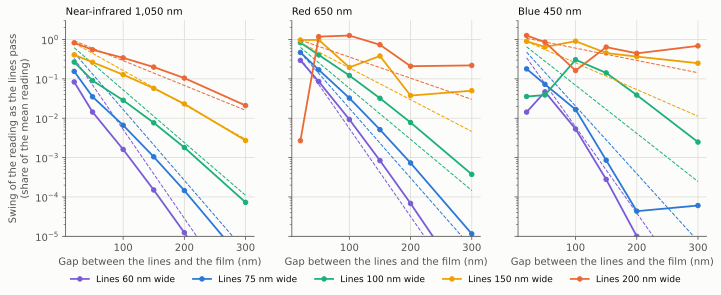
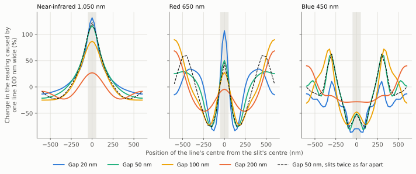

# A slit over fine lines, with waves

The study of [routes that keep ordinary light](research/ordinary-light-routes.md)
ranked first a metal film on the sensor with one narrow slit per pixel,
held within about 100 nm of the chip and lit by a plain lamp behind the
chip (its route B). That ranking rested on simple models: detail finer
than the wavelength fades with distance at a known rate, a slit passes
half the light that falls on it, and the slit reads whatever lies directly
under it. The study said plainly that none of this had been checked with a
wave calculation. This page is that check. It is the first item brought
forward under D5 of the [plan](plan.md#d-simulation-chain), and it answers
[REQ-22](design.md#requirements) (keep both the 100 nm goal and ordinary
light) and [REQ-15](design.md#requirements) (no hardware until simulation
shows a method works).

The answers:

- **The slit does see lines 100 nm wide, and the detail fades with the gap
  at close to the rate the simple model uses.** As the lines pass under
  the slit the reading swings up and down. The swing falls by a factor of
  2.7 for every 37 nm to 40 nm of gap in near-infrared and red light,
  against 32 nm to 34 nm in the simple model. The wave result is slightly
  the kinder of the two.
- **How strong the swing is depends on the colour.** In near-infrared
  light of 1,050 nm, which passes through a chip of full thickness, the
  swing is 0.37 to 0.75 of the simple model's. That is the same as the
  slit's edges being soft over about 60 nm to 105 nm, the cautious end of
  the range the routes study assumed. In red light of 650 nm it is 1.3 to
  2.7 times the simple model's. In blue light of 450 nm it is erratic:
  copper is a poor mirror in the blue, and the swing no longer falls
  steadily with the gap.
- **Only half the lamp's light takes part, and the other half does no
  harm.** Light whose electric field points across the slit passes. Light
  whose field points along the slit is stopped twice, by the lines and by
  the slit, and adds 0.04 % to 6 % to the reading.
- **The amount of light is close to the simple estimate over plain glass,
  and far from steady over lines.** Over plain glass a slit passes 0.8 to
  2.1 times the simple estimate. Over the lines the reading changes up to
  ten-fold with the gap, because light bounces between the film and the
  lines. The reading level is therefore itself a measure of the gap, and
  the gap has to be part of what is solved for.
- **The slit is not a purely local probe.** One line placed several
  hundred nanometres to the side of the slit changes the reading by tens
  of per cent, through light that runs along the metal film. This part
  varies slowly with position, so it does not blur fine detail, but a
  reconstruction that treats each reading as "what is under the slit"
  would be wrong. The forward model has to be a wave model.
- **Fine metal lines are themselves a polarising filter.** Lines 100 nm
  wide pass 81 % of near-infrared light whose field points across them
  and 1.3 % of light whose field points along them. A slit lying across
  such lines would therefore be nearly dark (Judgement, from two
  separate two-dimensional results; it needs a three-dimensional
  calculation).
- **Route B stands, with conditions.** Nothing here rules it out. In
  near-infrared light it needs a gap of about 100 nm or less to see
  100 nm lines in tens of readings, and each further 50 nm of gap costs
  10 to 18 times the readings. It is better with a film about 100 nm
  thick, and it needs a reconstruction built on a wave model.

Everything here is simulated, in a two-dimensional cross-section, at one
wavelength at a time, with light arriving from one direction. Section 12
lists what that leaves out. Code:
[`ccdsr/slit_waves.py`](https://github.com/mithro/ccd-superres/blob/main/ccdsr/slit_waves.py)
and
[`ccdsr/fdfd.py`](https://github.com/mithro/ccd-superres/blob/main/ccdsr/fdfd.py);
tests:
[`tests/test_slit_waves.py`](https://github.com/mithro/ccd-superres/blob/main/tests/test_slit_waves.py);
saved runs:
[`results/slit-waves/readings.json`](https://github.com/mithro/ccd-superres/blob/main/results/slit-waves/readings.json).

## How claims are marked

| Mark | Meaning |
|---|---|
| Simulated | Computed here with the wave solver, for the idealised cross-section of section 1 |
| Derived here | Worked out on this page from stated figures |
| Estimate | A rough figure from a simple model |
| Judgement | A conclusion drawn from the results, which could be argued |
| A key in square brackets | Taken from the source of that key in the [list of sources](#sources) |

*Table 1. Marks used on this page.*

## 1. What was calculated



*Figure 1. The cross-section, drawn to scale for a gap of 50 nm and a slit
of 50 nm. Everything continues unchanged into the page, so the slit runs
along the lines. The picture repeats sideways every 1,200 nm. Drawn by
[`make_slit_wave_diagrams.py`](https://github.com/mithro/ccd-superres/blob/main/docs/diagrams/make_slit_wave_diagrams.py).*

The chip is at the bottom of Figure 1 and the sensor at the top. Light
from a lamp behind the chip travels up through the chip's glass, meets
metal lines set into the top of the glass, crosses an air gap, and meets
a metal film lying on the sensor's silicon. The film has one slit. Light
that gets into the silicon is counted as the reading. The lines are then
moved sideways under the slit in steps of 25 nm, which is what a scan
does, and the reading is recorded at each step.

Two numbers summarise each case:

- the **mean reading**: the share of the light arriving on one repeat of
  the picture (about one pixel) that reaches the silicon, averaged over
  the positions of the lines;
- the **swing**: the size of the part of the reading that rises and falls
  once for each line that passes, as a share of the mean reading. A swing
  of 0 means the slit does not see the lines. A swing of 1 means the
  reading goes between zero and twice its mean.

The light is described by the direction of its electric field. "Across"
means across the slit and the lines (physicists call this p or TM), and
"along" means along them (s or TE). A lamp gives equal amounts of both.

| Setting | Values | Why |
|---|---|---|
| Lines | Copper, 100 nm wide, 100 nm apart, 100 nm thick, flush with the top of the glass. Also 60, 75, 150 and 200 nm wide, one line alone, and aluminium | The 100 nm target of the project; copper is the usual metal of fine chip wiring |
| Gap | 20, 50, 100, 150, 200 and 300 nm of air | The range asked for by the [routes study](research/ordinary-light-routes.md#10-what-the-simulator-needs), Table 22, item 1 |
| Film | Aluminium, 50 nm and 100 nm thick, on silicon | The film of the routes study, Table 15 |
| Slit | 50 nm and 100 nm wide (200 nm also, without lines) | As the routes study |
| Light | 1,050 nm (near-infrared), 650 nm (red), 450 nm (blue); field across and along; straight up, and slanted 30° in the glass | 1,050 nm passes through a chip of full thickness ([backlight](backlight.md)); red and blue need a chip thinned to a few micrometres |
| Repeat | 1,200 nm, and 2,400 nm as a check | Close to the 1,120 nm pixel pitch, and a whole number of lines |
| Grid | 2.5 nm, and 1.25 nm as a check | See section 2 |

*Table 2. What was varied. 1,911 cross-sections in all.*

| Material | 1,050 nm | 650 nm | 450 nm | Source |
|---|--:|--:|--:|---|
| Aluminium (film) | 1.39 + 10.08i | 1.56 + 7.71i | 0.63 + 5.45i | [[SW1](#sw1)] |
| Copper (lines) | 0.35 + 6.93i | 0.24 + 3.63i | 1.24 + 2.39i | [[SW2](#sw2)] |
| Silicon (sensor) | 3.556 + 0.0001i | 3.844 + 0.014i | 4.691 + 0.086i | Green 2008, as on the [backlight](backlight.md) page |
| Glass (chip) | 1.46 | 1.46 | 1.46 | Round value; fused silica is 1.45 to 1.47 over this range [[SW3](#sw3)] |

*Table 3. Refractive index of each material: the first number bends
light, the second (with the i) absorbs it. The metal values are
interpolated from published tables kept in
[`ccdsr/data`](https://github.com/mithro/ccd-superres/tree/main/ccdsr/data).*

## 2. The solver and how it was checked

The wave solver of the [slot waves](slot-waves.md) page handled one
direction of the electric field. For this page it gained a second entry
point, `solve_periodic`, for structures that repeat sideways, in both
field directions. It solves Maxwell's equations on a grid of points, at
one wavelength, with nothing left out except what the grid spacing
cannot show.

Each check below compares the solver with a result known from theory. All
are in the tests.

| Check | Known result | Solver |
|---|---|---|
| Light entering flat glass at 0°, 30° and 60°, both field directions | Fresnel's formulas [BornWolf] | Within 0.002 of the share passed |
| Glass at Brewster's angle, field across | Nothing reflects | 1.000 passed, within 0.002 |
| Light entering flat silicon at 30° | Fresnel's formulas | Within 0.006 |
| A layer of air between glass and silicon, 50 nm and 300 nm thick | The textbook formula for one layer [BornWolf] | Within 1 % |
| Fine detail above a grating finer than the wavelength | Fades as exp(−distance ÷ fade length) [Goodman] | Within 2 % over 125 nm, both field directions |
| A slit narrower than half a wavelength in a perfect metal, field along | Light falls as exp(−2κt) with thickness t, where κ² = (π ÷ width)² − (2π ÷ wavelength)² | Within 25 % (one grid cell changes the slit's width by 2.5 %) |
| The same, field across | Passes, with nearly complete passage at thicknesses a little under half a wavelength [[SW4](#sw4), [SW5](#sw5)] | Peak above 0.85; below 0.5 away from it |
| Clear materials only | Light in equals light out | Within 0.5 % |

*Table 4. Checks of the solver against theory. Simulated; the known
results are from the sources given.*

One error was found and corrected this way. For the field across, the
first version averaged the wrong quantity between neighbouring grid
points at a boundary between two materials, and its answers changed by
up to a factor of two when the grid was made finer. With the right
average (one over the mean of the squared index) the answers settle.

| Light | Gap (nm) | Mean reading, grid 2.5 nm | Mean reading, grid 1.25 nm | Difference | Swing, grid 2.5 nm | Swing, grid 1.25 nm | Difference |
|---|--:|--:|--:|--:|--:|--:|--:|
| Near-infrared 1,050 nm | 20 | 0.0578 | 0.0601 | -3.8 % | 0.267 | 0.262 | +2.0 % |
| Near-infrared 1,050 nm | 100 | 0.0227 | 0.0233 | -2.5 % | 0.0286 | 0.0283 | +0.9 % |
| Red 650 nm | 20 | 0.0119 | 0.0124 | -3.5 % | 0.832 | 0.825 | +0.9 % |
| Red 650 nm | 100 | 0.00430 | 0.00446 | -3.7 % | 0.122 | 0.120 | +0.9 % |
| Blue 450 nm | 20 | 0.00510 | 0.00513 | -0.5 % | 0.0356 | 0.0213 | +67.0 % |
| Blue 450 nm | 100 | 0.00516 | 0.00515 | +0.2 % | 0.306 | 0.300 | +2.0 % |

*Table 5. The same cases at two grid spacings, slit 50 nm, field across.
Simulated. Readings are 0 % to 4 % low on the coarser grid and swings
within 2 %, except blue at 20 nm, where the swing is small because two
effects nearly cancel and is not to be trusted.*

| Light | Light through one slit, slits 1,200 nm apart (nm) | The same, slits 2,400 nm apart (nm) | Swing, 1,200 nm apart | Swing, 2,400 nm apart | Change with one line under the slit, 1,200 nm apart | The same, 2,400 nm apart |
|---|--:|--:|--:|--:|--:|--:|
| Near-infrared 1,050 nm | 62.1 | 31.7 | 0.0904 | 0.0887 | +117 % | +123 % |
| Red 650 nm | 7.62 | 8.47 | 0.406 | 0.402 | +50 % | +46 % |
| Blue 450 nm | 5.08 | 5.46 | 0.0388 | 0.0216 | -51 % | -52 % |

*Table 6. What the sideways repeat does: slit 50 nm, gap 50 nm, field
across. Simulated. "Light through one slit" is the mean reading times the
repeat: the width of arriving light that one slit collects. The swing in
near-infrared and red does not depend on how far apart the slits are. The
light collected in near-infrared does: slits 1,200 nm apart each collect
twice what slits 2,400 nm apart do, so neighbouring slits help each
other. The blue swing at this gap is small and not stable, as in Table
5.*

## 3. Light through the slit over plain glass

Before any lines are added, how much light does a slit pass? The routes
study took a slit to pass all of the light with its field across and none
of the rest, so that a slit passes half the lamp's light falling on its
own area ([its Table 13](research/ordinary-light-routes.md#41-holes-pass-almost-no-light-slits-pass-plenty)).

| Light | Arrangement | Field across | Field along | Lamp (both) | Lamp, as a share of the open pixel | Simple estimate of that share | Lamp (both), range over gaps of 20 nm to 300 nm |
|---|---|--:|--:|--:|--:|--:|--:|
| Near-infrared 1,050 nm | Open pixel, no film | 0.79 | 0.79 | 0.79 | 1.0 |  | 0.55 to 0.82 |
| Near-infrared 1,050 nm | Unbroken film 50 nm | 0.0013 | 0.0013 | 0.0013 | 0.0016 |  | 7.5 × 10⁻⁴ to 0.0014 |
| Near-infrared 1,050 nm | Unbroken film 100 nm | 3.1 × 10⁻⁶ | 3.1 × 10⁻⁶ | 3.1 × 10⁻⁶ | 4.0 × 10⁻⁶ |  | 1.8 × 10⁻⁶ to 3.5 × 10⁻⁶ |
| Near-infrared 1,050 nm | Slit 50 nm, film 50 nm | 0.048 | 0.0025 | 0.025 | 0.032 | 0.021 | 0.015 to 0.027 |
| Near-infrared 1,050 nm | Slit 100 nm, film 50 nm | 0.11 | 0.012 | 0.060 | 0.076 | 0.042 | 0.035 to 0.066 |
| Near-infrared 1,050 nm | Slit 200 nm, film 50 nm | 0.16 | 0.083 | 0.12 | 0.15 | 0.083 | 0.071 to 0.14 |
| Near-infrared 1,050 nm | Slit 50 nm, film 100 nm | 0.065 | 3.1 × 10⁻⁵ | 0.032 | 0.041 | 0.021 | 0.019 to 0.037 |
| Near-infrared 1,050 nm | Slit 100 nm, film 100 nm | 0.14 | 9.9 × 10⁻⁴ | 0.071 | 0.090 | 0.042 | 0.041 to 0.083 |
| Near-infrared 1,050 nm | Slit 200 nm, film 100 nm | 0.18 | 0.027 | 0.10 | 0.13 | 0.083 | 0.061 to 0.12 |
| Red 650 nm | Open pixel, no film | 0.71 | 0.71 | 0.71 | 1.0 |  | 0.51 to 0.78 |
| Red 650 nm | Unbroken film 50 nm | 4.0 × 10⁻⁴ | 4.0 × 10⁻⁴ | 4.0 × 10⁻⁴ | 5.7 × 10⁻⁴ |  | 2.6 × 10⁻⁴ to 5.3 × 10⁻⁴ |
| Red 650 nm | Unbroken film 100 nm | 2.3 × 10⁻⁷ | 2.4 × 10⁻⁷ | 2.3 × 10⁻⁷ | 3.3 × 10⁻⁷ |  | 1.5 × 10⁻⁷ to 3.1 × 10⁻⁷ |
| Red 650 nm | Slit 50 nm, film 50 nm | 0.020 | 0.0016 | 0.011 | 0.016 | 0.021 | 0.0081 to 0.018 |
| Red 650 nm | Slit 100 nm, film 50 nm | 0.058 | 0.014 | 0.036 | 0.050 | 0.042 | 0.028 to 0.065 |
| Red 650 nm | Slit 200 nm, film 50 nm | 0.11 | 0.070 | 0.088 | 0.12 | 0.083 | 0.072 to 0.16 |
| Red 650 nm | Slit 50 nm, film 100 nm | 0.041 | 2.2 × 10⁻⁵ | 0.021 | 0.029 | 0.021 | 0.017 to 0.041 |
| Red 650 nm | Slit 100 nm, film 100 nm | 0.074 | 0.0014 | 0.038 | 0.053 | 0.042 | 0.032 to 0.071 |
| Red 650 nm | Slit 200 nm, film 100 nm | 0.099 | 0.028 | 0.063 | 0.089 | 0.083 | 0.057 to 0.12 |
| Blue 450 nm | Open pixel, no film | 0.56 | 0.56 | 0.56 | 1.0 |  | 0.44 to 0.68 |
| Blue 450 nm | Unbroken film 50 nm | 5.0 × 10⁻⁴ | 5.1 × 10⁻⁴ | 5.1 × 10⁻⁴ | 9.0 × 10⁻⁴ |  | 4.0 × 10⁻⁴ to 8.0 × 10⁻⁴ |
| Blue 450 nm | Unbroken film 100 nm | 2.5 × 10⁻⁷ | 2.5 × 10⁻⁷ | 2.5 × 10⁻⁷ | 4.5 × 10⁻⁷ |  | 2.0 × 10⁻⁷ to 4.0 × 10⁻⁷ |
| Blue 450 nm | Slit 50 nm, film 50 nm | 0.044 | 0.0024 | 0.023 | 0.042 | 0.021 | 0.023 to 0.057 |
| Blue 450 nm | Slit 100 nm, film 50 nm | 0.057 | 0.014 | 0.035 | 0.063 | 0.042 | 0.035 to 0.084 |
| Blue 450 nm | Slit 200 nm, film 50 nm | 0.077 | 0.054 | 0.065 | 0.12 | 0.083 | 0.065 to 0.14 |
| Blue 450 nm | Slit 50 nm, film 100 nm | 0.027 | 4.2 × 10⁻⁵ | 0.013 | 0.024 | 0.021 | 0.0098 to 0.017 |
| Blue 450 nm | Slit 100 nm, film 100 nm | 0.043 | 0.0018 | 0.023 | 0.040 | 0.042 | 0.019 to 0.033 |
| Blue 450 nm | Slit 200 nm, film 100 nm | 0.066 | 0.029 | 0.047 | 0.084 | 0.083 | 0.047 to 0.091 |

*Table 7. Share of the arriving light that reaches the silicon, with
plain glass under the film (no lines), at a gap of 50 nm; the last column
gives the range over all six gaps. Simulated. The simple estimate is half
the slit's share of the 1,200 nm repeat.*

Three things follow (Derived here from Table 7).

- The simple estimate holds within a factor of about two. As a share of
  the open pixel, a slit passes 0.8 to 2.1 times the estimate at this
  gap. Narrow slits in near-infrared light do best: a 50 nm slit passes
  1.5 to 2.0 times the estimate, because a slit gathers light from a
  strip wider than itself.
- A slit 50 nm wide passes at most 8 % as much of the "along" light as of
  the "across" light, and far less in a film 100 nm thick. A slit 200 nm
  wide passes much of both, and stops being a polarising element.
- A film 50 nm thick is not fully opaque. It leaks 0.04 % to 0.13 % of
  the light over the whole pixel, which is 2 % to 5 % of what a 50 nm
  slit passes. A film 100 nm thick leaks under 0.0004 %.

## 4. Lines 100 nm wide under the slit



*Figure 2. Swing of the reading against the gap, for lines 100 nm wide
and light with its field across the slit. Solid: wave calculation.
Dashed: the simple model. The vertical scale is logarithmic: each step
is a factor of ten. Simulated.*

The simple model that the routes study used predicts the swing in three
steps (Derived here): stripes that are fully dark and fully clear have a
once-per-line part 4 ÷ π = 1.27 times their mean; a gap g multiplies that
by exp(−g ÷ fade length), with the fade length of
[`near_field_transfer`](https://github.com/mithro/ccd-superres/blob/main/ccdsr/near_contact.py);
and a slit of width w averages it by sin(πw ÷ p) ÷ (πw ÷ p) for lines of
period p. This is the routes study's level 0 model with perfectly sharp
slit edges.

| Light | Slit (nm) | Gap (nm) | Mean reading | Swing, wave calculation | Swing, simple model | Wave ÷ simple | Reading is highest over a | Readings for the lines to stand 5 times above the noise |
|---|--:|--:|--:|--:|--:|--:|---|--:|
| Near-infrared 1,050 nm | 50 | 20 | 0.058 | 0.27 | 0.62 | 0.43 | line | 0.28 |
| Near-infrared 1,050 nm | 50 | 50 | 0.052 | 0.090 | 0.25 | 0.37 | line | 2.4 |
| Near-infrared 1,050 nm | 50 | 100 | 0.023 | 0.029 | 0.052 | 0.54 | line | 24 |
| Near-infrared 1,050 nm | 50 | 150 | 0.014 | 0.0076 | 0.011 | 0.68 | line | 342 |
| Near-infrared 1,050 nm | 50 | 200 | 0.010 | 0.0018 | 0.0024 | 0.75 | line | 6,159 |
| Near-infrared 1,050 nm | 50 | 300 | 0.0099 | 7.3 × 10⁻⁵ | 1.1 × 10⁻⁴ | 0.66 | line | 3,778,601 |
| Near-infrared 1,050 nm | 100 | 20 | 0.10 | 0.19 | 0.44 | 0.44 | line | 0.53 |
| Near-infrared 1,050 nm | 100 | 50 | 0.10 | 0.047 | 0.17 | 0.27 | line | 9.2 |
| Near-infrared 1,050 nm | 100 | 100 | 0.046 | 0.016 | 0.037 | 0.43 | line | 77 |
| Near-infrared 1,050 nm | 100 | 150 | 0.028 | 0.0043 | 0.0079 | 0.55 | line | 1,066 |
| Near-infrared 1,050 nm | 100 | 200 | 0.022 | 1.0 × 10⁻³ | 0.0017 | 0.59 | line | 20,099 |
| Near-infrared 1,050 nm | 100 | 300 | 0.022 | 3.4 × 10⁻⁵ | 7.8 × 10⁻⁵ | 0.44 | line | 16,856,180 |
| Red 650 nm | 50 | 20 | 0.012 | 0.83 | 0.63 | 1.3 | line | 0.029 |
| Red 650 nm | 50 | 50 | 0.0064 | 0.41 | 0.26 | 1.6 | line | 0.12 |
| Red 650 nm | 50 | 100 | 0.0043 | 0.12 | 0.058 | 2.1 | line | 1.4 |
| Red 650 nm | 50 | 150 | 0.0048 | 0.032 | 0.013 | 2.5 | line | 19 |
| Red 650 nm | 50 | 200 | 0.0089 | 0.0078 | 0.0029 | 2.7 | line | 330 |
| Red 650 nm | 50 | 300 | 0.044 | 3.7 × 10⁻⁴ | 1.5 × 10⁻⁴ | 2.6 | line | 142,385 |
| Red 650 nm | 100 | 20 | 0.026 | 0.55 | 0.45 | 1.2 | line | 0.066 |
| Red 650 nm | 100 | 50 | 0.018 | 0.32 | 0.18 | 1.7 | line | 0.20 |
| Red 650 nm | 100 | 100 | 0.013 | 0.098 | 0.041 | 2.4 | line | 2.1 |
| Red 650 nm | 100 | 150 | 0.015 | 0.028 | 0.0092 | 3.1 | line | 26 |
| Red 650 nm | 100 | 200 | 0.029 | 0.0075 | 0.0021 | 3.7 | line | 356 |
| Red 650 nm | 100 | 300 | 0.12 | 4.4 × 10⁻⁴ | 1.0 × 10⁻⁴ | 4.3 | line | 102,419 |
| Blue 450 nm | 50 | 20 | 0.0051 | 0.036 | 0.65 | 0.055 | space | 16 |
| Blue 450 nm | 50 | 50 | 0.0042 | 0.039 | 0.28 | 0.14 | space | 13 |
| Blue 450 nm | 50 | 100 | 0.0052 | 0.31 | 0.069 | 4.4 | space | 0.21 |
| Blue 450 nm | 50 | 150 | 0.014 | 0.14 | 0.017 | 8.4 | space | 0.99 |
| Blue 450 nm | 50 | 200 | 0.034 | 0.039 | 0.0041 | 9.4 | space | 13 |
| Blue 450 nm | 50 | 300 | 0.0070 | 0.0025 | 2.5 × 10⁻⁴ | 10 | line | 3,250 |
| Blue 450 nm | 100 | 20 | 0.0068 | 0.045 | 0.46 | 0.097 | space | 9.9 |
| Blue 450 nm | 100 | 50 | 0.0057 | 0.21 | 0.20 | 1.0 | space | 0.47 |
| Blue 450 nm | 100 | 100 | 0.0072 | 0.37 | 0.049 | 7.7 | space | 0.14 |
| Blue 450 nm | 100 | 150 | 0.021 | 0.17 | 0.012 | 14 | space | 0.73 |
| Blue 450 nm | 100 | 200 | 0.043 | 0.042 | 0.0029 | 15 | space | 11 |
| Blue 450 nm | 100 | 300 | 0.0092 | 0.0026 | 1.7 × 10⁻⁴ | 15 | line | 2,986 |

*Table 8. Lines 100 nm wide and 100 nm apart under the slit, field
across, film 50 nm thick. Simulated, except the last column, which is an
Estimate: each reading is taken as filled to 2,500 electrons with only
the noise of counting them, and the swing fitted to N readings spread
over the lines then has a noise of √(2 ÷ (2,500 N)). It ignores read
noise, errors in position and everything else a real reconstruction must
solve for, so it is a floor.*

What Table 8 and Figure 2 show:

- **Near-infrared.** The swing is 0.27 at a gap of 20 nm, 0.090 at 50 nm
  and 0.029 at 100 nm for a 50 nm slit, and falls steadily. It is 0.37
  to 0.75 of the simple model's. A slit whose edges were soft over 57 nm
  to 106 nm (full width at half maximum of a Gaussian blur) would give
  the same loss in the simple model (Derived here). The routes study
  assumed 30 nm to 100 nm.
- **Red.** The swing is 0.83, 0.41 and 0.12 at the same gaps, 1.3 to 2.7
  times the simple model's, and it too falls steadily. The mean reading
  is 5 to 8 times lower than in near-infrared at gaps up to 100 nm, because
  the copper lines pass less red light (section 6).
- **Blue.** The swing is small at 20 nm and 50 nm, largest at 100 nm, and
  the bright and dark positions are the other way round from the other
  two colours. Copper absorbs blue light instead of reflecting it, and
  the light bouncing between the film and the chip is near a resonance.
  Blue is the worst of the three colours for this arrangement, not the
  best as the simple model implied.
- **The sign.** In near-infrared and red the reading is highest when a
  metal line is under the slit, not a space. The slit does not see a
  shadow picture of the lines. The simple model has no sign at all, so
  this does not contradict it, but a reconstruction has to take the sign
  from a wave model.
- **A wider slit loses some swing and gains light.** A 100 nm slit gives
  0.5 to 0.7 of the swing of a 50 nm slit in near-infrared and 0.7 to
  1.2 of it in red, with 1.7 to 3.3 times the light.


*Figure 3. Strength of the magnetic field in the cross-section at a gap
of 50 nm, with a line (left) and a space (right) under the slit. White
outlines mark the metal; the dotted line is the top of the film, with
the silicon above it. In near-infrared the field between the film and
the chip is 1.5 to 2.2 times the arriving wave's, which is the light
bouncing between them. Simulated.*



*Figure 4. Mean reading against the gap, field across. Solid: over the
lines. Dotted: over plain glass. Simulated.*

The mean reading over the lines changes up to ten-fold with the gap
(Figure 4): from 0.058 to 0.0099 in near-infrared, and from 0.0043 to
0.044 in red, for a 50 nm slit. Over plain glass it changes by a factor
of two to three. The film and the lines face each other like two
mirrors, and how much light builds up between them depends on their
spacing. For a real instrument this cuts both ways (Judgement). The
exposure cannot be set once for all gaps and all patterns. But the
reading level carries information about the gap, which is the quantity
that most needs to be known.

## 5. Finer and coarser lines



*Figure 5. Swing against the gap for lines of five widths, slit 50 nm,
field across. Solid: wave calculation. Dashed: simple model. Simulated.*

| Light | Line width (nm) | Period (nm) | Fade length, simple model (nm) | Fade length fitted to the wave calculation, gaps to 150 nm (nm) | Ratio | Swing at 20 nm | Swing at 50 nm | Swing at 100 nm | Swing at 150 nm | Swing at 200 nm | Swing at 300 nm |
|---|--:|--:|--:|--:|--:|--:|--:|--:|--:|--:|--:|
| Near-infrared 1,050 nm | 60 | 120 | 19.2 | 20.9 | 1.1 | 0.083 | 0.014 | 0.0016 | 1.5 × 10⁻⁴ | 1.2 × 10⁻⁵ | 6.1 × 10⁻⁸ |
| Near-infrared 1,050 nm | 75 | 150 | 24.1 | 26.5 | 1.1 | 0.15 | 0.034 | 0.0065 | 0.0010 | 1.4 × 10⁻⁴ | 2.0 × 10⁻⁶ |
| Near-infrared 1,050 nm | 100 | 200 | 32.4 | 37.5 | 1.2 | 0.27 | 0.090 | 0.029 | 0.0076 | 0.0018 | 7.3 × 10⁻⁵ |
| Near-infrared 1,050 nm | 150 | 300 | 49.8 | 66.5 | 1.3 | 0.41 | 0.26 | 0.13 | 0.058 | 0.023 | 0.0027 |
| Near-infrared 1,050 nm | 200 | 400 | 68.9 | 93.6 | 1.4 | 0.82 | 0.55 | 0.34 | 0.20 | 0.10 | 0.021 |
| Red 650 nm | 60 | 120 | 19.4 | 22.2 | 1.1 | 0.29 | 0.086 | 0.0093 | 8.4 × 10⁻⁴ | 6.8 × 10⁻⁵ | 3.5 × 10⁻⁷ |
| Red 650 nm | 75 | 150 | 24.5 | 29.0 | 1.2 | 0.46 | 0.17 | 0.032 | 0.0051 | 7.3 × 10⁻⁴ | 1.2 × 10⁻⁵ |
| Red 650 nm | 100 | 200 | 33.5 | 40.0 | 1.2 | 0.83 | 0.41 | 0.12 | 0.032 | 0.0078 | 3.7 × 10⁻⁴ |
| Red 650 nm | 150 | 300 | 53.8 | 100 | 1.9 | 0.97 | 0.98 | 0.20 | 0.38 | 0.038 | 0.050 |
| Red 650 nm | 200 | 400 | 80.8 | -29.4 | -0.36 | 0.0027 | 1.2 | 1.3 | 0.74 | 0.21 | 0.22 |
| Blue 450 nm | 60 | 120 | 19.8 | 29.6 | 1.5 | 0.014 | 0.047 | 0.0053 | 2.8 × 10⁻⁴ | 1.0 × 10⁻⁵ | 1.3 × 10⁻⁶ |
| Blue 450 nm | 75 | 150 | 25.3 | 25.7 | 1.0 | 0.18 | 0.073 | 0.017 | 0.0010 | 1.0 × 10⁻⁵ | 6.1 × 10⁻⁵ |
| Blue 450 nm | 100 | 200 | 35.5 | -71.5 | -2.0 | 0.036 | 0.039 | 0.31 | 0.14 | 0.039 | 0.0025 |
| Blue 450 nm | 150 | 300 | 64.1 | 259 | 4.0 | 0.90 | 0.65 | 0.91 | 0.45 | 0.37 | 0.25 |
| Blue 450 nm | 200 | 400 | 139 | 127 | 0.92 | 1.3 | 0.86 | 0.16 | 0.64 | 0.45 | 0.69 |

*Table 9. Lines of five widths, each with spaces of the same width, slit
50 nm, field across. Simulated. A negative fitted fade length means the
swing did not fall with the gap over that range.*

In near-infrared light the fade length from the wave calculation is 1.1
to 1.4 times the simple model's for every line width, so the simple
model's central claim holds there, with a little to spare. Lines 60 nm
wide give a swing of 0.083 at a gap of 20 nm and 0.014 at 50 nm. In red
light the same holds for lines up to 100 nm wide. Where the period of
the lines comes near the wavelength (lines 150 nm and 200 nm wide in red
and blue) the swing is large at every gap and does not fall steadily:
such lines send out waves that travel, and the question of fading no
longer applies to them.

## 6. The other half of the light, and lines as a polarising filter

| Light | Gap (nm) | Mean reading, field across | Mean reading, field along | Along ÷ across | Swing, field across | Swing, field along | Swing, lamp (both) |
|---|--:|--:|--:|--:|--:|--:|--:|
| Near-infrared 1,050 nm | 20 | 0.058 | 3.7 × 10⁻⁵ | 6.5 × 10⁻⁴ | 0.27 | 0.28 | 0.27 |
| Near-infrared 1,050 nm | 50 | 0.052 | 2.1 × 10⁻⁵ | 4.1 × 10⁻⁴ | 0.090 | 0.16 | 0.090 |
| Near-infrared 1,050 nm | 100 | 0.023 | 1.2 × 10⁻⁵ | 5.3 × 10⁻⁴ | 0.029 | 0.052 | 0.029 |
| Near-infrared 1,050 nm | 150 | 0.014 | 8.8 × 10⁻⁶ | 6.5 × 10⁻⁴ | 0.0076 | 0.014 | 0.0076 |
| Near-infrared 1,050 nm | 200 | 0.010 | 8.0 × 10⁻⁶ | 7.8 × 10⁻⁴ | 0.0018 | 0.0032 | 0.0018 |
| Near-infrared 1,050 nm | 300 | 0.0099 | 1.1 × 10⁻⁵ | 0.0011 | 7.3 × 10⁻⁵ | 1.4 × 10⁻⁴ | 7.3 × 10⁻⁵ |
| Red 650 nm | 20 | 0.012 | 8.2 × 10⁻⁵ | 0.0069 | 0.83 | 0.54 | 0.82 |
| Red 650 nm | 50 | 0.0064 | 5.5 × 10⁻⁵ | 0.0086 | 0.41 | 0.32 | 0.40 |
| Red 650 nm | 100 | 0.0043 | 4.4 × 10⁻⁵ | 0.010 | 0.12 | 0.096 | 0.12 |
| Red 650 nm | 150 | 0.0048 | 5.7 × 10⁻⁵ | 0.012 | 0.032 | 0.022 | 0.032 |
| Red 650 nm | 200 | 0.0089 | 1.4 × 10⁻⁴ | 0.016 | 0.0078 | 0.0040 | 0.0076 |
| Red 650 nm | 300 | 0.044 | 3.2 × 10⁻⁴ | 0.0073 | 3.7 × 10⁻⁴ | 7.0 × 10⁻⁶ | 3.7 × 10⁻⁴ |
| Blue 450 nm | 20 | 0.0051 | 1.9 × 10⁻⁴ | 0.037 | 0.036 | 0.64 | 0.057 |
| Blue 450 nm | 50 | 0.0042 | 1.5 × 10⁻⁴ | 0.035 | 0.039 | 0.37 | 0.050 |
| Blue 450 nm | 100 | 0.0052 | 2.1 × 10⁻⁴ | 0.041 | 0.31 | 0.095 | 0.30 |
| Blue 450 nm | 150 | 0.014 | 8.5 × 10⁻⁴ | 0.059 | 0.14 | 0.014 | 0.13 |
| Blue 450 nm | 200 | 0.034 | 4.8 × 10⁻⁴ | 0.014 | 0.039 | 9.4 × 10⁻⁴ | 0.038 |
| Blue 450 nm | 300 | 0.0070 | 1.5 × 10⁻⁴ | 0.022 | 0.0025 | 6.3 × 10⁻⁴ | 0.0024 |

*Table 10. The two field directions, lines 100 nm wide, slit 50 nm, film
50 nm. Simulated. The lamp's reading is the mean of the two.*

Light with its field along the slit adds 0.04 % to 0.11 % to the reading
in near-infrared, 0.7 % to 1.6 % in red and 1.4 % to 5.9 % in blue. A
plain lamp, which gives both kinds equally, therefore loses half its
light and almost none of its swing. No polarising filter is needed.

The reason is partly the slit and partly the lines themselves. Metal
lines much finer than the wavelength pass light whose field points
across them and reflect light whose field points along them. This is
how a wire-grid polarising filter works [[SW6](#sw6)].

| Light | Line and space width (nm) | Field across the lines | Field along the lines | Across ÷ along |
|---|--:|--:|--:|--:|
| Near-infrared 1,050 nm | 60 | 0.86 | 0.0056 | 151 |
| Near-infrared 1,050 nm | 75 | 0.84 | 0.0077 | 110 |
| Near-infrared 1,050 nm | 100 | 0.81 | 0.013 | 64 |
| Near-infrared 1,050 nm | 150 | 0.74 | 0.034 | 22 |
| Near-infrared 1,050 nm | 200 | 0.65 | 0.083 | 7.8 |
| Red 650 nm | 60 | 0.40 | 0.019 | 21 |
| Red 650 nm | 75 | 0.36 | 0.024 | 15 |
| Red 650 nm | 100 | 0.31 | 0.040 | 7.6 |
| Red 650 nm | 150 | 0.23 | 0.11 | 2.1 |
| Red 650 nm | 200 | 0.11 | 0.29 | 0.39 |
| Blue 450 nm | 60 | 0.11 | 0.015 | 7.3 |
| Blue 450 nm | 75 | 0.098 | 0.020 | 4.8 |
| Blue 450 nm | 100 | 0.083 | 0.042 | 2.0 |
| Blue 450 nm | 150 | 0.066 | 0.25 | 0.26 |
| Blue 450 nm | 200 | 0.22 | 0.25 | 0.88 |

*Table 11. Share of the arriving light that passes copper lines 100 nm
thick into bare silicon 50 nm above them, with no film: what an open
pixel would collect over such lines. Simulated.*

Two consequences, both Judgement because this cross-section can only
hold a slit that runs along the lines:

- A slit turned to lie across dense fine lines needs light whose field
  is along the lines, which the lines reflect. In near-infrared light
  over 100 nm lines it would receive about 1/64 of the light that a slit
  along the lines receives. The mask of slits at many angles would then
  give readings whose level depends strongly on the angle between each
  slit and the lines below it. That is information about the direction
  of the wiring, and it also means the readings are not the simple
  shadow sums that the first two-dimensional test of the routes study
  assumed.
- The same applies with no mask at all. An open pixel over dense fine
  wiring sees mostly light of one field direction.

Both need a three-dimensional wave calculation to confirm.

## 7. One line alone: how local is the slit?



*Figure 6. Change in the reading caused by one copper line 100 nm wide,
against where the line is, for a 50 nm slit and field across. The grey
band is the width of the line when centred. Dashed: the same at a gap of
50 nm with slits 2,400 nm apart in place of 1,200 nm. Simulated.*

| Light | Gap (nm) | Change in reading, line under the slit | Largest change | Line's distance from the slit at the largest change (nm) | Full width at half of the change under the slit (nm) |
|---|--:|--:|--:|--:|--:|
| Near-infrared 1,050 nm | 20 | +131.5 % | +131.5 % | 0 | 169 |
| Near-infrared 1,050 nm | 50 | +116.6 % | +116.6 % | 0 | 220 |
| Near-infrared 1,050 nm | 100 | +87.0 % | +87.0 % | 0 | 250 |
| Near-infrared 1,050 nm | 200 | +26.9 % | +26.9 % | 0 | 209 |
| Red 650 nm | 20 | +107.0 % | +107.0 % | 0 | 72.9 |
| Red 650 nm | 50 | +50.3 % | -76.0 % | 150 | 74.7 |
| Red 650 nm | 100 | +27.6 % | +89.9 % | 600 | 76.3 |
| Red 650 nm | 200 | -4.5 % | +68.6 % | 600 | 860 |
| Blue 450 nm | 20 | -79.4 % | -86.4 % | 75 | 291 |
| Blue 450 nm | 50 | -51.1 % | -80.8 % | 75 | 351 |
| Blue 450 nm | 100 | -47.6 % | +72.1 % | 325 | 459 |
| Blue 450 nm | 200 | -28.2 % | +40.3 % | 600 | 805 |

*Table 12. Response to one line. Simulated. The line repeats every
1,200 nm with the slits, so a distance of 600 nm is half way between two
slits.*

A slit that read only what lies under it would give a response as wide
as the line and the slit together, about 100 nm here, and nothing
further out. The wave calculation gives something else.

- In near-infrared light one line under the slit more than doubles the
  reading at gaps up to 50 nm. The response is a single peak 170 nm to
  250 nm wide, with a shallow dip of 13 % to 25 % further out.
- In red light the central peak is sharp, about 75 nm wide at gaps up
  to 100 nm. But a line 125 nm to 175 nm to the side cuts the reading by
  about three quarters, and a line 600 nm away raises it by up to 90 %.
- In blue light a line under the slit cuts the reading by 28 % to 79 %,
  and a line about 300 nm to the side raises it by up to 72 %.

Slits and grooves in a metal film are known to affect each other over
many wavelengths through light that runs along the metal's surface
[[SW7](#sw7), [SW8](#sw8)]. The dashed curves in Figure 6 show that the
central part of the response does not depend on how far apart the slits
are, while the outer part in red does.

What this means (Judgement): the reading has a sharp part, which carries
the fine detail and fades with the gap as sections 4 and 5 describe, and
a broad part, which depends on everything within about a wavelength of
the slit and on the neighbouring slits. The broad part does not blur the
fine detail, because it changes slowly with position. But in red and
blue it is as large as the sharp part, so a reconstruction that models each reading as a
weighted sum of what is under the slit will fit real readings badly. The
reconstruction needs a wave model as its forward model. That is a matter
of computing cost, which [REQ-23](design.md#requirements) says is never
a reason to drop an approach.

## 8. Variations

| Light | Gap (nm) | Baseline | Film 100 nm thick | Aluminium lines | Light slanted 30° in the glass |
|---|--:|--:|--:|--:|--:|
| Near-infrared 1,050 nm | 20 | 0.058 / 0.27 | 0.081 / 0.29 | 0.081 / 0.19 | 0.10 / 0.15 |
| Near-infrared 1,050 nm | 50 | 0.052 / 0.090 | 0.065 / 0.083 | 0.055 / 0.081 | 0.091 / 0.058 |
| Near-infrared 1,050 nm | 100 | 0.023 / 0.029 | 0.027 / 0.027 | 0.023 / 0.026 | 0.065 / 0.019 |
| Near-infrared 1,050 nm | 150 | 0.014 / 0.0076 | 0.016 / 0.0072 | 0.014 / 0.0072 | 0.044 / 0.0062 |
| Near-infrared 1,050 nm | 200 | 0.010 / 0.0018 | 0.012 / 0.0017 | 0.010 / 0.0017 | 0.033 / 0.0019 |
| Near-infrared 1,050 nm | 300 | 0.0099 / 7.3 × 10⁻⁵ | 0.013 / 6.3 × 10⁻⁵ | 0.0097 / 7.0 × 10⁻⁵ | 0.022 / 1.5 × 10⁻⁴ |
| Red 650 nm | 20 | 0.012 / 0.83 | 0.013 / 0.13 | 0.015 / 0.63 | 0.021 / 0.79 |
| Red 650 nm | 50 | 0.0064 / 0.41 | 0.015 / 0.45 | 0.0069 / 0.33 | 0.015 / 0.38 |
| Red 650 nm | 100 | 0.0043 / 0.12 | 0.011 / 0.15 | 0.0039 / 0.15 | 0.012 / 0.13 |
| Red 650 nm | 150 | 0.0048 / 0.032 | 0.014 / 0.035 | 0.0040 / 0.041 | 0.012 / 0.045 |
| Red 650 nm | 200 | 0.0089 / 0.0078 | 0.024 / 0.0054 | 0.0065 / 0.0094 | 0.014 / 0.014 |
| Red 650 nm | 300 | 0.044 / 3.7 × 10⁻⁴ | 0.066 / 2.3 × 10⁻⁴ | 0.079 / 5.7 × 10⁻⁴ | 0.025 / 0.0010 |
| Blue 450 nm | 20 | 0.0051 / 0.036 | 0.0039 / 0.38 | 0.018 / 0.33 | 0.0066 / 1.2 |
| Blue 450 nm | 50 | 0.0042 / 0.039 | 0.0039 / 0.33 | 0.0089 / 0.68 | 0.0040 / 0.87 |
| Blue 450 nm | 100 | 0.0052 / 0.31 | 0.0023 / 0.12 | 0.043 / 0.032 | 0.0034 / 0.41 |
| Blue 450 nm | 150 | 0.014 / 0.14 | 0.0033 / 0.13 | 0.10 / 0.064 | 0.0047 / 0.17 |
| Blue 450 nm | 200 | 0.034 / 0.039 | 0.0082 / 0.060 | 0.12 / 0.039 | 0.0048 / 0.066 |
| Blue 450 nm | 300 | 0.0070 / 0.0025 | 0.0022 / 0.012 | 0.069 / 0.012 | 0.018 / 0.0060 |

*Table 13. Mean reading / swing for three changes to the baseline (film
50 nm, copper lines, light straight up), slit 50 nm, field across.
Simulated.*

- **A film 100 nm thick** changes the near-infrared swing by under 15 %
  and passes 15 % to 40 % more light, with no leak through the metal. It
  is the better choice. In red at 20 nm the swing drops from 0.83 to
  0.13, a sign of how sharply tuned the smallest gaps are.
- **Aluminium lines** in place of copper lower the near-infrared swing
  by 30 % at a gap of 20 nm and by 10 % or less beyond, and change the
  red swing by 20 % to 30 % at gaps up to 200 nm. In blue they
  change everything, since aluminium reflects blue and copper does not.
- **Slanted light** gives a near-infrared swing 0.55 to 0.8 of the
  straight-up value at gaps to 150 nm. In red it is within 10 % at gaps
  to 100 nm and larger beyond. A real
  lamp sends light over a range of directions, so the working figure
  lies between the two (Judgement).

## 9. What this means for the slit mask

| Assumption of the routes study | Wave result | Verdict |
|---|---|---|
| Detail of period p fades with gap g as exp(−g ÷ fade length), 32 nm to 36 nm for 100 nm lines | Fitted fade length 37 nm to 40 nm in near-infrared and red | Confirmed, slightly better |
| The slit's edges are soft over 30 nm to 100 nm | Equivalent softness 57 nm to 106 nm in near-infrared; none in red (the swing exceeds the sharp-edged model) | Near-infrared sits at the cautious end; red is better than assumed |
| A slit passes half the lamp's light on its area | 0.8 to 2.1 times that over plain glass. Over lines, 0.14 to 2.1 times, depending on gap and colour | Right within a factor of two over glass; not a constant over lines |
| Light with the field along the slit is not passed | It adds 0.04 % to 6 % | Confirmed |
| Each reading is a sum over what lies under the slit | A broad part of the response reaches hundreds of nanometres | Not confirmed. A wave forward model is needed |
| Any colour the chip passes will do, and bluer is sharper | Near-infrared and red behave regularly; blue is erratic with copper lines | Changed: red is the best of the three, near-infrared the most practical |
| Slits at many angles give sums along many directions | Fine lines pass one field direction, so a slit across them is nearly dark | Open. Needs three dimensions |

*Table 14. The routes study's assumptions about route B against this
page. The left column is from
[its sections 3 and 4](research/ordinary-light-routes.md#4-going-close-a-metal-mask-with-slits-at-many-angles);
the verdicts are Judgement.*

The routes study gave route B clean lines of 66 nm to 109 nm, for a slit
50 nm away with edges soft over 30 nm up to a slit 100 nm away with
edges soft over 100 nm. In near-infrared light the wave result sits near
the 109 nm end of that range, and in red light within it (Judgement;
the level 0 model was not rerun with the wave figures).

How close the sensor must be, in near-infrared light with a 50 nm slit
(Estimate, from the last column of Table 8): the lines stand five times
above the noise after about 2 readings at a gap of 50 nm, 24 at 100 nm,
350 at 150 nm and 6,200 at 200 nm. Each further 50 nm of gap costs 10
to 18 times the readings. The baseline scan takes about 13,000 readings
of every pixel-sized patch of the chip
([design, section 5.2](design.md#52-scan)), shared among slits of every
direction. If a twelfth of them, about 1,100, come from slits that run
along a given set of lines, gaps up to about 150 nm are within the
baseline scan and 200 nm is not (Judgement). This is the exchange between oversampling and distance that
[REQ-24](design.md#requirements) asks to be stated, now from a wave
calculation: one fade length of gap (37 nm) costs 7.4 times the
readings.

## 10. What changes in the plan

| Change | Where |
|---|---|
| The first part of the wave check of the near-contact routes is done; the wave solver handles both field directions and structures that repeat | [Plan](plan.md#d-simulation-chain), item D5 |
| The slit model for level 1 must take its response from the wave calculation, including the sign, the broad part and the dependence of the reading level on the gap | [Plan](plan.md#d-simulation-chain), items D2g and D2h |
| A three-dimensional wave calculation of a slit turned across the lines is needed before the mask of slits at many angles can be trusted | [Plan](plan.md#d-simulation-chain), item D5 |
| The design's table of routes records the wave result for route B | [Design, section 4.11](design.md#411-no-special-lighting-what-ordinary-light-can-reach-and-where-the-work-goes), Table 4.11e |

*Table 15. What this page changes.*

## 11. How to repeat it

```
python docs/diagrams/make_slit_wave_diagrams.py            # figures and tables from the saved runs, half a minute
python docs/diagrams/make_slit_wave_diagrams.py --rerun    # redo all 1,911 cross-sections, about an hour on four cores
python -m pytest -q tests/test_slit_waves.py
```

One cross-section from Python:

```python
from ccdsr.slit_waves import SlitCase, scan

result = scan(SlitCase(wavelength_nm=1050.0, polarisation="p", gap_nm=50.0, slit_nm=50.0))
print(result.mean, result.swing, result.brightest_over)
```

## 12. Limits

| Limit | Effect |
|---|---|
| Two dimensions | The slit runs along the lines and both are endlessly long. A slit across the lines, line ends, corners and real layouts are not covered |
| The picture repeats every 1,200 nm | Every pixel has the same slit in the same place, and all are lit in step. Table 6 shows the swing does not depend on this, and the light collected does |
| One wavelength, one direction, perfectly regular light | A lamp has a band of colours and directions, which would smooth the sharpest dependence on gap. Slanted light was tried at one angle (Table 13) |
| The lines sit at the top surface of the chip, with only glass beneath | A real chip has more wiring below the layer of interest, which the light meets first, and may have a covering layer above it. Removing layers is an open question ([design, section 11](design.md#11-build-stages-and-open-questions), item 15) |
| Flat surfaces and square corners | Real lines have sloped sides and rough surfaces |
| Published values for thick films of metal | Thin films and narrow wires absorb somewhat more. Aluminium lines were tried in place of copper (Table 13) |
| The reading is all light entering the silicon under the whole pixel | How much of it a pixel turns into signal is not modelled. In near-infrared a pixel absorbs only a small share ([backlight](backlight.md)) |
| Grid of 2.5 nm with stepped boundaries | Readings up to 4 % low, swings within 2 %, except where the swing is small through cancellation (Table 5) |
| The count of readings in Table 8 is a floor | It has only the noise of counting electrons |

*Table 16. Limits of these calculations.*

## Sources

(sw1)=
(sw2)=
(sw3)=
(sw4)=
(sw5)=
(sw6)=
(sw7)=
(sw8)=
| Key | Source | Used for |
|---|---|---|
| SW1 | A. D. Rakić, "Algorithm for the determination of intrinsic optical constants of metal films: application to aluminum", *Applied Optics* 34, 4755 (1995), [doi:10.1364/AO.34.004755](https://doi.org/10.1364/AO.34.004755). Values as tabulated in the refractiveindex.info database. Record checked | Refractive index of aluminium |
| SW2 | P. B. Johnson and R. W. Christy, "Optical constants of the noble metals", *Physical Review B* 6, 4370 (1972), [doi:10.1103/PhysRevB.6.4370](https://doi.org/10.1103/PhysRevB.6.4370). Values as tabulated in the refractiveindex.info database. Record checked | Refractive index of copper |
| SW3 | I. H. Malitson, "Interspecimen comparison of the refractive index of fused silica", *Journal of the Optical Society of America* 55, 1205 (1965), [doi:10.1364/JOSA.55.001205](https://doi.org/10.1364/JOSA.55.001205). Record checked; the range 1.45 to 1.47 is read from the database's table of its formula | Refractive index of glass |
| SW4 | Y. Takakura, "Optical resonance in a narrow slit in a thick metallic screen", *Physical Review Letters* 86, 5601 (2001), [doi:10.1103/PhysRevLett.86.5601](https://doi.org/10.1103/PhysRevLett.86.5601). Record checked; paper not read in full | A narrow slit passes the field across it and resonates with thickness |
| SW5 | J. A. Porto, F. J. García-Vidal and J. B. Pendry, "Transmission resonances on metallic gratings with very narrow slits", *Physical Review Letters* 83, 2845 (1999), [doi:10.1103/PhysRevLett.83.2845](https://doi.org/10.1103/PhysRevLett.83.2845). Record checked; paper not read in full | Rows of narrow slits pass nearly all the light at resonance |
| SW6 | G. R. Bird and M. Parrish, "The wire grid as a near-infrared polarizer", *Journal of the Optical Society of America* 50, 886 (1960), [doi:10.1364/JOSA.50.000886](https://doi.org/10.1364/JOSA.50.000886). Record checked; paper not read in full | Fine metal lines as a polarising filter |
| SW7 | P. Lalanne and J. P. Hugonin, "Interaction between optical nano-objects at metallo-dielectric interfaces", *Nature Physics* 2, 551 (2006), [doi:10.1038/nphys364](https://doi.org/10.1038/nphys364). Record checked; paper not read in full | Slits and grooves in metal affect each other through light along the surface |
| SW8 | H. F. Schouten and others, "Plasmon-assisted two-slit transmission: Young's experiment revisited", *Physical Review Letters* 94, 053901 (2005), [doi:10.1103/PhysRevLett.94.053901](https://doi.org/10.1103/PhysRevLett.94.053901). Record checked; paper not read in full | Light through one slit depends on a second slit several wavelengths away |
| BornWolf, Goodman | In the [shared reference list](references.md) | Reflection at flat surfaces and layers; fading of fine detail |

*Table 17. Sources. "Record checked" means the publication was found in
a bibliographic database with matching title, authors and year.*
