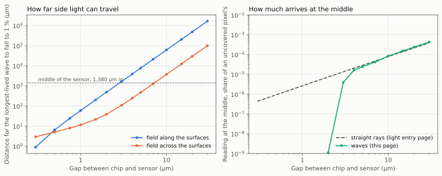
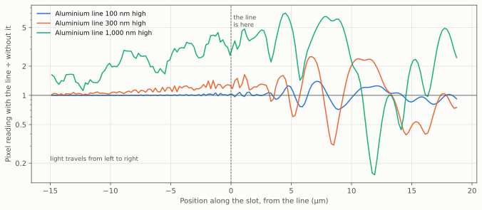

# Side light with waves, and the two ways of lighting compared

The [light entry](light-entry.md) page estimated with straight rays how
much ordinary light gets under the sensor from the side, and warned that
rays cannot be trusted in a slot only a few wavelengths high. This page
does the same calculation properly, with waves, and then asks what a pixel
would see of a feature on the chip under that light. It closes by setting
side light against plain near-infrared light from behind the chip
([backlight](backlight.md)), including how each responds to taking more
readings. This is the first part of item D5 of the
[plan](plan.md#d-simulation-chain).

The answers:

- **The wave calculation confirms the estimate.** Side light reaches the
  middle of the sensor only when the gap is about 3 µm or more. At 10 µm
  to 30 µm, waves and rays agree to within 15 %. At 1 µm nothing arrives.
- **A feature does not light up the pixel above it.** Under skimming
  light, a line on the chip changes the readings of pixels over tens of
  micrometres, mostly further in than the line, as a pattern of bright and
  dark bands. The strongest change is about one to two gaps beyond the
  line, and several times larger than the change in the pixel above it.
- **So side light gives no direct picture at any gap.** The hope that the
  chip's own edges would scatter light straight up into the pixel above is
  not borne out.
- **The pattern is not noise.** It is fixed by the chip and the gap, and
  the same wave model that produced it could in principle be run backwards
  to recover the chip from it. That is a heavy computation and has not
  been tried; it stays on the list ([REQ-23](design.md#requirements)).
- **Near-infrared light from behind is the one to work on first.** It
  gives more light, a direct picture and a known kind of reconstruction.
  Side light has one advantage, that nothing has to be done to the chip.
  The choice does not rest on computing cost.

Everything here is simulated. The slot calculation is exact for its
idealised geometry: flat, uniform surfaces. The feature calculation is in
two dimensions, at one wavelength and for one polarisation of the light.
Code:
[`ccdsr/slot_modes.py`](https://github.com/mithro/ccd-superres/blob/main/ccdsr/slot_modes.py),
[`ccdsr/fdfd.py`](https://github.com/mithro/ccd-superres/blob/main/ccdsr/fdfd.py),
[`ccdsr/edge_scatter.py`](https://github.com/mithro/ccd-superres/blob/main/ccdsr/edge_scatter.py);
tests:
[`tests/test_slot_waves.py`](https://github.com/mithro/ccd-superres/blob/main/tests/test_slot_waves.py).

## 1. Light travelling along the slot, with waves

Light confined between two surfaces can only travel in a set of fixed
patterns, called modes. Mode number m has m half-waves across the gap,
and behaves like a ray at the grazing angle whose sine is about m times
the wavelength divided by twice the gap. The modes are found from one
condition: a wave that crosses the gap, reflects, crosses back and
reflects again must come back in step with itself (the standard condition
for a layer between two reflecting surfaces [BornWolf]). Each mode loses
power at its own steady rate as it travels, because a little leaks into
the two surfaces all the way along.

| Quantity | How it is found | Status |
|---|---|---|
| The modes | Solving the round-trip condition for the wavenumber across the gap, with the Fresnel formulas for the two surfaces | Exact for flat, uniform surfaces |
| Loss of each mode with distance | Twice the imaginary part of the mode's wavenumber along the slot | Exact, as above |
| Power put into each mode by even light at the open edge | The same for every mode: a quarter of the brightness times the wavelength, per polarisation | Derived here: a slot of height h holds about 2h ÷ wavelength modes per polarisation, which between them take in the brightness times h that falls on the opening. The modes are taken as independent of each other, which is right for a lamp, and losses at the entrance are ignored, which is right for gaps of many wavelengths. With silicon surfaces there is one extra, very short-lived mode for the field across the surfaces |
| A pixel's reading | The power all modes lose into the sensor per unit length, as a share of what an uncovered pixel would get | Derived here, the wave counterpart of Table 1a of the [light entry](light-entry.md) page |

*Table 1. The wave calculation of the slot.*

| Gap (µm) | Modes that can travel | Flattest mode (° from the surface) | Its power is down to 1 % after (µm) | Share of it left at the middle | Reading at the middle, waves | Reading at the middle, rays |
|--:|--:|--:|--:|--:|--:|--:|
| 0.3 | 3 | 64 | 0.9 | none | none | 0.000 000 43 |
| 1 | 7 | 16 | 58 | under 10⁻⁴⁰ | none | 0.000 002 6 |
| 2 | 15 | 7.9 | 478 | 0.000 002 | 0.000 000 001 | 0.000 007 3 |
| 3 | 21 | 5.3 | 1,620 | 0.02 | 0.000 003 9 | 0.000 013 |
| 5 | 37 | 3.2 | 7,520 | 0.43 | 0.000 024 | 0.000 028 |
| 10 | 73 | 1.6 | 60,200 | 0.90 | 0.000 083 | 0.000 078 |
| 30 | 219 | 0.5 | 1,630,000 | 1.0 | 0.000 43 | 0.000 38 |

*Table 2. Side light at the middle of the sensor, 1.38 mm in from the
edge, green light of 550 nm between two silicon surfaces. Simulated (mode
solution). The mode count is for both polarisations. Readings are shares
of an uncovered pixel's. The last column is the ray model of the light
entry page, which that page declared unusable below 5 µm.*



*Figure 1. Left: how far side light travels before falling to 1 %, for
the two polarisations. Right: the reading at the middle from the wave
solution and from rays. Drawn by
[`make_slot_wave_diagrams.py`](https://github.com/mithro/ccd-superres/blob/main/docs/diagrams/make_slot_wave_diagrams.py).*

Three checks were made between independent methods, as the
[simulation chain](simulation-chain.md) requires.

| Check | Result |
|---|---|
| Waves against rays where rays are valid (gaps of 10 µm and 30 µm) | Readings agree within 6 % at 10 µm and 13 % at 30 µm, and so does the distance to where the light last touched the chip. The difference grows with the gap because the ray model takes the light absorbed at each touch as 1 − reflectance while letting the ray fade smoothly, which loses a little energy for steep rays. The wave figure is the one that conserves energy |
| The flattest mode against the simple wave limit used on the light entry page | Angle and reach agree within 2 % |
| The mode solution against the grid wave solver of section 2, for the first mode in a 1 µm slot | The solver's loss rate is 10 % low at a grid spacing of 20 nm and 3 % low at 10 nm, so it converges on the mode solution |

*Table 3. Cross-checks. All three are in the tests except the 10 nm run,
which takes half a minute.*

## 2. What a pixel sees of a feature under skimming light

A small wave solver was written for this: it solves Maxwell's equations on
a grid over a cross-section 40 µm long, for light whose electric field
points along the feature. It is the first piece of level 4 of the
simulation chain. One mode is launched along the slot, a line of material
1 µm wide is stood on the chip in its way, and the light entering the
sensor is recorded along the slot, with and without the line.



*Figure 2. The mark an aluminium line 1 µm wide leaves in the pixel
readings, for three heights, in a gap of 5 µm. A value of 1 means no
change. Readings are averaged over one pixel width. Simulated.*

| Case | Change in the reading of the pixel above the line (times) | Largest change in a pixel's reading (times) | Where that is, beyond the line (µm) | The same in gaps | Stretch of slot where readings change by more than 10 % (µm from the line) |
|---|--:|--:|--:|--:|---|
| Aluminium line 100 nm high, gap 5 µm | 1.03 | 1.4 | 7.2 | 1.4 | 4.4 to the end of the run at 18.9 |
| Aluminium line 300 nm high, gap 5 µm | 1.27 | 2.5 | 6.6 | 1.3 | −9.6 to the end of the run |
| Aluminium line 1,000 nm high, gap 5 µm | 2.59 | 7.1 | 4.5 | 0.9 | The whole run, −14.9 to 18.9 |
| Glass line 300 nm high, gap 5 µm | 1.11 | 3.3 | 6.9 | 1.4 | −5.0 to 18.6 |
| Aluminium 300 nm, second mode, gap 5 µm | 1.26 | 2.9 | 8.6 | 1.7 | −9.8 to the end of the run |
| Aluminium 300 nm, gap 3 µm | 1.53 | 2.8 | 3.5 | 1.2 | −11.8 to the end of the run |
| Aluminium 300 nm, gap 10 µm | 1.08 | 2.1 | 16.7 | 1.7 | −14.4 to the end of the run |

*Table 4. A line 1 µm wide on the chip under one mode of skimming light.
Simulated; the numbers are in
[`results/edge-scatter/runs.json`](https://github.com/mithro/ccd-superres/blob/main/results/edge-scatter/runs.json).
Negative positions are on the lit side of the line. The run covers 15 µm
before the line and 19 µm after it, so "the end of the run" means the mark
goes on further than was computed. In the 10 µm case the largest change
is near the end of the run, so a larger one may lie beyond it.*

What the runs show:

- **The pixel above the line sees a modest change.** A line 300 nm high
  raises the reading above it by about a quarter. A line that low only
  stands in the way of a small part of the light in the slot, and about a
  third of what it removes enters the sensor within one gap of it (from
  the reviewer's rerun of this case, recorded in the
  [review record](review.md)).
- **The largest change is elsewhere, and the mark is long.** Readings
  change over the whole computed run, tens of micrometres, in bands whose
  spacing is set by the gap. The largest change is about one to two gaps
  beyond the line and two to three times larger than the change above it.
- **The mark is strong.** A line 300 nm high changes some readings by a
  factor of two or more. Seeing that a feature is there is easy; saying
  where it is from one reading is not.
- **Shape seems to matter more than material.** A glass line and an
  aluminium line of the same size leave marks of similar strength (one
  comparison only).

With real lamp light the picture would differ in one way. The bands in
Figure 2 come from one mode at one wavelength. Several modes and a spread
of wavelengths smooth the bands into a broad streak without making it
shorter. The reviewer's sum over three modes and six wavelengths from
500 nm to 600 nm gave a rise of 30 % to 45 % around the line, a peak of
2.5 times at about 1.5 gaps beyond it, and then a shadow of 0.6 to 0.8
times to the end of the run (Simulated, in the review; not part of the
saved runs).

## 3. What this means for side light

A direct picture needs each pixel to respond to the patch of chip beneath
it. Under side light it does not, at any gap: below 3 µm no light
arrives, and above it a feature's mark is spread over tens of micrometres.

That does not make the information absent. The mark is a fixed,
repeatable pattern, set by the chip's shape and the gap, and the sensor
records it along its whole length with thousands of pixels. Recovering the
chip from it is the same kind of problem as recovering a picture through
a scrambling but known medium: propose a chip surface, compute the pattern
it would make with the wave model, compare, and adjust. By
[REQ-23](design.md#requirements) the weight of that computation is no
reason to drop it. What is not known is how fine a detail the pattern
still carries: a repeat distance finer than about half a wavelength, 275 nm,
which is lines of about 140 nm, cannot be carried by the light in the slot
at all, and reaching that bound would need the light thrown back towards
the lit edge to be recorded too, and the calculation needs the gap known to a
small fraction of a wavelength (Unverified; not computed). It is recorded
as an approach to examine: [plan](plan.md#d-simulation-chain), item D2d.

## 4. The two ways of lighting compared

| | Side light, ordinary lamp | Plain near-infrared light from behind the chip |
|---|---|---|
| Light a pixel gets, as a share of an uncovered pixel's | None below a gap of 3 µm; 0.000 024 at 5 µm; 0.000 083 at 10 µm (Table 2) | About 0.000 8 through a chip 500 µm thick, at any gap ([backlight](backlight.md), Table 4) |
| Smallest workable gap | About 3 µm | No lower limit from the light |
| What a pixel responds to | Features over tens of micrometres around it, as a banded pattern (Table 4) | The metal wiring beneath it, as a shadow |
| Finest lines, direct | No direct picture | About 0.5 µm at gaps up to 10 µm; the model allows about 280 nm at 0.3 µm ([backlight](backlight.md), Table 7) |
| What is seen | The shape of the chip's surface: steps and edges | The metal wiring, through all layers, and structures in the silicon |
| What the chip needs | Nothing | Taken out of its package, back face exposed and polished |
| Reconstruction | Running a wave model backwards through a scrambling slot. Not tried | Unscrambling a shadow, as lensless microscopes do. Established for thin samples |
| Main unknowns | Whether the pattern can be inverted and to what detail | Doping of the chip, how open its metal is, the sensor's response at this wavelength |
| Counts as ordinary light? | Yes | Open ([design, section 11](design.md#11-build-stages-and-open-questions), item 12) |

*Table 5. The two ordinary ways of lighting. Estimates and simulations
from this page and the two pages linked.*

Near-infrared light from behind is the route to work on first
(Judgement). It gives more light, a direct picture and a kind of
reconstruction that is already established. The judgement does not rest
on computing cost: the heavier computation that side light needs is no
reason against it (REQ-23). Side light is kept as an approach for the simulator, because
it needs nothing done to the chip and shows the surface where the other
shows the wiring.

## 5. How more readings trade against sharpness

Taking more readings of each point of the chip (oversampling) is the
project's main lever ([REQ-24](design.md#requirements)). More readings
come from a slower scan, more frames per second or more passes, and each
costs scan time. The table shows what they buy for light from behind.

| Readings per pixel-sized area | Time for the sensor to pass a point at 10 frames per second | Finest lines, gap 0.3 µm (nm) | The same with a tenth of the signal-to-noise (nm) | Finest lines, gap 10 µm (nm) | The same with a tenth of the signal-to-noise (nm) |
|--:|--:|--:|--:|--:|--:|
| 50 | 5 s | 377 | 488 | 524 | 525 |
| 500 | 50 s | 332 | 430 | 524 | 525 |
| 5,000 | 8 min | 294 | 377 | 523 | 524 |
| 13,000 | 22 min | 280 | 357 | 522 | 524 |
| 130,000 | 3.6 h | 251 | 315 | 521 | 523 |
| 1,300,000 | 36 h | 228 | 280 | 520 | 522 |
| 13,000,000 | 15 days | 208 | 251 | 519 | 521 |

*Table 6. Finest line width with near-infrared light from behind at
1,050 nm against the number of readings. Estimate from
[`ccdsr/backlight.py`](https://github.com/mithro/ccd-superres/blob/main/ccdsr/backlight.py)
with the baseline pixel and a signal-to-noise of 50 per reading, and of 5
in the columns marked a tenth, which stands for a hundred times less
light per reading when the noise is that of the light itself (Assumption). The time is the number of readings divided by the
frame rate. The same caveats apply as to Table 7 of the backlight page.*

Three things follow (Derived from Table 6).

- **At a gap of 10 µm, oversampling buys nothing beyond the first few
  dozen readings.** The limit there is the wavelength, so a fast scan is
  enough and the readings are better spent on a larger area or on
  variety: several gaps, several lamp positions.
- **At a small gap, every tenfold increase in readings makes the lines
  about a tenth finer.** That is the slow gain already found for visible
  light ([design, section 4.2](design.md#42-what-a-huge-number-of-samples-buys-and-what-it-does-not)).
- **Light and readings are interchangeable.** A hundred times less light
  per reading costs the same as a hundred times fewer readings, so a dim
  lamp is paid for in scan time and not in sharpness.

For side light no such table can be given yet, because there is no
reconstruction to say what the readings yield.

## 6. What changes in the plan

| Change | Where |
|---|---|
| Side light gives no direct picture at any gap. Design section 4.11 says so | [Design, section 4.11](design.md#411-no-special-lighting-what-ordinary-light-can-reach-and-where-the-work-goes) |
| The light model for side light in level 1 has to be a wave model of the slot, with reconstruction by running it backwards | [Plan](plan.md#d-simulation-chain), item D2d |
| A small wave solver exists and is the start of level 4 | [Plan](plan.md#d-simulation-chain), item D5 |
| Near-infrared light from behind is worked on first; its level 1 model and its unchecked points come next | [Plan](plan.md#d-simulation-chain), item D2f; [plan](plan.md#data-collection), items R19 and R20 |

*Table 7. What this page changes.*

## 7. How to repeat it

```
python docs/diagrams/make_slot_wave_diagrams.py            # figures and Table 2, a few seconds
python docs/diagrams/make_slot_wave_diagrams.py --rerun    # also redo the runs of Table 4, about 4 minutes
python -m pytest -q tests/test_slot_waves.py
```

## 8. Limits

| Limit | Effect |
|---|---|
| Flat, uniform surfaces in the mode solution | A real chip's surface scatters light out of the flat modes all the way along, so less arrives than Table 2 says |
| Two dimensions, one polarisation, one wavelength in the feature runs | The other polarisation dies out sooner at gaps above about 0.5 µm (Figure 1) and matters little there. A line running along the light, not across it, is not covered |
| Grid spacing of 20 nm, with materials stair-stepped | Loss rates about 10 % low (Table 3). Aluminium's surface layer is thinner than one grid cell, so its reflection is approximate |
| Runs 34 µm long | The full length of a feature's mark was not reached |
| One line at a time | A real chip has features all along the light's path, each marking the readings of all the others |

*Table 8. Limits of these calculations.*

## Sources

| Key | Source | Used for |
|---|---|---|
| BornWolf | In the [shared reference list](references.md) | Reflection at a flat surface; the condition for a wave between two reflecting surfaces |

*Table 9. Sources. The silicon and aluminium values are those of the
[light entry](light-entry.md) page.*
